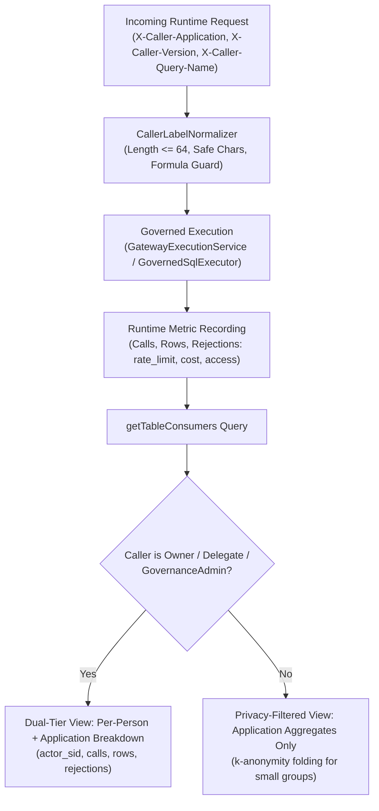

# Issue Intake Assessment: #114 and #113

**Document ID:** `INTAKE-2026-10-18-CONS-REQ`  
**Date:** 2026-10-18  
**Phase:** 1 (Product Qualification & Strategic Gatekeeping)  
**Author:** Enterprise Product Manager & Strategic Gatekeeper  
**Code base verified:** `main` / `feat/issue-143-restricted-scope-columns` at `a87f9b06`  
**Parent Plan:** [00-master-plan-overview.md](00-master-plan-overview.md)  
**Child Requirements:** `REQ-AUD-114` (Issue #114), `REQ-GOV-113` (Issue #113)  

---

## 1. Summary & Qualification Verdicts

Both issues represent high-value enterprise governance and observability capabilities. Neither is a duplicate or an anti-pattern. Each is qualified as **sensible with changes** (incorporating strict fail-closed mutation boundaries, person-privacy minimization, untrusted header sanitization, and atomic AST row-filter injection).

| Issue | Verdict | Recommended Solution (One Line) | Size | Proposed Wave / Rank |
|---|---|---|:---:|---|
| **#114** Consumers per calling application | Sensible with changes | Group runtime dataset metrics by normalized `X-Caller-Application` and day (calls, rows returned, categorized rejections: `rate_limit`, `cost`, `access`), enforcing dual-tier authorization where per-person breakdown is restricted to Data Owners, Delegates, and Governance Admins, while non-privileged users receive k-anonymized aggregated views. | M | Wave 3, rank 3.4 (step I-23) |
| **#113** Access requests with read-only tokens and row filters on approval | Sensible with changes (split in two increments) | Bounded self-service mutations (`requestTableAccess`, `withdrawAccessRequest`) for read-only tokens explicitly authorized via `ReadOnlySelfServiceScopes` (`data.access.request`) with request `context` (Increment A, M); approver-selected dynamic row filter and column masking levels atomically committed upon approval (Increment B, L). | M + L | Wave 3, rank 3.3 (steps I-22 & I-24) |

---

## 2. Cross-Cutting Architectural Alignment & Zero-Trust Guardrails

1. **Zero-Trust & Fail-Closed Mutation Gating (NIST SP 800-207 & OWASP API8:2023):**
   - **#113 Read-Only Token Boundary:** Read-only tokens are designed for query planes. To support discovery-to-access workflows, bounded mutation exceptions are permitted *only* for root fields explicitly allowlisted in `Gateway:Security:ReadOnlySelfServiceScopes` (defaulting to `["requestTableAccess", "withdrawAccessRequest"]`), and *only* when the token carries the dedicated `data.access.request` scope.
   - **Privilege Escalation Prevention:** Read-only tokens can **never** decide, approve, or alter policies. Approving an access request strictly requires a human delegated token carrying `data.access.review`, table ownership/delegate/admin authorization, and non-read-only status. Four-eyes segregation of duties is mandatory.
   - **Strict Data-Plane Protection:** All mutations affecting data planes (INSERT, UPDATE, DELETE, procedures, DDL) remain unconditionally rejected with HTTP 403 `READ_ONLY_TOKEN`.

2. **Privacy Minimization & Anti-Reidentification (GDPR Art. 5(1)(c), Art. 25):**
   - **#114 Dual-Tier Consumer Disclosure:** Detailed, per-person consumer activity (`actor_sid`, individual timestamps) constitutes personal data. Only dataset owners, designated delegates (`IDataOwnershipRepository.IsAuthorizedApproverForTableAsync`), and governance admins may inspect per-person consumption.
   - **Aggregated View Protection:** All other consumers receive strictly aggregated daily statistics by calling application (`X-Caller-Application`). To prevent small-cell re-identification (e.g., inferring a specific executive's activity from a single-user reporting app), applications with distinct actors $< k$ (default $k=3$) are folded into an `other` bucket or have actor counts suppressed.

3. **Untrusted Caller Header Sanitization (OWASP API3:2023 & Injection Guardrails):**
   - Headers `X-Caller-Application`, `X-Caller-Version`, and `X-Caller-Query-Name` are client-supplied telemetry hints, **never** identity or authorization credentials. They must never dictate rate limits, Casbin policies, or routing decisions.
   - Strict normalizer (`CallerLabelNormalizer`): Truncates to 64 characters, enforces regex `^[A-Za-z0-9._ -]+$`, strips leading formula trigger prefixes (`=`, `+`, `-`, `@`) to block CSV/Excel formula injection upon export.

4. **AST Pushdown & Atomic Policy Commitment:**
   - **#113 Increment B Dynamic Row Filters:** Approvers select or tune row filters at approval time. The submitted row filter AST must be parsed, validated against catalog column names and types, and integrated into `CONSENT_ROW_FILTERS`.
   - **Atomic Transaction:** Approval step (`APPROVAL_STEPS`), consent grant (`CONSENTS`), and row filters (`CONSENT_ROW_FILTERS`) must commit in a single database transaction, invalidating the table epoch immediately to eliminate race conditions.

5. **Cryptographic HMAC Audit Chain Integrity:**
   - Self-service requests and approval lifecycle transitions emit Tier-A fail-closed audit entries (`CONSENT_REQUESTED`, `CONSENT_APPROVAL_STEP`, `CONSENT_GRANTED`, `CONSENT_WITHDRAWN`).
   - Audit hash-chain HMAC calculations (`VerifyAuditHashChainAsync`) are preserved. Audit retention purge remains decoupled under #161 (Decision D-5).

---

## 3. REQ-AUD-114: Consumers per Calling Application

### 3.1 Problem Statement & Background
Dataset owners and capacity planners need visibility into which applications generate workload (query calls, returned row volumes, rejection spikes) on their datasets. Under current implementations, `getTableConsumers` only aggregates by raw `ActorSid` (person identity), lacking application-level attribution, row count metrics, and rejection categorization. Furthermore, exposing per-person activity to unauthorized callers violates privacy minimization standards.

### 3.2 User Stories
- **US-114-1 (Data Owner):** As a data owner, I want to see daily query counts, rows returned, and rejection breakdowns grouped by calling application, so that I can plan dataset capacity and contact application teams regarding load.
- **US-114-2 (Privacy & Governance Admin):** As a privacy administrator, I want per-person consumer breakdowns restricted exclusively to authorized data owners, delegates, and governance admins, ensuring general users only see aggregated application metrics.
- **US-114-3 (Application Owner):** As an application owner, I want visibility into whether our application versions and queries are encountering rate limits, cost caps, or authorization rejections on specific tables.

### 3.3 Functional & Technical Architecture


1. **Header Sanitization & Normalization:**
   - Normalizer enforces max length 64, allowed characters `[A-Za-z0-9._ -]`, and formula escape prefixes. Invalid headers default to `unknown_application`.
2. **Attribution & Metrics Breakdown:**
   - Grouping dimensions: Dataset/Table ID, UTC Day (`occurred_at::date`), Normalized Application Name.
   - Measures:
     - `Calls`: Total successful query executions.
     - `RowsReturned`: Total rows streamed back to client (captured post-execution).
     - `Rejections`: Broken down by distinct category (`AccessDenied`, `RateLimitExceeded`, `CostExceeded`).
   - Metadata: Collected distinct caller versions (`X-Caller-Version`) and query names (`X-Caller-Query-Name`).
3. **Dual-Tier Authorization Gate:**
   - Evaluation via `IDataOwnershipRepository.IsAuthorizedApproverForTableAsync` and `callerContext.IsGovernanceAdmin`.
   - Authorized tier: Full actor details (`actor_sid`, client heuristics, application labels).
   - Restricted tier: Aggregated application summaries only. Individual `actor_sid` fields are omitted.
4. **k-Anonymity Folding:**
   - When aggregated view is active, applications with fewer than $k$ ($k=3$) distinct actors are folded into an `Other Applications` summary or suppressed to prevent indirect re-identification.

### 3.4 Acceptance Criteria
- **AC-114-01:** `getTableConsumers` groups runtime query metrics by calling application (`X-Caller-Application`) and UTC day.
- **AC-114-02:** Returns aggregated call volume, total rows returned, and rejection counts categorized by `rate_limit`, `cost`, and `access`.
- **AC-114-03:** Includes observed caller versions (`X-Caller-Version`) and query names (`X-Caller-Query-Name`) per application.
- **AC-114-04:** Callers lacking data owner, delegate, or governance admin privileges receive only the per-application aggregated view with zero personal SIDs.
- **AC-114-05:** Applications with fewer than $k$ ($k=3$) distinct human actors are folded into `Other Applications` in restricted views.
- **AC-114-06:** Untrusted caller headers exceeding 64 chars or containing malicious characters are sanitized; formula injection characters (`=`, `+`, `-`, `@`) are stripped/escaped.
- **AC-114-07:** WebSQL and multi-table AST queries attribute row counts and rejections to all constituent accessed tables.
- **AC-114-08:** Querying consumer statistics does not execute full-table audit scans or trigger Large Object Heap (LOH) allocations.

### 3.5 Out-of-Scope Boundaries
- Automated chargeback/invoicing FinOps billing engine.
- Purging expired audit records (handled by `REQ-AUD-161` under #161).
- Basing dynamic access control or Casbin authorization decisions on caller headers.

---

## 4. REQ-GOV-113: Access Requests with Read-Only Tokens & Row Filters on Approval

### 4.1 Problem Statement & Background
Users and AI agents discovering restricted datasets in catalog tools (via Issue #111) often hold read-only tokens (`ReadOnlyScopes`). Currently, `requestTableAccess` is classified as a GraphQL mutation and rejected by `ReadOnlyOperationMiddleware` with HTTP 403 `READ_ONLY_TOKEN`. Requiring a write token to request access violates the principle of least privilege. Furthermore, approval currently applies a static metadata snapshot without row-level filtering, preventing approvers from granting scoped access (e.g. department/tenant slices).

### 4.2 User Stories
- **US-113-1 (Analyst / AI Agent):** As an analyst using an exploration tool with a read-only token, I want to submit access requests (`requestTableAccess`) with application context/justification, and withdraw them if needed, without obtaining a full write token.
- **US-113-2 (Data Owner / Approver):** As a data owner, I want to review incoming access requests with caller context and configure tailored row filters and column masking levels upon approval, ensuring least-privilege compliance.
- **US-113-3 (Security Architect):** As a security architect, I want read-only tokens strictly confined to self-service mutations explicitly configured in `ReadOnlySelfServiceScopes`, ensuring read-only tokens cannot decide requests or modify data.

### 4.3 Functional & Technical Architecture

The requirement is divided into two decoupled increments:

```mermaid
flowchart TD
    subgraph "Increment A: Bounded Self-Service for Read-Only Tokens"
        RO["Read-Only Token<br/>(Scope: data.access.request)"] --> MW{"ReadOnlyOperationMiddleware<br/>Root field in SelfServiceScopes?"}
        MW -->|No / Other Mutation| REJ["403 READ_ONLY_TOKEN"]
        MW -->|Yes| SUB["Execute Mutation:<br/>requestTableAccess / withdrawAccessRequest"]
        SUB --> ID{"Subject is Person?<br/>(SubjectType.Person)"}
        ID -->|No (App-Only)| REJ_APP["403 FORBIDDEN<br/>(Human subject required)"]
        ID -->|Yes| STORE["Persist Consent Request<br/>(Includes Context JSON)"]
    end

    subgraph "Increment B: Dynamic Approval & Row Filters"
        REV["Approver with data.access.review<br/>(Owner / Delegate / Admin)"] --> APP["approveConsentRequest(<br/>requestId, rowFilter, columnMasking)"]
        APP --> VAL["AST Validation & Schema Check<br/>(Validate predicate & column types)"]
        VAL --> TX["Atomic DB Transaction:<br/>Insert APPROVAL_STEP + CONSENT + CONSENT_ROW_FILTERS<br/>Bump Table Epoch"]
    end
```

#### Increment A: Self-Service Mutations & Request Context
1. **Configuration Setting:**
   - `Gateway:Security:ReadOnlySelfServiceScopes` / `SelfServiceScopes`: Default `["data.access.request"]`.
2. **Selective Mutation Admission:**
   - `ReadOnlyOperationMiddleware` inspects GraphQL root fields.
   - If document contains *only* allowlisted self-service operations (`requestTableAccess`, `withdrawAccessRequest`) AND caller's token includes `data.access.request`, mutation is admitted.
   - Any query containing other mutation fields (e.g. `createConsent`, `updateTable`, `deleteRecord`) is rejected fail-closed.
3. **Person-Subject Enforcement:**
   - Requester must resolve to an immutable human SID (`SubjectType.Person`). App-only tokens (`idtyp=app`, service principals) are rejected with 403 `FORBIDDEN`.
4. **Request Context:**
   - Optional `context` object on `requestTableAccess`: `{ "application": "PowerBI", "tool": "AnalysisStudio", "justification": "Quarterly audit", "expectedDuration": "P30D" }`.
   - Sanitized and persisted in `CONSENT_REQUESTS.context_json`. Surfaced in `pendingApprovalsForMe`.
5. **Request Withdrawal:**
   - Mutation `withdrawAccessRequest(requestId)`.
   - Validates that request status is `PENDING` and `RequesterSid == callerSid`. Sets status `WITHDRAWN`.

#### Increment B: Approver-Chosen Row Filters & Masking
1. **Dynamic Approval Mutation:**
   - `approveConsentRequest(requestId, rowFilter: RowFilterInput, columnMasking: [ColumnMaskingInput!], validTo: DateTime, consentDescription: String)`.
2. **Approver Authorization & Four-Eyes:**
   - Requires non-read-only delegated token with scope `data.access.review`.
   - Requester cannot approve their own request (`RequesterSid != ApproverSid`).
   - Requires Data Owner, Delegate, or GovernanceAdmin privileges.
3. **AST Validation & Pushdown:**
   - `rowFilter` predicate AST is parsed and validated against target table schema. Permitted operators and column types are verified.
   - Compiles to native AST predicate for injection into `CONSENT_ROW_FILTERS`.
4. **Atomic Transactional Activation:**
   - Approval step insertion, consent creation, and row filter persistence execute in a single ACID transaction. Table epoch invalidation executes immediately upon commit.

### 4.4 Acceptance Criteria
- **AC-113-01:** Read-only tokens carrying `data.access.request` can invoke `requestTableAccess` and `withdrawAccessRequest`.
- **AC-113-02:** Read-only tokens attempting any other mutation receive HTTP 403 `READ_ONLY_TOKEN`.
- **AC-113-03:** Read-only tokens lacking `data.access.request` receive HTTP 403 `FORBIDDEN` / `READ_ONLY_TOKEN` on all mutations.
- **AC-113-04:** App-only / service principal tokens are rejected from submitting self-service access requests.
- **AC-113-05:** Request `context` is sanitized, persisted, and visible in `pendingApprovalsForMe` and `myAccessRequests`.
- **AC-113-06:** Users can withdraw their own pending requests; withdrawing another user's request fails with 403 `FORBIDDEN`.
- **AC-113-07:** Withdrawn requests cannot be approved or re-activated.
- **AC-113-08:** `approveConsentRequest` permits approvers to supply custom `rowFilter` predicates and column masking configurations.
- **AC-113-09:** Submitted row filters are validated against catalog column metadata and reject invalid syntax or non-existent columns.
- **AC-113-10:** Approving an access request strictly requires `data.access.review` scope and approver role; self-approval is blocked fail-closed.
- **AC-113-11:** Final approval step, consent generation, and row filter persistence commit atomically within one transaction.
- **AC-113-12:** Table epoch is incremented upon approval, immediately enforcing new row filters and masking on subsequent queries.

### 4.5 Out-of-Scope Boundaries
- Automatic synchronization with external identity groups (e.g. requester-group template auto-resolution deferred per Decision D-4).
- Arbitrary unvalidated raw SQL execution in row filter definitions.
- Granting approval rights to read-only or automated tokens.

---

## 5. Backlog & Dependency Mapping

| Requirement | Wave & Rank | Size | Implementation Dependencies | Blockers / Preconditions |
|---|:---:|:---:|---|---|
| **REQ-AUD-114** (#114) | Wave 3, Rank 3.4 | M | Step I-23 in `PLAN-DELIVERY-W23` | Depends on #113 Increment A (`I-22`); decoupled from audit purge (#161, D-5) |
| **REQ-GOV-113 Inc A** (#113 A) | Wave 3, Rank 3.3 | M | Step I-22 in `PLAN-DELIVERY-W23` | Security bugfix B-3 (`WP-0`) merged; independent of catalog visibility |
| **REQ-GOV-113 Inc B** (#113 B) | Wave 3, Rank 3.3 | L | Step I-24 in `PLAN-DELIVERY-W23` | Depends on #113 Inc A (`I-22`) and #107 key-set caching (`I-1..I-3`) |
