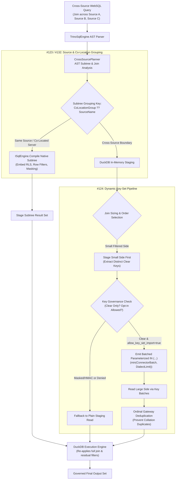

# Issue Intake Assessment & PRD: Cross-Source WebSQL Optimizations (#123, #124, #132)

**Document ID:** `INTAKE-2026-10-18-WEBSQL-OPTIMIZATIONS` / `REQ-DATA-123`, `REQ-DATA-124`, `REQ-DATA-132`  
**Date:** 2026-10-18  
**Phase:** 1 (Product Qualification & Strategic Gatekeeping)  
**Author:** Enterprise Product Manager & Strategic Gatekeeper  
**Code base verified:** `main` / `feat/issue-143-restricted-scope-columns` at `a87f9b06`  
**Parent Plan:** [00-master-plan-overview.md](00-master-plan-overview.md)  
**Child Requirements:** `REQ-DATA-123` (extends `REQ-FED-01` INC-6), `REQ-DATA-124` (extends `REQ-FED-01` INC-6), `REQ-DATA-132` (extends `REQ-FED-01` INC-7)  

---

## 1. Executive Summary & Qualification Verdict

**Verdict:** **Approved / Sensible with changes for all three issues**.

The cross-source WebSQL federated query engine (`CrossSourcePlanner`, `FederatedStagingService`, `FederatedDuckDbExecutionService`) currently operates under an unoptimized naive-staging model: every table referenced in a cross-source query is staged table-by-table up to `budget.MaxStagedRowsPerTable + 1` rows into in-memory DuckDB before any inter-table joins, aggregations, or filters across sources occur. While Issue #122 introduces single-table predicate pushdown, complex analytical queries remain vulnerable to staging exhaustion, excessive network egress, and redundant CPU overhead when:
1. Multiple joined tables reside within the *same* physical SQL source database (#123).
2. A small, highly filtered table is joined with a massive, unpartitioned table on another source (#124).
3. Joined tables reside across multiple distinct databases hosted on the *same* physical database server (#132).

These three issues represent an interconnected performance optimization pipeline. All three are qualified as **Sensible with changes**, subject to strict Zero-Trust governance, fail-closed security gates, AST-level pushdown validation, privacy leakage prevention, and tamper-evident HMAC audit chain continuity.

### Qualification & Triage Matrix

| Issue | Title | Verdict | Recommended Solution (One Line) | Size | Proposed Wave / Rank | Dependencies |
|---|---|---|---|:---:|---|---|
| **#123** | Run same-source parts of a cross-source WebSQL query in the source (`REQ-DATA-123`) | Approved / Sensible with changes | Group contiguous same-source AST subtrees (joins, pushable `WHERE`, CTEs, window functions, aggregates) and compile directly to native source SQL via `ISqlEngine.Compile` with embedded RLS and column masking; stage only narrowed subtree results. | L | Wave 3, rank 3.1b | #122 (`REQ-DATA-122`) |
| **#124** | Dynamic key-set filters in cross-source WebSQL joins (`REQ-DATA-124`) | Approved / Sensible with changes | Execute selective small-side staging first, extract distinct non-null join keys, and push them into the large-side scan as parameterized `key IN (@k1..@kn)` batches; enforce strict key caps, per-source consent, ordinal deduplication, and prohibit masked join keys. | M-L | Wave 3, rank 3.1c | #122 (`REQ-DATA-122`), shared key batcher with #75 |
| **#132** | Co-located data sources: run joins across databases of one server as one statement (`REQ-DATA-132`) | Approved / Sensible with changes | Enable administrator-declared `CoLocationGroup` across databases sharing identical server instances and credentials; compile multi-database subtrees into a single statement with three-part names (`[db].[schema].[table]`); enforce independent per-table RLS, masks, and connect-time identity verification with staging fallback. | L | Wave 4, rank 4.3 | #123 (`REQ-DATA-123`), SQL Server spike |

---

## 2. Cross-Cutting Architectural Alignment & Zero-Trust Non-Negotiables

### 2.1 Zero-Trust & Fail-Closed Enforcement (NIST SP 800-207)
1. **Narrowing Only (Never Widening):** Pushed subtrees (#123, #132) and key-set filters (#124) must strictly narrow data transfer. Every single table within a compiled subtree or key-set batch remains subject to its authoritative Casbin ABAC grant, Row-Level Security (`CombinedRowFilterSql`), and column-level masking. Pushdown can never bypass, relax, or broaden access boundaries.
2. **Post-Compile AST Validation:** For multi-database statements under #132, the compiler must assert that every physical table reference in the generated SQL strictly maps to an authorized `(source, database, schema, table)` tuple. Any extraneous or client-injected cross-database reference must trigger a fail-closed `SecurityException` (`SEC-ADG-02`).
3. **Cross-Database Policy Isolation:** Correlated row filters whose subqueries span outside the individual table's database are strictly rejected in #132. Policies cannot implicitly cross database boundaries.

### 2.2 Privacy Minimization & Filter Oracle Guardrails (GDPR Art. 5(1)(c) / OWASP API8:2023)
1. **Masked & HMAC Key Prohibition:** Columns assigned `Mask`, `Redact`, or `HMAC` pseudonyms **must never form dynamic key-set filters (#124)** or serve as cross-source join keys from subtrees (#123, #132). Pushing cleartext join keys derived from one source into another source without explicit authorization leaks data. Pushing masked values creates side-channel filter oracles via error codes or timing.
2. **Data-Owner Cross-Source Flow Consent (`allow_key_set_import`):** Transmitting key values from Source A into the queries and transaction logs of Source B represents an inter-source data flow. Source B must explicitly opt in via `allow_key_set_import: true` (default `false`, fail closed). If disabled, key-set pushdown is bypassed and plain staging is used.
3. **Subtree Masking Propagation:** Any column projected by a same-source subtree (#123) that originates from a masked table column—or derives from an expression containing a masked column—inherits the `Masked` classification. If such a column is referenced in a cross-source join predicate in DuckDB, `EnforceMaskedColumnGuardrails` strictly blocks execution unless evaluated as an allowed HMAC pseudonym.

### 2.3 Parameterized AST Pushdown (OWASP API3:2023 / SQL Injection Prevention)
1. **Zero String Concatenation:** All pushed predicates, key-set `IN (...)` lists, and subtree parameters must be emitted strictly via AST nodes with parameterized bindings (`$n`, `@p0..@pn`). No runtime string interpolation or raw literal splicing is permitted.
2. **Collation & Dialect Bind Clamping:** Dynamic key sets (#124) must partition parameter batches to `min(ConnectorCapabilities.MaxBatchSize, DialectCapabilityTable.MaxBindParameters, MaxKeySetBatchSize)` (e.g., clamped to 2,090 parameters on SQL Server, far below its 2,100 limit, leaving headroom for RLS parameters).
3. **Ordinal Deduplication on Ingestion:** Because SQL Server and Oracle evaluate string comparisons under case-insensitive (`CI`) or trailing-space-insensitive (`PAD SPACE`) semantics, querying `IN ('key', 'KEY')` across separate batches could return duplicate rows. The gateway staging engine must perform exact, ordinal, DuckDB-equivalent post-filtering per batch to prevent duplicate row staging.

### 2.4 Cryptographic HMAC Audit Chain & Query Analysis (#79 / #175)
1. **Tamper-Evident Audit Logging:**
   - **#123:** Subtree execution generates a statement-level audit record in `AUDIT_LOG_ENTRIES` listing all joined member tables, execution time, and staged row counts, plus per-table access records for compliance tracking.
   - **#124:** Key-set pushes record structural metadata (`keySetFilter: true`, `keyCount`, `batchCount`, target column) with zero payload serialization (no plain text key values logged).
   - **#132:** Co-located multi-database statements emit dual-tier audit entries: a statement-level record tagged with `colocated: true` and the `CoLocationGroup`, accompanied by distinct access logs for each member database's table owner.
2. **Static Query Analysis Integration (#79 / #175):** The `/api/v1/governance/query-analysis` endpoint must return a unified `federationPlan` containing:
   - Identified same-source subtrees and member tables (#123).
   - Planned dynamic key-set pushdowns, join order, and key bounds (#124).
   - Co-located groupings and multi-database execution paths (#132).

### 2.5 High-Performance .NET 10 (Zero-Allocation on Hot Paths)
- Subtree partitioning and join-graph traversal must utilize non-allocating graph algorithms and reusable visitor passes over the AST.
- Key-set extraction must stream distinct keys into pooled collections (`ArrayPool<T>` or bounded sets) without allocating transient LOH objects.

---

## 3. Product Requirements Specification: REQ-DATA-123 (Same-Source Subtrees)

### 3.1 Problem Statement
When a federated WebSQL query contains multiple tables from Source A (e.g., 5 tables of a normalized ERP on PostgreSQL) joined with a single table from Source B (e.g., a CRM table on SQL Server), the current engine stages all 6 tables individually into DuckDB. If the ERP tables contain millions of rows but their combined join and where-clause yields only 500 rows, staging all 5 ERP tables individually triggers `ROW_LIMIT_EXCEEDED` and exhausts gateway memory. The database engine of Source A is specialized to execute these joins, window functions, and aggregations natively at high speed.

### 3.2 User Stories
- **US-123-1 (Data Analyst):** As a data analyst, I want queries that join multiple tables within the same database to execute those joins inside the source database, so that complex joins complete quickly and do not fail due to staging row limits.
- **US-123-2 (Database Administrator):** As a DBA, I want same-source subtrees to run as optimized native queries on our enterprise database engine, utilizing existing indexes and query plans rather than dumping raw tables into gateway memory.
- **US-123-3 (Compliance Officer):** As a compliance officer, I need row-level security and column masking to be applied inside the source query before data leaves the source database, guaranteeing that unmasked data never enters transient staging storage.

### 3.3 Functional Requirements
- **FR-123-01 Subtree Partitioning:** `CrossSourcePlanner` must partition the query AST into maximal contiguous subgraphs where all referenced tables belong to the same SQL data source.
- **FR-123-02 Governed Subtree Compilation:** Each same-source subtree must be compiled via `ISqlEngine.Compile` using the source's native dialect, applying all authoritative RLS filters (`CombinedRowFilterSql`), column masks, and tenant boundaries.
- **FR-123-03 Advanced SQL Feature Pushdown:** Subtrees may include inner/outer joins, pushable `WHERE` conjuncts, common table expressions (CTEs), window functions, aggregates (`GROUP BY`, `HAVING`), and `DISTINCT`.
- **FR-123-04 Source Dialect Function Allowlist:** Functions inside a same-source subtree must be validated against the source dialect's function allowlist (`SqlFunctionAllowlists`), while functions in the outer query are validated against DuckDB's allowlist.
- **FR-123-05 Result Staging & Budgeting:** The compiled subtree query is executed on the source; only its projected result set is staged into DuckDB under a synthetic staging alias (`s0`, `s1`). The staged row count is bounded by `MaxStagedRowsPerTable`.
- **FR-123-06 Table Count Limits:** The number of tables inside a single subtree is bounded by a new configurable option `MaxTablesPerSubtree` (default 12).
- **FR-123-07 Masking Heritage:** Any subtree projection that derives from a masked column or an expression containing a masked column must retain the `Masked` attribute in the outer DuckDB plan.

### 3.4 Acceptance Criteria
- **AC-123-01:** A query joining 5 tables from PostgreSQL and 1 table from SQLite executes the 5 PostgreSQL tables as a single SQL query on PostgreSQL, staging only the joined result into DuckDB.
- **AC-123-02:** When ERP tables individually exceed `MaxStagedRowsPerTable` (50,000 rows), but the joined subtree produces 1,000 rows, the query succeeds without `ROW_LIMIT_EXCEEDED`.
- **AC-123-03:** RLS row filters for all 5 tables are embedded into the native SQL query with boolean `AND`; users with different RLS policies receive distinct, properly restricted results.
- **AC-123-04:** Functions supported natively by the source (e.g., specialized date math) execute correctly within the subtree even if DuckDB does not support the identical syntax.
- **AC-123-05:** Static query analysis (`/api/v1/governance/query-analysis`) reports the identified subtree, the member tables, and the native SQL generated for the source.

---

## 4. Product Requirements Specification: REQ-DATA-124 (Dynamic Key-Set Filters)

### 4.1 Problem Statement
In cross-source joins where a selective filter exists on one source (e.g., 50 matching customers in PostgreSQL) and is joined with a massive table on another source (e.g., 10,000,000 orders in SQL Server without date filters), pushdown (#122) cannot filter the orders table because the order table's predicate depends on the join condition `customers.id = orders.customer_id`. Consequently, the orders table must be staged in its entirety, instantly hitting `ROW_LIMIT_EXCEEDED` and failing the query.

### 4.2 User Stories
- **US-124-1 (Financial Analyst):** As a financial analyst, I want to filter accounts in one database and join their transactions from another database, so that only the transactions for those specific accounts are fetched across the network.
- **US-124-2 (Network & Cloud Infrastructure Engineer):** As an infrastructure engineer, I want cross-source joins to minimize cross-database network transfer by pushing down selective join keys, preventing saturation of egress bandwidth.
- **US-124-3 (Security Auditor):** As an auditor, I want guarantees that sensitive or masked identifiers are never transmitted across data source boundaries during key-set pushdown.

### 4.3 Functional Requirements
- **FR-124-01 Candidate Join Identification:** The planner identifies equi-joins (`a.k = b.k`) across different sources where one side has selective filters (small side) and the other side is unindexed or unfiltered (large side).
- **FR-124-02 Staging Execution Order:** Staging is executed in two phases: the small side is staged first, and distinct, non-null join key values are extracted from the staged data.
- **FR-124-03 Key-Set Filter Pushdown:** The collected keys are pushed into the large side's staging request as parameterized `k IN (@k1, @k2, ...)` batches.
- **FR-124-04 Shared Key Batching Component:** Key extraction, deduplication, batch sizing, and AST clause generation must reuse the shared `Federation/KeyBatching` component (shared with GraphQL cross-source relations #75).
- **FR-124-05 Batch Limits & Clamping:** Batch sizes must be clamped to `min(ConnectorCapabilities.MaxBatchSize, DialectCapabilityTable.MaxBindParameters, MaxKeySetBatchSize)`.
- **FR-124-06 Key-Set Bounds & Graceful Fallback:** If the distinct key count exceeds `MaxKeySetKeys` (default 2,000) or `MaxKeySetBatches` (default 10), dynamic key-set pushdown is aborted; execution falls back to plain staging (which will abort with `ROW_LIMIT_EXCEEDED` if it exceeds the staging budget, never truncating data silently).
- **FR-124-07 Data-Owner Opt-In (`allow_key_set_import`):** Dynamic key pushdown into Source B is permitted only if Source B's configuration sets `allow_key_set_import: true` (default `false`). If `false`, key-set pushdown is bypassed.
- **FR-124-08 Masked Key Exclusion:** If the join key column on either side is classified as `Mask`, `Redact`, or `HMAC`, dynamic key pushdown is strictly prohibited (fail closed to plain staging).
- **FR-124-09 Gateway Ordinal Deduplication:** The staging engine must deduplicate rows returned across batches using exact ordinal matching to prevent duplicate staging caused by case-insensitive or padding database collations.
- **FR-124-10 Ephemeral Lifecycle:** Dynamic key sets are held in transient memory only for the request duration, never written to disk, never cached across requests, and never logged in audit payloads.

### 4.4 Acceptance Criteria
- **AC-124-01:** Joining a filtered table (producing 150 rows) with a 2,000,000-row table on an equi-key succeeds, issuing batched `IN` queries to the large table and staging fewer than 5,000 rows.
- **AC-124-02:** When key-set filtering is active, the query result matches byte-for-byte the result of an unoptimized run (where staging limits are raised sufficiently to allow both).
- **AC-124-03:** If the distinct key set reaches 2,001 keys (exceeding `MaxKeySetKeys = 2000`), the query falls back to plain staging without throwing an unhandled exception.
- **AC-124-04:** If the join key is an HMAC or masked column, no dynamic `IN (...)` predicate is sent to the target source, and query logs confirm key pushdown was suppressed.
- **AC-124-05:** If `allow_key_set_import` is `false` on the target source, no foreign key values are transmitted, and the large table is read via plain staging.

---

## 5. Product Requirements Specification: REQ-DATA-132 (Co-Located Data Sources)

### 5.1 Problem Statement
Enterprise organizations frequently partition datasets across multiple databases hosted on the same physical SQL Server instance (e.g., `SalesDB`, `OperationsDB`, and `FinanceDB` residing on `sql01.corp`). Currently, Autheris treats each database as an isolated data source, requiring DuckDB to stage tables from each database separately over network connections and perform the join in memory. This wastes network bandwidth and neglects the database server's ability to join tables across databases via three-part naming (`[SalesDB].[dbo].[Orders] JOIN [OperationsDB].[dbo].[Inventory]`) in a single query execution plan.

### 5.2 User Stories
- **US-132-1 (Lead Enterprise Architect):** As an enterprise architect, I want to declare database sources that reside on the same database cluster as co-located, so that cross-database queries run as a single native statement on the server.
- **US-132-2 (Security Administrator):** As a security administrator, I want cross-database joins to enforce independent table permissions, row filters, and audit trails for each database, ensuring that co-location does not weaken data isolation.
- **US-132-3 (Database Administrator):** As a DBA, I want cross-database queries to execute using explicit service account permissions without enabling dangerous instance-wide ownership chaining (`DB_CHAINING`).

### 5.3 Functional Requirements
- **FR-132-01 Declaration via `CoLocationGroup`:** Administrators may configure an optional string property `CoLocationGroup` on `DataSourceConnectionOptions`.
- **FR-132-02 Symmetric Validation at Startup:** Gateway startup must validate all members of a `CoLocationGroup`:
  - Exactly matching `Provider` (SQL Server in the first release; PostgreSQL/Oracle fail startup with a descriptive error).
  - Identical normalized server host, port, and instance name.
  - Identical authentication method and service account credentials.
  - Identical session options (`ReadUncommitted`, command timeout classes).
  - No `Delegated*` authentication modes (all members must share the gateway service account).
  - Groups must contain at least 2 member data sources; asymmetric or orphaned declarations fail startup.
- **FR-132-03 Connect-Time Server Verification:** Prior to executing a co-located statement, the connection pool must verify `@@SERVERNAME` and current database. If any member fails identity verification, co-location for that group is disabled for that query, falling back safely to standard DuckDB staging.
- **FR-132-04 Extended Subtree Grouping:** The #123 subtree grouping key is extended to `CoLocationGroup ?? SourceName`. If contiguous joined tables belong to sources within the same co-location group, they are treated as a single same-source subtree.
- **FR-132-05 Dialect Three-Part Qualification:** The SQL emitter qualifies tables with the physical database name (`[DatabaseName].[Schema].[Table]`) only when a subtree references tables from more than one database in the group. Single-database queries retain two-part qualification (`[Schema].[Table]`).
- **FR-132-06 Client Name Injection Prohibition:** Client queries must continue using catalog identifiers (`catalog.schema.table`). Any query containing explicit client-supplied three-part or four-part database names must be rejected at the AST parsing phase.
- **FR-132-07 Explicit Permissions (No `DB_CHAINING`):** Execution relies exclusively on explicit `SELECT` grants granted to the service account on each database; `DB_CHAINING` is neither required nor assumed.
- **FR-132-08 Independent Governance Enforcement:** Each table in the co-located query is independently evaluated for Casbin ABAC consents, RLS row filters, and column masks. Cross-database correlated subquery policies are rejected fail-closed.
- **FR-132-09 Dual-Tier Audit Logging:** A single native execution produces:
  - A statement-level audit record tagged `colocated: true`, naming the `CoLocationGroup` and all queried databases.
  - Separate per-table access records for each member table's data owner.
- **FR-132-10 Global Feature Switch:** Governed by `WebSql:CrossSource:CoLocation:Enabled` (default `false` in initial deployment, enabled post-verification).

### 5.4 Acceptance Criteria
- **AC-132-01:** A WebSQL query joining `SalesDB.dbo.Orders` and `FinanceDB.dbo.Invoices` on the same SQL Server instance compiles into a single statement using `[SalesDB].[dbo].[Orders]` and `[FinanceDB].[dbo].[Invoices]`.
- **AC-132-02:** Table-level RLS policies on both `Orders` and `Invoices` are injected into the respective table subqueries or joined `WHERE` conditions.
- **AC-132-03:** Attempting to configure `CoLocationGroup` across two data sources with different user credentials or hosts fails gateway startup with a clear configuration validation error.
- **AC-132-04:** If `@@SERVERNAME` verification returns a mismatched host at runtime, the query automatically falls back to DuckDB federated staging, logging a structured warning event.
- **AC-132-05:** Cross-database collation conflicts (e.g., joining columns with different collations across databases) are caught and mapped to a stable `FEDERATION_SOURCE_ERROR` rather than exposing unhandled driver exceptions.

---

## 6. Out-of-Scope Boundaries

To maintain high architectural integrity and control implementation risk, the following items are explicitly out of scope:
1. **Dynamic Cross-Database Updates/Mutations:** WebSQL federation remains strictly read-only (`SELECT`). No cross-source or cross-database `INSERT`, `UPDATE`, or `DELETE` operations are supported.
2. **PostgreSQL/Oracle/MySQL Co-Location in Phase 1:** Cross-database single-statement joins under #132 are restricted to SQL Server in the initial delivery. PostgreSQL cross-database access requires `dblink` or `postgres_fdw` and is deferred.
3. **Cross-Database Correlated Policy Subqueries:** RLS policies that reference tables across different databases inside the co-located server are disallowed.
4. **Persistent Cross-Request Key-Set Caching:** Dynamic key sets (#124) are strictly ephemeral for the lifetime of a single query. They must not be persisted in Redis or memory caches (unlike #107 which caches policy subqueries).
5. **Cost-Based Query Optimization Engine:** Join ordering between sources uses heuristic rules (presence of selective predicates and catalog size hints `expected_rows`), not a dynamic cost-based statistics optimizer.

---

## 7. Verification & Testing Matrix

| ID | Focus | Scenario | Expected Outcome |
|---|---|---|---|
| **TEST-123-01** | Subtree Extraction | Query joining 3 tables from Source A and 2 tables from Source B | Planner creates 2 subtrees; each source executes 1 native query; DuckDB performs 1 final join. |
| **TEST-123-02** | RLS in Subtree | User with department filter executes same-source join | Pushed SQL embeds department filter; rows from unauthorized departments never leave the source DB. |
| **TEST-123-03** | Subtree Window Func | Query with `ROW_NUMBER() OVER (...)` in same-source CTE | Window function executes inside the source; DuckDB receives staged calculated results. |
| **TEST-124-01** | Key-Set Pushdown | Filtered small table (50 rows) joined with 100k-row table | Large table receives `IN (@k1..@k50)`; reads only matching rows; total staged rows < 1,000. |
| **TEST-124-02** | Key-Set Bound Fallback | Small table produces 2,500 keys (exceeds cap of 2,000) | Falls back cleanly to plain staging; if plain staging exceeds row budget, throws `ROW_LIMIT_EXCEEDED`. |
| **TEST-124-03** | Masked Key Guardrail | Join on customer SSN column where caller has `Mask` | Key-set generation is suppressed; query uses plain staging; no SSN values sent across sources. |
| **TEST-124-04** | Consent Opt-In Gate | Target source has `allow_key_set_import: false` | Key pushdown is disabled; query executes via standard staging. |
| **TEST-124-05** | Collation Deduplication | SQL Server returns rows for both `'abc'` and `'ABC'` | Gateway ordinal deduplication ensures each distinct key is represented exactly once. |
| **TEST-132-01** | Multi-DB Statement | Query joining 2 databases in same `CoLocationGroup` | Single SQL Server statement emitted using three-part names `[db].[schema].[table]`. |
| **TEST-132-02** | Server Mismatch Fallback | Mock connect-time verification returning mismatched server | Execution falls back to DuckDB staging; warning logged; query succeeds via fallback. |
| **TEST-132-03** | Direct DB Name Rejection | Caller sends SQL containing `[OtherDB].[dbo].[Table]` | Parser rejects statement with `INVALID_IDENTIFIER_QUALIFICATION`; execution blocked. |

---

## 8. Owner Decisions & Recommendations

| Decision ID | Topic | Recommendation | Rationale |
|---|---|---|---|
| **OD-WEBSQL-01** | Default for `allow_key_set_import` (#124) | `false` (opt-in required per data source) | Prevents unintended transmission of key values into third-party database logs without data-owner consent. |
| **OD-WEBSQL-02** | Key-Set Maximum Caps (#124) | `MaxKeySetKeys = 2000`, `MaxKeySetBatches = 10` | Balances network round-trip batching with dialect bind limits (SQL Server 2,100 parameter ceiling). |
| **OD-WEBSQL-03** | Subtree Table Cap (#123) | `MaxTablesPerSubtree = 12` | Prevents denial-of-service via massive, deeply nested joins while covering standard enterprise schemas. |
| **OD-WEBSQL-04** | Initial Dialect Scope for Co-Location (#132) | SQL Server only | SQL Server natively supports cross-database three-part naming in a single session; PostgreSQL requires FDW extensions. |
| **OD-WEBSQL-05** | Fallback Behavior for Co-Location (#132) | Fallback to federated DuckDB staging | Ensures high availability: if connect-time identity verification detects an anomaly, queries do not hard-fail if staging can fulfill them. |

---

## 9. Master Backlog Registration

This document formally qualifies and registers:
- `REQ-DATA-123` (Issue #123) in Wave 3 under rank **3.1b**.
- `REQ-DATA-124` (Issue #124) in Wave 3 under rank **3.1c**.
- `REQ-DATA-132` (Issue #132) in Wave 4 under rank **4.3**.
All three items link to the active delivery roadmap in [`00-master-plan-overview.md`](00-master-plan-overview.md).
