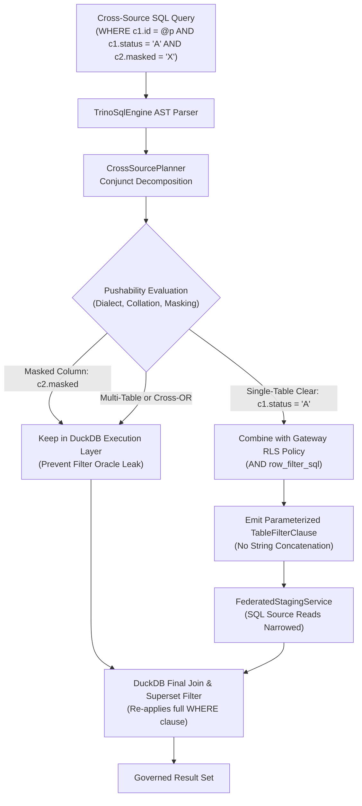

# Issue Intake Assessment & PRD: #122 Predicate Pushdown in Cross-Source WebSQL

**Document ID:** `INTAKE-2026-10-18-WEBSQL-PUSHDOWN` / `REQ-DATA-122`  
**Date:** 2026-10-18  
**Phase:** 1 (Product Qualification & Strategic Gatekeeping)  
**Author:** Enterprise Product Manager & Strategic Gatekeeper  
**Code base verified:** `main` / `feat/issue-143-restricted-scope-columns` at `a87f9b06`  
**Parent Plan:** [00-master-plan-overview.md](00-master-plan-overview.md)  
**Child Requirements:** `REQ-DATA-122` (extends `REQ-FED-01` INC-6)  

---

## 1. Summary & Qualification Verdict

**Verdict:** **Approved / Sensible with changes**.

Issue #122 addresses a critical scalability bottleneck in cross-source federated WebSQL. Currently, `CrossSourcePlanner` hardcodes `PushdownFilter: null` for all staged tables (`StagingTableRequest.PushdownFilter = null`). As a result, cross-source federation unconditionally reads every table up to `budget.MaxStagedRowsPerTable + 1` rows before DuckDB evaluates query filters. Any table exceeding `MaxStagedRowsPerTable` immediately aborts with `ROW_LIMIT_EXCEEDED`, even when a user's `WHERE` clause specifies a highly selective filter (e.g., `WHERE tenant_id = 't-1' AND id = 42`) matching only a single record.

This issue is qualified as **sensible with changes**: pushdown must be strictly bounded by Zero-Trust governance, fail-closed dialect capability checks, superset safety semantics, and privacy guardrails forbidding filter pushdown on masked columns.

| Issue | Verdict | Recommended Solution (One Line) | Size | Proposed Wave / Rank |
|---|---|---|:---:|---|
| **#122** Push down filter predicates to each source in cross-source WebSQL | Approved / Sensible with changes | Split `WHERE` and inner join `ON` into single-table conjuncts; compile supported conjuncts to parameterized `TableFilterClause` AST for SQL sources, AND-combined with RLS; retain all predicates in DuckDB; prohibit pushdown on masked columns; surface pushed clauses in audit and query analysis (#79 / #175). | M-L | Wave 2, rank 2.16 (unblocks #123 & #124 in Wave 3) |

---

## 2. Cross-Cutting Architectural Alignment & Zero-Trust Non-Negotiables



### 2.1 Zero-Trust & Fail-Closed Enforcement (NIST SP 800-207)
1. **Narrowing Only (Never Widening):** Pushed predicates are combined with gateway Row-Level Security (RLS) policies (`CombinedRowFilterSql`) and virtual filters via boolean `AND`. Pushdown can only restrict the staged row set; it can never bypass or expand permissions.
2. **Fail-Closed AST Decomposition:** If a conjunct contains unresolvable table aliases, ambiguous qualifiers, or unsupported AST constructs, the planner leaves the conjunct for DuckDB to evaluate. If parameter naming collides or integrity checks fail, the query fails closed immediately (`SEC-ADG-02`).

### 2.2 Parameterized AST Pushdown (OWASP API3:2023 / SQL Injection Prevention)
1. **Zero String Concatenation:** Pushed predicates must be constructed exclusively via structured AST nodes and emitted as parameterized `TableFilterClause` objects carrying bound parameters (`IReadOnlyDictionary<string, object?>`).
2. **Duplicate Parameter Name Defense (`SEC-ADG-02`):** When combining pushdown parameters with RLS parameters, any key collision must throw `SecurityException` (fail-closed) rather than letting an untrusted parameter overwrite an RLS boundary.

### 2.3 Privacy Minimization & Filter Oracle Guardrails (GDPR Art. 5(1)(c) / OWASP API8:2023)
1. **Masked & Denied Column Prohibition:** A predicate filtering on a masked column (including partial masks, hashes, or HMAC pseudonyms) **must never be pushed down** to the remote data source.
2. **Inference Oracle Prevention:** If a predicate on an HMAC or masked column were pushed down to an unmasked source table, differences in row counts, network latency, or `ROW_LIMIT_EXCEEDED` errors would allow an adversary to deduce cleartext values (a classical filter oracle leak). All predicates touching masked or denied columns remain strictly in the DuckDB layer where evaluation occurs after data has been masked or fails closed per `EnforceMaskedColumnGuardrails`.

### 2.4 Superset Semantic Safety & Dialect Parity
1. **Superset Read Contract:** The pushed source predicate must guarantee a mathematical *superset* of the rows DuckDB expects. DuckDB always re-executes the complete, original `WHERE` clause on the staged data.
2. **Collation & Trailing Spaces:** SQL Server defaults to case-insensitive, trailing-space-insensitive collation (`Latin1_General_CI_AS`), whereas DuckDB is strictly case-sensitive and trailing-space-sensitive. Pushing string equality `=` to SQL Server returns a superset, which DuckDB subsequently narrows correctly. However, negative filters (`<>`, `NOT IN`, `NOT LIKE`) and ordered range comparisons on collated strings must follow strict dialect capability tables or remain in DuckDB to prevent under-fetching.
3. **Three-Valued Logic (`NULL` Handling):** In ANSI SQL, `x NOT IN (1, 2, NULL)` evaluates to `UNKNOWN` (falsy for WHERE). If any element of a `NOT IN` list is literal `NULL` or null parameter, the predicate must not be pushed down.
4. **LIKE Semantics:** `LIKE` expressions with character classes (e.g. `[A-Z]`) supported in SQL Server but not in standard ANSI/DuckDB must not be pushed, or must be relaxed.

### 2.5 Cryptographic HMAC Audit Chain & Query Analysis (#79 / #175)
1. **Tamper-Evident Audit Logging:** Staging events recorded in `AUDIT_LOG_ENTRIES` must log structural pushdown metadata: `pushedPredicateCount`, referenced column names, and operator kinds.
2. **Zero-Payload Rule:** Query audit entries must never serialize parameter values or raw PII literals from pushed filters into the audit payload.
3. **Query Analysis Integration (#79 / #175):** Static query analysis (`POST /api/v1/governance/query-analysis`) must surface a dedicated `federation` section detailing per-table pushed predicates versus residual in-memory DuckDB predicates, enabling cost modelers (#175) to accurately estimate I/O reductions.

### 2.6 High-Performance .NET 10 (Zero Allocation on Hot Paths)
- The conjunct extraction pass must traverse the parsed SQL AST (`TrinoSqlEngine.Ast`) using an allocation-conscious visitor pattern (`SqlAstVisitor`), avoiding AST cloning or repetitive intermediate string allocations.

---

## 3. Product Requirements Specification (REQ-DATA-122)

### 3.1 Problem Statement & Background
In cross-source WebSQL queries spanning multiple data sources (e.g., PostgreSQL joined with SQL Server and SQLite), `CrossSourcePlanner` generates staging requests (`StagingTableRequest`) for each source table with `PushdownFilter: null`. 

When an operational table contains 500,000 rows, a query such as:
```sql
SELECT c.customer_name, o.order_id, o.amount
FROM postgres.crm.customers c
JOIN sqlserver.sales.orders o ON c.customer_id = o.customer_id
WHERE c.country = 'DE' AND o.order_date >= '2026-10-01';
```
currently attempts to stream all 500,000 orders into DuckDB memory. Because `budget.MaxStagedRowsPerTable` is enforced (e.g., 50,000 rows), the query aborts with `ROW_LIMIT_EXCEEDED` before DuckDB can filter the orders. This prevents enterprise customers from using cross-source WebSQL on realistic datasets.

### 3.2 User Stories
- **US-122-1 (Enterprise Data Analyst):** As a data analyst, I want cross-source queries with selective `WHERE` filters to succeed on large database tables, so that I can join customer and transaction data across different regional databases without hitting staging row caps.
- **US-122-2 (Data Protection Officer & Security Auditor):** As a security officer, I want predicates on masked columns to remain strictly within the gateway memory layer, so that untrusted database pushdown cannot be exploited as a side-channel filter oracle to reveal sensitive data.
- **US-122-3 (Database Administrator & SRE):** As a DBA, I want remote database queries to push down only safe, parameterized AST filters combined with RLS, ensuring pushdown never introduces SQL injection vulnerabilities or table lock escalations on underlying systems.
- **US-122-4 (FinOps & Capacity Planner):** As a FinOps engineer, I want query analysis (`/analyze` under #79/#175) to explicitly display which predicates are pushed down to each database, so that our teams can verify query efficiency and cost reduction before running large batch workflows.

### 3.3 Functional Requirements

#### FR-122-01: Conjunct Splitting (WHERE and Inner Join ON)
- The `CrossSourcePlanner` must split the top-level `WHERE` expression of the incoming SQL statement and the `ON` expressions of all `INNER JOIN` clauses into an array of conjuncts (flattening top-level boolean `AND` trees).
- Sub-trees containing `OR` at the top level between multiple tables remain as a single conjunct and are evaluated in DuckDB.
- An `OR` expression where all branches reference columns of the *exact same table* (e.g. `c.status = 'A' OR c.status = 'B'`) is considered a candidate for pushdown for that table.

#### FR-122-02: Target Dialect Pushability Matrix
A conjunct is pushable to table $T$ if and only if all of the following conditions hold:
1. **Single-Table Attribution:** Every column reference in the conjunct resolves unambiguously to table $T$ (or its unique alias).
2. **Allowed Data Source Type:** Table $T$ resides on a supported SQL data source (`SQLite`, `PostgreSQL`, `SqlServer`, `DuckDB`). HTTP declarative sources are strictly excluded.
3. **Operator & Literal Support:** Supported operators are comparison (`=`, `<>`, `<`, `<=`, `>`, `>=`), set membership (`IN`, `NOT IN`), range (`BETWEEN`), pattern matching (`LIKE`), and nullity (`IS NULL`, `IS NOT NULL`).
4. **Type Compatibility:** The literal or parameter type class matches the catalog column type class (preventing collation/cast divergence).
5. **No Complex Constructs:** No non-deterministic functions, user-defined functions, window functions, correlated subqueries, or unsafe casts.

| Operator / Expression | PostgreSQL | SQL Server | SQLite | DuckDB | Pushdown Precondition |
|---|:---:|:---:|:---:|:---:|---|
| `=`, `<`, `<=`, `>`, `>=` | ✅ | ✅ | ✅ | ✅ | Numeric, temporal, boolean, or exact string match |
| String `<>`, `NOT IN` | ✅ | ⚠️ Superset | ✅ | ✅ | If case/trailing space mismatch, evaluate only in DuckDB |
| `IN (...)` | ✅ | ✅ | ✅ | ✅ | Bounded parameter count ($\le 1000$); no NULL items |
| `NOT IN (...)` | ✅ | ✅ | ✅ | ✅ | **Excluded** if any list element is `NULL` |
| `LIKE 'prefix%'` | ✅ | ⚠️ | ✅ | ✅ | Standard wildcards (`%`, `_`) only; no bracket ranges `[...]` |
| `IS NULL`, `IS NOT NULL` | ✅ | ✅ | ✅ | ✅ | Permitted unconditionally for clear columns |
| Masked Column Predicate | ❌ | ❌ | ❌ | ❌ | **NEVER PUSHED** (evaluates in DuckDB only) |

#### FR-122-03: Composition with Row-Level Security (RLS)
- For each staged table $T$, any eligible pushed conjuncts are merged with $T$'s active RLS predicate (`req.Decision.CombinedRowFilterSql`) using boolean `AND`.
- The resulting combined clause is assigned to `StagingTableRequest.PushdownFilter`.
- If table $T$ has no pushable conjuncts, `PushdownFilter` remains `null` (or reflects only the RLS predicate if present).
- Under no circumstance may a pushed predicate negate, replace, or widen the RLS boundary.

#### FR-122-04: DuckDB Execution Preservation (Superset Contract)
- DuckDB's compiled query AST must retain all original `WHERE` and `JOIN` predicates.
- Pushing down a filter does not alter the final query AST executed in DuckDB; DuckDB filters the staged rows as a second defense layer, ensuring 100% semantic correctness even in the presence of subtle collation or character set divergences.

#### FR-122-05: Masked Column Oracle Protection
- Before qualifying a conjunct for pushdown, `CrossSourcePlanner` checks the effective access level for every referenced column using `TableAccessDecision.GetEffectiveColumnAccess(colName, metadata)`.
- If any column has access level `Mask`, `MaskWithHmac`, or `Deny`, the conjunct **must not be pushed**.
- The conjunct remains in DuckDB, where it evaluates over the pseudonymized/masked data emitted by `GovernedRowPolicy` or gets rejected by `EnforceMaskedColumnGuardrails`.

#### FR-122-06: Outer Join Semantics
- **Left Outer Join:** Conjuncts in the `WHERE` clause referencing preserved-side tables may be pushed. Conjuncts in the `ON` clause referencing null-supplying tables may be pushed to the null-supplying source. `ON` conjuncts on the preserved side or `WHERE` conjuncts on the null-supplying side must not be pushed down.
- **Right Outer Join:** Symmetric to Left Outer Join.
- **Full Outer Join:** No pushdown predicates are pushed for either table.

#### FR-122-07: Audit Trail & Query Analysis Integration
- The audit record emitted by `FederatedStagingService` / `CrossSourcePlanner` must record `PushedFilters`:
  ```json
  {
    "table": "sales.orders",
    "pushedPredicateCount": 2,
    "referencedColumns": ["order_date", "status"],
    "operators": ["GreaterThanOrEqual", "Equal"]
  }
  ```
- The query analysis endpoint (`POST /api/v1/governance/query-analysis` / `POST /analyze`) extended in #79 / #175 must output a `federation` section detailing per-table pushed filters and remaining in-memory filters.

---

## 4. Acceptance Criteria

- **AC-122-01 (Volume & Limit):** A cross-source WebSQL query filtering a SQL source table with $> \text{MaxStagedRowsPerTable}$ rows succeeds with correct results when the filter is pushable and selective, whereas the same query without the selective filter fails with `ROW_LIMIT_EXCEEDED`.
- **AC-122-02 (RLS Conjunction):** When both an RLS row policy (e.g. `tenant_id = @p0`) and a user pushdown filter (e.g. `category = 'A'`) exist, the query sent to the underlying SQL source contains `(tenant_id = @p0) AND (category = @p1)`.
- **AC-122-03 (Masked Column Guardrail):** Filtering on an HMAC-pseudonymized or masked column never adds that filter to `StagingTableRequest.PushdownFilter`. The underlying database source read log confirms the unmasked column was not filtered in SQL.
- **AC-122-04 (Superset Parity):** For a test suite covering SQLite, PostgreSQL, SQL Server, and DuckDB with varying string collations, trailing spaces, and `LIKE` wildcards, cross-source query results with pushdown enabled are byte-for-byte identical to results with pushdown disabled.
- **AC-122-05 (Three-Valued Logic NULL Safety):** `NOT IN` predicates containing `NULL` literals or `NULL` parameters are never pushed to the source; they are evaluated strictly in DuckDB.
- **AC-122-06 (Multi-Table & OR Isolation):** Conjuncts referencing more than one table, or `OR` expressions spanning multiple tables, are retained in DuckDB and not pushed down to any individual source.
- **AC-122-07 (HTTP Declarative Exemption):** HTTP data sources are never assigned a SQL `TableFilterClause` via this mechanism.
- **AC-122-08 (Parameter Integrity):** All pushed predicates utilize parameterized SQL statements. Any parameter name collisions fail closed immediately with `SecurityException` (`SEC-ADG-02`).
- **AC-122-09 (Audit Tamper-Evidence):** Audit log entries record pushed filter column names and operator counts per staged table with zero parameter values or PII payloads.
- **AC-122-10 (Query Analysis Parity):** `POST /api/v1/governance/query-analysis` displays the pushed predicates per table and residual DuckDB filters under the `federation` response property.

---

## 5. Out-of-Scope Boundaries

1. **HTTP Declarative Source Pushdown:** Pushing dynamic SQL filters to HTTP endpoints is out of scope; HTTP filtering remains governed by `VirtualFilterTablePlan` and declarative endpoint parameters.
2. **CTEs and Derived Subquery Pushdown:** Pushing predicates into CTEs or nested derived subqueries (`SELECT * FROM (SELECT ...) WHERE ...`) is deferred to Issue #123 (Same-source subtrees).
3. **Cross-Source Key-Set Dynamic Filtering:** Dynamic runtime pushdown of join keys from the build side to the probe side is deferred to Issue #124 (Cross-source key-set filters).
4. **Co-located Statement Collapsing:** Merging multiple tables from the same database server into a single SQL statement is deferred to Issue #132 (Co-located data sources).

---

## 6. RICE-C Prioritization & Backlog Recommendation

$$\text{Score} = \frac{\text{Reach (8)} \times \text{Impact (2.5)} \times \text{Confidence (95\%)} \times \text{ComplianceWeight (1.5)}}{\text{Effort (1.5 person-weeks)}} = \frac{8 \times 2.5 \times 0.95 \times 1.5}{1.5} = 19.0$$

- **Reach (8/10):** Affects all cross-source federated WebSQL queries on production-scale datasets.
- **Impact (2.5/3.0):** Turns an unusable feature (queries aborting on tables $> 50\text{k}$ rows) into a scalable, high-performance federated engine.
- **Confidence (95%):** Underlying plumbing (`StagingTableRequest.PushdownFilter`, `SqlTableReadExecutor`, `TrinoSqlEngine`) is already proven in production for single-source queries.
- **Compliance Weight (1.5):** Zero-Trust RLS preservation and masked column oracle prevention guardrails are vital to avoid data leaks.
- **Effort (1.5 person-weeks / Size M-L):** Planner conjunct splitter, dialect pushability matrix, unit and integration tests.

### Recommended Backlog Placement:
- **Priority Wave:** **Wave 2 (Urgently Missing Features)**
- **Rank:** **2.16** (Immediately following rank 2.15 #161).
- **Rationale:** Breaking #122 out of the monolithic Wave 3 rank 3.1 (`REQ-FED-01 INC-6`) and delivering it in Wave 2 eliminates the urgent `ROW_LIMIT_EXCEEDED` production failures for filtered queries, while establishing the necessary conjunct splitting and pushdown contracts required by #123 and #124 in Wave 3.
- **Dependencies:**
  - Upstream prerequisites: #107 (Row filter cache), #130 (Timezone conversions in AST), #175 (Query analysis cost model integration).
  - Downstream dependents: Unblocks #123 (Same-source subtrees) and #124 (Key-set filters) in Wave 3.
