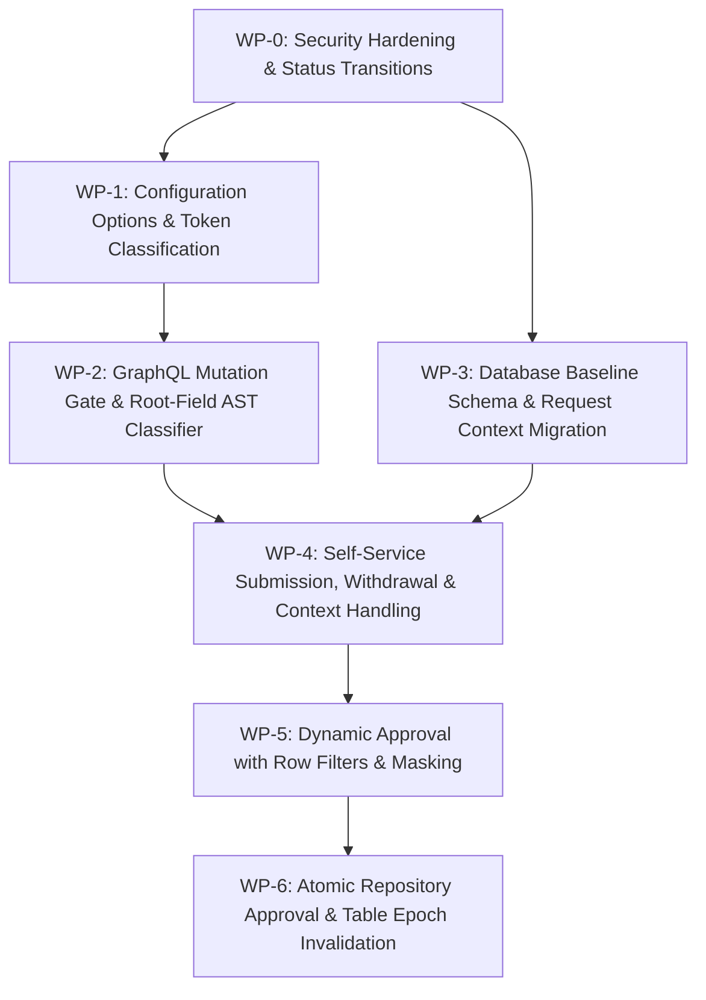

# Implementation Plan: Access Requests with Read-Only Tokens & Row Filters on Approval

**Document ID:** `PLAN-GOV-113`  
**Date:** 2026-10-18  
**Author:** Phase 2 Solution Architect (`csharp-architect`)  
**Target Branch:** `feat/issue-113-access-requests-readonly-tokens`  
**Parent Plan:** [00-master-plan-overview.md](00-master-plan-overview.md) (Wave 3, Rank 3.3, Steps I-22 & I-24)  
**Input PRD:** [2026-10-18-issue-intake-consumers-and-access-requests.md](2026-10-18-issue-intake-consumers-and-access-requests.md) (§2, §4 `REQ-GOV-113`)  
**Status:** Approved for Implementation  

---

## 1. Executive Summary & Problem Context

In zero-trust analytical and agentic environments (such as catalog discovery under Issue #111 and MCP semantic tools), users and AI agents routinely operate with read-only tokens (`ReadOnlyScopes`, e.g., `Agent.Read`, `App.Read`). When an analyst or agent discovers a protected dataset for which they lack query permission, they need to submit an access request (`requestTableAccess`) with operational context (such as calling application, tool, justification, and desired lease duration) and withdraw stale requests (`withdrawAccessRequest`).

Currently, Autheris enforces a blunt, coarse-grained write gate: [`ReadOnlyOperationMiddleware`](file:///root/autheris/src/Autheris.GraphQL/Interceptors/ReadOnlyOperationMiddleware.cs#L27-L40) inspects GraphQL operation definitions and unconditionally aborts all mutations with HTTP 403 `READ_ONLY_TOKEN` whenever the authenticated principal is marked read-only via [`TokenAccessScope.IsReadOnly()`](file:///root/autheris/src/Autheris.Domain/Security/TokenAccessScope.cs#L24-L25). Requiring a user to obtain a write token solely to request access violates the principle of least privilege. Furthermore, approving access requests currently applies a static metadata snapshot without row-level filtering or fine-grained column masking, preventing data owners from issuing restricted grants (such as department slices or regional partitions).

This architectural implementation resolves these challenges in two structured increments:
1. **Increment A: Bounded Self-Service for Read-Only Tokens:**
   - Configure allowlisted self-service scopes under [`GatewaySections.Security`](file:///root/autheris/src/Autheris.Domain/Options/GatewaySections.cs): `Gateway:Security:ReadOnlySelfServiceScopes` (default: `["data.access.request"]`).
   - Evolve [`ReadOnlyOperationMiddleware`](file:///root/autheris/src/Autheris.GraphQL/Interceptors/ReadOnlyOperationMiddleware.cs) with GraphQL root-field AST analysis (`SelfServiceMutationClassifier`) to permit mutations iff the document contains *exclusively* allowlisted self-service root fields (`requestTableAccess`, `withdrawAccessRequest`) and the token carries `data.access.request`.
   - Enforce human-subject identity gating (`SubjectType.Person`): app-only tokens (`idtyp=app`, service principals) are rejected fail-closed with HTTP 403 `FORBIDDEN`.
   - Persist optional structured request context (`context_json`) and implement request withdrawal (`withdrawAccessRequest`).
2. **Increment B: Dynamic Approval, Row Filters & Atomic Policy Activation:**
   - Extend `approveConsentRequest` to accept approver-defined dynamic row filter predicates (`rowFilter`) and column masking overrides (`columnMasking`).
   - Validate row filter AST predicates against catalog column metadata and type constraints.
   - Enforce four-eyes segregation of duties: approval strictly requires non-read-only delegated tokens carrying `data.access.review` and data owner/delegate/admin authorization. Requesters cannot approve their own requests (`RequesterSid != ApproverSid`).
   - Execute approval step recording (`APPROVAL_STEPS`), consent creation (`CONSENTS`, `CONSENT_COLUMN_RULES`), and row filter persistence (`CONSENT_ROW_FILTERS`) in a single atomic database transaction, invalidating the table epoch cache (`POLICY_EPOCHS`) immediately upon commit.

---

## 2. Verified Code Facts Beyond the PRD

| # | Fact | Evidence & Architectural Consequence |
|---|---|---|
| **V-1** | `ReadOnlyOperationMiddleware` checks operation type, not root fields | [`ReadOnlyOperationMiddleware.cs:43-47`](file:///root/autheris/src/Autheris.GraphQL/Interceptors/ReadOnlyOperationMiddleware.cs#L43-L47) checks `o.Operation == OperationType.Mutation`. Any mutation document is rejected if `IsReadOnly()` is true. Selective mutation gating requires AST inspection of field selections on the mutation root. |
| **V-2** | Scope classification trap in `EntraTokenPolicy` | [`EntraTokenPolicy.cs:82-87`](file:///root/autheris/src/Autheris.Api/Security/EntraTokenPolicy.cs#L82-L87) marks a token read-only only if `scopes.All(s => readOnlyScopes.Any(...))`. If a token carries `Agent.Read` AND an unlisted scope like `data.access.request`, `scopes.All(...)` returns `false`, causing the token to be classified as full read-write! `EntraTokenPolicy` must treat `ReadOnlyScopes` union `ReadOnlySelfServiceScopes` as read-only. |
| **V-3** | `ReadOnlyTokenMiddleware` already allows GraphQL path | [`ReadOnlyTokenMiddleware.cs:23-30`](file:///root/autheris/src/Autheris.Api/Middleware/ReadOnlyTokenMiddleware.cs#L23-L30) includes `graphQlPath` in `_queryPaths`. Read-only tokens can POST to GraphQL; the HTTP middleware does not block the request, passing it to `ReadOnlyOperationMiddleware`. |
| **V-4** | `GetUserSid()` falls back to application IDs | [`Sid.cs:21-36`](file:///root/autheris/src/Autheris.Domain/Common/Sid.cs#L21-L36) falls back to `appid`, `client_id`, and `azp` when human claims (`sub`, `upn`, `email`) are absent. For self-service access requests, callers must be verified as `SubjectType.Person` via [`IIdentitySubjectResolver`](file:///root/autheris/src/Autheris.Application/Services/IdentitySubjectResolver.cs) to prevent service principals from filing requests. |
| **V-5** | `CONSENT_REQUESTS` lacks context and withdrawal status | Baseline schema [`SqliteBaselineSchema.cs:198-211`](file:///root/autheris/src/Autheris.Infrastructure/Persistence/Migrations/SqliteBaselineSchema.cs#L198-L211) has no `context_json` column. `WITHDRAWN` is not currently an active status value in [`ConsentApprovalPolicy.cs`](file:///root/autheris/src/Autheris.Application/ConsentRequests/ConsentApprovalPolicy.cs). Baseline DDL must add `context_json TEXT NULL` and the state machine must recognize `WITHDRAWN`. |
| **V-6** | Approval and consent creation currently occur in separate transactions | In [`MutationTypes.cs:293-360`](file:///root/autheris/src/Autheris.GraphQL/Types/MutationTypes.cs#L293-L360), `ApproveConsentRequestStepAsync` is committed first, and `CreateConsentAsync` is called subsequently. A mid-flight crash leaves an `APPROVED` request without a corresponding active consent. Atomicity requires executing both inside a unified transaction. |
| **V-7** | `CONSENT_ROW_FILTERS` schema already supports key-set and AST columns | Baseline schema [`SqliteBaselineSchema.cs:132-157`](file:///root/autheris/src/Autheris.Infrastructure/Persistence/Migrations/SqliteBaselineSchema.cs#L132-L157) already includes `filter_group`, `table_column_id`, `column_name`, `operator`, `value_type`, `value_json`, `value_source`, `user_attribute`, and key-set fields. Dynamic approver row filters map directly into this table without DDL changes. |
| **V-8** | Audit event types `CONSENT_REQUESTED` and `CONSENT_APPROVAL_STEP` exist | [`AuditEventTypes.cs:30-36`](file:///root/autheris/src/Autheris.Domain/Audit/AuditEventTypes.cs#L30-L36) defines `ConsentRequested`, `ConsentApprovalStep`, `ConsentGranted`. Adding `ConsentWithdrawn = "CONSENT_WITHDRAWN"` completes the lifecycle. [`AuditPolicyTable.cs`](file:///root/autheris/src/Autheris.Application/Audit/AuditPolicyTable.cs) classifies these as `FailClosed`. |

---

## 3. Architectural Decisions

```mermaid
flowchart TD
    subgraph "Increment A: Bounded Self-Service Mutation Admission"
        REQ["Incoming GraphQL Mutation Request"] --> RO_CHK{"Principal IsReadOnly()?"}
        RO_CHK -->|No| WR_PATH["Standard Full-Access Pipeline"]
        RO_CHK -->|Yes| AST_PARSE["SelfServiceMutationClassifier<br/>(Inspect Root Field Selections)"]
        
        AST_PARSE --> ROOT_VAL{"Root fields exclusively in<br/>[requestTableAccess, withdrawAccessRequest]?"}
        ROOT_VAL -->|No| ERR_RO["403 READ_ONLY_TOKEN<br/>(Forbidden mutation)"]
        ROOT_VAL -->|Yes| SCOPE_CHK{"Principal has scope<br/>'data.access.request'?"}
        SCOPE_CHK -->|No| ERR_SCOPE["403 FORBIDDEN<br/>(data.access.request required)"]
        SCOPE_CHK -->|Yes| SUBJ_CHK{"SubjectType == Person?<br/>(Immutable Human SID)"}
        SUBJ_CHK -->|No (App-Only)| ERR_APP["403 FORBIDDEN<br/>(Service principal rejected)"]
        SUBJ_CHK -->|Yes| MUT_EXEC["Execute Mutation:<br/>requestTableAccess / withdrawAccessRequest"]
    end

    subgraph "Increment B: Dynamic Approval & Atomic Commitment"
        APPR_REQ["Approver Mutation:<br/>approveConsentRequest(requestId, rowFilter, masking)"] --> APPR_AUTH{"Caller has data.access.review<br/>AND is Owner/Delegate/Admin<br/>AND is NOT read-only?"}
        APPR_AUTH -->|No| APPR_DENY["403 FORBIDDEN"]
        APPR_AUTH -->|Yes| SELF_CHK{"RequesterSid != ApproverSid?"}
        SELF_CHK -->|No (Self-Approval)| ERR_SELF["403 FORBIDDEN (Self-approval blocked)"]
        SELF_CHK -->|Yes| AST_VAL["Validate RowFilter AST<br/>against Catalog Columns & Types"]
        AST_VAL -->|Invalid| ERR_AST["400 BAD_REQUEST (Invalid filter AST)"]
        AST_VAL -->|Valid| ATOMIC_TX["Single ACID Database Transaction:<br/>1. Insert APPROVAL_STEPS (Decision=APPROVED)<br/>2. Update CONSENT_REQUESTS (Status=APPROVED)<br/>3. Insert CONSENTS & CONSENT_COLUMN_RULES<br/>4. Insert CONSENT_ROW_FILTERS<br/>5. Bump Table Epoch in POLICY_EPOCHS<br/>6. Record Tier A CONSENT_GRANTED Audit"]
        ATOMIC_TX --> CACHE_INV["Invalidate In-Memory Epoch Cache<br/>(Immediate read-plane policy enforcement)"]
    end
```

### Decision D-1: Scope Classification Union & Entra Token Hardening
- **Context:** If a token carries `Agent.Read` plus `data.access.request`, `EntraTokenPolicy.Apply` previously checked `scopes.All(s => readOnlyScopes.Any(...))`. Because `data.access.request` was not in `ReadOnlyScopes`, the token would erroneously lose its read-only marker and gain write privileges.
- **Decision:** Introduce `JwtOptions.ReadOnlySelfServiceScopes` (default: `["data.access.request"]`). When classifying delegated tokens in `EntraTokenPolicy`, evaluate against `effectiveReadOnlyUnion = options.GetEffectiveReadOnlyScopes().Concat(options.ReadOnlySelfServiceScopes)`. If all token scopes are contained within this union, the principal is marked `TokenAccessScope.MarkReadOnly(identity)`. This guarantees that acquiring a self-service scope never widens ambient token authority.

### Decision D-2: AST-Based Root Field Mutation Classifier
- **Context:** An attacker holding a read-only token could attempt to batch multiple operations, use field aliases, or invoke unpermitted mutations (e.g. `deleteUser`, `updateTableMetadata`) alongside `requestTableAccess`.
- **Decision:** Implement `SelfServiceMutationClassifier`. For any mutation document executed by a read-only principal:
  1. Inspect the selected operation definition (or all operations if no `operationName` is specified).
  2. If the operation is not `OperationType.Mutation`, pass through.
  3. Extract all top-level field nodes in the selection set (resolving inline fragments and fragment definitions).
  4. Verify that **every** field node's name is present in the allowlist `[ "requestTableAccess", "withdrawAccessRequest" ]`.
  5. If any unallowlisted field, syntax error, or introspection mutation is present, abort immediately with 403 `READ_ONLY_TOKEN`.

### Decision D-3: Strict Person Subject Enforcement
- **Context:** Automated service principals or app-only tokens (`idtyp=app`) should not request human access grants or pollute ownership queues.
- **Decision:** When executing self-service mutations, extract the subject via `IIdentitySubjectResolver`. The resolved `SubjectType` must strictly be `SubjectType.Person`. If `SubjectType == SubjectType.ServicePrincipal` or `SubjectType == SubjectType.Anonymous`, reject fail-closed with HTTP 403 `FORBIDDEN` ("Human person subject required for self-service access requests").

### Decision D-4: Structured Request Context Sanitization
- **Context:** Requesters need to specify metadata (e.g., application name, query tool, business justification, expected duration) to assist approvers in making informed least-privilege decisions.
- **Decision:** Add optional `AccessRequestContextInput` to `requestTableAccess`:
  ```graphql
  input AccessRequestContextInput {
    application: String
    tool: String
    justification: String
    expectedDuration: String
  }
  ```
  Validate inputs using `UntrustedTextNormalizer`: maximum length per field 256 characters, total JSON payload $\le 2048$ bytes, strip control characters, and validate duration as ISO 8601. Persist as canonical JSON in `CONSENT_REQUESTS.context_json` and surface in `ConsentRequestDto`.

### Decision D-5: Atomic Approval and Consent Commit (SEC-GOV113-03)
- **Context:** Currently, approval step insertion and consent record generation are separate database operations. Network or server failures between these steps leave the request in an inconsistent state.
- **Decision:** Unify approval activation into a single transactional repository method:
  `ExecuteApprovalWithConsentAsync(Guid requestId, ApprovalDecision decision, ConsentGrantDefinition grant, CancellationToken ct)`.
  Within one ACID transaction:
  1. Verify current status is `PENDING` (or `PENDING_SECOND_APPROVAL`) and acquire row lock (`FOR UPDATE` in PostgreSQL; `HOLDLOCK` in SQL Server).
  2. Insert `APPROVAL_STEPS`.
  3. Update `CONSENT_REQUESTS` status to `APPROVED`.
  4. Insert `CONSENTS` and `CONSENT_COLUMN_RULES`.
  5. Insert approver-defined `CONSENT_ROW_FILTERS`.
  6. Increment table epoch in `POLICY_EPOCHS`.
  7. Insert Tier A fail-closed audit entry (`AuditEventTypes.ConsentGranted`).
  8. Immediately call `_epochCache.Invalidate(tableId)`.

### Decision D-6: Approver Scope & Segregation of Duties (Four-Eyes)
- **Context:** Approvers must not approve their own requests, and read-only tokens must never possess approval authority.
- **Decision:** In `ApproveConsentRequestAsync`:
  1. Verify caller principal is NOT read-only (`!context.User.IsReadOnly()`).
  2. Verify caller possesses the dedicated scope `data.access.review`.
  3. Verify caller is authorized for the table via `IDataOwnershipRepository.IsAuthorizedApproverForTableAsync` or is `GovernanceAdmin`/`ClusterAdmin`.
  4. Enforce `RequesterSid != ApproverSid` (and cross-identity verification via `IsSameIdentity`). Self-approval is rejected fail-closed with HTTP 403 `FORBIDDEN`.

---

## 4. Work Packages

### WP-0: Security Hardening & Status Transitions (Precondition)
- **Objective:** Fix existing approval status guards, ensure robust concurrency locks, and introduce the `WITHDRAWN` request status.
- **Files to Modify:**
  - [`src/Autheris.Application/ConsentRequests/ConsentApprovalPolicy.cs`](file:///root/autheris/src/Autheris.Application/ConsentRequests/ConsentApprovalPolicy.cs):
    - Add `RequestStatusWithdrawn = "WITHDRAWN"`.
    - Update `EnsureApprovableStatus`: ensure only `PENDING` and `PENDING_SECOND_APPROVAL` can be approved. `WITHDRAWN` requests cannot be approved.
  - [`src/Autheris.Domain/Audit/AuditEventTypes.cs`](file:///root/autheris/src/Autheris.Domain/Audit/AuditEventTypes.cs):
    - Add `public const string ConsentWithdrawn = "CONSENT_WITHDRAWN";`
  - [`src/Autheris.Application/Audit/AuditPolicyTable.cs`](file:///root/autheris/src/Autheris.Application/Audit/AuditPolicyTable.cs):
    - Map `AuditEventTypes.ConsentWithdrawn` to `AuditFailurePolicy.FailClosed`.
- **Test Criteria:**
  - Unit tests verifying `WITHDRAWN` requests fail approval validation.

### WP-1: Configuration Options & Token Classification (`SEC-GOV113-01`)
- **Objective:** Add `ReadOnlySelfServiceScopes` to `JwtOptions`, update `EntraTokenPolicy`, and harden read-only classification.
- **Files to Modify:**
  - [`src/Autheris.Domain/Options/Security/JwtOptions.cs`](file:///root/autheris/src/Autheris.Domain/Options/Security/JwtOptions.cs):
    - Add property: `public List<string> ReadOnlySelfServiceScopes { get; init; } = ["data.access.request"];`
  - [`src/Autheris.Api/Security/EntraTokenPolicy.cs`](file:///root/autheris/src/Autheris.Api/Security/EntraTokenPolicy.cs):
    - Update delegated scope evaluation:
      ```csharp
      var readOnlyScopes = options.GetEffectiveReadOnlyScopes();
      var selfServiceScopes = options.ReadOnlySelfServiceScopes ?? [];
      var permittedReadOnlyScopes = readOnlyScopes.Concat(selfServiceScopes).ToList();

      if (scopes.Count > 0 && permittedReadOnlyScopes.Count > 0 &&
          scopes.All(s => permittedReadOnlyScopes.Any(r => IsSameScope(r, s))))
      {
          TokenAccessScope.MarkReadOnly(identity);
      }
      ```
- **Test Criteria:**
  - Unit tests in `EntraTokenPolicyTests`:
    - Token with `["Agent.Read", "data.access.request"]` is marked `IsReadOnly() == true`.
    - Token with `["data.access.request"]` is marked `IsReadOnly() == true`.
    - Token with `["Agent.Read", "data.access.review"]` is NOT marked read-only.
    - Token with `["Agent.Write"]` is NOT marked read-only.

### WP-2: GraphQL Mutation Gate & Root-Field AST Classifier (`SEC-GOV113-02`)
- **Objective:** Implement `SelfServiceMutationClassifier` and integrate into `ReadOnlyOperationMiddleware`.
- **Files to Modify/Create:**
  - [`src/Autheris.GraphQL/Interceptors/SelfServiceMutationClassifier.cs`](file:///root/autheris/src/Autheris.GraphQL/Interceptors/SelfServiceMutationClassifier.cs) *(new)*:
    - Pure static helper:
      ```csharp
      public static class SelfServiceMutationClassifier
      {
          private static readonly HashSet<string> PermittedSelfServiceMutations = new(StringComparer.Ordinal)
          {
              "requestTableAccess",
              "withdrawAccessRequest"
          };

          public static bool IsExclusivelySelfServiceMutation(DocumentNode document, string? operationName)
          {
              var operations = document.Definitions.OfType<OperationDefinitionNode>()
                  .Where(o => string.IsNullOrEmpty(operationName) || string.Equals(o.Name?.Value, operationName, StringComparison.Ordinal));

              foreach (var op in operations)
              {
                  if (op.Operation != OperationType.Mutation) continue;
                  if (op.SelectionSet.Selections.Count == 0) return false;

                  foreach (var selection in op.SelectionSet.Selections)
                  {
                      if (selection is not FieldNode field) return false; // Fail closed on fragment spreads / inline fragments
                      if (!PermittedSelfServiceMutations.Contains(field.Name.Value)) return false;
                  }
              }
              return true;
          }
      }
      ```
  - [`src/Autheris.GraphQL/Interceptors/ReadOnlyOperationMiddleware.cs`](file:///root/autheris/src/Autheris.GraphQL/Interceptors/ReadOnlyOperationMiddleware.cs):
    - Update `InvokeAsync`:
      ```csharp
      var document = context.OperationDocumentInfo?.Document;
      if (document != null && IsMutation(document, context.Request.OperationName) && ResolvePrincipal(context).IsReadOnly())
      {
          var principal = ResolvePrincipal(context);
          var hasSelfServiceScope = principal?.HasScope("data.access.request") == true;

          if (!hasSelfServiceScope || !SelfServiceMutationClassifier.IsExclusivelySelfServiceMutation(document, context.Request.OperationName))
          {
              context.Result = OperationResult.FromError(ErrorBuilder.New()
                  .SetMessage("This token only permits read access; mutations are rejected.")
                  .SetCode("READ_ONLY_TOKEN")
                  .Build());
              return;
          }
      }
      ```
- **Test Criteria:**
  - Unit tests in `ReadOnlyOperationMiddlewareTests`:
    - Read-only token calling `requestTableAccess` with `data.access.request` succeeds.
    - Read-only token calling `requestTableAccess` without `data.access.request` receives 403 `READ_ONLY_TOKEN`.
    - Read-only token calling `deleteTable` or batched mutations receives 403 `READ_ONLY_TOKEN`.

### WP-3: Database Baseline Schema & Request Context Migration
- **Objective:** Add `context_json` column to `CONSENT_REQUESTS` across SQLite, PostgreSQL, and SQL Server baselines and shape snapshots.
- **Files to Modify:**
  - [`src/Autheris.Infrastructure/Persistence/Migrations/SqliteBaselineSchema.cs`](file:///root/autheris/src/Autheris.Infrastructure/Persistence/Migrations/SqliteBaselineSchema.cs):
    - Update `CONSENT_REQUESTS` DDL: add `context_json TEXT NULL`.
  - [`src/Autheris.Infrastructure/Persistence/Migrations/PostgreSqlBaselineSchema.cs`](file:///root/autheris/src/Autheris.Infrastructure/Persistence/Migrations/PostgreSqlBaselineSchema.cs):
    - Update `CONSENT_REQUESTS` DDL: add `context_json TEXT NULL`.
  - [`src/Autheris.Infrastructure/Persistence/Migrations/SqlServerBaselineSchema.cs`](file:///root/autheris/src/Autheris.Infrastructure/Persistence/Migrations/SqlServerBaselineSchema.cs):
    - Update `CONSENT_REQUESTS` DDL: add `context_json NVARCHAR(MAX) NULL`.
  - [`src/Autheris.Infrastructure/Persistence/Migrations/Shape/governance-shape.*.json`](file:///root/autheris/src/Autheris.Infrastructure/Persistence/Migrations/Shape/):
    - Update schema snapshot JSON files with `context_json`.
  - [`src/Autheris.Domain/Model/GovernanceModels.cs`](file:///root/autheris/src/Autheris.Domain/Model/GovernanceModels.cs):
    - Add `public string? ContextJson { get; set; }` to `ConsentRequest`.
  - [`src/Autheris.Domain/Model/ConsentDtoModels.cs`](file:///root/autheris/src/Autheris.Domain/Model/ConsentDtoModels.cs):
    - Add `public string? ContextJson { get; init; }` to `ConsentRequestDto`.
- **Test Criteria:**
  - `GovernanceSchemaShapeSnapshotTests` pass with 0 drift across all dialects.

### WP-4: Self-Service Submission, Withdrawal & Context Handling (`SEC-GOV113-01`)
- **Objective:** Implement request withdrawal, enforce human subject resolution, and persist structured context.
- **Files to Modify:**
  - [`src/Autheris.Application/ConsentRequests/ConsentRequestService.cs`](file:///root/autheris/src/Autheris.Application/ConsentRequests/ConsentRequestService.cs):
    - In `SubmitAsync`:
      - Verify `identitySubjectResolver.ResolveSubject(principal).SubjectType == SubjectType.Person`. If not, throw 403 `FORBIDDEN`.
      - Normalize and validate `AccessRequestContextInput` if provided; serialize to `context_json`.
      - Emit fail-closed audit entry `CONSENT_REQUESTED`.
    - Add `WithdrawAsync(Guid requestId, ClaimsPrincipal principal, CancellationToken ct)`:
      - Load request; verify `Status == "PENDING"`.
      - Verify `req.RequesterSid == callerSid` (or same identity). Rejection throws 403 `FORBIDDEN`.
      - Update status to `"WITHDRAWN"`.
      - Emit fail-closed audit entry `CONSENT_WITHDRAWN`.
  - [`src/Autheris.Application/Interfaces/IGovernanceRepository.cs`](file:///root/autheris/src/Autheris.Application/Interfaces/IGovernanceRepository.cs):
    - Add `Task<bool> WithdrawConsentRequestAsync(Guid requestId, Sid requesterSid, CancellationToken ct = default);`
  - [`src/Autheris.Infrastructure/Persistence/SqliteGovernanceRepository.Consent.cs`](file:///root/autheris/src/Autheris.Infrastructure/Persistence/SqliteGovernanceRepository.Consent.cs) (and PG/SQL Server):
    - Implement `WithdrawConsentRequestAsync` updating status to `WITHDRAWN` where `id = @id AND requester_sid = @sid AND status = 'PENDING'`.
  - [`src/Autheris.GraphQL/Types/MutationTypes.cs`](file:///root/autheris/src/Autheris.GraphQL/Types/MutationTypes.cs):
    - Expose `withdrawAccessRequest(requestId: UUID!)`.
    - Update `requestTableAccess` to accept optional `context: AccessRequestContextInput`.
- **Test Criteria:**
  - Unit tests verifying requester can withdraw own request; cannot withdraw another user's request; cannot withdraw already approved or rejected request.

### WP-5: Dynamic Approval with Row Filters & Column Masking (`SEC-GOV113-03`)
- **Objective:** Extend `approveConsentRequest` GraphQL mutation to accept dynamic row filters and masking levels; validate AST against table columns.
- **Files to Modify/Create:**
  - [`src/Autheris.Domain/Model/RowFilterInput.cs`](file:///root/autheris/src/Autheris.Domain/Model/RowFilterInput.cs) *(new)*:
    - Input models for GraphQL: `RowFilterInput`, `RowFilterPredicateInput`, `ColumnMaskingInput`.
  - [`src/Autheris.Application/Governance/Validation/RowFilterAstValidator.cs`](file:///root/autheris/src/Autheris.Application/Governance/Validation/RowFilterAstValidator.cs) *(new)*:
    - Validates column existence, permitted operators (`=`, `!=`, `<`, `<=`, `>`, `>=`, `IN`, `NOT IN`, `LIKE`, `IS NULL`, `IS NOT NULL`), and parameter value type compatibility against table catalog metadata.
  - [`src/Autheris.GraphQL/Types/MutationTypes.cs`](file:///root/autheris/src/Autheris.GraphQL/Types/MutationTypes.cs):
    - Update `ApproveConsentRequestAsync`:
      - Accept `rowFilter: RowFilterInput?`, `columnMasking: [ColumnMaskingInput!]?`, `validTo: DateTimeOffset?`, `consentDescription: String?`.
      - Check scope: must carry `data.access.review`.
      - Check non-read-only: `!context.User.IsReadOnly()`.
      - Check four-eyes: `req.RequesterSid != approverSid`.
      - Validate `rowFilter` using `RowFilterAstValidator`.
- **Test Criteria:**
  - Unit tests in `RowFilterAstValidatorTests`: test type mismatches, unknown columns, and forbidden SQL injection syntax.
  - Tests ensuring approvers without `data.access.review` are rejected.

### WP-6: Atomic Repository Approval & Table Epoch Invalidation (`SEC-GOV113-03`)
- **Objective:** Atomically commit approval step, consent grant, and row filters in a single transaction, invalidating the table epoch cache.
- **Files to Modify:**
  - [`src/Autheris.Application/Interfaces/IGovernanceRepository.cs`](file:///root/autheris/src/Autheris.Application/Interfaces/IGovernanceRepository.cs):
    - Add `Task<Consent> ExecuteAtomicApprovalWithConsentAsync(Guid requestId, ApprovalStep step, Consent consent, IReadOnlyList<ConsentRowFilter> rowFilters, IReadOnlyList<ConsentColumnRule> columnRules, CancellationToken ct = default);`
  - [`src/Autheris.Infrastructure/Persistence/SqliteGovernanceRepository.Consent.cs`](file:///root/autheris/src/Autheris.Infrastructure/Persistence/SqliteGovernanceRepository.Consent.cs) (and PG/SQL Server):
    - Implement `ExecuteAtomicApprovalWithConsentAsync`:
      - Begin ACID transaction.
      - Verify request status is approvable; update to `APPROVED`.
      - Insert `APPROVAL_STEPS`.
      - Insert `CONSENTS`.
      - Insert `CONSENT_COLUMN_RULES`.
      - Insert `CONSENT_ROW_FILTERS`.
      - Increment table epoch in `POLICY_EPOCHS`.
      - Record Tier A audit entry `CONSENT_GRANTED`.
      - Commit transaction.
      - Post-commit: call `InvalidateEpochAsync(tableId)`.
- **Test Criteria:**
  - Database integration tests on SQLite, PostgreSQL, and SQL Server: verify single atomic commit and rollback on simulated mid-flight exception.
  - Verify subsequent data queries immediately observe and enforce the newly approved row filter.

---

## 5. Fail-Closed and Security Summary

1. **Least-Privilege Mutation Admission (`SEC-GOV113-01`):**
   - Read-only tokens are barred from all data mutations and management operations.
   - Only mutations whose AST contains exclusively allowlisted self-service operations (`requestTableAccess`, `withdrawAccessRequest`) are admitted, and strictly when the token carries the dedicated `data.access.request` scope.
2. **Immutable Subject Gate:**
   - App-only tokens, service principals, and anonymous tokens cannot file or withdraw access requests. The principal must resolve to an immutable human `SubjectType.Person`.
3. **Four-Eyes Segregation of Duties:**
   - The token used to request access cannot be used to approve it (`RequesterSid != ApproverSid`).
   - Approval strictly requires the separate delegated scope `data.access.review` and data owner/delegate/admin authorization.
   - Read-only tokens can never decide or approve access requests.
4. **AST Validation Before Commitment:**
   - Approver-supplied row filters are strictly parsed into AST structures and validated against catalog column metadata and type systems. Raw SQL injection strings are rejected fail-closed.
5. **ACID Policy Commitment & Epoch Invalidation (`SEC-GOV113-03`):**
   - Approval state transitions, consent creation, and row filters commit within a single database transaction. Table policy epochs are incremented atomically, eliminating stale cached access windows.

---

## 6. Acceptance Criteria Mapping (PRD Traceability)

| PRD AC | Description | Architectural Implementation & Verification |
|---|---|---|
| **AC-113-01** | Read-only tokens carrying `data.access.request` can invoke `requestTableAccess` and `withdrawAccessRequest` | `ReadOnlyOperationMiddleware` + `SelfServiceMutationClassifier` admit allowlisted root mutations when scope is present. |
| **AC-113-02** | Read-only tokens attempting any other mutation receive HTTP 403 `READ_ONLY_TOKEN` | AST classifier rejects any document containing non-allowlisted root fields. |
| **AC-113-03** | Read-only tokens lacking `data.access.request` receive HTTP 403 `READ_ONLY_TOKEN` | Middleware verifies scope before admitting self-service mutations. |
| **AC-113-04** | App-only / service principal tokens are rejected from submitting requests | `ConsentRequestService` validates `SubjectType == SubjectType.Person`; fails closed with 403 `FORBIDDEN`. |
| **AC-113-05** | Request `context` is sanitized, persisted, and visible in queries | Validated via `UntrustedTextNormalizer`, stored in `context_json`, surfaced in `ConsentRequestDto`. |
| **AC-113-06** | Users can withdraw their own pending requests; others rejected | `WithdrawAsync` asserts `RequesterSid == callerSid`; other callers receive 403 `FORBIDDEN`. |
| **AC-113-07** | Withdrawn requests cannot be approved or re-activated | `EnsureApprovableStatus` rejects `WITHDRAWN` requests fail-closed. |
| **AC-113-08** | `approveConsentRequest` permits custom `rowFilter` and column masking | Updated GraphQL mutation accepts `RowFilterInput` and `ColumnMaskingInput`. |
| **AC-113-09** | Submitted row filters validated against catalog column metadata | `RowFilterAstValidator` validates columns, types, and operator allowlists. |
| **AC-113-10** | Approving strictly requires `data.access.review` scope and blocks self-approval | Resolver asserts `data.access.review`, non-read-only status, and `RequesterSid != ApproverSid`. |
| **AC-113-11** | Approval step, consent generation, and row filters commit atomically | Handled by `ExecuteAtomicApprovalWithConsentAsync` in a single ACID transaction. |
| **AC-113-12** | Table epoch incremented upon approval, immediately enforcing rules | Atomically bumped in `POLICY_EPOCHS` and invalidated in-memory via `InvalidateEpochAsync`. |

---

## 7. Sequencing & Parallelisation



- **Phase 2.1 (Security Precondition & Tokens):** WP-0 and WP-1 establish the security baseline and token classification.
- **Phase 2.2 (Increment A Gate & Schema):** WP-2 and WP-3 implement the GraphQL admission gate and migrate baseline schemas.
- **Phase 2.3 (Increment A Delivery):** WP-4 completes the self-service request and withdrawal flows.
- **Phase 2.4 (Increment B Approval & Atomicity):** WP-5 and WP-6 deliver dynamic approver row filtering and atomic policy activation.

---

## 8. Phase 3 Security Review & Binding Conditions (`csharp-security-expert`)

**Audit Verdict:** `APPROVED WITH CONDITIONS`  
**Security Evaluator:** Phase 3 Security Expert (`csharp-security-expert`)  
**Evaluation Standard:** Zero-Trust, Fail-Closed, Least Privilege, Defense-in-Depth, Anti-Tamper  

### 8.1 Binding Security Conditions

- **SEC-GOV113-01 (Fail-Closed Read-Only Bypass Defense):**
  - Read-only tokens (`TokenAccessScope.IsReadOnly()`) MUST only be permitted to execute mutations if ALL root field selections match the allowlist (`requestTableAccess`, `withdrawAccessRequest`).
  - AST classifier MUST inspect raw syntax tree definitions: aliases, introspection mutations (`__typename`), or batched/fragmented mutations containing unpermitted operations MUST be rejected fail-closed with HTTP 403 `READ_ONLY_TOKEN`.
  - The token MUST contain the dedicated scope `data.access.request`. If missing, return HTTP 403 `READ_ONLY_TOKEN`.
- **SEC-GOV113-02 (Human Subject Gate & Anti-Spoofing):**
  - Self-service mutations (`requestTableAccess`, `withdrawAccessRequest`) MUST verify that the authenticated subject is an immutable person (`SubjectType.Person`).
  - App-only tokens (`idtyp=app`), client credentials, and service principals MUST be rejected fail-closed with HTTP 403 `FORBIDDEN`.
- **SEC-GOV113-03 (Four-Eyes Segregation of Duties & Review Scope):**
  - Read-only tokens CANNOT approve or reject access requests under any circumstances.
  - Both `approveConsentRequest` and `rejectConsentRequest` mutations MUST strictly require non-read-only delegated tokens carrying the dedicated scope `data.access.review`.
  - Requesters CANNOT approve their own requests under any circumstances (`RequesterSid != ApproverSid` and `IsSameIdentity == false`), failing closed with HTTP 403 `FORBIDDEN`.
  - Table ownership or active delegate authorization MUST be verified inside the approval/rejection transaction.
- **SEC-GOV113-04 (Row Filter AST Validation & Injection Prevention):**
  - Custom row filter predicates provided on approval MUST be parsed into AST nodes and strictly validated against catalog columns belonging exclusively to the approved table.
  - Disallowed operators, raw SQL string injection, subqueries, unconsented tables, or cross-table column references MUST be rejected fail-closed with HTTP 400 `BAD_REQUEST`.
  - All filter values MUST be strictly type-checked and parameterized during policy compilation.
- **SEC-GOV113-05 (Atomic Transactional Commitment & Epoch Invalidation):**
  - Approval step recording (`APPROVAL_STEPS`), consent creation (`CONSENTS`, `CONSENT_COLUMN_RULES`), row filter persistence (`CONSENT_ROW_FILTERS`), and table epoch increment in `POLICY_EPOCHS` MUST execute within a single ACID database transaction.
  - If any step fails, the entire transaction MUST roll back.
  - The table epoch in-memory cache (`_epochCache.Invalidate(tableId)`) MUST be invalidated immediately upon commit to bust cached consent decisions and enforce row filters on subsequent queries.

### 8.2 Mandatory Security Test Requirements

All security tests must be tagged with `[Trait("Category", "Security")]`:

| Test ID | Test Method Name | Invariant Verified |
|---|---|---|
| **SEC-TEST-113-01** | `ReadOnlyToken_WithSelfServiceScope_AllowsRequestMutation` | Enforces `SEC-GOV113-01`: Read-only token with `data.access.request` executes `requestTableAccess`. |
| **SEC-TEST-113-02** | `ReadOnlyToken_WithoutSelfServiceScope_RejectsMutation` | Enforces `SEC-GOV113-01`: Read-only token without `data.access.request` receives 403 `READ_ONLY_TOKEN`. |
| **SEC-TEST-113-03** | `ReadOnlyToken_BatchedUnpermittedMutation_RejectsFailClosed` | Enforces `SEC-GOV113-01`: Batched mutation with unallowlisted field fails closed with 403 `READ_ONLY_TOKEN`. |
| **SEC-TEST-113-04** | `AppOnlyToken_SelfServiceRequest_RejectsForbidden` | Enforces `SEC-GOV113-02`: App-only token (`SubjectType.ServicePrincipal`) receives 403 `FORBIDDEN`. |
| **SEC-TEST-113-05** | `SelfApproval_ByRequester_RejectsForbidden` | Enforces `SEC-GOV113-03`: Approver attempting to approve own request is rejected fail-closed (403 `FORBIDDEN`). |
| **SEC-TEST-113-06** | `Approval_WithReadOnlyToken_RejectsForbidden` | Enforces `SEC-GOV113-03`: Read-only token attempting approval receives 403 `READ_ONLY_TOKEN` / `FORBIDDEN`. |
| **SEC-TEST-113-07** | `Rejection_WithReadOnlyToken_RejectsForbidden` | Enforces `SEC-GOV113-03`: Read-only token attempting rejection receives 403 `READ_ONLY_TOKEN` / `FORBIDDEN`. |
| **SEC-TEST-113-08** | `Approval_WithoutReviewScope_RejectsForbidden` | Enforces `SEC-GOV113-03`: Approver lacking `data.access.review` receives 403 `FORBIDDEN`. |
| **SEC-TEST-113-09** | `Withdrawal_ByNonRequester_RejectsForbidden` | Enforces `SEC-GOV113-02`: Withdrawing another user's request is rejected (403 `FORBIDDEN`). |
| **SEC-TEST-113-10** | `WithdrawnRequest_CannotBeApproved_FailsClosed` | Enforces `SEC-GOV113-03`: Attempt to approve withdrawn request throws exception / fails closed. |
| **SEC-TEST-113-11** | `DynamicApproval_InvalidColumnAst_RejectsBadRequest` | Enforces `SEC-GOV113-04`: Unknown column or cross-table column in row filter AST is rejected with 400 `BAD_REQUEST`. |
| **SEC-TEST-113-12** | `DynamicApproval_SqlInjectionInRowFilter_RejectsBadRequest` | Enforces `SEC-GOV113-04`: Malicious SQL injection payloads in row filter AST are rejected with 400 `BAD_REQUEST`. |
| **SEC-TEST-113-13** | `DynamicApproval_AtomicCommit_RollsBackOnFailure` | Enforces `SEC-GOV113-05`: Simulated fault rolls back consent, approval steps, and row filters. |
| **SEC-TEST-113-14** | `DynamicApproval_EpochBumping_ImmediatelyEnforcesFilter` | Enforces `SEC-GOV113-05`: Table epoch is bumped and cache invalidated, enforcing filter on next read. |
