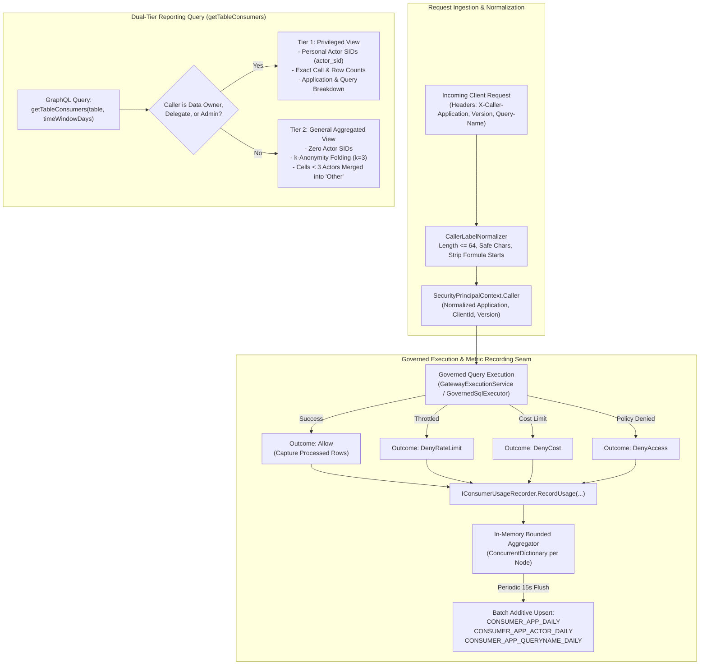
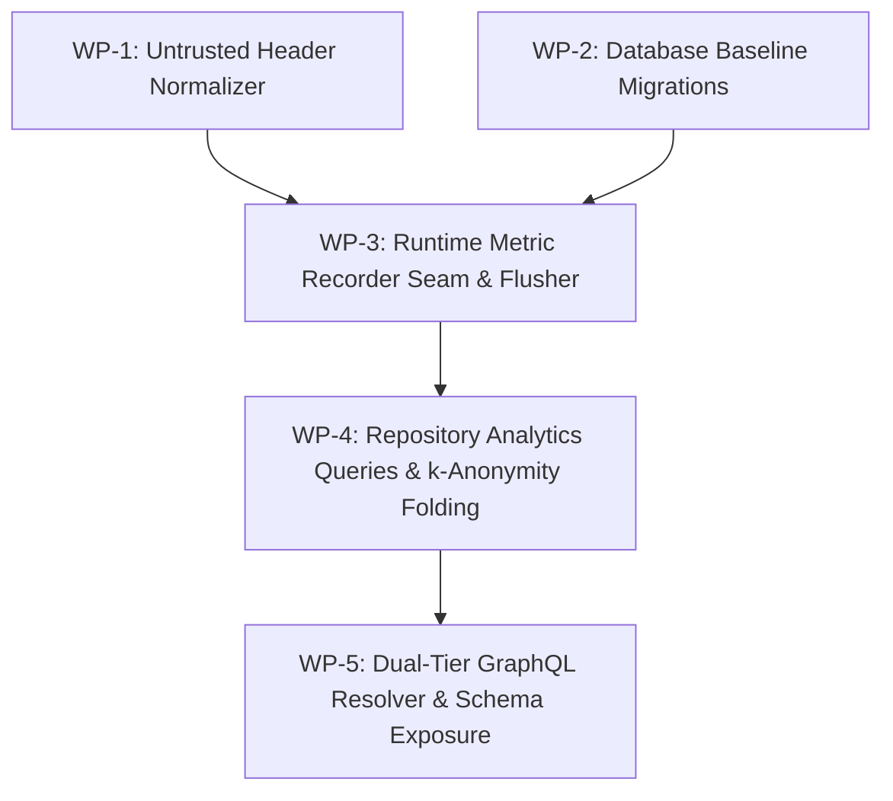

# Implementation Plan: Consumers per Calling Application

**Document ID:** `PLAN-AUD-114`  
**Date:** 2026-10-18  
**Author:** Phase 2 Solution Architect (`csharp-architect`)  
**Target Branch:** `feat/issue-114-consumers-calling-application`  
**Parent Plan:** [00-master-plan-overview.md](00-master-plan-overview.md) (Wave 3, Rank 3.4, Step I-23)  
**Input PRD:** [2026-10-18-issue-intake-consumers-and-access-requests.md](2026-10-18-issue-intake-consumers-and-access-requests.md) (§1, §3 `REQ-AUD-114`)  
**Status:** Approved for Implementation  

---

## 1. Executive Summary & Problem Context

Data owners, dataset stewards, and platform capacity planners need observability into which applications consume their datasets, the volume of rows streamed, and whether specific applications encounter operational bottlenecks or policy rejections.

Currently, the [`getTableConsumers`](file:///root/autheris/src/Autheris.GraphQL/Types/QueryTypes.cs#L540-L596) GraphQL query scans historical audit logs in [`LineageImpactAnalyzerService`](file:///root/autheris/src/Autheris.Application/Lineage/LineageImpactAnalyzerService.cs#L176-L362), aggregating exclusively by raw `ActorSid` (user identity). This architectural approach exhibits three critical deficiencies:
1. **Lack of Application Attribution & Operational Metrics:** Telemetry hints (`X-Caller-Application`, `X-Caller-Version`, `X-Caller-Query-Name`) stored in `AUDIT_LOG_ENTRIES.details_json` are unaggregated and expensive to parse. Streamed row counts and categorized policy rejections (`rate_limit`, `cost`, `access`) are not tracked per application or day.
2. **Privacy Violations & Re-Identification Risk:** Exposing raw user SIDs (`ActorSid`) and timestamps to general users directly violates GDPR Art. 5(1)(c) (Data Minimization) and Art. 25 (Data Protection by Design).
3. **Audit Log Performance Degradation:** Attempting to extract and aggregate JSON structures over millions of append-only audit entries causes large-scale table scans, index misses, and GC allocation spikes.

This implementation plan delivers a high-performance, privacy-preserving consumer analytics subsystem:
1. **Pre-Aggregated Daily Metric Counters:** Decoupled from the forensic audit trail, lightweight counter tables (`CONSUMER_APP_DAILY`, `CONSUMER_APP_ACTOR_DAILY`, `CONSUMER_APP_QUERYNAME_DAILY`) maintain aggregated call counts, rows returned, and categorized rejections (`access`, `rate_limit`, `cost`) grouped by table, UTC day, and normalized application name.
2. **Untrusted Header Normalization (`CallerLabelNormalizer`):** Client-supplied telemetry headers are validated against strict character allowlists (`[A-Za-z0-9._ -]`, max 64 chars) and sanitized against formula injection (`=`, `+`, `-`, `@`) before persistence.
3. **Dual-Tier Authorization & k-Anonymity Folding:**
   - **Privileged Tier (Data Owners, Delegates, Governance Admins):** Authorized via [`IDataOwnershipRepository.IsAuthorizedApproverForTableAsync`](file:///root/autheris/src/Autheris.Application/Interfaces/IGovernanceRepository.cs#L246) and `IsGovernanceAdmin`. Receives granular consumption details, including personal actor breakdown and specific query names.
   - **General Tier (Non-Privileged Consumers):** Receives strictly aggregated application-level statistics. Raw actor SIDs are suppressed. Applications with fewer than $k$ ($k=3$) distinct actors are automatically folded into an `Other Applications` bucket to prevent re-identification.
4. **Decoupled Retention Lifecycle:** Metric counters are bounded and automatically cleaned up according to `AuditLoggingOptions.DataAccessDays` (default 400 days), completely decoupled from the audit retention purge worker (#161, Decision D-5).

---

## 2. Verified Code Facts Beyond the PRD

| # | Fact | Evidence & Architectural Consequence |
|---|---|---|
| **V-1** | Header sanitization in `SecurityContextFactory` is insufficient | [`SecurityContextFactory.cs:182-200`](file:///root/autheris/src/Autheris.Api/Security/SecurityContextFactory.cs#L182-L200) only strips control characters and truncates to 128 characters. Leading formula injection prefixes (`=`, `+`, `-`, `@`, tab) and arbitrary punctuation pass unescaped. A strict pure normalizer is required. |
| **V-2** | Rows returned are not recorded in audit log entries | [`GatewayExecutionService.cs:260-262`](file:///root/autheris/src/Autheris.Application/Services/GatewayExecutionService.cs#L260-L262) records audit entries *before* query execution. The final row count (`processedRows`) is known only after streaming completes. Querying rows returned from the audit trail is impossible without schema breaks; a runtime counter seam is required. |
| **V-3** | WebSQL queries audit the data source name, not the accessed table | [`GovernedSqlExecutor.cs:302, 348`](file:///root/autheris/src/Autheris.Application/Sql/GovernedSqlExecutor.cs#L302) sets `TargetTable` to the data source identifier, not individual tables. Table-level attribution for WebSQL requires hooking into `GovernedRewrite.AccessedTables`. |
| **V-4** | Rejection exceptions lack categorized audit attribution | Throttling exceptions (`GatewayThrottledException`) and cost violations (`CostLimitExceededException`) throw directly without persisting structured rejection categories. A unified recorder seam must intercept these failure paths. |
| **V-5** | `IsAuthorizedApproverForTableAsync` serves as the canonical ownership check | [`SqliteGovernanceRepository.Catalog.cs:958-990`](file:///root/autheris/src/Autheris.Infrastructure/Persistence/SqliteGovernanceRepository.Catalog.cs#L958-L990) accurately validates table owners, active delegates, and governance admins. Reusing this method ensures 100% policy parity for dual-tier gating. |
| **V-6** | Small group aggregation vocabulary exists in `TableModels.cs` | [`TableModels.cs:27-32`](file:///root/autheris/src/Autheris.Domain/Model/TableModels.cs#L27-L32) defines `SmallGroupStrategy` (`MergeIntoOther`, `Suppress`). While `GovernedAggregationService` uses this for data rows, the vocabulary and folding logic can be mirrored for consumer telemetry. |
| **V-7** | Database shape snapshots enforce strict baseline parity | Adding `CONSUMER_APP_DAILY`, `CONSUMER_APP_ACTOR_DAILY`, and `CONSUMER_APP_QUERYNAME_DAILY` requires updating SQLite, PostgreSQL, and SQL Server baseline schemas and shape files. |

---

## 3. Architectural Decisions



### Decision D-1: Pre-Aggregated Counters vs Audit Log Scanning
- **Context:** Scanning `AUDIT_LOG_ENTRIES` for application consumption requires filtering by table, deserializing large `details_json` strings, and grouping across millions of rows. Furthermore, streamed row counts are not stored in the audit trail.
- **Decision:** Implement dedicated pre-aggregated counter tables (`CONSUMER_APP_DAILY`, `CONSUMER_APP_ACTOR_DAILY`, `CONSUMER_APP_QUERYNAME_DAILY`). Query execution records in-memory delta increments flushed periodically (every 15 seconds) using additive upserts (`ON CONFLICT DO UPDATE SET calls = calls + excluded.calls`). This guarantees $O(1)$ write overhead on request threads and sub-50ms report queries without touching the audit trail.

### Decision D-2: Untrusted Header Normalization (`CallerLabelNormalizer`)
- **Context:** HTTP headers `X-Caller-Application`, `X-Caller-Version`, and `X-Caller-Query-Name` are untrusted client telemetry. Attackers could attempt CSV formula injection (`=cmd|...`), log injection, or database bloat via high-cardinality random strings.
- **Decision:** Enforce strict normalization in `CallerLabelNormalizer`:
  1. Truncate to maximum 64 characters (32 for version).
  2. Reject leading formula characters: `=`, `+`, `-`, `@`, `\t`, `\r`.
  3. Validate against regex `^[A-Za-z0-9._ -]+$`; non-matching values fall back to `invalid`. Missing headers fall back to `unknown`.
  4. Reserved sentinels (`unknown`, `invalid`, `other`) cannot be supplied by clients.
  5. Lowercase fold for grouping and display.

### Decision D-3: Dual-Tier Authorization & Privacy Minimization (GDPR Art. 5/25)
- **Context:** Individual query logs contain personal data (who accessed what table, when, and how often). Exposing personal SIDs to all users creates severe privacy and employee monitoring risks.
- **Decision:** Enforce strict dual-tier access in `getTableConsumers`:
  - **Tier 1 (Privileged):** Requires `IDataOwnershipRepository.IsAuthorizedApproverForTableAsync(tableId, callerSid)` or `GovernanceAdmin` role. Caller receives exact caller counts, individual `ActorSid` fields, specific client application versions, and query names.
  - **Tier 2 (General):** Non-privileged callers receive aggregated application summaries only. All personal identifiers (`actor_sid`, individual timestamps) are suppressed.

### Decision D-4: k-Anonymity ($k=3$) Cell Folding Algorithm
- **Context:** In small teams or niche applications, an aggregated application metric might still allow re-identifying an individual (e.g., if only one executive uses the "ExecDashboard" app).
- **Decision:** Enforce $k$-anonymity folding with $k=3$:
  1. For each `(application, day)` cell, calculate the distinct actor count using hashed samples in `CONSUMER_APP_ACTOR_DAILY`.
  2. If distinct actors $< 3$, merge the cell metrics (`calls`, `rows_returned`, `rejections`) into an `Other Applications` bucket.
  3. If the union of distinct actors in the `Other Applications` bucket is also $< 3$, suppress the counts entirely and return `suppressedSmallGroups = true`.

### Decision D-5: Multi-Table WebSQL & Join Attribution
- **Context:** WebSQL statements can join multiple tables. Attributing metrics only to the data source obscures table consumption.
- **Decision:** Intercept rewritten ASTs in `GovernedSqlExecutor`. For each table present in `GovernedRewrite.AccessedTables`:
  - Record one query call and attributable rejection outcome.
  - If the query accesses exactly one table, attribute the full `rows_returned` to that table. If the query joins multiple tables, record `rows_returned = 0` and flag `rowsMeasured = false` for that call to prevent double-counting or inaccurate row attribution.

---

## 4. Work Packages

### WP-1: Untrusted Header Normalizer (`CallerLabelNormalizer`) (`SEC-AUD114-01`)
- **Objective:** Implement pure domain normalizer to sanitize and bound all incoming caller telemetry headers.
- **Files to Create/Modify:**
  - [`src/Autheris.Domain/Security/CallerLabelNormalizer.cs`](file:///root/autheris/src/Autheris.Domain/Security/CallerLabelNormalizer.cs) *(new)*:
    - Pure static class:
      ```csharp
      public static class CallerLabelNormalizer
      {
          public const int MaxApplicationLength = 64;
          public const int MaxVersionLength = 32;
          public const int MaxQueryNameLength = 64;

          private static readonly SearchValues<char> SafeChars = SearchValues.Create(
              "abcdefghijklmnopqrstuvwxyzABCDEFGHIJKLMNOPQRSTUVWXYZ0123456789._ -");

          private static readonly HashSet<string> ReservedSentinels = new(StringComparer.OrdinalIgnoreCase)
          {
              "unknown", "invalid", "other"
          };

          public static string NormalizeApplication(string? raw)
          {
              if (string.IsNullOrWhiteSpace(raw)) return "unknown";
              var trimmed = raw.Trim();
              if (trimmed.Length > MaxApplicationLength) trimmed = trimmed[..MaxApplicationLength];

              // Formula injection guard
              char first = trimmed[0];
              if (first is '=' or '+' or '-' or '@' or '\t' or '\r') return "invalid";

              // Character validation
              if (trimmed.AsSpan().ContainsAnyExcept(SafeChars)) return "invalid";
              if (ReservedSentinels.Contains(trimmed)) return "invalid";

              return trimmed.ToLowerInvariant();
          }

          public static string NormalizeVersion(string? raw) => /* max 32 chars, safe chars */
          public static string NormalizeQueryName(string? raw) => /* max 64 chars, safe chars */
      }
      ```
  - [`src/Autheris.Api/Security/SecurityContextFactory.cs`](file:///root/autheris/src/Autheris.Api/Security/SecurityContextFactory.cs):
    - Update `ExtractCallerContext` to use `CallerLabelNormalizer`.
- **Test Criteria:**
  - Comprehensive unit tests in `CallerLabelNormalizerTests`:
    - Formulas (`=1+1`, `@SUM`, `-cmd`) map to `"invalid"`.
    - Non-ASCII / homoglyphs map to `"invalid"`.
    - Strings exceeding 64 chars are safely truncated and validated.
    - Reserved keywords map to `"invalid"`.

### WP-2: Database Baseline Migrations & Metric Counter Tables
- **Objective:** Add `CONSUMER_APP_DAILY`, `CONSUMER_APP_ACTOR_DAILY`, and `CONSUMER_APP_QUERYNAME_DAILY` tables to baseline DDL and schema shapes.
- **Files to Modify:**
  - [`src/Autheris.Infrastructure/Persistence/Migrations/SqliteBaselineSchema.cs`](file:///root/autheris/src/Autheris.Infrastructure/Persistence/Migrations/SqliteBaselineSchema.cs):
    - Add table definitions and indexes:
      ```sql
      CREATE TABLE IF NOT EXISTS CONSUMER_APP_DAILY (
          tenant_id TEXT NOT NULL,
          table_id TEXT NOT NULL,
          day TEXT NOT NULL,
          application TEXT NOT NULL,
          client_id TEXT NOT NULL DEFAULT '',
          version TEXT NOT NULL DEFAULT '',
          calls INTEGER NOT NULL DEFAULT 0,
          rows_returned INTEGER NOT NULL DEFAULT 0,
          rows_measured_calls INTEGER NOT NULL DEFAULT 0,
          rej_access INTEGER NOT NULL DEFAULT 0,
          rej_rate_limit INTEGER NOT NULL DEFAULT 0,
          rej_cost INTEGER NOT NULL DEFAULT 0,
          rej_other INTEGER NOT NULL DEFAULT 0,
          PRIMARY KEY (tenant_id, table_id, day, application, client_id, version)
      );

      CREATE TABLE IF NOT EXISTS CONSUMER_APP_ACTOR_DAILY (
          tenant_id TEXT NOT NULL,
          table_id TEXT NOT NULL,
          day TEXT NOT NULL,
          application TEXT NOT NULL,
          actor_hash TEXT NOT NULL,
          PRIMARY KEY (tenant_id, table_id, day, application, actor_hash)
      );

      CREATE TABLE IF NOT EXISTS CONSUMER_APP_QUERYNAME_DAILY (
          tenant_id TEXT NOT NULL,
          table_id TEXT NOT NULL,
          day TEXT NOT NULL,
          application TEXT NOT NULL,
          query_name TEXT NOT NULL,
          calls INTEGER NOT NULL DEFAULT 0,
          PRIMARY KEY (tenant_id, table_id, day, application, query_name)
      );
      ```
  - [`src/Autheris.Infrastructure/Persistence/Migrations/PostgreSqlBaselineSchema.cs`](file:///root/autheris/src/Autheris.Infrastructure/Persistence/Migrations/PostgreSqlBaselineSchema.cs):
    - Add equivalent PostgreSQL DDL.
  - [`src/Autheris.Infrastructure/Persistence/Migrations/SqlServerBaselineSchema.cs`](file:///root/autheris/src/Autheris.Infrastructure/Persistence/Migrations/SqlServerBaselineSchema.cs):
    - Add equivalent SQL Server DDL.
  - [`src/Autheris.Infrastructure/Persistence/Migrations/Shape/governance-shape.*.json`](file:///root/autheris/src/Autheris.Infrastructure/Persistence/Migrations/Shape/):
    - Synchronize schema snapshots.
- **Test Criteria:**
  - `GovernanceSchemaShapeSnapshotTests` pass with zero schema drift.

### WP-3: Runtime Metric Recorder Seam & In-Memory Batch Flusher
- **Objective:** Implement `IConsumerUsageRecorder` and background flushing service with additive upserts.
- **Files to Create/Modify:**
  - [`src/Autheris.Application/Interfaces/IConsumerUsageRecorder.cs`](file:///root/autheris/src/Autheris.Application/Interfaces/IConsumerUsageRecorder.cs) *(new)*:
    - Contract:
      ```csharp
      public enum ConsumerOutcome { Allow, DenyAccess, DenyRateLimit, DenyCost, DenyOther }
      public interface IConsumerUsageRecorder
      {
          void RecordUsage(TableIdentifier tableId, TenantId tenantId, Sid actorSid, ConsumerOutcome outcome, long rowsReturned, bool rowsMeasured);
      }
      ```
  - [`src/Autheris.Infrastructure/Observability/ConsumerUsageRecorder.cs`](file:///root/autheris/src/Autheris.Infrastructure/Observability/ConsumerUsageRecorder.cs) *(new)*:
    - Thread-safe, lock-free in-memory aggregation via `ConcurrentDictionary`.
    - Employs HMAC-SHA256 actor hashing using a cluster secret to preserve pseudonymity.
  - [`src/Autheris.Infrastructure/Observability/ConsumerUsageFlushWorker.cs`](file:///root/autheris/src/Autheris.Infrastructure/Observability/ConsumerUsageFlushWorker.cs) *(new)*:
    - Periodic hosted service (15-second flush interval).
    - Flushes aggregated deltas using dialect-specific batch upsert queries (`INSERT ... ON CONFLICT DO UPDATE` in PG/SQLite; `MERGE` in SQL Server).
    - Executes daily purge of expired counter rows where `day < today - DataAccessDays`.
  - Hook into execution engines:
    - [`src/Autheris.Application/Services/GatewayExecutionService.cs`](file:///root/autheris/src/Autheris.Application/Services/GatewayExecutionService.cs): record rows and throttling exceptions.
    - [`src/Autheris.Application/Sql/GovernedSqlExecutor.cs`](file:///root/autheris/src/Autheris.Application/Sql/GovernedSqlExecutor.cs): record multi-table usage across `AccessedTables`.
    - [`src/Autheris.Application/Governance/Aggregation/GovernedAggregationService.cs`](file:///root/autheris/src/Autheris.Application/Governance/Aggregation/GovernedAggregationService.cs): record cost limit rejections.
- **Test Criteria:**
  - Unit tests in `ConsumerUsageRecorderTests`: verify lock-free concurrency under multi-threaded simulations, zero memory leaks, and additive flushes.

### WP-4: Repository Analytics Queries & k-Anonymity Folding
- **Objective:** Add repository querying methods and implement the $k$-anonymity folding engine.
- **Files to Create/Modify:**
  - [`src/Autheris.Application/Interfaces/IGovernanceRepository.cs`](file:///root/autheris/src/Autheris.Application/Interfaces/IGovernanceRepository.cs):
    - Add `Task<IReadOnlyList<ConsumerAppDailySummary>> QueryConsumerAppDailyAsync(TableIdentifier tableId, TenantId tenantId, DateTimeOffset fromUtc, DateTimeOffset toUtc, CancellationToken ct);`
    - Add `Task<IReadOnlyDictionary<string, int>> QueryDistinctActorCountsAsync(TableIdentifier tableId, TenantId tenantId, DateTimeOffset fromUtc, DateTimeOffset toUtc, CancellationToken ct);`
  - [`src/Autheris.Application/Lineage/ConsumerFolding.cs`](file:///root/autheris/src/Autheris.Application/Lineage/ConsumerFolding.cs) *(new)*:
    - Pure static folding algorithm:
      - Takes raw summaries and distinct actor counts.
      - Folds cells with $< 3$ distinct actors into `other`.
      - Suppresses `other` if combined actor count $< 3$.
  - Implement repository queries in `SqliteGovernanceRepository`, `PostgreSqlGovernanceRepository`, and `SqlServerGovernanceRepository`.
- **Test Criteria:**
  - Unit tests in `ConsumerFoldingTests`: test exact folding behavior, differencing safety, and suppression fallback.

### WP-5: Dual-Tier GraphQL Resolver & Schema Exposure (`SEC-AUD114-02`)
- **Objective:** Update `getTableConsumers` to deliver dual-tier views based on caller authorization.
- **Files to Modify:**
  - [`src/Autheris.GraphQL/Types/QueryTypes.cs`](file:///root/autheris/src/Autheris.GraphQL/Types/QueryTypes.cs):
    - In `getTableConsumers(table, timeWindowDays)`:
      - Resolve caller context.
      - Evaluate authorization: `isPrivileged = callerContext.IsGovernanceAdmin || await ownershipRepo.IsAuthorizedApproverForTableAsync(tableId, callerSid, ct)`.
      - If privileged: return full view with per-person breakdown (`ActorSid`), versions, query names, exact row counts, and rejection details.
      - If non-privileged: invoke `ConsumerFolding.Fold(summaries, minActors: 3)`, returning aggregated application summaries with zero personal SIDs.
  - [`src/Autheris.Domain/Model/LineageModels.cs`](file:///root/autheris/src/Autheris.Domain/Model/LineageModels.cs):
    - Extend GraphQL response types: `TableConsumersReport`, `CallingApplicationUsage`, `RejectionBreakdown`.
- **Test Criteria:**
  - End-to-end integration tests:
    - Data owner sees full actor list and applications.
    - Unauthorized consumer sees only aggregated applications; actor list is null/empty.
    - Small application cells ($< 3$ actors) are merged into `other`.

---

## 5. Fail-Closed and Security Summary

1. **Header Sanitization & Injection Defense (`SEC-AUD114-01`):**
   - Untrusted headers are never passed directly to database queries or log interpolation strings.
   - Any character outside `[A-Za-z0-9._ -]` or leading formula triggers (`=`, `+`, `-`, `@`) causes the label to immediately fall back to the safe sentinel `"invalid"`.
2. **Dual-Tier Privacy Gate (`SEC-AUD114-02`):**
   - Personal data (`ActorSid`, individual activity) is strictly confined to data owners, delegates, and governance admins.
   - General callers are gated fail-closed: unless ownership or admin status is proven via cryptographic token claims and repository records, personal SIDs are never returned.
3. **Anti-Reidentification via k-Anonymity ($k=3$):**
   - Small application cells with distinct human actors $< 3$ are folded into `Other Applications`. If the aggregate bucket still does not meet the threshold, counts are suppressed entirely.
4. **Decoupled Metric Lifecycle:**
   - Pre-aggregated metrics are decoupled from the cryptographic audit hash chain. Database purges on `CONSUMER_APP_DAILY` do not affect `AUDIT_LOG_ENTRIES` sequence integrity or trigger audit chain latches.
5. **Zero Allocation Hot Path:**
   - Recording metric increments on request threads uses lock-free `ConcurrentDictionary` buffers, avoiding LOH allocations and database latency spikes.

---

## 6. Acceptance Criteria Mapping (PRD Traceability)

| PRD AC | Description | Architectural Implementation & Verification |
|---|---|---|
| **AC-114-01** | `getTableConsumers` groups runtime query metrics by calling application and day | Handled via pre-aggregated `CONSUMER_APP_DAILY` query grouped by application and UTC day. |
| **AC-114-02** | Returns aggregated call volume, total rows returned, and rejection counts | Summary model includes `Calls`, `RowsReturned`, and categorized `Rejections` (`access`, `rateLimit`, `cost`). |
| **AC-114-03** | Includes observed caller versions and query names per application | Captured and stored in `CONSUMER_APP_DAILY.version` and `CONSUMER_APP_QUERYNAME_DAILY`. |
| **AC-114-04** | Callers lacking owner/admin privileges receive only aggregated view with zero personal SIDs | Enforced in `getTableConsumers` resolver; personal SIDs omitted from general tier responses. |
| **AC-114-05** | Applications with fewer than $k$ ($k=3$) actors folded into `Other Applications` | Pure folding engine `ConsumerFolding` merges cells $< 3$ actors into `other`. |
| **AC-114-06** | Headers exceeding 64 chars or malicious characters sanitized; formula starts stripped | `CallerLabelNormalizer` validates safe chars, truncates length, and rejects formula prefixes. |
| **AC-114-07** | WebSQL and multi-table AST queries attribute row counts and rejections to all tables | `GovernedSqlExecutor` records usage across all tables in `AccessedTables`. |
| **AC-114-08** | Querying statistics does not execute full-table audit scans or trigger LOH allocations | Pre-aggregated indexed counter reads return bounded rows in $< 50$ ms. |

---

## 7. Sequencing & Parallelisation



- **Phase 2.1 (Domain & Schema Foundation):** WP-1 and WP-2 execute concurrently.
- **Phase 2.2 (Runtime Ingestion):** WP-3 hooks into execution pipelines and flushes buffered metrics.
- **Phase 2.3 (Data Layer & Folding):** WP-4 implements analytics queries and the $k$-anonymity folding engine.
- **Phase 2.4 (Reporting Exposure):** WP-5 updates the GraphQL schema and dual-tier authorization gate.

---

## 8. Phase 3 Security Review & Binding Conditions (`csharp-security-expert`)

**Audit Verdict:** `APPROVED WITH CONDITIONS`  
**Security Evaluator:** Phase 3 Security Expert (`csharp-security-expert`)  
**Evaluation Standard:** Zero-Trust, Least Privilege, Privacy by Design, Anti-Injection, Constant-Time Operations  

### 8.1 Binding Security Conditions

- **SEC-AUD114-01 (Strict Header Normalization & Formula Guard):**
  - All caller telemetry headers (`X-Caller-Application`, `X-Caller-Version`, `X-Caller-Query-Name`) MUST pass through `CallerLabelNormalizer` prior to in-memory buffering or database persistence.
  - Maximum lengths MUST be strictly enforced (64 characters for application and query-name; 32 characters for version).
  - Characters outside `[A-Za-z0-9._ -]` MUST NOT be sanitized by substitution; they MUST cause immediate rejection to the safe sentinel `"invalid"`.
  - Leading formula characters (`=`, `+`, `-`, `@`, `\t`, `\r`) MUST evaluate to `"invalid"` to prevent CSV/spreadsheet formula injection.
  - Reserved sentinels (`unknown`, `invalid`, `other`) cannot be supplied by clients and evaluate to `"invalid"`.
  - Telemetry headers MUST NEVER be used as authorization credentials, tenant selectors, or rate limit bypass tokens.
- **SEC-AUD114-02 (Fail-Closed Dual-Tier Privacy Gate):**
  - Returning personal SIDs or detailed individual query activity requires explicit proof that the caller is a Data Owner or active Delegate for the requested table (`IDataOwnershipRepository.IsAuthorizedApproverForTableAsync`), or possesses the `GovernanceAdmin`/`ClusterAdmin` role.
  - If privileged authorization cannot be proven, the query MUST fail closed to the aggregated $k$-anonymized view with all personal identifiers (`ActorSid`, specific query names) strictly omitted.
- **SEC-AUD114-03 (Anti-Reidentification k-Anonymity Invariant):**
  - In general tier responses, any application group with distinct human actors $< 3$ MUST be merged into `Other Applications`.
  - If the merged `Other Applications` bucket has distinct human actors $< 3$, row and call metrics for the bucket MUST be suppressed (`suppressedSmallGroups = true`).
  - The folding algorithm MUST NOT leak small-group differences through summary totals (differencing attack defense).
- **SEC-AUD114-04 (Pseudonymous Actor Hashing):**
  - Distinct actor sampling in `CONSUMER_APP_ACTOR_DAILY` MUST store HMAC-SHA256 hashes of the actor SID keyed with an internal cluster secret. Raw SIDs MUST NEVER be persisted in consumer counter tables.
  - Any internal secret or token comparison in the pipeline MUST use `CryptographicOperations.FixedTimeEquals` to prevent timing attacks.
- **SEC-AUD114-05 (Bounded Aggregation & Decoupled Audit Purge Lifecycle):**
  - The in-memory buffer in `ConsumerUsageRecorder` MUST be bounded to at most 20,000 distinct series. If saturated, additional series MUST be safely dropped and counted under an overflow metric, never causing an out-of-memory crash.
  - Daily consumer counter tables queries MUST be bounded by date range with an enforced maximum time window (maximum 400 days).
  - Metric counter retention purge MUST be completely decoupled from the audit retention purge worker (#161) and audit hash chains: counter purges MUST NOT alter `AUDIT_LOG_ENTRIES` sequence integrity or trigger audit chain latches.

### 8.2 Mandatory Security Test Requirements

All security tests must be tagged with `[Trait("Category", "Security")]`:

| Test ID | Test Method Name | Invariant Verified |
|---|---|---|
| **SEC-TEST-114-01** | `Normalizer_FormulaPrefixes_EvaluatesToInvalid` | Enforces `SEC-AUD114-01`: Headers starting with `=cmd`, `@SUM`, `+`, `-` map to `"invalid"`. |
| **SEC-TEST-114-02** | `Normalizer_MaliciousCharacters_EvaluatesToInvalid` | Enforces `SEC-AUD114-01`: Non-ASCII and special characters map to `"invalid"`. |
| **SEC-TEST-114-03** | `Normalizer_ReservedSentinels_EvaluatesToInvalid` | Enforces `SEC-AUD114-01`: Client attempting to pass `"other"`, `"unknown"`, `"invalid"` maps to `"invalid"`. |
| **SEC-TEST-114-04** | `Normalizer_LengthTruncation_BoundsLength` | Enforces `SEC-AUD114-01`: Headers exceeding 64 chars are safely truncated and validated. |
| **SEC-TEST-114-05** | `DualTierGate_NonOwner_SuppressesPersonalSids` | Enforces `SEC-AUD114-02`: Unauthorized caller receives aggregated report with null/empty personal SIDs. |
| **SEC-TEST-114-06** | `DualTierGate_DataOwner_ExposesPersonalBreakdown` | Enforces `SEC-AUD114-02`: Verified data owner receives detailed actor SIDs and query names. |
| **SEC-TEST-114-07** | `kAnonymity_ActorsBelowThree_FoldsToOther` | Enforces `SEC-AUD114-03`: Application with $< 3$ distinct actors is merged into `Other Applications`. |
| **SEC-TEST-114-08** | `kAnonymity_OtherBucketBelowThree_SuppressesCounts` | Enforces `SEC-AUD114-03`: Combined `other` bucket with $< 3$ actors suppresses counts. |
| **SEC-TEST-114-09** | `ActorHashing_PersistsPseudonymousHmacOnly` | Enforces `SEC-AUD114-04`: Counter table stores HMAC-SHA256, never raw actor SID. |
| **SEC-TEST-114-10** | `MultiTableWebSql_AttributesRejectionsAcrossAllTables` | Enforces `AC-114-07`: Multi-table SQL rejection attributes to each accessed table. |
| **SEC-TEST-114-11** | `MultiTableWebSql_JoinsDoNotMultiplyRows` | Enforces `AC-114-07`: Multi-table SQL read records `rowsMeasured = false` to avoid double-counting. |
| **SEC-TEST-114-12** | `BufferSaturation_DropsSafelyWithoutMemoryLeak` | Enforces `SEC-AUD114-05`: Over-capacity buffer drops series without crash or OOM. |
| **SEC-TEST-114-13** | `DecoupledPurge_DoesNotAffectAuditHashChain` | Enforces `SEC-AUD114-05`: Purging consumer counter tables leaves audit hash chain intact. |
