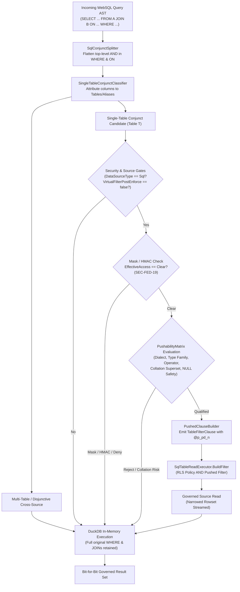
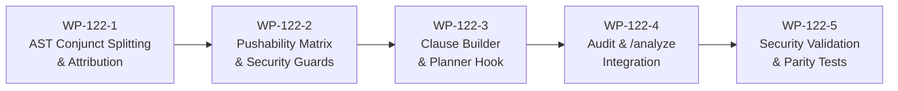
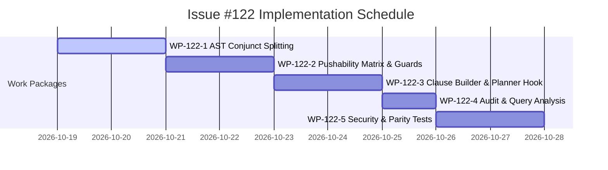

# Implementation Plan: Predicate Pushdown in Cross-Source WebSQL

**Document ID:** `PLAN-DATA-122`  
**Date:** 2026-10-18  
**Author:** Phase 2 Solution Architect (`csharp-architect`)  
**Target Branch:** `feat/issue-122-websql-filter-pushdown`  
**Parent Plan:** [00-master-plan-overview.md](file:///root/autheris/docs/plans/00-master-plan-overview.md) (Wave 2, Rank 2.16)  
**Input PRD:** [2026-10-18-issue-intake-websql-filter-pushdown.md](file:///root/autheris/docs/plans/2026-10-18-issue-intake-websql-filter-pushdown.md) (`REQ-DATA-122`)  
**Status:** APPROVED WITH CONDITIONS (Phase 3 Security Reviewed)  

---

## 1. Executive Summary & Problem Context

Cross-source federated WebSQL enables clients to query and join disparate data sources (PostgreSQL, SQL Server, SQLite, DuckDB, HTTP) via a unified SQL interface. Currently, [`CrossSourcePlanner`](file:///root/autheris/src/Autheris.Application/Sql/Services/CrossSourcePlanner.cs#L292-L300) unconditionally hardcodes `PushdownFilter: null` for all staged tables (`StagingTableRequest.PushdownFilter = null`). Consequently, [`FederatedStagingService`](file:///root/autheris/src/Autheris.Application/Olap/FederatedStagingService.cs#L162-L245) stages every table in its entirety up to `budget.MaxStagedRowsPerTable + 1` rows before DuckDB evaluates user-specified filters in memory.

When an operational table exceeds `MaxStagedRowsPerTable` (e.g., 50,000 rows), selective queries—such as `WHERE customer_id = 42 AND status = 'ACTIVE'`—fail catastrophically with `ROW_LIMIT_EXCEEDED`, even when matching only a single record.

This architectural implementation delivers:
1. **AST Conjunct Splitting & Attribution (WP-122-1):** Decomposes top-level query `WHERE` and `INNER JOIN` / `LEFT JOIN` `ON` clauses into boolean `AND` conjuncts using a zero-allocation AST visitor. Conjuncts referencing columns of exactly one source table are isolated as pushdown candidates.
2. **Fail-Closed Dialect & Superset Pushability Matrix (WP-122-2):** Evaluates conjuncts against a dialect capability matrix (`PushabilityMatrix`) covering SQLite, PostgreSQL, SQL Server, and DuckDB. Pushed filters guarantee mathematical superset semantics (accommodating collation differences, trailing whitespace padding, and ANSI Three-Valued Logic `NULL` handling). Unsupported constructs remain exclusively in DuckDB.
3. **Zero-Trust RLS Conjunction & Filter Oracle Defense (WP-122-2, WP-122-3):** Pushed predicates are boolean `AND`-combined with active Gateway Row-Level Security (RLS) policies (`CombinedRowFilterSql`); pushdown strictly narrows reads and never widens permissions. Crucially, any predicate referencing a masked, HMAC-pseudonymized, or denied column is **strictly forbidden from pushdown** (`SEC-FED-19`), preventing side-channel inference oracles.
4. **Parameterized `TableFilterClause` AST Generation (WP-122-3):** Strictly zero dynamic SQL string concatenation. All pushed filters emit parameterized Trino AST expressions with isolated `@p_pd_<n>` parameters. Duplicate parameter name collisions fail closed immediately with `SecurityException` (`SEC-ADG-02`).
5. **Structural Audit Logging & Query Analysis Integration (WP-122-4):** Emits structural staging audit metadata (referenced columns, operator kinds, counts; zero parameter values or PII payloads). Integrates with static query analysis (`POST /api/v1/governance/queries/analyze` / Issue #175) to expose pushed versus residual predicates for execution cost modeling.

---

## 2. Verified Code Facts Beyond the PRD

| # | Fact | Evidence & Architectural Consequence |
|---|---|---|
| **V-1** | `StagingTableRequest.PushdownFilter` already exists | [`IFederatedStagingService.cs:19`](file:///root/autheris/src/Autheris.Application/Olap/IFederatedStagingService.cs#L19) declares `TableFilterClause? PushdownFilter = null`. Currently, [`CrossSourcePlanner.cs:298`](file:///root/autheris/src/Autheris.Application/Sql/Services/CrossSourcePlanner.cs#L298) instantiates it as `PushdownFilter: null`. |
| **V-2** | `FederatedStagingService` forwards `PushdownFilter` for SQL sources | [`FederatedStagingService.cs:200-203`](file:///root/autheris/src/Autheris.Application/Olap/FederatedStagingService.cs#L200-L203) attaches `req.PushdownFilter` to `session.Items[TableQueryItems.Filter]` when `req.Metadata.Table.DataSourceType == DataSourceType.Sql`. HTTP declarative sources ignore it. |
| **V-3** | `SqlTableReadExecutor` combines `TableQueryItems.Filter` with arguments and RLS | [`SqlTableReadExecutor.cs:299-362`](file:///root/autheris/src/Autheris.Application/Services/SqlTableReadExecutor.cs#L299-L362) merges `TableQueryItems.Filter` with equality arguments via `AND`, checking for parameter name collisions with `SEC-ADG-02` fail-closed semantics. |
| **V-4** | `TableFilterClause` requires a `TrinoSqlFactory` | [`IGatewayExecutionService.cs:88-96`](file:///root/autheris/src/Autheris.Application/Interfaces/IGatewayExecutionService.cs#L88-L96) enforces fail-closed planning: calling `GetTrinoPredicate` throws `NotSupportedException` if `TrinoSqlFactory` is absent. Hand-assembled SQL strings are strictly prohibited. |
| **V-5** | `AstSimplificationVisitor` implements `FlattenAnd` | [`AstSimplificationVisitor.cs:282-293`](file:///root/autheris/src/TrinoSqlEngine/Ast/Visitors/AstSimplificationVisitor.cs#L282-L293) decomposes binary `AND` trees into flat conjunct lists. This visitor pattern forms the basis for `SqlConjunctSplitter`. |
| **V-6** | HMAC columns pass `EnforceMaskedColumnGuardrails` | [`CrossSourcePlanner.cs:131`](file:///root/autheris/src/Autheris.Application/Sql/Services/CrossSourcePlanner.cs#L131) and [`GovernedSqlExecutionService.cs:300-310`](file:///root/autheris/src/Autheris.Application/Sql/Services/GovernedSqlExecutionService.cs#L300-L310) permit HMAC comparisons in DuckDB against pseudonyms. Pushing an HMAC filter to an unmasked source would evaluate against cleartext, creating a filter oracle leak. Therefore, pushdown must explicitly require `ColumnAccessLevel.Clear` (`SEC-FED-19`). |
| **V-7** | Gateway-side Virtual Filter enforcement removes rows post-read | [`FederatedStagingService.cs:211-215`](file:///root/autheris/src/Autheris.Application/Olap/FederatedStagingService.cs#L211-L215) enforces post-read filters for certain Virtual Filter tiers. Tables undergoing post-read gateway row removal must be exempted from pushdown (`SEC-FED-23`) to prevent count oracle side channels. |
| **V-8** | Query Analysis endpoint model supports additive sections | [`QueryAnalysisModels.cs:179`](file:///root/autheris/src/Autheris.Application/Governance/Analysis/QueryAnalysisModels.cs#L179) defines `QueryAnalysisResult` with `QueryValidationReport` and `QueryAccessRequirementsReport`. It can be cleanly extended with `QueryFederationAnalysis? Federation = null`. |

---

## 3. Architectural Decisions



### Decision D-1: Pure AST Conjunct Extraction Visitor
- **Context:** Extracting `WHERE` and `ON` conjuncts via regular expressions or string parsing creates dialect vulnerabilities, AST drift, and high GC pressure.
- **Decision:** Implement [`SqlConjunctSplitter`](file:///root/autheris/src/Autheris.Application/Sql/Federation/Conjuncts/SqlConjunctSplitter.cs) as an allocation-conscious AST visitor. It traverses `SelectStatement.Body` (`QuerySpecification`) to extract top-level `BinaryExpression(..., BinaryOperator.And, ...)` nodes from:
  1. `QuerySpecification.Where`
  2. `JoinedTableSource.Condition` where `JoinedTableSource.Type == JoinType.Inner`
  3. `JoinedTableSource.Condition` where `JoinedTableSource.Type == JoinType.LeftOuter` (for null-supplying right-side single-table conjuncts only)
- **Superset Invariant:** Disjunctive sub-trees (`OR`) are treated as a single conjunct; if all branches reference the exact same single table, the entire `OR` subtree is eligible for single-table pushdown evaluation. If an `OR` spans multiple tables, it remains undivided and executes in DuckDB.

### Decision D-2: Two-Tier Fail-Closed Dialect Pushability Matrix
- **Context:** Underlying database engines exhibit subtle semantic divergences from ANSI/DuckDB in string collations, trailing space padding, case sensitivity, and Three-Valued Logic (`NULL`). Under-fetching in the source results in silent row loss (data corruption).
- **Decision:** Implement [`PushabilityMatrix`](file:///root/autheris/src/Autheris.Application/Sql/Federation/Pushdown/PushabilityMatrix.cs) using static data tables per [`TargetSqlDialect`](file:///root/autheris/src/Autheris.Domain/Common/TargetSqlDialect.cs) and type family:
  - **Equality (`=`, `IN`):** Pushable to all SQL dialects. SQL Server and SQLite collations return an identical or broader superset of DuckDB; DuckDB re-evaluates the filter to guarantee exact match.
  - **Inequality & Negative Filters (`<>`, `NOT IN`, `NOT LIKE`, `NOT BETWEEN`):** Pushable to PostgreSQL and SQLite (with binary/standard collation). Strictly **prohibited** for SQL Server strings unless marked with catalog hint `exact_compare`, because case-insensitive inequality drops rows that DuckDB would retain.
  - **Three-Valued Logic (`NULL` Safety):** An `InListExpression` where `IsNotIn == true` (`NOT IN`) containing any `NULL` literal or `NULL` bound parameter evaluates to `UNKNOWN` (falsy) in SQL. Pushing such a filter causes unpredictable remote elimination. It is unconditionally rejected from pushdown and left to DuckDB.
  - **LIKE Wildcards:** Permitted if the pattern uses standard ANSI wildcards (`%`, `_`). Patterns containing SQL Server bracket character classes (`[A-Z]`) are rejected.
  - **List Parameter Bounds:** Pushed `IN` clauses are clamped to `DialectCapabilities.MaxBindParameters` (e.g. 1,000 items).

### Decision D-3: Strict Zero-Trust Masked Column Gate (`SEC-FED-19`)
- **Context:** An adversary can craft selective predicates on HMAC or masked columns to infer cleartext values by observing row counts, query response times, or `ROW_LIMIT_EXCEEDED` boundaries (Filter Oracle Attack).
- **Decision:** Pushdown eligibility evaluation directly inspects [`TableAccessDecision.GetEffectiveColumnAccess(columnName, metadata)`](file:///root/autheris/src/Autheris.Domain/Model/TableAccessDecision.cs).
  - If any referenced column has access `ColumnAccessLevel.Mask`, `MaskWithHmac`, or `Deny`, the conjunct **must never be pushed down**.
  - The conjunct is preserved exclusively in DuckDB, where evaluation occurs over pseudonymized values or is rejected by `EnforceMaskedColumnGuardrails`.
  - Tables subject to post-read gateway-side Virtual Filter removal (`SEC-FED-23`) are likewise excluded from pushdown.

### Decision D-4: Pure Parameterized `TableFilterClause` AST Generation
- **Context:** Splicing string literals into remote SQL statements introduces SQL injection vulnerabilities (OWASP API3:2023) and pollutes source plan caches.
- **Decision:** Pushed conjuncts are compiled into structured [`TableFilterClause`](file:///root/autheris/src/Autheris.Application/Interfaces/IGatewayExecutionService.cs#L66) instances:
  - Parameter markers use dedicated prefix `@p_pd_<n>`, preventing collisions with client arguments (`@p_arg_<n>`).
  - Values are passed strictly via `IReadOnlyDictionary<string, object?> Parameters`.
  - `TrinoSqlFactory` is mandatory; fail-closed without exception.
  - In [`SqlTableReadExecutor.BuildFilter`](file:///root/autheris/src/Autheris.Application/Services/SqlTableReadExecutor.cs#L342-L353), when combining pushed filters with RLS, any parameter name collision fails closed immediately by throwing `SecurityException` (`SEC-ADG-02`).

### Decision D-5: Dual Defense Layer (DuckDB Superset Re-Execution)
- **Context:** Subtle edge cases in mathematical functions, floating-point rounding, or timezone definitions could cause remote sources to return divergent rows.
- **Decision:** Staging acts as an accelerator, not an authoritative filter. DuckDB's compiled query AST **retains all original `WHERE` and `JOIN` predicates** (`CrossSourcePlanner.Plan` AST rewrite preserves original filter logic). DuckDB re-filters staged rows in-memory. Result correctness is mathematically identical to an unoptimized read.

### Decision D-6: Query Analysis & Structural Audit Integration
- **Context:** FinOps and security auditors need visibility into pushdown performance and query costs without leaking PII or parameter literals.
- **Decision:**
  - **Staging Audit:** `WebSqlCrossSourceSourceRead` records `filterPushedDown: true`, `pushedPredicateCount: N`, and structural summary `pushedPredicates: [ { "column": "col", "operator": "Equal" } ]`. Zero parameter values or literals are serialized.
  - **Query Analysis (`/analyze` under #79 / #175):** Extends `QueryAnalysisResult` with `QueryFederationAnalysis` detailing per-table pushed predicates and residual DuckDB predicates with clear rejection reason codes (`MASKED_COLUMN`, `MULTI_TABLE`, `UNSUPPORTED_EXPRESSION`, `COLLATION_RISK`, `NOT_SQL_SOURCE`, `GATEWAY_ENFORCED_TABLE`).

---

## 4. Work Packages



### WP-122-1: AST Conjunct Splitting & Expression Classification
- **Objective:** Implement AST traversal to split `WHERE` and join `ON` clauses into boolean `AND` conjuncts and attribute referenced columns to specific source tables.
- **Files to Create:**
  - [`src/Autheris.Application/Sql/Federation/Conjuncts/SqlConjunctSplitter.cs`](file:///root/autheris/src/Autheris.Application/Sql/Federation/Conjuncts/SqlConjunctSplitter.cs):
    - Traverses `SelectStatement` using `SqlAstVisitor`.
    - Decomposes top-level `BinaryExpression(..., BinaryOperator.And, ...)` in `Where` and `JoinedTableSource.Condition`.
    - Honors join semantics:
      - `InnerJoin`: splits both `Where` and `On` conditions.
      - `LeftOuterJoin`: extracts `On` conjuncts referencing only the null-supplying right table; extracts `Where` conjuncts referencing only the preserved left table.
      - `RightOuterJoin`: symmetric to `LeftOuterJoin`.
      - `FullOuterJoin`: excludes all conjuncts from pushdown.
  - [`src/Autheris.Application/Sql/Federation/Conjuncts/SingleTableConjunctClassifier.cs`](file:///root/autheris/src/Autheris.Application/Sql/Federation/Conjuncts/SingleTableConjunctClassifier.cs):
    - Collects all `ColumnReference` nodes in a conjunct.
    - Resolves each qualifier against table targets, short names, and aliases using planner mapping.
    - Classifies conjuncts:
      - `SingleTableConjunct(TableIdentifier Table, Expression Predicate, IReadOnlyList<string> Columns)`
      - `MultiTableConjunct(IReadOnlyList<TableIdentifier> Tables, Expression Predicate)`
- **Test Criteria:**
  - Unit tests verifying nested `(A AND (B AND C))` flattening into `[A, B, C]`.
  - Unit tests verifying single-table `OR` (e.g. `c.status = 'A' OR c.status = 'B'`) is preserved as a single-table candidate, while cross-table `OR` (e.g. `c.id = 1 OR o.id = 2`) is classified as `MultiTable`.
  - Outer join test cases ensuring preserved vs null-supplying boundaries are strictly maintained.

### WP-122-2: Pushability Matrix & Zero-Trust Security Guards (`SEC-FED-19`, `SEC-FED-23`)
- **Objective:** Implement the dialect capability matrix and fail-closed pushability evaluator enforcing superset semantics, Three-Valued Logic, and masked column exclusion.
- **Files to Create:**
  - [`src/Autheris.Application/Sql/Federation/Pushdown/PushabilityMatrix.cs`](file:///root/autheris/src/Autheris.Application/Sql/Federation/Pushdown/PushabilityMatrix.cs):
    - Defines capability rules per `(TargetSqlDialect, TypeFamily, BinaryOperator / UnaryOperator)`.
    - Encodes SQL Server collation restrictions for `<>`, `NOT IN`, `NOT LIKE`.
    - Encodes Three-Valued Logic: rejects `NOT IN` containing `NULL` literals or parameters.
    - Validates wildcards in `LikeExpression`: permits standard `%` and `_`; rejects bracket sets `[...]`.
  - [`src/Autheris.Application/Sql/Federation/Pushdown/PushabilityEvaluator.cs`](file:///root/autheris/src/Autheris.Application/Sql/Federation/Pushdown/PushabilityEvaluator.cs):
    - Inputs: `SingleTableConjunct`, `TableMetadata`, `TableAccessDecision`, `TargetSqlDialect`, `VirtualFilterTablePlan?`.
    - Enforces Security Preconditions:
      1. Source must be SQL (`DataSourceType == Sql`). HTTP declarative sources are strictly excluded.
      2. Table must not have gateway-side row removal (`plan?.Enforcement == null && !plan?.SkipUpstream`).
      3. **STRICT GUARD (`SEC-FED-19`):** Every referenced column must have `decision.GetEffectiveColumnAccess(col, metadata) == ColumnAccessLevel.Clear`. Any column with `Mask`, `MaskWithHmac`, or `Deny` unconditionally disqualifies the conjunct.
      4. Expression must contain only constants, literals, bound parameters, and allowed comparisons. No functions, casts, arithmetic, or subqueries.
    - Returns `PushdownEvaluationResult` (`IsPushable`, `RejectionReason`).
- **Test Criteria:**
  - Unit tests in `PushabilityEvaluatorTests`:
    - Columns with `Mask` or `MaskWithHmac` are rejected with `RejectionReason.MaskedColumn`.
    - SQL Server string inequality `<>` without `exact_compare` is rejected with `RejectionReason.CollationRisk`.
    - `NOT IN ('a', NULL)` is rejected with `RejectionReason.NullInNotInList`.
    - HTTP data source tables rejected with `RejectionReason.NotSqlSource`.

### WP-122-3: Parameterized Clause Builder & Planner Integration
- **Objective:** Construct parameterized `TableFilterClause` objects and hook pushdown evaluation into `CrossSourcePlanner.Plan`.
- **Files to Create/Modify:**
  - [`src/Autheris.Application/Sql/Federation/Pushdown/PushedClauseBuilder.cs`](file:///root/autheris/src/Autheris.Application/Sql/Federation/Pushdown/PushedClauseBuilder.cs) *(new)*:
    - Builds `TableFilterClause` from qualified conjunct AST nodes.
    - Allocates isolated parameter markers `@p_pd_0`, `@p_pd_1`, ...
    - Implements `TrinoSqlFactory` for dialect-neutral rendering.
  - [`src/Autheris.Domain/Options/CrossSourceOptions.cs`](file:///root/autheris/src/Autheris.Domain/Options/CrossSourceOptions.cs):
    - Add pushdown configuration options:
      ```csharp
      public PredicatePushdownOptions PredicatePushdown { get; init; } = new();
      public sealed class PredicatePushdownOptions
      {
          public bool Enabled { get; init; } = true;
          public int MaxInListCount { get; init; } = 1000;
      }
      ```
  - [`src/Autheris.Application/Sql/Services/CrossSourcePlanner.cs`](file:///root/autheris/src/Autheris.Application/Sql/Services/CrossSourcePlanner.cs):
    - In `Plan(...)`:
      - If `options.PredicatePushdown.Enabled`:
        1. Invoke `SqlConjunctSplitter.Split(statement)` on parsed query.
        2. Attribute conjuncts via `SingleTableConjunctClassifier`.
        3. For each resolved table, evaluate pushability via `PushabilityEvaluator`.
        4. If pushable conjuncts exist, emit `TableFilterClause` via `PushedClauseBuilder`.
        5. Pass pushed clause into `new StagingTableRequest(..., PushdownFilter: pushedFilter)`.
      - DuckDB query rewrite preserves the complete original query statement so DuckDB re-executes all predicates.
- **Test Criteria:**
  - Unit tests verifying `CrossSourcePlanner` attaches non-null `PushdownFilter` to SQL tables when filters are selective.
  - Regression test verifying DuckDB AST statement retains full `WHERE` clause.
  - Parameter collision test verifying `SqlTableReadExecutor.BuildFilter` throws `SecurityException` on parameter name overlap.

### WP-122-4: Structural Audit & Query Analysis Integration
- **Objective:** Extend federated staging audit logging with structural pushdown metadata and enrich the `/analyze` endpoint with federation pushdown diagnostics.
- **Files to Modify/Create:**
  - [`src/Autheris.Application/Olap/FederatedStagingService.cs`](file:///root/autheris/src/Autheris.Application/Olap/FederatedStagingService.cs):
    - In `StageAsync`:
      - Extract structural pushdown metadata: `pushedPredicateCount`, `pushedPredicates` (`column`, `operator`).
      - Include in `WebSqlCrossSourceSourceRead` audit payload.
      - Zero-Payload rule: no parameter values or literals are included.
  - [`src/Autheris.Application/Governance/Analysis/QueryAnalysisModels.cs`](file:///root/autheris/src/Autheris.Application/Governance/Analysis/QueryAnalysisModels.cs):
    - Add federation models:
      ```csharp
      public sealed record QueryFederationAnalysis(
          IReadOnlyList<AnalyzedFederatedTable> Tables);

      public sealed record AnalyzedFederatedTable(
          string Table,
          string DataSource,
          bool PushdownApplied,
          IReadOnlyList<AnalyzedPushedPredicate> PushedPredicates,
          IReadOnlyList<AnalyzedResidualPredicate> ResidualPredicates);

      public sealed record AnalyzedPushedPredicate(string Column, string Operator);
      public sealed record AnalyzedResidualPredicate(string Column, string Reason);
      ```
    - Update `QueryAnalysisResult` with optional `QueryFederationAnalysis? Federation = null`.
  - [`src/Autheris.Application/Governance/Analysis/QueryAnalysisService.Sql.cs`](file:///root/autheris/src/Autheris.Application/Governance/Analysis/QueryAnalysisService.Sql.cs):
    - When an analyzed SQL query routes cross-source, invoke `ICrossSourcePlanner.Plan` in static analysis mode.
    - Populate `Federation` section with pushed vs residual predicates.
- **Test Criteria:**
  - Audit tests verifying `WebSqlCrossSourceSourceRead` records `filterPushedDown: true`, `pushedPredicateCount`, and `{column, operator}` structure without parameter values.
  - Integration tests verifying `POST /api/v1/governance/queries/analyze` outputs `Federation` details for cross-source queries.

### WP-122-5: Comprehensive Test Suite & Security Verification
- **Objective:** Implement full test suite validating row limit relief, superset parity across dialects, and Zero-Trust security invariants.
- **Files to Create:**
  - [`tests/Autheris.Tests.Unit/Federation/WebSqlFilterPushdownPlannerTests.cs`](file:///root/autheris/tests/Autheris.Tests.Unit/Federation/WebSqlFilterPushdownPlannerTests.cs):
    - Tests for conjunct splitting, attribution, and pushability evaluation across operator types.
  - [`tests/Autheris.Tests.Unit/Security/WebSqlFilterPushdownSecurityTests.cs`](file:///root/autheris/tests/Autheris.Tests.Unit/Security/WebSqlFilterPushdownSecurityTests.cs):
    - Tagged security tests `[Trait("Category", "Security")]`:
      - `T_SEC_DATA122_01_MaskedColumn_NeverPushed`: Verifies predicates referencing masked or HMAC columns are never pushed to the source connector.
      - `T_SEC_DATA122_02_RLS_NarrowingOnly`: Verifies user filters are ANDed with RLS and cannot widen row access.
      - `T_SEC_DATA122_03_ParameterCollision_FailClosed`: Verifies duplicate parameter keys throw `SecurityException`.
      - `T_SEC_DATA122_04_SupersetParity_DialectMatrix`: Verifies results with pushdown enabled match results with pushdown disabled across SQLite, Postgres, SQL Server, and DuckDB.
      - `T_SEC_DATA122_05_ThreeValuedLogic_NullInNotIn`: Verifies `NOT IN` containing `NULL` is never pushed.
      - `T_SEC_DATA122_06_MultiTableAndOrIsolation`: Verifies cross-table filters remain in DuckDB.
      - `T_SEC_DATA122_07_HttpSource_Exempt`: Verifies HTTP declarative sources are never assigned SQL pushdown filters.
      - `T_SEC_DATA122_08_Audit_StructuralZeroPayload`: Verifies audit payloads contain structural metadata and 0 parameter values.
      - `T_SEC_DATA122_09_QueryAnalysis_FederationSection`: Verifies query analysis surfaces pushdown vs residual predicates.
      - `T_SEC_DATA122_10_RowLimitRelief`: Demonstrates selective query on table with $> 50,000$ rows succeeds with pushdown and fails with `ROW_LIMIT_EXCEEDED` without pushdown.

---

## 5. Dependency Sequencing & Risk Matrix



| Risk ID | Risk Description | Severity | Likelihood | Mitigation Strategy |
|---|---|:---:|:---:|---|
| **R-122-1** | **Collation Under-fetching:** SQL Server case-insensitive comparison drops rows DuckDB retains | High | Medium | Pushability matrix restricts SQL Server string comparisons: `=` is permitted (returns superset); `<>`, `NOT IN`, `NOT LIKE` are prohibited unless flagged `exact_compare`. DuckDB re-evaluates all filters in memory. |
| **R-122-2** | **Filter Oracle Attack:** Attacker probes cleartext values via HMAC/masked column pushdown | Critical | Low | Hard gate in `PushabilityEvaluator`: any column with access other than `ColumnAccessLevel.Clear` is strictly disqualified from pushdown (`SEC-FED-19`). Evaluated exclusively in DuckDB. |
| **R-122-3** | **RLS Overwrite / Injection:** Pushed parameter marker collides with an RLS parameter | Critical | Low | Pushed parameters use isolated `@p_pd_<n>` namespace. `SqlTableReadExecutor.BuildFilter` throws `SecurityException` on any dictionary collision (`SEC-ADG-02`). |
| **R-122-4** | **Three-Valued Logic Corruption:** `NOT IN (..., NULL)` pushed to SQL source produces unexpected empty sets | High | Low | `PushabilityMatrix` inspects `InListExpression`: if `IsNotIn == true` and any item is `NULL`, pushdown is rejected. |
| **R-122-5** | **Count Oracle via Virtual Filters:** Pushing filters to tables with post-read gateway row removal allows binary search of hidden row counts | High | Low | `PushabilityEvaluator` checks `VirtualFilterTablePlan`: tables with gateway-side row removal are exempted from pushdown (`SEC-FED-23`). |

---

## 6. Definition of Done (DoD)

1. [ ] **AST Conjunct Splitting:** `SqlConjunctSplitter` and `SingleTableConjunctClassifier` split `WHERE` and `ON` clauses into verified single-table conjuncts.
2. [ ] **Dialect Matrix & Security Guards:** `PushabilityMatrix` and `PushabilityEvaluator` enforce superset semantics, Three-Valued Logic, and strict masked/HMAC column exclusion (`SEC-FED-19`).
3. [ ] **Parameterized Clause Generation:** `PushedClauseBuilder` generates parameterized `TableFilterClause` without string concatenation; duplicate parameters fail closed (`SEC-ADG-02`).
4. [ ] **DuckDB Superset Safety:** DuckDB query AST retains complete original filter logic; staged data is re-filtered in-memory.
5. [ ] **Volume Relief Verified:** Selective query on table with $> \text{MaxStagedRowsPerTable}$ rows succeeds with pushdown and aborts with `ROW_LIMIT_EXCEEDED` without pushdown.
6. [ ] **Audit Completeness:** `WebSqlCrossSourceSourceRead` audit event records structural pushdown metadata with zero parameter values or PII literals.
7. [ ] **Query Analysis Parity:** `POST /api/v1/governance/queries/analyze` outputs `Federation` pushdown breakdown.
8. [ ] **Test Coverage:** All unit tests and tagged security tests `T_SEC_DATA122_01` through `T_SEC_DATA122_10` pass green.

---

## 7. Phase 3 Security Review & Binding Conditions (`csharp-security-expert`)

**Review Date:** 2026-10-18  
**Verdict:** APPROVED WITH BINDING CONDITIONS  
**Reviewer:** Application Security Expert (`csharp-security-expert`)

### Security Findings & Risk Analysis

| Finding ID | Severity | Description & Security Impact |
| :--- | :--- | :--- |
| **SEC-122-F01** | Critical | **Filter Oracle Side-Channel via Masked/HMAC Pushdown (`SEC-FED-19`):** If a conjunct referencing a column with `Mask`, `MaskWithHmac`, or `Deny` is pushed to a remote SQL source, the remote engine evaluates the filter against cleartext data before masking occurs. An adversary could infer cleartext values by observing row presence, counts, or `ROW_LIMIT_EXCEEDED` boundaries. |
| **SEC-122-F02** | Critical | **SQL Injection & Parameter Collision Hijacking (`SEC-ADG-02`):** Building pushdown clauses via string formatting or failing to isolate pushdown parameters (`@p_pd_<n>`) from client arguments (`@p_arg_<n>`) or RLS parameters could lead to remote SQL injection or silent parameter overwrite. |
| **SEC-122-F03** | High | **RLS Policy Bypass / Predicate Widening:** If pushed filters fail to boolean `AND`-combine strictly with active Gateway Row-Level Security (`CombinedRowFilterSql`), or if pushdown replaces RLS, tenant boundaries could be breached. |
| **SEC-122-F04** | High | **Data Loss / Under-Fetching via Dialect Divergences:** If non-superset filters (e.g. SQL Server case-insensitive inequality `<>` or `NOT IN` containing `NULL`) are pushed, rows matching DuckDB semantics could be dropped remotely, violating superset guarantees. |
| **SEC-122-F05** | Medium | **Count Oracle via Gateway Virtual Filters (`SEC-FED-23`):** Tables subjected to post-read gateway-side virtual filter row elimination could leak row counts or presence if selective predicates are evaluated upstream. |
| **SEC-122-F06** | Medium | **PII & Credential Leakage in Audit Logs:** Logging bound parameter values or SQL literals in federated staging audit events (`WebSqlCrossSourceSourceRead`) would leak sensitive customer data to log aggregators. |

### Binding Security Conditions

1. **`SEC-DATA122-01`: Pure AST Parameterization & Collision Fail-Closed (`SEC-ADG-02`)**
   - All pushed predicates MUST be compiled into strictly parameterized `TableFilterClause` AST representations. String interpolation, dynamic SQL concatenation, or raw literal splicing into query text is strictly prohibited.
   - All pushed parameter markers MUST be isolated under the `@p_pd_<n>` namespace (e.g., `@p_pd_0`, `@p_pd_1`).
   - Every parameter MUST be registered in `IReadOnlyDictionary<string, object?> Parameters`.
   - `TrinoSqlFactory` is mandatory on `TableFilterClause`; attempting to render without a valid factory MUST throw `NotSupportedException`.
   - When merging pushed filters with client arguments and gateway RLS in `SqlTableReadExecutor.BuildFilter`, any duplicate parameter key MUST throw `SecurityException` immediately with fail-closed semantics (`SEC-ADG-02`).

2. **`SEC-DATA122-02`: Zero-Trust Masked Column Gate & Oracle Defense (`SEC-FED-19`)**
   - The pushability evaluator MUST evaluate every column referenced in a candidate conjunct against `TableAccessDecision.GetEffectiveColumnAccess(columnName, metadata)`.
   - A conjunct is pushable IF AND ONLY IF every referenced column has `ColumnAccessLevel.Clear`.
   - Any column with `ColumnAccessLevel.Mask`, `MaskWithHmac` (pseudonymized), or `Deny` MUST cause the conjunct to be rejected from pushdown (`RejectionReason.MaskedColumn`).
   - Pushdown MUST NEVER be executed against columns undergoing masking or HMAC transformations, eliminating filter oracle and side-channel inference vectors.

3. **`SEC-DATA122-03`: Dual-Defense Layer & DuckDB Superset Invariant**
   - Staging pushdown MUST act solely as a performance accelerator and MUST NOT serve as an authoritative security boundary.
   - Pushed predicates MUST evaluate to a mathematical superset of the query filter: no row required by DuckDB may be eliminated upstream.
   - The compiled DuckDB query AST MUST retain 100% of the original `WHERE` and `JOIN` filter expressions (`CrossSourcePlanner.Plan` AST rewrite preserves full filtering logic). DuckDB MUST re-filter all staged rows in memory over masked/pseudonymized values.

4. **`SEC-DATA122-04`: Dialect Collation Safety & Three-Valued Logic (`NULL`) Isolation**
   - The pushability matrix MUST enforce fail-closed evaluation across target dialects (`TargetSqlDialect`):
     - **Three-Valued Logic:** An `InListExpression` with `IsNotIn == true` (`NOT IN`) containing any `NULL` literal or bound parameter evaluating to `NULL` MUST be rejected from pushdown (`RejectionReason.NullInNotInList`) to prevent remote dialect elimination divergences.
     - **Collation Divergence:** For SQL Server string columns, negative filters (`<>`, `NOT IN`, `NOT LIKE`, `NOT BETWEEN`) MUST NOT be pushed unless catalog metadata explicitly specifies `exact_compare`. Case-insensitive matching (`=`, `IN`) is permitted as it returns a superset.
     - **Wildcard Validation:** `LikeExpression` containing dialect-specific bracket patterns (e.g. `[A-Z]`) MUST be rejected from pushdown.

5. **`SEC-DATA122-05`: Non-SQL & Virtual Filter Exclusion (`SEC-FED-23`)**
   - Pushdown MUST be restricted strictly to relational SQL data sources (`DataSourceType == DataSourceType.Sql`). Declarative HTTP endpoints and custom non-SQL sources MUST fail closed with `PushdownFilter: null` (`RejectionReason.NotSqlSource`).
   - Tables configured with gateway-side post-read row removal in `VirtualFilterTablePlan` (`Enforcement != null && !SkipUpstream`) MUST be exempted from pushdown (`SEC-FED-23`, `RejectionReason.GatewayEnforcedTable`) to eliminate row count inference oracles.

6. **`SEC-DATA122-06`: Strict RLS Narrowing & Conjunction Integrity**
   - Pushed predicates MUST be boolean `AND`-combined with active Gateway Row-Level Security policies (`CombinedRowFilterSql`).
   - Pushed filters MUST strictly narrow the staged rowset; they MUST NOT widen, bypass, or substitute for RLS rules under any circumstance.
   - If `CombinedRowFilterSql` is empty or absent, pushdown remains bounded by tenant isolation and dataset-level permissions.

7. **`SEC-DATA122-07`: Structural Audit Minimization & Zero-PII Guarantee**
   - The `WebSqlCrossSourceSourceRead` audit event logged by `FederatedStagingService` MUST record ONLY structural pushdown metadata: `filterPushedDown` (boolean), `pushedPredicateCount` (int), and `pushedPredicates` array containing `{ "column": "<name>", "operator": "<kind>" }`.
   - Staging audit payloads and `/analyze` federation outputs MUST contain strictly ZERO parameter values, literals, or operand constants.

### Mandatory Security Test Suite (`[Trait("Category", "Security")]`)

The following automated security tests MUST be implemented in `tests/Autheris.Tests.Unit/Security/WebSqlFilterPushdownSecurityTests.cs` and pass before PR approval:

| Test ID | Method Name | Verification Objective |
| :--- | :--- | :--- |
| **T-SEC-122-01** | `T_SEC_DATA122_01_MaskedColumn_NeverPushed` | Asserts that predicates referencing columns with `Mask`, `MaskWithHmac`, or `Deny` yield `PushdownFilter: null` and remain exclusively in DuckDB (`SEC-FED-19`). |
| **T-SEC-122-02** | `T_SEC_DATA122_02_RLS_NarrowingOnly` | Asserts that pushed predicates are combined via `AND` with `CombinedRowFilterSql`, and cannot access rows forbidden by RLS. |
| **T-SEC-122-03** | `T_SEC_DATA122_03_ParameterCollision_FailClosed` | Asserts that duplicate parameter names across pushed filters, arguments, or RLS throw `SecurityException` (`SEC-ADG-02`). |
| **T-SEC-122-04** | `T_SEC_DATA122_04_SupersetParity_DialectMatrix` | Asserts bit-for-bit result parity between pushdown-enabled and pushdown-disabled executions across SQLite, PostgreSQL, and SQL Server. |
| **T-SEC-122-05** | `T_SEC_DATA122_05_ThreeValuedLogic_NullInNotIn` | Asserts that `NOT IN (..., NULL)` is rejected from pushdown and handled safely in DuckDB. |
| **T-SEC-122-06** | `T_SEC_DATA122_06_MultiTableAndOrIsolation` | Asserts that disjunctive `OR` clauses spanning multiple tables are never split or pushed down to an individual table connector. |
| **T-SEC-122-07** | `T_SEC_DATA122_07_HttpSource_Exempt` | Asserts that HTTP declarative sources receive `PushdownFilter: null` without exception. |
| **T-SEC-122-08** | `T_SEC_DATA122_08_VirtualFilter_Exempt` | Asserts that tables with gateway-side virtual filter row removal are exempted from pushdown (`SEC-FED-23`). |
| **T-SEC-122-09** | `T_SEC_DATA122_09_Audit_StructuralZeroPayload` | Asserts that `WebSqlCrossSourceSourceRead` audit records contain column names and operator types, but zero parameter values or literals. |
| **T-SEC-122-10** | `T_SEC_DATA122_10_RowLimitRelief` | Asserts that a selective query on a table with $> 50,000$ rows succeeds with pushdown and fails with `ROW_LIMIT_EXCEEDED` when pushdown is disabled. |

