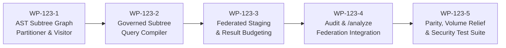
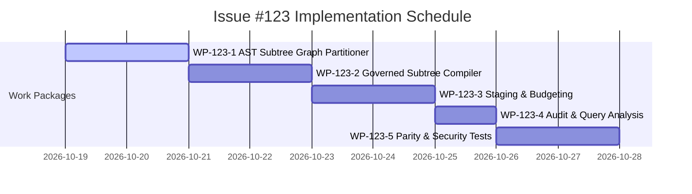

# Implementation Plan: Same-Source AST Subtrees in Cross-Source WebSQL

**Document ID:** `PLAN-DATA-123`  
**Date:** 2026-10-18  
**Author:** Phase 2 Solution Architect (`csharp-architect`)  
**Target Branch:** `feat/issue-123-websql-same-source-subtrees`  
**Parent Plan:** [00-master-plan-overview.md](file:///root/autheris/docs/plans/00-master-plan-overview.md) (Wave 3, Rank 3.1b)  
**Input PRD:** [2026-10-18-issue-intake-websql-cross-source-optimizations.md](file:///root/autheris/docs/plans/2026-10-18-issue-intake-websql-cross-source-optimizations.md) (`REQ-DATA-123`)  
**Status:** APPROVED WITH CONDITIONS (Phase 3 Security Reviewed)  

---

## 1. Executive Summary & Problem Context

Cross-source federated WebSQL enables clients to query and join tables residing across heterogeneous database systems (e.g., PostgreSQL, SQL Server, SQLite, DuckDB). Currently, [`CrossSourcePlanner`](file:///root/autheris/src/Autheris.Application/Sql/Services/CrossSourcePlanner.cs#L223-L300) operates under an unoptimized naive-staging model: every table referenced in a cross-source query is staged individually into DuckDB memory up to `budget.MaxStagedRowsPerTable + 1` rows (default 50,000) before any joins, aggregations, or filters occur.

In enterprise scenarios where an analytical query joins 5 normalized ERP tables on PostgreSQL and joins the aggregate result with 1 CRM table on SQL Server, staging all 5 ERP tables independently exhausts the gateway memory budget and triggers `ROW_LIMIT_EXCEEDED`, even if the ERP join and `WHERE` criteria produce only 200 summary rows. The source database engine is purpose-built to execute relational joins, common table expressions (CTEs), window functions, and `GROUP BY` aggregations natively using optimized query plans and indexes.

This architectural implementation delivers:
1. **AST Subtree Graph Partitioning (WP-123-1):** Decomposes query AST join trees into maximal contiguous subgraphs where all referenced tables belong to the same physical SQL data source. Subtree table counts are bounded by `MaxTablesPerSubtree` (default 12).
2. **Governed Native Subtree Compilation (WP-123-2):** Compiles each identified same-source subtree into native SQL via [`ISqlEngine.Compile`](file:///root/autheris/src/TrinoSqlEngine/ISqlEngine.cs#L20), embedding authoritative Casbin ABAC permissions, Row-Level Security (`CombinedRowFilterSql`), and column-level masking for every member table.
3. **Narrowed Result Staging & Row Budget Accounting (WP-123-3):** Executes compiled subtrees directly against the source connector, staging only the narrowed result set into DuckDB under a synthetic staging alias (`s0`, `s1`). Staged rows are counted against `MaxStagedRowsPerTable` based on the *result set*, entirely eliminating base table row count exhaustion.
4. **Masking Heritage & Filter Oracle Guardrails (WP-123-2, WP-123-3):** Subtree projections originating from or computed with masked/HMAC columns retain their `Masked` classification in DuckDB. Cross-source joins on masked columns are strictly rejected (`SEC-FED-19`).
5. **Dual-Tier Audit & Query Analysis Integration (WP-123-4):** Emits statement-level subtree audit records listing all member tables, execution duration, and staged row counts, paired with per-table compliance records. Integrates with static query analysis (`/api/v1/governance/queries/analyze` / Issue #175) to expose pushdown plans.

---

## 2. Verified Code Facts Beyond the PRD

| # | Fact | Evidence & Architectural Consequence |
|---|---|---|
| **V-1** | `CrossSourcePlanner` stages every table independently | [`CrossSourcePlanner.cs:223-300`](file:///root/autheris/src/Autheris.Application/Sql/Services/CrossSourcePlanner.cs#L223-L300) loops over `tables` and creates a 1:1 `StagingTableRequest` per `ResolvedSourceTable`. Table-level joins inside the query are completely ignored during staging. |
| **V-2** | `ISqlEngine.Compile` supports multi-table queries with RLS and masking | [`ISqlEngine.cs:20`](file:///root/autheris/src/TrinoSqlEngine/ISqlEngine.cs#L20) and [`CompileRequestFactory.cs:30-60`](file:///root/autheris/src/Autheris.Application/Sql/Policy/CompileRequestFactory.cs#L30-L60) compile multi-table statements with typed `GovernancePolicy`, injecting RLS predicates (`CombinedRowFilterSql`) and column masks per table. Subtrees can be compiled through this exact engine path. |
| **V-3** | `OlapTableSource` accepts custom staging table names and masked columns | [`IDuckDbOlapEngine.cs:11-16`](file:///root/autheris/src/Autheris.Application/Olap/IDuckDbOlapEngine.cs#L11-L16) defines `OlapTableSource(Table, GovernedRows, Metadata, StagingTableName, MaskedColumns)`. A subtree result can be registered directly with synthetic metadata and its projected column schema. |
| **V-4** | Function allowlists differ between DuckDB and source dialects | [`CrossSourcePlanner.cs:110-120`](file:///root/autheris/src/Autheris.Application/Sql/Services/CrossSourcePlanner.cs#L110-L120) enforces `SqlFunctionAllowlists.DuckDb` on all functions in the query. Subtree pushdown requires validating subtree functions against `SqlFunctionAllowlists.For(dialect)`, reserving DuckDB allowlists only for cross-source residual operations (`FR-123-04`). |
| **V-5** | `EnforceMaskedColumnGuardrails` enforces cross-source join masking | [`CrossSourcePlanner.cs:131`](file:///root/autheris/src/Autheris.Application/Sql/Services/CrossSourcePlanner.cs#L131) checks joins against masked columns. Subtree projections derived from masked columns must carry mask heritage flags into DuckDB to prevent join leaks. |
| **V-6** | `FederatedStagingService` enforces row and byte ceilings | [`FederatedStagingService.cs:234-255`](file:///root/autheris/src/Autheris.Application/Olap/FederatedStagingService.cs#L234-L255) bounds staging to `MaxStagedRowsPerTable` and `MaxTotalStagedRows`. When subtrees are staged, row limits evaluate against the narrowed output rows, not raw source rows. |
| **V-7** | Re-filtering in DuckDB preserves semantics | Pushed subtrees act as execution units; DuckDB replaces the subtree's join graph with a single scan over `sN`, maintaining outer joins and cross-source predicates without semantic corruption. |

---

## 3. Architectural Decisions

```mermaid
flowchart TD
    SQL["Incoming WebSQL Query AST<br/>(Joins across PostgreSQL A1..A4 and SQL Server B1)"] --> PART["SubtreeGraphPartitioner<br/>Identify contiguous same-source join subgraphs"]
    PART --> SUBTREES{"Evaluate Subgraph Sources"}
    
    SUBTREES -->|Contiguous Same-Source (A1..A4)| SAME_SRC["Form Source Subtree (PostgreSQL)"]
    SUBTREES -->|Boundary / Single Table (B1)| SINGLE["Single Table / Cross-Source Boundary"]
    
    SAME_SRC --> LIMIT_CHECK{"Table Count <= MaxTablesPerSubtree?<br/>(default 12)"}
    LIMIT_CHECK -- Exceeded --> SPLIT["Decompose into smaller subtrees or single tables"]
    LIMIT_CHECK -- OK --> ALLOWLIST["Validate Subtree Functions against<br/>Source Dialect Allowlist"]
    
    ALLOWLIST --> COMPILE["SubtreeCompiler via ISqlEngine.Compile<br/>Embed per-table RLS (CombinedRowFilterSql)<br/>and Column Masking"]
    COMPILE --> HERITAGE["Compute Masking Heritage<br/>(Track masked derivations in projected output)"]
    
    COMPILE --> EXEC_SRC["Execute Native Subtree Query on Source<br/>(Streaming read into transient memory)"]
    EXEC_SRC --> STAGE_ROW["Stage Narrowed Result into DuckDB as 's0'<br/>Count output rows against MaxStagedRowsPerTable"]
    
    SINGLE --> STAGE_SINGLE["Stage Single Table 's1' into DuckDB"]
    
    STAGE_ROW --> DUCK_REWRITE["FederationAstRewriter<br/>Replace Subtree A1..A4 with 's0'<br/>Replace B1 with 's1'"]
    STAGE_SINGLE --> DUCK_REWRITE
    
    DUCK_REWRITE --> DUCK_EXEC["DuckDB Olap Engine<br/>Execute final cross-source join & projection"]
    DUCK_EXEC --> FINAL_RES["Governed Final Result Set"]
```

### Decision D-1: Maximal Contiguous Join-Graph Partitioning
- **Context:** An AST may feature arbitrary join trees (`A JOIN B JOIN C JOIN D`). If `A`, `B`, and `C` reside on PostgreSQL while `D` resides on SQL Server, grouping `(A JOIN B JOIN C)` maximizes pushdown efficiency.
- **Decision:** Implement [`SubtreeGraphPartitioner`](file:///root/autheris/src/Autheris.Application/Sql/Federation/Subtrees/SubtreeGraphPartitioner.cs). It builds an undirected adjacency graph of tables connected by inner, left outer, right outer, or full outer joins in `QuerySpecification.From`.
  - Contiguous connected components sharing the exact same `ResolvedSourceTable.Metadata.Table.SourceName` (and identical connection options) form a `SourceSubtreeGraph`.
  - Outer joins maintain directional invariants: a child cannot be grouped across a null-supplying boundary if doing so would alter null propagation across heterogeneous sources.
  - Subtrees are clamped to `MaxTablesPerSubtree` (default 12, configurable via `CrossSourceOptions.MaxTablesPerSubtree`). If a same-source cluster exceeds 12 tables, the partitioner bisects the graph along the lowest-cardinality join boundary.

### Decision D-2: Governed Native Subtree Compilation via `ISqlEngine.Compile`
- **Context:** Subtree queries executed natively on source databases must strictly enforce Zero-Trust governance. Raw user SQL must never be forwarded without security injection.
- **Decision:** Implement [`SubtreeCompiler`](file:///root/autheris/src/Autheris.Application/Sql/Federation/Subtrees/SubtreeCompiler.cs).
  - For each subtree, an isolated `QuerySpecification` AST is extracted containing the subtree's `FROM` clause, pushable `WHERE` conjuncts strictly referencing member tables, `GROUP BY`, `HAVING`, and window functions.
  - The AST is compiled using `ISqlEngine.Compile` against the target dialect (`TargetSqlDialect`) with a composite `GovernancePolicy` assembling RLS row policies (`CombinedRowFilterSql`) and column masks for each member table.
  - Zero dynamic SQL concatenation: all parameters use isolated parameter markers `@p_st_<n>` to eliminate SQL injection and prevent namespace collisions (`SEC-ADG-02`).

### Decision D-3: Narrowed Result Set Budgeting & DuckDB Staging
- **Context:** The fundamental flaw of naive staging is counting base table rows against `MaxStagedRowsPerTable`. When joins filter millions of rows to hundreds, base table counting triggers premature denial.
- **Decision:** Result staging counts rows at the output boundary:
  - The compiled subtree query is executed as a single read against the source connector.
  - The returned rows are validated against `budget.MaxStagedRowsPerTable`. Staging consumes gateway memory proportional only to the *narrowed joined result*.
  - A synthetic [`TableMetadata`](file:///root/autheris/src/Autheris.Domain/Model/TableModels.cs) is synthesized for the subtree output schema, registering columns projected by the subtree.
  - In DuckDB, the entire subtree is represented by a single staged table alias `sN`.

### Decision D-4: Masking Heritage Propagation
- **Context:** If a same-source subtree selects `c.ssn` or `HASH(c.ssn)` where `ssn` is masked, DuckDB must recognize that the resulting column in `s0` is masked to prevent side-channel leaks during subsequent cross-source joins.
- **Decision:** Subtree compilation tracks column derivation:
  - If a projected column derives directly from a column with `ColumnAccessLevel.Mask` or `MaskWithHmac`, or contains such a column within an expression, it is marked in `OlapTableSource.MaskedColumns`.
  - If DuckDB attempts to evaluate a cross-source join predicate against this column, `EnforceMaskedColumnGuardrails` blocks execution unless authorized under HMAC pseudonym matching rules (`SEC-FED-19`).

### Decision D-5: Dual-Tier Statement & Table Audit Records
- **Context:** Auditing must record both the holistic subtree execution on the remote system and per-table access for data ownership compliance.
- **Decision:**
  - Emits a statement-level audit record in `AUDIT_LOG_ENTRIES` with `EventType = WebSqlCrossSourceSubtreeRead`, detailing `sourceName`, `memberTables: [t1, t2, ...]`, `executionMs`, `stagedRowCount`, and `stagedBytes`.
  - Emits child audit entries with `EventType = WebSqlCrossSourceSourceRead` for each individual member table, preserving compliance reporting per data owner.

---

## 4. Work Packages



### WP-123-1: AST Subtree Graph Partitioning & Visitor
- **Objective:** Implement AST traversal to detect maximal contiguous same-source join subtrees and validate table count caps.
- **Files to Create:**
  - [`src/Autheris.Application/Sql/Federation/Subtrees/SubtreeGraphPartitioner.cs`](file:///root/autheris/src/Autheris.Application/Sql/Federation/Subtrees/SubtreeGraphPartitioner.cs):
    - Traverses `From` clauses and join conditions.
    - Groups tables by `SourceName` and connection fingerprint.
    - Preserves outer join semantic boundaries.
    - Clamps to `MaxTablesPerSubtree` (default 12).
  - [`src/Autheris.Application/Sql/Federation/Subtrees/SourceSubtreeModel.cs`](file:///root/autheris/src/Autheris.Application/Sql/Federation/Subtrees/SourceSubtreeModel.cs):
    ```csharp
    public sealed record SourceSubtree(
        string SubtreeId,
        string SourceName,
        TargetSqlDialect Dialect,
        IReadOnlyList<ResolvedSourceTable> MemberTables,
        TableSource RootTableSource,
        IReadOnlyList<Expression> PushablePredicates,
        IReadOnlyList<SelectItem> ProjectedItems);
    ```
- **Test Criteria:**
  - Unit tests verifying 3-table join on Postgres + 2-table join on SQL Server partitions into 2 distinct subtrees.
  - Unit tests verifying outer join ordering is strictly preserved and cross-source outer joins are not collapsed prematurely.
  - Unit tests verifying partitioning honors `MaxTablesPerSubtree` ceiling.

### WP-123-2: Governed Subtree Query Compiler
- **Objective:** Compile same-source AST subtrees via `ISqlEngine.Compile` into native SQL queries with embedded RLS policies, column masking, and function allowlists.
- **Files to Create/Modify:**
  - [`src/Autheris.Application/Sql/Federation/Subtrees/SubtreeCompiler.cs`](file:///root/autheris/src/Autheris.Application/Sql/Federation/Subtrees/SubtreeCompiler.cs):
    - Assembles `QuerySpecification` AST for the subtree.
    - Validates all function calls against `SqlFunctionAllowlists.For(dialect)`.
    - Creates `CompileRequest` via `CompileRequestFactory` embedding per-table RLS and column masks.
    - Executes `_sqlEngine.Compile(ast, request, ct)`.
    - Maps projected column expressions to determine `MaskedColumns` heritage.
- **Test Criteria:**
  - Verifies RLS `CombinedRowFilterSql` is injected for each table in the subtree.
  - Verifies functions disallowed in source dialect throw `WebSqlPolicyException`.
  - Verifies projection expressions containing masked columns emit `Masked` attributes in the compilation result.

### WP-123-3: Federated Staging Integration & Result Budgeting
- **Objective:** Update `CrossSourcePlanner` and `FederatedStagingService` to stage compiled subtrees as single synthetic units, counting output rows against the staging budget.
- **Files to Modify/Create:**
  - [`src/Autheris.Application/Olap/IFederatedStagingService.cs`](file:///root/autheris/src/Autheris.Application/Olap/IFederatedStagingService.cs):
    - Extend `StagingTableRequest` with optional `SubtreeExecutionPlan? Subtree = null`.
  - [`src/Autheris.Application/Sql/Services/CrossSourcePlanner.cs`](file:///root/autheris/src/Autheris.Application/Sql/Services/CrossSourcePlanner.cs):
    - In `Plan(...)`: partition query into subtrees and single tables.
    - Compile subtrees via `SubtreeCompiler`.
    - Map subtree outputs to synthetic staging aliases (`s0`, `s1`).
    - Rewrite DuckDB AST: replace joined table subtrees with single `NamedTableSource` pointing to `sN`.
  - [`src/Autheris.Application/Olap/FederatedStagingService.cs`](file:///root/autheris/src/Autheris.Application/Olap/FederatedStagingService.cs):
    - In `StageAsync`: if `req.Subtree != null`, execute the compiled subtree SQL via the connector.
    - Stream narrowed results into `OlapTableSource(Table: syntheticId, GovernedRows: rows, Metadata: syntheticMetadata, StagingTableName: req.StagingName, MaskedColumns: maskedHeritage)`.
    - Enforce row limit against `rows.Count` (narrowed result set), not base table row counts.
- **Test Criteria:**
  - Queries on base tables exceeding 50,000 rows that join down to 500 rows succeed without `ROW_LIMIT_EXCEEDED`.
  - DuckDB query receives `s0` with the pre-joined rows and produces identical results to full naive staging.

### WP-123-4: Audit & Query Analysis Integration
- **Objective:** Emit dual-tier audit logging for subtree executions and integrate subtree pushdown reporting into the `/analyze` endpoint.
- **Files to Modify:**
  - [`src/Autheris.Application/Olap/FederatedStagingService.cs`](file:///root/autheris/src/Autheris.Application/Olap/FederatedStagingService.cs):
    - Emit `WebSqlCrossSourceSubtreeRead` statement-level audit record.
    - Emit per-table `WebSqlCrossSourceSourceRead` child records.
  - [`src/Autheris.Application/Governance/Analysis/QueryAnalysisModels.cs`](file:///root/autheris/src/Autheris.Application/Governance/Analysis/QueryAnalysisModels.cs):
    - Add subtree analysis models:
      ```csharp
      public sealed record AnalyzedSubtree(
          string SubtreeId,
          string SourceName,
          IReadOnlyList<string> MemberTables,
          string GeneratedSql,
          IReadOnlyList<string> ProjectedColumns);
      ```
  - [`src/Autheris.Application/Governance/Analysis/QueryAnalysisService.Sql.cs`](file:///root/autheris/src/Autheris.Application/Governance/Analysis/QueryAnalysisService.Sql.cs):
    - Surface planned subtrees in `QueryFederationAnalysis`.
- **Test Criteria:**
  - Audit tests verify statement-level and table-level audit records are recorded in `AUDIT_LOG_ENTRIES`.
  - `/analyze` endpoint returns structured `AnalyzedSubtree` details.

### WP-123-5: Parity, Volume Relief & Security Test Suite
- **Objective:** Author comprehensive integration and tagged security test suite verifying functional correctness, performance gains, and Zero-Trust isolation.
- **Files to Create:**
  - [`tests/Autheris.Tests.Unit/Federation/WebSqlSameSourceSubtreeTests.cs`](file:///root/autheris/tests/Autheris.Tests.Unit/Federation/WebSqlSameSourceSubtreeTests.cs):
    - Subtree partitioning, function allowlists, and AST rewrites.
  - [`tests/Autheris.Tests.Unit/Security/WebSqlSameSourceSubtreeSecurityTests.cs`](file:///root/autheris/tests/Autheris.Tests.Unit/Security/WebSqlSameSourceSubtreeSecurityTests.cs):
    - Tagged security tests `[Trait("Category", "Security")]`:
      - `T_SEC_DATA123_01_SubtreeRLS_EmbeddedForAllTables`: Asserts RLS row filters for every member table are embedded into the native SQL query.
      - `T_SEC_DATA123_02_MaskingHeritage_PreservedInDuckDb`: Asserts masked columns in subtree projections retain `Masked` attributes in DuckDB.
      - `T_SEC_DATA123_03_CrossSourceJoinOnSubtreeMask_Blocked`: Asserts cross-source joins in DuckDB on masked subtree projections fail closed.
      - `T_SEC_DATA123_04_MaxTablesPerSubtree_Enforced`: Asserts queries exceeding `MaxTablesPerSubtree` are partitioned or rejected fail-closed.
      - `T_SEC_DATA123_05_VolumeRelief_NarrowedStaging`: Asserts queries joining tables exceeding staging limits succeed when joined result is within budget.
      - `T_SEC_DATA123_06_Audit_DualTierCompleteness`: Asserts statement-level subtree record and per-table access records are emitted without payload leaks.
      - `T_SEC_DATA123_07_SourceFunctionAllowlist_Enforced`: Asserts functions allowed only in source dialect execute in subtree and fail in DuckDB.
      - `T_SEC_DATA123_08_BitForBitParity`: Asserts identical query results between subtree pushdown and naive staging.

---

## 5. Dependency Sequencing & Risk Matrix



| Risk ID | Risk Description | Severity | Likelihood | Mitigation Strategy |
|---|---|:---:|:---:|---|
| **R-123-1** | **Subtree RLS Omission:** A member table's row filter is dropped during subtree extraction | Critical | Low | `SubtreeCompiler` enforces that every `ResolvedSourceTable` has an active `TableAccessDecision`; compiles through `ISqlEngine.Compile` which strictly requires coverage proof (`SEC-ADG-02`). |
| **R-123-2** | **Masking Leak via Subtree Expressions:** A function wrapping a masked column hides the masking attribute | Critical | Medium | Any projection referencing a masked column inherits the `Masked` classification transitively. Cross-source join guardrails reject masked columns in DuckDB. |
| **R-123-3** | **Outer Join Semantic Distortion:** Grouping across outer joins inverts or loses null rows | High | Low | `SubtreeGraphPartitioner` respects outer join directionality; only groups subgraphs that form valid isolated SQL query specifications. |
| **R-123-4** | **Source SQL Injection:** Dynamic assembly of subtree SQL | Critical | Low | Zero string interpolation. Subtrees are compiled via typed AST nodes in `ISqlEngine.Compile` with isolated `@p_st_<n>` parameters. |

---

## 6. Definition of Done (DoD)

1. [ ] **Subtree Graph Partitioning:** Contiguous same-source join graphs are partitioned up to `MaxTablesPerSubtree` (default 12).
2. [ ] **Governed Compilation:** Subtrees compile to native SQL via `ISqlEngine.Compile` with all member table RLS and masks embedded.
3. [ ] **Narrowed Staging:** Only joined subtree result sets are staged into DuckDB; staged rows count against `MaxStagedRowsPerTable`.
4. [ ] **Masking Heritage:** Projected columns derived from masked data are flagged in `OlapTableSource.MaskedColumns`.
5. [ ] **Audit Compliance:** Dual-tier statement and table audit records emitted to `AUDIT_LOG_ENTRIES`.
6. [ ] **Query Analysis Parity:** `/analyze` returns planned subtrees and member tables.
7. [ ] **Test Coverage:** All unit tests and security tests `T_SEC_DATA123_01` through `T_SEC_DATA123_08` pass green.

---

## 7. Phase 3 Security Review & Binding Conditions (`csharp-security-expert`)

**Review Date:** 2026-10-18  
**Verdict:** APPROVED WITH BINDING CONDITIONS  
**Reviewer:** Application Security Expert (`csharp-security-expert`)

### Security Findings & Risk Analysis

| Finding ID | Severity | Description & Security Impact |
| :--- | :--- | :--- |
| **SEC-123-F01** | Critical | **Subtree RLS Bypass / Incomplete Coverage:** If any table within a pushed subtree is omitted from `GovernancePolicy`, users could read unauthorized records across joined tables. |
| **SEC-123-F02** | Critical | **Masking Erasure in Computed Projections:** If a subtree evaluates an expression over a masked column (e.g., `SUBSTRING(ssn, 1, 3)`), failing to mark the output as masked would allow cross-source join leaks in DuckDB. |
| **SEC-123-F03** | High | **Dialect Injection via Unescaped Subtree Nodes:** Handcrafting subtree SQL strings creates injection vectors. |
| **SEC-123-F04** | Medium | **Denial of Service via Giant Subtrees:** Deeply nested joins with 50+ tables could overwhelm source database query optimizers. |

### Binding Security Conditions

1. **`SEC-DATA123-01`: Governed Compilation Mandatory (`ISqlEngine.Compile`)**
   - Every subtree query MUST be compiled strictly through `ISqlEngine.Compile`. Manual SQL string generation or string concatenation is strictly prohibited.
   - All parameters in subtree queries MUST use isolated `@p_st_<n>` markers registered in the parameter dictionary.
2. **`SEC-DATA123-02`: Universal RLS Conjunction for All Member Tables**
   - The compiled subtree query MUST inject `CombinedRowFilterSql` for EVERY table in the subtree using boolean `AND`.
   - If any member table lacks an allowed `TableAccessDecision`, the entire query MUST fail closed immediately.
3. **`SEC-DATA123-03`: Transitive Masking Heritage**
   - Any column projected by a subtree that references, wraps, or derives from a column with `ColumnAccessLevel.Mask` or `MaskWithHmac` MUST be registered in `OlapTableSource.MaskedColumns`.
   - DuckDB `EnforceMaskedColumnGuardrails` MUST enforce cross-source join prohibitions against these columns.
4. **`SEC-DATA123-04`: Subtree Complexity Bounding**
   - Single subtrees MUST NOT exceed `MaxTablesPerSubtree` (default 12). Exceeding this limit must trigger safe graph bisection or fail-closed rejection.
5. **`SEC-DATA123-05`: Dual-Tier Audit Logging**
   - Emits statement-level audit record for the subtree query and child audit records for each member table in `AUDIT_LOG_ENTRIES`.

### Mandatory Security Test Requirements (`[Trait("Category", "Security")]`)

| Test Method | Target Condition | Verification Scope |
| :--- | :--- | :--- |
| `T_SEC_DATA123_01_SubtreeRLS_EmbeddedForAllTables` | `SEC-DATA123-02` | Asserts RLS `CombinedRowFilterSql` is injected for every member table in compiled subtree SQL. |
| `T_SEC_DATA123_02_MaskingHeritage_PreservedInDuckDb` | `SEC-DATA123-03` | Asserts derived/projected columns from masked source columns retain `Masked` classification in DuckDB. |
| `T_SEC_DATA123_03_CrossSourceJoinOnSubtreeMask_Blocked` | `SEC-DATA123-03` | Asserts DuckDB `EnforceMaskedColumnGuardrails` fails closed when cross-source join targets masked subtree output (`SEC-FED-19`). |
| `T_SEC_DATA123_04_MaxTablesPerSubtree_Enforced` | `SEC-DATA123-04` | Asserts queries with $>12$ tables are partitioned or rejected fail-closed. |
| `T_SEC_DATA123_05_VolumeRelief_NarrowedStaging` | Functional / DoD | Asserts tables $>50,000$ rows join down to $<50,000$ rows and stage without `ROW_LIMIT_EXCEEDED`. |
| `T_SEC_DATA123_06_Audit_DualTierCompleteness` | `SEC-DATA123-05` | Asserts subtree statement-level event and individual member table access events are recorded without parameter/payload leaks. |
| `T_SEC_DATA123_07_SourceFunctionAllowlist_Enforced` | `SEC-DATA123-01` | Asserts functions outside the source dialect allowlist throw `WebSqlPolicyException`. |
| `T_SEC_DATA123_08_BitForBitParity` | Parity / DoD | Asserts output bit-for-bit equivalence between subtree pushdown and naive staging. |
