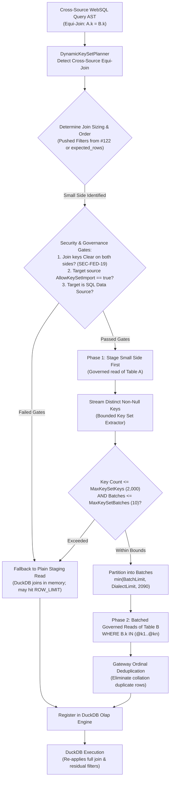
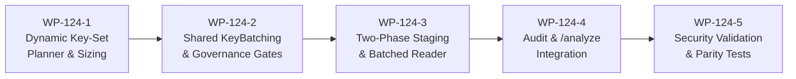
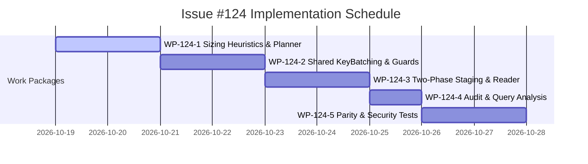

# Implementation Plan: Dynamic Key-Set Filters in Cross-Source WebSQL Joins

**Document ID:** `PLAN-DATA-124`  
**Date:** 2026-10-18  
**Author:** Phase 2 Solution Architect (`csharp-architect`)  
**Target Branch:** `feat/issue-124-websql-dynamic-keyset-filters`  
**Parent Plan:** [00-master-plan-overview.md](file:///root/autheris/docs/plans/00-master-plan-overview.md) (Wave 3, Rank 3.1c)  
**Input PRD:** [2026-10-18-issue-intake-websql-cross-source-optimizations.md](file:///root/autheris/docs/plans/2026-10-18-issue-intake-websql-cross-source-optimizations.md) (`REQ-DATA-124`)  
**Status:** APPROVED WITH CONDITIONS (Phase 3 Security Reviewed)  

---

## 1. Executive Summary & Problem Context

Cross-source federated WebSQL enables joining tables across heterogeneous databases. When a cross-source equi-join connects a small, highly filtered table on one source (e.g., 50 VIP customers in PostgreSQL) with an unindexed or massive table on another source (e.g., 10,000,000 orders in SQL Server), single-table predicate pushdown ([#122 / `PLAN-DATA-122`](file:///root/autheris/docs/plans/2026-10-18-plan-issue-122-websql-filter-pushdown.md)) cannot filter the large table because the join condition (`customers.id = orders.customer_id`) depends dynamically on data evaluated from the other source.

Under the current staging implementation, the large table is read in its entirety up to `MaxStagedRowsPerTable + 1` rows, instantly exceeding the staging budget and aborting the query with `ROW_LIMIT_EXCEEDED`.

This architectural implementation delivers:
1. **Heuristic Join Sizing & Staging Ordering (WP-124-1):** Enhances [`CrossSourcePlanner`](file:///root/autheris/src/Autheris.Application/Sql/Services/CrossSourcePlanner.cs) to detect cross-source equi-joins, determine join asymmetry using pushed single-table predicates (#122) and catalog table cardinality hints (`expected_rows`), and schedule two-phase staging execution.
2. **Two-Phase Staging & Distinct Key Extraction (WP-124-2):** Stages the small, filtered side first; streams distinct non-null join key values into bounded memory structures using the shared `KeyBatching` component (shared with GraphQL cross-source relations #75).
3. **Parameterized Dynamic Key-Set Pushdown (WP-124-3):** Generates parameterized `key IN (@k1..@kn)` batches clamped to `min(ConnectorCapabilities.MaxBatchSize, DialectCapabilityTable.MaxBindParameters, MaxKeySetBatchSize)` (e.g., clamped to 2,090 parameters on SQL Server, leaving headroom for RLS parameters).
4. **Zero-Trust Privacy & Consent Gates (WP-124-2, WP-124-3):**
   - **Data-Owner Opt-In:** Dynamic key import into the target source requires explicit consent via [`DataSourceConnectionOptions.AllowKeySetImport: true`](file:///root/autheris/src/Autheris.Domain/Options/Storage/DatabaseOptions.cs) (default `false`, fail closed).
   - **Masked/HMAC Key Prohibition (`SEC-FED-19`):** Join keys assigned `Mask`, `Redact`, or `HMAC` pseudonyms are strictly forbidden from forming dynamic key sets, preventing side-channel filter oracles.
5. **Gateway Ordinal Deduplication & Superset Parity (WP-124-3):** Eliminates duplicate rows caused by case-insensitive (`CI`) or trailing-space-padding (`PAD SPACE`) database collations across separate key batches via exact ordinal in-memory deduplication before DuckDB execution.
6. **Bounded Fallback & Structural Audit Integration (WP-124-4):** Keys exceeding `MaxKeySetKeys` (default 2,000) or `MaxKeySetBatches` (default 10) abort key-set pushdown and fall back safely to plain staging reads without silent truncation. Emits zero-PII structural audit records and integrates with `/analyze` (#175).

---

## 2. Verified Code Facts Beyond the PRD

| # | Fact | Evidence & Architectural Consequence |
|---|---|---|
| **V-1** | `DataSourceConnectionOptions` lacks `AllowKeySetImport` | [`DatabaseOptions.cs:35-85`](file:///root/autheris/src/Autheris.Domain/Options/Storage/DatabaseOptions.cs#L35-L85) declares `KeySetCacheAllowed` and `CallerAttributeLookupAllowed`, but does not yet declare `AllowKeySetImport`. Adding `public bool AllowKeySetImport { get; init; } = false;` enforces the opt-in gate. |
| **V-2** | Shared composite key extraction exists in `CrossSourceRelationResolver` | [`CrossSourceRelationResolver.cs:153-169`](file:///root/autheris/src/Autheris.Application/Data/Relations/CrossSourceRelationResolver.cs#L153-L169) implements `TryExtractKey`, `distinctKeys`, and `seenKeys` for relations. This logic can be unified into `Autheris.Application.Sql.Federation.KeyBatching`. |
| **V-3** | `StagingTableRequest.PushdownFilter` already accepts `TableFilterClause` | [`IFederatedStagingService.cs:19`](file:///root/autheris/src/Autheris.Application/Olap/IFederatedStagingService.cs#L19) and [`FederatedStagingService.cs:200-203`](file:///root/autheris/src/Autheris.Application/Olap/FederatedStagingService.cs#L200-L203) attach `PushdownFilter` to the connector session for SQL sources. Batched key-set filters can be injected through this exact abstraction. |
| **V-4** | SQL Server parameter bind limit is 2,100 | The ADO.NET SQL Server client throws `SqlException` if parameters exceed 2,100. Clamping batches to 2,090 ensures safety alongside RLS policy parameters (`@p_rls_0`). |
| **V-5** | `TableAccessDecision.GetEffectiveColumnAccess` detects masked keys | [`TableAccessDecision.cs:45`](file:///root/autheris/src/Autheris.Domain/Model/TableAccessDecision.cs) checks column security. If a join key column is `Mask`, `MaskWithHmac`, or `Deny`, pushdown must fail closed (`SEC-FED-19`). |
| **V-6** | `FederatedStagingService` stages sequentially or bounded | [`CrossSourceOptions.MaxParallelSourceReads`](file:///root/autheris/src/Autheris.Domain/Options/Protocols/RestApiOptions.cs#L115) bounds concurrency. Two-phase staging executes Phase 1 (small table), extracts keys, and executes Phase 2 (large table) sequentially without blocking unaffected independent tables. |

---

## 3. Architectural Decisions



### Decision D-1: Heuristic Join Sizing & Dependency Ordering
- **Context:** Deciding which side of an equi-join is the "small" side cannot rely on a heavy cost-based optimizer, as full table statistics are unavailable across external federated databases.
- **Decision:** Implement [`DynamicKeySetPlanner`](file:///root/autheris/src/Autheris.Application/Sql/Federation/KeyBatching/DynamicKeySetPlanner.cs) using deterministic heuristic rules:
  1. **Selective Single-Table Filter (#122):** If Table A has pushable equality/range predicates while Table B is unfiltered, Table A is designated the driving (small) side.
  2. **Catalog Cardinality Hints (`expected_rows`):** If neither or both have filters, inspect catalog metadata `expected_rows`. If `A.expected_rows * 10 < B.expected_rows`, Table A is designated the driving side.
  3. **Tie-Breaking / Ambiguity:** If cardinality is comparable or unknown, dynamic key pushdown is skipped; execution proceeds via standard staging.

### Decision D-2: Bounded Key Set Caps & Graceful Fallback
- **Context:** Pushing tens of thousands of keys across database connections causes driver stalls, high connection pool contention, and plan cache bloat.
- **Decision:**
  - Configure hard ceilings via `CrossSourceOptions.DynamicKeySet`:
    - `MaxKeySetKeys`: default 2,000.
    - `MaxKeySetBatches`: default 10.
    - `MaxKeySetBatchSize`: default 500 (clamped per dialect).
  - If the extracted distinct keys exceed `MaxKeySetKeys` (e.g. 2,001 keys), the engine aborts key-set pushdown and immediately falls back to reading Table B via plain staging.
  - If the plain staging read subsequently exceeds `MaxStagedRowsPerTable`, it aborts with `ROW_LIMIT_EXCEEDED`. The gateway **never silently truncates data**.

### Decision D-3: Zero-Trust Opt-In & Masked Key Prohibition (`SEC-FED-19`)
- **Context:** Pushing key values from Source A into queries executed against Source B transmits data across trust boundaries and stores foreign keys in Source B's query logs. Pushing masked values creates side-channel filter oracles.
- **Decision:**
  1. **Data-Owner Consent:** Target source must explicitly configure `AllowKeySetImport: true` on its `DataSourceConnectionOptions`. Default is `false` (fail closed).
  2. **Masked/HMAC Key Gate (`SEC-FED-19`):** Both `parentKey` on Table A and `childKey` on Table B must have `ColumnAccessLevel.Clear`. If either column is `Mask`, `MaskWithHmac`, or `Deny`, key-set pushdown is strictly prohibited and plain staging is used.

### Decision D-4: Gateway Ordinal Deduplication
- **Context:** Target relational engines may evaluate string comparisons under case-insensitive (`CI`) or trailing-space-insensitive (`PAD SPACE`) collations. If distinct keys `['ABC', 'abc']` are placed into separate batches, the database may return the same row for both batches, causing duplicate row staging.
- **Decision:** The staging pipeline maintains an ordinal key hash set (`HashSet<string>(StringComparer.Ordinal)` or composite key hash) per staged row. If a row with an identical join key was already ingested from a previous batch, the duplicate row is dropped at the staging gateway boundary before DuckDB registration.

### Decision D-5: Ephemeral Lifecycle & Zero-PII Audit Logging
- **Context:** Key sets contain raw business keys that must not leak to logs or persist across queries.
- **Decision:**
  - Key sets reside in transient memory only for the request duration; never cached in Redis or memory caches.
  - Federated staging audit events (`WebSqlCrossSourceSourceRead`) record only structural telemetry: `keySetPushedDown: true`, `keyCount: 42`, `batchCount: 1`, `targetColumn: "customer_id"`. Parameter values and literal keys are strictly excluded.

---

## 4. Work Packages



### WP-124-1: Dynamic Key-Set Planner & Sizing Heuristics
- **Objective:** Detect cross-source equi-joins and determine driving vs driven staging dependencies.
- **Files to Create/Modify:**
  - [`src/Autheris.Application/Sql/Federation/KeyBatching/DynamicKeySetPlanner.cs`](file:///root/autheris/src/Autheris.Application/Sql/Federation/KeyBatching/DynamicKeySetPlanner.cs):
    - Analyzes AST join predicates for equi-joins (`BinaryOperator.Equal` across two tables).
    - Checks driving side heuristics: presence of pushed filters (#122) or `expected_rows` differential $\ge 10\times$.
    - Outputs `KeySetJoinPlan(DrivingTable, DrivenTable, DrivingKeyColumn, DrivenKeyColumn)`.
  - [`src/Autheris.Domain/Options/Protocols/RestApiOptions.cs`](file:///root/autheris/src/Autheris.Domain/Options/Protocols/RestApiOptions.cs):
    - Add `DynamicKeySetOptions`:
      ```csharp
      public DynamicKeySetOptions DynamicKeySet { get; init; } = new();
      public sealed class DynamicKeySetOptions
      {
          public bool Enabled { get; init; } = true;
          public int MaxKeySetKeys { get; init; } = 2000;
          public int MaxKeySetBatches { get; init; } = 10;
          public int MaxKeySetBatchSize { get; init; } = 500;
      }
      ```
- **Test Criteria:**
  - Unit tests verifying filtered table is selected as driving side over unfiltered table.
  - Unit tests verifying `expected_rows` differential correctly establishes join direction.
  - Unit tests verifying non-equi joins or circular dependencies skip dynamic key-set pushdown.

### WP-124-2: Shared KeyBatching & Zero-Trust Governance Gates
- **Objective:** Create shared key batching abstractions and enforce data-owner consent and masked column exclusions.
- **Files to Create/Modify:**
  - [`src/Autheris.Domain/Options/Storage/DatabaseOptions.cs`](file:///root/autheris/src/Autheris.Domain/Options/Storage/DatabaseOptions.cs):
    - Add `public bool AllowKeySetImport { get; init; } = false;` to `DataSourceConnectionOptions`.
  - [`src/Autheris.Application/Sql/Federation/KeyBatching/KeyBatcher.cs`](file:///root/autheris/src/Autheris.Application/Sql/Federation/KeyBatching/KeyBatcher.cs):
    - Extracts distinct, non-null keys from staged row dictionaries.
    - Clamps batch sizes against `min(ConnectorCapabilities.MaxBatchSize, DialectCapabilityTable.MaxBindParameters, MaxKeySetBatchSize)`.
  - [`src/Autheris.Application/Sql/Federation/KeyBatching/KeySetGovernanceGuard.cs`](file:///root/autheris/src/Autheris.Application/Sql/Federation/KeyBatching/KeySetGovernanceGuard.cs):
    - Evaluates `AllowKeySetImport` on the target data source.
    - Asserts both join key columns have `ColumnAccessLevel.Clear` via `TableAccessDecision.GetEffectiveColumnAccess` (`SEC-FED-19`).
- **Test Criteria:**
  - Unit tests verifying `AllowKeySetImport == false` disables key-set generation.
  - Unit tests verifying `Mask` or `MaskWithHmac` join keys trigger fail-closed fallback to plain staging.

### WP-124-3: Two-Phase Staging & Batched Clause Generation
- **Objective:** Implement two-phase staging in `FederatedStagingService`, execute batched queries with parameterized `IN` lists, and deduplicate results ordinally.
- **Files to Modify/Create:**
  - [`src/Autheris.Application/Sql/Federation/KeyBatching/KeySetClauseBuilder.cs`](file:///root/autheris/src/Autheris.Application/Sql/Federation/KeyBatching/KeySetClauseBuilder.cs):
    - Constructs parameterized `TableFilterClause` representing `k IN (@k_0, @k_1, ...)`.
    - Uses isolated `@k_<n>` parameter namespace.
  - [`src/Autheris.Application/Olap/FederatedStagingService.cs`](file:///root/autheris/src/Autheris.Application/Olap/FederatedStagingService.cs):
    - Coordinates two-phase staging: stages driving table first.
    - Extracts distinct keys. If $\le \text{MaxKeySetKeys}$, stages driven table via batched reads.
    - Deduplicates rows ordinally across batches using join key values.
    - If keys exceed cap, falls back seamlessly to standard single-pass staging.
- **Test Criteria:**
  - Integration tests verifying small filtered table joined with large table issues batched `IN` queries.
  - Collation tests verifying case-insensitive dialect returns rows deduplicated ordinally.
  - Fallback tests verifying key counts exceeding 2,000 fall back to plain staging.

### WP-124-4: Audit & Query Analysis Integration
- **Objective:** Record zero-payload structural audit logs and surface key-set plans in `/analyze`.
- **Files to Modify:**
  - [`src/Autheris.Application/Olap/FederatedStagingService.cs`](file:///root/autheris/src/Autheris.Application/Olap/FederatedStagingService.cs):
    - Include `keySetFilter: true`, `keyCount`, `batchCount`, `targetColumn` in `WebSqlCrossSourceSourceRead` audit payload.
  - [`src/Autheris.Application/Governance/Analysis/QueryAnalysisModels.cs`](file:///root/autheris/src/Autheris.Application/Governance/Analysis/QueryAnalysisModels.cs):
    - Extend `QueryFederationAnalysis` with `AnalyzedKeySetPushdown(DrivingTable, DrivenTable, TargetColumn, PushedKeyCount, EstimatedBatches)`.
  - [`src/Autheris.Application/Governance/Analysis/QueryAnalysisService.Sql.cs`](file:///root/autheris/src/Autheris.Application/Governance/Analysis/QueryAnalysisService.Sql.cs):
    - Populate key-set analysis section during static query analysis.
- **Test Criteria:**
  - Audit tests verify structural metadata presence and zero key literal leakage.
  - Query analysis endpoint returns expected `AnalyzedKeySetPushdown` metadata.

### WP-124-5: Security Validation & Parity Test Suite
- **Objective:** Author automated unit and security test suite enforcing Zero-Trust invariants and semantic parity.
- **Files to Create:**
  - [`tests/Autheris.Tests.Unit/Federation/WebSqlDynamicKeySetPlannerTests.cs`](file:///root/autheris/tests/Autheris.Tests.Unit/Federation/WebSqlDynamicKeySetPlannerTests.cs):
    - Tests for join detection, driving side heuristics, and key batching.
  - [`tests/Autheris.Tests.Unit/Security/WebSqlDynamicKeySetSecurityTests.cs`](file:///root/autheris/tests/Autheris.Tests.Unit/Security/WebSqlDynamicKeySetSecurityTests.cs):
    - Tagged security tests `[Trait("Category", "Security")]`:
      - `T_SEC_DATA124_01_MaskedKey_NeverPushed`: Asserts join keys with `Mask`, `MaskWithHmac`, or `Deny` strictly block key-set pushdown (`SEC-FED-19`).
      - `T_SEC_DATA124_02_AllowKeySetImport_OptInEnforced`: Asserts target sources with `AllowKeySetImport = false` fall back to plain staging.
      - `T_SEC_DATA124_03_KeyBounds_Exceeded_Fallback`: Asserts distinct keys $> 2000$ fall back cleanly without unhandled exceptions.
      - `T_SEC_DATA124_04_BatchParameterClamping_SqlDialect`: Asserts parameter counts never exceed dialect ceiling (clamped to 2,090 on SQL Server).
      - `T_SEC_DATA124_05_OrdinalDeduplication_CollationSafety`: Asserts gateway deduplicates rows across batches when collation produces duplicate matches.
      - `T_SEC_DATA124_06_Audit_ZeroPayload`: Asserts audit logs contain key counts and column names but zero raw key values.
      - `T_SEC_DATA124_07_BitForBitParity_ResultCorrectness`: Asserts identical results between key-set filtered read and unoptimized staging read.

---

## 5. Dependency Sequencing & Risk Matrix



| Risk ID | Risk Description | Severity | Likelihood | Mitigation Strategy |
|---|---|:---:|:---:|---|
| **R-124-1** | **Filter Oracle Attack:** Probing cleartext values via masked key pushdown | Critical | Low | Strict gate in `KeySetGovernanceGuard`: any column with access other than `ColumnAccessLevel.Clear` aborts key pushdown (`SEC-FED-19`). |
| **R-124-2** | **Dialect Parameter Overflow:** Batch size exceeds SQL Server 2,100 parameter ceiling | High | Low | Clamping in `KeyBatcher`: batch size strictly bounded by `min(MaxBatchSize, DialectLimit, 2090)`. |
| **R-124-3** | **Data Leakage via Audit:** Parameter keys serialized to logs | High | Low | Zero-Payload rule enforced: audit models accept only counts and column identifiers. |
| **R-124-4** | **Silent Row Truncation on Cap Exceeded:** Aborting at 2,000 keys causes partial results | Critical | Low | Exceeding caps triggers full fallback to plain staging; if plain staging exceeds limits, query aborts with `ROW_LIMIT_EXCEEDED`. |

---

## 6. Definition of Done (DoD)

1. [ ] **Join Detection & Sizing:** `DynamicKeySetPlanner` identifies equi-joins and establishes small/large dependency order.
2. [ ] **Zero-Trust Consent & Privacy:** `AllowKeySetImport` opt-in enforced; masked join keys strictly rejected (`SEC-FED-19`).
3. [ ] **Batch Clamping:** Key-set batches clamped to dialect parameter limits (2,090 on SQL Server).
4. [ ] **Ordinal Deduplication:** Gateway deduplicates rows returned across batches.
5. [ ] **Bounded Fallback:** Distinct keys $> 2,000$ fall back safely to plain staging.
6. [ ] **Audit Completeness:** Structural metadata logged to `AUDIT_LOG_ENTRIES` with zero key value payloads.
7. [ ] **Query Analysis Parity:** `/analyze` surfaces planned key-set pushdown.
8. [ ] **Test Coverage:** All unit tests and security tests `T_SEC_DATA124_01` through `T_SEC_DATA124_07` pass green.

---

## 7. Phase 3 Security Review & Binding Conditions (`csharp-security-expert`)

**Review Date:** 2026-10-18  
**Verdict:** APPROVED WITH BINDING CONDITIONS  
**Reviewer:** Application Security Expert (`csharp-security-expert`)

### Security Findings & Risk Analysis

| Finding ID | Severity | Description & Security Impact |
| :--- | :--- | :--- |
| **SEC-124-F01** | Critical | **Filter Oracle Side-Channel via Masked Join Keys (`SEC-FED-19`):** Pushing masked or HMAC keys across sources evaluates them against remote cleartext, enabling side-channel inference. |
| **SEC-124-F02** | High | **Unconsented Cross-Source Data Egress:** Injecting foreign keys into target database transaction logs without data-owner consent violates data sovereignty. |
| **SEC-124-F03** | High | **Denial of Service via Huge Key Sets:** Uncapped `IN` lists exhaust target engine memory or trip connection limits. |
| **SEC-124-F04** | Medium | **PII Key Leakage in Audit Trails:** Storing key sets in audit payloads violates GDPR Art. 5(1)(c). |

### Binding Security Conditions

1. **`SEC-DATA124-01`: Cleartext Join Key Invariant (`SEC-FED-19`)**
   - Both join key columns MUST have `ColumnAccessLevel.Clear`.
   - Columns classified as `Mask`, `MaskWithHmac`, `Redact`, or `Deny` MUST strictly disqualify the join from key-set pushdown. Execution MUST fall back to plain staging.
2. **`SEC-DATA124-02`: Explicit Data-Owner Consent (`AllowKeySetImport`)**
   - Target data sources MUST have `AllowKeySetImport = true` on `DataSourceConnectionOptions`. If `false`, key pushdown is bypassed.
3. **`SEC-DATA124-03`: Parameter Clamping & Strict Bounds**
   - Parameter counts per batch MUST NOT exceed 2,090 on SQL Server.
   - Distinct keys MUST NOT exceed `MaxKeySetKeys` (2,000) and batches MUST NOT exceed `MaxKeySetBatches` (10). Exceeding these bounds MUST trigger fallback to plain staging.
4. **`SEC-DATA124-04`: Gateway Ordinal Deduplication**
   - Staging engine MUST ordinally deduplicate rows returned across batches before registering into DuckDB.
5. **`SEC-DATA124-05`: Zero-Payload Audit Telemetry**
   - Federated staging audit events MUST record only structural metadata (`keyCount`, `batchCount`, `targetColumn`). Serialization of key values is strictly forbidden.

### Mandatory Security Test Requirements (`[Trait("Category", "Security")]`)

| Test Method | Target Condition | Verification Scope |
| :--- | :--- | :--- |
| `T_SEC_DATA124_01_MaskedKey_NeverPushed` | `SEC-DATA124-01` | Asserts join keys with `Mask`, `MaskWithHmac`, or `Deny` strictly block key-set pushdown (`SEC-FED-19`). |
| `T_SEC_DATA124_02_AllowKeySetImport_OptInEnforced` | `SEC-DATA124-02` | Asserts target sources with `AllowKeySetImport = false` fall back to plain staging. |
| `T_SEC_DATA124_03_KeyBounds_Exceeded_Fallback` | `SEC-DATA124-03` | Asserts distinct keys $> 2,000$ or batches $> 10$ fall back cleanly without unhandled exceptions. |
| `T_SEC_DATA124_04_BatchParameterClamping_SqlDialect` | `SEC-DATA124-03` | Asserts parameter counts never exceed dialect ceiling (clamped to 2,090 on SQL Server). |
| `T_SEC_DATA124_05_OrdinalDeduplication_CollationSafety` | `SEC-DATA124-04` | Asserts gateway deduplicates rows across batches when collation produces duplicate matches. |
| `T_SEC_DATA124_06_Audit_ZeroPayload` | `SEC-DATA124-05` | Asserts audit logs contain key counts and column names but zero raw key values. |
| `T_SEC_DATA124_07_BitForBitParity_ResultCorrectness` | Parity / DoD | Asserts identical results between key-set filtered read and unoptimized staging read. |
