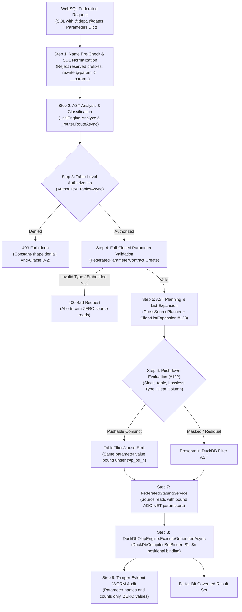

# Implementation Plan: Bound Parameters in Federated (Cross-Source) WebSQL Queries

**Document ID:** `PLAN-DATA-131`  
**Date:** 2026-10-18  
**Author:** Phase 2 Solution Architect (`csharp-architect`)  
**Target Branch:** `feat/issue-131-bound-parameters-federation`  
**Parent Plan:** [00-master-plan-overview.md](file:///root/autheris/docs/plans/00-master-plan-overview.md) (Wave 3, Rank 3.6 / `WP-FED-15`)  
**Input PRD:** [2026-10-18-issue-intake-bound-parameters-federation.md](file:///root/autheris/docs/plans/2026-10-18-issue-intake-bound-parameters-federation.md) (`REQ-DATA-131`)  
**Related Plans:** [PLAN-DATA-122](file:///root/autheris/docs/plans/2026-10-18-plan-issue-122-websql-filter-pushdown.md) (Predicate Pushdown), [PLAN-SQL-128](file:///root/autheris/docs/plans/2026-10-16-plan-issue-128-list-parameters.md) (List Parameters)  
**Status:** APPROVED WITH CONDITIONS (Phase 3 Security Review)  

---

## 1. Executive Summary & Problem Context

Cross-source federated WebSQL enables enterprise analytical pipelines to join disparate physical data sources (PostgreSQL, SQL Server, SQLite, DuckDB, HTTP virtual tables) using a unified SQL dialect. However, while single-source WebSQL queries support parameterized templates (`@param`), federated queries fail closed whenever client parameters are declared.

Inspection of the federated query pipeline reveals two foundational defects:
1. **Premature Syntax Rejection:** [`FederatedDuckDbExecutionService`](file:///root/autheris/src/Autheris.Application/Sql/Services/FederatedDuckDbExecutionService.cs#L244-L265) ignores `GovernedSqlQueryRequest.Parameters` and passes raw query text directly to `_sqlEngine.Analyze(...)` and `_planner.Plan(...)`. Because `SqlBase.g4` treats `@` parameter prefixes as lexical errors in column expression positions, any parameterized federated query is rejected as a syntax error before routing or planning.
2. **Latent Silent-NULL Hazard:** When `CrossSourcePlanner` emits parameter slots, DuckDB execution in [`DuckDbOlapEngine.cs:203-209`](file:///root/autheris/src/Autheris.Application/Olap/DuckDbOlapEngine.cs#L203-L209) binds parameters using `new DuckDBParameter(parameter.Name, parameter.Value ?? DBNull.Value)`. For `ParameterOrigin.ClientNamed` slots where `Value` is intentionally `null` prior to binding, this binds `DBNull.Value` (`NULL`). Consequently, equality predicates (`x = @param`) evaluate to `NULL` (falsy in ANSI 3VL), returning empty rowsets without an error.
3. **Impaired Pushdown (#122):** The predicate pushdown optimizer ([`PLAN-DATA-122`](file:///root/autheris/docs/plans/2026-10-18-plan-issue-122-websql-filter-pushdown.md)) cannot push parameterized filters to source databases, forcing staging up to row limits and causing catastrophic `ROW_LIMIT_EXCEEDED` errors.

This plan delivers a zero-trust, high-performance (.NET 10 / C# 13) parameterized execution pipeline across federated queries:
- **`FederatedParameterContract` (WP-131-1):** Ingests, normalizes, and validates client parameters fail-closed; enforces anti-oracle authorization precedence.
- **DuckDB AST Parameterized Binding (WP-131-2):** Rewrites `@param` tokens to synthetic identifiers, compiles positional `$n` placeholders, binds values via [`DuckDbCompiledSqlBinder`](file:///root/autheris/src/TrinoSqlEngine/Ast/Emit/ICompiledSqlBinder.cs#L370-L374), and eliminates the silent-NULL vulnerability.
- **Source Predicate Parameter Alignment (WP-131-3):** Aligns parameterized pushdown conjuncts with remote ADO.NET `DbCommand` bindings under strict value parity.
- **List Parameter Expansion (WP-131-4):** Expands `IN` / `NOT IN` lists into discrete positional placeholders clamped by dialect limits.
- **Structural Audit & Sanitization (WP-131-5):** Audits parameter names and list counts with strictly zero sensitive values, sanitizing exception messages on failure.

---

## 2. Verified Code Facts Beyond the PRD

| # | Verified Fact | Evidence & Architectural Consequence |
|---|---|---|
| **V-1** | `FederatedDuckDbExecutionService` drops `request.Parameters` | [`FederatedDuckDbExecutionService.cs:244-325`](file:///root/autheris/src/Autheris.Application/Sql/Services/FederatedDuckDbExecutionService.cs#L244-L325) accepts `GovernedSqlQueryRequest request` but never references `request.Parameters`. Raw SQL is forwarded to `_sqlEngine.Analyze`, failing at `SqlBase.g4` tokenization. |
| **V-2** | Single-source path normalizes `@param` to `__param_` | [`GovernedSqlExecutionService.NormalizeClientParameters`](file:///root/autheris/src/Autheris.Application/Sql/Services/GovernedSqlExecutionService.cs#L373-L436) rewrites `@param` to `__param_param`, which [`SqlAstBuilder.VisitColumnReference`](file:///root/autheris/src/TrinoSqlEngine/Ast/Builder/SqlAstBuilder.cs#L1058-L1064) detects to produce `ParameterReference(..., ParameterOrigin.ClientNamed)`. |
| **V-3** | `DuckDbOlapEngine` binds `DBNull.Value` for null values | [`DuckDbOlapEngine.cs:207`](file:///root/autheris/src/Autheris.Application/Olap/DuckDbOlapEngine.cs#L207) executes `queryCmd.Parameters.Add(new DuckDBParameter(parameter.Name, parameter.Value ?? DBNull.Value))`. Client-named parameters carry `Value = null`, binding as `NULL` instead of resolving from client input. |
| **V-4** | `DuckDbCompiledSqlBinder` is implemented and verified | [`ICompiledSqlBinder.cs:370-374`](file:///root/autheris/src/TrinoSqlEngine/Ast/Emit/ICompiledSqlBinder.cs#L370-L374) and [`CompiledSqlBinders.cs:28`](file:///root/autheris/src/TrinoSqlEngine/Ast/Emit/CompiledSqlBinders.cs#L28) define `DuckDbCompiledSqlBinder`, which correctly resolves `ParameterOrigin.ClientNamed` via `clientParameterValues` into typed `$n` positional parameters. |
| **V-5** | `TimeZoneConversion.GenerateFederated` hardcodes `ParameterSource.Empty` | [`TimeZoneConversion.cs:51-53`](file:///root/autheris/src/TrinoSqlEngine/TimeZones/TimeZoneConversion.cs#L51-L53) invokes `generator.Generate(statement, ParameterSource.Empty, ...)`. While `ParameterSource.Empty` is used, DuckDB AST generator correctly emits `$n` for `ParameterReference` nodes when present. |
| **V-6** | `SqlTableReadExecutor` combines parameters and rejects duplicates | [`SqlTableReadExecutor.cs:340-362`](file:///root/autheris/src/Autheris.Application/Services/SqlTableReadExecutor.cs#L340-L362) aggregates parameters from `TableFilterClause` and arguments `@p_arg_n`, throwing `WebSqlSecurityException` on collisions (`SEC-ADG-02`). |
| **V-7** | Failure audit logs leak `ex.Message` | [`FederatedDuckDbExecutionService.cs:628-631`](file:///root/autheris/src/Autheris.Application/Sql/Services/FederatedDuckDbExecutionService.cs#L628-L631) logs `error = ex.Message`. Driver conversion errors (e.g. DuckDB `Conversion Error: Could not convert string 'SECRET' to INT32`) leak parameter values into audit logs unless sanitized. |
| **V-8** | Reserved parameter prefixes are enforced in `GovernedSqlExecutor` | [`GovernedSqlExecutor.cs:245-256`](file:///root/autheris/src/Autheris.Application/Sql/Services/GovernedSqlExecutor.cs#L245-L256) rejects parameter names starting with `__gql_`, `p_rls_`, or `rls_`. This check must be shared with the federated pipeline. |

---

## 3. Architecture Decisions



### Decision D-1: Unified `FederatedParameterContract` & Analysis Normalization
- **Context:** Federated queries require parameter metadata during analysis, AST expansion during planning, and typed values during binding.
- **Decision:** Implement [`FederatedParameterContract`](file:///root/autheris/src/Autheris.Application/Federation/FederatedParameterContract.cs) as the immutable carrier of client parameters. Prior to query analysis, SQL text is rewritten via [`GovernedSqlExecutionService.NormalizeClientParameters`](file:///root/autheris/src/Autheris.Application/Sql/Services/GovernedSqlExecutionService.cs#L373) (`@param` $\rightarrow$ `__param_param`). Analysis and AST building proceed naturally without grammar changes. Unsupplied parameters remain `@param` and fail closed as syntax errors at analysis, maintaining strict error parity with the single-source path.

### Decision D-2: Anti-Oracle Authorization Precedence (`SEC-FED-37`)
- **Context:** If parameter validation errors (e.g. type mismatch, bounds violation) trigger before table authorization, an attacker can probe whether tables or columns exist by crafting malformed parameter values (Side-Channel Existence Oracle).
- **Decision:** Authorization of all referenced tables ([`AuthorizeAllTablesAsync`](file:///root/autheris/src/Autheris.Application/Sql/Services/FederatedDuckDbExecutionService.cs#L319)) strictly precedes `FederatedParameterContract.Create` value validation. An unauthorized caller unconditionally receives `403 Forbidden`, regardless of whether parameter values are valid, malformed, or missing.

### Decision D-3: True AST Parameterized Binding in DuckDB via `DuckDbCompiledSqlBinder`
- **Context:** DuckDB command execution currently defaults to `Value ?? DBNull.Value`, silently inserting `NULL` for client parameter slots.
- **Decision:** Extend [`GeneratedOlapQuery`](file:///root/autheris/src/Autheris.Application/Olap/IDuckDbOlapEngine.cs#L32) and [`OlapQueryRequest`](file:///root/autheris/src/Autheris.Application/Olap/IDuckDbOlapEngine.cs#L18) with `CompiledSql? Compiled` and `IReadOnlyDictionary<string, object?>? ClientValues`. In [`DuckDbOlapEngine.ExecuteCoreAsync`](file:///root/autheris/src/Autheris.Application/Olap/DuckDbOlapEngine.cs#L200), when `Compiled` is present, delegate parameter binding exclusively to [`DuckDbCompiledSqlBinder`](file:///root/autheris/src/TrinoSqlEngine/Ast/Emit/ICompiledSqlBinder.cs#L370). For legacy non-compiled requests, any `ParameterOrigin.ClientNamed` slot throws an `InvalidOperationException`, eliminating the silent-NULL vulnerability fail-closed.

### Decision D-4: Value Parity Contract for Remote Predicate Pushdown (`#122`)
- **Context:** When predicate pushdown ([`PLAN-DATA-122`](file:///root/autheris/docs/plans/2026-10-18-plan-issue-122-websql-filter-pushdown.md)) is active, parameterized filters pushed to SQL sources must evaluate with identical semantic values to avoid divergent result sets.
- **Decision:** Pushed parameter values in [`TableFilterClause.Parameters`](file:///root/autheris/src/Autheris.Application/Interfaces/IGatewayExecutionService.cs#L66) are reference-identical to the normalized values passed to DuckDB. Remote parameter names use synthetic isolated prefixes (`@p_pd_<conjunct>_<idx>`), preventing collisions with client arguments (`@p_arg_n`) or RLS tokens (`@p_rls_n`).

### Decision D-5: Forward-Compatible List Parameter Expansion (`#128`)
- **Context:** Analytical queries frequently filter on lists (`WHERE plant_id IN (@plants)`). SQL dialects require either array binding or expanded scalar placeholders.
- **Decision:** Expose a public static AST visitor [`ClientListExpansion`](file:///root/autheris/src/TrinoSqlEngine/Ast/Visitors/ClientListExpansion.cs) over the engine's list expander. In DuckDB, list parameters expand to discrete positional placeholders (`$n, $(n+1), ...`) or boolean constants (`1 = 0` / `1 = 1` for empty lists). For pushed SQL predicates, lists expand to scalar binds bounded by the destination dialect's `EffectiveMax` bind parameter limit (`min(MaxListParameterValues, MaxBindParameters - 100)`).

### Decision D-6: Cryptographic WORM Audit Data Minimization & Error Sanitization
- **Context:** Audit logs and exception messages must comply with GDPR Art. 5(1)(c) data minimization and SEC Rule 17a-4 tamper evidence. Database conversion exceptions frequently reflect parameter literals.
- **Decision:** WORM audit records ([`WebSqlCrossSourceQuery`](file:///root/autheris/src/Autheris.Application/Sql/Services/FederatedDuckDbExecutionService.cs#L520)) record only parameter names, kind (`scalar` or `list`), and list counts; parameter values are strictly excluded. On execution failure, if the query carries parameters, `error` records only the exception type name, suppressing `ex.Message` to prevent parameter value leakage.

### Decision D-7: Reserved Parameter Name Hardening (`SEC-ADG-02`)
- **Context:** Internal security tokens rely on prefixes (`__gql_`, `p_rls_`, `rls_`, `__param_`).
- **Decision:** Reject any client parameter name prefixed with reserved tokens immediately during pre-check via `WebSqlPolicyException`. SQL text containing literal `__param_` is rejected before rewriting.

---

## 4. Work Packages

```mermaid
gantt
    title Issue #131 Implementation Sequencing
    dateFormat  X
    axisFormat %s
    section Work Packages
    WP-131-1 Ingestion & Pre-Read Validation   :active, wp1, 0, 2
    WP-131-2 DuckDB AST Binding & Silent-NULL   :wp2, after wp1, 2
    WP-131-3 Pushdown Parity (#122)             :wp3, after wp2, 2
    WP-131-4 List Expansion (#128)              :wp4, after wp2, 2
    WP-131-5 Structural Audit Minimization      :wp5, after wp3, 1
    section Security Verification
    Tagged T_SEC_DATA131_* Suite                :sec, after wp5, 2
```



### WP-131-1: Client-Named Parameter Acceptance, Normalization & Anti-Oracle Pre-Read Validation
- **Goal:** Ingest client parameters in federated queries, normalize SQL text before AST parsing, and validate parameter types fail-closed strictly after table authorization.
- **Components to Modify/Create:**
  - `src/Autheris.Application/Federation/FederatedParameterContract.cs` (New): Carrier holding normalized `ClientValues`, `ListShapes`, and type metadata.
  - `src/Autheris.Application/Sql/Services/FederatedDuckDbExecutionService.cs`:
    - Invoke `EnsureClientParameterNames` pre-check on `request.Parameters`.
    - Apply `NormalizeClientParameters(request.Sql, request.Parameters, out _)` to produce `sqlForAnalysis`.
    - Feed `sqlForAnalysis` to `_sqlEngine.Analyze`, function checks, routing, and `ParseStatement`.
    - Place `FederatedParameterContract.Create(request.Parameters, ...)` strictly *after* `AuthorizeAllTablesAsync` and *before* `PlanVirtualFiltersAsync` / `Plan`.
- **Invariants:** Zero source database connections or HTTP requests occur if parameter validation fails (`SEC-FED-37`). Unauthorized tables trigger `403 Forbidden` regardless of parameter values.

### WP-131-2: AST Parameterized Binding in DuckDB & Silent-NULL Elimination
- **Goal:** Bind client parameters as positional `$n` placeholders in DuckDB via `DuckDbCompiledSqlBinder`, eliminating dynamic string concatenation and the silent-NULL defect.
- **Components to Modify/Create:**
  - `src/Autheris.Application/Sql/Services/CrossSourcePlanner.cs`:
    - Update `ICrossSourcePlanner.Plan` to accept `FederatedParameterContract? parameters = null`.
    - Pass compiled AST through `TimeZoneConversion.GenerateFederated(rewrittenAst, timeZoneProof)`.
  - `src/Autheris.Application/Olap/IDuckDbOlapEngine.cs`:
    - Add `CompiledSql? Compiled = null` and `IReadOnlyDictionary<string, object?>? ClientValues = null` to `GeneratedOlapQuery` and `OlapQueryRequest`.
  - `src/Autheris.Application/Olap/DuckDbOlapEngine.cs`:
    - In `ExecuteCoreAsync`: if `request.Compiled != null`, invoke `CompiledSqlBinders.For(TargetSqlDialect.DuckDb).Bind(queryCmd, request.Compiled, request.ClientValues)`.
    - If `request.Compiled == null`: fail closed if any bound parameter has `Origin == ParameterOrigin.ClientNamed`.
- **Invariants:** String parameters containing embedded NUL (`\0`) are rejected fail-closed. No dynamic string concatenation or literal value interpolation.

### WP-131-3: Source Predicate Parameter Alignment & Value Parity (#122 Integration)
- **Goal:** Ensure pushed table filter predicates bind the exact same normalized parameter instances in source ADO.NET `DbCommand` execution.
- **Components to Modify/Create:**
  - `src/Autheris.Application/Sql/Federation/Optimization/PushedClauseBuilder.cs` (Integrates with #122):
    - Extract parameterized conjuncts referencing single staged tables.
    - Evaluate pushability against lossless type compatibility matrix:
      - `int`, `long`, `short`, `byte` $\rightarrow$ integer columns.
      - `decimal`, integer types $\rightarrow$ numeric/decimal columns.
      - `bool` $\rightarrow$ boolean columns.
      - `string` $\rightarrow$ text/varchar columns.
      - Temporal, GUID, Float, JSON, Spatial $\rightarrow$ **strictly not pushed** (remain in DuckDB).
    - Emit `TableFilterClause` with unique parameter names (`@p_pd_<c>_<idx>`) and identical value references.
  - `src/Autheris.Application/Services/SqlTableReadExecutor.cs`:
    - Bind `TableFilterClause.Parameters` directly into remote ADO.NET `DbCommand.Parameters`.
- **Invariants:** Value parity: source database and DuckDB receive identical parameter values (`FR-131-03`, `SEC-FED-36`). Pushed predicates on masked/HMAC/denied columns are strictly prohibited (`SEC-FED-19`).

### WP-131-4: List Parameter Expansion & Type Safety (#128 Forward Compatibility)
- **Goal:** Expand list parameters in `IN` / `NOT IN` clauses into positional parameter slots respecting destination dialect limits.
- **Components to Modify/Create:**
  - `src/TrinoSqlEngine/Ast/Visitors/ClientListExpansion.cs` (New Public Facade):
    - Wraps internal `ClientListExpander` to rewrite `InListExpression` nodes containing list parameter references into discrete indexed references (`@param[0], @param[1], ...`).
    - Rewrites empty lists into boolean constants (`1 = 0` for `IN`, `1 = 1` for `NOT IN`).
  - `src/Autheris.Application/Sql/Services/CrossSourcePlanner.cs`:
    - Apply `ClientListExpansion.Apply(rewrittenAst, parameters.ListShapes)` prior to DuckDB SQL generation.
  - Pushdown List Clamping:
    - Enforce dialect parameter limits via `ListParameterLimits.EffectiveMax(...)` (e.g. SQL Server 2,000, Oracle 1,000, minus 100 system reserve). Excess lists remain in DuckDB.
- **Invariants:** List parameter expansion never exceeds dialect bind limits. Lists in scalar positions fail closed with `400 Bad Request`.

### WP-131-5: Structural WORM Audit Minimization & Error Sanitization
- **Goal:** Maintain compliance with GDPR Art. 5(1)(c) and SEC Rule 17a-4 by recording parameter structure without values and sanitizing failure errors.
- **Components to Modify/Create:**
  - `src/Autheris.Application/Sql/Services/FederatedDuckDbExecutionService.cs`:
    - `RecordStartAuditAsync` (`WebSqlCrossSourceQuery`): Append `parameters` array with `{ name, kind: "scalar" | "list", count }` and `bindCount`.
    - `RecordFailureAuditAsync`: Record identical structural `parameters` block.
    - Error Sanitization: If `request.Parameters` is non-empty and query fails, record only `ex.GetType().Name` in `error`, omitting `ex.Message`.
  - `src/Autheris.Application/Olap/FederatedStagingService.cs`:
    - Record pushed parameter names and list counts in `WebSqlCrossSourceSourceRead` audit event.
- **Invariants:** Strictly zero parameter values or list elements appear in audit trails, trace spans, or failure responses.

---

## 5. Architectural Contracts & Interfaces

### 5.1 `FederatedParameterContract`
```csharp
namespace Autheris.Application.Federation;

using System.Collections.Frozen;
using Autheris.Domain.Common;
using TrinoSqlEngine.Ast.Emit;

public sealed class FederatedParameterContract
{
    private readonly FrozenDictionary<string, object?> _clientValues;
    private readonly FrozenDictionary<string, int> _listShapes;

    private FederatedParameterContract(
        FrozenDictionary<string, object?> clientValues,
        FrozenDictionary<string, int> listShapes)
    {
        _clientValues = clientValues;
        _listShapes = listShapes;
    }

    public IReadOnlyDictionary<string, object?> ClientValues => _clientValues;
    public IReadOnlyDictionary<string, int> ListShapes => _listShapes;

    public static FederatedParameterContract Create(
        IReadOnlyDictionary<string, object?>? rawParameters,
        int maxListElements = 1000)
    {
        if (rawParameters == null || rawParameters.Count == 0)
        {
            return new FederatedParameterContract(
                FrozenDictionary<string, object?>.Empty,
                FrozenDictionary<string, int>.Empty);
        }

        var normalizedValues = new Dictionary<string, object?>(rawParameters.Count, StringComparer.OrdinalIgnoreCase);
        var listShapes = new Dictionary<string, int>(StringComparer.OrdinalIgnoreCase);

        foreach (var (rawKey, rawValue) in rawParameters)
        {
            var key = rawKey.TrimStart('@');
            if (normalizedValues.ContainsKey(key))
            {
                continue; // First spelling wins
            }

            // Embedded NUL check on string values
            if (rawValue is string s && s.Contains('\0'))
            {
                throw new WebSqlSecurityException("Parameter value contains forbidden control character.");
            }

            // Scalar vs List validation
            if (rawValue is IEnumerable<object?> enumerable and not string and not byte[])
            {
                var items = enumerable.ToList();
                if (items.Count > maxListElements)
                {
                    throw new WebSqlPolicyException($"List parameter '{key}' exceeds maximum element limit of {maxListElements}.");
                }
                listShapes[key] = items.Count;
                normalizedValues[key] = items;
            }
            else
            {
                normalizedValues[key] = rawValue;
            }
        }

        return new FederatedParameterContract(
            normalizedValues.ToFrozenDictionary(StringComparer.OrdinalIgnoreCase),
            listShapes.ToFrozenDictionary(StringComparer.OrdinalIgnoreCase));
    }
}
```

### 5.2 `GeneratedOlapQuery` & `OlapQueryRequest` Extension
```csharp
namespace Autheris.Application.Olap;

using TrinoSqlEngine.Ast.Emit;

public sealed record GeneratedOlapQuery(
    string Sql,
    IReadOnlyList<BoundParameter>? Parameters = null,
    CompiledSql? Compiled = null,
    IReadOnlyDictionary<string, object?>? ClientValues = null);

public sealed record OlapQueryRequest(
    string Sql,
    IReadOnlyList<StagedSourceTable>? Sources = null,
    IReadOnlyList<BoundParameter>? Parameters = null,
    bool CrossSource = false,
    bool AllowNonEquiJoins = false,
    CompiledSql? Compiled = null,
    IReadOnlyDictionary<string, object?>? ClientValues = null);
```

---

## 6. Security Test Suite (`T_SEC_DATA131_*`)

All security conditions are implemented in [`tests/Autheris.Tests.Unit/Security/BoundParametersFederationSecurityTests.cs`](file:///root/autheris/tests/Autheris.Tests.Unit/Security/BoundParametersFederationSecurityTests.cs) with `[Trait("Category", "Security")]`.

```csharp
[Trait("Category", "Security")]
public sealed class BoundParametersFederationSecurityTests
{
    [Fact]
    public async Task T_SEC_DATA131_01_ClientNamedParameter_AcceptanceAndBinding() { ... }

    [Fact]
    public async Task T_SEC_DATA131_02_AST_ParameterizedBinding_ZeroInterpolation() { ... }

    [Fact]
    public async Task T_SEC_DATA131_03_SourcePredicate_ValueParity_TableFilterClause() { ... }

    [Fact]
    public async Task T_SEC_DATA131_04_ListParameter_Expansion_AndDialectLimits() { ... }

    [Fact]
    public async Task T_SEC_DATA131_05_FailClosed_PreReadValidation_ZeroSourceReads() { ... }

    [Fact]
    public async Task T_SEC_DATA131_06_AntiOracle_AuthorizationPrecedence_DenialParity() { ... }

    [Fact]
    public async Task T_SEC_DATA131_07_AuditMinimization_ZeroValues_ErrorSanitization() { ... }

    [Theory]
    [InlineData("__gql_token")]
    [InlineData("p_rls_tenant")]
    [InlineData("rls_user")]
    [InlineData("__param_internal")]
    public async Task T_SEC_DATA131_08_ReservedParameterNames_FailClosed(string reservedName) { ... }

    [Theory]
    [InlineData("' OR '1'='1")]
    [InlineData("'; DROP TABLE orders; --")]
    [InlineData("/* injected comment */ 1")]
    public async Task T_SEC_DATA131_09_SqlInjectionPayloads_TreatedAsLiterals(string injectionPayload) { ... }

    [Fact]
    public async Task T_SEC_DATA131_10_MissingParameter_ParityWithSingleSource() { ... }
}
```

### Verification Matrix

| Test ID | Condition Tested | Failure Mode Guarded Against |
|---|---|---|
| **T_SEC_DATA131_01** | Client-named parameter acceptance & execution | Grammar rejection of `@param` in cross-source queries. |
| **T_SEC_DATA131_02** | DuckDB positional binding ($1..$n) without interpolation | SQL injection and silent-NULL evaluation (`Value ?? DBNull`). |
| **T_SEC_DATA131_03** | Source pushdown value parity (#122) | Semantic divergence between remote filter and local DuckDB filter. |
| **T_SEC_DATA131_04** | List parameter expansion & dialect bind limit clamping | Dialect parameter buffer overflow; unexpanded array tokens in SQL text. |
| **T_SEC_DATA131_05** | Pre-read parameter validation (types, bounds, embedded NUL) | Dispatched remote database reads or staging I/O for invalid requests. |
| **T_SEC_DATA131_06** | Anti-oracle authorization precedence | Table existence / column schema probing via parameter validation errors. |
| **T_SEC_DATA131_07** | Structural audit minimization & exception sanitization | Leakage of sensitive PII/secrets into WORM audit logs or API errors. |
| **T_SEC_DATA131_08** | Reserved parameter name prefix rejection | Bypassing RLS policies or internal synthetic placeholder collisions. |
| **T_SEC_DATA131_09** | SQL injection vectors in parameter values | SQL grammar hijacking in DuckDB or remote source statements. |
| **T_SEC_DATA131_10** | Unsupplied parameter syntax error parity | Silent execution with NULL or disparate error behavior from single-source. |

---

## 7. Implementation Sequencing & Risk Mitigation

| Phase | Package | Focus & Milestone | Dependencies |
|---|---|---|---|
| **Phase 4.1** | WP-131-1 | Ingest `request.Parameters`, normalize SQL before analysis, wire anti-oracle authorization precedence in `FederatedDuckDbExecutionService`. | None |
| **Phase 4.2** | WP-131-2 | Implement `DuckDbCompiledSqlBinder` invocation in `DuckDbOlapEngine`, add `Compiled` & `ClientValues` to `GeneratedOlapQuery`, eliminate silent-NULL. | WP-131-1 |
| **Phase 4.3** | WP-131-4 | Expose `ClientListExpansion` AST visitor facade; support `IN (@list)` in DuckDB execution. | WP-131-2 |
| **Phase 4.4** | WP-131-3 | Integrate with #122 pushdown optimizer; ensure value parity and lossless type checks in `PushedClauseBuilder`. | WP-131-2, #122 |
| **Phase 4.5** | WP-131-5 | Extend WORM audit payloads with structural parameter counts; implement failure error message sanitization. | WP-131-1..4 |
| **Phase 4.6** | Security | Execute `T_SEC_DATA131_*` suite, verify allocation profiles, confirm zero compilation warnings. | WP-131-5 |

### Risk Matrix & Architectural Controls

1. **Risk:** Driver exception messages echo secret parameter values into audit logs or API responses.  
   *Mitigation:* `WP-131-5` unconditionally strips `ex.Message` on failure whenever a request carries parameters, recording only `ex.GetType().Name`.
2. **Risk:** Collation or type mismatches when pushing parameters to remote SQL databases lead to silent row omission.  
   *Mitigation:* `WP-131-3` restricts pushdown strictly to lossless primitive types (`int`, `long`, `decimal`, `bool`, `string`). Temporal and complex types remain exclusively in DuckDB.
3. **Risk:** Parameter name collisions between client names, pushdown names (`@p_pd_*`), and RLS names (`@p_rls_*`).  
   *Mitigation:* Client names are translated to positional `$n` in DuckDB. In remote sources, pushdown parameters use synthetic prefix `@p_pd_` with guaranteed monotonic sequence indexing.


---

## 8. Phase 3 Security Review & Binding Conditions

**Reviewer:** Phase 3 Security Expert (`csharp-security-expert`)  
**Date:** 2026-10-18  
**Verdict:** **APPROVED WITH CONDITIONS**  

### 8.1 Threat Analysis & Security Findings

| Finding ID | Severity | Description & Architectural Risk |
|---|---|---|
| **SEC-131-F01** | Critical | **Side-Channel Existence & Schema Probing Oracle (`SEC-FED-37`):** If client parameter values (e.g. types, embedded NUL, list sizes) are validated before table authorization, an unauthenticated/unauthorized caller can determine whether tables or columns exist by observing validation error differences. |
| **SEC-131-F02** | Critical | **Silent-NULL Semantic Corruption & Bypass (`SEC-ADG-19`):** DuckDB execution binding `Value ?? DBNull.Value` for unbound `ParameterOrigin.ClientNamed` slots converts missing values into SQL `NULL`, silently returning empty sets instead of failing closed. |
| **SEC-131-F03** | High | **Masked / Pseudonymized Column Pushdown Side-Channel (`SEC-FED-19`):** Pushing parameterized predicates on masked or HMAC-pseudonymized columns to remote SQL sources evaluates filters on cleartext data upstream, creating an oracle leak. |
| **SEC-131-F04** | High | **Dialect Parameter Budget Exhaustion (#128):** Expanding unbounded client lists into pushed source SQL can exceed database driver limits (e.g. SQLite 999, SQL Server 2,100), triggering unhandled driver exceptions. |
| **SEC-131-F05** | Medium | **PII & Secret Value Leakage via Driver Exceptions (`SEC-FED-DELTA-01`):** ADO.NET and DuckDB type conversion error messages (`ex.Message`) frequently echo literal parameter inputs into failure audit trails or API error bodies. |
| **SEC-131-F06** | Medium | **Namespace Collision & Policy Overwrite (`SEC-ADG-02`):** Client parameters colliding with internal system prefixes (`p_rls_`, `__gql_`, `p_pd_`, `__param_`) could bypass row-level security or overwrite pushed predicates. |

### 8.2 Binding Security Conditions

1. **`SEC-DATA131-01`: Anti-Oracle Authorization Precedence (`SEC-FED-37` / D-2)**
   - Table-level access authorization (`AuthorizeAllTablesAsync`) MUST strictly precede client parameter value validation (`FederatedParameterContract.Create`).
   - Unauthorized callers MUST unconditionally receive `403 Forbidden` with a constant denial shape, irrespective of whether parameter values are valid, invalid, or omitted.
   - Zero remote database connections, virtual filter key reads, or staging allocations may occur if authorization or parameter validation fails.

2. **`SEC-DATA131-02`: Positional AST Parameterization & Silent-NULL Defense (`SEC-ADG-19` / D-3)**
   - All client-named parameters in DuckDB MUST be compiled and bound strictly as positional `$n` parameters via `DuckDbCompiledSqlBinder`. Raw string concatenation or SQL literal interpolation is strictly prohibited.
   - Missing or unsupplied client parameters MUST throw `MissingClientParameterException` immediately (fail-closed).
   - In uncompiled OLAP requests (`request.Compiled == null`), any parameter descriptor with `ParameterOrigin.ClientNamed` MUST throw `InvalidOperationException` to eliminate the silent-NULL defect.
   - String parameter values containing embedded NUL (`\0`) characters MUST be rejected fail-closed during contract creation.

3. **`SEC-DATA131-03`: Storage Pushdown Alignment, Value Parity & Masked Column Immunity (`#122` / `SEC-FED-19` / D-4)**
   - Pushed parameters in `TableFilterClause.Parameters` MUST reference the exact normalized values bound in DuckDB (value parity).
   - Pushed predicates MUST use the isolated synthetic namespace `@p_pd_<conjunct>_<idx>` and throw `SecurityException` on any duplicate key collision (`SEC-ADG-02`).
   - Zero-Trust Masked Column Gate: candidate predicates referencing columns with `Mask`, `MaskWithHmac`, or `Deny` access MUST NEVER be pushed down to underlying storage engines (`RejectionReason.MaskedColumn`).
   - DuckDB Dual-Defense Invariant: DuckDB MUST retain 100% of filter logic in its query AST, re-filtering all staged data in memory.

4. **`SEC-DATA131-04`: List Parameter Clamping & Type Safety (`#128` / `SEC-128-10` / D-5)**
   - Pushed list parameter expansion MUST enforce destination dialect budget limits (`ListParameterLimits.EffectiveMax`). Any predicate exceeding dialect limits MUST NOT be pushed down and must remain exclusively in DuckDB.
   - Empty lists MUST expand safely to boolean constants (`1 = 0` for `IN`, `1 = 1` for `NOT IN`).
   - List values supplied for scalar parameter placeholders MUST fail closed immediately with `400 Bad Request` (`ClientListException`).

5. **`SEC-DATA131-05`: Structural WORM Audit Minimization & Error Sanitization (`SEC-FED-DELTA-01` / `SEC-X1-12` / D-6)**
   - Federated audit events (`WebSqlCrossSourceQuery` and `WebSqlCrossSourceSourceRead`) MUST record ONLY structural metadata: parameter names, kind (`scalar` or `list`), and list counts. Parameter values or list elements MUST NEVER be recorded in audit logs or telemetry.
   - When a parameterized query fails, failure audit records and client-facing error payloads MUST record only stable reason codes or exception type names (`ex.GetType().Name`), strictly suppressing `ex.Message` to prevent parameter value leakage.

6. **`SEC-DATA131-06`: Reserved Parameter Namespace Hardening (`SEC-ADG-02` / D-7)**
   - Any client parameter name starting with `__gql_`, `p_rls_`, `rls_`, `__param_`, or `p_pd_` MUST be rejected fail-closed with `WebSqlPolicyException`.
   - SQL query text containing the literal prefix `__param_` before normalization MUST be rejected immediately.

### 8.3 Mandatory Security Test Verification Suite (`[Trait("Category", "Security")]`)

The following security test suite MUST be implemented in `tests/Autheris.Tests.Unit/Security/BoundParametersFederationSecurityTests.cs` and pass before PR approval:

| Test ID | Method Name | Verification Objective |
|---|---|---|
| **T_SEC_DATA131_01** | `T_SEC_DATA131_01_ClientNamedParameter_AcceptanceAndBinding` | Verifies parameterized cross-source queries execute successfully with bound values. |
| **T_SEC_DATA131_02** | `T_SEC_DATA131_02_AST_ParameterizedBinding_ZeroInterpolation` | Verifies parameters are bound as positional `$n` in DuckDB with zero string interpolation. |
| **T_SEC_DATA131_03** | `T_SEC_DATA131_03_SourcePredicate_ValueParity_TableFilterClause` | Verifies pushed filters bind identical normalized parameter instances under `@p_pd_*`. |
| **T_SEC_DATA131_04** | `T_SEC_DATA131_04_ListParameter_Expansion_AndDialectLimits` | Verifies list expansion respects dialect budget caps and clamped lists fall back to DuckDB. |
| **T_SEC_DATA131_05** | `T_SEC_DATA131_05_FailClosed_PreReadValidation_ZeroSourceReads` | Verifies invalid types or embedded NUL fail closed with ZERO remote source reads or staging. |
| **T_SEC_DATA131_06** | `T_SEC_DATA131_06_AntiOracle_AuthorizationPrecedence_DenialParity` | Verifies unauthorized tables return 403 Forbidden before parameter value validation occurs. |
| **T_SEC_DATA131_07** | `T_SEC_DATA131_07_AuditMinimization_ZeroValues_ErrorSanitization` | Verifies audit records contain names/counts only, and failure errors suppress `ex.Message`. |
| **T_SEC_DATA131_08** | `T_SEC_DATA131_08_ReservedParameterNames_FailClosed` | Verifies parameters starting with `__gql_`, `p_rls_`, `rls_`, `__param_`, `p_pd_` are rejected. |
| **T_SEC_DATA131_09** | `T_SEC_DATA131_09_SqlInjectionPayloads_TreatedAsLiterals` | Verifies SQL injection vectors (`' OR '1'='1`, comment syntax) are safely handled as literals. |
| **T_SEC_DATA131_10** | `T_SEC_DATA131_10_MissingParameter_ParityWithSingleSource` | Verifies missing/unsupplied parameters fail closed without silent-NULL evaluation. |
| **T_SEC_DATA131_11** | `T_SEC_DATA131_11_MaskedColumn_ParameterizedPredicate_NeverPushed` | Verifies parameterized predicates on masked/HMAC columns are NEVER pushed to sources (`SEC-FED-19`). |
