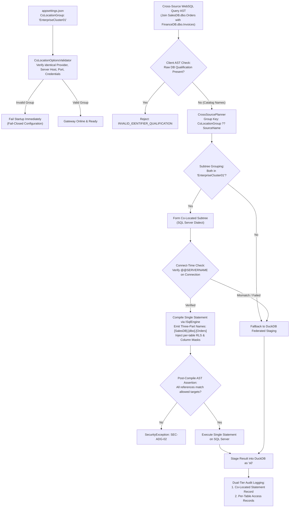
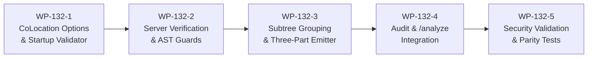
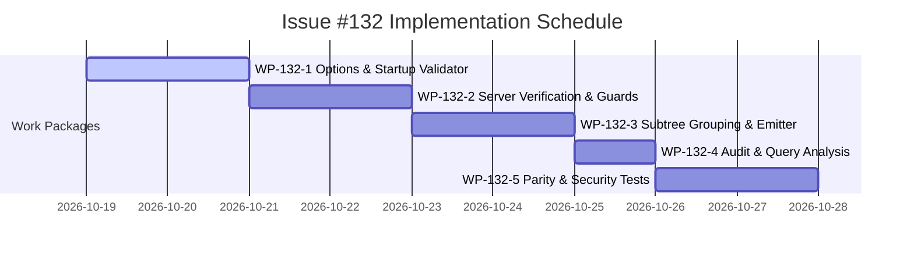

# Implementation Plan: Co-Located SQL Server Data Sources in Cross-Source WebSQL

**Document ID:** `PLAN-DATA-132`  
**Date:** 2026-10-18  
**Author:** Phase 2 Solution Architect (`csharp-architect`)  
**Target Branch:** `feat/issue-132-colocated-data-sources`  
**Parent Plan:** [00-master-plan-overview.md](file:///root/autheris/docs/plans/00-master-plan-overview.md) (Wave 4, Rank 4.3)  
**Input PRD:** [2026-10-18-issue-intake-websql-cross-source-optimizations.md](file:///root/autheris/docs/plans/2026-10-18-issue-intake-websql-cross-source-optimizations.md) (`REQ-DATA-132`)  
**Status:** APPROVED WITH CONDITIONS (Phase 3 Security Reviewed)  

---

## 1. Executive Summary & Problem Context

Enterprise organizations commonly partition enterprise domain datasets across multiple discrete databases hosted on the same physical Microsoft SQL Server instance (e.g., `SalesDB`, `OperationsDB`, and `FinanceDB` residing on cluster `sql01.corp`). Currently, Autheris treats each database as an isolated data source connection. Consequently, cross-database joins require DuckDB to stage tables independently over distinct network connections and execute the join in gateway memory, incurring severe network egress overhead and ignoring SQL Server's native ability to execute cross-database joins in a single statement via three-part naming (`[SalesDB].[dbo].[Orders] JOIN [FinanceDB].[dbo].[Invoices]`).

Building directly upon Same-Source Subtrees ([#123 / `PLAN-DATA-123`](file:///root/autheris/docs/plans/2026-10-18-plan-issue-123-websql-same-source-subtrees.md)), this architectural implementation delivers:
1. **Administrative Co-Location Grouping (WP-132-1):** Enables administrators to declare `CoLocationGroup` on [`DataSourceConnectionOptions`](file:///root/autheris/src/Autheris.Domain/Options/Storage/DatabaseOptions.cs) for SQL Server databases sharing identical server hosts and service account credentials.
2. **Symmetric Startup Validation (WP-132-1):** Enforces strict configuration consistency across group members at application startup: identical providers (SQL Server in Phase 1), normalized server host/port/instance, shared non-delegated service account credentials, and identical isolation modes. Misconfigurations or orphaned groups fail startup immediately.
3. **Connect-Time Identity Verification with Graceful Fallback (WP-132-2):** Verifies physical server identity (`SELECT @@SERVERNAME`) and current database on pooled connections before executing co-located queries. Mismatched server topologies disable co-location for that execution and fall back safely to standard DuckDB federated staging.
4. **Extended Subtree Grouping & Dialect Three-Part Qualification (WP-132-3):** Extends the #123 subtree grouping key to `CoLocationGroup ?? SourceName`. Multi-database subtrees compile into a single statement where tables spanning multiple databases in the group are qualified using physical three-part names (`[Database].[Schema].[Table]`). Single-database queries retain two-part qualification (`[Schema].[Table]`).
5. **AST Table Reference Assertion & Injection Prevention (WP-132-2, WP-132-3):** Client queries remain strictly catalog-qualified (`catalog.schema.table`). Explicit client-supplied three-part or four-part database names are rejected at AST parse time (`INVALID_IDENTIFIER_QUALIFICATION`). A post-compile assertion verifies that every table in the generated SQL strictly maps to an authorized target.
6. **Zero-Trust Governance & Dual-Tier Audit Logging (WP-132-4):** Preserves independent Casbin ABAC permissions, table-level RLS (`CombinedRowFilterSql`), and column masks per table. Cross-database correlated subquery policies are rejected fail-closed. Emits statement-level co-located audit records and per-table access records.

---

## 2. Verified Code Facts Beyond the PRD

| # | Fact | Evidence & Architectural Consequence |
|---|---|---|
| **V-1** | `CrossSourcePlanner` groups tables by exact identifier | [`CrossSourcePlanner.cs:59-63`](file:///root/autheris/src/Autheris.Application/Sql/Services/CrossSourcePlanner.cs#L59-L63) uses `table.Metadata.Identifier` (`domain.schema.table`) as the primary decision key. Under #123, subtrees group by `SourceName`. Extending the grouping key to `CoLocationGroup ?? SourceName` enables co-located grouping without disturbing table-level security keys. |
| **V-2** | SQL Server emitter supports table qualification | The Trino-to-SQL Server AST emitter formats table references. Extending the emitter to emit `[Database].[Schema].[Table]` when a subtree spans $> 1$ database within a co-location group enables single-statement server-side cross-database execution. |
| **V-3** | Client queries strictly reject four-part names | `SqlTokenSecurityOptions` rejects reserved identifiers and excessive dot qualifications. Client-supplied raw database names are disallowed; all client queries reference catalog/domain names. |
| **V-4** | `SqlConnectionFactory` manages ADO.NET connections | [`SqlConnectionFactory.cs:61`](file:///root/autheris/src/Autheris.Infrastructure/Persistence/SqlConnectionFactory.cs#L61) opens connections based on `DataSourceConnectionOptions`. Adding connection verification (`SELECT @@SERVERNAME`) validates physical co-location at runtime. |
| **V-5** | `AdoSqlConnector` executes against single data source | The connector connects to the primary database of the data source. Because SQL Server service accounts with cross-database `SELECT` permissions can query sibling databases in the same instance via three-part naming, connecting to any member database executes the multi-database statement. |
| **V-6** | Global feature switch pattern is standard | Options classes in `Autheris.Domain.Options` support feature enablement flags (e.g., `WebSql:CrossSource:CoLocation:Enabled`). |

---

## 3. Architectural Decisions



### Decision D-1: Administrative Declaration & Symmetric Startup Validation
- **Context:** Allowing arbitrary cross-database queries without strict validation risks credential confusion, privilege escalation, or connection failures.
- **Decision:**
  - Introduce `public string? CoLocationGroup { get; init; }` on [`DataSourceConnectionOptions`](file:///root/autheris/src/Autheris.Domain/Options/Storage/DatabaseOptions.cs).
  - Implement [`CoLocationOptionsValidator`](file:///root/autheris/src/Autheris.Api/Configuration/Validation/CoLocationOptionsValidator.cs) executed at application startup (`IValidateOptions<GatewayOptions>`):
    1. **Provider Check:** Provider must be `SqlServer` (`TargetSqlDialect.SqlServer`). Any group specifying `PostgreSql`, `Oracle`, or `Sqlite` aborts startup with an explicit descriptive error.
    2. **Host & Instance Parity:** Normalized server hostname (lowercased, whitespace-trimmed), port, and instance name must match identically across all members of the group.
    3. **Credential Identity:** All members must share the exact same authentication method, service account login, and password (or Key Vault reference). Delegated authentication modes (`DelegatedWindowsAuth`, `DelegatedKerberos`) are strictly prohibited.
    4. **Session Options:** `ReadUncommitted` and command timeout classes must match across all members.
    5. **Minimum Cardinality:** A `CoLocationGroup` must contain $\ge 2$ data sources. Orphaned single-member group declarations abort startup.

### Decision D-2: Connect-Time Server Verification with Staging Fallback
- **Context:** In dynamic cloud or multi-tenant environments (e.g. DNS failover, read replicas), a connection pool might inadvertently connect to different physical replicas for different databases in the same group.
- **Decision:**
  - Before executing a co-located multi-database statement, the gateway executes a fast cached verification query: `SELECT @@SERVERNAME, DB_NAME()`.
  - The runtime server name is compared against the known instance identity.
  - If a mismatch is detected, execution does **not hard-fail**; instead, it disables co-location for that specific query execution and falls back gracefully to standard DuckDB federated staging, logging a structured warning event (`AC-132-04`, `OD-WEBSQL-05`).

### Decision D-3: Subtree Grouping Key Extension & Dialect Three-Part Qualification
- **Context:** Issue #123 groups contiguous AST joins by `SourceName`. For co-located databases, joins across different `SourceName` values should be merged into a single execution unit if they share a `CoLocationGroup`.
- **Decision:**
  - Extend the subtree grouping key in `SubtreeGraphPartitioner` to:
    ```csharp
    string groupingKey = !string.IsNullOrEmpty(connectionOptions.CoLocationGroup) && isCoLocationEnabled
        ? $"colocated:{connectionOptions.CoLocationGroup}"
        : $"source:{table.Metadata.Table.SourceName}";
    ```
  - When compiling a co-located subtree spanning $\ge 2$ distinct databases in the group, the SQL Server AST emitter emits three-part qualified table names:
    `[{PhysicalDatabaseName}].[{Schema}].[{Table}]`.
  - If a subtree references tables from only a single database, the emitter retains standard two-part qualification:
    `[{Schema}].[{Table}]`.

### Decision D-4: Client AST Name Injection Prohibition & Post-Compile Assertion
- **Context:** Malicious clients might attempt to probe unauthorized databases on the SQL Server instance by submitting three-part or four-part names in raw WebSQL (`SELECT * FROM OtherDb.dbo.Secrets`).
- **Decision:**
  1. **Pre-Parse AST Gate:** The ANTLR AST visitor verifies all `NamedTableSource` and `ColumnReference` nodes in user queries. Table references must use catalog notation (`catalog.schema.table` or `schema.table`). Any query containing explicit physical database qualification is rejected immediately with `INVALID_IDENTIFIER_QUALIFICATION`.
  2. **Post-Compile AST Assertion:** Prior to issuing the compiled SQL to the database server, a security visitor inspects all physical table names in the generated AST and asserts that every emitted `(database, schema, table)` maps strictly to an authorized `ResolvedSourceTable` with an `ALLOW` decision. Any extraneous reference throws `SecurityException` (`SEC-ADG-02`).

### Decision D-5: Explicit Permissions & Independent Policy Isolation
- **Context:** SQL Server cross-database ownership chaining (`DB_CHAINING`) can bypass table-level permissions and is considered a severe security risk.
- **Decision:**
  - Cross-database execution relies strictly on explicit `SELECT` grants granted to the service account in each target database. `DB_CHAINING` is neither required nor assumed (`FR-132-07`).
  - Table-level RLS policies (`CombinedRowFilterSql`) are evaluated and injected independently per table.
  - Cross-database correlated subquery policies (where Table A's RLS policy references a subquery on Table B in another database) are strictly rejected fail-closed (`FR-132-08`).

### Decision D-6: Dual-Tier Audit Logging & Global Feature Switch
- **Context:** Security audits must maintain per-database compliance records while reflecting that execution occurred as a unified statement on the server.
- **Decision:**
  - Emits a statement-level audit record in `AUDIT_LOG_ENTRIES` tagged `colocated: true`, listing `coLocationGroup`, all queried databases, execution time, and row counts.
  - Emits separate child audit records for each member table's data owner (`FR-132-09`).
  - Governed by global switch: `WebSql:CrossSource:CoLocation:Enabled` (default `false`, fail closed) (`FR-132-10`).

---

## 4. Work Packages



### WP-132-1: CoLocation Options & Startup Validator
- **Objective:** Introduce `CoLocationGroup` in configuration options and implement startup validation enforcing symmetric provider, host, and credential settings.
- **Files to Modify/Create:**
  - [`src/Autheris.Domain/Options/Storage/DatabaseOptions.cs`](file:///root/autheris/src/Autheris.Domain/Options/Storage/DatabaseOptions.cs):
    - Add `public string? CoLocationGroup { get; init; } = null;` to `DataSourceConnectionOptions`.
  - [`src/Autheris.Domain/Options/Protocols/RestApiOptions.cs`](file:///root/autheris/src/Autheris.Domain/Options/Protocols/RestApiOptions.cs):
    - Add `CoLocationOptions` under `CrossSourceOptions`:
      ```csharp
      public CoLocationOptions CoLocation { get; init; } = new();
      public sealed class CoLocationOptions
      {
          public bool Enabled { get; init; } = false;
      }
      ```
  - [`src/Autheris.Api/Configuration/Validation/CoLocationOptionsValidator.cs`](file:///root/autheris/src/Autheris.Api/Configuration/Validation/CoLocationOptionsValidator.cs):
    - Implements `IValidateOptions<GatewayOptions>`.
    - Validates all data sources declaring `CoLocationGroup`:
      - Provider == `SqlServer`.
      - Identical normalized server host, port, and instance.
      - Identical authentication method and service account credentials.
      - Identical `ReadUncommitted` and command timeout.
      - Disallows `Delegated*` authentication modes.
      - Enforces $\ge 2$ members per group.
- **Test Criteria:**
  - Startup tests verifying valid multi-database SQL Server co-location passes validation.
  - Startup tests verifying mismatched credentials, hosts, or non-SQL Server providers fail startup with descriptive errors.
  - Startup tests verifying orphaned 1-member groups fail startup.

### WP-132-2: Connect-Time Identity Verification & AST Guards
- **Objective:** Implement connect-time `@@SERVERNAME` verification with DuckDB staging fallback, and enforce client-side database qualification rejection.
- **Files to Modify/Create:**
  - [`src/Autheris.Infrastructure/Persistence/SqlConnectionFactory.cs`](file:///root/autheris/src/Autheris.Infrastructure/Persistence/SqlConnectionFactory.cs):
    - Add `VerifyServerIdentityAsync(DbConnection connection, string expectedHost, CancellationToken ct)`.
    - Executes `SELECT @@SERVERNAME`.
  - [`src/Autheris.Application/Sql/Federation/CoLocation/CoLocationVerificationService.cs`](file:///root/autheris/src/Autheris.Application/Sql/Federation/CoLocation/CoLocationVerificationService.cs):
    - Caches verified server identities per connection pool.
    - If verification fails, flags co-location as disabled for the execution scope.
  - [`src/Autheris.Application/Sql/Security/TableQualificationValidator.cs`](file:///root/autheris/src/Autheris.Application/Sql/Security/TableQualificationValidator.cs):
    - AST visitor asserting that no client `NamedTableSource` contains explicit physical database names.
    - Rejects invalid qualifications with `INVALID_IDENTIFIER_QUALIFICATION`.
- **Test Criteria:**
  - Unit tests verifying client query with `[OtherDB].[dbo].[Table]` is rejected at AST parsing.
  - Mock connection tests verifying server name mismatch triggers fallback to standard DuckDB staging.

### WP-132-3: Extended Subtree Grouping & Dialect Three-Part Emitter
- **Objective:** Extend #123 subtree grouping key to incorporate `CoLocationGroup` and update SQL Server emitter to output physical three-part table names.
- **Files to Modify/Create:**
  - [`src/Autheris.Application/Sql/Federation/Subtrees/SubtreeGraphPartitioner.cs`](file:///root/autheris/src/Autheris.Application/Sql/Federation/Subtrees/SubtreeGraphPartitioner.cs):
    - Extend grouping key calculation:
      `CoLocationGroup != null && options.CoLocation.Enabled ? $"colocated:{CoLocationGroup}" : $"source:{SourceName}"`.
  - [`src/TrinoSqlEngine/Ast/Emit/SqlServerDialectEmitter.cs`](file:///root/autheris/src/TrinoSqlEngine/Ast/Emit/SqlServerDialectEmitter.cs):
    - When compiling a co-located subtree spanning multiple databases:
      Format table references as `[{PhysicalDatabaseName}].[{Schema}].[{TableName}]`.
    - Assert post-compile table references match allowed `ResolvedSourceTable` list (`SEC-ADG-02`).
  - [`src/Autheris.Application/Sql/Federation/Subtrees/SubtreeCompiler.cs`](file:///root/autheris/src/Autheris.Application/Sql/Federation/Subtrees/SubtreeCompiler.cs):
    - Pass co-location database mapping to compiler request.
- **Test Criteria:**
  - AST compilation tests verifying joins across 2 databases in the same group emit `[DB1].[dbo].[Table1] JOIN [DB2].[dbo].[Table2]`.
  - Compilation tests verifying single-database queries retain two-part names `[dbo].[Table1]`.
  - Post-compile security assertion verifying injected extraneous table names throw `SecurityException`.

### WP-132-4: Dual-Tier Audit & Query Analysis Integration
- **Objective:** Implement dual-tier audit logging for co-located statement executions and surface co-location details in `/analyze`.
- **Files to Modify:**
  - [`src/Autheris.Application/Olap/FederatedStagingService.cs`](file:///root/autheris/src/Autheris.Application/Olap/FederatedStagingService.cs):
    - Emit `WebSqlCrossSourceSubtreeRead` with `colocated: true` and `coLocationGroup`.
    - Emit per-table `WebSqlCrossSourceSourceRead` child records.
  - [`src/Autheris.Application/Governance/Analysis/QueryAnalysisModels.cs`](file:///root/autheris/src/Autheris.Application/Governance/Analysis/QueryAnalysisModels.cs):
    - Extend `QueryFederationAnalysis` with `CoLocatedGroupPlan(GroupName, Databases, MemberTables, SingleStatementExecuted)`.
  - [`src/Autheris.Application/Governance/Analysis/QueryAnalysisService.Sql.cs`](file:///root/autheris/src/Autheris.Application/Governance/Analysis/QueryAnalysisService.Sql.cs):
    - Surface co-location groupings in static query analysis.
- **Test Criteria:**
  - Audit tests verify dual-tier audit entries emitted with `colocated: true`.
  - Query analysis returns `CoLocatedGroupPlan` details.

### WP-132-5: Security Validation & Parity Test Suite
- **Objective:** Author comprehensive test suite verifying cross-database execution, RLS injection, security boundaries, and fallback resilience.
- **Files to Create:**
  - [`tests/Autheris.Tests.Unit/Federation/WebSqlCoLocatedDataSourcesTests.cs`](file:///root/autheris/tests/Autheris.Tests.Unit/Federation/WebSqlCoLocatedDataSourcesTests.cs):
    - Grouping logic, three-part name emission, and AST qualification guards.
  - [`tests/Autheris.Tests.Unit/Security/WebSqlCoLocatedDataSourcesSecurityTests.cs`](file:///root/autheris/tests/Autheris.Tests.Unit/Security/WebSqlCoLocatedDataSourcesSecurityTests.cs):
    - Tagged security tests `[Trait("Category", "Security")]`:
      - `T_SEC_DATA132_01_DirectDatabaseQualification_Rejected`: Asserts client queries containing explicit three-part or four-part database names throw `WebSqlPolicyException`.
      - `T_SEC_DATA132_02_IndependentRLS_PerDatabaseEnforced`: Asserts table-level RLS policies are injected independently into each database's table reference.
      - `T_SEC_DATA132_03_CrossDatabaseCorrelatedRLS_Rejected`: Asserts correlated subquery RLS policies spanning database boundaries fail closed.
      - `T_SEC_DATA132_04_PostCompileAstAssertion_ExtraneousTableBlocked`: Asserts post-compile visitor throws `SecurityException` if an unauthorized table reference appears.
      - `T_SEC_DATA132_05_ConnectTimeServerMismatch_FallbackToDuckDb`: Asserts runtime `@@SERVERNAME` mismatch falls back safely to DuckDB staging.
      - `T_SEC_DATA132_06_StartupValidation_AsymmetricGroupFails`: Asserts startup validator fails if data sources in a group have mismatched credentials or hosts.
      - `T_SEC_DATA132_07_Audit_DualTierEmitted`: Asserts statement-level co-location audit records and per-table access records are logged in `AUDIT_LOG_ENTRIES`.

---

## 5. Dependency Sequencing & Risk Matrix



| Risk ID | Risk Description | Severity | Likelihood | Mitigation Strategy |
|---|---|:---:|:---:|---|
| **R-132-1** | **Client Cross-Database Injection:** Client probes arbitrary databases on SQL Server | Critical | Low | Two-layer defense: ANTLR AST parser rejects explicit database qualifications; post-compile AST visitor asserts all table references match authorized catalog targets (`SEC-ADG-02`). |
| **R-132-2** | **Server Replica Divergence:** Pooled connection connects to replica with different data | High | Low | Connect-time `SELECT @@SERVERNAME` verification. Mismatch disables co-location and falls back safely to DuckDB staging. |
| **R-132-3** | **Cross-Database Collation Conflict:** Databases use incompatible default collations | High | Medium | Caught during query compilation or mapped to stable `FEDERATION_SOURCE_ERROR` rather than unhandled driver crash. |
| **R-132-4** | **Credential Escaping / Misconfiguration:** Asymmetric passwords or logins across group | Critical | Low | `CoLocationOptionsValidator` validates symmetric host, port, credentials, and settings at application startup; fails startup on any asymmetry. |

---

## 6. Definition of Done (DoD)

1. [ ] **Configuration & Startup Validation:** `CoLocationOptionsValidator` validates symmetric settings across group members at gateway startup.
2. [ ] **Client Qualification Rejection:** Raw three-part/four-part database names in client SQL are rejected at AST parse time.
3. [ ] **Connect-Time Verification:** Physical server identity is verified at runtime; mismatches trigger automatic DuckDB staging fallback.
4. [ ] **Three-Part SQL Emission:** SQL Server emitter produces `[db].[schema].[table]` only for subtrees spanning multiple databases in the co-location group.
5. [ ] **Independent Policy Isolation:** Table-level RLS, Casbin ABAC, and column masks are applied independently per table.
6. [ ] **Audit Completeness:** Dual-tier audit entries emitted to `AUDIT_LOG_ENTRIES`.
7. [ ] **Query Analysis Parity:** `/analyze` surfaces co-located group execution plans.
8. [ ] **Test Coverage:** All unit tests and security tests `T_SEC_DATA132_01` through `T_SEC_DATA132_07` pass green.

---

## 7. Phase 3 Security Review & Binding Conditions (`csharp-security-expert`)

**Review Date:** 2026-10-18  
**Verdict:** APPROVED WITH BINDING CONDITIONS  
**Reviewer:** Application Security Expert (`csharp-security-expert`)

### Security Findings & Risk Analysis

| Finding ID | Severity | Description & Security Impact |
| :--- | :--- | :--- |
| **SEC-132-F01** | Critical | **Cross-Database Injection / Unauthorized Table Access (`SEC-ADG-02`):** Permitting three-part naming could allow an attacker to reference arbitrary databases on the server if client identifiers are not strictly verified. |
| **SEC-132-F02** | Critical | **Privilege Escalation via Ownership Chaining:** Relying on SQL Server `DB_CHAINING` allows queries to bypass table permissions across databases. |
| **SEC-132-F03** | High | **Cross-Database Policy Bleed:** Evaluating correlated RLS subqueries across databases risks leaking cross-tenant data. |
| **SEC-132-F04** | High | **Split-Brain / Topology Drift:** Routing co-located queries across divergent replica servers leads to dirty reads or data corruption. |

### Binding Security Conditions

1. **`SEC-DATA132-01`: Client Database Qualification Strictly Rejected**
   - Client SQL statements MUST use catalog identifiers (`catalog.schema.table` or `schema.table`).
   - Any client query containing explicit three-part or four-part database qualification MUST be rejected immediately during AST parsing with `INVALID_IDENTIFIER_QUALIFICATION`.
2. **`SEC-DATA132-02`: Post-Compile AST Target Assertion (`SEC-ADG-02`)**
   - Before executing a compiled co-located statement, a security AST visitor MUST assert that every physical table reference maps strictly to an authorized `(database, schema, table)` tuple. Any extraneous reference MUST throw `SecurityException`.
3. **`SEC-DATA132-03`: No Database Ownership Chaining (`DB_CHAINING`)**
   - Multi-database statement execution MUST rely strictly on explicit `SELECT` permissions granted to the service account on each individual database. `DB_CHAINING` MUST NOT be required or enabled.
4. **`SEC-DATA132-04`: Cross-Database Policy Isolation**
   - Row-Level Security (`CombinedRowFilterSql`) subqueries MUST NOT reference tables outside the respective database. Correlated cross-database RLS policies MUST fail closed.
5. **`SEC-DATA132-05`: Connect-Time Topology Verification & Fallback**
   - The connection pool MUST verify `SELECT @@SERVERNAME`. If the runtime server name diverges from the registered host, co-location MUST be disabled for that execution, falling back safely to DuckDB federated staging.
6. **`SEC-DATA132-06`: Symmetric Startup Configuration Validator**
   - Application startup MUST fail closed if members of a `CoLocationGroup` exhibit asymmetric providers, hosts, ports, credentials, or session settings.
7. **`SEC-DATA132-07`: Dual-Tier Co-Located Audit Logging**
   - Statement-level audit record tagged `colocated: true` and member table access records MUST be emitted to `AUDIT_LOG_ENTRIES` without exposing credentials or internal connection strings.

### Mandatory Security Test Requirements (`[Trait("Category", "Security")]`)

| Test Method | Target Condition | Verification Scope |
| :--- | :--- | :--- |
| `T_SEC_DATA132_01_DirectDatabaseQualification_Rejected` | `SEC-DATA132-01` | Asserts client queries containing explicit three-part or four-part database names throw `WebSqlPolicyException` (`INVALID_IDENTIFIER_QUALIFICATION`). |
| `T_SEC_DATA132_02_IndependentRLS_PerDatabaseEnforced` | `SEC-DATA132-04` | Asserts table-level RLS policies are injected independently into each database's table reference. |
| `T_SEC_DATA132_03_CrossDatabaseCorrelatedRLS_Rejected` | `SEC-DATA132-04` | Asserts correlated subquery RLS policies spanning database boundaries fail closed. |
| `T_SEC_DATA132_04_PostCompileAstAssertion_ExtraneousTableBlocked` | `SEC-DATA132-02` | Asserts post-compile visitor throws `SecurityException` if an unauthorized table reference appears (`SEC-ADG-02`). |
| `T_SEC_DATA132_05_ConnectTimeServerMismatch_FallbackToDuckDb` | `SEC-DATA132-05` | Asserts runtime `@@SERVERNAME` mismatch falls back safely to DuckDB staging without leaking credentials. |
| `T_SEC_DATA132_06_StartupValidation_AsymmetricGroupFails` | `SEC-DATA132-06` | Asserts startup validator fails closed if data sources in a group have mismatched credentials, providers, or hosts. |
| `T_SEC_DATA132_07_Audit_DualTierEmitted` | `SEC-DATA132-07` | Asserts statement-level co-location audit records and per-table access records are logged in `AUDIT_LOG_ENTRIES`. |
