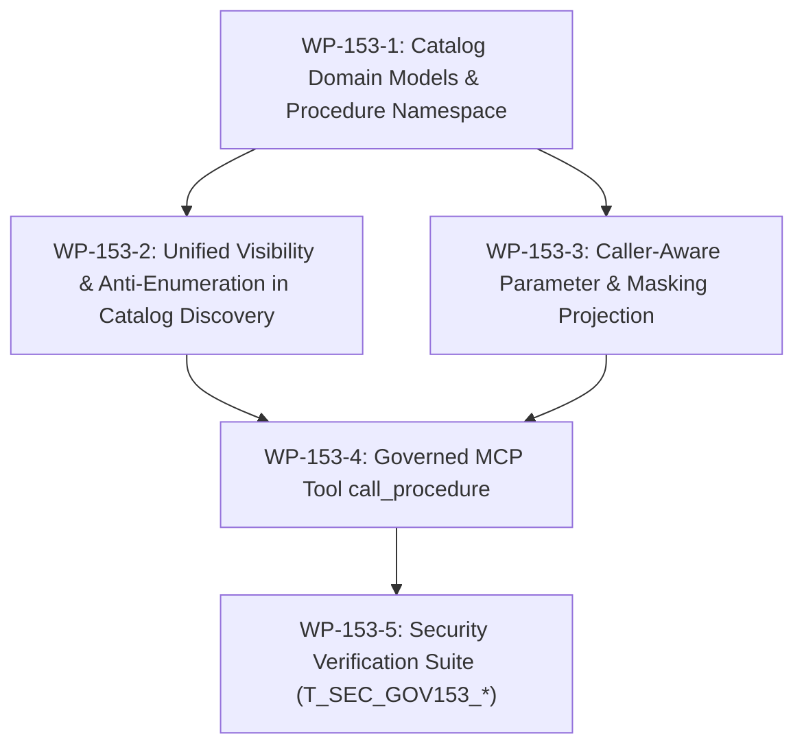

# Architecture Implementation Plan: Issue #153 - Governed Stored Procedures in Catalog and MCP

**Document ID:** `PLAN-GOV-153`  
**Date:** 2026-10-18  
**Phase:** 2 (Architecture, Design & Implementation Blueprint)  
**Author:** Phase 2 Solution Architect (`csharp-architect`)  
**Parent Requirements:** [`INTAKE-2026-10-18-AUD-PROC`](file:///root/autheris/docs/plans/2026-10-18-issue-intake-audit-and-procedures.md) (§4 REQ-GOV-153)  
**Target Branch:** `feat/issue-153-stored-procedures-catalog-mcp`  
**Consolidates:** INC-3 (Procedure Column Plan), INC-4 (Procedure Catalog Integration), INC-5 (Governed MCP Procedure Invocation)

---

## 1. Executive Summary & Problem Statement

### 1.1 Problem Statement
In Autheris, stored procedures and Table-Valued Functions (TVFs) are registered via [`IProcedureRegistry`](file:///root/autheris/src/Autheris.Application/Procedures/Interfaces/IProcedureRegistry.cs#L7) and executed via REST endpoints (`/api/v1/procedures/{name}`). However:
1. **Catalog Invisibility:** Stored procedures are completely absent from Model Context Protocol (MCP) discovery tools ([`list_datasets`](file:///root/autheris/src/Autheris.Application/Mcp/Services/McpDatasetCatalog.cs#L146), [`describe_dataset`](file:///root/autheris/src/Autheris.Application/Mcp/Services/McpDatasetCatalog.cs#L212), [`search_catalog`](file:///root/autheris/src/Autheris.Application/Catalog/Services/CatalogDiscoveryService.cs#L191)). AI agents and analysts cannot discover available procedures, inspect expected input parameters, or view which output columns will be masked.
2. **Missing Anti-Enumeration Unification:** Unconsented procedures must not leak their existence or schemas. If an unprivileged caller queries `describe_dataset("procedure:GetRevenue")`, returning `403 Forbidden` or a malformed identifier error provides an existence oracle. It must return `404 DATASET_NOT_FOUND` indistinguishable in timing and byte-exact payload from an unknown dataset.
3. **Absence of Caller-Aware Column Masking Projection:** The procedure result schema must dynamically reflect the caller's active consent on [`ResultTable`](file:///root/autheris/src/Autheris.Domain/Model/ProcedureModels.cs#L84). Columns with `ColumnAccessLevel.Deny` must be completely omitted from the schema, while masked columns must explicitly indicate `"mask"`, without executing the underlying procedure or allocating AST nodes.
4. **Lack of Governed MCP Execution:** AI agents operating with read-only tokens cannot safely invoke procedures. A dedicated, governed MCP tool (`call_procedure`) is required under the `Query` tool group (governed by [#115](file:///root/autheris/docs/plans/2026-10-16-plan-issue-115-read-path-switches.md) switches), bounded by strict row limits (default 100, max 1,000 per OQ-36) and full audit logging.

### 1.2 Architectural Solution Blueprint
- **Catalog Model & Namespace (`WP-153-1`):** Namespace procedures in dataset catalogs as `procedure:<name>`. Set `kind = "procedure"` in [`McpDatasetSummary`](file:///root/autheris/src/Autheris.Domain/Model/McpDatasetModels.cs#L8), [`McpDatasetDescription`](file:///root/autheris/src/Autheris.Domain/Model/McpDatasetModels.cs#L100), and [`CatalogSearchHit`](file:///root/autheris/src/Autheris.Domain/Model/CatalogSearchModels.cs#L58). Fail-closed policy: only procedures with declared `ResultTable` and `ProcedureMode.Read` are exposed in catalog discovery (OQ-35).
- **Unified Visibility & Anti-Enumeration (`WP-153-2`):** Integrate [`ICatalogVisibilityService`](file:///root/autheris/src/Autheris.Application/Catalog/Interfaces/ICatalogVisibilityService.cs#L91) and [`IProcedureExecutionService.IsVisibleAsync`](file:///root/autheris/src/Autheris.Application/Procedures/Interfaces/IProcedureExecutionService.cs#L32). A caller lacking required roles or consent on `ResultTable` receives an identical `404 DATASET_NOT_FOUND` / `McpErrorCodes.NotFound` on `describe_dataset("procedure:<name>")`, matching unknown datasets with zero information leak. Invisible procedures are omitted from `list_datasets` and `search_catalog` without leaking total counts.
- **Caller-Aware Masking Projection (`WP-153-3`):** In `describe_dataset`, output parameters (`Name`, `SqlType`, `ClrType`, `isRequired`, `description`) and caller-specific output columns with clear/mask status projected via [`IConsentResolutionService.ResolveAccess`](file:///root/autheris/src/Autheris.Domain/Interfaces/IConsentResolutionService.cs#L8) on `ResultTable`. Columns with `ColumnAccessLevel.Deny` are completely stripped.
- **Governed MCP Tool `call_procedure` (`WP-153-4`):** Register `call_procedure` under [`McpToolGroup.Query`](file:///root/autheris/src/Autheris.Application/Mcp/Services/McpToolGroups.cs#L12). Allow invocation by read-only tokens in [`ReadOnlyTokenMiddleware`](file:///root/autheris/src/Autheris.Api/Middleware/ReadOnlyTokenMiddleware.cs#L14) only when `ProcedureMode.Read`. Enforce row limits (default 100, max 1,000, OQ-36) with an explicit `truncated: true` indicator. Delegate directly to [`IProcedureExecutionService.ExecuteAsync`](file:///root/autheris/src/Autheris.Application/Procedures/Interfaces/IProcedureExecutionService.cs#L20) with tenant context and principal, applying full column masking and audit logging.

---

## 2. Verified Code Facts Beyond the PRD

| # | Fact | Evidence & Architectural Consequence |
|---|---|---|
| **V-1** | `IProcedureExecutionService` already implements visibility verification | [`IProcedureExecutionService.cs:32`](file:///root/autheris/src/Autheris.Application/Procedures/Interfaces/IProcedureExecutionService.cs#L32) defines `IsVisibleAsync(RegisteredProcedure, ClaimsPrincipal, TenantId, CancellationToken)`. Implemented in [`GovernedProcedureExecutionService.cs:286-369`](file:///root/autheris/src/Autheris.Application/Procedures/Services/GovernedProcedureExecutionService.cs#L286-L369) evaluating required roles and consent on `ResultTable` + `ReferencedTables`. |
| **V-2** | Dataset ID parsing currently strictly rejects procedure prefixes | [`McpDatasetCatalog.cs:848-858`](file:///root/autheris/src/Autheris.Application/Mcp/Services/McpDatasetCatalog.cs#L848-L858) and [`TableIdentifier.cs:55-65`](file:///root/autheris/src/Autheris.Domain/Common/TableIdentifier.cs#L55-L65) require 3 dot-separated parts (`domain.schema.table`). Invoking `describe_dataset("procedure:X")` currently throws `ArgumentException` and returns `InvalidParams` ([`GatewayMcpQueryExecutor.cs:304-309`](file:///root/autheris/src/Autheris.GraphQL/Mcp/GatewayMcpQueryExecutor.cs#L304-L309)), leaking input validation errors rather than returning 404 anti-enumeration. |
| **V-3** | `McpDatasetSummary` and `McpDatasetDescription` lack `Kind` and parameter models | [`McpDatasetModels.cs:8-16, 100-119`](file:///root/autheris/src/Autheris.Domain/Model/McpDatasetModels.cs#L8-L16) only models tables. `McpDatasetSummary` has 8 positional fields; `McpDatasetDescription` has 18 fields. Adding `string Kind = "table"` and `IReadOnlyList<McpProcedureParameterInfo>? Parameters = null` with default values preserves 100% backwards compatibility for existing unit tests ([`McpDatasetToolWiringTests.cs:14`](file:///root/autheris/tests/Autheris.Tests.Unit/Mcp/McpDatasetToolWiringTests.cs#L14)). |
| **V-4** | `McpDatasetColumn` lacks an explicit `Access` status property | [`McpDatasetModels.cs:66-76`](file:///root/autheris/src/Autheris.Domain/Model/McpDatasetModels.cs#L66-L76) defines `Name`, `Type`, `Description`, `Sensitive`, `PrimaryKey`, `GraphQlField`, `GraphQlType`, `Semantics`, `Deprecation`, `ValueProfile`. Adding `string? Access = null` allows serializing `"access": "clear"` or `"access": "mask"` for caller-aware describe projection. |
| **V-5** | `McpToolGroups` governs switchable tool execution | [`McpToolGroups.cs:49-52`](file:///root/autheris/src/Autheris.Application/Mcp/Services/McpToolGroups.cs#L49-L52) classifies tools into `Catalog`, `Query`, `Api`, `Access`, and `None`. Adding `call_procedure` to `McpToolGroup.Query` automatically integrates with `#115` (`Mcp:ToolGroups:Query = false`). |
| **V-6** | `McpToolExecutionHandler` is the hybrid execution engine | [`McpToolExecutionHandler.cs:66-75, 77-160`](file:///root/autheris/src/Autheris.Application/Mcp/Services/McpToolExecutionHandler.cs#L66-L75) dispatches `query_sql`, `query_dataset`, `search_catalog`, etc. Adding `call_procedure` to `CanHandle` and `ExecuteToolAsync` centralizes parameter validation, execution delegation, and error mapping. |
| **V-7** | `ReadOnlyTokenMiddleware` permits query paths and procedure endpoints | [`ReadOnlyTokenMiddleware.cs:23-31, 103-106`](file:///root/autheris/src/Autheris.Api/Middleware/ReadOnlyTokenMiddleware.cs#L23-L31) already whitelists `mcpPath` in `_queryPaths` and provides `IsProcedureExecutionPath`. For MCP, tool execution is intercepted inside `McpToolExecutionHandler` or `GatewayMcpQueryExecutor`, ensuring read-only tokens can execute `call_procedure` only when `ProcedureMode.Read`. |
| **V-8** | `CatalogSearchHit` represents search items with `TableIdentifier` | [`CatalogSearchModels.cs:58-70`](file:///root/autheris/src/Autheris.Domain/Model/CatalogSearchModels.cs#L58-L70) has `TableIdentifier TableIdentifier`. For a procedure, domain is `procedure.CatalogDomain`, schema is `"procedure"`, and tableName is `procedure.Name`. Adding `string Kind = "table"` and `string? DatasetId = null` allows seamless serialization of `procedure:<name>`. |

---

## 3. Architectural Decisions

```mermaid
flowchart TD
    subgraph DiscoveryFlow ["MCP Catalog Discovery Pipeline (WP-153-1, WP-153-2)"]
        A1["Agent calls list_datasets / search_catalog"] --> A2["Fetch Visible Tables via ICatalogVisibilityService"]
        A1 --> A3["Fetch Registered Active Procedures from IProcedureRegistry"]
        A3 --> A4{"ProcedureMode == Read && ResultTable != null? (OQ-35)"}
        A4 -- No --> A5["Drop Procedure (Fail-Closed)"]
        A4 -- Yes --> A6["Evaluate IProcedureExecutionService.IsVisibleAsync(proc, caller)"]
        A6 -- Not Visible --> A5
        A6 -- Visible --> A7["Project McpDatasetSummary (Id = 'procedure:name', kind = 'procedure')"]
        A2 --> A8["Merge & Sort Table Summaries and Procedure Summaries"]
        A7 --> A8
        A8 --> A9["Apply Search Filter, Domain Filter, Paging (Offset, Limit)"]
        A9 --> A10["Return McpDatasetList (Total reflects visible items only)"]
    end

    subgraph DescribeFlow ["Describe Dataset Pipeline (WP-153-3)"]
        D1["Agent calls describe_dataset(id)"] --> D2{"id starts with 'procedure:'?"}
        D2 -- No --> D3["Standard Table Describe Pipeline"]
        D2 -- Yes --> D4["Lookup Procedure in IProcedureRegistry"]
        D4 --> D5{"Found && Active && ReadMode && HasResultTable?"}
        D5 -- No --> D6["Throw TableNotFoundException (404 Anti-Enumeration Parity)"]
        D5 -- Yes --> D7["Evaluate IsVisibleAsync(proc, caller)"]
        D7 -- False --> D6
        D7 -- True --> D8["Load ResultTable Metadata from Repository"]
        D8 --> D9["Resolve Caller Access via IConsentResolutionService.ResolveAccess"]
        D9 --> D10["Filter & Project Columns: Omit Denied; Mark Clear or Mask"]
        D10 --> D11["Project Declared Parameters (Name, SqlType, ClrType, isRequired, desc)"]
        D11 --> D12["Return McpDatasetDescription (kind = 'procedure', Columns, Parameters)"]
    end

    subgraph ExecutionFlow ["Governed Procedure Execution Pipeline (WP-153-4)"]
        E1["Agent calls call_procedure(procedure_name, arguments, max_rows)"] --> E2["Lookup Procedure in IProcedureRegistry"]
        E2 --> E3{"Caller is ReadOnlyToken?"}
        E3 -- Yes --> E4{"proc.Definition.Mode == Read?"}
        E4 -- No --> E5["Return 403 Forbidden (READ_ONLY_TOKEN)"]
        E4 -- Yes --> E6["Proceed"]
        E3 -- No --> E6
        E6 --> E7["Clamp max_rows to [1, 1000] (default 100, OQ-36)"]
        E7 --> E8["Invoke IProcedureExecutionService.ExecuteAsync(name, args, principal, tenant)"]
        E8 --> E9{"KeyNotFoundException / Unavailable / BusinessException?"}
        E9 -- KeyNotFoundException --> E10["Return 404 NotFound ('Procedure endpoint not found.')"]
        E9 -- Unavailable --> E11["Return 503 NotAvailable"]
        E9 -- BusinessException --> E12["Return 422 ExecutionFailed with Mapped Code/Message"]
        E9 -- Success --> E13["Serialize Tabular Result: columns, rows, rowCount, truncated"]
    end
```



### Decision D-153-1: Dataset Identifier Namespacing & Fail-Closed Inclusion
- **Rule:** Procedures in MCP catalog tools are identified with the prefix `procedure:<name>` (e.g. `procedure:GetMonthlyRevenue`).
- **Fail-Closed Filtering (OQ-35):** Only registered procedures satisfying ALL of the following criteria are exposed in the catalog:
  1. `State == ProcedureState.Active`
  2. `Mode == ProcedureMode.Read` (write-mode procedures are strictly omitted from discovery)
  3. `ResultTable != null` (procedures without a declared result table cannot evaluate consent or masking, and are hidden)
  4. Caller passes required roles and consent checks on `ResultTable` and all referenced tables via `IsVisibleAsync`.

### Decision D-153-2: Anti-Enumeration Parity (Indistinguishable 404)
- **Rule:** Across `describe_dataset("procedure:<name>")`, callers lacking role entitlement, consent on `ResultTable`, or referencing an inactive/unknown procedure receive identical response status (`McpErrorCodes.NotFound` / HTTP 404) and byte-exact error payload: `"Dataset not found or not visible."`.
- **Timing and Exception Parity:** Handled via [`TableNotFoundException`](file:///root/autheris/src/Autheris.Domain/Exceptions/GatewayExceptions.cs#L88) caught by [`GatewayMcpQueryExecutor.cs:294-298`](file:///root/autheris/src/Autheris.GraphQL/Mcp/GatewayMcpQueryExecutor.cs#L294-L298). No existence oracle or schema discovery leak occurs for unauthorized actors.

### Decision D-153-3: Static Projection of Caller-Aware Column Masking
- **Rule:** In `describe_dataset`, column visibility and masking levels are determined statically without calling the database:
  1. Fetch `ResultTable` metadata from [`ITableMetadataRepository`](file:///root/autheris/src/Autheris.Domain/Interfaces/ITableMetadataRepository.cs).
  2. Evaluate caller consent via [`IConsentResolutionService.ResolveAccess`](file:///root/autheris/src/Autheris.Domain/Interfaces/IConsentResolutionService.cs#L8).
  3. For each column:
     - `ColumnAccessLevel.Deny`: completely omitted (stripped from the columns array).
     - `ColumnAccessLevel.Mask`: included with `Access = "mask"`.
     - `ColumnAccessLevel.Clear`: included with `Access = "clear"`.
  4. Include declared parameters: `Name`, `SqlType`, `ClrType` (simple string name, e.g. `"Int32"`), `IsRequired`, `Description`.

### Decision D-153-4: Tool Group Classification & `#115` Switch Governance
- **Rule:** The `call_procedure` tool is registered under [`McpToolGroup.Query`](file:///root/autheris/src/Autheris.Application/Mcp/Services/McpToolGroups.cs#L12).
- **Behavior:** When the query tool group is disabled (`Mcp:ToolGroups:Query = false`), `call_procedure` is excluded from the MCP tool registry, matching `query_sql` and `query_dataset`.

### Decision D-153-5: Read-Only Token Enforcement in MCP Execution
- **Rule:** Read-only tokens (`context.User.IsReadOnly()` / `sessionContext.IsReadOnly`) are permitted to execute `call_procedure` ONLY if `procedure.Definition.Mode == ProcedureMode.Read`.
- **Write-Mode Rejection:** Attempting to execute a procedure with `ProcedureMode.Write` using a read-only token immediately halts execution before database invocation, returning HTTP 403 / `McpErrorCodes.Forbidden` with extensions code `READ_ONLY_TOKEN`.

### Decision D-153-6: Bounded Tabular Output & Context Protection (OQ-36)
- **Rule:** `call_procedure` enforces bounded output streaming. The `max_rows` argument is clamped to $[1, 1000]$ with a default of $100$. If row results exceed `max_rows`, the output is sliced to `max_rows` and `truncated: true` is set in the serialized JSON response.

---

## 4. Work Packages

### 4.1 WP-153-1: Catalog Domain Models & Procedure Namespace
**Target Files:**
- [`src/Autheris.Domain/Model/McpDatasetModels.cs`](file:///root/autheris/src/Autheris.Domain/Model/McpDatasetModels.cs)
- [`src/Autheris.Domain/Model/CatalogSearchModels.cs`](file:///root/autheris/src/Autheris.Domain/Model/CatalogSearchModels.cs)
- [`src/Autheris.Domain/Model/ProcedureModels.cs`](file:///root/autheris/src/Autheris.Domain/Model/ProcedureModels.cs)

**Implementation Details:**
1. In `McpDatasetModels.cs`:
   - Extend [`McpDatasetSummary`](file:///root/autheris/src/Autheris.Domain/Model/McpDatasetModels.cs#L8) with optional property `string Kind = "table"`.
   - Define `McpProcedureParameterInfo(string Name, string SqlType, string ClrType, bool IsRequired, string? Description = null)`.
   - Extend [`McpDatasetColumn`](file:///root/autheris/src/Autheris.Domain/Model/McpDatasetModels.cs#L66) with optional property `string? Access = null` (`"clear" | "mask"`).
   - Extend [`McpDatasetDescription`](file:///root/autheris/src/Autheris.Domain/Model/McpDatasetModels.cs#L100) with optional properties `string Kind = "table"` and `IReadOnlyList<McpProcedureParameterInfo>? Parameters = null`.
2. In `CatalogSearchModels.cs`:
   - Extend [`CatalogSearchHit`](file:///root/autheris/src/Autheris.Domain/Model/CatalogSearchModels.cs#L58) with `string Kind = "table"` and `string? DatasetId = null`.
3. In `ProcedureModels.cs`:
   - Ensure [`ProcedureDefinition`](file:///root/autheris/src/Autheris.Domain/Model/ProcedureModels.cs#L75) exposes optional `string? Description { get; init; } = null` alongside `Summary`.

**Acceptance Criteria:**
- Models compile with backward-compatible defaults without breaking existing unit tests.
- Serialized JSON outputs include `kind: "procedure"` and `access: "clear"|"mask"` when populated.

---

### 4.2 WP-153-2: Unified Visibility & Anti-Enumeration in Catalog Discovery
**Target Files:**
- [`src/Autheris.Application/Mcp/Services/McpDatasetCatalog.cs`](file:///root/autheris/src/Autheris.Application/Mcp/Services/McpDatasetCatalog.cs)
- [`src/Autheris.Application/Catalog/Services/CatalogDiscoveryService.cs`](file:///root/autheris/src/Autheris.Application/Catalog/Services/CatalogDiscoveryService.cs)
- [`src/Autheris.Api/Extensions/DependencyInjection/GatewayMcpServiceExtensions.cs`](file:///root/autheris/src/Autheris.Api/Extensions/DependencyInjection/GatewayMcpServiceExtensions.cs)

**Implementation Details:**
1. Inject [`IProcedureRegistry`](file:///root/autheris/src/Autheris.Application/Procedures/Interfaces/IProcedureRegistry.cs#L7) and [`IProcedureExecutionService`](file:///root/autheris/src/Autheris.Application/Procedures/Interfaces/IProcedureExecutionService.cs#L18) into `McpDatasetCatalog` and `CatalogDiscoveryService`.
2. In `McpDatasetCatalog.ListDatasetsAsync`:
   - Retrieve active procedures where `Mode == ProcedureMode.Read` and `ResultTable != null`.
   - Filter procedures using `await _procedureExecutionService.IsVisibleAsync(proc, principal, tenant, ct)`.
   - Project visible procedures into `McpDatasetSummary` instances:
     - `Id`: `$"procedure:{proc.Definition.Name}"`
     - `DisplayName`: `proc.Definition.Summary`
     - `Description`: `proc.Definition.Description ?? proc.Definition.Summary`
     - `Sensitivity`: `resultTableMeta.Table.Sensitivity`
     - `ColumnCount`: visible column count after stripping denied columns
     - `Kind`: `"procedure"`
     - `AccessStatus`: `"GRANTED"`
   - Merge with visible tables, sort deterministically, and apply `offset` and `limit`.
3. In `CatalogDiscoveryService.SearchCatalogDetailedAsync`:
   - Match query terms against procedure `Name`, `Summary`, `Description`, and parameter names.
   - Filter procedure candidates through `IsVisibleAsync` **before** ranking and applying `query.Limit`.
   - Project visible matches to `CatalogSearchHit` with `Kind = "procedure"` and `DatasetId = $"procedure:{proc.Definition.Name}"`.
4. In `McpDatasetCatalog.DescribeDatasetAsync`:
   - Inspect dataset string. If it begins with `procedure:` (case-insensitive):
     - Extract procedure name: `string procName = dataset["procedure:".Length..].Trim()`.
     - Attempt lookup via `_procedureRegistry.TryGet(procName, out var reg)`.
     - If not found, not active, `Mode != ProcedureMode.Read`, or `ResultTable == null`: throw `TableNotFoundException(new TableIdentifier("procedure", "dbo", procName))`.
     - Evaluate `await _procedureExecutionService.IsVisibleAsync(reg, principal, tenant, ct)`. If false: throw `TableNotFoundException`.

**Acceptance Criteria:**
- Unconsented procedures return identical `404 DATASET_NOT_FOUND` on `describe_dataset` matching unknown datasets.
- Invisible procedures are omitted from `list_datasets` and `search_catalog`.
- Search pagination counts visible items only without leaking invisible item presence.

---

### 4.3 WP-153-3: Caller-Aware Parameter & Masking Projection
**Target Files:**
- [`src/Autheris.Application/Mcp/Services/McpDatasetCatalog.cs`](file:///root/autheris/src/Autheris.Application/Mcp/Services/McpDatasetCatalog.cs)

**Implementation Details:**
1. Inside `McpDatasetCatalog.DescribeDatasetAsync` for visible procedures:
   - Resolve `ResultTableIdentifier` from `reg.Definition`.
   - Fetch `TableMetadata` for `ResultTable` from `_metadataRepository`.
   - Retrieve caller's active consents and evaluate access decision via `_consentResolution.ResolveAccess(...)`.
   - Determine column levels using [`TableAccessDecision.GetEffectiveColumnAccess`](file:///root/autheris/src/Autheris.Domain/Interfaces/TableAccessDecision.cs#L36).
2. Column projection:
   - For each column in `ResultTable` (or `reg.Definition.DeclaredOutputs` if declared):
     - If level is `ColumnAccessLevel.Deny`: completely exclude column from output.
     - If level is `ColumnAccessLevel.Mask`: include `McpDatasetColumn` with `Access = "mask"`.
     - If level is `ColumnAccessLevel.Clear`: include `McpDatasetColumn` with `Access = "clear"`.
3. Parameter projection:
   - Map `reg.Definition.Parameters` to `McpProcedureParameterInfo`:
     - `Name = p.Name`
     - `SqlType = p.SqlType`
     - `ClrType = p.ClrType.Name`
     - `IsRequired = p.IsRequired`
     - `Description = p.Description`
4. Construct and return `McpDatasetDescription`:
   - `Id = $"procedure:{reg.Definition.Name}"`
   - `DisplayName = reg.Definition.Summary`
   - `Domain = reg.Definition.CatalogDomain`
   - `Schema = "procedure"`
   - `Table = reg.Definition.Name`
   - `Columns = projectedColumns`
   - `Parameters = projectedParameters`
   - `Kind = "procedure"`

**Acceptance Criteria:**
- Denied columns are completely absent from `Columns`.
- Masked columns have `Access == "mask"`; clear columns have `Access == "clear"`.
- Declared parameters are accurately listed with SQL and CLR type names.

---

### 4.4 WP-153-4: Governed MCP Tool `call_procedure`
**Target Files:**
- [`src/Autheris.Application/Mcp/Services/McpDatasetTools.cs`](file:///root/autheris/src/Autheris.Application/Mcp/Services/McpDatasetTools.cs)
- [`src/Autheris.Application/Mcp/Services/McpToolGroups.cs`](file:///root/autheris/src/Autheris.Application/Mcp/Services/McpToolGroups.cs)
- [`src/Autheris.Application/Mcp/Services/McpToolExecutionHandler.cs`](file:///root/autheris/src/Autheris.Application/Mcp/Services/McpToolExecutionHandler.cs)
- [`src/Autheris.Api/Middleware/ReadOnlyTokenMiddleware.cs`](file:///root/autheris/src/Autheris.Api/Middleware/ReadOnlyTokenMiddleware.cs)

**Implementation Details:**
1. In `McpDatasetTools.cs`:
   - Define constant: `public const string CallProcedure = "call_procedure";`.
   - Add `CallProcedure` to `IsDatasetTool` and `ReadsRows`.
   - Update `TargetTable` to resolve `ResultTableIdentifier` when given `procedure:<name>` or `call_procedure` arguments.
   - Add tool declaration to `Definitions()`:
     ```csharp
     yield return new McpToolDefinition(
         Name: CallProcedure,
         Description: "Executes a governed stored procedure or table-valued function with input validation, concurrency control, row-level security, and column masking under the caller's context.",
         InputJsonSchema: """
         {
           "type": "object",
           "required": ["procedure_name"],
           "properties": {
             "procedure_name": { "type": "string", "description": "Stored procedure identifier (with or without 'procedure:' prefix)." },
             "arguments": { "type": "object", "description": "Key-value map of parameter names to argument values." },
             "max_rows": { "type": "integer", "minimum": 1, "maximum": 1000, "description": "Maximum rows to return (default 100, maximum 1000)." }
           }
         }
         """,
         TargetGraphQLOperation: CallProcedure);
     ```
2. In `McpToolGroups.cs`:
   - Register `McpDatasetTools.CallProcedure` under `McpToolGroup.Query`.
3. In `McpToolExecutionHandler.cs`:
   - Inject `IProcedureExecutionService` and `IProcedureRegistry`.
   - Add `McpDatasetTools.CallProcedure` to `CanHandle(string toolName)`.
   - In `ExecuteToolAsync`, implement execution block:
     - Parse `procedure_name` (strip `procedure:` prefix if present). If blank, return `InvalidParams`.
     - Parse `arguments` dictionary from JSON object.
     - Parse `max_rows` (default 100, clamped to `[1, 1000]`).
     - Check procedure definition: if `_procedureRegistry.TryGet(procName, out var reg)`:
       - If `userPrincipal.IsReadOnly() || sessionContext.IsReadOnly`:
         If `reg.Definition.Mode == ProcedureMode.Write`, return `CreateErrorResult(..., McpErrorCodes.Forbidden, "This token only permits read access; write procedures are rejected.")`.
     - Inject `rawInputs["limit"] = maxRows`.
     - Execute via `await _procedureExecutionService.ExecuteAsync(procName, rawInputs, userPrincipal, tenantId, ct)`.
     - Translate exceptions:
       - `KeyNotFoundException` -> `CreateErrorResult(..., McpErrorCodes.NotFound, "Procedure endpoint not found.")` (zero-leak parity).
       - `ProcedureBusinessException` -> `CreateErrorResult(..., McpErrorCodes.ExecutionFailed, ex.MappedMessage ?? ex.Message)`.
       - `ProcedureUnavailableException` -> `CreateErrorResult(..., McpErrorCodes.NotAvailable, "Procedure endpoint is currently unavailable.")`.
     - Return tabular JSON result:
       ```json
       {
         "columns": ["id", "customer_name", "masked_email"],
         "rows": [{ "id": 1, "customer_name": "Acme", "masked_email": "a***@***" }],
         "rowCount": 1,
         "truncated": false
       }
       ```

**Acceptance Criteria:**
- Read-only tokens can execute `ProcedureMode.Read` procedures but are rejected (403) on `ProcedureMode.Write`.
- Unauthorized/unknown procedures return 404 with identical error payload.
- Output is clamped to `max_rows` with `truncated: true` when capped.
- Results have column masking and row scopes applied.

---

### 4.5 WP-153-5: Security Verification Suite (`T_SEC_GOV153_*`)
**Target File:**
- `tests/Autheris.Tests.Unit/Security/Issue153ProcedureCatalogMcpSecurityTests.cs`

**Implementation Details:**
Create an exhaustive unit test suite tagged with `[Trait("Category", "Security")]`:
1. `T_SEC_GOV153_01_AntiEnumeration_DescribeDataset_Returns404Parity`: Assert unconsented or role-denied procedure returns identical error bytes and code (`McpErrorCodes.NotFound`) to unknown procedure.
2. `T_SEC_GOV153_02_AntiEnumeration_ListAndSearch_Omission`: Assert unauthorized procedures are completely omitted from `list_datasets` and `search_catalog`.
3. `T_SEC_GOV153_03_CallerAwareMasking_StrippedColumnsOmitted_MaskedMarked`: Assert denied columns are completely omitted; masked columns carry `"mask"` access status.
4. `T_SEC_GOV153_04_CallProcedure_ReadOnlyToken_PermittedForRead_ForbiddenForWrite`: Assert read-only principal can invoke read procedures but is forbidden (403) from write procedures.
5. `T_SEC_GOV153_05_CallProcedure_RowClampingAndTruncationFlag`: Assert `call_procedure` clamps row limit to `max_rows` (default 100, max 1000) and marks `truncated: true`.
6. `T_SEC_GOV153_06_CallProcedure_AntiEnumeration_ExecutionDenialParity`: Assert executing unconsented procedure returns identical 404 to unknown procedure.
7. `T_SEC_GOV153_07_FailClosed_ProceduresWithoutResultTable_HiddenFromCatalog`: Assert procedures without `ResultTable` or with `ProcedureMode.Write` are omitted from catalog tools.
8. `T_SEC_GOV153_08_TenantIsolation_CrossTenantProcedureLeakageBlocked`: Assert procedures evaluate visibility strictly against caller's tenant context.

---

## 5. Execution Sequencing & Dependency Graph



### Dependency Analysis:
1. **WP-153-1** defines the domain contracts (`Kind`, `Parameters`, `Access`), which unblocks both catalog listing (`WP-153-2`) and masking projection (`WP-153-3`).
2. **WP-153-2** and **WP-153-3** can proceed in tandem within `McpDatasetCatalog.cs` and `CatalogDiscoveryService.cs`.
3. **WP-153-4** builds upon visibility and execution abstractions to expose `call_procedure` in MCP.
4. **WP-153-5** validates end-to-end security compliance across all work packages.

---

## 6. Security Test Criteria & Verification Matrix

| Test ID | Method / Scenario | Expected Outcome | Security Trait |
|---|---|---|:---:|
| `T_SEC_GOV153_01` | `describe_dataset("procedure:DeniedProc")` vs `describe_dataset("procedure:NonExistent")` | Identical `McpErrorCodes.NotFound` ("Dataset not found or not visible.") | `[Trait("Category", "Security")]` |
| `T_SEC_GOV153_02` | `list_datasets` and `search_catalog` for caller without consent on `ResultTable` | Zero procedure items returned; `total` count reflects visible tables only | `[Trait("Category", "Security")]` |
| `T_SEC_GOV153_03` | `describe_dataset("procedure:ValidProc")` with column consent (Clear, Mask, Deny) | Denied columns omitted; Masked columns marked `access: "mask"`; Clear marked `access: "clear"` | `[Trait("Category", "Security")]` |
| `T_SEC_GOV153_04` | Read-only token executes `call_procedure` on `Read` procedure vs `Write` procedure | Read succeeds (200); Write rejected with 403 `READ_ONLY_TOKEN` | `[Trait("Category", "Security")]` |
| `T_SEC_GOV153_05` | `call_procedure` with `max_rows: 50` on 120-row result set | Clamped to 50 rows, response has `truncated: true`, rowCount: 50 | `[Trait("Category", "Security")]` |
| `T_SEC_GOV153_06` | `call_procedure` on unconsented procedure | Identical 404 `McpErrorCodes.NotFound` ("Procedure endpoint not found.") | `[Trait("Category", "Security")]` |
| `T_SEC_GOV153_07` | Registered procedure with `ResultTable = null` queried in catalog | Omitted from `list_datasets`, `search_catalog`, and returns 404 in `describe_dataset` | `[Trait("Category", "Security")]` |
| `T_SEC_GOV153_08` | Caller in Tenant B queries procedure consented only in Tenant A | Omitted from catalog and denied execution (returns 404 anti-enumeration) | `[Trait("Category", "Security")]` |

---

## 7. Guardrails, Non-Negotiables & Out-of-Scope

### 7.1 Guardrails & Non-Negotiables
1. **Zero Information Oracle (OWASP API3:2023 & API8:2023):** Error messages, status codes, and response timings between an unconsented procedure and a non-existent procedure must be indistinguishable.
2. **Zero Hot-Path Allocations:** Column masking projection in `describe_dataset` must project directly from cached `TableAccessDecision` and `TableMetadata` without executing procedure SQL or allocating AST trees.
3. **Fail-Closed Default (OQ-35):** Procedures without declared `ResultTable` or with `ProcedureMode.Write` must never appear in dataset catalog discovery.
4. **Context Window Safety (OQ-36):** Maximum row limit is strictly bounded at 1,000 rows (`max_rows` $\le 1000$).

### 7.2 Out-of-Scope Boundaries
- Write-mode procedure invocation via read-only tokens or GET verbs.
- Dynamic ad-hoc procedure compilation (procedures must be pre-registered via YAML/SQL definitions).
- Modifying underlying database DDL triggers.


---

## 8. Phase 3 Security Review & Binding Guardrails

**Auditor:** Phase 3 Security Expert (`csharp-security-expert`)  
**Date:** 2026-10-18  
**Document ID:** `PLAN-GOV-153`  
**Verdict:** **APPROVED WITH CONDITIONS**

### 8.1 Binding Security Conditions

- **SEC-GOV153-01 (Anti-Enumeration & Zero-Oracle Visibility):**
  - Querying unconsented, role-denied, inactive, or non-existent procedures via `describe_dataset("procedure:<name>")` MUST return identical `404 DATASET_NOT_FOUND` / `McpErrorCodes.NotFound` ("Dataset not found or not visible.") with timing and payload parity.
  - Procedures without declared `ResultTable` or with `ProcedureMode.Write` MUST fail-closed and be completely excluded from discovery (`list_datasets`, `search_catalog`).
  - Search and list pagination `total` counts MUST reflect visible items only, preventing presence leakage via count deltas.

- **SEC-GOV153-02 (Read-Only Token Scoping & Mutation Defense):**
  - Callers authenticated with read-only tokens (`User.IsReadOnly()` or `sessionContext.IsReadOnly`) MUST be restricted to `ProcedureMode.Read`.
  - In `call_procedure`, any invocation targeting a non-read procedure MUST fail closed with 403 `READ_ONLY_TOKEN` (`McpErrorCodes.Forbidden`). To prevent enumeration oracles, visibility/existence checks MUST precede or be indistinguishable from denial.
  - Procedures cannot bypass read-only enforcement via aliasing or declaring `ProcedureMode.Read`: `StoredProcedureCatalogValidator` MUST strictly reject procedures modifying tables (`is_updated == 1`), using dynamic SQL (`sp_executesql`/`EXEC`), or using `EXECUTE AS`.

- **SEC-GOV153-03 (Caller-Aware Column Masking & Data Minimization):**
  - In `describe_dataset("procedure:<name>")`, column projection on `ResultTable` MUST statically evaluate `IConsentResolutionService.ResolveAccess` for the caller's SID and tenant.
  - Columns evaluated as `ColumnAccessLevel.Deny` MUST be completely omitted from the schema. Masked columns MUST carry `access: "mask"`, and clear columns `access: "clear"`.
  - In `call_procedure`, all tabular rows MUST have masking applied by `IColumnMaskingProvider` via `IProcedureExecutionService.ExecuteAsync` prior to JSON serialization.

- **SEC-GOV153-04 (Parameter Sanitization, Context Binding & DoS Prevention):**
  - All procedure arguments MUST be bound as parameterized ADO.NET `DbParameter` instances; zero dynamic SQL concatenation.
  - Context parameters (`TenantId`, `UserSid`, `Purpose`) MUST be bound exclusively from gateway security context and cannot be client-controlled.
  - `call_procedure` `max_rows` argument MUST be clamped to $[1, 1000]$ (default 100) to prevent memory exhaustion DoS, setting `truncated: true` when capped.

- **SEC-GOV153-05 (Tier A Synchronous Audit Traceability & Zero-Leak Logging):**
  - Execution via `call_procedure` MUST emit synchronous Tier A audit events (`PROCEDURE_EXECUTE` / `PROCEDURE_DENIED`) recording caller SID, tenant ID, procedure name, row count, execution latency, and truncated flag.
  - Audit payloads and error logs MUST NEVER log sensitive argument values or result rows (only HMAC parameter hashes via `HashParameters` and error numbers/SQLSTATE).

### 8.2 Mandatory Security Test Suite (`[Trait("Category", "Security")]`)
Implementation in `tests/Autheris.Tests.Unit/Security/Issue153ProcedureCatalogMcpSecurityTests.cs` must satisfy:
1. `T_SEC_GOV153_01_AntiEnumeration_DescribeDataset_Returns404Parity`: 404 parity between unconsented and non-existent procedures.
2. `T_SEC_GOV153_02_AntiEnumeration_ListAndSearch_Omission`: Unconsented procedures absent from list and search; pagination total counts visible items only.
3. `T_SEC_GOV153_03_CallerAwareMasking_StrippedColumnsOmitted_MaskedMarked`: Denied columns excluded; masked columns marked `"mask"`.
4. `T_SEC_GOV153_04_CallProcedure_ReadOnlyToken_PermittedForRead_ForbiddenForWrite`: Read-only token succeeds for read, rejected with 403 `READ_ONLY_TOKEN` on write.
5. `T_SEC_GOV153_05_CallProcedure_RowClampingAndTruncationFlag`: Clamps to `max_rows` (default 100, max 1000) and marks `truncated: true`.
6. `T_SEC_GOV153_06_CallProcedure_AntiEnumeration_ExecutionDenialParity`: Unconsented procedure execution returns 404 matching non-existent.
7. `T_SEC_GOV153_07_FailClosed_ProceduresWithoutResultTable_HiddenFromCatalog`: Procedures without `ResultTable` or in write mode hidden from discovery.
8. `T_SEC_GOV153_08_TenantIsolation_CrossTenantProcedureLeakageBlocked`: Strict tenant isolation for catalog visibility and execution.
