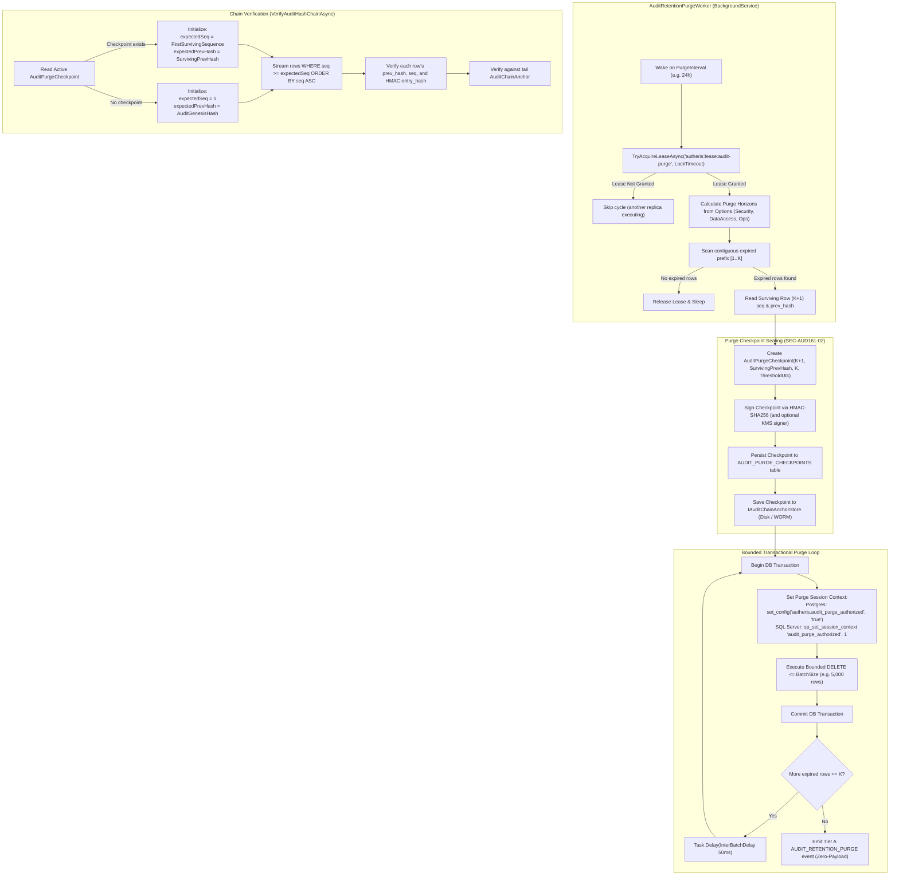
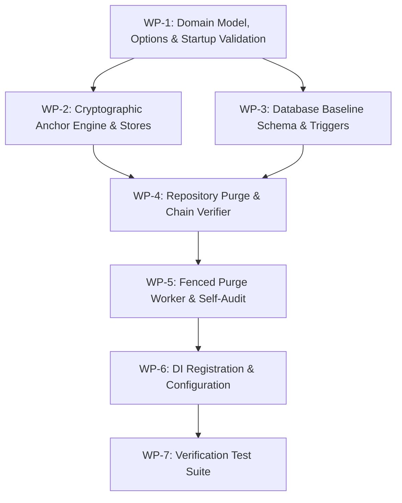

# Implementation Plan: Bounded Audit Retention Purge Job

**Document ID:** `PLAN-AUD-161`  
**Date:** 2026-10-18  
**Author:** Phase 2 Solution Architect (`csharp-architect`)  
**Target Branch:** `feat/issue-161-audit-retention-purge`  
**Parent Plan:** [00-master-plan-overview.md](00-master-plan-overview.md) (Decision D-5, Wave 2 Rank 2.15)  
**Input PRD:** [2026-10-18-issue-intake-audit-and-procedures.md](2026-10-18-issue-intake-audit-and-procedures.md) (§1, §3 `REQ-AUD-161`)  
**Status:** Approved for Implementation  

---

## 1. Executive Summary & Problem Context

The Autheris governance database maintains a strictly append-only audit trail in `AUDIT_LOG_ENTRIES` protected by database-level triggers and continuous cryptographic HMAC-SHA256 hash chains. While [`AuditRetentionOptions`](file:///root/autheris/src/Autheris.Domain/Options/Security/AuditLoggingOptions.cs#L26-L32) defines target retention horizons (`SecurityDays = 3650`, `DataAccessDays = 400`, `AggregatedDays = 90`, `OperationsDays = 30`), no automated mechanism currently purges expired records. As identified in Issue #114 (O-4 / O-9, SEC-114-12) and decoupled by Decision D-5, audit records and caller SIDs accumulate indefinitely, directly violating GDPR Art. 5(1)(e) (Storage Limitation) and leading to unchecked database bloat across large deployments.

Naively executing `DELETE` statements on `AUDIT_LOG_ENTRIES` introduces three catastrophic failure modes:
1. **Cryptographic Verification Breakdown:** [`VerifyAuditHashChainAsync`](file:///root/autheris/src/Autheris.Infrastructure/Persistence/SqliteGovernanceRepository.Audit.cs#L821-L930) walks sequentially from `AuditGenesisHash` at sequence 1. Deleting historical prefix records `[1..K]` causes `VerifyAuditHashChainAsync` to immediately detect a missing sequence or broken hash, triggering a system-wide audit chain violation latch that denies all subsequent data access queries (`AuditChainViolationPolicy.DenyDataAccess`).
2. **Trigger-Level Abort:** Existing schema triggers in PostgreSQL (`autheris_audit_append_only`, error code `42501`) and SQL Server (`trg_audit_append_only`, error code `50042`) unconditionally reject any `DELETE` or `TRUNCATE` command.
3. **Transaction Log Saturation and Lock Escalation:** Deleting millions of historical rows in a single batch causes table-level lock escalation, blocking concurrent incoming query audits (`TABLE_QUERY`, `WEBSQL_QUERY`) and exhausting write-ahead logs.

This architectural implementation delivers:
1. **Configurable Retention Policy & Hard Startup Floors:** Bind `AuditRetentionOptions` to configuration path [`GatewaySections.AuditRetention`](file:///root/autheris/src/Autheris.Domain/Options/GatewaySections.cs#L36) (`"Gateway:Audit:Retention"`) with default `RetentionDays = 90`. Enforce strict startup validation (`IValidateOptions<AuditRetentionOptions>`, `ValidateOnStart()`): outside Development, any retention configuration $< 7$ days fails application boot (`SEC-AUD161-01`), and categorical retention floors (min 365 days for Security, min 30 days for DataAccess) are validated.
2. **Cryptographic Purge Checkpoint Anchor Protocol:** Prior to deleting contiguous rows `[1..K]`, the worker computes and signs a purge checkpoint anchor (`AuditPurgeCheckpoint`) capturing `FirstSurvivingSequence` ($K+1$), `SurvivingPrevHash` (the `prev_hash` of row $K+1$), `PurgedCount` ($K$), and `PurgedThroughUtc`, sealed with an HMAC-SHA256 signature and optional external KMS signature. The checkpoint is atomically persisted to `AUDIT_PURGE_CHECKPOINTS` and mirrored to [`IAuditChainAnchorStore`](file:///root/autheris/src/Autheris.Application/Interfaces/IAuditChainAnchorStore.cs). [`VerifyAuditHashChainAsync`](file:///root/autheris/src/Autheris.Infrastructure/Persistence/SqliteGovernanceRepository.Audit.cs#L821) verifies starting from `FirstSurvivingSequence` forward to the tail anchor, preserving cryptographic proof of integrity without historical rows (`SEC-AUD161-02`).
3. **Fenced Background Purge Worker with Dialect-Specific Trigger Bypass:** Implement `AuditRetentionPurgeWorker` (`BackgroundService`) with distributed leasing via [`IDistributedClusterStateProvider`](file:///root/autheris/src/Autheris.Application/State/IDistributedClusterStateProvider.cs) to prevent multi-instance race conditions. In each bounded transaction ($\le 5,000$ rows), the worker securely bypasses append-only triggers using transaction-scoped session context (`autheris.audit_purge_authorized = 'true'` in PostgreSQL; `SESSION_CONTEXT(N'audit_purge_authorized') = 1` in SQL Server). Untrusted or ad-hoc SQL deletes without session context remain strictly blocked.
4. **Self-Audit Logging:** Upon completion of a purge cycle, emit a Tier A fail-closed audit entry (`AuditEventTypes.AuditRetentionPurge`) recording purged row counts, elapsed duration, threshold UTC, and first surviving sequence. Enforce the Zero-Payload Rule: strictly zero query text, actor SIDs, or data payloads.

---

## 2. Verified Code Facts Beyond the PRD

| # | Fact | Evidence & Architectural Consequence |
|---|---|---|
| **V-1** | `AuditRetentionOptions` exists but lacks worker parameters | [`AuditLoggingOptions.cs:26-32`](file:///root/autheris/src/Autheris.Domain/Options/Security/AuditLoggingOptions.cs#L26-L32) defines `SecurityDays`, `DataAccessDays`, `AggregatedDays`, `OperationsDays`, but lacks `Enabled`, general `RetentionDays`, `BatchSize`, `PurgeInterval`, `LockTimeout`, and `InterBatchDelay`. |
| **V-2** | Configuration section constant is already reserved | [`GatewaySections.cs:36`](file:///root/autheris/src/Autheris.Domain/Options/GatewaySections.cs#L36) defines `GatewaySections.AuditRetention = "Gateway:Audit:Retention"`. Currently no options registration binds this section directly with `ValidateOnStart()`. |
| **V-3** | `AuditEventTypes.AuditRetentionPurge` is already declared and Tier A FailClosed | [`AuditEventTypes.cs:57`](file:///root/autheris/src/Autheris.Domain/Audit/AuditEventTypes.cs#L57) defines `AuditRetentionPurge = "AUDIT_RETENTION_PURGE"`. [`AuditPolicyTable.cs:55`](file:///root/autheris/src/Autheris.Application/Audit/AuditPolicyTable.cs#L55) assigns it to `AuditFailurePolicy.FailClosed`. No new enum or policy mapping is needed. |
| **V-4** | Append-only triggers unconditionally block deletes | PostgreSQL [`PostgreSqlBaselineSchema.cs:606-614`](file:///root/autheris/src/Autheris.Infrastructure/Persistence/Migrations/PostgreSqlBaselineSchema.cs#L606-L614) executes `autheris_audit_append_only()` raising `42501`. SQL Server [`SqlServerBaselineSchema.cs:706-712`](file:///root/autheris/src/Autheris.Infrastructure/Persistence/Migrations/SqlServerBaselineSchema.cs#L706-L712) throws `50042`. SQLite does not have append-only triggers. |
| **V-5** | Migration post-condition runners inspect trigger presence and signature | [`PostgreSqlGovernanceMigrationRunner.cs:90-106`](file:///root/autheris/src/Autheris.Infrastructure/Persistence/Migrations/PostgreSqlGovernanceMigrationRunner.cs#L90-L106) and [`SqlServerGovernanceMigrationRunner.cs:104-125`](file:///root/autheris/src/Autheris.Infrastructure/Persistence/Migrations/SqlServerGovernanceMigrationRunner.cs#L104-L125) assert trigger existence and attachment to function `autheris_audit_append_only`. Modifying the function body to inspect session variables leaves the trigger signature intact. |
| **V-6** | Database schema shape snapshot tests enforce strict parity | [`GovernanceSchemaShapeSnapshotTests.cs:14`](file:///root/autheris/tests/Autheris.Tests.Unit/Governance/GovernanceSchemaShapeSnapshotTests.cs#L14) compares migrated schema against `governance-shape.*.json`. Adding `AUDIT_PURGE_CHECKPOINTS` requires updating baseline schemas and shape files for SQLite, PostgreSQL, and SQL Server. |
| **V-7** | `VerifyAuditHashChainAsync` assumes sequence starts at 1 from genesis | [`SqliteGovernanceRepository.Audit.cs:857-895`](file:///root/autheris/src/Autheris.Infrastructure/Persistence/SqliteGovernanceRepository.Audit.cs#L857-L895), [`PostgreSqlGovernanceRepository.Audit.cs:846-878`](file:///root/autheris/src/Autheris.Infrastructure/Persistence/PostgreSqlGovernanceRepository.Audit.cs#L846-L878), and [`SqlServerGovernanceRepository.Audit.cs:894-926`](file:///root/autheris/src/Autheris.Infrastructure/Persistence/SqlServerGovernanceRepository.Audit.cs#L894-L926) initialize `expectedPrevHash = AuditGenesisHash` and check `seq.Value == position` starting at 1. They must be updated to load the active purge checkpoint anchor and initialize `expectedPrevHash = checkpoint.SurvivingPrevHash` and `position = checkpoint.FirstSurvivingSequence`. |
| **V-8** | Distributed cluster state provides native lease management | [`ClusterScheduledService.cs:71-245`](file:///root/autheris/src/Autheris.Application/Hosting/ClusterScheduledService.cs#L71-L245) provides a robust distributed leasing framework backed by [`IDistributedClusterStateProvider.TryAcquireLeaseAsync`](file:///root/autheris/src/Autheris.Application/State/IDistributedClusterStateProvider.cs). `AuditRetentionPurgeWorker` can leverage this infrastructure. |
| **V-9** | Tail anchor store supports file, memory, WORM, composite, and KMS signing | [`AuditChainAnchorStores.cs:17-516`](file:///root/autheris/src/Autheris.Infrastructure/Persistence/AuditChainAnchorStores.cs#L17-L516) implements `IAuditChainAnchorStore`. Extending `IAuditChainAnchorStore` with purge checkpoint methods allows all storage strategies to archive purge checkpoints alongside tail anchors. |

---

## 3. Architectural Decisions



### Decision D-1: Contiguous Prefix Purge vs Selective Categorical Deletion
- **Context:** `AuditRetentionOptions` specifies varying retention periods (`SecurityDays = 3650`, `DataAccessDays = 400`, `OperationsDays = 30`). Selectively deleting only DataAccess entries would create gaps in sequence numbers ($1, 2, 5, 8\dots$) and sever intermediate hash links, irreparably breaking the linear hash chain.
- **Decision:** Purging strictly operates as a **contiguous prefix purge** $[S_{start} .. K]$. An entry at sequence $i$ is only eligible for purge if $T_i < \text{UtcNow} - \text{Retention}(C_i)$ where $C_i$ is its specific category (or general `RetentionDays`). The candidate purge range is bounded by the *first surviving entry* that has not yet reached its retention horizon. If a Security entry exists at sequence 10, the purge cannot advance past sequence 9 until that Security entry has elapsed its 3,650-day horizon. This mathematically guarantees that the remaining log is always contiguous without sequence gaps.

### Decision D-2: Two-Phase Checkpoint Before Deletion (SEC-AUD161-02)
- **Context:** If a crash or failure occurs during deletion, or if the database is restored from a replica, the verifier must never encounter unanchored missing rows.
- **Decision:** Write and sign the purge checkpoint anchor **before** executing any `DELETE` statement. The checkpoint records:
  $$\text{PurgeAnchor} = \left\langle \text{FirstSurvivingSequence}, \text{SurvivingPrevHash}, \text{PurgedCount}, \text{PurgedThroughUtc}, \text{CreatedAtUtc}, \text{HMAC-SHA256}(\dots) \right\rangle$$
  Persist this record to the `AUDIT_PURGE_CHECKPOINTS` table and write it to `IAuditChainAnchorStore`. `VerifyAuditHashChainAsync` verifies the chain from `FirstSurvivingSequence` forward. If any row with $\text{seq} < \text{FirstSurvivingSequence}$ is still present, or if $\text{seq} > \text{FirstSurvivingSequence}$ has a gap, verification fails closed.

### Decision D-3: Trigger Bypass via Administrative Session Context
- **Context:** Existing triggers in PostgreSQL (`trg_audit_append_only_row`) and SQL Server (`trg_audit_append_only`) abort deletions with fatal error codes. Disabling or dropping triggers during purge violates least privilege and introduces schema drift flags in `GovernanceMigrationRunnerBase`.
- **Decision:** Retain triggers permanently enabled, but modify their internal function bodies to inspect a transaction-local administrative session variable:
  - **PostgreSQL:** `IF TG_OP = 'DELETE' AND current_setting('autheris.audit_purge_authorized', true) = 'true' THEN RETURN OLD; END IF;`
  - **SQL Server:** `IF CAST(SESSION_CONTEXT(N'audit_purge_authorized') AS bit) = 1 BEGIN DELETE e FROM dbo.AUDIT_LOG_ENTRIES e INNER JOIN deleted d ON e.id = d.id; RETURN; END;`
  - **SQLite:** Executes deletes within the exclusive write lock transaction; no append-only triggers are present.
  Any query executed without setting this session context (including manual SQL injections or rogue application paths) is rejected by the trigger.

### Decision D-4: Bounded Batches with Inter-Batch Yield
- **Context:** Deleting 100,000+ expired audit records in a single statement locks the table, causes replication lag in read replicas, and exhausts the transaction log.
- **Decision:** Bounded batches of $\le \text{BatchSize}$ (default 5,000 rows) per transaction. Between batches, execute a non-blocking `Task.Delay(InterBatchDelay, ct)` (default 50ms) to allow pending query audits (`TABLE_QUERY`, `WEBSQL_QUERY`) to commit without lock contention.

---

## 4. Work Packages

### WP-1: Domain Model, Options & Startup Validation (`SEC-AUD161-01`)
- **Objective:** Extend `AuditRetentionOptions` with worker execution parameters and implement strict startup validation enforcing hard retention floors outside Development.
- **Files to Modify/Create:**
  - [`src/Autheris.Domain/Options/Security/AuditLoggingOptions.cs`](file:///root/autheris/src/Autheris.Domain/Options/Security/AuditLoggingOptions.cs):
    - Update `AuditRetentionOptions` with properties:
      - `public const string SectionName = GatewaySections.AuditRetention;`
      - `public bool Enabled { get; init; } = true;`
      - `public int RetentionDays { get; init; } = 90;`
      - `public int SecurityDays { get; init; } = 3650;`
      - `public int DataAccessDays { get; init; } = 400;`
      - `public int AggregatedDays { get; init; } = 90;`
      - `public int OperationsDays { get; init; } = 30;`
      - `public int BatchSize { get; init; } = 5000;`
      - `public TimeSpan PurgeInterval { get; init; } = TimeSpan.FromHours(24);`
      - `public TimeSpan LockTimeout { get; init; } = TimeSpan.FromMinutes(30);`
      - `public TimeSpan InterBatchDelay { get; init; } = TimeSpan.FromMilliseconds(50);`
  - [`src/Autheris.Domain/Audit/AuditPurgeCheckpoint.cs`](file:///root/autheris/src/Autheris.Domain/Audit/AuditPurgeCheckpoint.cs) *(new)*:
    - Declare immutable record:
      ```csharp
      public sealed record AuditPurgeCheckpoint(
          long FirstSurvivingSequence,
          string SurvivingPrevHash,
          long PurgedCount,
          DateTimeOffset PurgedThroughUtc,
          DateTimeOffset CreatedAtUtc,
          string Signature,
          string? ExternalSignature = null);
      ```
  - [`src/Autheris.Application/Audit/AuditRetentionOptionsValidator.cs`](file:///root/autheris/src/Autheris.Application/Audit/AuditRetentionOptionsValidator.cs) *(new)*:
    - Implement `IValidateOptions<AuditRetentionOptions>`:
      - Enforce `SEC-AUD161-01`: Outside `Development`, if `RetentionDays < 7`, `OperationsDays < 7`, `DataAccessDays < 30`, `SecurityDays < 365`, `AggregatedDays < 30`, `BatchSize <= 0`, `PurgeInterval <= TimeSpan.Zero`, or `LockTimeout <= TimeSpan.Zero`, validation fails (`ValidateOptionsResult.Fail`).
      - In `Development`, values $< 7$ days log a warning but are permitted for rapid integration testing.
- **Test Criteria:**
  - Unit tests in `AuditRetentionOptionsValidatorTests`: verify fail-closed startup validation across Production vs Development configurations.

### WP-2: Cryptographic Purge Anchor Engine & Store Extensions (`SEC-AUD161-02`)
- **Objective:** Extend `AuditChainEngine` and `IAuditChainAnchorStore` to compute, verify, and persist signed purge checkpoint anchors.
- **Files to Modify/Create:**
  - [`src/Autheris.Application/Interfaces/IAuditChainAnchorStore.cs`](file:///root/autheris/src/Autheris.Application/Interfaces/IAuditChainAnchorStore.cs):
    - Add methods to `IAuditChainAnchorStore`:
      - `AuditPurgeCheckpoint? LoadPurgeCheckpoint();`
      - `void SavePurgeCheckpoint(AuditPurgeCheckpoint checkpoint);`
  - [`src/Autheris.Infrastructure/Persistence/AuditChainEngine.cs`](file:///root/autheris/src/Autheris.Infrastructure/Persistence/AuditChainEngine.cs):
    - Add canonical purge payload format:
      `$"PURGE_CHECKPOINT_V1|{firstSurvivingSeq}|{survivingPrevHash}|{purgedCount}|{purgedThroughUtc.ToUniversalTime():O}|{createdAtUtc.ToUniversalTime():O}"`
    - Add `string ComputePurgeCheckpointSignature(byte[]? hmacKey, long firstSurvivingSeq, string survivingPrevHash, long purgedCount, DateTimeOffset purgedThroughUtc, DateTimeOffset createdAtUtc)` using HMAC-SHA256 or SHA-256 fallback.
    - Add `bool VerifyPurgeCheckpointSignature(byte[]? hmacKey, AuditPurgeCheckpoint checkpoint)`.
  - [`src/Autheris.Infrastructure/Persistence/AuditChainAnchorStores.cs`](file:///root/autheris/src/Autheris.Infrastructure/Persistence/AuditChainAnchorStores.cs):
    - Update `FileAuditChainAnchorStore`: persist purge checkpoint to `<path>.purge.json` with sibling `.lock` file.
    - Update `InMemoryAuditChainAnchorStore`: volatile field `_purgeCheckpoint` with monotonic check.
    - Update `WormDirectoryAuditChainAnchorStore`: persist immutable file `purge-<seq>-<ticks>.json` with read-only attributes.
    - Update `CompositeAuditChainAnchorStore`: broadcast save to all child stores, load newest valid checkpoint.
    - Update `SigningAuditChainAnchorStore`: verify and append KMS asymmetric signature `ExternalSignature` on purge checkpoint.
- **Test Criteria:**
  - Unit tests in `AuditPurgeCheckpointAnchorStoreTests`: test round-trip serialization, HMAC signature verification, KMS signing decoration, and tamper detection on altered fields.

### WP-3: Governance Database Schema & Append-Only Trigger Bypass
- **Objective:** Create `AUDIT_PURGE_CHECKPOINTS` table across all dialects, update schema trigger functions to recognize administrative session context, and synchronize schema shapes.
- **Files to Modify:**
  - [`src/Autheris.Infrastructure/Persistence/Migrations/SqliteBaselineSchema.cs`](file:///root/autheris/src/Autheris.Infrastructure/Persistence/Migrations/SqliteBaselineSchema.cs):
    - Add `CREATE TABLE IF NOT EXISTS AUDIT_PURGE_CHECKPOINTS (id TEXT PRIMARY KEY, first_surviving_seq INTEGER NOT NULL, surviving_prev_hash TEXT NOT NULL, purged_count INTEGER NOT NULL, purged_through_utc TEXT NOT NULL, created_at TEXT NOT NULL, signature TEXT NOT NULL, external_signature TEXT NULL);`
  - [`src/Autheris.Infrastructure/Persistence/Migrations/PostgreSqlBaselineSchema.cs`](file:///root/autheris/src/Autheris.Infrastructure/Persistence/Migrations/PostgreSqlBaselineSchema.cs):
    - Add `AUDIT_PURGE_CHECKPOINTS` table DDL.
    - Update `autheris_audit_append_only()` function body:
      ```sql
      CREATE OR REPLACE FUNCTION autheris_audit_append_only() RETURNS trigger AS $audit$
      BEGIN
          IF TG_OP = 'DELETE' AND current_setting('autheris.audit_purge_authorized', true) = 'true' THEN
              RETURN OLD;
          END IF;
          RAISE EXCEPTION 'AUDIT_LOG_ENTRIES is append-only (%)', TG_OP USING ERRCODE = '42501';
      END;
      $audit$ LANGUAGE plpgsql
      ```
  - [`src/Autheris.Infrastructure/Persistence/Migrations/SqlServerBaselineSchema.cs`](file:///root/autheris/src/Autheris.Infrastructure/Persistence/Migrations/SqlServerBaselineSchema.cs):
    - Add `AUDIT_PURGE_CHECKPOINTS` table DDL.
    - Update `trg_audit_append_only` trigger:
      ```sql
      CREATE OR ALTER TRIGGER dbo.trg_audit_append_only ON dbo.AUDIT_LOG_ENTRIES
      INSTEAD OF UPDATE, DELETE
      AS
      BEGIN
          SET NOCOUNT ON;
          IF CAST(SESSION_CONTEXT(N'audit_purge_authorized') AS bit) = 1
          BEGIN
              DELETE e
              FROM dbo.AUDIT_LOG_ENTRIES e
              INNER JOIN deleted d ON e.id = d.id;
              RETURN;
          END;
          THROW 50042, 'AUDIT_LOG_ENTRIES is append-only', 1;
      END
      ```
  - [`src/Autheris.Infrastructure/Persistence/Migrations/Shape/governance-shape.*.json`](file:///root/autheris/src/Autheris.Infrastructure/Persistence/Migrations/Shape/):
    - Update snapshot shapes for sqlite, postgresql, and sqlserver to include `AUDIT_PURGE_CHECKPOINTS`.
- **Test Criteria:**
  - `GovernanceSchemaShapeSnapshotTests` pass with 0 drift across SQLite, PostgreSQL, and SQL Server.
  - Integration tests verify direct unauthorized `DELETE` statement triggers error `42501` (Postgres) and `50042` (SQL Server).

### WP-4: Repository Purge Execution & Hash Chain Verifier (`SEC-AUD161-02`)
- **Objective:** Add purge querying and transactional execution to `IAuditLogRepository`, and upgrade `VerifyAuditHashChainAsync` to verify from the active purge checkpoint forward.
- **Files to Modify:**
  - [`src/Autheris.Application/Interfaces/IGovernanceRepository.cs`](file:///root/autheris/src/Autheris.Application/Interfaces/IGovernanceRepository.cs):
    - Add methods to `IAuditLogRepository`:
      - `Task<AuditPurgeCheckpoint?> GetLatestPurgeCheckpointAsync(CancellationToken ct = default);`
      - `Task SavePurgeCheckpointAsync(AuditPurgeCheckpoint checkpoint, CancellationToken ct = default);`
      - `Task<(long MaxEligibleSequence, long FirstSurvivingSequence, string SurvivingPrevHash, long PurgeCount)?> PlanPurgePrefixAsync(DateTimeOffset thresholdUtc, CancellationToken ct = default);`
      - `Task<int> ExecutePurgeBatchAsync(long maxSequenceInclusive, int batchSize, CancellationToken ct = default);`
  - [`src/Autheris.Infrastructure/Persistence/SqliteGovernanceRepository.Audit.cs`](file:///root/autheris/src/Autheris.Infrastructure/Persistence/SqliteGovernanceRepository.Audit.cs):
    - Implement `PlanPurgePrefixAsync`, `ExecutePurgeBatchAsync`, `SavePurgeCheckpointAsync`, and `GetLatestPurgeCheckpointAsync`.
    - Update `VerifyAuditHashChainAsync`:
      - Load active checkpoint via `TryLoadVerifiedPurgeCheckpoint`.
      - If checkpoint exists, verify from `checkpoint.FirstSurvivingSequence` with `expectedPrevHash = checkpoint.SurvivingPrevHash`.
      - If any row with `seq < checkpoint.FirstSurvivingSequence` is found, flag violation.
  - [`src/Autheris.Infrastructure/Persistence/PostgreSqlGovernanceRepository.Audit.cs`](file:///root/autheris/src/Autheris.Infrastructure/Persistence/PostgreSqlGovernanceRepository.Audit.cs):
    - Implement purge methods. Inside `ExecutePurgeBatchAsync`, within the active `NpgsqlTransaction`, issue `SELECT set_config('autheris.audit_purge_authorized', 'true', true);` before executing bounded delete:
      `DELETE FROM AUDIT_LOG_ENTRIES WHERE id IN (SELECT id FROM AUDIT_LOG_ENTRIES WHERE seq <= @maxSeq ORDER BY seq ASC LIMIT @batchSize);`
    - Update `VerifyAuditHashChainAsync` with checkpoint awareness.
  - [`src/Autheris.Infrastructure/Persistence/SqlServerGovernanceRepository.Audit.cs`](file:///root/autheris/src/Autheris.Infrastructure/Persistence/SqlServerGovernanceRepository.Audit.cs):
    - Implement purge methods. Inside `ExecutePurgeBatchAsync`, within active `SqlTransaction`, execute `EXEC sp_set_session_context @key = N'audit_purge_authorized', @value = 1;` before executing:
      `DELETE TOP (@batchSize) FROM AUDIT_LOG_ENTRIES WHERE seq <= @maxSeq;`
    - Update `VerifyAuditHashChainAsync` with checkpoint awareness.
- **Test Criteria:**
  - Unit tests verifying `VerifyAuditHashChainAsync` returns `true` on unpurged log, `true` after single purge, `true` after multiple consecutive purges, and `false` if any intermediate record is tampered with or if a sequence gap is present.

### WP-5: Fenced Background Worker & Tier A Self-Audit Logging
- **Objective:** Implement `AuditRetentionPurgeWorker` background service with distributed lease fencing, bounded batch iterations, and zero-payload self-audit emission.
- **Files to Create/Modify:**
  - [`src/Autheris.Application/Audit/AuditRetentionPurgeWorker.cs`](file:///root/autheris/src/Autheris.Application/Audit/AuditRetentionPurgeWorker.cs) *(new)*:
    - Inherit from `BackgroundService`.
    - Inject `IServiceScopeFactory`, `IDistributedClusterStateProvider`, `IOptionsMonitor<AuditRetentionOptions>`, `IAuditWriter`, `ILogger<AuditRetentionPurgeWorker>`, `TimeProvider`.
    - In `ExecuteAsync`:
      - Evaluate options: if `!options.Enabled`, idle for `PurgeInterval`.
      - Acquire distributed lease: `clusterState.TryAcquireLeaseAsync("autheris:lease:audit-retention-purge", options.LockTimeout, stoppingToken)`.
      - If lease is null (busy): log debug and wait for next interval.
      - Calculate expiration horizon: `thresholdUtc = timeProvider.GetUtcNow() - TimeSpan.FromDays(options.RetentionDays)`.
      - Invoke `repo.PlanPurgePrefixAsync(thresholdUtc, stoppingToken)`.
      - If eligible rows found:
        - Construct `AuditPurgeCheckpoint` with `FirstSurvivingSequence`, `SurvivingPrevHash`, `PurgeCount`, `thresholdUtc`.
        - Sign checkpoint via `AuditChainEngine.ComputePurgeCheckpointSignature` and optional `IAuditAnchorSigner`.
        - Persist to database (`SavePurgeCheckpointAsync`) and anchor store (`anchorStore.SavePurgeCheckpoint`).
        - Bounded loop: call `repo.ExecutePurgeBatchAsync(plan.MaxEligibleSequence, options.BatchSize, linkedToken)`.
        - Between batches, await `Task.Delay(options.InterBatchDelay, timeProvider, linkedToken)`.
        - Record execution metrics: `purgedCount`, `durationMs`.
        - Write Tier A fail-closed audit entry:
          ```csharp
          await auditWriter.RecordRequiredAsync(new AuditLogEntry
          {
              EventType = AuditEventTypes.AuditRetentionPurge,
              OccurredAt = timeProvider.GetUtcNow(),
              Decision = "PURGED",
              ActorSid = Sid.System,
              DetailsJson = JsonSerializer.Serialize(new
              {
                  purgedCount = totalPurged,
                  firstSurvivingSequence = plan.FirstSurvivingSequence,
                  lastPurgedSequence = plan.MaxEligibleSequence,
                  thresholdUtc = thresholdUtc.ToString("O"),
                  durationMs = stopwatch.ElapsedMilliseconds
              })
          }, stoppingToken);
          ```
        - Strict Zero-Payload Rule: no actor queries, request bodies, or user SIDs are included in `DetailsJson`.
- **Test Criteria:**
  - Unit tests in `AuditRetentionPurgeWorkerTests`: simulate lease acquisition, cancelled lease loss, bounded batch looping, inter-batch delays, and self-audit entry logging.

### WP-6: DI Registration & Configuration Integration
- **Objective:** Wire options, validators, repository services, and background worker in API service collection extensions.
- **Files to Modify:**
  - [`src/Autheris.Api/Extensions/DependencyInjection/GatewayGovernanceServiceExtensions.cs`](file:///root/autheris/src/Autheris.Api/Extensions/DependencyInjection/GatewayGovernanceServiceExtensions.cs):
    - Register options and validator:
      ```csharp
      services.AddOptions<AuditRetentionOptions>()
          .BindConfiguration(GatewaySections.AuditRetention)
          .ValidateOnStart();
      services.AddSingleton<IValidateOptions<AuditRetentionOptions>, AuditRetentionOptionsValidator>();
      services.AddHostedService<AuditRetentionPurgeWorker>();
      ```
  - [`src/Autheris.Api/appsettings.json`](file:///root/autheris/src/Autheris.Api/appsettings.json):
    - Add default `Gateway:Audit:Retention` section with safe production defaults.
- **Test Criteria:**
  - Startup tests verify host starts with valid options and fails immediately on startup if `RetentionDays < 7` outside Development.

### WP-7: End-to-End Verification Test Suite
- **Objective:** Comprehensive unit, integration, and security test coverage across all three database backends.
- **Files to Create:**
  - `tests/Autheris.Tests.Unit/Audit/AuditRetentionPurgeWorkerTests.cs`:
    - Tests single-batch purge, multi-batch purge, empty log, and lease contention.
  - `tests/Autheris.Tests.Unit/Audit/AuditPurgeChainIntegrityTests.cs`:
    - Seeds 10,000 entries; purges 6,000 entries across 2 batches; verifies `VerifyAuditHashChainAsync` returns `true`.
    - Simulates tampered post-purge entry: verifies `VerifyAuditHashChainAsync` returns `false` and latches violation.
    - Simulates sequence hole: deletes an intermediate row after checkpoint; verifies detection.
  - `tests/Autheris.Tests.Integration/AuditRetentionTriggerSecurityContractTests.cs`:
    - Tests against real SQLite, PostgreSQL, and SQL Server instances:
      - Direct `DELETE FROM AUDIT_LOG_ENTRIES` fails with trigger error.
      - Authorized purge with session context succeeds and deletes rows.
      - Chain verification passes post-purge.
- **Test Criteria:**
  - All tests execute with zero failures; zero memory leaks or unmanaged connection leaks.

---

## 5. Fail-Closed and Security Summary

1. **Anti-Tampering & Chain Continuity (`SEC-AUD161-02`):**
   - The purge checkpoint anchor seals `FirstSurvivingSequence` and `SurvivingPrevHash` using an HMAC key derived via HKDF (and optional KMS asymmetric key).
   - If an attacker attempts to truncate or delete rows without a corresponding validly signed purge checkpoint anchor, `VerifyAuditHashChainAsync` immediately detects the missing sequences from Genesis and trips the `_auditChainViolation` latch, disabling data queries (`AuditChainViolationPolicy.DenyDataAccess`).
2. **Hard Minimum Retention Floors (`SEC-AUD161-01`):**
   - Options validation enforces non-bypassable floors outside Development: minimum 7 days general retention, minimum 30 days data-access retention, and minimum 365 days security retention.
   - Any attempt to configure `RetentionDays = 0` or negative values aborts application startup during host initialization (`ValidateOnStart()`).
3. **Database Append-Only Protection:**
   - Triggers on PostgreSQL and SQL Server remain active 100% of the time. They check transaction-scoped session context (`autheris.audit_purge_authorized` / `SESSION_CONTEXT('audit_purge_authorized')`). Even with direct database connection access, queries without the session token are aborted with error code `42501` or `50042`.
4. **Zero-Payload Self-Audit Logging:**
   - The self-audit event `AUDIT_RETENTION_PURGE` records only operational statistics (`purgedCount`, `firstSurvivingSequence`, `durationMs`). No caller statements, sensitive payloads, or actor identities are recorded, preventing forensic data leakage.
5. **Distributed Fencing & Single-Instance Lease:**
   - Guarded by `IDistributedClusterStateProvider` distributed lease (`"autheris:lease:audit-retention-purge"`). If the active node crashes or loses connectivity, the lease automatically expires after `LockTimeout`, enabling another node to safely assume purge responsibility without split-brain races.

---

## 6. Acceptance Criteria Mapping (PRD Traceability)

| PRD AC | Description | Architectural Implementation & Verification |
|---|---|---|
| **AC-161-01** | Background service runs on schedule and respects cancellation tokens | `AuditRetentionPurgeWorker` inherits `BackgroundService`, runs on `PurgeInterval`, links `stoppingToken` with `lease.LeaseLost`. |
| **AC-161-02** | Purges only entries whose retention category has elapsed based on `occurred_at` | `PlanPurgePrefixAsync` computes cutoff timestamp $T_{cutoff} = \text{UtcNow} - \text{RetentionDays}$ and bounds candidate range. |
| **AC-161-03** | Bounded batch size ($\le 5,000$ rows) with inter-batch throttling delay | `ExecutePurgeBatchAsync` clamps to `options.BatchSize` (5,000) and yields via `Task.Delay(options.InterBatchDelay)`. |
| **AC-161-04** | Purge checkpoint anchor generated, signed, and persisted prior to row deletion | `AuditPurgeCheckpoint` sealed with HMAC-SHA256, saved to `AUDIT_PURGE_CHECKPOINTS` and `IAuditChainAnchorStore` before batch delete. |
| **AC-161-05** | `VerifyAuditHashChainAsync` passes cleanly after purging from checkpoint | `VerifyAuditHashChainAsync` starts from `FirstSurvivingSequence` and `SurvivingPrevHash`, validating forward to tail anchor. |
| **AC-161-06** | Unauthorized manual `DELETE` rejected by append-only trigger | Triggers require `autheris.audit_purge_authorized = 'true'` / `SESSION_CONTEXT('audit_purge_authorized') = 1`; direct DELETE throws. |
| **AC-161-07** | Emits `AUDIT_RETENTION_PURGE` audit entry for each completed purge run | Emitted via `IAuditWriter.RecordRequiredAsync` with `AuditEventTypes.AuditRetentionPurge` (Tier A, FailClosed). |
| **AC-161-08** | Purge details JSON contains zero user payloads or actor SIDs | `DetailsJson` contains only `purgedCount`, `firstSurvivingSequence`, `lastPurgedSequence`, `thresholdUtc`, `durationMs`. |

---

## 7. Sequencing & Parallelisation



- **Phase 2.1 (Domain & Contracts):** WP-1 and WP-2 can proceed in parallel.
- **Phase 2.2 (Data Layer & Migrations):** WP-3 applies baseline schema migrations and trigger updates across SQLite, PostgreSQL, and SQL Server.
- **Phase 2.3 (Repository Implementation):** WP-4 implements repository purge methods and upgrades `VerifyAuditHashChainAsync`.
- **Phase 2.4 (Worker & Host Integration):** WP-5 and WP-6 integrate the background worker, distributed lease fencing, and DI bindings.
- **Phase 2.5 (Verification):** WP-7 runs unit, contract, and trigger penetration test suites.

---

## 8. Phase 3 Security Review & Binding Conditions (`csharp-security-expert`)

**Audit Verdict:** `APPROVED WITH CONDITIONS`  
**Security Evaluator:** Phase 3 Security Expert (`csharp-security-expert`)  
**Evaluation Standard:** Zero-Trust, Fail-Closed, Constant-Time Cryptography, Defense-in-Depth, Least Privilege  

The architectural design for `PLAN-AUD-161` adheres to the governance integrity and non-repudiation invariants of Autheris. To ensure robust defense against privilege escalation, trigger circumvention, timing attacks, split-brain deletion races, and forensic log tampering, the following binding conditions are mandatory for implementation:

### 8.1 Binding Security Conditions

- **SEC-AUD161-01 (Fail-Closed Retention Floors):**
  - In `AuditRetentionOptionsValidator`, outside `Development` environment (`!env.IsDevelopment()`), startup validation MUST fail (`ValidateOptionsResult.Fail`) if:
    - `RetentionDays < 7`
    - `OperationsDays < 7`
    - `DataAccessDays < 30`
    - `SecurityDays < 365`
    - `AggregatedDays < 30`
    - `BatchSize <= 0` or `BatchSize > 10000`
    - `PurgeInterval <= TimeSpan.Zero`
    - `LockTimeout <= TimeSpan.Zero`
  - The options configuration MUST be wired with `.ValidateOnStart()` so the application crashes during host boot if invalid configurations are supplied.

- **SEC-AUD161-02 (Cryptographic Checkpoint Anchor Sealing & Invariant Verification):**
  - Checkpoint signature MUST cover the canonical payload:
    `$"PURGE_CHECKPOINT_V1|{firstSurvivingSeq}|{survivingPrevHash}|{purgedCount}|{purgedThroughUtc.ToUniversalTime():O}|{createdAtUtc.ToUniversalTime():O}"`
  - Signature verification MUST use `CryptographicOperations.FixedTimeEquals` to prevent side-channel timing attacks.
  - The checkpoint record MUST be durably committed to both `AUDIT_PURGE_CHECKPOINTS` and `IAuditChainAnchorStore` **BEFORE** any `DELETE` statement executes.
  - Checkpoints must be strictly monotonic: new checkpoints MUST have `FirstSurvivingSequence > lastCheckpoint.FirstSurvivingSequence` and `PurgedCount > lastCheckpoint.PurgedCount`. Any backwards or non-monotonic checkpoint insertion MUST be rejected fail-closed.
  - `VerifyAuditHashChainAsync` MUST verify the checkpoint signature. If invalid, it MUST immediately latch `FlagAuditChainViolation(...)` and return `false`.
  - When a valid checkpoint is present, chain verification MUST verify:
    1. Zero rows exist with `seq < checkpoint.FirstSurvivingSequence`.
    2. The row at `seq == checkpoint.FirstSurvivingSequence` has `prev_hash` equal to `checkpoint.SurvivingPrevHash` (verified with `FixedTimeEquals`).
    3. Monotonic gap-free sequencing holds for all surviving rows up to the tail anchor.

- **SEC-AUD161-03 (Trigger Bypass Defense & Session Context Containment):**
  - Direct ad-hoc `DELETE` statements on `AUDIT_LOG_ENTRIES` MUST remain strictly prohibited by database triggers (`42501` on Postgres, `50042` on SQL Server).
  - PostgreSQL bypass: MUST use `set_config('autheris.audit_purge_authorized', 'true', true)` with `is_local = true` so the authorization is strictly scoped to the active transaction and automatically clears upon transaction `COMMIT` or `ROLLBACK`.
  - SQL Server bypass: MUST explicitly clear session context in a `finally` block:
    `EXEC sp_set_session_context @key = N'audit_purge_authorized', @value = NULL;`
    to guarantee no session context pollution across pooled ADO.NET connections.
  - No HTTP controllers, Minimal API endpoints, GraphQL resolvers, or background tasks other than `AuditRetentionPurgeWorker` may issue session context authorization statements.

- **SEC-AUD161-04 (Distributed Lease Fencing & Cancellation Responsiveness):**
  - The background purge worker MUST acquire the distributed lease (`"autheris:lease:audit-retention-purge"`) before planning or executing purge operations.
  - The worker MUST link the execution token to `lease.LeaseLost`. If lease ownership is revoked or expires, batch iteration MUST terminate immediately before executing subsequent delete transactions.

- **SEC-AUD161-05 (Zero-Payload Audit Emission & Data Minimization):**
  - The purge completion event `AUDIT_RETENTION_PURGE` MUST be recorded via `IAuditWriter.RecordRequiredAsync` (Tier A, FailClosed).
  - Under no circumstances may `DetailsJson` contain SQL query strings, tenant data, personal data, or caller user SIDs.
  - Permitted metadata keys: `purgedCount`, `firstSurvivingSequence`, `lastPurgedSequence`, `thresholdUtc`, `durationMs`.
  - Actor SID MUST strictly be `Sid.System`.

- **SEC-AUD161-06 (No Sequence Gaps or Reseeding):**
  - Sequence IDs (`seq`) in `AUDIT_LOG_ENTRIES` MUST never be re-seeded, shifted, or compacted following a purge.
  - Purging MUST be strictly prefix-contiguous (`[1..K]`); selective row deletion leaving sequence gaps is prohibited.

- **SEC-AUD161-07 (Zero-Allocation Hot-Path Ingestion):**
  - When loading purge checkpoints during hash chain verification, fields MUST be extracted using ordinals and direct primitive access (`reader.GetInt64`, `reader.GetString`), minimizing allocations and GC pressure.

---

### 8.2 Mandatory Security Test Requirements

All security tests must be tagged with `[Trait("Category", "Security")]`:

| Test ID | Test Method Name | Invariant Verified |
|---|---|---|
| **SEC-TEST-161-01** | `RetentionOptions_BelowFloorsOutsideDev_FailsStartup` | Enforces `SEC-AUD161-01`: `RetentionDays < 7` or categorical floors violate startup validation in production mode. |
| **SEC-TEST-161-02** | `PurgeCheckpoint_TamperedSignature_LatchesViolation` | Enforces `SEC-AUD161-02`: Tampered checkpoint signature triggers `FlagAuditChainViolation` and denies queries. |
| **SEC-TEST-161-03** | `PurgeCheckpoint_NonMonotonicSequence_Rejected` | Enforces `SEC-AUD161-02`: Inserting a checkpoint with decreasing or identical sequence number is rejected. |
| **SEC-TEST-161-04** | `PostgreSqlTrigger_DirectDelete_Throws42501` | Enforces `SEC-AUD161-03`: `DELETE FROM AUDIT_LOG_ENTRIES` without session context throws PostgreSQL error `42501`. |
| **SEC-TEST-161-05** | `SqlServerTrigger_DirectDelete_Throws50042` | Enforces `SEC-AUD161-03`: `DELETE FROM AUDIT_LOG_ENTRIES` without session context throws SQL Server error `50042`. |
| **SEC-TEST-161-06** | `SqlServerSessionContext_BatchCompletion_ClearsContext` | Enforces `SEC-AUD161-03`: Session context `audit_purge_authorized` is nullified post-execution. |
| **SEC-TEST-161-07** | `HashChainVerification_PrefixPurged_PassesContinuity` | Enforces `SEC-AUD161-02`: Valid purge checkpoint allows `VerifyAuditHashChainAsync` to pass from `FirstSurvivingSequence` to tail. |
| **SEC-TEST-161-08** | `HashChainVerification_UnanchoredHistoricalDelete_FailsClosed` | Enforces `SEC-AUD161-02`: Deleting rows without a matching checkpoint triggers immediate chain failure. |
| **SEC-TEST-161-09** | `PurgeWorker_LeaseLoss_AbortsSubsequentBatches` | Enforces `SEC-AUD161-04`: Triggering `lease.LeaseLost` immediately stops the batch loop. |
| **SEC-TEST-161-10** | `PurgeSelfAudit_ZeroPayload_ContainsNoUserDataOrQuery` | Enforces `SEC-AUD161-05`: `AUDIT_RETENTION_PURGE` payload contains only bounded telemetry, zero caller/tenant payload. |

