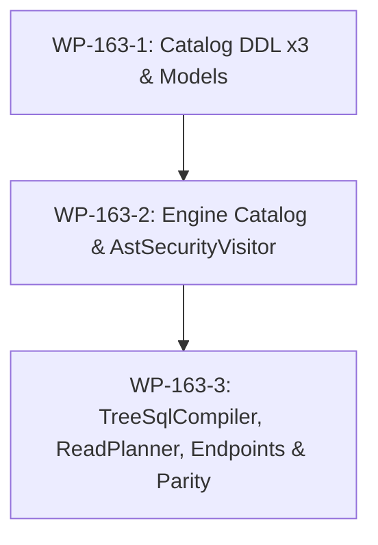

# PLAN-GOV-163: Table-Level Required Filter Columns Enforced Across Every Read Path

**Document ID:** `PLAN-GOV-163`  
**Date:** 2026-10-18  
**Phase:** 3 (security review completed) · **Next:** Phase 4 implementation  
**PRD / Intake:** [`REQ-GOV-163`](2026-10-18-issue-intake-assessment.md) §3.1 · **Parent:** [00-master-plan-overview.md](00-master-plan-overview.md) rank 2.12  
**Verified against:** `origin/main` (`f0071be6`), working tree clean  

---

## 1. Inputs and Defaults

- **Scope & Objectives:** Prevent catastrophic full-table scans, buffer-pool evictions, and cross-tenant/cross-boundary data leaks on massive partitioned tables (e.g. audit logs, transactions, telemetry) by enforcing that queries constrain declared required filter columns across every read path.
- **Intake Decisions Accepted:**
  - **OQ-26 (Effective filter satisfaction):** An active, enforced Row-Level Security (RLS) row policy or gateway tenant isolation filter that constrains the required column waives the caller's query filter requirement. Requiring callers to duplicate an already-injected tenant filter would break transparent multi-tenant access.
  - **OQ-27 (Declarative catalog schema):** Required filter columns are declared explicitly in catalog metadata via `TABLES.required_filter_columns_json` in baseline DDL x3 (no automatic heuristic inference from table keys or partition schemas).
- **Fail-Closed Security Posture:**
  - If a table specifies required filter columns, any read request omitting constraints on those columns—and not covered by active row policy—is rejected with HTTP 400 and standard error code `REQUIRED_FILTER_COLUMN_MISSING`.
  - Disjunctions (`OR`): A caller filter using `OR` must constrain the required column in **every** disjunctive branch. Constraining only one branch leaves an unbounded scan path and is rejected (fail-closed).
  - Tautological predicates (e.g., `1 = 1`, `col = col`) do not satisfy the filter requirement.

---

## 2. Verified Code Facts Beyond the PRD

| # | Fact | Evidence & Consequence |
|---|---|---|
| **V-1** | `Table` and `TableMetadata` lack filter requirement declarations | `src/Autheris.Domain/Model/TableModels.cs:46-70,152-195`. Neither entity holds required filter columns; all tables currently allow unconstrained `SELECT * FROM table`. |
| **V-2** | Baseline DDL x3 has no slot for required filter columns | `SqliteBaselineSchema.cs:25-41`, `PostgreSqlBaselineSchema.cs:20-37`, `SqlServerBaselineSchema.cs:21-41`. `TABLES` table definition must add `required_filter_columns_json` in-place (`0001` baseline, no upgrade migrations per rule 2026-10-15). |
| **V-3** | Repositories deserialize fixed column sets | `SqliteGovernanceRepository.Catalog.cs:108-140,500`, `PostgreSqlGovernanceRepository.Catalog.cs:47,285`, `SqlServerGovernanceRepository.Catalog.cs:48,285`. SELECT and INSERT/UPDATE statements must map the JSON array column. |
| **V-4** | `TableCatalogEntry` is unaware of required columns | `src/TrinoSqlEngine/Governance/TableCatalog.cs:31-35` has `(TableIdentity Identity, ImmutableArray<CatalogColumn> Columns, string? TenantColumn, long Version = 0)`. `GovernedCatalogProvider.cs:342-348` builds entries without filter requirements. |
| **V-5** | `AstSecurityVisitor` encapsulates physical scans into subqueries | `AstSecurityVisitor.Tables.cs:48-115` (`SecureTyped`) wraps physical tables into `(SELECT ... FROM table WHERE tenant AND policy) AS alias`. Tenant predicate is added via `typed.BuildTenantPredicate` and row policy via `typed.RowFilters.GetPredicate`. |
| **V-6** | `PolicyPredicate` tracks referenced columns | `src/TrinoSqlEngine/Governance/PolicyPredicate.cs:36-41` exposes `ImmutableHashSet<string> ReferencedColumns` (case-insensitive target-table columns constrained by the policy). |
| **V-7** | `AstSecurityVisitor.Select.cs` gathers table sources in `_specTables` | `AstSecurityVisitor.Select.cs:123-151` calls `PrepareSpecSources(node)` which fills `_specTables` with `(TableName, Alias)`. `node.Where` and join conditions can be inspected at this exact visitor choke point without AST re-cloning. |
| **V-8** | `TreeSqlCompiler.Prepare` compiles GraphQL selection nodes | `src/Autheris.Application/Sql/Tree/TreeSqlCompiler.cs:264-421` receives `TreeQueryNode` (with `Where`) and `TreeTableAccess` (with `Metadata`, `Decision`, `TenantColumn`, `TenantValue`). Validates readable columns and clear order, but allows `Where == null`. |
| **V-9** | `GovernedTableReadPlanner` plans REST, OData, and export reads | `src/Autheris.Application/Data/Services/GovernedTableReadPlanner.cs:46-107` allows `intent.Filter == null`. `intent.Filter.ReferencedColumns` is available on `TableFilterClause` (`IGatewayExecutionService.cs:69`). |
| **V-10** | `ArrowExportEndpoints` generates unconstrained table queries | `src/Autheris.Api/Endpoints/ArrowExportEndpoints.cs:169-172` generates `planner.BuildFullTableSelect(tableId!.Value)` when request lacks `sql`. |
| **V-11** | Error codes and mapper lack required filter error entry | `GovernedSqlErrorCodes.cs:6-88` and `ApiErrorCodes.cs:8-45` lack `REQUIRED_FILTER_COLUMN_MISSING`. `SqlCompilerErrorMapper.cs:103-144` would currently fall through to generic `SecurityException` (403 `SQL_POLICY_VIOLATION`) instead of 400. |

---

## 3. Decisions

### D-1: Domain Model & Catalog Metadata
- Add `public IReadOnlyList<string> RequiredFilterColumns { get; init; } = Array.Empty<string>();` to `Table` (`src/Autheris.Domain/Model/TableModels.cs`).
- Expose on `TableMetadata`: `public IReadOnlyList<string> RequiredFilterColumns => Table.RequiredFilterColumns;`.
- Validation on metadata ingestion: Column names must be non-empty, trimmed, case-insensitively unique, and must match declared column names in `Columns` (fail-closed with `CatalogValidationException` if referencing a non-existent column).

### D-2: Baseline DDL Schema x3 (`0001` Baseline In-Place)
- Extended column in `TABLES`:
  - **SQLite:** `required_filter_columns_json TEXT` (`SqliteBaselineSchema.cs:25-41`).
  - **PostgreSQL:** `required_filter_columns_json TEXT` (`PostgreSqlBaselineSchema.cs:20-37`).
  - **SQL Server:** `required_filter_columns_json NVARCHAR(MAX)` (`SqlServerBaselineSchema.cs:21-41`).
- No database migration files (in accordance with repository architectural rule 2026-10-15: schema changes edit the `0001` baseline in place).

### D-3: Repository Persistence
- In `SqliteGovernanceRepository.Catalog.cs`, `PostgreSqlGovernanceRepository.Catalog.cs`, `SqlServerGovernanceRepository.Catalog.cs`:
  - Read: Include `required_filter_columns_json` in table projection; if NULL or empty whitespace, bind `Array.Empty<string>()`; otherwise deserialize via `JsonSerializer.Deserialize<IReadOnlyList<string>>(json)`.
  - Write: In `INSERT INTO TABLES` and update queries, serialize `RequiredFilterColumns` to JSON array string (or `null` when empty).

### D-4: Engine Catalog Entry (`TrinoSqlEngine`)
- In `src/TrinoSqlEngine/Governance/TableCatalog.cs`, update record:
  ```csharp
  public sealed record TableCatalogEntry(
      TableIdentity Identity,
      ImmutableArray<CatalogColumn> Columns,
      string? TenantColumn,
      ImmutableArray<string> RequiredFilterColumns = default,
      long Version = 0);
  ```
- In `src/Autheris.Infrastructure/Persistence/Catalog/GovernedCatalogProvider.cs`, map `metadata.RequiredFilterColumns.ToImmutableArray()`.

### D-5: Condition Logic (Effective Filter Satisfaction)
A required column `col` of table $T$ is **satisfied** if and only if either **Condition A** or **Condition B** holds:
1. **Condition A (Enforced Policy):**
   - Active tenant isolation constrains `col` (`string.Equals(entry.TenantColumn, col, StringComparison.OrdinalIgnoreCase)` and caller's tenant predicate is actively injected); OR
   - Active RLS row policy constrains `col` (`predicate.ReferencedColumns.Contains(col.ToLowerInvariant())`).
2. **Condition B (Caller Filter Expression):**
   - Caller's query contains a filter expression on `col` (matching the table's name or alias, or unqualified when unambiguous).
   - Valid expression kinds:
     - `BinaryExpression`: Equal (`=`), NotEqual (`!=`), LessThan (`<`), LessThanOrEqual (`<=`), GreaterThan (`>`), GreaterThanOrEqual (`>=`).
     - `InListExpression` or `InSubqueryExpression` (`IN`, `NOT IN`).
     - `BetweenExpression` (`BETWEEN`).
     - `LikeExpression` (`LIKE`).
     - `UnaryExpression`: `IS NULL`, `IS NOT NULL`.
   - Disjunction Rule: In an `OR` construct, `col` must be constrained in **every** branch. If any branch lacks a constraint on `col`, the disjunction is non-constraining and rejected.
   - Non-Tautology: Expressions comparing a column to itself (`col = col`) or constant tautologies (`1 = 1`) are ignored.

### D-6: Standardized Error Codes & Exception Types
- Error code constant: `REQUIRED_FILTER_COLUMN_MISSING`.
- Add to `src/TrinoSqlEngine/Ast/Emit/GovernedSqlException.cs`:
  ```csharp
  public const string RequiredFilterColumnMissing = "REQUIRED_FILTER_COLUMN_MISSING";
  ```
  Fixed message: `"A required filter column was not constrained by the query or an active row policy."` (names no columns or values to avoid information disclosure).
- Add to `src/Autheris.Api/Errors/ApiErrorCodes.cs`:
  ```csharp
  public const string RequiredFilterColumnMissing = "REQUIRED_FILTER_COLUMN_MISSING";
  ```
- New exception:
  ```csharp
  public sealed class RequiredFilterColumnMissingException : GovernedSqlException
  {
      public RequiredFilterColumnMissingException(TargetSqlDialect dialect)
          : base(GovernedSqlErrorCodes.RequiredFilterColumnMissing, dialect) { }
      public RequiredFilterColumnMissingException(string message)
          : base(GovernedSqlErrorCodes.RequiredFilterColumnMissing, TargetSqlDialect.PostgreSql) { }
  }
  ```
- In `src/Autheris.Application/Sql/Errors/SqlCompilerErrorMapper.cs`, add mapping rule before generic `SecurityException`:
  ```csharp
  e is RequiredFilterColumnMissingException req => Of(400, req.Code),
  ```

### D-7: AST Security Visitor Enforcement (SQL, WebSQL, Trino, MCP SQL)
- In `AstSecurityVisitor.Select.cs`, within `VisitQuerySpecification(QuerySpecification node)`:
  - After `PrepareSpecSources(node)` populates `_specTables`, invoke `EnsureRequiredFilterColumnsSatisfied(node)`.
  - For each table source `(tbl, alias)` in `_specTables`, resolve `entry = _typed.Catalog.Resolve(new SqlQualifiedName(...))`.
  - If `entry.RequiredFilterColumns.Length > 0`:
    - Identify required columns satisfied by active policy:
      - Tenant: `entry.TenantColumn` matches and `_typed.BuildTenantPredicate(entry) != null`.
      - RLS: `_typed.RowFilters.ShouldApplyPolicy(entry.Identity)` is true and `predicate.ReferencedColumns.Contains(col.ToLowerInvariant())`.
    - For remaining unsatisfied columns, inspect `node.Where` and join conditions in `node.From`:
      - Reuse private work stack `_requiredFilterStack` (zero allocations on hot path, allocated once per visitor instance).
      - Check that each unsatisfied column is constrained by a valid comparison/in/between predicate per D-5.
    - If any required column is unsatisfied, throw `new RequiredFilterColumnMissingException(_options.Dialect)`.

### D-8: GraphQL Tree Compiler (`TreeSqlCompiler`) & Schema
- In `src/Autheris.Application/Sql/Tree/TreeSqlCompiler.cs` within `Prepare(TreeQueryNode node, ...)`:
  - For table `node.Table`, read `tableAccess.Metadata.RequiredFilterColumns`.
  - Check satisfaction via active tenant (`tableAccess.TenantColumn`) or active RLS row policy (`tableAccess.Decision.RowPolicy`).
  - If not satisfied by policy, evaluate `node.Where` (`TreeFilter`):
    - Recursive visitor `IsColumnConstrained(TreeFilter filter, string column)`:
      - `TreeComparison`: matches column name (case-insensitive).
      - `TreeAndFilter`: true if ANY child constrains the column.
      - `TreeOrFilter`: true only if ALL children constrain the column.
      - `TreeNotFilter`: does not count as bounded constraint (returns false).
  - If any required column is unconstrained, throw `new RequiredFilterColumnMissingException(GovernedSqlErrorCodes.FixedMessage(GovernedSqlErrorCodes.RequiredFilterColumnMissing))`.
- In `CatalogGraphQlTypeModule.cs`: catch `RequiredFilterColumnMissingException` and return GraphQL error with code `"REQUIRED_FILTER_COLUMN_MISSING"` and message `GovernedSqlErrorCodes.FixedMessage(...)`.

### D-9: REST Data API & OData (`GovernedTableReadPlanner`)
- In `GovernedTableReadPlanner.Plan`, `PlanCount`, and `PlanAggregate`:
  - When `metadata.RequiredFilterColumns.Count > 0`:
    - Determine unsatisfied columns after checking `decision.RowPolicy` / `metadata.TenantColumnName`.
    - Verify that `intent.Filter != null` and `intent.Filter.ReferencedColumns` contains the required columns.
    - If missing, throw `new RequiredFilterColumnMissingException(...)`.
- In `DatasetDataEndpoints.cs`:
  - Exception is mapped via `SqlCompilerErrorMapper.TryMap` and written as HTTP 400 ProblemDetails with code `REQUIRED_FILTER_COLUMN_MISSING`.

### D-10: Arrow Export & OLAP Federation Guardrails
- **Arrow Export (`ArrowExportEndpoints.cs`):**
  - If `string.IsNullOrWhiteSpace(sql)` (table-only export request):
    - Check if table metadata has `RequiredFilterColumns`.
    - If required columns exist and are not satisfied by active RLS, reject immediately with HTTP 400 `REQUIRED_FILTER_COLUMN_MISSING`.
  - If `sql` is provided, `AstSecurityVisitor` validates it via the SQL compiler pipeline.
- **OLAP / Staging (`FederatedStagingService.cs` & `CrossSourcePlanner.cs`):**
  - Verify that each staged table either has its required filter columns satisfied by pushdown filter (`req.PushdownFilter`) or active RLS policy (`req.Decision.CombinedRowFilterSql`).
  - Staging requests failing this invariant throw `GatewaySecurityException(GovernedSqlErrorCodes.RequiredFilterColumnMissing)`.

### D-11: MCP Surface Guardrails
- `McpDatasetCatalog` / `query_table` / `query_sql` in `src/Autheris.Application/Mcp/Services/`:
  - Structured queries execute through `GovernedDataQueryService` (which invokes `GovernedTableReadPlanner`).
  - Arbitrary SQL executes through `GovernedSqlExecutionService` (which invokes `AstSecurityVisitor`).
  - Both surfaces return the standardized `REQUIRED_FILTER_COLUMN_MISSING` error code with fixed value-free message.

---

## 4. Work Packages (Single Sequential PR)

### WP-163-1: Catalog Metadata, Baseline DDL x3, and Repositories (M)
- **Files Modified:**
  - `src/Autheris.Domain/Model/TableModels.cs` (Add `RequiredFilterColumns` to `Table` and `TableMetadata`)
  - `src/Autheris.Infrastructure/Persistence/Migrations/SqliteBaselineSchema.cs`
  - `src/Autheris.Infrastructure/Persistence/Migrations/PostgreSqlBaselineSchema.cs`
  - `src/Autheris.Infrastructure/Persistence/Migrations/SqlServerBaselineSchema.cs`
  - `src/Autheris.Infrastructure/Persistence/SqliteGovernanceRepository.Catalog.cs`
  - `src/Autheris.Infrastructure/Persistence/PostgreSqlGovernanceRepository.Catalog.cs`
  - `src/Autheris.Infrastructure/Persistence/SqlServerGovernanceRepository.Catalog.cs`
- **Tests Created / Updated:**
  - `tests/Autheris.Tests.Unit/Governance/RequiredFilterColumnsCatalogTests.cs`:
    - `RequiredFilterColumns_RoundTrip_Sqlite_StoresAndLoads`
    - `RequiredFilterColumns_EmptyOrNull_DefaultsToEmptyList`
    - `RequiredFilterColumns_CasePreserved_NormalizedCaseInsensitive`
  - `tests/Autheris.Tests.Unit/Governance/GovernanceSchemaShapeSnapshotTests.cs`: Update SQLite baseline shape snapshot.

### WP-163-2: Engine Catalog Entry & AST Security Visitor (M)
- **Files Modified:**
  - `src/TrinoSqlEngine/Governance/TableCatalog.cs` (`TableCatalogEntry.RequiredFilterColumns`)
  - `src/Autheris.Infrastructure/Persistence/Catalog/GovernedCatalogProvider.cs` (Mapping)
  - `src/TrinoSqlEngine/Ast/Emit/GovernedSqlException.cs` (Error code & exception)
  - `src/Autheris.Api/Errors/ApiErrorCodes.cs` (Code constant)
  - `src/Autheris.Application/Sql/Errors/SqlCompilerErrorMapper.cs` (Error mapping rule)
  - `src/TrinoSqlEngine/Ast/Visitors/AstSecurityVisitor.cs` (Stack field `_requiredFilterStack`)
  - `src/TrinoSqlEngine/Ast/Visitors/AstSecurityVisitor.Select.cs` (Specification guard)
- **Tests Created / Updated:**
  - `tests/TrinoSqlEngine.Tests/Ast/AstSecurityVisitorRequiredFilterTests.cs`:
    - `QueryWithoutWhere_RequiredColumn_RejectedWith400`
    - `QueryWithComparisonFilter_RequiredColumn_Permitted`
    - `QueryWithInListFilter_RequiredColumn_Permitted`
    - `QueryWithBetweenFilter_RequiredColumn_Permitted`
    - `QueryWithTautologyFilter_colEqualsCol_Rejected`
    - `QueryWithOrFilter_MissingInOneBranch_Rejected`
    - `QueryWithOrFilter_PresentInAllBranches_Permitted`
    - `QueryWithoutWhere_ActiveRlsConstrainsColumn_Permitted`
    - `QueryWithoutWhere_ActiveTenantConstrainsColumn_Permitted`
    - `QueryInCte_RequiredColumnMissingInCte_Rejected`
    - `QueryInUnionBranch_RequiredColumnMissingInOneBranch_Rejected`
    - `SqlCompilerErrorMapper_MapsTo400_WithFixedMessage`

### WP-163-3: Tree SQL Compiler, Read Planner, REST, Export, and MCP Parity (M)
- **Files Modified:**
  - `src/Autheris.Application/Sql/Tree/TreeSqlCompiler.cs` (`Prepare` validation)
  - `src/Autheris.GraphQL/Catalog/CatalogGraphQlTypeModule.cs` (Error handling)
  - `src/Autheris.Application/Data/Services/GovernedTableReadPlanner.cs` (`Plan`, `PlanCount`, `PlanAggregate`)
  - `src/Autheris.Api/Endpoints/ArrowExportEndpoints.cs` (Validation)
  - `src/Autheris.Application/Sql/Services/CrossSourcePlanner.cs` (Staging check)
- **Tests Created / Updated:**
  - `tests/Autheris.Tests.Unit/GraphQL/TreeSqlCompilerRequiredFilterTests.cs`:
    - `GraphQLTree_MissingRequiredFilter_ThrowsRequiredFilterException`
    - `GraphQLTree_WithComparisonFilter_Passes`
    - `GraphQLTree_WithTenantPolicy_PassesWithoutClientFilter`
    - `GraphQLTree_OrFilter_Incomplete_ThrowsRequiredFilterException`
  - `tests/Autheris.Tests.Unit/DataApi/GovernedTableReadPlannerRequiredFilterTests.cs`:
    - `Plan_MissingFilter_ThrowsRequiredFilterException`
    - `PlanCount_MissingFilter_ThrowsRequiredFilterException`
    - `PlanAggregate_MissingFilter_ThrowsRequiredFilterException`
    - `Plan_WithFilterClause_Passes`
    - `Plan_WithActiveRlsDecision_Passes`
  - `tests/Autheris.Tests.Integration/Governance/RequiredFilterColumnsParityIntegrationTests.cs`:
    - Multi-transport parity test across WebSQL, GraphQL, REST Data API, OData, and Arrow Export confirming uniform rejection with `REQUIRED_FILTER_COLUMN_MISSING`.

---

## 5. Sequencing and Parallelisation



- **Shared File Overlap & Dependencies:**
  - Baseline DDL files (`SqliteBaselineSchema.cs`, etc.) are touched by Wave 2 rank 2.12.
  - `GovernedTableReadPlanner.cs` is modified by `DefaultReadOrdering` changes; clear separation within method entry points.
  - `AstSecurityVisitor.Select.cs` and `SqlCompilerErrorMapper.cs` have independent insertion points for required filter checks and error mapping rules.
- **Branch Strategy:** Single PR sequentially delivering WP-163-1 $\to$ WP-163-2 $\to$ WP-163-3 on branch `feat/issue-163-required-filter-columns`.

---

## 6. Fail-Closed Summary and Security Invariants

1. **Zero-Trust Default:** Any table declaring `RequiredFilterColumns` fails closed if a read path cannot positively verify that the column is constrained either by the caller's expression or an active RLS/tenant predicate.
2. **Fixed, Value-Free Error Messages:** Rejection always returns HTTP 400 with code `REQUIRED_FILTER_COLUMN_MISSING` and fixed message `"A required filter column was not constrained by the query or an active row policy."`. It never discloses column names, values, or schema structures.
3. **Zero-Allocation Hot Path:** AST traversal in `AstSecurityVisitor` reuses private pooled stack fields (`_requiredFilterStack`), guaranteeing zero heap allocations on high-throughput query compilation paths.
4. **Disjunction Hardening:** Predicates with `OR` must strictly constrain the required column across all disjunctive paths. Partial disjunction is treated as unconstrained and rejected.
5. **No Tautology Bypass:** Expressions that evaluate tautologically or do not constrain the value domain are discarded from satisfaction calculations.

---

## 7. Owner Questions (Confirmation at PR)

| ID | Issue | Question | Selected Default | Rationale |
|---|---|---|---|---|
| **OQ-26** | #163 | Does active RLS or tenant policy waive caller filter? | **Yes** | Multi-tenant applications transparently inject tenant constraints; forcing duplicate caller filters would break standard multi-tenant consumption. Condition SEC-GOV163-06 applies. |
| **OQ-27** | #163 | How are required filter columns stored? | `TABLES.required_filter_columns_json` | Explicit, declarative list in catalog metadata; prevents accidental heuristics. SEC-GOV163-01 applies. |
| **OQ-31** | #163 | Should `IS NULL` satisfy a required filter column? | **Yes (Restricted)** | `IS NULL` explicitly partitions the value set; however, `IS NOT NULL` is forbidden per SEC-GOV163-02 as it matches all rows on non-nullable columns and bypasses partition bounding. |

---

## Phase 3 Security Review

**Reviewer:** `csharp-security-expert`, 2026-10-18.  
**Plan:** `PLAN-GOV-163` (rev. 1). Verified against `origin/main` (`f0071be6`).  
**Verdict:** **APPROVED WITH CONDITIONS**

### Security Assessment

1. **Fail-Closed Baseline & Storage Invariants:**
   - Catalog deserialization of `TABLES.required_filter_columns_json` must fail-closed: missing or malformed JSON payloads, null/empty entries, or column names referencing undeclared table columns must fail table registration/load (throwing `CatalogValidationException` or `JsonException`), never silently falling back to `Array.Empty<string>()`.
2. **Filter Bypass Hardening (Tautology & Anti-Constraint Elimination):**
   - Tautologies (`col = col`, `1 = 1`, `'a' = 'a'`), empty IN-lists (`col IN ()`), and negative filters (`col != 'val'`, `col NOT IN (...)`, `col NOT LIKE ...`) do not bound table scans or isolate partitions. They MUST NOT satisfy a required filter.
   - `col IS NOT NULL` is a tautology on non-nullable columns and fails to constrain the scan space on nullable columns; it MUST NOT satisfy a required filter. Only explicit `IS NULL` (targeting the null partition) or positive equality/range/like predicates are permissible.
3. **Disjunction (OR) Scoping:**
   - In any disjunctive predicate (`A OR B`), the required column must be positively constrained in **every** branch (`IsConstrained(A) && IsConstrained(B)`). Any unconstrained branch leaves a full-scan path and fails closed.
4. **Scope Isolation (Subqueries, CTEs, Joins, Set Operations):**
   - Each `QuerySpecification` (CTE body, derived table subquery, `UNION`/`INTERSECT`/`EXCEPT` branch) that scans a table with required filters must independently satisfy the constraint at its immediate query specification scope. Outer query filters cannot be assumed to push down into CTEs or subqueries.
   - Equijoins between tables (`t1.req_col = t2.other_col`) do not satisfy `req_col` unless the joined column is itself constrained to a constant or parameter bound.
5. **RLS & Multi-Tenant Interaction (OQ-26):**
   - Active RLS row policy or tenant isolation satisfies a required filter column **only** if the policy is actively enforced for the principal (not bypassed by admins) and actually constrains that specific column across all policy branches.
   - For tables with multiple required filter columns, satisfaction is verified per-column; an RLS policy constraining only one column leaves remaining columns required for the caller.
6. **Error Hygiene & Anti-Enumeration Oracle:**
   - Table authentication, authorization, and catalog visibility checks MUST precede required filter enforcement. Queries on unauthorized or non-existent tables must return 401/403/404, never 400 `REQUIRED_FILTER_COLUMN_MISSING`.
   - The HTTP 400 ProblemDetails payload and logs must use the standardized error code `REQUIRED_FILTER_COLUMN_MISSING` and fixed static message `"A required filter column was not constrained by the query or an active row policy."`, leaking no table or column names.

### Findings

| Id | Sev | Finding |
|---|---|---|
| SEC-163-F01 | High | D-5 & OQ-31 allow `IS NOT NULL` and negative operators (`!=`, `NOT IN`) to satisfy required filter columns. On massive partitioned tables, negative operators and `IS NOT NULL` scan virtually all rows and allow trivial filter bypass. |
| SEC-163-F02 | High | D-3 notes falling back to `Array.Empty<string>()` if deserialization encounters null/whitespace. Corrupted or malformed JSON in DB must fail closed (throw), never falling back to empty list which silently drops required filters. |
| SEC-163-F03 | Medium | Equijoins between tables (`t1.col = t2.col`) in FROM/JOIN could be mistaken for valid filter expressions if not restricted to constant/literal/parameter bounded values. |
| SEC-163-F04 | Medium | Probing an unauthorized table with an unconstrained query could leak table existence and schema structure if 400 `REQUIRED_FILTER_COLUMN_MISSING` is emitted before 403/404 authorization checks. |

### Binding Security Conditions

- **SEC-GOV163-01 (Fail-Closed Metadata):** Malformed, invalid, or unparseable JSON in `required_filter_columns_json` or columns not present in table schema must throw and fail table loading/queries. Deserialization must never catch errors and default to empty.
- **SEC-GOV163-02 (Positive Bounded Constraints Only):** Required filter satisfaction requires positive domain constraints: `=`, `<`, `<=`, `>`, `>=`, `BETWEEN`, `LIKE`, non-empty `IN (...)`, or `IS NULL`. Tautologies (`col = col`, `1 = 1`), empty `IN ()`, `IS NOT NULL`, and negative predicates (`!=`, `<>`, `NOT IN`) are strictly rejected.
- **SEC-GOV163-03 (Equijoin Non-Satisfaction):** Table-to-table column comparisons (`t1.col = t2.col`) do NOT satisfy required filters unless the comparison binds `t1.col` to a constant, literal, or parameter value.
- **SEC-GOV163-04 (Strict Disjunction Enforcement):** In any `OR` expression, `col` must be positively constrained across all branches (`Left && Right`). Partial disjunction fails closed with `REQUIRED_FILTER_COLUMN_MISSING`.
- **SEC-GOV163-05 (Subquery & CTE Scope Boundary):** Table scans in CTE definitions, derived subqueries, or set-operation branches (`UNION`, etc.) must satisfy required filter columns within their local query specification scope. Outer predicates do not waive inner requirements.
- **SEC-GOV163-06 (Per-Column Active Policy Verification):** Condition A (RLS/tenant waiver) applies per-column only when actively enforced for the current caller and strictly constraining the target column. Multi-column requirements must all be satisfied (by policy or query).
- **SEC-GOV163-07 (Authorization Precedence & Anti-Enumeration):** Table authorization and tenant visibility checks MUST precede required filter validation. Unauthorized table reads return 401/403/404. Error responses must never leak column or table names.

### Mandatory Security Tests (`[Trait("Category", "Security")]`)

- **T-SEC-163-01** `Catalog_MalformedJson_ThrowsAndBlocksTableAccess`: Asserts corrupted JSON in `required_filter_columns_json` throws `JsonException` and fails closed.
- **T-SEC-163-02** `Catalog_NonExistentColumnInRequiredList_FailsClosed`: Asserts required filter referencing undeclared column throws `CatalogValidationException`.
- **T-SEC-163-03** `Query_Tautology_ColEqualsCol_RejectedWith400`: Asserts `col = col` fails with `REQUIRED_FILTER_COLUMN_MISSING`.
- **T-SEC-163-04** `Query_Tautology_OneEqualsOneOrDisjunction_RejectedWith400`: Asserts `col = 'v' OR 1=1` fails with `REQUIRED_FILTER_COLUMN_MISSING`.
- **T-SEC-163-05** `Query_IsNotNull_RejectedWith400`: Asserts `col IS NOT NULL` does not satisfy required filter.
- **T-SEC-163-06** `Query_NegativeOperator_NotEqual_RejectedWith400`: Asserts `col != 'v'` and `col NOT IN ('v')` fail with `REQUIRED_FILTER_COLUMN_MISSING`.
- **T-SEC-163-07** `Query_EmptyInList_RejectedWith400`: Asserts `col IN ()` or empty parameters fail closed.
- **T-SEC-163-08** `Query_Disjunction_MissingInOneBranch_RejectedWith400`: Asserts `col = 1 OR other = 2` fails closed.
- **T-SEC-163-09** `Query_Disjunction_PresentInAllBranches_Permitted`: Asserts `(col = 1 AND a = 1) OR (col = 2 AND b = 2)` passes.
- **T-SEC-163-10** `Query_Cte_MissingFilterInCteBody_RejectedEvenIfOuterQueryHasWhere`: Asserts CTE without filter on required table fails closed.
- **T-SEC-163-11** `Query_Union_MissingFilterInOneBranch_RejectedWith400`: Asserts UNION with one unconstrained branch fails closed.
- **T-SEC-163-12** `Query_Join_EquijoinToUnconstrainedTable_RejectedWith400`: Asserts `t1.col = t2.other` without constant bound fails closed.
- **T-SEC-163-13** `RlsPolicy_ConstrainsDifferentColumn_RequiredFilterRemainsUnsatisfied`: Asserts RLS on column A leaves required column B unsatisfied.
- **T-SEC-163-14** `RlsPolicy_AdminBypass_RequiresCallerFilter`: Asserts privileged caller without active RLS must supply filter.
- **T-SEC-163-15** `AntiEnumeration_UnauthorizedTableQuery_Returns403Or404BeforeFilterCheck`: Asserts unauthorized query returns 403/404, not 400.
- **T-SEC-163-16** `ErrorHygiene_RequiredFilterMissing_ExposesNoColumnOrTableNames`: Asserts error payload contains fixed code and message with zero column/table names.
