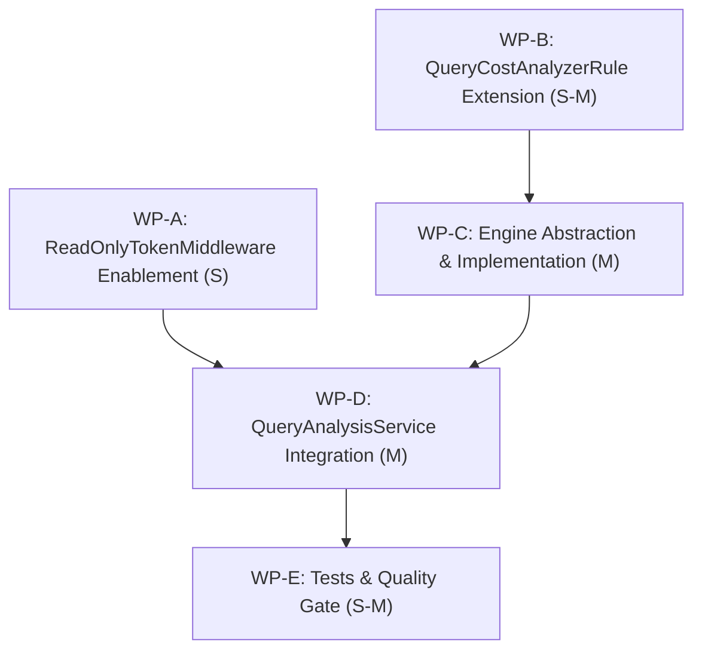

# PLAN-GOV-175: Query Analysis for Read-Only Tokens with the Execution Cost Model

**Document ID:** `PLAN-GOV-175`  
**Date:** 2026-10-18  
**Status:** APPROVED WITH CONDITIONS (Phase 3 Security Reviewed)  
**Author:** Solution Architect (`csharp-architect`)  
**Input PRD:** [`docs/plans/2026-10-18-req-issue-175-query-analysis-execution-cost-model.md`](2026-10-18-req-issue-175-query-analysis-execution-cost-model.md)  
**Parent Plan:** [`docs/plans/00-master-plan-overview.md`](00-master-plan-overview.md)  
**Target Branch:** `feat/issue-175-query-analysis-cost-model` (branched after `#143` & `#150` merge)  
**GitHub Issue:** #175  

---

## 1. Executive Summary & Problem Context

`POST /api/v1/governance/queries/analyze` provides pre-flight governance evaluation for clients and autonomous agents. However, read-only callers (tokens holding `ReadOnlyScopes`) are rejected with `403 READ_ONLY_TOKEN` by `ReadOnlyTokenMiddleware`. Additionally, the current GraphQL analysis calculates cost using a naive heuristic (`fields * CostPerField + depth * CostPerJoin`) that drifts significantly from the runtime AST execution model in `QueryCostAnalyzerRule` (which accounts for pagination bounds, list multipliers, variable substitution, and column masking surcharges).

This implementation plan delivers:
1. **Read-Only Authorization:** Whitelist `/api/v1/governance/queries/analyze` in `ReadOnlyTokenMiddleware` so callers with read-only scopes can evaluate queries without 403 errors.
2. **Exact Engine Reuse (Zero Drift):** Cleanly invert dependencies to reuse Hot Chocolate's `QueryCostAnalyzerRule` over the parsed AST `DocumentNode`.
3. **Root-Field Cost Breakdown:** Provide exact complexity breakdown per top-level root field selection and alias.
4. **Diagnostic Parity:** Align rejection reason codes (`QUERY_TOO_COMPLEX`, `MASKED_COLUMN_IN_FILTER`) between static analysis and runtime execution.
5. **Zero-Side-Effect Guarantee:** Ensure analysis executes with 0 source database reads, 0 state mutations, and 0 quota token deductions.

---

## 2. Verified Code Facts (Deltas to PRD & Layout)

1. **`ReadOnlyTokenMiddleware` Behavior (`src/Autheris.Api/Middleware/ReadOnlyTokenMiddleware.cs`):**
   - Filters out non-read HTTP requests (`POST`) unless they match configured query paths (`/graphql`, `/mcp`), read-only procedure executions (`/api/v1/procedures/{segment}`), or safe methods (`GET`, `HEAD`, `OPTIONS`).
   - Root `/api/v1/queries` and `/api/v1/governance/*` are currently denied to read-only callers.
   - Allowing `POST /api/v1/governance/queries/analyze` must be strictly targeted so `POST /api/v1/governance/consents/bundle` (a state-changing mutation) remains denied.

2. **Assembly Dependency Graph:**
   - `Autheris.GraphQL` references `Autheris.Application` and `Autheris.Domain`.
   - `Autheris.Application` **cannot** reference `Autheris.GraphQL` (clean architecture boundary).
   - `Autheris.Application` already references `HotChocolate.Language` (16.6.8), making AST types (`DocumentNode`, `FieldNode`, `OperationDefinitionNode`) native to `Autheris.Application`.
   - Reusing `QueryCostAnalyzerRule` requires an interface abstraction in `Autheris.Application` (`IGraphQlCostAnalysisEngine`) implemented by `Autheris.GraphQL` and registered in DI.

3. **Current Cost Calculation (`QueryAnalysisService.GraphQl.cs` L174-L175):**
   - Computes: `outcome.EstimatedCost = Math.Max(1, totalFields) * CostPerRequestedField + Math.Max(0, maxDepth - 1) * CostPerJoin`.
   - Fails to account for `first: N` pagination arguments, runtime variable coercion, or list nesting fan-out.
   - `QueryCostAnalyzerRule.CalculateCost(document, schema, ...)` already provides exact AST cost calculation but currently only exposes an aggregated integer cost.

4. **Model Layout (`QueryAnalysisModels.cs`):**
   - `QueryCostEstimate` is a sealed record: `(int EstimatedCost, int MaxAllowedCost, bool IsWithinCostLimit)`.
   - It is instantiated only in `QueryAnalysisService.cs` (L347), enabling backward-compatible extension with `IReadOnlyDictionary<string, int>? RootFieldCosts = null`.
   - Diagnostic codes in `QueryDiagnosticCodes` currently lack `QUERY_TOO_COMPLEX`.

5. **Filter Argument Extraction (`QueryAnalysisService.GraphQl.cs` L189-L205):**
   - Extracts filter columns only from `"where"` and `"filter"` arguments.
   - Ordering arguments (`"orderBy"`, `"order_by"`, `"sort"`, `"sortBy"`) are not parsed for masked columns, missing parity for queries ordering by sensitive columns.

---

## 3. Architectural Decisions

```
+-----------------------------------------------------------------------------------------+
|                                    HTTP Layer (Api)                                     |
|  POST /api/v1/governance/queries/analyze                                                |
|  - ReadOnlyTokenMiddleware: Permit read-only tokens for /analyze (Decision D-5)          |
+-----------------------------------------------------------------------------------------+
                                           |
                                           v
+-----------------------------------------------------------------------------------------+
|                               Application Layer (Domain/App)                             |
|  IQueryAnalysisService -> QueryAnalysisService                                          |
|  - Parses AST (DocumentNode) via HotChocolate.Language                                  |
|  - Extracts filter arguments (including orderBy)                                        |
|  - Calls IGraphQlCostAnalysisEngine.CalculateCostAsync(doc, vars, ct)                   |
|  - Merges RootFieldCosts into QueryCostEstimate (Decision D-3)                           |
|  - Emits QUERY_TOO_COMPLEX & MASKED_COLUMN_IN_FILTER (Decision D-4)                     |
+-----------------------------------------------------------------------------------------+
                                           |
                                           v (Dependency Inversion)
+-----------------------------------------------------------------------------------------+
|                                  GraphQL Layer                                          |
|  HotChocolateGraphQlCostAnalysisEngine : IGraphQlCostAnalysisEngine (Decision D-2)      |
|  - Resolves ISchema via IRequestExecutorProvider.GetExecutorAsync(ct)                   |
|  - QueryCostAnalyzerRule.ComputeCostDetails(...) (Decision D-1)                         |
|    * Reuses exact runtime AST visitor engine                                            |
|    * Computes TotalCost + RootFieldCosts per top-level FieldNode/alias                  |
+-----------------------------------------------------------------------------------------+
```

### Decision D-1: In-Process Engine Reuse Over Heuristics (Anti-Drift)
- **Choice:** Directly reuse `QueryCostAnalyzerRule` in-process over the parsed `DocumentNode`.
- **Rationale:** Building a parallel approximation heuristic creates permanent drift against runtime execution. Reusing `QueryCostAnalyzerRule` guarantees 100% cost parity:
  $$\text{costEstimate}_{\text{analysis}} \equiv \text{calculatedCost}_{\text{runtime}}$$
- **Scope:** Evaluates list multipliers, pagination arguments (`first`, `limit`), nested list row fan-out, variable substitution with default values, and column masking surcharges (+3).

### Decision D-2: Clean Architecture Inversion via `IGraphQlCostAnalysisEngine`
- **Choice:** Define `IGraphQlCostAnalysisEngine` in `Autheris.Application.Governance.Analysis` and implement it in `Autheris.GraphQL.Analysis`.
- **Rationale:** Preserves unidirectional project references: `Autheris.GraphQL` $\to$ `Autheris.Application` $\to$ `Autheris.Domain`.
- **Signatures:**
  ```csharp
  namespace Autheris.Application.Governance.Analysis;

  public interface IGraphQlCostAnalysisEngine
  {
      ValueTask<GraphQlCostAnalysisResult> CalculateCostAsync(
          DocumentNode document,
          IReadOnlyDictionary<string, object?>? variableValues = null,
          CancellationToken ct = default);
  }

  public sealed record GraphQlCostAnalysisResult(
      int TotalCost,
      IReadOnlyDictionary<string, int> RootFieldCosts,
      int MaxRootFieldsCount);
  ```
- **DI Registration:** Registered as scoped in `GatewayCatalogServiceExtensions`:
  ```csharp
  services.TryAddScoped<IGraphQlCostAnalysisEngine, HotChocolateGraphQlCostAnalysisEngine>();
  ```
- **Test Compatibility:** In `QueryAnalysisService`, `IGraphQlCostAnalysisEngine? costAnalysisEngine = null` is an optional parameter. When omitted in lightweight unit tests, it falls back gracefully without requiring a full GraphQL schema.

### Decision D-3: Root-Field Cost Breakdown (`RootFieldCosts`)
- **Choice:** Refactor `QueryCostAnalyzerRule` to compute costs per top-level root field selection.
- **Engine Method:**
  ```csharp
  public (int TotalCost, IReadOnlyDictionary<string, int> RootFieldCosts) ComputeCostDetails(
      DocumentNode document,
      ISchemaDefinition schema,
      IReadOnlyDictionary<string, object?>? variableValues = null)
  ```
- **Field Keying:** Top-level selections are mapped by response field name: `field.Alias?.Value ?? field.Name.Value`.
- **Mathematical Identity:** Total cost equals the saturating sum of all root field costs:
  $$\text{TotalCost} = \max\left(1, \sum_{i} \text{RootFieldCost}_i\right)$$
- **Model Extension:**
  ```csharp
  public sealed record QueryCostEstimate(
      int EstimatedCost,
      int MaxAllowedCost,
      bool IsWithinCostLimit,
      IReadOnlyDictionary<string, int>? RootFieldCosts = null);
  ```

### Decision D-4: Strict Diagnostic & Rejection Parity
- **Choice:** Align static diagnostic codes with runtime error codes.
  1. Add `QueryDiagnosticCodes.QueryTooComplex = "QUERY_TOO_COMPLEX"`.
  2. Emit `QUERY_TOO_COMPLEX` if `TotalCost > MaxAllowedCost` or `MaxRootFieldsCount > MaxRootFields`.
  3. Mark `IsValid = false` when `QUERY_TOO_COMPLEX` is present.
  4. Extend `ExtractGraphQlFilterArguments` to parse `orderBy`, `order_by`, `sort`, `sortBy`, flagging masked columns in ordering clauses with `MASKED_COLUMN_IN_FILTER`.

### Decision D-5: Read-Only Authorization Whitelist
- **Choice:** Allow `POST /api/v1/governance/queries/analyze` and `/api/v1/governance/queries/analyze/` in `ReadOnlyTokenMiddleware`.
- **Fail-Closed Boundaries:**
  - `POST /api/v1/governance/consents/bundle` remains **denied** (`403 READ_ONLY_TOKEN`) because it mutates governance state.
  - Sub-paths or malformed paths (e.g. `/api/v1/governance/queries/analyze/exec`) remain denied.
  - Target principal impersonation (`TargetSubjectId`) remains protected by `GovernanceAdmin` / `governance:simulate` role checks in `QueryAnalysisService`.

### Decision D-6: Phased Implementation
- **Phase A (Immediate, Issue #175):** Core engine delegation, root-field breakdown, diagnostic parity, `ReadOnlyTokenMiddleware` enablement.
- **Phase B (Future Wave):** Expose `analyze_query` as an MCP tool and/or GraphQL schema field on `Query`.

---

## 4. Work Packages



### WP-A: Read-Only Token Middleware Enablement (Size: S)

- **Target Files:**
  - `src/Autheris.Api/Middleware/ReadOnlyTokenMiddleware.cs`
- **Implementation:**
  - Add constant:
    ```csharp
    private const string GovernanceQueryAnalyzePath = "/api/v1/governance/queries/analyze";
    ```
  - In `IsPermitted(HttpRequest request)`:
    ```csharp
    if (request.Path.Equals(GovernanceQueryAnalyzePath, StringComparison.OrdinalIgnoreCase) ||
        request.Path.Equals(GovernanceQueryAnalyzePath + "/", StringComparison.OrdinalIgnoreCase))
    {
        return true;
    }
    ```
  - Verify that `POST /api/v1/governance/consents/bundle` is not permitted for read-only tokens.
- **Test Criteria:**
  - `tests/Autheris.Tests.Unit/Security/ReadOnlyTokenTests.cs`: Add test cases verifying read-only principal can POST to `/api/v1/governance/queries/analyze` and `/api/v1/governance/queries/analyze/`.
  - Verify `POST /api/v1/governance/consents/bundle` continues to return 403 Forbidden (`READ_ONLY_TOKEN`).
  - Verify arbitrary POSTs like `/api/v1/governance/queries/analyze/sub` return 403 Forbidden.

### WP-B: `QueryCostAnalyzerRule` Root-Field Cost Breakdown (Size: S-M)

- **Target Files:**
  - `src/Autheris.GraphQL/Interceptors/QueryCostAnalyzerRule.cs`
- **Implementation:**
  - Implement `ComputeCostDetails`:
    ```csharp
    public (int TotalCost, IReadOnlyDictionary<string, int> RootFieldCosts) ComputeCostDetails(
        DocumentNode document,
        ISchemaDefinition schema,
        IReadOnlyDictionary<string, object?>? variableValues = null)
    ```
  - Iterates over operations in `document.Definitions.OfType<OperationDefinitionNode>()`.
  - For each top-level selection in `operation.SelectionSet.Selections`:
    - Wraps the single selection in a `SelectionSetNode` and computes cost using existing `CalculateSelectionSetCost`.
    - Key name: `field.Alias?.Value ?? field.Name.Value` (or node description if inline fragment).
    - Accumulates into `rootFieldCosts` dictionary.
  - Refactor `ComputeCost` to invoke `ComputeCostDetails` and return `TotalCost`.
  - Add public static convenience method:
    ```csharp
    public static (int TotalCost, IReadOnlyDictionary<string, int> RootFieldCosts) CalculateCostDetails(
        DocumentNode document,
        ISchemaDefinition schema,
        int defaultListMultiplier = 10,
        int maxResponseRows = 1000,
        IReadOnlyDictionary<string, object?>? variableValues = null)
    ```
- **Test Criteria:**
  - `tests/Autheris.Tests.Unit/GraphQL/QueryCostAnalyzerDetailsTests.cs`:
    - Query with multiple root fields: verify individual root costs match isolated execution.
    - Query with aliased root fields: verify keys match aliases.
    - Query with nested list pagination (`first: 10`): verify child costs scale with limit.
    - Query with variables: verify runtime variables alter root cost identically to default variables.

### WP-C: Application Abstraction & GraphQL Engine Implementation (Size: M)

- **Target Files:**
  - `src/Autheris.Application/Governance/Analysis/IGraphQlCostAnalysisEngine.cs` (new)
  - `src/Autheris.Application/Governance/Analysis/QueryAnalysisModels.cs`
  - `src/Autheris.GraphQL/Analysis/HotChocolateGraphQlCostAnalysisEngine.cs` (new)
  - `src/Autheris.Api/Extensions/DependencyInjection/GatewayCatalogServiceExtensions.cs`
- **Implementation:**
  - In `QueryAnalysisModels.cs`:
    - Add `QueryDiagnosticCodes.QueryTooComplex = "QUERY_TOO_COMPLEX";`.
    - Extend `QueryCostEstimate`:
      ```csharp
      public sealed record QueryCostEstimate(
          int EstimatedCost,
          int MaxAllowedCost,
          bool IsWithinCostLimit,
          IReadOnlyDictionary<string, int>? RootFieldCosts = null);
      ```
  - In `HotChocolateGraphQlCostAnalysisEngine.cs`:
    - Injects `IRequestExecutorProvider` and `IOptions<GatewayOptions>`.
    - Resolves `IRequestExecutor` and `ISchema`.
    - Instantiates `QueryCostAnalyzerRule` with configured options.
    - Invokes `rule.ComputeCostDetails(document, schema, variableValues)`.
    - Returns `GraphQlCostAnalysisResult(totalCost, rootFieldCosts, rootFieldCount)`.
  - In `GatewayCatalogServiceExtensions.cs`:
    - Register: `services.TryAddScoped<IGraphQlCostAnalysisEngine, HotChocolateGraphQlCostAnalysisEngine>();`.
- **Test Criteria:**
  - Unit tests verifying `HotChocolateGraphQlCostAnalysisEngine` correctly resolves schema and executes without blocking threads (`ValueTask`, zero `.Result` calls).

### WP-D: `QueryAnalysisService` Integration & Diagnostic Parity (Size: M)

- **Target Files:**
  - `src/Autheris.Application/Governance/Analysis/QueryAnalysisService.cs`
  - `src/Autheris.Application/Governance/Analysis/QueryAnalysisService.GraphQl.cs`
  - `src/Autheris.Application/Governance/Analysis/QueryAnalysisService.Evaluation.cs`
- **Implementation:**
  - In `QueryAnalysisService.cs`:
    - Add optional constructor parameter: `IGraphQlCostAnalysisEngine? costAnalysisEngine = null`.
    - Store `_costAnalysisEngine`.
    - In query loop, aggregate `rootFieldCosts` across items into `QueryCostEstimate`.
    - Check complexity bounds:
      ```csharp
      if (totalEstimatedCost > maxAllowedCost)
      {
          diagnostics.Add(new QueryValidationDiagnostic(
              QueryDiagnosticCodes.QueryTooComplex,
              $"The query exceeds the complexity budget of {maxAllowedCost} (calculated cost: {totalEstimatedCost}).",
              QueryName: queryName));
      }
      ```
    - In `isValid` check, include `!string.Equals(d.Code, QueryDiagnosticCodes.QueryTooComplex, StringComparison.OrdinalIgnoreCase)`.
  - In `QueryAnalysisService.GraphQl.cs`:
    - When `_costAnalysisEngine != null`:
      - Invoke `await _costAnalysisEngine.CalculateCostAsync(document, variables, ct)`.
      - Populate `outcome.EstimatedCost` and `outcome.RootFieldCosts`.
      - Check `result.MaxRootFieldsCount > _maxRootFields` and add `QueryTooComplex` diagnostic if exceeded.
    - Extend `ExtractGraphQlFilterArguments`:
      - Check `"orderBy"`, `"order_by"`, `"sort"`, `"sortBy"` in addition to `"where"` and `"filter"`.
      - Extract referenced columns into `filterColumns` so masked columns in ordering are flagged.
  - In `QueryAnalysisService.Evaluation.cs`:
    - Add `public Dictionary<string, int> RootFieldCosts { get; } = new(StringComparer.Ordinal);` to `SingleQueryAnalysisOutcome`.
    - In `MergeOutcome`, merge `source.RootFieldCosts` into the aggregated dictionary.
- **Test Criteria:**
  - New test file: `tests/Autheris.Tests.Unit/Governance/QueryAnalysisExecutionCostModelTests.cs`:
    - Exact cost parity with `QueryCostAnalyzerRule`.
    - Root field cost dictionary populated with exact breakdown.
    - Diagnostic code `QUERY_TOO_COMPLEX` returned when cost exceeds budget, setting `IsValid = false`.
    - Masked column inside `orderBy: { ssn: ASC }` flagged with `MASKED_COLUMN_IN_FILTER`.
    - Fallback behavior when `costAnalysisEngine` is null preserves existing behavior.

### WP-E: Integration Parity & End-to-End Tests (Size: S-M)

- **Target Files:**
  - `tests/Autheris.Tests.Integration/Governance/QueryAnalysisExecutionCostIntegrationTests.cs` (new)
- **Implementation:**
  - Use `WebApplicationFactory<Program>` / `AutherisApiFactory`.
  - Issue `POST /api/v1/governance/queries/analyze` with a bearer token containing only read-only scopes (`TokenAccessScope.ReadOnlyScopes`).
  - Verify HTTP 200 OK response with `isWithinCostLimit: true` and populated `rootFieldCosts`.
  - Compare the analyzed `estimatedCost` with the cost calculated by executing the query against `/graphql`.
  - Verify that source database metrics indicate 0 source database reads and 0 rate-limit tokens deducted.
- **Test Criteria:**
  - Full end-to-end integration test passes across valid queries, overly complex queries, and queries with variables.

---

## 5. Fail-Closed and Security Summary

1. **Strict Zero-Trust & Fail-Closed Authorization:**
   - Permitting `/api/v1/governance/queries/analyze` does **not** grant access to underlying data.
   - Read-only tokens cannot execute mutations, access unconsented tables, or submit consent tickets (`POST /api/v1/governance/consents/bundle` remains strictly blocked with 403 `READ_ONLY_TOKEN`).
   - Impersonation (`TargetSubjectId`) requires `GovernanceAdmin` or `governance:simulate` roles. An unauthorized caller attempting impersonation is rejected with 403 Forbidden.

2. **DoS & Resource Exhaustion Defense:**
   - Query parsing uses Hot Chocolate's `Utf8GraphQLParser` with parser depth and complexity limits.
   - Cost analysis uses saturating arithmetic (`SafeAdd`) and spread expansion limits (`maxSpreadExpansions = 250`) to prevent stack overflow from recursive fragments or cyclic spreads.
   - Alias amplification is capped at `CountMaxRootFields(document, maxRootFields)`.

3. **Data Leakage Prevention:**
   - Query analysis operates entirely in memory on AST metadata.
   - Output columns and diagnostics never expose raw database connection strings, credentials, or row-level filter SQL predicates.
   - Tables with `DatasetVisibility.Hidden` return generic `UnknownTable` errors to prevent enumeration by non-admin users.

4. **Zero Side-Effects:**
   - 0 source database connections opened.
   - 0 rows retrieved.
   - 0 rate-limit / quota tokens consumed.

---

## 6. Acceptance Criteria Mapping (PRD Traceability)

| PRD Acceptance Criteria | Work Package | Verification Test |
| :--- | :--- | :--- |
| **AC-1:** Read-only token receives HTTP 200 from `/analyze` without 403 rejection | WP-A, WP-E | `ReadOnlyTokenTests.cs`, `QueryAnalysisExecutionCostIntegrationTests.cs` |
| **AC-2:** `costEstimate` per root field matches `calculatedCost` produced by `QueryCostAnalyzerRule` | WP-B, WP-C, WP-D | `QueryCostAnalyzerDetailsTests.cs`, `QueryAnalysisExecutionCostModelTests.cs` |
| **AC-3:** Identical rejection reason codes (`QUERY_TOO_COMPLEX`, `MASKED_COLUMN_IN_FILTER`) | WP-C, WP-D | `QueryAnalysisExecutionCostModelTests.cs` |
| **AC-4:** 0 source database reads and 0 quota token deductions | WP-D, WP-E | `QueryAnalysisExecutionCostIntegrationTests.cs` |
| **AC-5:** No regression on existing SQL / federated analysis routes | WP-D, WP-E | Full test suite (`Autheris.Tests.Unit`, `Autheris.Tests.Integration`) |

---

## 7. Sequencing & Parallelisation

1. **Step 1 (Parallel Tracks):**
   - **Track 1 (Api/Security):** WP-A (`ReadOnlyTokenMiddleware` enablement and route unit tests).
   - **Track 2 (GraphQL Core):** WP-B (`QueryCostAnalyzerRule` root-field cost breakdown and details unit tests).
2. **Step 2 (Application & DI Wiring):**
   - WP-C (`IGraphQlCostAnalysisEngine` abstraction, `HotChocolateGraphQlCostAnalysisEngine` implementation, DI registration).
3. **Step 3 (Governance Integration):**
   - WP-D (`QueryAnalysisService` engine delegation, diagnostic parity, `orderBy` masked column detection).
4. **Step 4 (Integration Verification & Quality Gate):**
   - WP-E (Integration tests, regression verification, `dotnet test Autheris.sln`).

---

## 8. Phase 3 Security Review & Binding Conditions (`csharp-security-expert`)

**Review Date:** 2026-10-18  
**Verdict:** APPROVED WITH CONDITIONS  
**Reviewer:** Application Security Expert (`csharp-security-expert`)

### Binding Security Conditions

1. **`SEC-GOV175-01`: Fail-Closed Route Matching in `ReadOnlyTokenMiddleware`**
   - Permitting `/api/v1/governance/queries/analyze` MUST use exact path matching (`request.Path.Equals(GovernanceQueryAnalyzePath, StringComparison.OrdinalIgnoreCase) || request.Path.Equals(GovernanceQueryAnalyzePath + "/", StringComparison.OrdinalIgnoreCase)`).
   - Under no circumstances shall `StartsWithSegments` or prefix wildcards be used on `/api/v1/governance` or `/api/v1/governance/queries`.
   - Mutation routes—specifically `POST /api/v1/governance/consents/*`, `POST /api/governance/consents/*`, `POST /api/governance/plans/*`, and `POST /api/governance/hitl/*`—MUST remain strictly rejected (`403 Forbidden`, `READ_ONLY_TOKEN`) for read-only tokens.
   - Probing headers `X-Original-Method` and `X-Forwarded-Method` specifying non-safe verbs MUST continue to fail closed.

2. **`SEC-GOV175-02`: DoS & AST Amplification Defense in `QueryCostAnalyzerRule`**
   - **Root-Field Hard Limit**: In `HotChocolateGraphQlCostAnalysisEngine`, enforce `QueryCostAnalyzerRule.CountMaxRootFields(document, maxRootFields)` against `GatewayOptions.GraphQL.MaxRootFieldsPerOperation` (default: 10). If exceeded, reject immediately with `QUERY_TOO_COMPLEX` before table metadata resolution or individual root field cost analysis.
   - **Shared Spread Counter & Depth Guard**: In `ComputeCostDetails`, `spreadCounter` (limit 250) MUST be accumulated across the entire operation rather than reset per root field. AST recursion in `CalculateSelectionSetCost` and `CollectSelectedGraphQlFields` MUST enforce a maximum depth limit (aligned with `MaxAllowedExecutionDepth`) to prevent stack overflow from pathological ASTs.
   - **Fragment Deduplication & Cycle Protection**: Retain active fragment cycle guards (`activeFragments`) and memoized fragment cost evaluation (`fragmentCostCache`) across root-field slices. Correctly handle `FragmentSpreadNode` and `InlineFragmentNode` at root level without throwing `NullReferenceException`.

3. **`SEC-GOV175-03`: Zero Database Reads & No Quota Consumption**
   - Analysis execution MUST be strictly non-functional/in-memory over AST nodes: 0 database queries, 0 EF Core/ADO.NET calls, and 0 row reads.
   - Schema resolution via `IRequestExecutorProvider.GetExecutorAsync(ct)` must reuse the cached in-memory `ISchema` without triggering pipeline execution or resolver evaluation.
   - Pre-flight governance queries MUST NOT decrement client rate-limiting or query quota buckets.

4. **`SEC-GOV175-04`: Zero Existence Oracles & Catalog Leakage Prevention**
   - Tables with `DatasetVisibility.Hidden` where the caller lacks grant, ownership, or admin privileges MUST emit `UnknownTable` with generic phrasing and NEVER leak existence in `MissingConsents`, `OutputColumns`, or `RootFieldCosts`.
   - Root field cost calculation for non-existent or hidden fields MUST use uniform AST fallback logic so cost delta cannot be used as a timing or existence oracle.
   - Impersonation (`TargetSubjectId`) MUST strictly enforce `governance:simulate` or `GovernanceAdmin` roles; unprivileged callers attempting simulation MUST be rejected with `403 Forbidden` prior to catalog inspection.

### Mandatory Security Test Suite

All conditions must be verified with dedicated tests marked `[Trait("Category", "Security")]`:
- `T_SEC_GOV175_01_ReadOnlyToken_RouteAuthorization`: Verifies read-only tokens receive 200 on `/analyze` and `/analyze/`, while `POST /api/v1/governance/consents/bundle`, `POST /api/v1/governance/consents/apply`, and sub-paths (e.g., `/analyze/sub`) receive 403 `READ_ONLY_TOKEN`.
- `T_SEC_GOV175_02_AST_Amplification_And_Cycles`: Verifies that cyclic fragment spreads, deep nested selections (> `MaxAllowedExecutionDepth`), and excessive root-field alias counts (> `MaxRootFieldsPerOperation`) fail gracefully with `QUERY_TOO_COMPLEX` without high CPU or stack overflow.
- `T_SEC_GOV175_03_ZeroDatabaseReadsAndZeroQuota`: Verifies with mock/spied connection pool that 0 connections are opened and 0 quota tokens are deducted during query analysis.
- `T_SEC_GOV175_04_NoExistenceOracle_HiddenDatasets`: Verifies indistinguishable diagnostics and zero column disclosures between non-existent tables and `Hidden` datasets for unprivileged callers.
