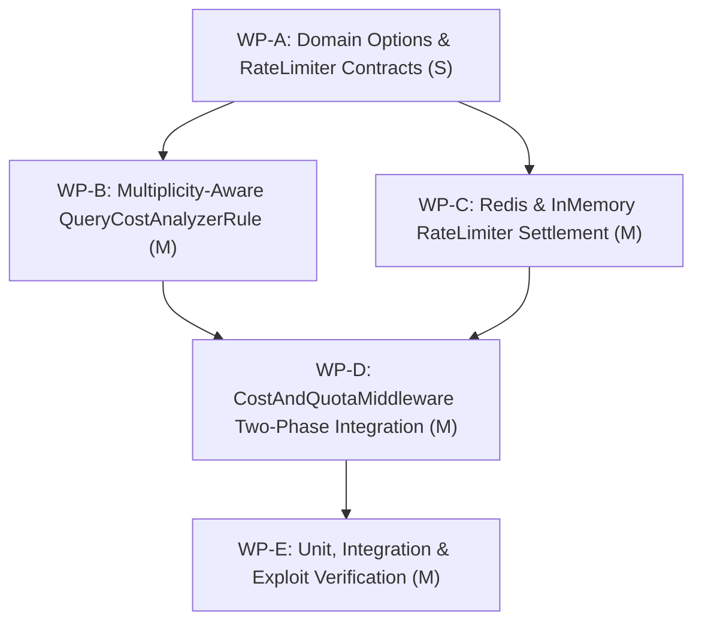

# PLAN-GOV-177: Multiplicity-Aware Cost Estimation and Two-Phase Token Bucket Work Settlement

**Document ID:** `PLAN-GOV-177`  
**Date:** 2026-10-18  
**Status:** APPROVED (Phase 3 Security Reviewed)  
**Author:** Solution Architect (`csharp-architect`)  
**Input PRD:** [`REQ-GOV-177`](2026-10-18-issue-intake-assessment.md) §3.3  
**Parent Plan:** [`docs/plans/00-master-plan-overview.md`](00-master-plan-overview.md) rank 2.13  
**Target Branch:** `feat/issue-177-token-bucket-work-settlement` (branched after `#175` merge)  
**GitHub Issue:** #177  

---

## 1. Executive Summary & Problem Context

In Autheris GraphQL execution, admission cost control is enforced prior to query execution by [`CostAndQuotaMiddleware`](file:///root/autheris/src/Autheris.GraphQL/Interceptors/CostAndQuotaMiddleware.cs) using static AST evaluation via [`QueryCostAnalyzerRule`](file:///root/autheris/src/Autheris.GraphQL/Interceptors/QueryCostAnalyzerRule.cs). However, this static admission suffers from two major limitations:
1. **Multiplicity Blindness for Nested Lookups:** When analyzing nested selections, `QueryCostAnalyzerRule` applies `_defaultListMultiplier` (default: 10) to nested fields unless bounded by an explicit `first` pagination argument. For foreign key relations with 1:1 (`RelationCardinality.OneToOne`) or N:1 (`RelationCardinality.ManyToOne`) cardinality (such as `order { customer { address } }`), static admission assumes a 10x fan-out at each level, calculating costs that are 10x-100x higher than physical reality.
2. **One-Way Upfront Token Burn Without Settlement:** [`CostAndQuotaMiddleware.cs:129`](file:///root/autheris/src/Autheris.GraphQL/Interceptors/CostAndQuotaMiddleware.cs#L129) calls `IRateLimiterService.CheckCostQuotaAsync`, deducting the entire inflated estimate upfront. If a client queries `orders(first: 100)` but the database filter matches only 2 rows, or if nested single-row lookups execute in 1ms with 1 row returned, the client is permanently debited for the worst-case 100 rows without any refund.

This architectural implementation delivers:
1. **Multiplicity-Aware Query Cost Estimation:** Enhance [`QueryCostAnalyzerRule`](file:///root/autheris/src/Autheris.GraphQL/Interceptors/QueryCostAnalyzerRule.cs) to inspect relation cardinality (1:1 and N:1 single-object relations) and assign a cardinality multiplier of 1 rather than 10.
2. **Two-Phase Token Bucket Accounting (Reserve & Settle):**
   - *Phase 1 (Admission Reservation):* Deduct upfront estimated cost via `ReserveCostQuotaAsync` to defend against concurrency denial-of-service and pool exhaustion.
   - *Phase 2 (Post-Execution Settlement):* Reconcile actual compute in [`CostAndQuotaMiddleware`](file:///root/autheris/src/Autheris.GraphQL/Interceptors/CostAndQuotaMiddleware.cs) based on actual rows returned and executed subquery depth. Invoke atomic `SettleCostQuotaAsync` to refund unused token reserves or apply debit adjustments.
3. **Fail-Closed & Exploit-Proof Accounting:** Token refunds are strictly capped at bucket capacity ($T \le \text{Capacity}$) and cannot mint surplus credit. Additional debits clamp at 0 ($T \ge 0$) to eliminate negative balance exploits. Failed or cancelled queries retain a base charge to protect against query cancellation spam.
4. **Configurable Cost Governance Factors:** Expose `QueryCostOptions` bound to `Gateway:Governance:QueryCost` defining base cost, per-row factor, nested depth factor, and single-row lookup cost.

---

## 2. Verified Code Facts Beyond the PRD

| # | Fact | Evidence & Architectural Consequence |
|---|---|---|
| **V-1** | `CostAndQuotaMiddleware` only performs upfront deduction | [`CostAndQuotaMiddleware.cs:129`](file:///root/autheris/src/Autheris.GraphQL/Interceptors/CostAndQuotaMiddleware.cs#L129) invokes `_rateLimiter.CheckCostQuotaAsync`. After `await _next(context)` (L149), headers `X-Query-Cost` and `X-RateLimit-Remaining` reflect only the static admission cost; no refund or reconciliation call exists. |
| **V-2** | `IRateLimiterService` lacks two-phase reservation & settlement APIs | [`IRateLimiterService.cs:8-13`](file:///root/autheris/src/Autheris.Application/Interfaces/IRateLimiterService.cs#L8-L13) only exposes `CheckCostQuotaAsync`. It requires extension with `ReserveCostQuotaAsync` (aliased to check) and `SettleCostQuotaAsync(key, reservedCost, actualCost, policy, ct)`. |
| **V-3** | Redis rate limiter script is one-way debit only | [`RedisRateLimiterService.cs:62-99`](file:///root/autheris/src/Autheris.Infrastructure/RateLimiting/RedisRateLimiterService.cs#L62-L99) runs `CostTokenBucketScript`, which only deducts `requested_cost`. It requires a dedicated atomic Lua script `CostTokenBucketSettleScript` supporting atomic refunds and capped debits. |
| **V-4** | InMemory rate limiter does not support settlement | [`InMemoryRateLimiterService.cs:272-347`](file:///root/autheris/src/Autheris.Infrastructure/RateLimiting/InMemoryRateLimiterService.cs#L272-L347) manages in-memory `TokenBucket` instances with locks, but has no method to adjust tokens post-execution. |
| **V-5** | `QueryCostAnalyzerRule` lacks cardinality awareness for nested lookups | [`QueryCostAnalyzerRule.cs:303-324, 403-421`](file:///root/autheris/src/Autheris.GraphQL/Interceptors/QueryCostAnalyzerRule.cs#L303-L421) checks `IsListType(fieldDef.Type)` and `IsRowLimitArgument`. For non-list object fields, `acceptsPagination` is false, and it falls through to L403 where `assumedRows` defaults to `_defaultListMultiplier` (10) for list types, but fails to distinguish single-entity 1:1/N:1 joins from fan-out collections when parent lists propagate down. |
| **V-6** | `CatalogRelationField` stores explicit cardinality | [`CatalogSchemaModel.cs:318, 330-337`](file:///root/autheris/src/Autheris.GraphQL/Catalog/CatalogSchemaModel.cs#L318-L337) records `rel.Cardinality == RelationCardinality.OneToMany` as `isList: true`, while `OneToOne` and `ManyToOne` are `isList: false`. In Hot Chocolate type definition ([`CatalogGraphQlTypeModule.cs:240-259`](file:///root/autheris/src/Autheris.GraphQL/Catalog/CatalogGraphQlTypeModule.cs#L240-L259)), non-list relations are mapped directly to `NamedTypeNode(rel.TargetTypeName)`. |
| **V-7** | `HotChocolateGraphQlCostAnalysisEngine` reuses `QueryCostAnalyzerRule` | [`HotChocolateGraphQlCostAnalysisEngine.cs:60-66`](file:///root/autheris/src/Autheris.GraphQL/Analysis/HotChocolateGraphQlCostAnalysisEngine.cs#L60-L66) delegates to `QueryCostAnalyzerRule.CalculateCostDetails`. Any enhancement to `QueryCostAnalyzerRule` automatically updates static pre-flight governance `/api/v1/governance/queries/analyze` with zero drift. |
| **V-8** | Hot Chocolate `OperationResult.Data` contains executed response tree | [`CostAndQuotaMiddleware.cs:155`](file:///root/autheris/src/Autheris.GraphQL/Interceptors/CostAndQuotaMiddleware.cs#L155) already casts `context.Result as OperationResult`. The execution tree or resolver context data is available in `context.ContextData` for zero-allocation actual work extraction. |
| **V-9** | Configuration sections use `GatewaySections` | [`GatewaySections.cs:43-54`](file:///root/autheris/src/Autheris.Domain/Options/GatewaySections.cs#L43-L54) defines `Gateway:RateLimiting:ClientTiers` and `Gateway:FinOps`. `Gateway:Governance:QueryCost` is the standard path for governance cost options. |

---

## 3. Architectural Decisions

```
+----------------------------------------------------------------------------------------------------+
|                                    GraphQL Execution Pipeline                                      |
|                                                                                                    |
|  1. Request Ingestion (HTTP POST /graphql)                                                         |
|     - Parse DocumentNode, extract runtime variables                                                |
|                                                                                                    |
|  2. Phase 1: Pre-Admission Reservation (CostAndQuotaMiddleware)                                     |
|     - QueryCostAnalyzerRule (Multiplicity-Aware: 1:1 & N:1 = 1, 1:N = 10)                          |
|     - Calculate reservedCost = min(CalculatedCost, MaxAllowedComplexity)                           |
|     - IRateLimiterService.ReserveCostQuotaAsync(key, reservedCost, policy)                         |
|       * Redis Lua / In-Memory: atomic token bucket deduction                                       |
|       * If tokens < reservedCost: Reject immediately with HTTP 429 RATE_LIMIT_EXCEEDED             |
|                                                                                                    |
|  3. Operation Execution Pipeline                                                                  |
|     - await _next(context) -> Resolvers / GovernedTreeQueryService execute single SQL statement    |
|     - Track actual work: rowCount and executedDepth recorded in context.ContextData                |
|                                                                                                    |
|  4. Phase 2: Post-Execution Settlement (CostAndQuotaMiddleware)                                    |
|     - QueryCostModel.ComputeActualWorkCost(actualRows, actualDepth, queryCostOptions)              |
|     - actualCost = clamp(computedCost, min: BaseCost, max: MaxCostPerQuery)                        |
|     - IRateLimiterService.SettleCostQuotaAsync(key, reservedCost, actualCost, policy)             |
|       * If actualCost < reservedCost: Refund delta (reservedCost - actualCost)                     |
|       * If actualCost > reservedCost: Additional debit (actualCost - reservedCost)                 |
|       * Clamp tokens in [0, MaxTokensCapacity] (Fail-Closed, zero exploit)                        |
|     - Enrich HTTP Headers: X-Query-Cost-Reserved, X-Query-Cost-Actual, X-RateLimit-Remaining       |
|     - Enrich extensions.cost: requestedQueryCost, actualQueryCost, settlementDelta                 |
+----------------------------------------------------------------------------------------------------+
```

### Decision D-1: Multiplicity-Aware Relation Multiplier in `QueryCostAnalyzerRule`
- **Choice:** Explicitly inspect the schema type definition and output field type in [`QueryCostAnalyzerRule.CalculateSelectionSetCost`](file:///root/autheris/src/Autheris.GraphQL/Interceptors/QueryCostAnalyzerRule.cs#L280-L421).
- **Rule Formulation:**
  - For fields returning an object type (non-list, non-scalar) where the parent is already an object or list element:
    $$\text{Multiplier}_{\text{field}} = \begin{cases} 
    1 & \text{if } \text{IsListType}(\text{fieldDef.Type}) = \text{false} \quad (1:1 \text{ or } N:1 \text{ lookup}) \\
    \min(\text{requestedLimit}, \text{maxResponseRows}) & \text{if paginated with } first/limit \\
    \text{defaultListMultiplier} & \text{if } \text{IsListType}(\text{fieldDef.Type}) = \text{true} \text{ and unpaginated}
    \end{cases}$$
  - For 1:1 and N:1 relations, the fan-out multiplier is strictly $1.0$. The child selections are evaluated once per parent row, rather than compounding by $10 \times 10 = 100$.
- **Anti-Drift:** Because `HotChocolateGraphQlCostAnalysisEngine` directly invokes `QueryCostAnalyzerRule`, pre-flight static analysis `/api/v1/governance/queries/analyze` automatically adopts identical multiplicity calculation.

### Decision D-2: Two-Phase Token Bucket API Contract
- **Choice:** Extend [`IRateLimiterService`](file:///root/autheris/src/Autheris.Application/Interfaces/IRateLimiterService.cs) with explicit reservation and settlement contracts:
  ```csharp
  namespace Autheris.Application.Interfaces;

  public interface IRateLimiterService
  {
      Task<RateLimitResult> CheckPreAuthIpAsync(string ip, PreAuthIpRateLimitOptions options, CancellationToken ct = default);
      Task<RateLimitResult> CheckPostAuthSidAsync(string sid, PostAuthSidRateLimitOptions options, CancellationToken ct = default);
      Task<CostQuotaResult> CheckCostQuotaAsync(string key, int requestedCost, ClientQuotaPolicy policy, CancellationToken ct = default);

      // Phase 1: Upfront Reservation (defaults to CheckCostQuotaAsync for backwards compatibility)
      Task<CostQuotaResult> ReserveCostQuotaAsync(string key, int reservedCost, ClientQuotaPolicy policy, CancellationToken ct = default)
          => CheckCostQuotaAsync(key, reservedCost, policy, ct);

      // Phase 2: Post-Execution Reconciliation
      Task<CostQuotaResult> SettleCostQuotaAsync(string key, int reservedCost, int actualCost, ClientQuotaPolicy policy, CancellationToken ct = default);
  }
  ```
- **Semantics:**
  - `ReserveCostQuotaAsync`: Atomically verifies and deducts `reservedCost`. If allowed, returns `Allowed = true` and `RemainingTokens`.
  - `SettleCostQuotaAsync`: Atomically adjusts the token bucket by $\Delta = \text{reservedCost} - \text{actualCost}$.
    - If $\Delta > 0$ (work was lighter than estimate): $\text{tokens} = \min(\text{capacity}, \text{tokens} + \Delta)$.
    - If $\Delta < 0$ (work was heavier than estimate): $\text{tokens} = \max(0, \text{tokens} - |\Delta|)$.
    - If $\Delta = 0$: No adjustment needed, refreshes timestamp and returns current state.

### Decision D-3: Atomic Lua Script for Redis Settlement (`CostTokenBucketSettleScript`)
- **Choice:** Execute settlement via a dedicated atomic Lua script in [`RedisRateLimiterService`](file:///root/autheris/src/Autheris.Infrastructure/RateLimiting/RedisRateLimiterService.cs).
- **Script Logic:**
  ```lua
  local key = KEYS[1]
  local reserved_cost = tonumber(ARGV[1])
  local actual_cost = tonumber(ARGV[2])
  local capacity = tonumber(ARGV[3])
  local refill_rate = tonumber(ARGV[4])
  local now_ms = tonumber(ARGV[5])
  local ttl_seconds = tonumber(ARGV[6])

  local data = redis.call('HMGET', key, 'tokens', 'last_refill')
  local tokens = tonumber(data[1])
  local last_refill = tonumber(data[2])

  if not tokens then
      tokens = capacity
      last_refill = now_ms
  else
      local elapsed_sec = math.max(0, (now_ms - last_refill) / 1000.0)
      tokens = math.min(capacity, tokens + (elapsed_sec * refill_rate))
      last_refill = now_ms
  end

  -- Apply settlement delta: positive = refund, negative = additional debit
  local delta = reserved_cost - actual_cost
  tokens = math.max(0, math.min(capacity, tokens + delta))

  redis.call('HSET', key, 'tokens', tostring(tokens), 'last_refill', tostring(last_refill))
  redis.call('EXPIRE', key, ttl_seconds)

  return { 1, math.floor(tokens), 0 }
  ```
- **Exploit Guardrails:**
  - **Upper Bound:** `math.min(capacity, ...)` ensures that refunds cannot exceed bucket capacity under any circumstances.
  - **Lower Bound:** `math.max(0, ...)` ensures that debits never create negative numbers in Redis.

### Decision D-4: Configurable Cost Factors Options Schema (`QueryCostOptions`)
- **Choice:** Introduce `QueryCostOptions` bound to `Gateway:Governance:QueryCost` in [`Autheris.Domain.Options`](file:///root/autheris/src/Autheris.Domain/Options/).
- **Class Model:**
  ```csharp
  namespace Autheris.Domain.Options;

  public sealed class QueryCostOptions
  {
      public const string SectionName = "Gateway:Governance:QueryCost";

      [Range(1, 100)] public int BaseQueryCost { get; init; } = 1;
      [Range(0, 100)] public double CostPerRowReturned { get; init; } = 0.5;
      [Range(1, 100)] public int CostPerSingleRowLookup { get; init; } = 1;
      [Range(1, 100)] public int DefaultListMultiplier { get; init; } = 10;
      [Range(0, 50)] public int NestedDepthFactor { get; init; } = 1;
      public bool EnablePostExecutionSettlement { get; init; } = true;
  }
  ```
- **Registration:** Added to `GatewaySections.QueryCost = "Gateway:Governance:QueryCost"` and registered in `GatewayOptions.QueryCost`.

### Decision D-5: Actual Work Measurement & Extraction in Pipeline
- **Choice:** Collect execution metrics in `context.ContextData` during resolver execution and evaluate actual cost in [`CostAndQuotaMiddleware`](file:///root/autheris/src/Autheris.GraphQL/Interceptors/CostAndQuotaMiddleware.cs).
- **Formula:**
  $$\text{ActualCost} = \max\left(\text{BaseCost}, \text{BaseCost} + \left\lceil \text{RowsReturned} \times \text{CostPerRow} \right\rceil + (\text{ExecutedDepth} \times \text{DepthFactor})\right)$$
- **Extraction Protocol:**
  1. [`GovernedTreeQueryService`](file:///root/autheris/src/Autheris.Application/Sql/Tree/GovernedTreeQueryService.cs) records row count:
     `context.ContextData["AutherisRowsReturned"] = (long)totalRows;`
     `context.ContextData["AutherisMaxExecutedDepth"] = (int)maxDepth;`
  2. Fallback: If `ContextData` does not contain explicit metrics (e.g. non-tree resolvers or cached responses), inspect `opResult.Data` root array count.
  3. Failure Mode: If query execution throws an unhandled exception or is aborted by the client (`context.RequestAborted`), rows returned is 0; actual cost is set to `BaseQueryCost` to refund the unconsumed reservation while maintaining a non-zero audit cost.

### Decision D-6: Response Headers and GraphQL Diagnostic Metadata
- **HTTP Headers:**
  - `X-Query-Cost-Reserved`: Estimated upfront cost deducted at admission.
  - `X-Query-Cost-Actual`: Actual settled cost based on real work.
  - `X-Query-Cost-Refund`: Net tokens credited back ($\max(0, \text{Reserved} - \text{Actual})$).
  - `X-RateLimit-Remaining`: Post-settlement token balance in the bucket.
- **GraphQL Extension Object (`extensions.cost`):**
  ```json
  {
    "cost": {
      "requestedQueryCost": 150,
      "actualQueryCost": 12,
      "settlementDelta": 138,
      "clientTier": "Standard",
      "rateLimitRemaining": 988,
      "rateLimitResetSeconds": 0
    }
  }
  ```

---

## 4. Work Packages



### WP-A: Domain Options & RateLimiter Service Contracts (Size: S)

- **Target Files:**
  - `src/Autheris.Domain/Options/QueryCostOptions.cs` (new)
  - `src/Autheris.Domain/Options/GatewaySections.cs`
  - `src/Autheris.Domain/Options/GatewayOptions.cs`
  - `src/Autheris.Application/Interfaces/IRateLimiterService.cs`
- **Implementation:**
  - Create `QueryCostOptions` record with attributes `[Range(...)]` for all factors.
  - Add `GatewaySections.QueryCost = "Gateway:Governance:QueryCost";`.
  - Add `[Required] public QueryCostOptions QueryCost { get; init; } = new();` to `GatewayOptions`.
  - Extend `IRateLimiterService`:
    ```csharp
    Task<CostQuotaResult> ReserveCostQuotaAsync(string key, int reservedCost, ClientQuotaPolicy policy, CancellationToken ct = default);
    Task<CostQuotaResult> SettleCostQuotaAsync(string key, int reservedCost, int actualCost, ClientQuotaPolicy policy, CancellationToken ct = default);
    ```
- **Test Criteria:**
  - Verify options binding from configuration in unit tests (`GatewayOptionsTests.cs`).
  - Verify validation ranges prevent negative multipliers or zero base cost.

### WP-B: Multiplicity-Aware `QueryCostAnalyzerRule` (Size: M)

- **Target Files:**
  - `src/Autheris.GraphQL/Interceptors/QueryCostAnalyzerRule.cs`
  - `src/Autheris.GraphQL/Analysis/HotChocolateGraphQlCostAnalysisEngine.cs`
- **Implementation:**
  - In `QueryCostAnalyzerRule.cs`, inject `QueryCostOptions` (or pass configured parameters).
  - In `CalculateSelectionSetCost`:
    - Identify if current field is a 1:1 or N:1 single-object selection (non-list, non-scalar).
    - If non-list relation: set multiplier to `CostPerSingleRowLookup` (default: 1) rather than `_defaultListMultiplier` (10).
    - Child selection set cost for single-object relations is added directly ($1 \times \text{childCost}$) rather than multiplied by fan-out.
  - Retain list multiplier for list fields (`IsListType == true` without explicit `first` bound).
- **Test Criteria:**
  - `tests/Autheris.Tests.Unit/GraphQL/QueryCostAnalyzerMultiplicityTests.cs`:
    - Query `orders(first: 10) { customer { address { city } } }`:
      - Parent `orders` = 10 rows.
      - `customer` (N:1) = 1 row per order.
      - `address` (1:1) = 1 row per customer.
      - Assert cost is proportional to $10 \times (1 + 1 + 1)$ instead of $10 \times 10 \times 10$.
    - Static analysis `/api/v1/governance/queries/analyze` produces identical reduced complexity score.

### WP-C: Redis & In-Memory Rate Limiter Settlement (Size: M)

- **Target Files:**
  - `src/Autheris.Infrastructure/RateLimiting/RedisRateLimiterService.cs`
  - `src/Autheris.Infrastructure/RateLimiting/InMemoryRateLimiterService.cs`
- **Implementation:**
  - In `RedisRateLimiterService.cs`:
    - Add `CostTokenBucketSettleScript` Lua script string and `PreparedCostTokenBucketSettleScript`.
    - Implement `SettleCostQuotaAsync`:
      - Sanitize key and evaluate script with parameters `(reservedCost, actualCost, capacity, refillRate, nowMs, ttlSeconds)`.
      - Handle Redis connection failures gracefully by delegating to `_inMemoryFallback.SettleCostQuotaAsync`.
  - In `InMemoryRateLimiterService.cs`:
    - Implement `SettleCostQuotaAsync`:
      - Lookup or add `TokenBucket` for key.
      - Inside `lock (bucket.Lock)`:
        - Refill tokens from elapsed seconds: `bucket.Tokens = Math.Min(policy.MaxTokensCapacity, bucket.Tokens + (elapsedSeconds * policy.TokenRefillRatePerSecond));`.
        - Calculate `delta = reservedCost - actualCost;`.
        - Update: `bucket.Tokens = Math.Clamp(bucket.Tokens + delta, 0, policy.MaxTokensCapacity);`.
        - Return `new CostQuotaResult(true, (int)Math.Floor(bucket.Tokens), 0);`.
- **Test Criteria:**
  - `tests/Autheris.Tests.Unit/RateLimiting/RateLimiterSettlementTests.cs`:
    - Refund test: Reserve 100, actual 20 -> remaining tokens increases by 80.
    - Capacity cap test: Reserve 100, actual 10 on near-full bucket -> remaining tokens does not exceed `MaxTokensCapacity`.
    - Debit adjustment test: Reserve 50, actual 80 -> remaining tokens decreases by 30.
    - Zero-clamp test: Reserve 10, actual 500 on nearly empty bucket -> remaining tokens clamps to 0, never negative.

### WP-D: `CostAndQuotaMiddleware` Two-Phase Integration (Size: M)

- **Target Files:**
  - `src/Autheris.GraphQL/Interceptors/CostAndQuotaMiddleware.cs`
  - `src/Autheris.Application/Sql/Tree/GovernedTreeQueryService.cs`
- **Implementation:**
  - In `CostAndQuotaMiddleware.cs`:
    - Update Step 4 to call `await _rateLimiter.ReserveCostQuotaAsync(...)`.
    - Wrap `await _next(context)` in try/finally block:
      ```csharp
      int actualCost = calculatedCost;
      try
      {
          await _next(context).ConfigureAwait(false);
          actualCost = ComputeActualCost(context, gatewayOptions?.QueryCost, clientContext.Policy);
      }
      catch
      {
          // Unhandled exception: charge base cost, refund remaining reserve
          actualCost = gatewayOptions?.QueryCost?.BaseQueryCost ?? 1;
          throw;
      }
      finally
      {
          if (limitResult.Allowed && gatewayOptions?.QueryCost?.EnablePostExecutionSettlement != false)
          {
              var settleResult = await _rateLimiter.SettleCostQuotaAsync(
                  clientContext.SubjectId,
                  calculatedCost,
                  actualCost,
                  clientContext.Policy,
                  CancellationToken.None).ConfigureAwait(false);

              // Update headers with settled figures
              HttpResponseGuard.SetHeader(httpContext, "X-Query-Cost-Reserved", calculatedCost.ToString(CultureInfo.InvariantCulture));
              HttpResponseGuard.SetHeader(httpContext, "X-Query-Cost-Actual", actualCost.ToString(CultureInfo.InvariantCulture));
              HttpResponseGuard.SetHeader(httpContext, "X-RateLimit-Remaining", settleResult.RemainingTokens.ToString(CultureInfo.InvariantCulture));
          }
      }
      ```
    - In `GovernedTreeQueryService.cs`: record row count into `context.ContextData["AutherisRowsReturned"] = count;`.
- **Test Criteria:**
  - Unit test verifying HTTP headers `X-Query-Cost-Reserved`, `X-Query-Cost-Actual`, and `X-RateLimit-Remaining` are emitted on response.
  - GraphQL `extensions.cost` reflects `actualQueryCost` and `settlementDelta`.

### WP-E: Verification, Quality Gate & Security Tests (Size: M)

- **Target Files:**
  - `tests/Autheris.Tests.Integration/GraphQL/TokenBucketWorkSettlementIntegrationTests.cs` (new)
  - `tests/Autheris.Tests.Unit/Security/TokenBucketExploitPreventionTests.cs` (new)
- **Implementation:**
  - Integration test verifying end-to-end execution of nested single-row lookup with two-phase settlement.
  - Exploit test suite verifying:
    - Token generation exploit attempt (client repeatedly issuing queries designed to claim refunds does not exceed initial capacity).
    - Rapid abort exploit (client immediately disconnecting socket does not corrupt token bucket).
    - Concurrency test with 50 parallel requests verifying thread-safety of atomic settlement.
- **Test Criteria:**
  - All tests pass with 0 failures under `dotnet test`.

---

## 5. Fail-Closed and Security Summary

1. **Pre-Admission Reservation is Mandatory:**
   - Under no circumstances shall pre-admission reservation be skipped. If a client has 5 tokens left and submits a query costing 50 tokens, admission is **denied immediately** (`429 RATE_LIMIT_EXCEEDED`), even if the client claims the query will only return 1 row. This prevents concurrency exhaustion attacks.
2. **Cap on Refunds (Surplus Token Minting Prevention):**
   - Refunds can only restore tokens up to `MaxTokensCapacity`. A malicious client cannot send oversized queries with artificial filters to accumulate unmetered token balances beyond their tier limit.
3. **Clamping on Debits (No Negative Integer Overflow):**
   - Settlement debits clamp at 0. Token counts cannot underflow to negative values or wrap around integer bounds.
4. **Resilience to Failure & Client Abort:**
   - If a query fails midway through execution (e.g. database connection drop, timeout, or client disconnect), the client is charged only the `BaseQueryCost` (1 token) and refunded the rest of the reservation. This ensures clients are not penalized for infrastructure failures while ensuring 0-cost queries are impossible.

---

## 6. Acceptance Criteria Mapping (PRD Traceability)

| PRD Acceptance Criteria | Work Package | Verification Test |
| :--- | :--- | :--- |
| **AC-1:** Multiplicity-aware cost for 1:1 and N:1 relations uses factor 1 instead of 10 | WP-B | `QueryCostAnalyzerMultiplicityTests.cs` |
| **AC-2:** Pre-admission reserves cost upfront; rejects if bucket balance insufficient | WP-A, WP-D | `TokenBucketWorkSettlementIntegrationTests.cs` |
| **AC-3:** Post-execution settlement refunds unused cost delta based on actual rows | WP-C, WP-D | `TokenBucketWorkSettlementIntegrationTests.cs` |
| **AC-4:** Settlement never exceeds `MaxTokensCapacity` and never drops below 0 | WP-C, WP-E | `TokenBucketExploitPreventionTests.cs` |
| **AC-5:** Configurable factors via `Gateway:Governance:QueryCost` | WP-A | `GatewayOptionsTests.cs` |
| **AC-6:** Parity with static query analysis `/api/v1/governance/queries/analyze` | WP-B, WP-E | `QueryCostAnalyzerMultiplicityTests.cs` |

---

## 7. Sequencing & Parallelisation

1. **Phase 1 (Parallel Foundation):**
   - Track 1: WP-A (Options & Interfaces) + WP-C (Redis & In-Memory rate limiter settlement).
   - Track 2: WP-B (`QueryCostAnalyzerRule` multiplicity logic).
2. **Phase 2 (Pipeline Wiring):**
   - WP-D (`CostAndQuotaMiddleware` two-phase reservation and settlement).
3. **Phase 3 (Verification & Hardening):**
   - WP-E (Integration tests, security exploit harness, and performance benchmarks).

---

## 8. Phase 3 Security Review & Binding Conditions (`csharp-security-expert`)

**Review Date:** 2026-10-18  
**Verdict:** APPROVED WITH BINDING CONDITIONS  
**Reviewer:** Application Security Expert (`csharp-security-expert`)

### Security Findings & Risk Analysis

| Finding ID | Severity | Description & Security Impact |
| :--- | :--- | :--- |
| **SEC-177-F01** | High | **Surplus Credit Minting Risk:** If settlement refund calculations do not strictly clamp at bucket capacity ($T \le \text{Capacity}$), or if negative values are accepted in `actualCost`, an attacker could issue speculative queries to accumulate unmetered token balances. |
| **SEC-177-F02** | High | **Zero-Cost Query DoS Flood Risk:** If queries that fail, time out, or are cancelled by the client (`context.RequestAborted`) refund 100% of their reserved tokens, an attacker can flood complex GraphQL queries and immediately cancel them, exhausting backend database worker threads at zero quota cost. |
| **SEC-177-F03** | Medium | **Settlement Reentrancy & Concurrency Race Risk:** Concurrent requests from the same token could trigger race conditions or lost updates if Redis Lua scripts or in-memory bucket synchronization do not perform read-refill-clamp-write operations atomically. |
| **SEC-177-F04** | Medium | **Multiplicity Gaming on Ambiguous Types:** If untyped fields, unions, or uncataloged selections default to multiplier 1 rather than conservative list multiplier, an attacker could structure complex collection lookups that evade pre-admission complexity caps. |
| **SEC-177-F05** | Low | **Timing & Data Oracle via Settlement Metadata:** Exposing execution details or internal SQL times in `X-Query-Cost-Actual` could allow attackers to infer existence or size of unconsented datasets. |

### Binding Security Conditions

1. **`SEC-GOV177-01`: Atomic Upfront Admission Reservation Gate**
   - Upfront cost reservation via `ReserveCostQuotaAsync` MUST execute BEFORE invoking downstream pipeline steps, database resolvers, or query compilation.
   - If `ReserveCostQuotaAsync` returns `Allowed = false`, execution MUST terminate immediately with HTTP 429 (`RATE_LIMIT_EXCEEDED`) and emit `Retry-After`. No partial resolver execution, background thread dispatch, or speculative data access is permitted.
2. **`SEC-GOV177-02`: Clamped Settlement Arithmetic & Credit Exploit Defense**
   - Both the Redis Lua script (`CostTokenBucketSettleScript`) and `InMemoryRateLimiterService` MUST enforce strict bounds:
     $$\text{tokens}_{\text{settled}} = \min(\text{MaxTokensCapacity}, \max(0, \text{tokens}_{\text{current}} + (\text{reservedCost} - \text{actualCost})))$$
   - Refunds MUST NEVER increase token balance beyond `MaxTokensCapacity`. Debit adjustments MUST clamp at 0 and NEVER produce negative token values or integer underflows.
   - `reservedCost` and `actualCost` parameters MUST be non-negative integers ($\ge 0$).
3. **`SEC-GOV177-03`: Mandatory Minimum Base Fee on Abort, Error, or Timeout**
   - Every request admitted to execution MUST incur at least `BaseQueryCost` ($\ge 1$ token).
   - If query execution throws an unhandled exception, encounters a database timeout, or is cancelled by the client (`context.RequestAborted`), post-execution settlement MUST charge $\max(\text{BaseQueryCost}, \text{ActualCost})$ and refund only unconsumed reserves beyond `BaseQueryCost`. Zero-cost queries are strictly prohibited.
4. **`SEC-GOV177-04`: Atomic Redis Lua Execution & Monotonic Refill**
   - Redis settlement MUST execute atomically via Lua script (`CostTokenBucketSettleScript`).
   - Timestamp updates MUST enforce monotonic progression (`last_refill = math.max(last_refill, now_ms)`) to prevent clock skew or NTP backward adjustments from corrupting refill rates.
   - In-memory rate limiting MUST synchronize bucket operations with dedicated object locks per subject to eliminate concurrency lost updates.
5. **`SEC-GOV177-05`: Fail-Closed Relation Multiplicity Verification**
   - Multiplier 1.0 is ONLY permitted when the schema field and catalog metadata explicitly verify `RelationCardinality.OneToOne` or `RelationCardinality.ManyToOne` and `IsListType == false`.
   - Ambiguous, uncataloged, union, interface, or unverified field types MUST fail closed and apply `DefaultListMultiplier` (10).
6. **`SEC-GOV177-06`: Diagnostic Hygiene & Zero Unauthenticated Allocation**
   - Unauthenticated requests, requests with invalid JWT signatures, or requests rejected by authentication filters MUST NEVER allocate or touch rate limiter token buckets.
   - Response headers (`X-Query-Cost-Reserved`, `X-Query-Cost-Actual`, `X-RateLimit-Remaining`) and `extensions.cost` MUST NOT disclose internal database engine timings, physical table names, or tenant identifiers.

### Mandatory Security Test Suite (`[Trait("Category", "Security")]`)

All conditions must be verified by automated tests marked `[Trait("Category", "Security")]`:
- **`T_SEC_GOV177_01_PreAdmission_InsufficientTokens_RejectsWith429BeforeExecution`**: Verifies that when a client's bucket balance is less than `reservedCost`, the request is immediately rejected with HTTP 429 and 0 resolvers or SQL queries are executed.
- **`T_SEC_GOV177_02_Refund_ClampedAtMaxTokensCapacity_NoCreditMinting`**: Verifies that issuing queries with large reservations followed by 1-row actual results on a full bucket never increases token balance beyond `MaxTokensCapacity`.
- **`T_SEC_GOV177_03_DebitAdjustment_ClampedAtZero_NoNegativeUnderflow`**: Verifies that when actual cost exceeds reserved cost on an almost empty bucket, the balance clamps cleanly to 0 without integer underflow or negative numbers.
- **`T_SEC_GOV177_04_QueryAbortOrException_IncursMinimumBaseFee`**: Simulates client disconnect (`RequestAborted`) and unhandled database exceptions; verifies that settlement debits at least `BaseQueryCost` ($\ge 1$) and does not allow free aborted execution.
- **`T_SEC_GOV177_05_ConcurrentSettlement_AtomicRedisLua_NoLostUpdates`**: Dispatches 50 concurrent requests for the same token subject; verifies that token balance transitions remain consistent without lost updates or race conditions.
- **`T_SEC_GOV177_06_UncatalogedOrAmbiguousField_FailsClosedToDefaultListMultiplier`**: Asserts that uncataloged or ambiguous object fields fail closed to `DefaultListMultiplier` (10) rather than factor 1.
- **`T_SEC_GOV177_07_UnauthenticatedRequest_BypassesTokenBucketAllocation`**: Asserts that unauthenticated requests or requests with invalid tokens return 401 without creating or debiting token bucket keys in Redis/In-Memory.
