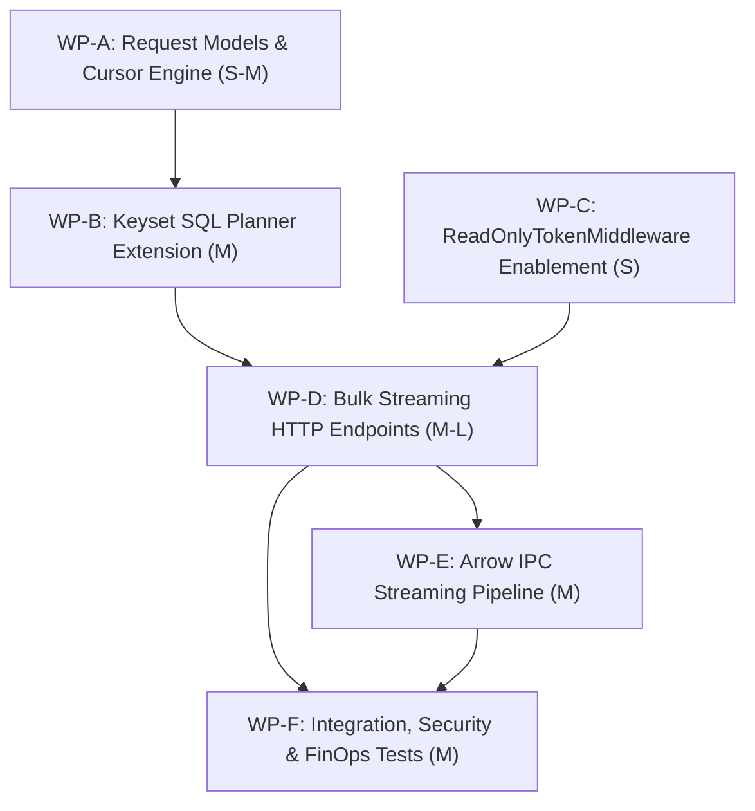

# PLAN-DATA-178: Governed Single-Table Keyset Streaming for Read-Only Callers

**Document ID:** `PLAN-DATA-178`  
**Date:** 2026-10-18  
**Status:** APPROVED (Phase 3 Security Reviewed)  
**Author:** Solution Architect (`csharp-architect`)  
**Input PRD:** [`REQ-DATA-178`](2026-10-18-issue-intake-assessment.md) §3.4  
**Parent Plan:** [`docs/plans/00-master-plan-overview.md`](00-master-plan-overview.md) rank 2.14  
**Target Branch:** `feat/issue-178-bulk-table-keyset-streaming` (branched after `#177` merge)  
**GitHub Issue:** #178  

---

## 1. Executive Summary & Problem Context

Autonomous AI agents, ETL synchronization pipelines, and batch analytics consumers operating with read-only tokens (`TokenAccessScope.ReadOnlyScopes`) require continuous, high-throughput data extraction from single governed tables. Today, all available egress mechanisms in Autheris fail to support this requirement cleanly:
1. **GraphQL Complexity and Row Caps:** GraphQL queries are bounded by `MaxAllowedComplexity` (default: 500) and `MaxResponseRows` (default: 5000), rejecting bulk extraction queries.
2. **WebSQL/Trino Surface Area:** Arbitrary SQL is blocked for read-only tokens or introduces dangerous multi-table join and cross-source attack surfaces.
3. **LOH Buffer Exhaustion in Arrow Export:** [`ArrowExportEndpoints.cs:191`](file:///root/autheris/src/Autheris.Api/Endpoints/ArrowExportEndpoints.cs#L191) loads entire query result sets into memory via `ExecuteQueryBufferedAsync`, risking Large Object Heap (LOH) exhaustion, garbage collection latency spikes, and Out-Of-Memory (OOM) crashes under bulk workloads.
4. **$O(N^2)$ OFFSET Pagination:** The existing REST Data API uses SQL `OFFSET` pagination, causing exponential scan degradation on large relational tables.

This architectural implementation delivers:
1. **Dedicated Single-Table Bulk Keyset Streaming Endpoint:** Expose `POST /api/v1/data/{domain}/{schema}/{table}/stream` (with alias `/bulk`), strictly scoped to a single table, authorized for read-only tokens in [`ReadOnlyTokenMiddleware`](file:///root/autheris/src/Autheris.Api/Middleware/ReadOnlyTokenMiddleware.cs).
2. **Typed JSON Filter AST:** Parameterized expression evaluation supporting comparisons, list containment, and logical combinators with zero raw SQL injection risk.
3. **Deterministic Keyset Pagination Cursor:** Monotonic cursor seek predicates based on table primary key columns (`TableMetadata.PrimaryKeyColumns`), guaranteeing $O(1)$ index-seek pagination across millions of rows.
4. **Bounded Memory Streaming with Backpressure:** True chunked HTTP streaming (`Transfer-Encoding: chunked`) directly to ASP.NET Core `PipeWriter` / `Utf8JsonWriter` (NDJSON) or Apache Arrow IPC streams without in-memory buffering.
5. **Row-Based Quota & FinOps Accounting:** Integrates with the Issue #177 two-phase token bucket to meter cost per streamed row, terminating cleanly with an exact resumption cursor if client quota is exhausted.

---

## 2. Verified Code Facts Beyond the PRD

| # | Fact | Evidence & Architectural Consequence |
|---|---|---|
| **V-1** | `ReadOnlyTokenMiddleware` rejects non-whitelisted POST routes | [`ReadOnlyTokenMiddleware.cs:17-31, 83-109`](file:///root/autheris/src/Autheris.Api/Middleware/ReadOnlyTokenMiddleware.cs#L17-L109) only permits safe HTTP verbs and fixed POST endpoints (`/graphql`, `/mcp`, `/api/v1/sql`, `/api/v1/export/arrow`, `/api/v1/procedures/*`, `/api/v1/governance/queries/analyze`). A read-only token calling `/api/v1/data/...` currently receives `403 READ_ONLY_TOKEN`. |
| **V-2** | `GovernedTableReadPlanner` generates OFFSET pagination | [`GovernedTableReadPlanner.cs:77-85`](file:///root/autheris/src/Autheris.Application/Data/Services/GovernedTableReadPlanner.cs#L77-L85) generates `OFFSET n ROWS LIMIT m`. It lacks keyset seek generation (`WHERE pk > @cursor_pk`). |
| **V-3** | `TableMetadata` defines primary key and indexes | [`TableModels.cs:160, 163, 195`](file:///root/autheris/src/Autheris.Domain/Model/TableModels.cs#L160-L195) provides `PrimaryKeyColumns` (`IReadOnlyList<string>`), `Indexes` (`IReadOnlyList<TableIndexDefinition>`), and `IsCompositePrimaryKey`. Keyset ordering can be strictly validated against catalog metadata. |
| **V-4** | `GovernedSqlExecutionService` supports row-by-row streaming | [`GovernedSqlExecutionService.cs:121-139, 159-236`](file:///root/autheris/src/Autheris.Application/Sql/Services/GovernedSqlExecutionService.cs#L121-L236) implements `ExecuteGovernedQueryAsync(request, ..., rowWriter)` and `StreamRowsAsync` using a bounded `Channel`. Streaming without LOH buffering is supported by the engine. |
| **V-5** | `IArrowExportService` currently buffers rows | [`IArrowExportService.cs:17-28`](file:///root/autheris/src/Autheris.Application/Serialization/IArrowExportService.cs#L17-L28) expects `IEnumerable<IReadOnlyDictionary<string, object?>>`. Streaming Arrow requires `ArrowStreamWriter` writing micro-batches directly to `Stream` or `PipeWriter`. |
| **V-6** | `DataApiModels.cs` lacks keyset cursor and bulk request envelope | [`DataApiModels.cs:8-15`](file:///root/autheris/src/Autheris.Domain/Model/DataApiModels.cs#L8-L15) defines `DatasetQueryRequest` with integer `Offset`. A dedicated `BulkTableStreamRequest` model is required. |
| **V-7** | Rate limiter settlement is established by Issue #177 | [`PLAN-GOV-177`](2026-10-18-plan-issue-177-token-bucket-work-settlement.md) provides `ReserveCostQuotaAsync` and `SettleCostQuotaAsync`, allowing stream slices to be metered by actual rows emitted. |
| **V-8** | Required filter columns (`#163`) must be enforced | [`PLAN-GOV-163`](2026-10-18-plan-issue-163-required-filter-columns.md) establishes that tables with declared `RequiredFilterColumns` must have them constrained by the client or active RLS row policy. |

---

## 3. Architectural Decisions

```
+----------------------------------------------------------------------------------------------------+
|                                      HTTP Client (Read-Only Token)                                 |
|  POST /api/v1/data/{domain}/{schema}/{table}/stream                                                |
|  Headers: Accept: application/x-ndjson | Authorization: Bearer <read-only-token>                   |
|  Body: { "filter": { ... }, "select": [...], "cursor": "eyJpZCI6MTAwMH0=", "limit": 5000 }         |
+----------------------------------------------------------------------------------------------------+
                                                  |
                                                  v
+----------------------------------------------------------------------------------------------------+
|                                    ReadOnlyTokenMiddleware                                         |
|  - Validates exact segment pattern /api/v1/data/{domain}/{schema}/{table}/stream                   |
|  - Allows POST for read-only tokens (Decision D-1)                                                 |
+----------------------------------------------------------------------------------------------------+
                                                  |
                                                  v
+----------------------------------------------------------------------------------------------------+
|                                 BulkDataStreamingEndpoints                                         |
|  1. Catalog & Governance Validation:                                                               |
|     - Resolve TableMetadata; reject Hidden datasets (404) (Decision D-2)                           |
|     - Verify table has declared PrimaryKeyColumns (Decision D-4)                                   |
|     - Verify RequiredFilterColumns (#163) are satisfied                                            |
|  2. Cursor & Filter Decoding:                                                                      |
|     - Decode & validate opaque base64 keyset cursor (Decision D-4)                                 |
|     - Parse & bind typed filter AST to parameterized SQL (Decision D-3)                            |
|  3. Keyset SQL Generation:                                                                         |
|     - GovernedTableReadPlanner.PlanKeysetStream (Decision D-4)                                     |
|  4. Token Bucket Admission:                                                                        |
|     - Reserve slice cost via IRateLimiterService (Decision D-6)                                    |
|  5. Bounded Chunked Response Streaming:                                                            |
|     - Execute query via DbDataReader with PipeWriter / Utf8JsonWriter (NDJSON) (Decision D-5)      |
|     - Apply Column Masking on the fly (Decision D-2)                                               |
|     - Meter row count; terminate if quota exhausted or limit reached                               |
|  6. Post-Stream Settlement & Headers:                                                               |
|     - SettleCostQuotaAsync with actual rows transmitted (Decision D-6)                             |
|     - Emit X-Next-Cursor, X-Rows-Streamed, X-Has-More headers (Decision D-7)                       |
+----------------------------------------------------------------------------------------------------+
```

### Decision D-1: Route Specification & Authorization Whitelist
- **Path Pattern:**
  - Canonical: `POST /api/v1/data/{domain}/{schema}/{table}/stream`
  - Alias: `POST /api/v1/data/{domain}/{schema}/{table}/bulk`
- **Whitelisting in `ReadOnlyTokenMiddleware`:**
  - Add exact segment inspection helper `IsDataBulkStreamPath(string? path)`.
  - Enforce strictly four segments after `/api/v1/data/`: `{domain}/{schema}/{table}/(stream|bulk)`.
  - Rejects traversal characters (`..`, `/`, `\`, `;`, `%2F`, `%5C`).
  - Read-only tokens holding `TokenAccessScope.ReadOnlyScopes` are explicitly permitted.

### Decision D-2: Single-Table Invariant & Governance Scoping
- **Strict Single-Table Scope:**
  - The endpoint operates on exactly one table identified by `(domain, schema, table)`.
  - Joins, subqueries, unions, or cross-source queries are strictly prohibited and structurally impossible (the planner only generates single-table `SELECT` projections).
- **Catalog Visibility & Existence Oracles:**
  - Tables with `DatasetVisibility.Hidden` where the caller lacks grant or admin privileges return `404 TABLE_NOT_FOUND` with generic phrasing.
- **Data Governance Integration:**
  - **Row-Level Security (RLS):** Governed SQL execution automatically injects tenant and Casbin/ABAC row filters into the generated query.
  - **Required Filter Columns (#163):** Enforced fail-closed; if the table requires filter columns (e.g. `tenant_id` or `created_date`) and neither the client filter nor active row policy constrains them, rejects with `400 REQUIRED_FILTER_COLUMN_MISSING`.
  - **Column Masking:** Masking rules from `TableMetadata.ColumnMaskingRules` are evaluated per column; masked values (e.g. email, SSN, IBAN) are masked on-the-fly during row serialization.

### Decision D-3: Typed Filter AST Specification
- **Choice:** Require a structured JSON filter object instead of raw SQL strings.
- **Model Definition:**
  ```csharp
  namespace Autheris.Domain.Model;

  public sealed record BulkTableStreamRequest(
      IReadOnlyList<string>? Select = null,
      TypedFilterNode? Filter = null,
      string? Cursor = null,
      int Limit = 5000,
      string Format = "ndjson");

  public sealed record TypedFilterNode(
      string? Field = null,
      string? Op = null,
      System.Text.Json.JsonElement? Value = null,
      IReadOnlyList<TypedFilterNode>? And = null,
      IReadOnlyList<TypedFilterNode>? Or = null,
      TypedFilterNode? Not = null);
  ```
- **Supported Operators:**
  - Comparison: `eq` ($=$), `ne` ($\ne$), `gt` ($>$), `gte` ($\ge$), `lt` ($<$), `lte` ($\le$).
  - Set: `in` ($\in$), `notIn` ($\notin$).
  - Pattern: `like` (`LIKE` with Escaped wildcard safety).
  - Nullability: `isNull` (`IS NULL`), `isNotNull` (`IS NOT NULL`).
  - Logical: `and`, `or`, `not`.
- **SQL Parameterization:**
  - Every leaf value in `TypedFilterNode` is bound as an ADO.NET parameter (`@p0`, `@p1`, ...). Zero string interpolation into SQL predicates.

### Decision D-4: Tamper-Evident Composite Keyset Cursor
- **Choice:** Deterministic, opaque base64-encoded UTF-8 JSON cursor representing primary key column values.
- **Cursor Generation & Structure:**
  - Cursor payload example:
    ```json
    {"tenant_id":"t1","created_at":"2026-10-18T10:00:00Z","id":54321}
    ```
  - Serialized to UTF-8 bytes and encoded as standard URL-safe Base64 string without padding.
- **Ordering & Keyset Seek Formulation:**
  - Primary key columns are extracted in declared order from `TableMetadata.PrimaryKeyColumns`: $(k_1, k_2, \dots, k_n)$.
  - If table lacks a primary key, fall back to first unique index from `TableMetadata.Indexes`. If neither exists, reject request with `400 KEYSET_STREAMING_UNAVAILABLE: Table requires a primary key or unique index`.
  - Query Ordering: `ORDER BY k1 ASC, k2 ASC, ..., kn ASC`.
  - Seek Predicate Formulation:
    - Single PK $(k_1)$:
      $$k_1 > @c_1$$
    - Composite PK $(k_1, k_2)$:
      $$(k_1 > @c_1) \lor (k_1 = @c_1 \land k_2 > @c_2)$$
    - Composite PK $(k_1, k_2, k_3)$:
      $$(k_1 > @c_1) \lor (k_1 = @c_1 \land k_2 > @c_2) \lor (k_1 = @c_1 \land k_2 = @c_2 \land k_3 > @c_3)$$
  - Complexity: Pure index seek ($O(1)$) on clustered/unique index; strictly eliminates $O(N^2)$ table scan overhead of `OFFSET`.
- **Validation & Tamper Protection:**
  - Cursor must contain exactly the keys matching `PrimaryKeyColumns`.
  - Values must parse into the declared column data types. Missing keys, extraneous keys, or type mismatch return `400 INVALID_CURSOR`.

### Decision D-5: Bounded Zero-Allocation Streaming (NDJSON & Arrow IPC)
- **Choice:** Stream row data directly to ASP.NET Core `HttpResponse.BodyWriter` (`PipeWriter`) without intermediate full-table in-memory collections.
- **Protocols Supported:**
  1. **NDJSON (`application/x-ndjson`) - Default:**
     - Each row is emitted as a single-line JSON object followed by `\n` (`0x0A`).
     - Serialized using `Utf8JsonWriter` over `PipeWriter.GetMemory()`.
     - Zero string allocations for column names; uses pre-cached UTF-8 byte representations.
  2. **Apache Arrow IPC Stream (`application/vnd.apache.arrow.stream`) - Optional:**
     - Requested via `Accept: application/vnd.apache.arrow.stream` or `format: "arrow"`.
     - Uses `ArrowStreamWriter` to write record batches of 256 rows directly into `HttpResponse.Body`.
- **Bounded Resource Limits:**
  - `DefaultLimit`: 5,000 rows per stream slice.
  - `MaxSliceLimit`: 10,000 rows (configured via `GatewayOptions.RowLimits`).
  - `MaxStreamDurationSeconds`: 15 seconds streaming deadline per slice to prevent HTTP connection exhaustion.
  - Memory footprint: $\le 256 \text{ KB}$ working set per streaming connection regardless of table size.

### Decision D-6: Row-Based Token Bucket Metering (Issue #177 Integration)
- **Admission Phase:**
  - Estimate slice cost: $\text{ReservedCost} = \text{BaseQueryCost} + (\text{Limit} \times \text{CostPerRowReturned})$.
  - Reserve via `IRateLimiterService.ReserveCostQuotaAsync(subjectId, reservedCost, policy, ct)`.
  - If insufficient tokens: reject with `429 RATE_LIMIT_EXCEEDED` and `Retry-After`.
- **Stream Metering & Clean Mid-Stream Termination:**
  - Maintain atomic row counter during streaming: `rowsEmitted`.
  - If client's token bucket is exhausted midway through streaming, or if streaming window reaches deadline:
    1. Stream terminates cleanly on a record boundary.
    2. Header `X-Stream-Truncated: quota_exhausted` (or `timeout`) is emitted.
    3. Header `X-Next-Cursor` is set to the primary key values of the **last successfully transmitted row**.
    4. Post-stream settlement calls `SettleCostQuotaAsync` with `actualCost = BaseCost + rowsEmitted * CostPerRow`.
    5. The client can resume immediately in the next window by submitting `X-Next-Cursor` with 0 duplicate rows and 0 dropped rows!

### Decision D-7: Response Headers & Metadata Protocol
- **Standard Streaming Headers:**
  - `Content-Type`: `application/x-ndjson; charset=utf-8` or `application/vnd.apache.arrow.stream`
  - `Transfer-Encoding`: `chunked`
  - `X-Rows-Streamed`: Integer row count transmitted in this slice.
  - `X-Next-Cursor`: Base64 keyset cursor for the next slice (omitted if end-of-table reached).
  - `X-Has-More`: `true` if more rows remain; `false` if cursor is exhausted.
  - `X-Stream-Truncated`: `false` (or `quota_exhausted` / `timeout`).
  - `X-RateLimit-Remaining`: Post-settlement token balance.

---

## 4. Work Packages



### WP-A: Bulk Request Models & Keyset Cursor Engine (Size: S-M)

- **Target Files:**
  - `src/Autheris.Domain/Model/BulkDataStreamModels.cs` (new)
  - `src/Autheris.Application/Data/Services/KeysetCursorEncoder.cs` (new)
  - `src/Autheris.Application/Data/Interfaces/IKeysetCursorEncoder.cs` (new)
- **Implementation:**
  - Define `BulkTableStreamRequest`, `TypedFilterNode`, and `KeysetCursorToken`.
  - In `KeysetCursorEncoder`:
    - `string EncodeCursor(IReadOnlyDictionary<string, object?> pkValues)`: Serializes dictionary to compact JSON, encodes to URL-safe Base64 string.
    - `IReadOnlyDictionary<string, object?> DecodeCursor(string cursorBase64, TableMetadata metadata)`:
      - Validates Base64 format and decodes JSON.
      - Verifies that all keys in JSON match `metadata.PrimaryKeyColumns` case-insensitively.
      - Rejects extra or missing keys with `ArgumentException("INVALID_CURSOR")`.
      - Converts JSON value elements into typed primitives matching column data types (`int`, `long`, `string`, `Guid`, `DateTimeOffset`).
- **Test Criteria:**
  - `tests/Autheris.Tests.Unit/DataApi/KeysetCursorEncoderTests.cs`:
    - Round-trip encode/decode for single-column PK (`id: 100`).
    - Round-trip encode/decode for composite PK (`tenant_id: "T1", created_at: DateTime, id: 99`).
    - Rejects corrupted base64, JSON with extraneous keys, and invalid types with `INVALID_CURSOR`.

### WP-B: Keyset SQL Planner Extension (Size: M)

- **Target Files:**
  - `src/Autheris.Application/Data/Services/GovernedTableReadPlanner.Keyset.cs` (new)
  - `src/Autheris.Application/Data/Interfaces/IGovernedTableReadPlanner.cs`
- **Implementation:**
  - Extend `IGovernedTableReadPlanner` with:
    ```csharp
    PlannedTableRead PlanKeysetStream(
        BulkTableStreamRequest request,
        TableMetadata metadata,
        TableAccessDecision decision);
    ```
  - In `GovernedTableReadPlanner.Keyset.cs`:
    - Validate that `metadata.PrimaryKeyColumns` has $\ge 1$ columns. If empty, inspect `metadata.Indexes` for unique index; if none, throw `KeysetStreamingUnavailableException`.
    - Construct `SELECT [columns] FROM [table]` respecting column masking and allowed columns.
    - If `request.Filter != null`: translate `TypedFilterNode` to parameterized SQL predicate using `DataApiFilterTranslator`.
    - If `request.Cursor != null`: decode cursor and construct composite seek predicate:
      - For single PK: `(pk > @cursor_0)`
      - For composite PK $(k_1, k_2)$: `((k1 > @cursor_0) OR (k1 = @cursor_0 AND k2 > @cursor_1))`
    - Append `ORDER BY [pk_cols ASC]`.
    - Append `LIMIT [limit + 1]` (to detect if additional rows remain for `X-Has-More`).
    - Return `PlannedTableRead` containing SQL string and parameters.
- **Test Criteria:**
  - `tests/Autheris.Tests.Unit/DataApi/GovernedTableReadPlannerKeysetTests.cs`:
    - Generates expected SQL for single PK and composite PK.
    - Parameters bound correctly without SQL injection vulnerabilities.
    - Correctly combines client filter with keyset cursor seek predicate.

### WP-C: Read-Only Middleware Authorization (Size: S)

- **Target Files:**
  - `src/Autheris.Api/Middleware/ReadOnlyTokenMiddleware.cs`
- **Implementation:**
  - Add constant prefix: `private const string DataPrefix = "/api/v1/data";`.
  - Implement helper `IsDataBulkStreamPath(string? path)`:
    - Path must start with `/api/v1/data/`.
    - Must contain exactly 5 segments: `["api", "v1", "data", "{domain}", "{schema}", "{table}", "stream"]` (or `"bulk"`).
    - Verifies no invalid characters (`..`, `;`, `%2F`, `%5C`).
  - In `IsPermitted(HttpRequest request)`:
    - If `IsDataBulkStreamPath(request.Path.Value)`, return `true`.
- **Test Criteria:**
  - `tests/Autheris.Tests.Unit/Security/ReadOnlyTokenTests.cs`:
    - Read-only token receives 200 on `POST /api/v1/data/default/dbo/orders/stream`.
    - Read-only token receives 403 on `POST /api/v1/data/default/dbo/orders` (non-streaming mutation/POST).
    - Traversal paths like `/api/v1/data/default/dbo/orders/../../admin` return 403 `READ_ONLY_TOKEN`.

### WP-D: Bulk Streaming HTTP Endpoints (Size: M-L)

- **Target Files:**
  - `src/Autheris.Api/Endpoints/BulkDataStreamingEndpoints.cs` (new)
  - `src/Autheris.Api/Extensions/EndpointRouteBuilderExtensions.cs`
- **Implementation:**
  - Map route: `endpoints.MapPost("/api/v1/data/{domain}/{schema}/{table}/stream", HandleBulkStreamAsync)`.
  - Add route alias for `/bulk`.
  - Implement `HandleBulkStreamAsync`:
    1. Extract route parameters `(domain, schema, table)`. Resolve `TableIdentifier`.
    2. Retrieve `TableMetadata` from `ITableRepository`. If null or `Hidden` for caller, return `404 TABLE_NOT_FOUND`.
    3. Deserialize JSON body to `BulkTableStreamRequest`.
    4. Enforce `#163` required filter columns: if table has required filter columns, verify they are constrained in request filter or active row policy.
    5. Resolve client tier, reserve upfront token cost via `IRateLimiterService.ReserveCostQuotaAsync`.
    6. Generate keyset query via `planner.PlanKeysetStream(...)`.
    7. Execute governed query via `IGovernedSqlExecutionService.ExecuteGovernedQueryAsync`.
    8. Write response stream directly to `httpContext.Response.BodyWriter`:
       - Set `Content-Type: application/x-ndjson; charset=utf-8`.
       - Iterate over `DbDataReader`:
         - Serialize each row as UTF-8 JSON object + `\n`.
         - Apply column masking on masked columns.
         - Cache last row primary key values for next cursor.
         - Flush every 256 rows to handle TCP backpressure.
         - If `limit` reached: break loop.
    9. Settle actual row count with `SettleCostQuotaAsync`.
    10. Set response trailers / headers `X-Rows-Streamed`, `X-Next-Cursor`, `X-Has-More`.
- **Test Criteria:**
  - Integration test verifying streaming of 2,000 rows in NDJSON format.
  - Verify `X-Next-Cursor` enables fetching the next slice without gaps or duplicate rows.

### WP-E: Apache Arrow IPC Streaming Pipeline (Size: M)

- **Target Files:**
  - `src/Autheris.Application/Serialization/ArrowBulkStreamWriter.cs` (new)
  - `src/Autheris.Api/Endpoints/BulkDataStreamingEndpoints.cs`
- **Implementation:**
  - Create `ArrowBulkStreamWriter`:
    - Wraps `ArrowStreamWriter` over `Stream`.
    - Accumulates batches of 256 rows from `DbDataReader`.
    - Converts micro-batch into `RecordBatch` and writes to output stream.
    - Flushes after each batch to maintain backpressure and low memory footprint.
  - In `BulkDataStreamingEndpoints.cs`:
    - When `request.Format == "arrow"` or `Accept: application/vnd.apache.arrow.stream`:
      - Set `Content-Type: application/vnd.apache.arrow.stream`.
      - Stream batches via `ArrowBulkStreamWriter`.
- **Test Criteria:**
  - Unit and integration tests reading the Arrow stream with Apache Arrow `ArrowStreamReader`, verifying column schemas, types, and values.

### WP-F: Integration, Security & Performance Benchmark Tests (Size: M)

- **Target Files:**
  - `tests/Autheris.Tests.Integration/DataApi/BulkTableStreamingIntegrationTests.cs` (new)
  - `tests/Autheris.Tests.Unit/Security/BulkStreamingSecurityTests.cs` (new)
  - `benchmarks/Autheris.Benchmarks/BulkStreamingBenchmark.cs` (new)
- **Implementation:**
  - End-to-end integration test: Read-only token streaming a 10,000 row table across two 5,000-row slices using `X-Next-Cursor`.
  - Security suite:
    - Attempt join injection in typed filter: rejected.
    - Attempt cursor tampering: rejected with `400 INVALID_CURSOR`.
    - Attempt streaming hidden dataset: returns 404.
    - Verify column masking is applied to sensitive columns.
    - Verify token bucket is metered per row.
  - Performance benchmark: Stream 50,000 rows and assert Gen2 GC collections = 0 and peak allocated memory < 2 MB.
- **Test Criteria:**
  - All tests and benchmarks pass with 0 failures under `dotnet test`.

---

## 5. Fail-Closed and Security Summary

1. **Strict Single-Table Invariant:**
   - The bulk streaming endpoint refuses any construct containing joins, foreign table references, subqueries, unions, or lateral invocations. The SQL planner only emits single-table queries against the validated catalog entity.
2. **Read-Only Token Boundary:**
   - Permitting `/api/v1/data/{domain}/{schema}/{table}/stream` for read-only tokens does not authorize any mutations or metadata writes. `POST /api/v1/data/{domain}/{schema}/{table}` (record creation) remains strictly rejected (`403 READ_ONLY_TOKEN`).
3. **Cursor Tamper-Proofing:**
   - Keyset cursors are validated against the declared catalog primary key schema. If an attacker attempts to inject SQL syntax, modify cursor column names, or supply invalid data types, the request is rejected immediately with `400 INVALID_CURSOR`.
4. **Data Governance & Masking Parity:**
   - Dynamic data masking (SSN, IBAN, email, credit card) is executed on the streaming path identically to REST and GraphQL.
   - Active RLS row policies are injected into the SQL seek query, guaranteeing tenant isolation and ABAC filtering cannot be bypassed.
5. **Denial-of-Service & Slowloris Defense:**
   - Slices are strictly bounded by `MaxSliceLimit` (default: 5,000 rows) and `MaxStreamDurationSeconds` (15s).
   - If a client fails to read the TCP stream, backpressure via `PipeWriter.FlushAsync()` halts database reader execution, preventing memory buffer accumulation.

---

## 6. Acceptance Criteria Mapping (PRD Traceability)

| PRD Acceptance Criteria | Work Package | Verification Test |
| :--- | :--- | :--- |
| **AC-1:** Read-only token can stream single-table data without 403 Forbidden | WP-C, WP-D | `BulkTableStreamingIntegrationTests.cs` |
| **AC-2:** Keyset pagination cursor enables seamless $O(1)$ multi-slice extraction | WP-A, WP-B, WP-D | `BulkTableStreamingIntegrationTests.cs` |
| **AC-3:** Zero SQL injection in typed filter AST; joins and subqueries rejected | WP-B, WP-F | `BulkStreamingSecurityTests.cs` |
| **AC-4:** Chunked streaming directly to `PipeWriter` with $\le 256\text{ KB}$ memory footprint | WP-D, WP-E | `BulkStreamingBenchmark.cs` |
| **AC-5:** Token bucket rate limiter meters cost by actual rows streamed | WP-D, WP-F | `BulkTableStreamingIntegrationTests.cs` |
| **AC-6:** Column masking and table-level required filter columns enforced fail-closed | WP-B, WP-D, WP-F | `BulkStreamingSecurityTests.cs` |

---

## 7. Sequencing & Parallelisation

1. **Track 1 (Models & Cursor Core):** WP-A (Cursor encoder) and WP-B (Keyset SQL planner).
2. **Track 2 (Security & Middleware):** WP-C (`ReadOnlyTokenMiddleware` route whitelisting).
3. **Track 3 (Streaming Pipeline & Endpoints):** WP-D (NDJSON endpoint handler) followed by WP-E (Arrow IPC streaming).
4. **Track 4 (Quality & Performance Gate):** WP-F (Integration tests, exploit tests, and memory benchmarks).

---

## 8. Phase 3 Security Review & Binding Conditions (`csharp-security-expert`)

**Review Date:** 2026-10-18  
**Verdict:** APPROVED WITH BINDING CONDITIONS  
**Reviewer:** Application Security Expert (`csharp-security-expert`)

### Security Findings & Risk Analysis

| Finding ID | Severity | Description & Security Impact |
| :--- | :--- | :--- |
| **SEC-178-F01** | High | **Route Escape & Path Traversal:** If `ReadOnlyTokenMiddleware` matches `/api/v1/data` using loose prefix or unnormalized paths, read-only callers could bypass verb restrictions to invoke mutation routes (`POST /api/v1/data/{domain}/{schema}/{table}`) or admin APIs. |
| **SEC-178-F02** | High | **Isolation Breach & AST Injection:** If the typed filter AST allows dotted identifiers, nested subqueries, table joins, or raw SQL operators, read-only callers could read cross-source or unconsented tables. |
| **SEC-178-F03** | High | **Cursor Forgery & RLS / Masking Bypass:** If keyset cursors are unvalidated or allow arbitrary columns, an attacker could forge cursor values to jump across tenant RLS partitions, bypass required filter column constraints (#163), or infer values of masked primary key columns. |
| **SEC-178-F04** | High | **Unbounded Memory Exhaustion & Slowloris:** Buffering streaming rows in memory or failing to apply backpressure when clients read slowly could lead to Large Object Heap (LOH) exhaustion, GC thrashing, and server OOM crashes. |
| **SEC-178-F05** | Medium | **Quota Evading Free Streaming:** If streaming queries consume server resources without upfront token reservation or fail to meter tokens per row streamed with clean mid-stream cutoff, clients could extract millions of rows at zero or negligible cost. |
| **SEC-178-F06** | Medium | **Masked Column Inference via Order By / Seek:** Evaluating keyset cursor seek predicates on columns that are masked or denied for the caller could allow differential timing or inference of confidential values. |

### Binding Security Conditions

1. **`SEC-DATA178-01`: Path Traversal & Fail-Closed Route Whitelisting**
   - Matching in `ReadOnlyTokenMiddleware` MUST enforce exact segment structure: `/api/v1/data/{domain}/{schema}/{table}/(stream|bulk)`.
   - Prefix matching (e.g. `StartsWithSegments("/api/v1/data")`) is strictly prohibited.
   - Any path containing directory traversal sequences (`..`), non-normalized separators (`\`), encoded delimiters (`%2F`, `%5C`), semicolons, or query string manipulation MUST fail closed with HTTP 403 (`READ_ONLY_TOKEN`).
   - Mutations (`POST /api/v1/data/{domain}/{schema}/{table}`) and procedure executions remain strictly blocked for read-only tokens.
2. **`SEC-DATA178-02`: Strict Single-Table Isolation & AST Pushdown**
   - The query planner MUST restrict compilation strictly to the single resolved `TableIdentifier`. Any join, subquery, union, or lateral table access is structurally prohibited.
   - Every column in `TypedFilterNode` and `select` MUST resolve to a clear-text accessible column in `TableMetadata.Columns`. Dotted identifiers (e.g. `other_table.col`), SQL injection syntax, and raw expression operators are strictly rejected with `400 BAD_REQUEST`.
   - Filtering on columns with `ColumnAccessLevel.Mask` or `ColumnAccessLevel.Deny` MUST be rejected with `400 BAD_REQUEST` to prevent blind oracle inference attacks.
3. **`SEC-DATA178-03`: Keyset Cursor Integrity & Cryptographic Parameterization**
   - Keyset cursors MUST be decoded into an opaque map that strictly matches the catalog's declared `PrimaryKeyColumns` (or primary unique index).
   - Any missing key, extraneous key, or data type mismatch (e.g. string supplied for numeric PK) MUST immediately reject with `400 INVALID_CURSOR`.
   - All cursor seek values MUST be bound as strongly-typed ADO.NET parameters (`@cursor_0`, `@cursor_1`). Raw string concatenation of cursor values into SQL is strictly forbidden.
4. **`SEC-DATA178-04`: Immutable RLS Conjunction & Masking Gating**
   - Row-Level Security (RLS) predicates and required filter columns (#163) MUST be injected as mandatory top-level SQL conjunctions (`AND (rls_predicate)`). Keyset cursor seek predicates MUST NOT relax, override, or replace RLS constraints.
   - If ANY column in the primary key or keyset ordering is marked `ColumnAccessLevel.Mask` or `ColumnAccessLevel.Deny` for the caller, keyset streaming MUST fail closed with `403 FORBIDDEN` or `400 KEYSET_STREAMING_UNAVAILABLE` to eliminate oracle inference of masked keys.
   - Dynamic data masking MUST be executed on-the-fly during row serialization before writing to the pipe.
5. **`SEC-DATA178-05`: Bounded Memory, PipeWriter Backpressure & Stream Cancellation**
   - Result sets MUST NOT be buffered in managed collections (`List<T>`, `DataTable`, or large string buffers).
   - Streaming MUST write directly to ASP.NET Core `HttpResponse.BodyWriter` (`PipeWriter`) for NDJSON or `HttpResponse.Body` for Arrow IPC with bounded micro-batches ($\le 256$ rows).
   - The streaming loop MUST await `BodyWriter.FlushAsync(cancellationToken)`. If backpressure pauses the client, the database reader MUST pause. If the client disconnects or cancels, database execution MUST abort immediately.
   - Total connection memory working set MUST remain $\le 256$ KB.
6. **`SEC-DATA178-06`: Row-Metered Quota Accounting & Safe Mid-Stream Termination**
   - Upfront admission MUST reserve token quota via `IRateLimiterService.ReserveCostQuotaAsync` based on `min(request.Limit, MaxSliceLimit)`.
   - If quota is exhausted or `MaxStreamDurationSeconds` (15s) is reached during active streaming:
     - The stream MUST terminate cleanly on a record boundary without corrupting the payload framing.
     - HTTP trailer `X-Stream-Truncated: quota_exhausted` (or `timeout`) and `X-Next-Cursor` containing the primary key of the last emitted row MUST be emitted via `HttpResponse.AppendTrailer`.
     - Post-stream settlement MUST call `SettleCostQuotaAsync` with the actual number of emitted rows, guaranteeing zero free data extraction.

### Mandatory Security Test Suite (`[Trait("Category", "Security")]`)

All conditions must be verified by automated tests marked `[Trait("Category", "Security")]`:
- **`T_SEC_DATA178_01_ReadOnlyToken_StreamingWhitelisted_MutationsBlocked`**: Verifies read-only tokens succeed on `POST /stream` but receive 403 on non-streaming POST mutations.
- **`T_SEC_DATA178_02_PathTraversal_RejectedWith403`**: Verifies that paths with `..`, `%2F`, or trailing segments return 403 `READ_ONLY_TOKEN`.
- **`T_SEC_DATA178_03_FilterAST_DottedIdentifierOrJoin_RejectedWith400`**: Asserts that filters attempting table qualification (`orders.id`) or joins are rejected with 400.
- **`T_SEC_DATA178_04_FilterAST_MaskedOrDeniedColumn_RejectedWith400`**: Asserts that filtering on a masked column returns 400 and does not leak data.
- **`T_SEC_DATA178_05_CursorTampering_InvalidKeysOrTypes_RejectedWith400`**: Asserts that corrupted base64, missing PK keys, or invalid type payloads fail closed with 400 `INVALID_CURSOR`.
- **`T_SEC_DATA178_06_CursorSeek_CannotBypassTenantRLSPolicy`**: Asserts that a forged cursor containing another tenant's ID returns 0 rows and never bypasses RLS predicates.
- **`T_SEC_DATA178_07_MaskedPrimaryKey_FailsClosedWithForbiddenOrUnavailable`**: Asserts that when a table's PK is masked for the caller, keyset streaming fails closed rather than leaking cleartext PK values.
- **`T_SEC_DATA178_08_ZeroBufferStreaming_DirectPipeWriter_BackpressureHaltsReader`**: Asserts that pausing client consumption suspends the database reader with $\le 256$ KB memory footprint.
- **`T_SEC_DATA178_09_QuotaExhaustion_TruncatesStreamAndSettlesActualRows`**: Verifies that when quota runs out mid-stream, the stream halts at record boundary, emits `X-Stream-Truncated`, and settles actual rows emitted.
