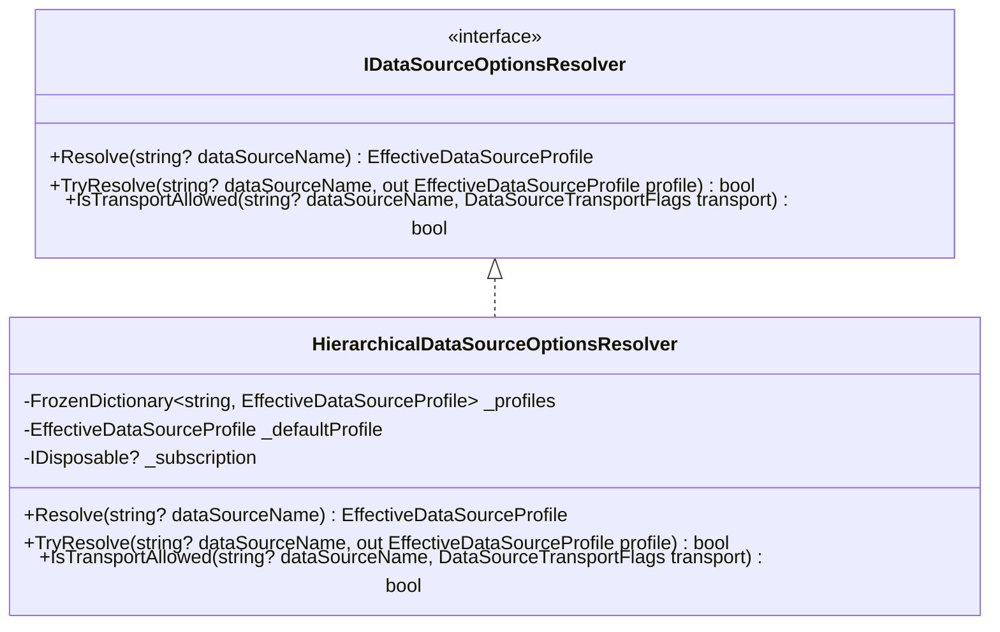

# Implementation Plan: REQ-OPS-BL05 - Granular Configuration per Data Source

**Document ID:** `PLAN-OPS-BL05`  
**Date:** 2026-10-19  
**Status:** APPROVED (Phase 2 Architecture & Phase 3 Security Review complete); ready for Phase 4 (TDD Developers)  
**Authors:** Solution Architect (`csharp-architect`), Security Expert (`csharp-security-expert`)  
**Input PRD:** [`2026-10-19-req-bl-05-per-data-source-configuration.md`](2026-10-19-req-bl-05-per-data-source-configuration.md) (`REQ-OPS-BL05`)  
**Branch:** `feat/bl-05-per-data-source-configuration`  
**Parent Plan:** [`00-master-plan-overview.md`](00-master-plan-overview.md), backlog item BL-05 in [`2026-10-16-backlog-intake.md`](2026-10-16-backlog-intake.md) §2.2  

---

## 1. Architectural Architecture & Component Design

### 1.1 Layering & Separation of Concerns

Following Autheris clean architecture (`Domain` pure -> `Application` -> `Infrastructure` -> `Api`):
1. **Domain (`Autheris.Domain`):**
   - Options & Models:
     * `src/Autheris.Domain/Options/DataSources/DataSourceProfileOptions.cs`: Per-source override options model.
     * `src/Autheris.Domain/Options/DataSources/DataSourceSafetyCeilingsOptions.cs`: Global safety ceilings and anti-escalation caps.
     * `src/Autheris.Domain/Options/DataSources/DataSourceConfigurationOptions.cs`: Root configuration container binding `Gateway:DataSources:Configuration`.
     * `src/Autheris.Domain/Options/DataSources/EffectiveDataSourceProfile.cs`: Immutable record representing fully resolved, clamped runtime profile.
     * `src/Autheris.Domain/Options/DataSources/DataSourceEnums.cs`: Enums for `OutboundPropagationMode` and `DataSourceTransportFlags`.
2. **Application (`Autheris.Application`):**
   - Interfaces & Resolvers:
     * `src/Autheris.Application/DataSources/IDataSourceOptionsResolver.cs`: Contract for zero-allocation O(1) profile resolution.
     * `src/Autheris.Application/DataSources/HierarchicalDataSourceOptionsResolver.cs`: Thread-safe, hot-reloading implementation using `IOptionsMonitor` and `FrozenDictionary<string, EffectiveDataSourceProfile>`.
     * `src/Autheris.Application/DataSources/DataSourceOptionsValidator.cs`: `IValidateOptions<DataSourceConfigurationOptions>` validator enforcing ranges and constraints.
     * Integration with Telemetry: `HierarchicalDataSourceTelemetryPolicyProvider` bridging `IDataSourceTelemetryPolicyProvider` with `IDataSourceOptionsResolver`.
3. **API & Dependency Injection (`Autheris.Api`):**
   - DI extensions:
     * `src/Autheris.Api/Extensions/DependencyInjection/GatewayDataSourceServiceExtensions.cs`: Registers options, validators, and singleton resolver.
4. **Testing (`tests/Autheris.Tests.Unit`):**
   - Unit & Security tests:
     * `tests/Autheris.Tests.Unit/DataSources/HierarchicalDataSourceOptionsResolverTests.cs`: Comprehensive unit tests covering inheritance, fallback, hot reloading, transport gating, and zero-allocation characteristics.
     * `tests/Autheris.Tests.Unit/DataSources/DataSourceSafetyCeilingSecurityTests.cs`: Security tests verifying anti-escalation, dual-opt-in bypass, fail-closed handling, and credential isolation.

---

## 2. Options Resolution & Inheritance Hierarchy

### 2.1 Precedence Chain

For any property $P$ of data source $S$:
1. If $S$ explicitly configures $P$ in `Gateway:DataSources:Profiles:{S}:{P}`:
   - Check against Global Safety Ceiling $C(P)$.
   - If $P > C(P)$, effective value is clamped: $P_{eff} = \min(P, C(P))$ unless `AllowCeilingRelaxation == true` AND `AllowGlobalCeilingRelaxation == true`.
   - Else $P_{eff} = P$.
2. Else if $S$ has a legacy property on `DataSourceConnectionOptions` (e.g. `CommandTimeoutSeconds`):
   - $P_{eff} = P_{legacy}$.
3. Else inherit from Global Gateway Defaults:
   - Cost: from `GatewayOptions.QueryCost` (`BaseCost`, `RowCostFactor`).
   - Logging: from `GatewayOptions.Logging` (`LogGeneratedSql`).
   - Telemetry: from `TelemetryOptions.DataSourceDefaults` / `SamplingOptions`.
   - Limits: from `WebSqlOptions.DefaultMaxRows` / `GatewayOptions.RowLimits`.
   - Caching: from `CachingOptions`.
   - Staging: from default 3600 seconds.

### 2.2 Hot-Path Zero-Allocation Guarantee

- When options reload via `IOptionsMonitor<DataSourceConfigurationOptions>`, the resolver builds an immutable snapshot dictionary and freezes it using `.ToFrozenDictionary(StringComparer.OrdinalIgnoreCase)`.
- It atomically swaps `_profiles` via an atomic reference write.
- `Resolve(dataSourceName)` evaluates:
  1. If `string.IsNullOrWhiteSpace(dataSourceName)`, return `_defaultProfile` (0 allocations).
  2. If `_profiles.TryGetValue(dataSourceName, out var profile)`, return `profile` (0 allocations).
  3. Otherwise return `_defaultProfile` (0 allocations).
- Zero allocations, zero locking, pure $O(1)$ amortized lookup.

---

## 3. Work Breakdown Structure (Phase 4 Execution Streams)

### WP-1: Domain Models & Options Contracts
- `DataSourceEnums.cs`:
  * `OutboundPropagationMode` (`Inherit`, `Always`, `Never`)
  * `DataSourceTransportFlags` (`None`, `WebSql`, `GraphQL`, `Rest`, `OData`, `Mcp`, `Trino`, `ArrowFlight`, `All`)
- `DataSourceProfileOptions.cs`:
  * Per-source granular override properties.
- `DataSourceSafetyCeilingsOptions.cs`:
  * Safety ceilings capping cost complexity, row counts, byte limits, timeouts, and staging TTL.
- `DataSourceConfigurationOptions.cs`:
  * Contains `Dictionary<string, DataSourceProfileOptions> Profiles`, `DataSourceSafetyCeilingsOptions Ceilings`, and default settings.
- `EffectiveDataSourceProfile.cs`:
  * Pre-calculated, immutable record with fully typed properties and TimeSpan/enum values.

### WP-2: Application Resolver & Telemetry Integration
- `IDataSourceOptionsResolver.cs`: Interface contract.
- `HierarchicalDataSourceOptionsResolver.cs`:
  * Resolves inheritance across global options, connection options, and profile options.
  * Enforces safety ceilings clamping.
  * Freezes profiles into `FrozenDictionary`.
- `DataSourceOptionsValidator.cs`:
  * `IValidateOptions<DataSourceConfigurationOptions>` ensuring all values are strictly within acceptable system bounds.
- `HierarchicalDataSourceTelemetryPolicyProvider.cs`:
  * Implements `IDataSourceTelemetryPolicyProvider` using `IDataSourceOptionsResolver` and `TelemetryCeiling`.

### WP-3: DI Registration & API Wiring
- `GatewayDataSourceServiceExtensions.cs`:
  * `AddDataSourceHierarchicalConfiguration(this IServiceCollection services, IConfiguration configuration)`
  * Registers options, validators, and singleton `IDataSourceOptionsResolver`.
  * Replaces or registers `IDataSourceTelemetryPolicyProvider`.

### WP-4: Unit & Security Test Suite
- `HierarchicalDataSourceOptionsResolverTests.cs`:
  * Validates override precedence (source profile > connection option > global default).
  * Validates fallback for unspecified sources.
  * Validates hot-reloading without service restart.
  * Validates zero-allocation in steady-state loop.
  * Validates transport bitmask checks (`IsTransportAllowed`).
- `DataSourceSafetyCeilingSecurityTests.cs`:
  * Verifies SEC-DS05-01 through SEC-DS05-08 binding security conditions.

---

## 4. Phase 3: Security & Compliance Audit (Binding Security Conditions)

The AppSec review (`csharp-security-expert`) mandates the following non-negotiable security requirements:

### SEC-DS05-01: Strict Anti-Escalation Safety Ceilings
No per-data-source override may loosen system safety ceilings (MaxResponseRows, MaxResponseBytes, MaxAllowedComplexity, QueryTimeoutSeconds, CommandTimeoutSeconds, StagingTtlSeconds, MaxKeySetImportLimit) beyond the values defined in `DataSourceSafetyCeilingsOptions`. Any override exceeding a ceiling MUST be clamped to the ceiling value.

### SEC-DS05-02: Dual Administrative Opt-In for Ceiling Relaxation
A ceiling may only be bypassed if **both** of the following conditions are met:
1. `DataSourceSafetyCeilingsOptions.AllowGlobalCeilingRelaxation == true` (set by global administrator).
2. `DataSourceProfileOptions.AllowCeilingRelaxation == true` (explicit per-source opt-in).
If either flag is false, the ceiling is strictly enforced.

### SEC-DS05-03: Fail-Closed Transport Enforcement
If a request arrives via a transport not included in the data source's `AllowedTransports` mask, execution MUST be rejected before any database connection is acquired or query is prepared, returning an authorization denial.

### SEC-DS05-04: Credential & Secret Isolation
`EffectiveDataSourceProfile` and `IDataSourceOptionsResolver` MUST NOT expose raw connection strings, passwords, or secret references. Secret resolution remains confined to the connection factory layer.

### SEC-DS05-05: Fail-Closed Unknown Source Resolution
When an unknown or unregistered data source is requested, the resolver MUST return a safe default profile with strict ceilings and minimal privileges. It must NEVER throw an unhandled exception or return null.

### SEC-DS05-06: Telemetry Redaction Ceiling Precedence
A per-data-source logging or telemetry override (such as `LogGeneratedSql = true` or `MinimumLogLevel = LogLevel.Trace`) cannot override the global `TelemetryCeiling` or `RedactionOptions.AllowStatementText == false`. The effective telemetry policy MUST be clamped to the global telemetry ceiling.

### SEC-DS05-07: Outbound Trace Propagation Leakage Prevention
When `OutboundPropagationMode` is set to `Never`, outbound HTTP or RPC headers MUST strip `traceparent` and `tracestate` to prevent leaking internal trace IDs and span information to external third-party sources.

### SEC-DS05-08: Startup Validation of Configuration Integrity
`IValidateOptions<DataSourceConfigurationOptions>` MUST validate on application startup (`ValidateOnStart()`). Any invalid numeric range (e.g., negative timeout, negative row limit, sampling ratio < 0.0 or > 1.0) MUST halt application boot immediately (fail-fast).
