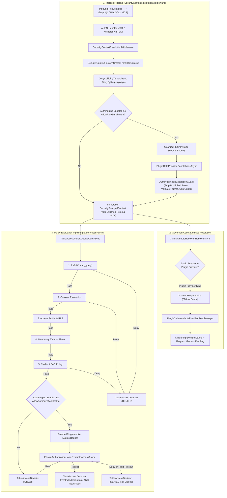
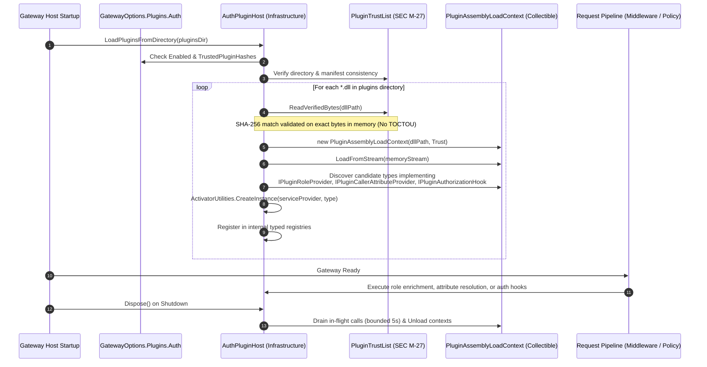

# Implementation Plan: REQ-SEC-BL08 - C# DLL Extension Points for Authentication & Authorization

**Document ID:** `PLAN-SEC-BL08`  
**Date:** 2026-10-19  
**Status:** APPROVED (Phase 2 Architecture & Phase 3 Security Review complete); ready for Phase 4 (TDD Developers)  
**Authors:** Principal C# & .NET 10 Solution Architect (`csharp-architect`), Security Expert (`csharp-security-expert`)  
**Input PRD:** [`2026-10-19-req-bl-08-csharp-dll-auth-extension-points.md`](2026-10-19-req-bl-08-csharp-dll-auth-extension-points.md) (`REQ-SEC-BL08`)  
**Branch:** `feat/bl-08-csharp-dll-auth-extension-points`  
**Parent Plan:** [`00-master-plan-overview.md`](00-master-plan-overview.md) (Wave 4, row 4.5)  
**Related Items:**  
- BL-01 Generic C# DLL Plugin & Event Subsystem (`PluginAssemblyLoadContext`, `PluginTrustList`, `PluginManager`)  
- Issue #129 Caller-Attribute Row Filters (`REQ-GOV-129`, `ICallerAttributeProvider`, `ICallerAttributeResolver`)  
- Ingress & Security Pipeline (`SecurityContextResolutionMiddleware`, `TableAccessPolicy`, `UnifiedPolicyDecisionPoint`)  

---

## 1. Architectural Architecture & Component Topology

### 1.1 Overview & System Topology

Autheris BL-08 extends the core identity and governance engine of Autheris with secure, isolated, and cryptographically verified **C# DLL Extension Points for Authentication and Authorization** running natively on .NET 10 (C# 13).

The design introduces three discrete extension points:
1. **Extension Point 1A (Role & Group SID Enrichment - `IPluginRoleProvider`):** Invoked during ingress context establishment in [`SecurityContextResolutionMiddleware`](file:///root/autheris/src/Autheris.Api/Middleware/SecurityContextResolutionMiddleware.cs) to expand directory roles and Kerberos group SIDs without granting access to cluster administration.
2. **Extension Point 1B (Caller Attribute Provider Bridge - `IPluginCallerAttributeProvider`):** Bridges into [`CallerAttributeResolver`](file:///root/autheris/src/Autheris.Application/Identity/Attributes/CallerAttributeResolver.cs) to resolve dynamic enterprise attributes (e.g. employee cost centers, clearance levels) for row-level security (`{{caller.<name>}}`) with single-flight caching, memoization, and circuit breakers.
3. **Extension Point 2 (Custom Authorization Hook - `IPluginAuthorizationHook`):** Evaluated inside [`TableAccessPolicy.DecideAsync`](file:///root/autheris/src/Autheris.Application/Policy/TableAccessPolicy.cs) after ReBAC, Consents, Access Profiles, and Casbin ABAC have evaluated, enabling custom perimeter, compliance, or time-window fences.



---

### 1.2 Cryptographic Isolation & ALC Host Lifecycle

BL-08 reuses the SHA-256 byte-verified assembly loading architecture from BL-01 ([`PluginAssemblyLoadContext`](file:///root/autheris/src/Autheris.Infrastructure/Plugins/PluginAssemblyLoadContext.cs) and [`PluginTrustList`](file:///root/autheris/src/Autheris.Infrastructure/Plugins/PluginTrustList.cs)):



---

## 2. Layering & Clean Architecture Project Mapping

In strict accordance with Autheris Clean Architecture:
- `Autheris.Domain`: Zero external dependencies, pure domain models, options, and diagnostics.
- `Autheris.Application`: Extension contracts, escalation guards, and host service interfaces.
- `Autheris.Infrastructure`: Assembly loading, cryptographic hash pinning, bounded guarded invoker, and concrete plugin host.
- `Autheris.Api`: Middleware integration, dependency injection wiring, and startup initialization.
- `Autheris.Tests.Unit`: Unit, security, and timeout test suites.

### 2.1 File Placement & Responsibilities

| Project | Target Path | Responsibility |
|---|---|---|
| **Domain** | [`src/Autheris.Domain/Options/Plugins/AuthPluginOptions.cs`](file:///root/autheris/src/Autheris.Domain/Options/Plugins/AuthPluginOptions.cs) | Configuration options for auth plugins under `Gateway:Plugins:Auth`. |
| **Domain** | [`src/Autheris.Domain/Options/Integrations/ItsmOptions.cs`](file:///root/autheris/src/Autheris.Domain/Options/Integrations/ItsmOptions.cs) | Update `PluginsOptions` to include `public AuthPluginOptions Auth { get; init; } = new();`. |
| **Domain** | [`src/Autheris.Domain/Plugins/Auth/PluginSecurityContext.cs`](file:///root/autheris/src/Autheris.Domain/Plugins/Auth/PluginSecurityContext.cs) | Immutable ingress security context passed to `IPluginRoleProvider`. No raw secrets or bearer tokens. |
| **Domain** | [`src/Autheris.Domain/Plugins/Auth/PluginRoleEnrichmentResult.cs`](file:///root/autheris/src/Autheris.Domain/Plugins/Auth/PluginRoleEnrichmentResult.cs) | Added roles and group SIDs returned by `IPluginRoleProvider`. |
| **Domain** | [`src/Autheris.Domain/Plugins/Auth/PluginAuthorizationContext.cs`](file:///root/autheris/src/Autheris.Domain/Plugins/Auth/PluginAuthorizationContext.cs) | Context passed to `IPluginAuthorizationHook` for table evaluation. |
| **Domain** | [`src/Autheris.Domain/Plugins/Auth/PluginAuthorizationResult.cs`](file:///root/autheris/src/Autheris.Domain/Plugins/Auth/PluginAuthorizationResult.cs) | Decision outcome (`Allow`, `Deny`, `Restrict`), reason code, denied columns, and additional row filter SQL. |
| **Domain** | [`src/Autheris.Domain/Plugins/Auth/PluginAuthorizationOutcome.cs`](file:///root/autheris/src/Autheris.Domain/Plugins/Auth/PluginAuthorizationOutcome.cs) | Enum: `Allow = 0`, `Deny = 1`, `Restrict = 2`. |
| **Domain** | [`src/Autheris.Domain/Plugins/Auth/AuthPluginDiagnostics.cs`](file:///root/autheris/src/Autheris.Domain/Plugins/Auth/AuthPluginDiagnostics.cs) | OpenTelemetry Meter and ActivitySource definitions for auth plugins. |
| **Application** | [`src/Autheris.Application/Plugins/Auth/IPluginRoleProvider.cs`](file:///root/autheris/src/Autheris.Application/Plugins/Auth/IPluginRoleProvider.cs) | Extension point contract for role & group SID enrichment. |
| **Application** | [`src/Autheris.Application/Plugins/Auth/IPluginCallerAttributeProvider.cs`](file:///root/autheris/src/Autheris.Application/Plugins/Auth/IPluginCallerAttributeProvider.cs) | Extension point contract for custom caller attributes (extends `ICallerAttributeProvider`). |
| **Application** | [`src/Autheris.Application/Plugins/Auth/IPluginAuthorizationHook.cs`](file:///root/autheris/src/Autheris.Application/Plugins/Auth/IPluginAuthorizationHook.cs) | Extension point contract for inline authorization decision hooks. |
| **Application** | [`src/Autheris.Application/Plugins/Auth/IAuthPluginHost.cs`](file:///root/autheris/src/Autheris.Application/Plugins/Auth/IAuthPluginHost.cs) | Orchestration contract for plugin discovery, loading, and guarded execution. |
| **Application** | [`src/Autheris.Application/Plugins/Auth/AuthPluginRoleEscalationGuard.cs`](file:///root/autheris/src/Autheris.Application/Plugins/Auth/AuthPluginRoleEscalationGuard.cs) | Enforces anti-escalation rules, strips prohibited roles, validates format, caps quotas, and logs security alerts. |
| **Application** | [`src/Autheris.Application/Identity/Attributes/CallerAttributeResolver.cs`](file:///root/autheris/src/Autheris.Application/Identity/Attributes/CallerAttributeResolver.cs) | Injects `IAuthPluginHost` to resolve custom plugin attribute providers dynamically. |
| **Application** | [`src/Autheris.Application/Policy/TableAccessPolicy.cs`](file:///root/autheris/src/Autheris.Application/Policy/TableAccessPolicy.cs) | Injects `IAuthPluginHost` to evaluate authorization hooks post-Casbin when prior checks allow. |
| **Infrastructure** | [`src/Autheris.Infrastructure/Plugins/Auth/GuardedPluginInvoker.cs`](file:///root/autheris/src/Autheris.Infrastructure/Plugins/Auth/GuardedPluginInvoker.cs) | Bounded invocation wrapper: timeout, cancellation, exception trapping, Activity spans, and duration metrics. |
| **Infrastructure** | [`src/Autheris.Infrastructure/Plugins/Auth/AuthPluginHost.cs`](file:///root/autheris/src/Autheris.Infrastructure/Plugins/Auth/AuthPluginHost.cs) | Implements `IAuthPluginHost`, manages `PluginAssemblyLoadContext` and `PluginTrustList` SHA-256 verification. |
| **Api** | [`src/Autheris.Api/Middleware/SecurityContextResolutionMiddleware.cs`](file:///root/autheris/src/Autheris.Api/Middleware/SecurityContextResolutionMiddleware.cs) | Invokes role enrichment post-authentication and updates `SecurityPrincipalContext`. |
| **Api** | [`src/Autheris.Api/Extensions/DependencyInjection/GatewayGovernanceServiceExtensions.cs`](file:///root/autheris/src/Autheris.Api/Extensions/DependencyInjection/GatewayGovernanceServiceExtensions.cs) | DI service registrations for `IAuthPluginHost`, options validation, and policy integration. |
| **Api** | [`src/Autheris.Api/Extensions/GatewayApplicationBuilderExtensions.cs`](file:///root/autheris/src/Autheris.Api/Extensions/GatewayApplicationBuilderExtensions.cs) | Startup trigger for auth plugin discovery. |
| **Tests** | [`tests/Autheris.Tests.Unit/Plugins/Auth/AuthPluginRoleProviderTests.cs`](file:///root/autheris/tests/Autheris.Tests.Unit/Plugins/Auth/AuthPluginRoleProviderTests.cs) | Unit tests for role enrichment, SID enrichment, empty results, and middleware flow. |
| **Tests** | [`tests/Autheris.Tests.Unit/Plugins/Auth/AuthPluginRoleEscalationTests.cs`](file:///root/autheris/tests/Autheris.Tests.Unit/Plugins/Auth/AuthPluginRoleEscalationTests.cs) | Security tests verifying stripping of `ClusterAdmin`/`GovernanceAdmin`, colon injection, length bounds, and quota limits. |
| **Tests** | [`tests/Autheris.Tests.Unit/Plugins/Auth/AuthPluginCallerAttributeTests.cs`](file:///root/autheris/tests/Autheris.Tests.Unit/Plugins/Auth/AuthPluginCallerAttributeTests.cs) | Unit tests for attribute provider resolution, caching, memoization, and fail-closed handling. |
| **Tests** | [`tests/Autheris.Tests.Unit/Plugins/Auth/AuthPluginAuthorizationHookTests.cs`](file:///root/autheris/tests/Autheris.Tests.Unit/Plugins/Auth/AuthPluginAuthorizationHookTests.cs) | Unit tests for Allow, Deny, Restrict outcomes, column reduction, and SQL filter composition. |
| **Tests** | [`tests/Autheris.Tests.Unit/Security/AuthPluginSecurityTests.cs`](file:///root/autheris/tests/Autheris.Tests.Unit/Security/AuthPluginSecurityTests.cs) | AppSec test suite verifying fail-closed invariants, anti-bypass rules, timeout cancellation, and SHA-256 hash pinning. |

---

## 3. Contracts, Interfaces & Detailed Specifications

### 3.1 Domain Contracts & Options

#### 3.1.1 `AuthPluginOptions`
```csharp
namespace Autheris.Domain.Options.Plugins;

using System.Collections.Generic;
using System.ComponentModel.DataAnnotations;

public sealed class AuthPluginOptions
{
    public const string SectionName = "Gateway:Plugins:Auth";

    public bool Enabled { get; init; } = true;

    [Range(50, 5000)]
    public int ExecutionTimeoutMilliseconds { get; init; } = 500;

    [Range(1, 256)]
    public int MaxEnrichedRolesPerCaller { get; init; } = 64;

    [Range(1, 1024)]
    public int MaxEnrichedGroupSidsPerCaller { get; init; } = 256;

    public bool AllowRoleEnrichment { get; init; } = true;

    public bool AllowAuthorizationHooks { get; init; } = true;

    public List<string> ProhibitedRoles { get; init; } =
    [
        "ClusterAdmin",
        "GovernanceAdmin",
        "SecurityAdmin"
    ];
}
```

#### 3.1.2 `PluginSecurityContext` & `PluginRoleEnrichmentResult`
```csharp
namespace Autheris.Domain.Plugins.Auth;

using System.Collections.Generic;
using System.Net;
using System.Security.Claims;
using Autheris.Domain.Common;

/// <summary>
/// Sanitized, immutable security context passed to IPluginRoleProvider.
/// Deliberately omits raw tokens, client secrets, passwords, and sensitive headers.
/// </summary>
public sealed record PluginSecurityContext
{
    public required TenantId TenantId { get; init; }
    public required Sid UserSid { get; init; }
    public required IReadOnlySet<Sid> GroupSids { get; init; }
    public required IReadOnlySet<string> ExistingTenantRoles { get; init; }
    public required IReadOnlyList<Claim> Claims { get; init; }
    public IPAddress? ClientIp { get; init; }
    public required string AuthenticationScheme { get; init; }
}

public sealed record PluginRoleEnrichmentResult
{
    public static readonly PluginRoleEnrichmentResult Empty = new([], []);

    public IReadOnlyCollection<string> AddedRoles { get; init; }
    public IReadOnlyCollection<Sid> AddedGroupSids { get; init; }

    public PluginRoleEnrichmentResult(
        IReadOnlyCollection<string>? addedRoles = null,
        IReadOnlyCollection<Sid>? addedGroupSids = null)
    {
        AddedRoles = addedRoles ?? [];
        AddedGroupSids = addedGroupSids ?? [];
    }
}
```

#### 3.1.3 `PluginAuthorizationContext` & `PluginAuthorizationResult`
```csharp
namespace Autheris.Domain.Plugins.Auth;

using System.Collections.Generic;
using System.Net;
using Autheris.Domain.Common;
using Autheris.Domain.Model;

public enum PluginAuthorizationOutcome
{
    Allow = 0,
    Deny = 1,
    Restrict = 2
}

public sealed record PluginAuthorizationContext
{
    public required TenantId TenantId { get; init; }
    public required Sid UserSid { get; init; }
    public required IReadOnlySet<Sid> GroupSids { get; init; }
    public required IReadOnlySet<string> Roles { get; init; }
    public required TableIdentifier TableIdentifier { get; init; }
    public IReadOnlyList<string>? RequestedColumns { get; init; }
    public IReadOnlyList<string>? TableTags { get; init; }
    public string? TableSensitivity { get; init; }
    public IPAddress? ClientIp { get; init; }
    public IReadOnlyDictionary<string, object?>? ExtraAttributes { get; init; }
}

public sealed record PluginAuthorizationResult
{
    public required PluginAuthorizationOutcome Outcome { get; init; }
    public string? ReasonCode { get; init; }
    public string? ClientMessage { get; init; }
    public IReadOnlyCollection<string>? DeniedColumns { get; init; }
    public string? AdditionalRowFilterSql { get; init; }
    public string? HookName { get; init; }

    public static PluginAuthorizationResult Allow(string? hookName = null) =>
        new() { Outcome = PluginAuthorizationOutcome.Allow, HookName = hookName };

    public static PluginAuthorizationResult Deny(string reasonCode, string? clientMessage = null, string? hookName = null) =>
        new()
        {
            Outcome = PluginAuthorizationOutcome.Deny,
            ReasonCode = reasonCode,
            ClientMessage = clientMessage,
            HookName = hookName
        };

    public static PluginAuthorizationResult Restrict(
        IReadOnlyCollection<string>? deniedColumns = null,
        string? additionalRowFilterSql = null,
        string? hookName = null) =>
        new()
        {
            Outcome = PluginAuthorizationOutcome.Restrict,
            DeniedColumns = deniedColumns,
            AdditionalRowFilterSql = additionalRowFilterSql,
            HookName = hookName
        };
}
```

---

### 3.2 Application Extension Interfaces & Guards

#### 3.2.1 Extension Point Interfaces
```csharp
namespace Autheris.Application.Plugins.Auth;

using System.Threading;
using System.Threading.Tasks;
using Autheris.Application.Identity.Attributes;
using Autheris.Domain.Plugins.Auth;

public interface IPluginRoleProvider
{
    string Name { get; }
    ValueTask<PluginRoleEnrichmentResult> EnrichRolesAsync(PluginSecurityContext context, CancellationToken ct);
}

public interface IPluginCallerAttributeProvider : ICallerAttributeProvider
{
    new string Kind { get; }
}

public interface IPluginAuthorizationHook
{
    string HookName { get; }
    int Order { get; }
    ValueTask<PluginAuthorizationResult> EvaluateAccessAsync(PluginAuthorizationContext context, CancellationToken ct);
}
```

#### 3.2.2 `IAuthPluginHost` Contract
```csharp
namespace Autheris.Application.Plugins.Auth;

using System.Threading;
using System.Threading.Tasks;
using Autheris.Domain.Plugins.Auth;

public interface IAuthPluginHost
{
    bool HasRoleProviders { get; }
    bool HasCallerAttributeProviders { get; }
    bool HasAuthorizationHooks { get; }

    int LoadPluginsFromDirectory(string directoryPath);

    ValueTask<PluginRoleEnrichmentExecutionResult> EnrichRolesAsync(
        PluginSecurityContext context,
        CancellationToken ct);

    bool TryGetCallerAttributeProvider(string kind, out IPluginCallerAttributeProvider? provider);

    ValueTask<PluginAuthorizationResult> EvaluateAuthorizationHooksAsync(
        PluginAuthorizationContext context,
        CancellationToken ct);
}

public sealed record PluginRoleEnrichmentExecutionResult(
    bool IsSuccess,
    PluginRoleEnrichmentResult Result,
    string? ErrorCode = null,
    string? ErrorMessage = null)
{
    public static PluginRoleEnrichmentExecutionResult Success(PluginRoleEnrichmentResult result) =>
        new(true, result);

    public static PluginRoleEnrichmentExecutionResult Failed(string errorCode, string? errorMessage = null) =>
        new(false, PluginRoleEnrichmentResult.Empty, errorCode, errorMessage);
}
```

#### 3.2.3 `AuthPluginRoleEscalationGuard`
Responsible for enforcing anti-escalation security checks:
1. Strips any role matching configured `ProhibitedRoles` (case-insensitive: `ClusterAdmin`, `GovernanceAdmin`, `SecurityAdmin`).
2. Rejects any role containing `:` (colon separator reserved for tenant scoping / global namespaces) to prevent spoofing.
3. Rejects control characters (`\r`, `\n`, `\0`) and enforces maximum role length of 128 characters.
4. Enforces cardinality caps: truncates or rejects roles exceeding `MaxEnrichedRolesPerCaller` (default 64) and group SIDs exceeding `MaxEnrichedGroupSidsPerCaller` (default 256).
5. Emits `SECURITY_ALERT_ROLE_ESCALATION_ATTEMPT` audit and telemetry counters when any illegal role is attempted.

---

### 3.3 Infrastructure Host & Guarded Invocation Engine

#### 3.3.1 `GuardedPluginInvoker`
Enforces bounded execution across all plugin invocations:
```csharp
namespace Autheris.Infrastructure.Plugins.Auth;

public sealed class GuardedPluginInvoker(
    TimeProvider timeProvider,
    ILogger logger)
{
    public async ValueTask<TResult> InvokeAsync<TResult>(
        string pluginName,
        string extensionPoint,
        TimeSpan timeout,
        Func<CancellationToken, ValueTask<TResult>> invocation,
        Func<string, string, TResult> failureFactory,
        CancellationToken callerCt)
    {
        // 1. Create linked CTS with strict timeout
        using var linkedCts = CancellationTokenSource.CreateLinkedTokenSource(callerCt);
        linkedCts.CancelAfter(timeout);

        using var activity = AuthPluginDiagnostics.ActivitySource.StartActivity($"auth.plugin.{extensionPoint}");
        activity?.SetTag("plugin.name", pluginName);
        activity?.SetTag("plugin.extension_point", extensionPoint);

        long startTimestamp = timeProvider.GetTimestamp();
        string outcome = "success";

        try
        {
            var result = await invocation(linkedCts.Token).ConfigureAwait(false);
            return result;
        }
        catch (OperationCanceledException) when (!callerCt.IsCancellationRequested)
        {
            outcome = "timeout";
            logger.LogError("Auth plugin '{PluginName}' ({ExtensionPoint}) exceeded execution timeout of {Timeout}ms (Fail-Closed).",
                pluginName, extensionPoint, timeout.TotalMilliseconds);
            return failureFactory("AUTH_PLUGIN_TIMEOUT", $"Plugin execution exceeded timeout of {timeout.TotalMilliseconds}ms.");
        }
        catch (Exception ex) when (ex is not OperationCanceledException)
        {
            outcome = "error";
            logger.LogError(ex, "Auth plugin '{PluginName}' ({ExtensionPoint}) threw unhandled exception (Fail-Closed).",
                pluginName, extensionPoint);
            return failureFactory("AUTH_PLUGIN_FAILED", "Plugin execution encountered an unhandled fault.");
        }
        finally
        {
            var elapsed = timeProvider.GetElapsedTime(startTimestamp);
            AuthPluginDiagnostics.RecordInvocation(pluginName, extensionPoint, outcome, elapsed.TotalSeconds);
            activity?.SetTag("auth.outcome", outcome);
        }
    }
}
```

---

## 4. Pipeline Integration Details

### 4.1 Ingress Middleware Integration (`SecurityContextResolutionMiddleware`)

In [`SecurityContextResolutionMiddleware.InvokeAsync`](file:///root/autheris/src/Autheris.Api/Middleware/SecurityContextResolutionMiddleware.cs#L180-L238):
1. Normal authentication and base `SecurityPrincipalContext` extraction occurs via `SecurityContextFactory.CreateFromHttpContext(context)`.
2. Collision and tenant registry checks execute (`DenyCollidingTenantAsync`, `DenyByRegistryAsync`).
3. If principal is authenticated, `IAuthPluginHost` is checked:
   ```csharp
   var authPluginHost = context.RequestServices.GetService<IAuthPluginHost>();
   var authOptions = context.RequestServices.GetService<IOptions<GatewayOptions>>()?.Value.Plugins.Auth;

   if (securityContext.IsAuthenticated &&
       authOptions?.Enabled == true &&
       authOptions.AllowRoleEnrichment &&
       authPluginHost != null &&
       authPluginHost.HasRoleProviders)
   {
       var pluginContext = new PluginSecurityContext
       {
           TenantId = securityContext.TenantId,
           UserSid = securityContext.UserSid,
           GroupSids = securityContext.GroupSids,
           ExistingTenantRoles = securityContext.TenantRoles,
           Claims = securityContext.Claims?.ToList() ?? (IReadOnlyList<Claim>)context.User.Claims.ToList(),
           ClientIp = securityContext.ClientIp,
           AuthenticationScheme = securityContext.AuthenticationScheme
       };

       var enrichment = await authPluginHost.EnrichRolesAsync(pluginContext, context.RequestAborted).ConfigureAwait(false);
       if (!enrichment.IsSuccess)
       {
           await WriteJsonAsync(context, StatusCodes.Status403Forbidden, "Authentication plugin execution failed.", enrichment.ErrorCode ?? "AUTH_PLUGIN_FAILED").ConfigureAwait(false);
           return;
       }

       if (enrichment.Result.AddedRoles.Count > 0 || enrichment.Result.AddedGroupSids.Count > 0)
       {
           var enrichedRoles = new HashSet<string>(securityContext.TenantRoles, StringComparer.OrdinalIgnoreCase);
           foreach (var role in enrichment.Result.AddedRoles)
           {
               enrichedRoles.Add(role);
           }

           var enrichedSids = new HashSet<Sid>(securityContext.GroupSids);
           foreach (var sid in enrichment.Result.AddedGroupSids)
           {
               enrichedSids.Add(sid);
           }

           securityContext = securityContext with
           {
               TenantRoles = enrichedRoles,
               GroupSids = enrichedSids
           };
       }
   }
   ```
4. Context is stored in `context.Items[SecurityPrincipalContext.ItemKey] = securityContext`.

---

### 4.2 Caller Attribute Resolver Integration (`CallerAttributeResolver`)

In [`CallerAttributeResolver`](file:///root/autheris/src/Autheris.Application/Identity/Attributes/CallerAttributeResolver.cs):
1. Constructor accepts optional `IAuthPluginHost? authPluginHost = null`.
2. In `ResolveCoreAsync`, if provider is not present in static `_providers`:
   ```csharp
   if (!_providers.TryGetValue(kind, out var provider))
   {
       if (_authPluginHost != null && _authPluginHost.TryGetCallerAttributeProvider(kind, out var pluginProvider))
       {
           provider = pluginProvider!;
       }
       else
       {
           return CallerAttributeResult.Failed("ProviderUnavailable");
       }
   }
   ```
3. Custom plugin caller attributes immediately inherit all gateway protections:
   - Request-scoped memoization (`CallerAttributeRequestState`).
   - Single-flight caching (`SingleFlightKeySetCache`).
   - Concurrency limits (Bulkhead per provider `kind`).
   - Infrastructure circuit breaker (`Breaker` per provider `kind`).
   - Cardinality capping and list padding (`PadListsToBuckets`).

---

### 4.3 Table Access Policy Integration (`TableAccessPolicy`)

In [`TableAccessPolicy.DecideCoreAsync`](file:///root/autheris/src/Autheris.Application/Policy/TableAccessPolicy.cs#L360-L370):
1. All baseline authorization gates evaluate first:
   - Inactive table check.
   - Schema contracts enforcement.
   - ReBAC graph check (`can_query`).
   - Consent resolution (Deny consents, purpose fencing).
   - Access profile masking exemptions & RLS.
   - Virtual filters.
   - Casbin ABAC evaluation.
2. If any prior gate denied access, `decision.IsAllowed` is `false`, and auth hooks are **NEVER** called (Invariant 1: Short-circuit on prior deny).
3. If `decision.IsAllowed` is `true`, evaluate auth hooks:
   ```csharp
   if (decision.IsAllowed &&
       _options.Plugins.Auth.Enabled &&
       _options.Plugins.Auth.AllowAuthorizationHooks &&
       _authPluginHost != null &&
       _authPluginHost.HasAuthorizationHooks)
   {
       var authzContext = new PluginAuthorizationContext
       {
           TenantId = query.Tenant,
           UserSid = query.UserSid,
           GroupSids = query.GroupSids,
           Roles = query.Roles,
           TableIdentifier = table,
           RequestedColumns = query.RequestedColumns,
           TableTags = query.Metadata.Table.Tags,
           TableSensitivity = query.Metadata.Table.Sensitivity,
           ClientIp = query.ClientIp,
           ExtraAttributes = query.ExtraAttributes
       };

       var hookResult = await _authPluginHost.EvaluateAuthorizationHooksAsync(authzContext, ct).ConfigureAwait(false);
       if (hookResult.Outcome == PluginAuthorizationOutcome.Deny)
       {
           return TableAccessDecision.Denied(table,
               $"Plugin Authorization Denial ({hookResult.HookName ?? "Unknown"}): {hookResult.ReasonCode ?? "Access denied by enterprise plugin."}");
       }
       else if (hookResult.Outcome == PluginAuthorizationOutcome.Restrict)
       {
           var restrictedColumns = new Dictionary<string, ColumnAccessLevel>(decision.ColumnAccess, StringComparer.OrdinalIgnoreCase);
           if (hookResult.DeniedColumns != null)
           {
               foreach (var col in hookResult.DeniedColumns)
               {
                   // Invariant 3: Hook can only lower access to Deny, never elevate from Mask/Deny to Clear
                   restrictedColumns[col] = ColumnAccessLevel.Deny;
               }
           }

           decision = decision with { ColumnAccess = restrictedColumns };

           if (!string.IsNullOrWhiteSpace(hookResult.AdditionalRowFilterSql))
           {
               decision = decision.WithAdditionalRowFilter(hookResult.AdditionalRowFilterSql);
           }
       }
   }
   ```
4. If a hook throws an unhandled exception or times out, the `GuardedPluginInvoker` returns `PluginAuthorizationResult.Deny("AUTH_HOOK_FAILED" / "AUTH_HOOK_TIMEOUT")`, producing an immediate fail-closed denial.

---

## 5. Security & Anti-Bypass Guarantees (Phase 3 AppSec Alignment)

The implementation strictly satisfies all five immutable security invariants:

| Security Invariant | Guarantee & Architectural Enforcement Mechanism |
|---|---|
| **Invariant 1: Prior Denial Short-Circuit** | If ReBAC, Consent, Schema Contract, or Casbin returns `DENY`, `TableAccessPolicy` returns immediately. Plugin authorization hooks are never invoked for already-denied requests. |
| **Invariant 2: No Denial Reversal** | A hook returning `Allow()` can only confirm access for queries that passed all prior gateway security gates. It cannot override a `DENY` decision. |
| **Invariant 3: No Masking Reversal** | Column clearance modifications in `PluginAuthorizationResult.Restrict` only set `ColumnAccessLevel.Deny`. It cannot alter existing `Mask` or `Deny` levels to `Clear`. |
| **Invariant 4: Strict Tenant Isolation** | `TenantId` is immutable in both `PluginSecurityContext` and `PluginAuthorizationContext`. Plugins cannot modify caller tenant or query cross-tenant boundaries. |
| **Invariant 5: Zero Privilege Escalation** | `AuthPluginRoleEscalationGuard` strictly strips `ProhibitedRoles` (`ClusterAdmin`, `GovernanceAdmin`, `SecurityAdmin`), rejects `:` characters, and bounds additions to `MaxEnrichedRolesPerCaller`. Cluster-admin status is never granted to plugin-enriched roles. |
| **Invariant 6: Zero Credential Leakage** | Raw Bearer tokens, HTTP Authorization headers, client secret assertions, and TLS private keys are never passed to plugins. Only sanitized domain objects are exposed. |
| **Invariant 7: Cryptographic Integrity (SEC M-27)** | Outside Development mode, every plugin assembly loaded from disk must match an authoritative SHA-256 hash defined in `Gateway:Plugins:TrustedPluginHashes`. Verification reads bytes once into memory (`ReadVerifiedBytes()`) and loads directly from memory stream to prevent TOCTOU file tampering. |

---

## 6. Work Packages Breakdown (Phase 4 Execution Streams)

### WP-0: Domain Models, Contracts & Configuration Options
- **Target Files:**
  - `src/Autheris.Domain/Options/Plugins/AuthPluginOptions.cs`
  - `src/Autheris.Domain/Options/Integrations/ItsmOptions.cs` (Update `PluginsOptions`)
  - `src/Autheris.Domain/Plugins/Auth/PluginSecurityContext.cs`
  - `src/Autheris.Domain/Plugins/Auth/PluginRoleEnrichmentResult.cs`
  - `src/Autheris.Domain/Plugins/Auth/PluginAuthorizationContext.cs`
  - `src/Autheris.Domain/Plugins/Auth/PluginAuthorizationResult.cs`
  - `src/Autheris.Domain/Plugins/Auth/PluginAuthorizationOutcome.cs`
  - `src/Autheris.Domain/Plugins/Auth/AuthPluginDiagnostics.cs`
- **Description:** Implement all domain models, options, diagnostics counters, and activity sources with full validation attributes.
- **Verification:** Unit tests confirm options binding, default values, and data annotation range validation (`Range(50, 5000)` on timeout).

### WP-1: Application Extension Point Interfaces & Anti-Escalation Guard
- **Target Files:**
  - `src/Autheris.Application/Plugins/Auth/IPluginRoleProvider.cs`
  - `src/Autheris.Application/Plugins/Auth/IPluginCallerAttributeProvider.cs`
  - `src/Autheris.Application/Plugins/Auth/IPluginAuthorizationHook.cs`
  - `src/Autheris.Application/Plugins/Auth/IAuthPluginHost.cs`
  - `src/Autheris.Application/Plugins/Auth/AuthPluginRoleEscalationGuard.cs`
- **Description:** Define extension interfaces and implement `AuthPluginRoleEscalationGuard` to strip prohibited roles, validate role formatting (reject `:`, control chars, >128 chars), cap role/group counts, and record security alert metrics.
- **Verification:** Unit tests in `AuthPluginRoleEscalationTests.cs` validating all stripping, colon rejection, and quota truncation scenarios.

### WP-2: Infrastructure Host & Guarded Invocation Engine
- **Target Files:**
  - `src/Autheris.Infrastructure/Plugins/Auth/GuardedPluginInvoker.cs`
  - `src/Autheris.Infrastructure/Plugins/Auth/AuthPluginHost.cs`
- **Description:**
  - Implement `GuardedPluginInvoker` with `TimeProvider`, linked CTS timeout enforcement, unhandled exception trapping, Activity tracing, and duration histogram recording.
  - Implement `AuthPluginHost` to discover assemblies, verify SHA-256 via `PluginTrustList`, load into `PluginAssemblyLoadContext`, instantiate instances with `ActivatorUtilities`, sort hooks by `Order`, and provide bounded execution delegates.
- **Verification:** Unit tests confirming timeout cancellation, exception handling, and SHA-256 mismatch rejection.

### WP-3: Ingress Middleware Role Enrichment Integration
- **Target Files:**
  - `src/Autheris.Api/Middleware/SecurityContextResolutionMiddleware.cs`
- **Description:** Integrate `IAuthPluginHost.EnrichRolesAsync` into `SecurityContextResolutionMiddleware`. Apply sanitized roles & SIDs to `SecurityPrincipalContext` via `with` record expression. Fail closed with HTTP 403 upon plugin failure or timeout.
- **Verification:** Unit tests in `AuthPluginRoleProviderTests.cs` verifying role enrichment, SID enrichment, empty results, and 403 fail-closed responses.

### WP-4: Caller Attribute Resolution Bridge Integration
- **Target Files:**
  - `src/Autheris.Application/Identity/Attributes/CallerAttributeResolver.cs`
- **Description:** Update `CallerAttributeResolver` to accept optional `IAuthPluginHost`. If a requested attribute provider kind is not in static DI providers, query `IAuthPluginHost.TryGetCallerAttributeProvider(kind, out provider)`.
- **Verification:** Unit tests in `AuthPluginCallerAttributeTests.cs` confirming plugin-provided attributes participate in single-flight caching, request memoization, and list padding.

### WP-5: Table Access Policy Authorization Hook Integration
- **Target Files:**
  - `src/Autheris.Application/Policy/TableAccessPolicy.cs`
  - `src/Autheris.Application/Policy/TypedPolicySources.cs`
- **Description:** Update `TableAccessPolicy` to accept optional `IAuthPluginHost`. Evaluate `EvaluateAuthorizationHooksAsync` in `DecideCoreAsync` after Casbin ABAC. Enforce Invariants 1–5: short-circuit prior denials, cannot overturn denials, restrict columns, AND-merge row filter SQL, fail-closed on faults.
- **Verification:** Unit tests in `AuthPluginAuthorizationHookTests.cs` testing Allow, Deny, Restrict outcomes, and invariant enforcement.

### WP-6: Dependency Injection, App Builder & Security Test Suite
- **Target Files:**
  - `src/Autheris.Api/Extensions/DependencyInjection/GatewayGovernanceServiceExtensions.cs`
  - `src/Autheris.Api/Extensions/GatewayApplicationBuilderExtensions.cs`
  - `tests/Autheris.Tests.Unit/Plugins/Auth/AuthPluginRoleProviderTests.cs`
  - `tests/Autheris.Tests.Unit/Plugins/Auth/AuthPluginRoleEscalationTests.cs`
  - `tests/Autheris.Tests.Unit/Plugins/Auth/AuthPluginCallerAttributeTests.cs`
  - `tests/Autheris.Tests.Unit/Plugins/Auth/AuthPluginAuthorizationHookTests.cs`
  - `tests/Autheris.Tests.Unit/Security/AuthPluginSecurityTests.cs`
- **Description:** Register `IAuthPluginHost` and `AuthPluginHost` as singleton in DI. Wire discovery at startup in `GatewayApplicationBuilderExtensions`. Add comprehensive unit and security test suites.
- **Verification:** `dotnet test` passing with 100% green tests across all auth plugin test suites.

---

## 7. Verification Criteria & Test Matrix

| Acceptance Criteria | Test Class | Specific Test Scenario |
|---|---|---|
| **AC-BL08-01 (Cryptographic Loading & Verification)** | `AuthPluginSecurityTests` | In non-dev mode, loading an assembly with missing/mismatched SHA-256 throws `SecurityException` and halts startup. |
| **AC-BL08-02 (Role & Group SID Enrichment)** | `AuthPluginRoleProviderTests` | `IPluginRoleProvider` enriches `TenantRoles` and `GroupSids`; enriched roles appear in `SecurityPrincipalContext` and are honored in downstream checks. |
| **AC-BL08-03 (Privilege Escalation Prevention)** | `AuthPluginRoleEscalationTests` | Provider returning `ClusterAdmin` or `GovernanceAdmin` has role stripped, `SECURITY_ALERT_ROLE_ESCALATION_ATTEMPT` logged, and no admin rights granted. Role containing `:` is stripped. |
| **AC-BL08-04 (Caller Attribute Resolution Bridge)** | `AuthPluginCallerAttributeTests` | `IPluginCallerAttributeProvider` is discovered, resolves custom attribute, and participates in single-flight caching, memoization, and list padding. |
| **AC-BL08-05 (Custom Authorization Hook Execution)** | `AuthPluginAuthorizationHookTests` | `IPluginAuthorizationHook` executes inside `TableAccessPolicy.DecideAsync`. `Allow()` permits query, `Deny()` returns 403 with reason, `Restrict()` removes columns and adds SQL filter. |
| **AC-BL08-06 (Anti-Bypass Invariant Enforcement)** | `AuthPluginSecurityTests` | Hook cannot overturn a prior ReBAC, Consent, or Casbin `DENY`. Hook cannot unmask a masked column. Hook cannot switch tenants. |
| **AC-BL08-07 (Fail-Closed on Unhandled Exception)** | `AuthPluginSecurityTests` | Plugin throwing unhandled exception causes immediate fail-closed denial (`AUTH_PLUGIN_FAILED` / `AUTH_HOOK_FAILED`). No stack trace leaked to client. |
| **AC-BL08-08 (Execution Timeout & Cancellation)** | `AuthPluginSecurityTests` | Plugin exceeding `ExecutionTimeoutMilliseconds` (e.g. 500ms) triggers cancellation token and fails closed with `AUTH_PLUGIN_TIMEOUT`. |
| **AC-BL08-09 (Zero Credential Exposure)** | `AuthPluginSecurityTests` | Verify `PluginSecurityContext` and `PluginAuthorizationContext` contain no bearer token string, password, or client assertion. |
| **AC-BL08-10 (OpenTelemetry Observability)** | `AuthPluginSecurityTests` | Verify `autheris_auth_plugin_duration_seconds` and `autheris_auth_plugin_invocations_total` metrics are recorded with correct tags. Verify trace Activity spans are emitted. |
| **AC-BL08-11 (Audit Logging)** | `AuthPluginSecurityTests` | Verify denials and restrictions from authorization hooks, as well as role escalation attempts, emit entries to the audit trail. |
| **AC-BL08-12 (Graceful Hot Reload & Shutdown)** | `AuthPluginSecurityTests` | On `AuthPluginHost.Dispose()`, in-flight plugin calls drain within bounded timeout (5s) and `PluginAssemblyLoadContext` is unloaded cleanly. |

---

## 8. Phase 3: Security & Compliance Audit (Binding Security Conditions & Test Cases)

**Audit Conducted By:** Application Security Expert (`csharp-security-expert`)  
**Audit Standard:** Zero-Trust Architecture, Fail-Closed Security, Principle of Least Privilege, Cryptographic Hash Pinning (SEC M-27), Anti-Bypass Invariants, OWASP Top 10 API Security.  
**Review Verdict:** **APPROVED WITH CONDITIONS (`SEC-BL08-01..16`)**

### 8.1 Threat Modeling & Security Posture Assessment

Deploying arbitrary third-party compiled C# DLL assemblies directly within the gateway process introduces serious potential attack vectors if not rigorously governed:
1. **Privilege Escalation:** A rogue or compromised plugin attempting to grant superuser or cluster administration roles (`ClusterAdmin`, `GovernanceAdmin`, `SecurityAdmin`), bypassing tenant boundaries or gaining root gateway control.
2. **Denial-of-Service & Thread Exhaustion:** Slow or hanging plugins blocking gateway request execution threads, causing thread pool starvation, resource exhaustion, or cascading failure across the mesh.
3. **Fail-Open Policy Bypass:** Unhandled exceptions, deadlocks, out-of-memory faults, or task cancellations in plugins accidentally resulting in unrestricted table access or unmasked sensitive columns.
4. **Subversion of Cryptographic Loading (TOCTOU):** Tampering with plugin binaries on disk between check time and load time, or loading unvetted DLLs into the process address space.
5. **Credential & Identity Leakage:** Exposing raw OAuth Bearer tokens, HTTP Authorization headers, client assertions, or TLS private keys to untrusted plugin code, or leaking exception stack traces containing sensitive internal metadata to external API clients.
6. **SQL & Filter Injection:** Malicious or malformed SQL predicates returned by authorization hooks bypassing AST policy analysis, resulting in SQL injection or cross-tenant data leakage.

To permanently neutralize these attack vectors, the following 16 binding security conditions are established and must be strictly satisfied in Phase 4 implementation and verified by automated security test cases (`T-SEC-BL08-01..18`).

---

### 8.2 Binding Security Conditions (`SEC-BL08-01..16`)

#### `SEC-BL08-01: Cryptographic SHA-256 Byte Verification & Zero TOCTOU at Startup`
- Outside `Development` environment (`ASPNETCORE_ENVIRONMENT != "Development"` or `Gateway:Plugins:RequireIntegrityManifest == true`), every plugin DLL in `Gateway:Plugins:Directory` MUST have an authoritative SHA-256 hash defined in `Gateway:Plugins:TrustedPluginHashes`.
- Verification MUST read bytes into memory once via `PluginTrustList.ReadVerifiedBytes()` and load directly via `MemoryStream`. The gateway MUST NEVER load unpinned or mismatched assemblies from raw disk file paths, eliminating Time-of-Check to Time-of-Use (TOCTOU) file replacement windows.
- Any unpinned, unknown, or hash-mismatched assembly MUST throw `SecurityException` and immediately abort gateway startup (fail-fast).

#### `SEC-BL08-02: Universal Fail-Closed Exception Handling`
- Any unhandled exception, crash, or fault thrown during plugin execution MUST fail closed unconditionally:
  - In `IPluginRoleProvider.EnrichRolesAsync`: Request processing is immediately aborted; the gateway returns HTTP `403 Forbidden` with stable RFC 7807 error code `AUTH_PLUGIN_FAILED`. No unverified principal state may proceed.
  - In `IPluginCallerAttributeProvider.ResolveAsync`: The resolution outcome MUST return `CallerAttributeOutcome.Failed`, converging deterministically on a `1 = 0` (DENY) predicate in row-level filtering.
  - In `IPluginAuthorizationHook.EvaluateAccessAsync`: Access decision MUST immediately evaluate to `TableAccessDecision.Denied` with reason code `AUTH_HOOK_FAILED`.
- Unhandled plugin exceptions MUST NEVER bubble up as HTTP 500 Internal Server Error or cause unhandled process termination.

#### `SEC-BL08-03: Bounded Execution Timeout with Guaranteed Pipeline Unblocking`
- Every plugin invocation MUST be bounded by `ExecutionTimeoutMilliseconds` (default 500ms, clamped to `50..5000ms`).
- Execution MUST be wrapped in a linked `CancellationTokenSource` and awaited via asynchronous timeout protection (`Task.WaitAsync(timeout, callerCt)`).
- If a plugin exceeds the configured timeout, the pipeline MUST immediately unblock and fail closed with code `AUTH_PLUGIN_TIMEOUT` (HTTP 403 or `TableAccessDecision.Denied`), even if the plugin's internal code fails to observe the `CancellationToken` or blocks in managed code.

#### `SEC-BL08-04: Multi-Plugin Ordering & Short-Circuit Execution`
- If multiple `IPluginRoleProvider` plugins are active:
  - If ANY role provider throws an exception or times out, the entire role enrichment pipeline MUST fail closed (HTTP 403 Forbidden). No partial or unverified roles may be committed.
- If multiple `IPluginAuthorizationHook` plugins are active:
  - Hooks MUST execute in ascending numerical sequence according to `IPluginAuthorizationHook.Order`.
  - Execution MUST short-circuit on the first `Deny` or failure: subsequent hooks MUST NOT execute once access has been denied.
  - If multiple hooks return `Restrict`, their restrictions MUST combine monotonically (denied columns accumulate into a union, and additional row filter SQL predicates are combined via `AND`).

#### `SEC-BL08-05: Strict Role Name Sanitization & Prohibited Superadmin Role Stripping`
- Custom role providers (`IPluginRoleProvider`) are strictly forbidden from injecting superadministrative roles.
- `AuthPluginRoleEscalationGuard` MUST enforce an immutable blacklist: `["ClusterAdmin", "GovernanceAdmin", "SecurityAdmin"]` plus any additional roles configured in `AuthPluginOptions.ProhibitedRoles`.
- Role comparisons MUST be case-insensitive using ordinal string comparison (`StringComparer.OrdinalIgnoreCase`).
- Proposed role names MUST conform strictly to the regex allowlist `^[a-zA-Z0-9_\-\.]{1,128}$`. Any role containing colons (`:`), semicolons, slashes, control characters (`\0`..`\x1F`), or exceeding 128 characters MUST be stripped.
- Any attempt to return a prohibited or malformed role MUST be stripped and trigger a security audit alert (`SECURITY_ALERT_ROLE_ESCALATION_ATTEMPT`).

#### `SEC-BL08-06: Reserved System SID Stripping & SID Validation`
- All group SIDs returned in `PluginRoleEnrichmentResult.AddedGroupSids` MUST be validated for valid SID structure.
- The guard MUST reject and strip well-known privileged system SIDs:
  - `S-1-5-18` (Local System)
  - `S-1-5-19` (NT Authority / Local Service)
  - `S-1-5-20` (NT Authority / Network Service)
  - `S-1-5-32-544` (Builtin Administrators)
  - `S-1-5-32-545` (Builtin Users)
- Any attempt to return a prohibited or invalid SID MUST be stripped and emit `SECURITY_ALERT_SYSTEM_SID_ATTEMPT`.

#### `SEC-BL08-07: Cardinality Caps on Enriched Roles and Group SIDs`
- The number of roles added by `IPluginRoleProvider` MUST NOT exceed `MaxEnrichedRolesPerCaller` (default 64, clamped `1..256`).
- The number of group SIDs added by `IPluginRoleProvider` MUST NOT exceed `MaxEnrichedGroupSidsPerCaller` (default 256, clamped `1..1024`).
- If an enrichment result exceeds these caps, excess entries MUST be truncated or rejected fail-closed, and an audit warning logged, preventing memory exhaustion and denial-of-service in Casbin policy evaluation.

#### `SEC-BL08-08: Anti-Bypass Order: Precedence of ReBAC, Consent & Casbin Denials`
- `TableAccessPolicy` MUST evaluate all baseline governance gates first: Inactive Table, Schema Contract, ReBAC graph clearance, Consent Resolution, Access Profiles, Virtual Filters, and Casbin ABAC.
- If ANY prior gate denies access (`decision.IsAllowed == false`), `IPluginAuthorizationHook` MUST NEVER be invoked.
- A plugin hook returning `PluginAuthorizationResult.Allow()` can NEVER overturn a prior denial.

#### `SEC-BL08-09: Anti-Bypass Integrity: Monotonic Restriction & Mask Preservation`
- A plugin hook returning `PluginAuthorizationResult.Restrict` can only decrease access privileges:
  - It may only add columns to `ColumnAccessLevel.Deny`.
  - It CANNOT modify a column whose access level is already `Mask` or `Deny` to `Clear`.
  - It CANNOT lift data classification masks or consent-mandated masking rules.

#### `SEC-BL08-10: Additional Row Filter SQL Sanitization & Precedence Fencing`
- If an authorization hook supplies `AdditionalRowFilterSql`:
  - It MUST be enclosed in parentheses `AND (<additionalRowFilterSql>)` when combined with existing RLS predicates to prevent SQL operator precedence injection (e.g. `OR 1=1`).
  - It MUST be parsed and validated by the gateway's AST security visitor to ensure it contains no DDL, no DML, no unauthorized subqueries, and no cross-tenant references. If AST parsing or validation fails, access MUST fail closed immediately (`AUTH_HOOK_INVALID_FILTER`).

#### `SEC-BL08-11: Strict Tenant Sandboxing & Cross-Tenant Boundary Enforcement`
- `TenantId` is immutable in `PluginSecurityContext` and `PluginAuthorizationContext`.
- Plugins CANNOT switch, alter, or spoof `TenantId`.
- Roles containing tenant prefixes (e.g. `tenant:role`) are prohibited by the role syntax allowlist (`SEC-BL08-05`).
- Custom caller attribute providers must resolve values strictly within the tenant scope provided by the caller context.

#### `SEC-BL08-12: Zero Credential, Token, and Secret Exposure`
- `PluginSecurityContext` and `PluginAuthorizationContext` MUST NEVER contain:
  - Raw JWT Bearer token strings
  - Client secrets, passwords, or shared symmetric keys
  - TLS / mTLS private keys
  - Raw incoming HTTP headers (`Authorization`, `Cookie`, etc.)
- Only sanitized, validated domain identity descriptors (`TenantId`, `UserSid`, `GroupSids`, `Claims`, `ClientIp`, `AuthenticationScheme`) are exposed to plugin code.

#### `SEC-BL08-13: Client Diagnostic Sanitization & Stack Trace Masking`
- Internal exception details, stack traces, class names, and assembly paths from plugin failures MUST NEVER be returned to HTTP/API callers.
- API responses MUST return generic, standardized RFC 7807 problem details or JSON error structures containing stable codes (`AUTH_PLUGIN_FAILED`, `AUTH_PLUGIN_TIMEOUT`, `AUTH_HOOK_FAILED`).
- Detailed exception information and stack traces are logged strictly to internal gateway logs at `LogLevel.Error` with configured PII redactors.

#### `SEC-BL08-14: Tamper-Evident WORM Audit Trail Integration`
- The following security events MUST be emitted to the WORM audit log:
  - Role escalation attempt: `SECURITY_ALERT_ROLE_ESCALATION_ATTEMPT` (actor SID, tenant, plugin name, attempted role).
  - Reserved system SID attempt: `SECURITY_ALERT_SYSTEM_SID_ATTEMPT` (actor SID, tenant, plugin name, attempted SID).
  - Authorization hook denial: `AUTH_PLUGIN_DECISION` (outcome = Deny, hook name, stable reason code).
  - Authorization hook restriction: `AUTH_PLUGIN_DECISION` (outcome = Restrict, hook name, denied columns, filter hash).
  - Plugin timeouts or unhandled exceptions: `AUTH_PLUGIN_ERROR` (plugin name, extension point, error code).

#### `SEC-BL08-15: Assembly Isolation & Collectible ALC Lifecycle`
- Every plugin assembly and its private managed dependencies MUST load into an isolated, collectible `PluginAssemblyLoadContext`.
- Shared core host assemblies (`Autheris.Domain`, `Autheris.Application`, `Microsoft.AspNetCore.*`, `Microsoft.Extensions.*`, `System.*`) MUST resolve strictly via the Default host ALC to avoid type identity duplication and security boundary confusion.
- Upon host shutdown, in-flight plugin invocations MUST be drained within a bounded drain timeout (5 seconds), and all ALCs MUST be cleanly unloaded.

#### `SEC-BL08-16: Startup Configuration Validation`
- `AuthPluginOptions` MUST be validated on application startup (`ValidateOnStart()`).
- Constraints: `ExecutionTimeoutMilliseconds` in `[50, 5000]`, `MaxEnrichedRolesPerCaller` in `[1, 256]`, `MaxEnrichedGroupSidsPerCaller` in `[1, 1024]`, and `ProhibitedRoles` MUST NOT be empty. Any misconfiguration MUST halt startup immediately.

---

### 8.3 Mandatory Security Test Cases (`T-SEC-BL08-01..18`)

The following automated test cases must be implemented in Phase 4 and pass 100% in CI:

| Test ID | Test Method / Scope | Verified Security Condition | Pass Criteria |
|---|---|---|---|
| `T-SEC-BL08-01` | `UnpinnedAssembly_InNonDevEnvironment_ThrowsSecurityException` | `SEC-BL08-01` | Non-dev gateway startup fails immediately if a plugin DLL in `Gateway:Plugins:Directory` is unlisted in `TrustedPluginHashes`. |
| `T-SEC-BL08-02` | `MismatchedHashAssembly_ThrowsSecurityException` | `SEC-BL08-01` | Gateway startup fails immediately if a plugin DLL hash differs from `TrustedPluginHashes`. |
| `T-SEC-BL08-03` | `ReadVerifiedBytes_LoadsDirectlyFromMemoryStream_NoTOCTOU` | `SEC-BL08-01` | Verifies `PluginTrustList.ReadVerifiedBytes` validates bytes once and feeds `MemoryStream` directly into ALC. |
| `T-SEC-BL08-04` | `RoleProvider_UnhandledException_FailsClosedWith403` | `SEC-BL08-02` | When `IPluginRoleProvider` throws, `SecurityContextResolutionMiddleware` returns HTTP 403 `AUTH_PLUGIN_FAILED`. |
| `T-SEC-BL08-05` | `AttributeProvider_UnhandledException_ConvergesToDenyPredicate` | `SEC-BL08-02` | When `IPluginCallerAttributeProvider` throws, attribute outcome is `Failed` producing `1 = 0` SQL predicate. |
| `T-SEC-BL08-06` | `AuthorizationHook_UnhandledException_ReturnsDeniedDecision` | `SEC-BL08-02` | When `IPluginAuthorizationHook` throws, `TableAccessPolicy` returns `TableAccessDecision.Denied` (`AUTH_HOOK_FAILED`). |
| `T-SEC-BL08-07` | `RoleProvider_ExecutionTimeout_AbortsWith403AndUnblocks` | `SEC-BL08-03` | Plugin exceeding 500ms timeout returns HTTP 403 `AUTH_PLUGIN_TIMEOUT` without blocking caller or leaking thread. |
| `T-SEC-BL08-08` | `AuthorizationHook_ExecutionTimeout_ReturnsDeniedDecision` | `SEC-BL08-03` | Hook exceeding 500ms timeout immediately aborts and returns `TableAccessDecision.Denied` (`AUTH_HOOK_TIMEOUT`). |
| `T-SEC-BL08-09` | `MultipleRoleProviders_OneFails_EntireEnrichmentFailsClosed` | `SEC-BL08-04` | If role provider 1 succeeds but role provider 2 throws/times out, no roles are applied and request fails with HTTP 403. |
| `T-SEC-BL08-10` | `MultipleHooks_ExecuteInOrder_ShortCircuitOnDeny` | `SEC-BL08-04` | Hook with lower Order returning Deny halts execution; subsequent hooks are never invoked. |
| `T-SEC-BL08-11` | `ProhibitedRole_ClusterAdmin_IsStrippedAndAlertLogged` | `SEC-BL08-05` | `ClusterAdmin`, `GovernanceAdmin`, `SecurityAdmin` (case-insensitive) are stripped, and `SECURITY_ALERT_ROLE_ESCALATION_ATTEMPT` is emitted. |
| `T-SEC-BL08-12` | `RoleName_ContainingColonOrControlChars_IsStripped` | `SEC-BL08-05` | Roles containing `:` (tenant spoofing), `\0`, or invalid characters are stripped. |
| `T-SEC-BL08-13` | `ReservedSystemSids_AreStrippedAndAlertLogged` | `SEC-BL08-06` | SIDs `S-1-5-18`, `S-1-5-32-544` returned by role provider are stripped and alert emitted. |
| `T-SEC-BL08-14` | `EnrichedRolesAndSids_ExceedingQuota_AreClamped` | `SEC-BL08-07` | Roles exceeding `MaxEnrichedRolesPerCaller` or SIDs exceeding `MaxEnrichedGroupSidsPerCaller` are truncated. |
| `T-SEC-BL08-15` | `PriorCasbinDenial_ShortCircuits_HookNeverInvoked` | `SEC-BL08-08` | When Casbin or Consent denies table access, `IPluginAuthorizationHook` is never invoked. |
| `T-SEC-BL08-16` | `AuthorizationHook_CannotUnmaskMaskedColumn` | `SEC-BL08-09` | Hook `Restrict` cannot elevate a `Mask` column to `Clear`; can only lower to `Deny`. |
| `T-SEC-BL08-17` | `AdditionalRowFilterSql_EnclosedInParens_AndValidated` | `SEC-BL08-10` | Additional SQL filter is safely wrapped with `AND (...)` and malicious syntax is rejected fail-closed. |
| `T-SEC-BL08-18` | `SecurityContext_DoesNotExposeBearerTokenOrSecrets` | `SEC-BL08-12` | Verified reflection/inspection confirms no raw Bearer token, password, or TLS key in plugin contexts. |

---

### 8.4 Security Sign-Off Verdict

The implementation design for **BL-08: C# DLL Extension Points for Authentication & Authorization** (`PLAN-SEC-BL08`) fully satisfies the Zero-Trust, Fail-Closed, Least Privilege, and Cryptographic Pinning principles of Autheris. 

**Verdict:** **PHASE 3 APPROVED WITH CONDITIONS (`SEC-BL08-01..16`)**  
Ready for Phase 4 Test-Driven Development (TDD) implementation.

