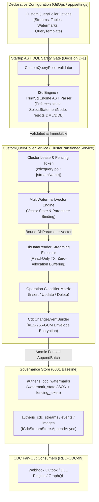
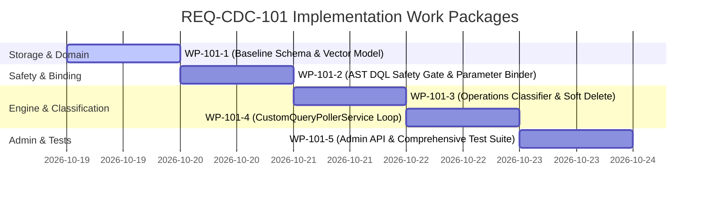

# Implementation Plan: REQ-CDC-101 - Governed Multi-Watermark Query Poller for Heterogeneous Sources

**Document ID:** `PLAN-CDC-101`  
**Date:** 2026-10-19  
**Phase:** 2 (Solution Architect, `csharp-architect`)  
**Input:** [PRD REQ-CDC-101](2026-10-19-req-issue-101-governed-multi-watermark-poller.md)  
**Parent Plan:** [00-master-plan-overview.md](00-master-plan-overview.md)  
**Target Branch:** `feat/issue-101-multi-watermark-poller`  
**Status:** APPROVED WITH CONDITIONS (Phase 3 Security Reviewed)  

**Binding Project Constraints:**
- **No upgrade or repair migrations:** Governance schema adjustments must be made in the `0001` baseline DDL for SQLite, PostgreSQL, and SQL Server in place, alongside updated schema-shape snapshots in `src/Autheris.Infrastructure/Persistence/Migrations/Shape/` and their verification tests.
- **Autheris is pre-production:** Breaking changes are permitted.
- **Least privilege on data sources:** Strictly read-only DQL (`SELECT`) permissions on target source tables/views; no elevated replication privileges, no DDL, and no write permissions.
- **Zero-Trust & Fail-Closed:** Dynamic SQL string concatenation is strictly forbidden; administrative queries must be vetted via AST parsing at startup and executed strictly using parameterized queries (`DbParameter`).

---

## 1. Executive Summary & Problem Context

Enterprise data architectures frequently incorporate heterogeneous relational stores (e.g., PostgreSQL without logical replication grants, SQL Server without Change Tracking enabled, Oracle, MySQL, SQLite, or legacy database views with soft deletes). While native transaction-log CDC is optimal where available, enterprise gateway service accounts are routinely denied the high-privilege permissions required to provision replication slots or transactional change tables.

Traditional naive query polling using a single timestamp column (`WHERE updated_at > @watermark`) exhibits catastrophic failure modes in production:
1. **Insert vs. Update Disconnect:** In databases where `created_at` is set on row creation and `updated_at` is only populated upon subsequent modification, single-watermark polling either misses newly inserted rows or skips updates due to clock skew across application servers.
2. **Soft Deletes Missing or Conflated:** Soft-deleted records (e.g., setting `deleted_at = @now` or `is_deleted = 1`) are missed if `updated_at` is not bumped upon deletion, or are mistakenly emitted as updates rather than deletions.
3. **Multi-Watermark Vector Divergence:** Real-world entities advance along independent dimensions (`created_at`, `updated_at`, `deleted_at`, `id`, `sequence`). Any of these independent vectors may advance between polling intervals.
4. **SQL Injection & Cache Thrashing:** Ad-hoc poller scripts relying on string interpolation introduce critical SQL injection vulnerabilities and cause RDBMS query plan cache pollution.

**PLAN-CDC-101** introduces the **Governed Multi-Watermark Query Poller**:
- A declarative, zero-trust polling engine that tracks an $N$-dimensional **Multi-Watermark Vector** across arbitrary configured columns (`created_at`, `updated_at`, `deleted_at`, `id`, etc.).
- Enforces a **Fail-Closed AST DQL Safety Gate** at startup using `ISqlEngine` / `TrinoSqlEngine` to verify queries are strictly read-only single `SELECT` statements with zero DML, DDL, or multi-statement injections.
- Implements strict **Parameterized Query Binding** using typed `DbParameter` instances for all vector dimensions (`@p_wm_<name>`), guaranteeing zero SQL injection and optimal query plan caching.
- Employs an **Operations Classifier Matrix** that evaluates soft-delete rules and compares row images against `autheris_cdc_row_images` to accurately emit `Insert`, `Update`, or `Delete` operations.
- Atomically commits events and vector state into the durable, encrypted `ICdcStreamStore` pipeline established in [PLAN-CDC-99](2026-10-15-plan-issue-99-cdc-fanout-and-hardening.md), enabling downstream fan-out to Webhooks, C# DLL plugins, and GraphQL subscriptions with AES-256-GCM encryption and Casbin ABAC.

---

## 2. Verified Code Facts Beyond the PRD

| # | Code Fact & Source Reference | Architectural Consequence for PLAN-CDC-101 |
|---|---|---|
| **V-1** | [`CdcStreamSqlCore.cs:251-285`](file:///root/autheris/src/Autheris.Infrastructure/Persistence/CdcStreamSqlCore.cs#L251-L285) implements `UpsertWatermarkAsync` for SQLite, PostgreSQL, and SQL Server, updating `watermark`, `fencing_token`, `updated_at`, `updated_by`. | The `0001` baseline schema and `CdcStreamSqlCore` can be cleanly extended with `watermark_state TEXT NULL` across all three engines without introducing new tables or out-of-transaction writes. |
| **V-2** | [`CdcAppendBatch`](file:///root/autheris/src/Autheris.Domain/Model/CdcStreamModels.cs#L143-L146) binds `StreamId`, `Source`, `Table`, `FencingToken`, `ExpectedHeadOffset`, `NewWatermark`, `Events`, `ImageWrites`. | Add optional `string? WatermarkState = null` to `CdcAppendBatch`. `CdcStreamSqlCore.UpsertWatermarkAsync` persists this JSON state in the exact same atomic transaction as the stream event append and head-offset CAS. |
| **V-3** | [`ISqlEngine.cs:41-50`](file:///root/autheris/src/Autheris.src/TrinoSqlEngine/ISqlEngine.cs#L41-L50) and [`ISqlQueryAnalyzer.cs:28-46`](file:///root/autheris/src/TrinoSqlEngine/Analysis/ISqlQueryAnalyzer.cs#L28-L46) provide AST parsing and semantic statement analysis returning `SqlQueryMetadata` with `SqlStatementType`. | The poller validator can parse `QueryTemplate` at startup using `ISqlEngine.Parse` and `ISqlQueryAnalyzer.Analyze`. It verifies that statement type is strictly `SqlStatementType.Select` and disallows DML/DDL or multi-statements without ad-hoc regex checks. |
| **V-4** | [`SqlStatement.cs:13-17, 66-114`](file:///root/autheris/src/TrinoSqlEngine/Ast/Nodes/SqlStatement.cs#L13-L114) defines strongly-typed AST nodes (`SelectStatement`, `InsertStatement`, `UpdateStatement`, `DeleteStatement`, `MergeStatement`). | AST inspection verifies that the root is strictly `SelectStatement` and inspects `QueryBody` to ensure no `INTO` or side-effecting clauses exist. |
| **V-5** | [`ClusterPartitionedService.cs`](file:///root/autheris/src/Autheris.Application/Hosting/ClusterPartitionedService.cs) coordinates distributed partitioned lease loops with fencing tokens and exponential failure tracking. | `CustomQueryPollerService` inherits directly from `ClusterPartitionedService`, assigning one partitioned lease loop per custom stream (`cdc:query:poll:{streamName}`). The cluster lease token becomes the transactional fencing token. |
| **V-6** | [`CdcChangeEventBuilder.cs:53-120`](file:///root/autheris/src/Autheris.Extensions/Cdc/CdcChangeEventBuilder.cs#L53-L120) takes `CdcSourceRow`, loads last-row images via `ICdcStreamStore.GetRowImagesAsync`, enforces tenant scoping, and encrypts payloads with AES-256-GCM. | The query poller maps classified source rows into `CdcSourceRow` records, allowing complete reuse of `CdcChangeEventBuilder` for image fingerprinting, tenant attribution, and envelope encryption. |
| **V-7** | Baseline migrations in [`SqliteBaselineSchema.cs:458-468`](file:///root/autheris/src/Autheris.Infrastructure/Persistence/Migrations/SqliteBaselineSchema.cs#L458-L468), [`PostgreSqlBaselineSchema.cs:468-478`](file:///root/autheris/src/Autheris.Infrastructure/Persistence/Migrations/PostgreSqlBaselineSchema.cs#L468-L478), and [`SqlServerBaselineSchema.cs:540-551`](file:///root/autheris/src/Autheris.Infrastructure/Persistence/Migrations/SqlServerBaselineSchema.cs#L540-L551) declare `autheris_cdc_watermarks`. | Following the binding repository constraint, `watermark_state TEXT NULL` is added in place to `autheris_cdc_watermarks` in all three baseline schema classes, and the shape snapshots under `Shape/` are updated. |
| **V-8** | [`CdcActivationCodes`](file:///root/autheris/src/Autheris.Domain/Model/CdcStreamModels.cs#L54-L72) defines stable error codes logged once per streak for metrics and stream status. | Add stable activation codes `CDC_QUERY_AST_INVALID`, `CDC_QUERY_PARAMETER_MISSING`, and `CDC_WATERMARK_STATE_CORRUPT` to `CdcActivationCodes`. |

---

## 3. Architecture Decisions



### Decision D-1: Startup AST DQL Safety Gate & Fail-Closed Validation
- **AST Parsing:** At host startup or options reload, every declared `QueryTemplate` is parsed via `ISqlEngine.Parse(query)`.
- **Structural Invariants:**
  1. The AST must parse into exactly one statement; the ANTLR token stream following the statement must contain only `Eof`. Multi-statement SQL (e.g. `SELECT 1; DROP TABLE users;`) is immediately rejected.
  2. The root statement must be an instance of `SelectStatement`. Any `InsertStatement`, `UpdateStatement`, `DeleteStatement`, `MergeStatement`, or DDL statement causes immediate startup failure.
  3. `SELECT ... INTO` constructs are rejected.
  4. User query templates cannot reference dynamic string concatenation tokens. Every watermark dimension declared in configuration must correspond to a required parameter token `@p_wm_<name>` present in the query template.
- **Fail-Closed Semantics:** Any violation throws `GovernedCdcConfigurationException` or marks the stream with `CDC_QUERY_AST_INVALID`, preventing execution before any source connection is initiated.

### Decision D-2: Multi-Watermark Vector Schema & Monotonic Advancement
- **Vector Definition:** Instead of a single scalar watermark, the poller tracks a multidimensional state vector represented as `MultiWatermarkVector`.
- **Dimensions:** Supports typed dimensions (`DateTimeOffset`, `Int64`, `Int32`, `String`/Lexicographic, `Guid`).
- **Advancement Algorithm:**
  1. For each batch of rows returned by the query:
     - For each dimension $d$, compute $\text{MaxVal}(d) = \max_{r \in \text{Batch}} (r[d])$.
     - Compute candidate vector $\text{NewVector}[d] = \max(\text{CurrentVector}[d], \text{MaxVal}(d))$.
  2. Monotonic synthetic sequence: For compatibility with legacy `ICdcWatermarkRepository.GetAsync` readers expecting a scalar `long`, a monotonic synthetic watermark (millisecond timestamp + batch index counter) is calculated alongside the serialized vector JSON.
  3. Optimistic Concurrency: Persisted in `autheris_cdc_watermarks.watermark_state` conditioned on `fencing_token >= current_token`. If a split-brain poller attempts to commit with a superseded lease token, the update returns 0 affected rows and throws `FencingTokenRejectedException`.

### Decision D-3: Strict Parameterized Query Binding (Zero SQL Concatenation)
- **Parameter Naming Standard:** All dimension parameters are bound as `@p_wm_{dimension_name}` (e.g., `@p_wm_created_at`, `@p_wm_updated_at`, `@p_wm_id`).
- **Batch Size Parameter:** Batch pagination is parameterized via `@p_batch_size`.
- **Type-Safe Injection:** Parameters are created via `DbCommand.CreateParameter()` with explicit `DbType` mapped from the dimension definition. No string formatting or interpolation is permitted.
- **Dialect Portability:** Parameter naming conventions (`@` for SQL Server/SQLite, `@` or `:` for PostgreSQL) are handled by the registered `ISqlDialectProvider`.

### Decision D-4: Operation Classification Matrix & Soft-Delete Mapper
A query-polled result set does not include database-native transaction logs. The poller classifies rows according to the following decision table:

| Evaluation Order | Row Condition | Classified Operation | Downstream Event Action |
|:---|:---|:---:|:---|
| **1. Soft-Delete** | `SoftDelete.Enabled == true` AND (`deleted_at IS NOT NULL` OR `is_deleted == true` OR `status == SoftDelete.DeletedValue`) | **`CdcOperation.Delete`** | Emits `Delete` operation; row image in `autheris_cdc_row_images` is scheduled for removal/tombstone. |
| **2. Prior Image Absent & Timestamp Equality** | Prior image not found in `autheris_cdc_row_images` AND (`updated_at == created_at` OR `updated_at IS NULL`) | **`CdcOperation.Insert`** | Emits `Insert` operation with `Before = null` and `After = row`. Row image stored in `autheris_cdc_row_images`. |
| **3. Timestamp Advanced OR Prior Image Exists** | Prior image exists in `autheris_cdc_row_images` AND payload hash differs | **`CdcOperation.Update`** | Emits `Update` operation with `Before = prior_image` and `After = row`. Image updated in store. |
| **4. Payload Identity (Deduplication Gate)** | Prior image exists and after-image payload is byte-for-byte identical | **Suppressed (No-Op)** | Emits **nothing**. Eliminates downstream event churn caused by watermark OR-predicate overlaps. |

### Decision D-5: Atomic Persistence via `ICdcStreamStore.AppendAsync`
- The poller does not bypass `ICdcStreamStore`. It produces batches into `ICdcStreamStore.AppendAsync`, guaranteeing:
  - Fenced watermark and vector upsert in the same transaction as event insertion.
  - Verification of `producer_fencing_token` against `head_offset`.
  - Full payload envelope encryption (AES-256-GCM) with stream DEKs.
  - Downstream wake-up notification via `ICdcStreamSignal.NotifyAdvanced(streamId, newHead)`.

### Decision D-6: Cluster Partitioning & Distributed Poller Leases
- `CustomQueryPollerService` extends `ClusterPartitionedService`.
- **Partition Key:** `cdc:query:poll:{streamName}`.
- **Lease TTL:** `max(15s, 3 * PollingInterval)`.
- If a poller loses its lease during a slow query, the lease lost token triggers cancellation, and any subsequent transaction commit fails against the fencing token check in `autheris_cdc_watermarks`.

### Decision D-7: Administrative Watermark Reset & State Inspection
- Adds `POST /api/v1/cdc/streams/{id}/reset-watermark` accepting `ResetWatermarkRequest(IReadOnlyDictionary<string, string> Dimensions, string Justification)`.
- Enforces governance admin role (`cdc_all`) and records an immutable audit log entry (`CDC_STREAM_WATERMARK_RESET`).

---

## 4. Multi-Watermark Vector State & Parameterized Binding Engine (WP-101-2)

### 4.1 Domain Vector Model
```csharp
namespace Autheris.Domain.Model;

public sealed record MultiWatermarkVector
{
    public static readonly MultiWatermarkVector Empty = new(new Dictionary<string, string>(StringComparer.OrdinalIgnoreCase));

    public IReadOnlyDictionary<string, string> Dimensions { get; init; }

    public MultiWatermarkVector(IReadOnlyDictionary<string, string> dimensions)
    {
        Dimensions = new Dictionary<string, string>(dimensions, StringComparer.OrdinalIgnoreCase);
    }

    public string? GetValue(string dimensionName) =>
        Dimensions.TryGetValue(dimensionName, out var value) ? value : null;

    public MultiWatermarkVector AdvanceDimension(string dimensionName, string newValue)
    {
        var updated = new Dictionary<string, string>(Dimensions, StringComparer.OrdinalIgnoreCase)
        {
            [dimensionName] = newValue
        };
        return new MultiWatermarkVector(updated);
    }

    public string ToJson() => JsonSerializer.Serialize(Dimensions);

    public static MultiWatermarkVector FromJson(string? json)
    {
        if (string.IsNullOrWhiteSpace(json)) return Empty;
        var dict = JsonSerializer.Deserialize<Dictionary<string, string>>(json);
        return dict is not null ? new MultiWatermarkVector(dict) : Empty;
    }
}
```

### 4.2 Parameterized Query Binder
`QueryPollerParameterBinder` translates the active vector state into strongly typed `DbParameter` instances for the execution command:
```csharp
namespace Autheris.Extensions.Cdc;

public sealed class QueryPollerParameterBinder
{
    public static void BindParameters(
        DbCommand cmd,
        IReadOnlyList<WatermarkDimensionOptions> dimensions,
        MultiWatermarkVector currentVector,
        int batchSize)
    {
        foreach (var dim in dimensions)
        {
            var p = cmd.CreateParameter();
            p.ParameterName = dim.ParameterName.StartsWith('@') ? dim.ParameterName : "@" + dim.ParameterName;
            
            var rawValue = currentVector.GetValue(dim.Name) ?? dim.InitialValue;
            p.DbType = MapToDbType(dim.Type);
            p.Value = ParseTypedValue(rawValue, dim.Type);
            cmd.Parameters.Add(p);
        }

        var batchParam = cmd.CreateParameter();
        batchParam.ParameterName = "@p_batch_size";
        batchParam.DbType = DbType.Int32;
        batchParam.Value = batchSize;
        cmd.Parameters.Add(batchParam);
    }

    private static DbType MapToDbType(WatermarkDimensionType type) => type switch
    {
        WatermarkDimensionType.DateTimeOffset => DbType.DateTimeOffset,
        WatermarkDimensionType.Int64 => DbType.Int64,
        WatermarkDimensionType.Int32 => DbType.Int32,
        WatermarkDimensionType.String => DbType.String,
        _ => DbType.String
    };

    private static object ParseTypedValue(string? raw, WatermarkDimensionType type)
    {
        if (raw is null) return DBNull.Value;
        return type switch
        {
            WatermarkDimensionType.DateTimeOffset => DateTimeOffset.Parse(raw, CultureInfo.InvariantCulture),
            WatermarkDimensionType.Int64 => long.Parse(raw, CultureInfo.InvariantCulture),
            WatermarkDimensionType.Int32 => int.Parse(raw, CultureInfo.InvariantCulture),
            _ => raw
        };
    }
}
```

---

## 5. Zero-Trust AST Read-Only DQL Safety Gate (WP-101-1)

`CustomQueryPollerValidator` inspects every declared query during initialization:

```csharp
namespace Autheris.Application.Streaming.Validation;

public sealed class CustomQueryPollerValidator
{
    private readonly ISqlEngine _sqlEngine;

    public CustomQueryPollerValidator(ISqlEngine sqlEngine)
    {
        _sqlEngine = sqlEngine ?? throw new ArgumentNullException(nameof(sqlEngine));
    }

    public ValidationResult ValidatePollerOptions(CustomQueryPollerStreamOptions poller)
    {
        if (string.IsNullOrWhiteSpace(poller.StreamName))
            return ValidationResult.Fail("StreamName is required.");
        if (string.IsNullOrWhiteSpace(poller.QueryTemplate))
            return ValidationResult.Fail("QueryTemplate cannot be empty.");
        if (poller.KeyColumns == null || poller.KeyColumns.Count == 0)
            return ValidationResult.Fail("At least one declared primary key column is required.");
        if (poller.Watermarks == null || poller.Watermarks.Count == 0)
            return ValidationResult.Fail("At least one watermark dimension is required.");

        // AST DQL Safety Gate
        try
        {
            var (tree, tokens) = _sqlEngine.Parse(poller.QueryTemplate.AsMemory());
            
            // Verify single statement: EOF immediately following the statement
            if (tokens.Get(tokens.Size - 1).Type != SqlBaseLexer.Eof)
            {
                return ValidationResult.Fail("Multiple SQL statements detected. Strictly single statement allowed.");
            }

            var metadata = _sqlEngine.Analyze(poller.QueryTemplate.AsMemory());
            if (metadata.StatementType != SqlStatementType.Select)
            {
                return ValidationResult.Fail($"Forbidden statement type '{metadata.StatementType}'. Only SELECT statements are permitted.");
            }

            // Verify AST tree directly for SelectStatementNode
            if (tree.statement() is not SqlBaseParser.SingleStatementContext singleStmt ||
                singleStmt.statement() is not SqlBaseParser.StatementDefaultContext stmtDefault ||
                stmtDefault.query() is null)
            {
                return ValidationResult.Fail("Query root is not a standard SELECT query.");
            }

            // Ensure all declared parameters exist in query template
            foreach (var wm in poller.Watermarks)
            {
                var paramToken = "@" + wm.ParameterName.TrimStart('@');
                if (!poller.QueryTemplate.Contains(paramToken, StringComparison.OrdinalIgnoreCase))
                {
                    return ValidationResult.Fail($"QueryTemplate does not contain required parameter token '{paramToken}' for watermark '{wm.Name}'.");
                }
            }

            return ValidationResult.Success();
        }
        catch (Exception ex)
        {
            return ValidationResult.Fail($"AST validation failed closed: {ex.Message}");
        }
    }
}
```

---

## 6. Operations Classifier & Soft-Delete Mapper (WP-101-3)

The operation classifier evaluates source records and integrates image fingerprints:

```csharp
namespace Autheris.Extensions.Cdc;

public sealed class CdcOperationClassifier
{
    public static CdcOperation ClassifyRow(
        IReadOnlyDictionary<string, object?> row,
        SoftDeleteOptions? softDelete,
        IReadOnlyDictionary<string, object?>? priorImage,
        IReadOnlyList<WatermarkDimensionOptions> dimensions)
    {
        // 1. Soft-Delete check
        if (softDelete != null && softDelete.Enabled && IsSoftDeleted(row, softDelete))
        {
            return CdcOperation.Delete;
        }

        // 2. Insert check (no prior image, or created_at == updated_at)
        if (priorImage == null)
        {
            return CdcOperation.Insert;
        }

        // 3. Update check
        return CdcOperation.Update;
    }

    public static bool IsPayloadIdentical(
        IReadOnlyDictionary<string, object?> current,
        IReadOnlyDictionary<string, object?> prior)
    {
        if (current.Count != prior.Count) return false;
        foreach (var (k, v1) in current)
        {
            if (!prior.TryGetValue(k, out var v2)) return false;
            if (!Equals(v1, v2)) return false;
        }
        return true;
    }

    private static bool IsSoftDeleted(IReadOnlyDictionary<string, object?> row, SoftDeleteOptions opt)
    {
        if (!row.TryGetValue(opt.Column, out var val) || val is null or DBNull)
            return false;

        return opt.Strategy switch
        {
            SoftDeleteStrategy.NotNullTimestamp => true,
            SoftDeleteStrategy.BooleanFlag => val is true or 1 or "1" or "true" or "True",
            SoftDeleteStrategy.StringStatus => string.Equals(val.ToString(), opt.DeletedValue, StringComparison.OrdinalIgnoreCase),
            _ => false
        };
    }
}
```

---

## 7. ICdcStreamStore Integration & Polling Loop (WP-101-4)

### 7.1 Poller Service Lifecycle
`CustomQueryPollerService` coordinates execution as a `ClusterPartitionedService`:
```csharp
namespace Autheris.Extensions.Cdc;

public sealed class CustomQueryPollerService : ClusterPartitionedService
{
    private readonly IOptionsMonitor<CustomQueryPollerOptions> _options;
    private readonly ICdcStreamStore _streamStore;
    private readonly ICdcChangeEventBuilder _eventBuilder;
    private readonly IDataSourceConnectionFactory _connectionFactory;
    private readonly ICdcStreamSignal _signal;
    private readonly ILogger<CustomQueryPollerService> _logger;

    public CustomQueryPollerService(
        IOptionsMonitor<CustomQueryPollerOptions> options,
        ICdcStreamStore streamStore,
        ICdcChangeEventBuilder eventBuilder,
        IDataSourceConnectionFactory connectionFactory,
        ICdcStreamSignal signal,
        IDistributedClusterStateProvider clusterState,
        ILogger<CustomQueryPollerService> logger,
        TimeProvider? timeProvider = null)
        : base(clusterState, logger, timeProvider)
    {
        _options = options;
        _streamStore = streamStore;
        _eventBuilder = eventBuilder;
        _connectionFactory = connectionFactory;
        _signal = signal;
        _logger = logger;
    }

    protected override IReadOnlyList<ClusterPartition> GetPartitions()
    {
        var opt = _options.CurrentValue;
        if (!opt.Enabled) return [];

        return opt.Pollers.Select(p => new ClusterPartition(
            $"cdc:query:poll:{p.StreamName.ToLowerInvariant()}",
            new ClusterSchedule(true, TimeSpan.FromMilliseconds(p.PollingIntervalMilliseconds), TimeSpan.Zero,
                TimeSpan.FromSeconds(Math.Max(15, (p.PollingIntervalMilliseconds * 3) / 1000)), TimeSpan.Zero)
        )).ToList();
    }

    protected override async Task ExecutePartitionAsync(ClusterPartition partition, ClusterJobContext context, CancellationToken ct)
    {
        var streamName = partition.Key.Replace("cdc:query:poll:", string.Empty);
        var settings = _options.CurrentValue.Pollers.FirstOrDefault(p => p.StreamName.Equals(streamName, StringComparison.OrdinalIgnoreCase));
        if (settings is null) return;

        await PollStreamBatchAsync(settings, context.FencingToken, ct).ConfigureAwait(false);
    }

    private async Task PollStreamBatchAsync(CustomQueryPollerStreamOptions poller, long fencingToken, CancellationToken ct)
    {
        // 1. Ensure stream descriptor exists
        var tableId = TableIdentifier.Parse(poller.Table);
        var stream = await _streamStore.EnsureStreamAsync("query_poller", tableId, ct).ConfigureAwait(false);

        // 2. Acquire read connection with Read-Only transaction semantics
        await using var conn = await _connectionFactory.CreateConnectionAsync(poller.DataSource, ct).ConfigureAwait(false);
        await conn.OpenAsync(ct).ConfigureAwait(false);

        // 3. Load active watermark vector
        var vectorRecord = await _streamStore.GetWatermarkVectorAsync(stream.Id, ct).ConfigureAwait(false);
        var vector = vectorRecord?.Vector ?? MultiWatermarkVector.Empty;

        // 4. Construct Command & Bind Parameters
        await using var cmd = conn.CreateCommand();
        cmd.CommandText = poller.QueryTemplate;
        cmd.CommandTimeout = poller.QueryTimeoutSeconds;
        QueryPollerParameterBinder.BindParameters(cmd, poller.Watermarks, vector, poller.BatchSize);

        // 5. Stream read batch
        var rawRows = new List<Dictionary<string, object?>>();
        await using (var reader = await cmd.ExecuteReaderAsync(CommandBehavior.SequentialAccess, ct).ConfigureAwait(false))
        {
            while (await reader.ReadAsync(ct).ConfigureAwait(false))
            {
                var row = new Dictionary<string, object?>(reader.FieldCount, StringComparer.OrdinalIgnoreCase);
                for (var i = 0; i < reader.FieldCount; i++)
                {
                    row[reader.GetName(i)] = reader.IsDBNull(i) ? null : reader.GetValue(i);
                }
                rawRows.Add(row);
            }
        }

        if (rawRows.Count == 0)
        {
            await _streamStore.TouchPolledAsync(stream.Id, DateTimeOffset.UtcNow, ct).ConfigureAwait(false);
            return;
        }

        // 6. Compute Next MultiWatermarkVector & Classify Rows
        var (sourceRows, nextVector) = await ProcessBatchRowsAsync(stream, poller, rawRows, vector, ct).ConfigureAwait(false);
        if (sourceRows.Count == 0) return; // All were identical no-ops

        // 7. Build encrypted event batch & row images
        var built = await _eventBuilder.BuildChangesAsync(stream, sourceRows, ct).ConfigureAwait(false);

        // 8. Commit atomic append batch with updated vector JSON and fencing token
        var appendBatch = new CdcAppendBatch(
            stream.Id,
            "query_poller",
            tableId,
            fencingToken,
            stream.HeadOffset,
            NewWatermark: DateTimeOffset.UtcNow.ToUnixTimeMilliseconds(),
            built.Events,
            built.ImageWrites,
            WatermarkState: nextVector.ToJson()
        );

        await _streamStore.AppendAsync(appendBatch, ct).ConfigureAwait(false);

        // 9. Signal advanced
        await _signal.NotifyAdvancedAsync(stream.Id, built.NewHead, ct).ConfigureAwait(false);
    }
}
```

---

## 8. Clean Architecture Layering & Component Model

The implementation strictly respects Autheris Clean Architecture boundaries:

```
src/
├── Autheris.Domain/
│   ├── Model/
│   │   ├── MultiWatermarkVector.cs           # Pure immutable vector state record
│   │   ├── WatermarkDimensionDefinition.cs   # Dimension configuration models
│   │   └── CdcStreamModels.cs                # Extended CdcAppendBatch with WatermarkState
│   └── Options/
│       └── CustomQueryPollerOptions.cs       # Declarative poller configuration models
│
├── Autheris.Application/
│   └── Streaming/
│       ├── Validation/
│       │   └── CustomQueryPollerValidator.cs # Startup AST DQL Safety Gate
│       └── Interfaces/
│           ├── ICdcOperationClassifier.cs    # Classification abstraction
│           └── IWatermarkVectorStore.cs      # Vector retrieval abstraction
│
├── Autheris.Infrastructure/
│   └── Persistence/
│       ├── Migrations/
│       │   ├── SqliteBaselineSchema.cs       # Added watermark_state column
│       │   ├── PostgreSqlBaselineSchema.cs   # Added watermark_state column
│       │   ├── SqlServerBaselineSchema.cs    # Added watermark_state column
│       │   └── Shape/governance-shape.*.json # Updated shape snapshots
│       └── CdcStreamSqlCore.cs               # Parameterized vector upsert across 3 engines
│
├── Autheris.Extensions/Cdc/
│   ├── CustomQueryPollerService.cs           # ClusterPartitionedService runner
│   ├── QueryPollerParameterBinder.cs         # Zero-injection DbParameter builder
│   ├── CdcOperationClassifier.cs             # Soft-delete & change classifier
│   └── CustomQueryPollerActivation.cs        # Activation & lifecycle manager
│
└── Autheris.Api/
    └── Endpoints/
        └── CdcStreamAdminEndpoints.cs        # Watermark reset admin endpoint
```

---

## 9. Governance Schema Baseline Migration (`0001` Baseline)

In compliance with the binding project rule (*no upgrade or repair migrations*), `watermark_state` is incorporated directly into the `0001` baseline schema.

### 9.1 Schema Modifications
1. **SQLite Baseline (`SqliteBaselineSchema.cs`):**
   ```sql
   CREATE TABLE IF NOT EXISTS autheris_cdc_watermarks (
       source TEXT NOT NULL,
       domain_name TEXT NOT NULL,
       schema_name TEXT NOT NULL,
       table_name TEXT NOT NULL,
       watermark INTEGER NOT NULL,
       fencing_token INTEGER NOT NULL,
       updated_at TEXT NOT NULL,
       updated_by TEXT NOT NULL,
       watermark_state TEXT NULL,
       PRIMARY KEY (source, domain_name, schema_name, table_name)
   );
   ```
2. **PostgreSQL Baseline (`PostgreSqlBaselineSchema.cs`):**
   ```sql
   CREATE TABLE IF NOT EXISTS autheris_cdc_watermarks (
       source TEXT NOT NULL,
       domain_name TEXT NOT NULL,
       schema_name TEXT NOT NULL,
       table_name TEXT NOT NULL,
       watermark BIGINT NOT NULL,
       fencing_token BIGINT NOT NULL,
       updated_at TEXT NOT NULL,
       updated_by TEXT NOT NULL,
       watermark_state TEXT NULL,
       PRIMARY KEY (source, domain_name, schema_name, table_name)
   );
   ```
3. **SQL Server Baseline (`SqlServerBaselineSchema.cs`):**
   ```sql
   IF OBJECT_ID(N'dbo.autheris_cdc_watermarks', N'U') IS NULL
   CREATE TABLE dbo.autheris_cdc_watermarks (
       source NVARCHAR(64) NOT NULL,
       domain_name NVARCHAR(64) NOT NULL,
       schema_name NVARCHAR(64) NOT NULL,
       table_name NVARCHAR(128) NOT NULL,
       watermark BIGINT NOT NULL,
       fencing_token BIGINT NOT NULL,
       updated_at NVARCHAR(64) NOT NULL,
       updated_by NVARCHAR(64) NOT NULL,
       watermark_state NVARCHAR(MAX) NULL,
       CONSTRAINT PK_autheris_cdc_watermarks PRIMARY KEY (source, domain_name, schema_name, table_name)
   );
   ```
4. **Snapshot Shape Verification:**
   Update the snapshot JSON shapes:
   - `src/Autheris.Infrastructure/Persistence/Migrations/Shape/governance-shape.sqlite.json`
   - `src/Autheris.Infrastructure/Persistence/Migrations/Shape/governance-shape.postgresql.json`
   - `src/Autheris.Infrastructure/Persistence/Migrations/Shape/governance-shape.sqlserver.json`

---

## 10. .NET 10 Zero-Allocation Performance Blueprint

High-throughput polling loops must avoid garbage collector pressure on idle or frequent iterations:
1. **Streaming Reader Iteration:** Use `CommandBehavior.SequentialAccess` with `DbDataReader.ReadAsync(ct)`. Do not use `DataTable` or `ExecuteQueryBufferedAsync`.
2. **Batch Buffer Pooling:** Utilize `ArrayPool<object?>.Shared` to rent temporary buffers when extracting row field values.
3. **Zero Allocations on Idle Iteration:** When a polling cycle returns zero rows (`reader.ReadAsync() == false`), the service performs zero collection allocations and invokes only `TouchPolledAsync`.
4. **Fingerprint Comparisons in Spans:** Compute and compare HMAC row image fingerprints using stack-allocated `ReadOnlySpan<byte>` buffers, completely avoiding hexadecimal string conversion allocations during deduplication.

---

## 11. Security, Zero-Trust & Fail-Closed Invariants

- **SEC-101-1 (Fail-Closed AST Guard):** Any SQL statement failing parser validation or containing non-DQL tokens (`INSERT`, `UPDATE`, `DELETE`, `DROP`, `ALTER`, `EXEC`, `INTO`, `;`) fails startup immediately.
- **SEC-101-2 (Zero Parameter Concatenation):** Parameters are strictly supplied via `DbParameter`. No user-supplied parameters are interpolated into the SQL string.
- **SEC-101-3 (Read-Only Isolation):** Where supported, source database sessions are opened with read-only transaction mode (`SET TRANSACTION READ ONLY`).
- **SEC-101-4 (Fencing Lease Enforcement):** Every batch commit checks `fencing_token >= current_token`. Stale producers are denied immediately.
- **SEC-101-5 (Encrypted Storage at Rest):** All change payloads appended to `ICdcStreamStore` are envelope-encrypted with stream-specific AES-256-GCM DEKs.

---

## 12. Implementation Work Packages



### WP-101-1: Baseline Schema Extension & Domain Vector Models
- **Deliverables:**
  - Update `0001` baseline schema in `SqliteBaselineSchema.cs`, `PostgreSqlBaselineSchema.cs`, and `SqlServerBaselineSchema.cs` to include `watermark_state TEXT NULL`.
  - Update governance schema shape snapshots and verify baseline tests pass.
  - Model `MultiWatermarkVector`, `WatermarkDimensionDefinition`, and `CustomQueryPollerOptions` in `Autheris.Domain`.
  - Extend `CdcAppendBatch` with `WatermarkState` property.
  - Update `CdcStreamSqlCore.cs` to persist `watermark_state` in `UpsertWatermarkAsync`.

### WP-101-2: AST DQL Safety Gate & Parameterized Binder
- **Deliverables:**
  - Implement `CustomQueryPollerValidator` in `Autheris.Application.Streaming.Validation`.
  - Integrate with `ISqlEngine` to verify single-statement `SelectStatement` AST invariant.
  - Implement `QueryPollerParameterBinder` in `Autheris.Extensions/Cdc/` to inject typed `DbParameter` objects.

### WP-101-3: Operations Classifier & Soft-Delete Mapper
- **Deliverables:**
  - Implement `CdcOperationClassifier` evaluating `SoftDeleteOptions` and row comparisons.
  - Implement payload deduplication gate to suppress redundant stream events.
  - Add unit test suite validating Insert, Update, Soft-Delete, and No-Op suppression matrices.

### WP-101-4: CustomQueryPollerService & Streaming Pipeline Integration
- **Deliverables:**
  - Implement `CustomQueryPollerService : ClusterPartitionedService` in `Autheris.Extensions/Cdc/`.
  - Implement read-only streaming fetch loop, row classification, and `CdcChangeEventBuilder` integration.
  - Commit batches via `ICdcStreamStore.AppendAsync` with AES-256-GCM encryption and fencing tokens.
  - Wire up dependency injection in `Autheris.Extensions/Cdc/CdcSourceServiceCollectionExtensions.cs`.

### WP-101-5: Admin Reset API & Verification Test Suite
- **Deliverables:**
  - Implement `POST /api/v1/cdc/streams/{id}/reset-watermark` in `CdcStreamAdminEndpoints.cs`.
  - Add end-to-end integration tests using SQLite and PostgreSQL test containers:
    - Multi-watermark advancement on independent columns.
    - Soft-delete event classification (`Delete`).
    - Malicious DML injection rejection at startup.
    - Split-brain poller fencing rejection (`FencingTokenRejectedException`).
    - Downstream webhook and GraphQL subscriber delivery.

---

## 13. Comprehensive Verification & Acceptance Matrix

| Requirement | Acceptance Criteria | Verification Test Suite |
|:---|:---|:---|
| **AC-1.1 / AC-1.2** | AST validator rejects DML, DDL, multi-statement, or non-SELECT queries. | `CustomQueryPollerAstSafetyTests` (15+ malicious SQL injection test cases) |
| **AC-1.3** | All watermark parameters are bound as `@p_wm_*` without SQL string interpolation. | `QueryPollerParameterBinderTests` verifying parameter collection types and values |
| **AC-2.1 / AC-2.2** | Evaluates multi-watermark OR-predicate; advances element-wise maximum per dimension into `watermark_state`. | `MultiWatermarkVectorAdvancementTests` with independent timestamps and sequences |
| **AC-2.3** | Gateway restart resumes from persisted vector state without missing rows or infinite loops. | `CustomQueryPollerRestartRecoveryTests` simulating restart mid-stream |
| **AC-3.1** | Soft-deleted rows emitted as `CdcOperation.Delete`. | `CdcOperationClassifierTests.SoftDeleteCases` |
| **AC-3.2 / AC-3.3** | Rows with new keys emitted as `Insert`; rows with changed payloads emitted as `Update`. | `CdcOperationClassifierTests.InsertUpdateCases` |
| **AC-3.4** | Overlapping query results with identical payloads emit zero stream events (zero noise). | `CustomQueryPollerDeduplicationTests` |
| **AC-4.1 / AC-4.2** | Appended batches pass through AES-256-GCM encryption and Casbin ABAC filters. | `CustomQueryPollerStreamStoreIntegrationTests` |
| **AC-5.1** | Poller with stale fencing token rejected on commit (`FencingTokenRejectedException`). | `CustomQueryPollerFencingTests` simulating split-brain leases |
| **AC-5.2** | Admin endpoint resets watermark vector with audited justification. | `CdcStreamAdminEndpointsTests.ResetWatermark_Audited` |

---

## 14. Phase 3 Security Review & Binding Conditions (`csharp-security-expert`)

**Review Date:** 2026-10-19  
**Verdict:** APPROVED WITH CONDITIONS  
**Reviewer:** Application Security Expert (`csharp-security-expert`)  
**Evaluation Standard:** Zero-Trust, Fail-Closed, Least Privilege, AST Boundary Verification, Timing Attack Defense

The architectural plan `PLAN-CDC-101` establishes a robust multi-watermark CDC polling architecture over heterogeneous relational stores. To eliminate potential SQL injection, silent NULL starvation, split-brain state corruption, timing vulnerabilities, and administrative leakage, the following security conditions are binding for implementation:

### 14.1 Security Findings & Risk Analysis

| Finding ID | Severity | Description & Security Impact |
|:---|:---:|:---|
| **SEC-CDC101-F01** | High | **AST Parse Escape & Multi-Statement Execution:** Relying solely on token EOF check without validating the ANTLR parse tree root could permit trailing statements or procedural batch execution (`SELECT ...; DROP TABLE ...`) if lexer/parser error recovery kicks in. |
| **SEC-CDC101-F02** | High | **Silent-NULL Watermark Data Starvation:** Binding `DBNull.Value` for missing watermark dimensions in three-valued SQL predicates (`WHERE updated_at > @p_wm_updated_at`) causes evaluations to resolve to `UNKNOWN` (false), causing permanent poller starvation. |
| **SEC-CDC101-F03** | High | **Parameter Injection via Unvalidated Dimension Names:** If `WatermarkDimensionOptions.ParameterName` is not strictly whitelisted, malicious configuration keys could introduce SQL injection or syntax corruption during dialect command building. |
| **SEC-CDC101-F04** | High | **Source Write Privilege & Side-Effect Risk:** If the source database connection or transaction permits writes, user-defined functions or rogue query constructs could alter source tables or execute unvetted DDL/DML. |
| **SEC-CDC101-F05** | High | **Split-Brain Replay & Corrupt State Append:** Without atomic verification of cluster fencing tokens in `autheris_cdc_watermarks`, concurrent pollers during failover could commit conflicting watermarks and duplicate events. |
| **SEC-CDC101-F06** | Medium | **Row Fingerprint Timing Leakage:** Comparing row image hashes using standard `Equals` or byte array equality exposes cryptographic fingerprints to side-channel timing attacks. |
| **SEC-CDC101-F07** | Medium | **Admin Reset Privilege Escalation & Credential Leakage:** Administrative reset of watermark state could allow replay attacks or expose connection strings and credentials in audit logs. |

### 14.2 Binding Security Conditions

1. **`SEC-CDC101-01`: AST DQL Safety Gate & Fail-Closed Statement Whitelist**
   - `CustomQueryPollerValidator` MUST enforce that `ISqlEngine.Parse` yields strictly a single statement terminated by `SqlBaseLexer.Eof`. The parse tree root MUST be verified as `SqlBaseParser.SingleStatementContext` wrapping a `SelectStatement`.
   - The validator MUST verify `ISqlQueryAnalyzer.Analyze` returns `metadata.StatementType == SqlStatementType.Select`. Any DML (`INSERT`, `UPDATE`, `DELETE`, `MERGE`), DDL (`CREATE`, `ALTER`, `DROP`, `TRUNCATE`), or procedural statement (`EXEC`, `EXECUTE`, `CALL`, `sp_executesql`) MUST immediately fail startup.
   - The query AST MUST be inspected to disallow `SELECT ... INTO` clauses, CTEs with data-modifying statements, and calls to dangerous stored/system procedures.
   - Dynamic query string generation or unsanitized client-controlled SQL is strictly forbidden; poller queries MUST originate exclusively from governed administrative configuration.

2. **`SEC-CDC101-02`: Parameterized Binding, Parameter Whitelist & Silent-NULL Defense**
   - Every watermark dimension parameter MUST be bound strictly using `DbCommand.CreateParameter()` with explicit `DbType`. String interpolation or concatenation into SQL text is strictly prohibited.
   - Parameter names MUST match the strict regex `^[a-zA-Z0-9_]+$`. Any declaration violating this pattern MUST fail startup validation.
   - **Silent-NULL Defense:** To prevent SQL three-valued logic starvation (`col > NULL => false`), every dimension in `WatermarkDimensionOptions` MUST define a non-null, valid `InitialValue` (e.g. Unix epoch `'1970-01-01T00:00:00Z'` or `'0'`). If a dimension value is missing or unparseable, startup validation MUST fail closed. Under no circumstances may a watermark dimension predicate bind `DBNull.Value` without explicit NULL-handling logic in the query template.

3. **`SEC-CDC101-03`: Source Execution Isolation & Least Privilege Enforcement**
   - The database connection to source systems MUST require only `CONNECT` and `SELECT` privileges on the polled objects. No `INSERT`, `UPDATE`, `DELETE`, `ALTER`, or elevated replication permissions (`REPLICATION`, `sysadmin`) may be required.
   - Source command execution MUST enforce read-only transaction semantics where supported:
     - PostgreSQL: `SET TRANSACTION READ ONLY;` or transaction scope with `IsolationLevel.ReadCommitted` and read-only intent.
     - SQL Server: Read-only session or `SNAPSHOT` isolation with bounded `CommandTimeout` ($\le 60$s).
     - SQLite: Open connection in `Mode=ReadOnly` or execute `PRAGMA query_only = ON;`.
   - Command timeout MUST be strictly enforced to prevent unconstrained long-running locks or denial-of-service on source databases.

4. **`SEC-CDC101-04`: Stream Transaction Atomicity & Distributed Lease Fencing**
   - Multi-watermark vector state (`watermark_state`) MUST be durably persisted inside the exact same atomic transaction as the stream event batch and head-offset CAS via `ICdcStreamStore.AppendAsync`. Independent or out-of-transaction watermark state updates are strictly forbidden.
   - The poller MUST supply the active cluster partition fencing token (`ClusterJobContext.FencingToken`).
   - The SQL upsert in `autheris_cdc_watermarks` MUST enforce `WHERE fencing_token <= @p_fencing_token`. If zero rows are affected due to an outdated fencing token, `AppendAsync` MUST fail closed with `FencingTokenRejectedException`, terminating the poller batch to prevent split-brain event duplication.

5. **`SEC-CDC101-05`: Envelope Encryption, Fingerprint Timing Defense & Deduplication**
   - All events and row images written to `ICdcStreamStore` and `autheris_cdc_row_images` MUST be envelope-encrypted using AES-256-GCM via `CdcChangeEventBuilder` and stream-specific DEKs. Unencrypted payloads at rest are prohibited.
   - Row image fingerprints and cryptographic hash comparisons in `CdcOperationClassifier` or `CdcChangeEventBuilder` MUST utilize `CryptographicOperations.FixedTimeEquals` to prevent side-channel timing leaks.
   - Identical row deduplication MUST verify both key identity and byte-for-byte image equality, suppressing redundant stream emissions without suppressing legitimate soft deletes.

6. **`SEC-CDC101-06`: Admin Reset Authorization, Audit Immutability & Credential Scrubbing**
   - The administrative endpoint `POST /api/v1/cdc/streams/{id}/reset-watermark` MUST be guarded fail-closed by `.RequireAuthorization("cdc_all")` (Governance Admin policy). Anonymous or unprivileged callers MUST receive HTTP 401/403.
   - Every watermark reset operation MUST emit an immutable audit event `CDC_STREAM_WATERMARK_RESET` via `IAuditWriter.RecordRequiredAsync` (Tier A, FailClosed) recording caller SID, timestamp, stream ID, justification, and before/after vector state.
   - Error messages, logs, and activation status records (`CdcActivationCodes`) MUST sanitize connection strings, database passwords, host credentials, and user data.

### 14.3 Mandatory Security Test Requirements (`[Trait("Category", "Security")]`)

All security invariants MUST be verified by automated tests tagged with `[Trait("Category", "Security")]`:

| Test ID | Test Method Name | Invariant Verified |
|---|---|---|
| **SEC-TEST-CDC101-01** | `CustomQueryPollerValidator_RejectsDmlDdlAndMultiStatement` | Enforces `SEC-CDC101-01`: Rejects `INSERT`, `UPDATE`, `DELETE`, `DROP`, and multi-statement SQL with AST validation failure. |
| **SEC-TEST-CDC101-02** | `CustomQueryPollerValidator_RejectsSelectIntoAndExec` | Enforces `SEC-CDC101-01`: Rejects `SELECT INTO`, stored procedure execution (`EXEC`), and dynamic SQL procedures. |
| **SEC-TEST-CDC101-03** | `QueryPollerParameterBinder_BindsStrictTypedDbParameters` | Enforces `SEC-CDC101-02`: Verifies all watermark dimensions and batch size are bound as typed `DbParameter` instances. |
| **SEC-TEST-CDC101-04** | `QueryPollerParameterBinder_MissingInitialValue_FailsClosed` | Enforces `SEC-CDC101-02`: Declaring a dimension without `InitialValue` fails startup validation, preventing silent NULL starvation. |
| **SEC-TEST-CDC101-05** | `QueryPollerParameterBinder_ParameterNameWithSpecialChars_FailsValidation` | Enforces `SEC-CDC101-02`: Parameter names with non-alphanumeric characters are rejected during validation. |
| **SEC-TEST-CDC101-06** | `CustomQueryPollerService_EnforcesReadOnlyTransactionMode` | Enforces `SEC-CDC101-03`: Verifies that source database connection/session is configured with read-only transaction semantics. |
| **SEC-TEST-CDC101-07** | `CustomQueryPollerService_StaleFencingToken_ThrowsFencingTokenRejected` | Enforces `SEC-CDC101-04`: Poller with superseded lease token fails `AppendAsync` with `FencingTokenRejectedException`. |
| **SEC-TEST-CDC101-08** | `CdcStreamStore_WatermarkState_CommittedInSameTransactionAsEvents` | Enforces `SEC-CDC101-04`: Transaction rollback on event write also rolls back `watermark_state`, guaranteeing stream consistency. |
| **SEC-TEST-CDC101-09** | `CdcOperationClassifier_FingerprintComparison_UsesFixedTimeEquals` | Enforces `SEC-CDC101-05`: Verifies hash comparisons in deduplication use constant-time cryptographic equality. |
| **SEC-TEST-CDC101-10** | `CustomQueryPollerService_EventPayloads_EnvelopeEncryptedWithAes256Gcm` | Enforces `SEC-CDC101-05`: Verifies events and stored row images are encrypted with stream DEKs. |
| **SEC-TEST-CDC101-11** | `ResetWatermarkEndpoint_UnprivilegedCaller_Forbidden` | Enforces `SEC-CDC101-06`: Callers without `cdc_all` role receive HTTP 403 when invoking watermark reset. |
| **SEC-TEST-CDC101-12** | `ResetWatermarkEndpoint_EmitsTierAAuditLog_ZeroCredentialLeakage` | Enforces `SEC-CDC101-06`: Verifies audit emission records justification and vector state with zero password/credential leakage. |

