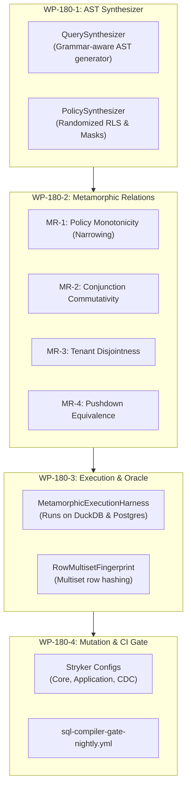

# Implementation Plan: REQ-TEST-180 - Metamorphic & Property-Based RLS Differential Testing

**Document ID:** `PLAN-TEST-180`  
**Date:** 2026-10-19  
**Phase:** 2 (Solution Architect, `csharp-architect`)  
**Input:** [PRD REQ-TEST-180](2026-10-19-req-rls-metamorphic-differential-testing.md)  
**Parent Plan:** [00-master-plan-overview.md](00-master-plan-overview.md)  
**Target Branch:** `feat/differential-rls-testing`  
**Status:** PROPOSED (Phase 2 Architected)  

---

## 1. Executive Summary & Problem Context

Autheris enforces Row-Level Security (RLS), column masking, and virtual filters at compile time by intercepting and transforming queries within the `TrinoSqlEngine` AST compiler. While unit tests and the legacy differential gate (`Autheris.Tests.SqlCompilerGate`) assert correct compilation on static corpora (~150 queries), static tests cannot uncover subtle semantic discrepancies in complex boolean trees, Three-Valued Logic (3VL) NULL interactions, or cross-source federated pushdown optimizations.

**PLAN-TEST-180** establishes an automated, property-based **Metamorphic RLS Differential Testing Framework** within `Autheris.Tests.SqlCompilerGate`:
1. **Property-Based AST Query Synthesizer:** Generates valid, type-checked SQL queries over the canonical `GateModel` schema using deterministic pseudo-random seeds.
2. **Metamorphic Relation (MR) Engine:** Programmatically applies semantic transformations (Narrowing, Commutativity, Disjointness, Pushdown Invariance) to yield paired executions $(Q, Q')$.
3. **Multiset Fingerprint Oracle:** Compares result sets using order-independent cryptographic multiset hashing (SHA-256) to verify mathematical invariants without requiring an external reference implementation.
4. **Expanded Stryker.NET Mutation Testing:** Establishes multi-target mutation testing configurations covering `TrinoSqlEngine`, `Autheris.Application` (Federation and Virtual Filters), and `Autheris.Extensions` (CDC).

---

## 2. Architecture Decisions

### Decision D-180-1: In-Process AST Generation vs. Raw String Fuzzing
- **Context:** Raw SQL string fuzzing produces a high ratio (>95%) of invalid syntax or unresolvable identifier errors, wasting CPU and execution time.
- **Decision:** Build a grammar-aware AST synthesizer (`QuerySynthesizer`) that constructs valid `QuerySpecification` and `SelectStatement` AST nodes directly using the strongly-typed classes in `TrinoSqlEngine.Ast.Nodes`.
- **Rationale:** Guarantees 100% syntactically valid queries with valid table/column references against `GateModel`, focusing test iterations exclusively on semantic compiler logic and RLS enforcement.

### Decision D-180-2: Deterministic Seeding & Minimal Reproducible Cases
- **Context:** When a randomized test fails on CI, developers must be able to reproduce the exact failure locally.
- **Decision:** Every metamorphic test run requires an explicit integer `seed` (e.g. derived from epoch, commit hash, or test index). On violation, the framework outputs:
  - The exact seed and configuration parameters.
  - The un-rewritten base query $Q$ and transformed query $Q'$.
  - The compiled native SQL statements emitted for both legs.
  - The symmetric difference of rows violating the metamorphic invariant.

### Decision D-180-3: Multiset Hashing for Order-Independent Row Comparison
- **Context:** ANSI SQL does not guarantee physical row ordering unless an explicit `ORDER BY` is specified on unique keys. Standard list comparisons would generate false-positive ordering mismatches.
- **Decision:** Implement `RowMultisetFingerprint` using sorted column canonicalization and order-independent cryptographic multiset accumulation:
  $$\text{Fingerprint}(R) = \sum_{r \in R} \text{HMAC-SHA256}(K, \text{SerializeRow}(r)) \pmod{2^{256}}$$
  This allows $O(N)$ verification of set equality, subset containment ($R_1 \subseteq R_2$), and mutual disjointness ($R_1 \cap R_2 = \emptyset$).

---

## 3. Work Packages & Component Blueprint

### WP-180-1: Property-Based AST & Policy Synthesizer
- **Location:** `tests/Autheris.Tests.SqlCompilerGate/Metamorphic/Synthesis/`
- **Components:**
  - `QuerySynthesizer.cs`: Generates `SelectStatement` trees with randomized projections, joins, WHERE clauses, and group-by columns.
  - `PolicySynthesizer.cs`: Synthesizes valid RLS policies (simple equality, range filters, correlated subqueries, tenant boundaries) and column mask definitions (e.g. `Redact`, `Hash`, `PartialMask`).

### WP-180-2: Metamorphic Transformation Engine
- **Location:** `tests/Autheris.Tests.SqlCompilerGate/Metamorphic/Relations/`
- **Components:**
  - `IMetamorphicRelation.cs`: Interface defining `(Query, Policy) -> (QueryVariant, PolicyVariant)` and `Verify(ResultA, ResultB)`.
  - `NarrowingRelation.cs` (MR-1): Injects additional restrictive conjunct $P_{\text{extra}}$; asserts $\mathcal{R}(Q, P \land P_{\text{extra}}) \subseteq \mathcal{R}(Q, P)$.
  - `CommutativityRelation.cs` (MR-2): Permutes order of conjunctions; asserts exact set equality $\mathcal{R}(Q, A \land B) == \mathcal{R}(Q, B \land A)$.
  - `TenantDisjointnessRelation.cs` (MR-3): Generates queries across tenants $T_A$ and $T_B$; asserts $\mathcal{R}(Q, T_A) \cap \mathcal{R}(Q, T_B) = \emptyset$.
  - `PushdownEquivalenceRelation.cs` (MR-4): Compiles federated query with pushdown vs. pure in-memory staging; asserts exact result parity.

### WP-180-3: Execution Harness & Multiset Fingerprinting
- **Location:** `tests/Autheris.Tests.SqlCompilerGate/Metamorphic/Harness/`
- **Components:**
  - `RowMultisetFingerprint.cs`: Computes order-independent SHA-256 multiset fingerprints and performs set subset / disjointness checks.
  - `MetamorphicExecutionHarness.cs`: Executes query pairs against in-memory DuckDB and containerized PostgreSQL, collecting timings and result rows.

### WP-180-4: Stryker.NET Mutation Testing Expansion
- Update `stryker-config.json` with comprehensive compiler AST visitor paths.
- Add `stryker-application.json` covering `Sql/Federation/` and `VirtualFilters/`.
- Add `stryker-cdc.json` covering `Cdc/`.

### WP-180-5: Nightly CI Workflow Integration
- Update `.github/workflows/sql-compiler-gate-nightly.yml` to execute metamorphic testing suite with 2,500 iterations per dialect.

---

## 4. Test Verification Plan

1. **Synthesizer Validity Test:** `QuerySynthesizerTests.cs` asserts that 1,000 generated queries parse and type-check without exceptions.
2. **Metamorphic Theory Tests:**
   - `MetamorphicNarrowingTests.cs`: 200 random queries asserting MR-1.
   - `MetamorphicCommutativityTests.cs`: 200 random queries asserting MR-2.
   - `MetamorphicTenantDisjointnessTests.cs`: 200 random queries asserting MR-3.
   - `MetamorphicPushdownEquivalenceTests.cs`: 200 random queries asserting MR-4.
3. **Stryker Mutation Benchmark:** Assert mutation score >= 85% on AST visitors.
