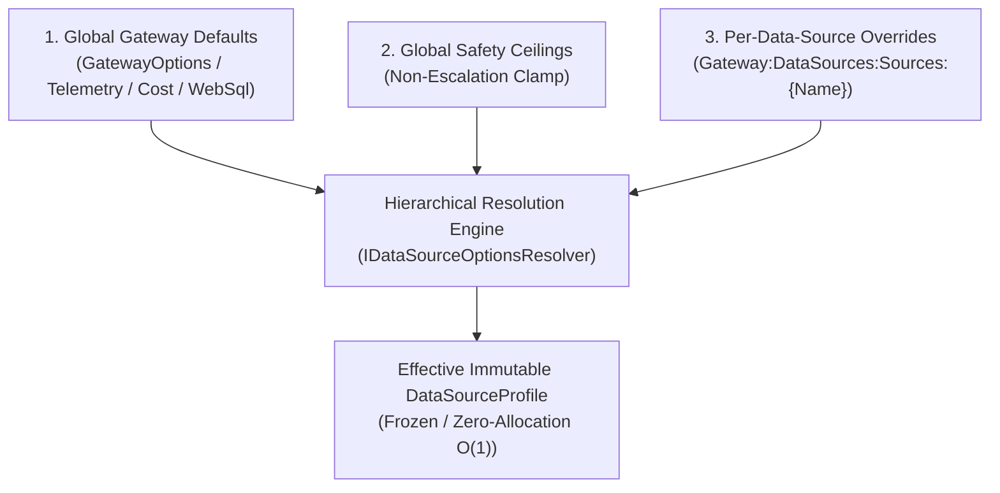

# PRD: REQ-OPS-BL05 - Granular Configuration per Data Source (Hierarchical Overrides)

**Document ID:** `REQ-OPS-BL05`  
**Date:** 2026-10-19  
**Status:** PRD APPROVED (Phase 1 complete); ready for Phase 2 Implementation Plan (`PLAN-OPS-BL05`)  
**Author:** Enterprise Product Manager  
**Source:** Owner request BL-05 ("Granular configuration per data source"), [backlog intake](2026-10-16-backlog-intake.md) §2.2  
**Branch:** `feat/bl-05-per-data-source-configuration`  
**Parent Plan:** [`00-master-plan-overview.md`](00-master-plan-overview.md) (Wave 4, row 4.4)  
**Related Items:**  
- BL-06 Tracing, Metrics and Logging (`REQ-OPS-BL06` / `PLAN-OPS-BL06` / `IDataSourceTelemetryPolicyProvider`)  
- BL-04 Table Cache (consumes per-data-source staging TTL & cache settings)  
- Issue #124 Dynamic Key-Set Filters in Cross-Source WebSQL (`AllowKeySetImport`, import row limits)  
- Issue #175 / #177 Query Cost Modeling & Execution Budgets (`QueryCostOptions`, FinOps)  
- Issue #238 Databricks OBO & Policy Enforcement Modes (`EnforcementMode`)  

---

## 1. Problem Statement & Motivation

Today in Autheris, operational limits, query cost factors, execution timeouts, logging verbosity, and caching policies are defined predominantly at the global gateway level (`GatewayOptions.QueryCost`, `Gateway:Telemetry`, `WebSqlOptions`, `CachingOptions`, `TransportRowLimitsOptions`).

However, real-world enterprise deployments connect diverse, heterogeneous data sources:
1. **High-throughput OLTP databases** (e.g., PostgreSQL / SQL Server) require strict concurrency caps, low row limits, small connection pools, and aggressive command timeouts (e.g. 5 seconds) to prevent starvation of transactional workloads.
2. **Analytical warehouses & lakehouses** (e.g., Databricks SQL / Snowflake / DuckDB OLAP) require higher complexity budgets, larger byte limits, longer command timeouts (e.g. 120 seconds), and relaxed row budgets for reporting, but demand strict cost-attribution multipliers.
3. **External or REST/HTTP declarative tables** require strict transport boundaries, granular rate caps, specific caching TTLs, and custom telemetry propagation headers.
4. **Sensitive compliance sources** require mandatory SQL audit logging, verbose trace detail, and restricted transport exposure (e.g. reachable only via governed GraphQL, never via raw WebSQL or Trino protocols).

Treating all data sources uniformly under global defaults introduces severe operational vulnerabilities:
- An analytical query sent to an OLTP source can exhaust connection pools and trigger catastrophic locking.
- A query timeout set high enough for analytical queries leaves OLTP connections hanging indefinitely during downstream network degradation.
- Telemetry verbosity cannot be increased for a misbehaving source without polluting the global log stream with sensitive SQL from all sources.
- Staging and caching guardrails cannot be tuned based on the storage backing the source.

The objective of **BL-05** is to deliver **granular, hierarchical configuration per data source** with strict zero-trust anti-escalation guardrails, zero-allocation runtime performance in hot query execution paths, and seamless hot-reloading.

---

## 2. Granular Configuration Dimensions

The per-data-source configuration model organizes settings into four orthogonal functional domains with hierarchical inheritance:

### 2.1 Cost & Quota Settings
| Option | Type | Default | Description |
|---|---|---|---|
| `QueryCostMultiplier` | `double` | `1.0` | Factor multiplied with standard AST complexity score to reflect execution expense of this specific source (e.g. 3.5 for cloud warehouse compute). Clamped to min 0.1, max 100.0. |
| `MaxAllowedComplexity` | `int?` | `null` | Per-source maximum AST query complexity. Unset falls back to global `QueryCostOptions.MaxAllowedComplexity` or tier default. Cannot exceed global safety ceiling unless admin override. |
| `MaxAggregateRowBudget` | `long?` | `null` | Maximum aggregate rows this source may scan/aggregate in a single query. Unset falls back to global default. |
| `QueryTimeoutSeconds` | `int?` | `null` | Timeout in seconds for queries targeting this source. Overrides global `CommandTimeoutSeconds`. |

### 2.2 Logging & Telemetry Settings
| Option | Type | Default | Description |
|---|---|---|---|
| `MinimumLogLevel` | `string?` | `null` | Per-source minimum log level (`Trace`, `Debug`, `Information`, `Warning`, `Error`). Clamped by global `TelemetryCeiling.MinimumLogLevel`. |
| `LogGeneratedSql` | `bool?` | `null` | Enables logging of scrubbed SQL statements compiled for this data source. Unset inherits global `LoggingOptions.LogGeneratedSql`. Clamped by global redaction ceiling. |
| `SamplingRatio` | `double?` | `null` | Per-source trace sampling probability (0.0 to 1.0). When unset, inherits global `SamplingOptions.Ratio`. |
| `OutboundPropagationMode` | `PropagationMode` | `Inherit` | Governs whether W3C TraceContext (`traceparent`) is propagated outbound to this data source (`Inherit`, `Always`, `Never`). Useful to suppress header leakage to third-party HTTP endpoints. |

### 2.3 Operational & Data Guardrails
| Option | Type | Default | Description |
|---|---|---|---|
| `MaxResponseRows` | `long?` | `null` | Hard cap on row count returned from this source. Clamped to global safety ceiling (anti-escalation). |
| `MaxResponseBytes` | `long?` | `null` | Hard cap on memory buffer / byte payload for results from this source. |
| `CommandTimeoutSeconds` | `int?` | `null` | ADO.NET / statement command execution timeout in seconds. Clamped to global safety ceiling. |
| `MinPoolSize` | `int?` | `null` | Minimum connection pool size for providers supporting pooling. |
| `MaxPoolSize` | `int?` | `null` | Maximum connection pool size for providers supporting pooling. |
| `DefaultIsolationLevel` | `IsolationLevel?` | `null` | Connection transaction isolation level (`Unspecified`, `ReadUncommitted`, `ReadCommitted`, `RepeatableRead`, `Serializable`, `Snapshot`). SQL Server `ReadUncommitted` remains respected. |
| `AllowedTransports` | `DataSourceTransportFlags` | `All` | Flags enum designating protocols authorized to query this source: `WebSql`, `GraphQL`, `Rest`, `OData`, `Mcp`, `Trino`, `ArrowFlight`. Unauthorized protocol access fails closed (`PROTOCOL_NOT_PERMITTED`). |

### 2.4 Caching & Staging Guardrails
| Option | Type | Default | Description |
|---|---|---|---|
| `CachingEnabled` | `bool?` | `null` | Opt-in / opt-out of L1/L2 query result and key-set caching for this data source. Unset inherits global `CachingOptions`. |
| `StagingTtlSeconds` | `int?` | `null` | TTL in seconds for intermediate staged tables (e.g. cross-source join buffers, federated staging). Range 1 to 86400 seconds. |
| `MaxKeySetImportLimit` | `int?` | `null` | Maximum number of keys allowed when importing dynamic key sets into this source during cross-source operations (overriding global cross-source limit). |

---

## 3. Open-Source Assessment & License Compliance

In accordance with repo governance (BSL 1.1 license compliance, AGENTS.md, and `2026-10-16-backlog-intake.md` §2.4):
- **Candidate Evaluation:**
  - Evaluated third-party configuration cascading frameworks (e.g., `Config.Net`, `Steeltoe.Configuration`, `NetEscapades.Configuration`).
  - **License Review:** Several third-party libraries introduce complex dependency trees or licensing restrictions.
  - **Technical Fit:** Third-party configuration libraries allocate significantly on dictionary lookups, boxing values and generating string concatenations, which violates Autheris's core architectural principle of zero-allocation hot paths (sub-millisecond P99, 64,500+ req/s).
- **Recommendation (Build Native):**
  - Autheris will **NOT** take on external third-party dependencies for hierarchical configuration.
  - Use native .NET 10 `Microsoft.Extensions.Options.IOptionsMonitor<T>` paired with `System.Collections.Frozen.FrozenDictionary<string, EffectiveDataSourceProfile>`.
  - On configuration reload, the resolver computes the entire hierarchical tree once in background, freezes the dictionaries, and atomically swaps the reference (`volatile`).
  - Runtime resolution is pure O(1), allocation-free (0 bytes allocated per lookup), and 100% compliant with Autheris BSL 1.1 license.

---

## 4. Benchmark & Best Practices

| Domain / Standard | Best Practice | Autheris Implementation in BL-05 |
|---|---|---|
| **Zero-Trust & Fail-Closed** | Missing or malformed configurations must never default to unrestricted access. | If an unknown data source is queried or configuration is missing, the resolver falls back to strict global baseline defaults. If a data source is disabled or absent from `AllowedDataSources`, requests are rejected. |
| **Anti-Escalation (OWASP API8)** | A subordinate configuration cannot bypass or loosen security boundaries established by central administration. | Global Safety Ceilings (`DataSourceSafetyCeilingsOptions`) define upper bounds (e.g., `MaxResponseRowsCeiling = 100,000`, `MaxResponseBytesCeiling = 50MB`, `MaxAllowedComplexityCeiling = 5,000`, `QueryTimeoutCeilingSeconds = 300`). A source override that exceeds a ceiling is clamped to the ceiling, unless the global option `AllowCeilingRelaxation` is explicitly set by a system admin. |
| **Transport Boundary Enforcement** | Principle of Least Privilege for API interfaces. | `AllowedTransports` allows operators to lock sensitive data sources to specific protocols (e.g., allow only governed `GraphQL` and `Rest`, but deny ad-hoc SQL via `WebSql` or `Trino`). |
| **High-Performance .NET 10** | Hot-path operations must not allocate on every request. | Pre-materialized immutable records (`EffectiveDataSourceProfile`) indexed in case-insensitive `FrozenDictionary<string, EffectiveDataSourceProfile>`. Lookups return a cached reference without string allocation, boxing, or lock contention. |

---

## 5. Security & Anti-Escalation Model

1. **Non-Escalation Clamping:**
   - Even if a tenant or data-owner sets `MaxResponseRows: 10,000,000`, the resolver evaluates:
     $$\text{EffectiveMaxRows} = \min(\text{ConfiguredValue}, \text{GlobalSafetyCeiling})$$
   - Unless `AllowCeilingRelaxation: true` is set in gateway configuration (which logs an operational audit event).
2. **Credential & Secret Isolation:**
   - Per-data-source connection strings and secret references (`PasswordKeyVaultRef`, `WindowsAuth`, `Databricks.Auth`) remain isolated within their respective `DataSourceConnectionOptions`. The options resolver never leaks connection strings into telemetry, profiles, or public API surfaces.
3. **Transport Confinement:**
   - Any transport request checks `profile.AllowedTransports.HasFlag(currentTransport)`. If false, execution is aborted with `403 Forbidden` (`PROTOCOL_NOT_PERMITTED`).

---

## 6. Acceptance Criteria (AC)

- **AC-01 (Hierarchical Inheritance):** A configured source override takes precedence over the global gateway default. An unset property cleanly inherits the global default.
- **AC-02 (Anti-Escalation Clamping):** Overrides that specify values above the global safety ceiling are automatically clamped to the ceiling unless `AllowCeilingRelaxation` is enabled.
- **AC-03 (Zero-Allocation Hot Path):** `IDataSourceOptionsResolver.Resolve(dataSourceName)` performs zero heap allocations in steady state.
- **AC-04 (Hot Reloading):** Dynamic configuration changes via `IOptionsMonitor` are reflected in subsequent queries without gateway restart.
- **AC-05 (Transport Guard):** An execution attempt through a transport not present in `AllowedTransports` is rejected immediately before query planning or connection rental.
- **AC-06 (Telemetry Integration):** Resolves telemetry policy in harmony with `IDataSourceTelemetryPolicyProvider` (BL-06) respecting `MinimumLogLevel`, `LogGeneratedSql`, and `SamplingRatio`.
- **AC-07 (Validation & Startup Guard):** Invalid configuration values (e.g. negative timeouts, ratios > 1.0) trigger immediate startup validation errors (`IValidateOptions`).
- **AC-08 (100% Test Coverage):** Unit and security tests cover all resolution branches, clamping rules, transport filtering, and hot-reload scenarios.
