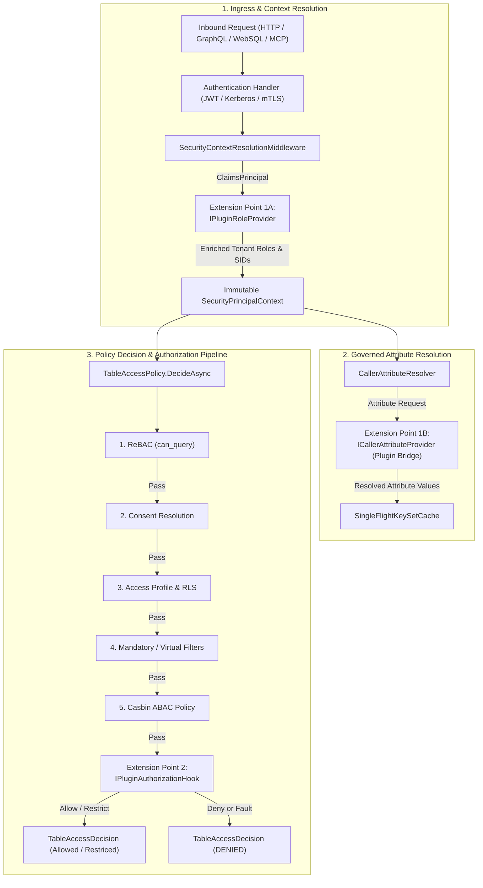
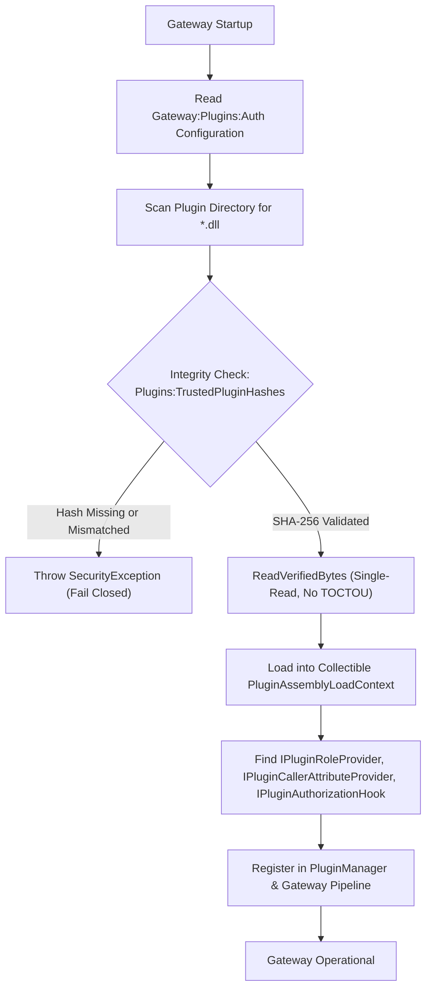

# PRD: REQ-SEC-BL08 - C# DLL Extension Points for Authentication & Authorization

**Document ID:** `REQ-SEC-BL08`  
**Date:** 2026-10-19  
**Status:** PRD APPROVED (Phase 1 complete); ready for Phase 2 Implementation Plan (`PLAN-SEC-BL08`)  
**Author:** Enterprise Product Manager & Strategic Gatekeeper  
**Source:** Owner request BL-08 ("C# DLL extension points for authentication and authorization"), [backlog intake](2026-10-16-backlog-intake.md) §2.4  
**Branch:** `feat/bl-08-csharp-dll-auth-extension-points`  
**Parent Plan:** [`00-master-plan-overview.md`](00-master-plan-overview.md) (Wave 4, row 4.5)  
**Related Items:**  
- BL-01 Generic C# DLL Plugin & Event Subsystem (`F-EXT-01`, `PluginAssemblyLoadContext`, `PluginTrustList`, `PluginManager`)  
- BL-03 Scale to 5,000 Users (`PLAN-SCALE-5000`, `WP-SC-05` / `WP-SC-13` Role-Resolver Providers)  
- Issue #129 Caller-Attribute Row Filters (`REQ-GOV-129`, `ICallerAttributeProvider`, `ICallerAttributeResolver`)  
- Issue #238 Databricks OBO & Delegation (`REQ-DATA-238`, `IDelegationCapability`)  
- Architecture Phase 1 Ingress & Decision Pipeline (`SecurityContextResolutionMiddleware`, `TableAccessPolicy`, `UnifiedPolicyDecisionPoint`)  

---

## 1. Executive Summary & Problem Statement

Modern enterprise data mesh environments deploy Autheris as a governed data gateway across diverse corporate identity domains. While Autheris provides native support for OAuth 2.0 / OIDC JWTs, Windows Kerberos / NTLM, and SCIM-provisioned directories, real-world enterprise deployments encounter bespoke or legacy authentication and authorization mechanisms that cannot be handled by standard token claims alone:

1. **Local Active Directory & Kerberos Group Expansion:** Enterprise identity topologies often employ nested on-premises Active Directory groups, resource domain local groups, or POSIX groups that are omitted from cloud-issued identity tokens (e.g. Entra ID tokens where groups exceed the 200-group overage limit, emitting only a Graph API link or zero group claims).
2. **Dynamic Corporate Attributes in Bespoke Data Stores:** Dynamic row filters (`{{caller.<name>}}` / `USER_ATTRIBUTE`) and Casbin ABAC rules frequently depend on organizational attributes (e.g., employee department, security clearance level, project assignment, legal citizenship, sovereign data fence jurisdiction) maintained in bespoke HR databases, legacy LDAP trees, or internal microservices.
3. **Bespoke Contextual Authorization Hooks:** Certain enterprises enforce dynamic, real-time perimeter checks prior to table access—such as time-of-day access windows, corporate network egress verification, zero-trust device health scoring, or internal threat-intel risk scores—that must evaluate inline during request processing.

Historically, supporting these bespoke mechanisms forced organizations to either run external pre-authenticating reverse proxies (adding hop latency and operational complexity) or request invasive modifications to core gateway code.

**REQ-SEC-BL08** defines standard, isolated, high-performance **C# DLL Extension Points for Authentication & Authorization** running directly inside the Autheris gateway process (.NET 10). By reusing the cryptographically hardened, SHA-256-pinned `PluginAssemblyLoadContext` infrastructure established in BL-01 (`F-EXT-01`), BL-08 enables enterprise SecOps and Identity Engineers to deploy custom C# plugins that seamlessly enrich caller roles and attributes and execute custom authorization checks—while strictly maintaining zero-trust, fail-closed security and immutable anti-bypass invariants.

---

## 2. User Personas & Use Cases

### 2.1 Target Personas
- **Enterprise SecOps & AppSec Engineers:** Demand complete control over in-process binary execution, ensuring third-party or custom code cannot bypass tenant boundaries, leak tokens, escalate privileges, or cause gateway downtime.
- **Enterprise Identity Engineers:** Require standard interfaces to resolve local group memberships (e.g., on-premises Windows Active Directory, Novell eDirectory, OpenLDAP) and bind enterprise attributes to inbound caller identities.
- **Data Platform & Compliance Architects:** Require custom inline policy hooks to assert compliance fences (e.g., ITAR, FedRAMP, GDPR cross-border restrictions) without altering dataset governance definitions.

### 2.2 Core Use Cases
- **Use Case 1 (On-Prem AD Group Expansion):** An authenticated user sends an OAuth 2.0 Bearer token with claim `oid: <GUID>`. A custom C# plugin resolves the user's on-premises Active Directory Kerberos SID and queries a local directory to discover nested department group SIDs, enriching `SecurityPrincipalContext.GroupSids` and `TenantRoles`.
- **Use Case 2 (Dynamic Attribute Resolution for Row Filtering):** A data access policy contains a row filter `organization_code = {{caller.dept_code}}`. The gateway invokes the custom C# attribute provider plugin to fetch `dept_code` from an internal employee registry and cache it for the duration of the request memo.
- **Use Case 3 (Contextual Authorization Guardrail):** A custom authorization hook plugin evaluates inbound table access queries; if the request arrives outside authorized operating hours or targets a table tagged `ExportControlled` from a client IP outside the corporate intranet range, the plugin denies access with reason `COMPLIANCE_FENCE_DENIAL`.

---

## 3. Architecture & Extension Points

BL-08 introduces two primary extension interfaces managed by the isolated plugin subsystem:



### 3.1 Extension Point 1: Custom Role & Attribute Provider

#### 3.1.1 Role & Security Context Provider (`IPluginRoleProvider`)
- **Location:** Invoked during security context establishment in `SecurityContextResolutionMiddleware` immediately following initial token claims validation and tenant verification.
- **Interface Contract:**
  ```csharp
  namespace Autheris.Application.Plugins.Auth;

  public interface IPluginRoleProvider
  {
      /// <summary>Unique identifier of the provider for audit and telemetry.</summary>
      string Name { get; }

      /// <summary>
      /// Enriches the caller's tenant-scoped roles and group SIDs based on the authenticated principal.
      /// </summary>
      ValueTask<PluginRoleEnrichmentResult> EnrichRolesAsync(
          PluginSecurityContext context,
          CancellationToken ct);
  }
  ```
- **Context & Result Payloads:**
  - `PluginSecurityContext`: Contains `TenantId`, `UserSid`, `IReadOnlySet<Sid> GroupSids`, `IReadOnlySet<string> ExistingTenantRoles`, `IReadOnlyList<Claim> Claims`, `IPAddress? ClientIp`, and `string AuthenticationScheme`. **No tokens, passwords, or raw headers are included.**
  - `PluginRoleEnrichmentResult`: Contains `IReadOnlyCollection<string> AddedRoles` and `IReadOnlyCollection<Sid> AddedGroupSids`.
- **Privilege Escalation Defense:**
  - Any attempt to return cluster administrative roles (`ClusterAdmin`, `GovernanceAdmin`), cross-tenant roles, or roles containing invalid characters (`:`, control characters, length > 128) is **strictly rejected** by the gateway.
  - The gateway logs a security alert (`SECURITY_ALERT_ROLE_ESCALATION_ATTEMPT`) and strips the illegal roles.
  - Enriched roles are applied strictly to `SecurityPrincipalContext.TenantRoles` and `GroupSids` for the duration of the request.

#### 3.1.2 Custom Caller Attribute Provider (`IPluginCallerAttributeProvider`)
- **Location:** Integrates with `CallerAttributeResolver` (introduced in REQ-GOV-129 / WP-SC-04).
- **Interface Contract:**
  - Plugins implement `ICallerAttributeProvider` or a specialized plugin interface `IPluginCallerAttributeProvider` discovered during plugin assembly loading:
  ```csharp
  namespace Autheris.Application.Plugins.Auth;

  public interface IPluginCallerAttributeProvider : ICallerAttributeProvider
  {
      /// <summary>Provider kind identifier matching CallerAttributeDefinition.Kind.</summary>
      new string Kind { get; }
  }
  ```
- **Execution & Caching:**
  - Invoked exclusively through `CallerAttributeResolver.ResolveAsync`.
  - Results participate in the gateway's `SingleFlightKeySetCache`, request-scoped memoization, bulkhead concurrency limits, circuit breakers, and list padding (`PadListsToBuckets`).
  - Values must strictly conform to `CallerAttributeValue` and `SqlParameterType` (string, integer, boolean, timestamp, etc.). Over-cardinality checks and list expansion budgets apply identically to plugin-provided attributes.

---

### 3.2 Extension Point 2: Custom Authorization Check Hook (`IPluginAuthorizationHook`)

- **Location:** Executed inside `TableAccessPolicy.DecideCoreAsync` as an additional policy evaluation gate.
- **Interface Contract:**
  ```csharp
  namespace Autheris.Application.Plugins.Auth;

  public interface IPluginAuthorizationHook
  {
      /// <summary>Unique name of the authorization hook.</summary>
      string HookName { get; }

      /// <summary>Execution order priority (lower numbers execute first).</summary>
      int Order { get; }

      /// <summary>
      /// Evaluates custom enterprise access rules for a table access request.
      /// </summary>
      ValueTask<PluginAuthorizationResult> EvaluateAccessAsync(
          PluginAuthorizationContext context,
          CancellationToken ct);
  }
  ```
- **Context & Result Payloads:**
  - `PluginAuthorizationContext`: Holds `TenantId`, `UserSid`, `GroupSids`, `Roles`, `TableIdentifier`, `TableMetadata` (including tags and sensitivity), `RequestedColumns`, `ClientIp`, and `ExtraAttributes`.
  - `PluginAuthorizationResult`:
    - `Allow()`: Allows the request to proceed.
    - `Deny(string reasonCode, string? clientMessage = null)`: Halts policy execution and denies access. `reasonCode` is a stable identifier (e.g. `TIME_WINDOW_CLOSED`, `GEO_FENCE_DENIED`); `clientMessage` is sanitized before emission.
    - `Restrict(IReadOnlyCollection<string>? deniedColumns = null, string? additionalRowFilterSql = null)`: Restricts access by removing columns from clearance or appending an additional SQL predicate to be `AND`ed with row-level security.
- **Evaluation Order & Anti-Bypass Guarantees:**
  - The hook evaluates **after** ReBAC, Consents, Access Profiles, and Casbin ABAC.
  - **Invariant 1:** If ReBAC, Consent, or Casbin denies access, the hook is **never invoked** (denial short-circuits immediately).
  - **Invariant 2:** The hook **CANNOT** overturn a prior denial into an allow.
  - **Invariant 3:** The hook **CANNOT** unmask a column masked by consents, access profiles, or data classification.
  - **Invariant 4:** The hook **CANNOT** expand access across tenant boundaries.

---

### 3.3 Cryptographic Loading & Lifecycle Architecture

BL-08 directly leverages the BL-01 isolated assembly loading subsystem (`PluginAssemblyLoadContext`, `PluginTrustList`, `PluginManager`):



1. **Assembly Isolation:** Each plugin assembly (and its private managed dependencies) is loaded into a dedicated, collectible `PluginAssemblyLoadContext`. Shared host assemblies (`Autheris.Domain`, `Autheris.Application`, `Microsoft.Extensions.*`, `System.*`) resolve strictly via the default ALC.
2. **Cryptographic SHA-256 Pinning:** Outside `Development` mode, every assembly loaded from disk must match an authoritative SHA-256 hash defined in `Gateway:Plugins:TrustedPluginHashes`. Manifest files on disk are verified against configuration to prevent tampering.
3. **No TOCTOU Window:** Assemblies are loaded into memory via `MemoryStream` directly from the byte array verified by `PluginTrustList.ReadVerifiedBytes()`.
4. **Dependency Injection:** Plugin types are instantiated using `ActivatorUtilities.CreateInstance` against the host service provider, supporting constructor injection of registered logging and configuration abstractions.

---

## 4. Non-Functional & Security Requirements

### 4.1 Fail-Closed by Default
- **Fault Isolation & Error Handling:** If any auth plugin throws an unhandled exception, crashes, or encounters an internal fault, the gateway **MUST fail closed**:
  - In `IPluginRoleProvider`: An exception causes the security context resolution to fail immediately with HTTP `403 Forbidden` (`AUTH_PLUGIN_FAILED`). The request is aborted; unauthenticated or unverified caller state is never allowed into the pipeline.
  - In `IPluginCallerAttributeProvider`: An exception sets the attribute outcome to `CallerAttributeOutcome.Failed`, which converges on a constant `1 = 0` (DENY) predicate in row-level filtering.
  - In `IPluginAuthorizationHook`: An exception immediately converts the access decision to `TableAccessDecision.Denied` with code `AUTH_HOOK_FAILED`.
- **Bounded Execution & Timeouts:**
  - All plugin invocations are wrapped in a linked `CancellationTokenSource` with a strict timeout (`ExecutionTimeoutMilliseconds`, default 500 ms, configurable range 50 ms to 5000 ms).
  - If a plugin exceeds the timeout, the cancellation token is triggered, a `TimeoutException` is recorded, and the request is **denied immediately** (`AUTH_PLUGIN_TIMEOUT`).

### 4.2 Immutable Anti-Bypass Invariants
To maintain Autheris's Zero-Trust and Principle of Least Privilege posture:
1. **No ClusterAdmin Privilege Escalation:** Plugins cannot grant `ClusterAdmin`, `GovernanceAdmin`, or global administrative roles under any circumstances.
2. **No Consent / Casbin Bypass:** Plugins cannot override `DENY` decisions from ReBAC, Consent Resolution, or Casbin ABAC.
3. **Strict Tenant Sandboxing:** Plugins cannot modify `TenantId` or emit roles/predicates referencing foreign tenants.
4. **No Masking Reversal:** Column clearance returned by a plugin cannot lift a mask established by catalog sensitivity rules or consent definitions.
5. **No Audit Bypass:** Plugin execution, decisions, and errors are unconditionally recorded in the WORM audit trail.

### 4.3 Zero Credential & Secret Leakage
- **No Ingress Token Exposure:** The raw JWT Bearer token string, Basic authentication password, mTLS private key, or client assertion is **never** passed to any plugin interface. Only sanitized identity descriptors (`CallerSubject`, `PluginSecurityContext`) are exposed.
- **Diagnostic Sanitization:** Unhandled exception messages from third-party plugins are logged internally at `Error` level with redactor filtering, but are **never returned to API clients**. Clients receive only stable, generic error codes (`AUTH_PLUGIN_FAILED`, `AUTH_HOOK_DENIED`).

### 4.4 Observability, Telemetry & Audit
- **OpenTelemetry Metrics:**
  - `autheris_auth_plugin_duration_seconds` (Histogram): Invocation duration in seconds, tagged by `plugin`, `extension_point`, and `outcome`.
  - `autheris_auth_plugin_invocations_total` (Counter): Total invocation count, tagged by `plugin`, `extension_point`, `outcome` (`success`, `denied`, `error`, `timeout`), and `tenant`.
- **OpenTelemetry Tracing:**
  - Every plugin execution is wrapped in an internal Activity span (`auth.plugin.role_enrichment`, `auth.plugin.attribute_resolution`, `auth.plugin.authorization_hook`) carrying standard W3C trace context.
- **WORM Audit Trail:**
  - Decisions made by `IPluginAuthorizationHook` that result in a denial or column/row restriction emit an audit log entry (`AUTH_PLUGIN_DECISION`).
  - Plugin timeouts and failures emit an audit event (`AUTH_PLUGIN_ERROR`).

---

## 5. Configuration Model

All settings for authentication and authorization plugins reside in `appsettings.json` under `Gateway:Plugins:Auth`:

```json
{
  "Gateway": {
    "Plugins": {
      "Directory": "plugins",
      "RequireIntegrityManifest": true,
      "TrustedPluginHashes": {
        "Autheris.Plugins.ActiveDirectory.dll": "4A12B89C33D14F98E1E2F543C65B77AA8899FF00112233445566778899AABBCC",
        "Autheris.Plugins.ComplianceHooks.dll": "EEFF00112233445566778899AABBCCDD4A12B89C33D14F98E1E2F543C65B77AA"
      },
      "Auth": {
        "Enabled": true,
        "ExecutionTimeoutMilliseconds": 500,
        "MaxEnrichedRolesPerCaller": 64,
        "MaxEnrichedGroupSidsPerCaller": 256,
        "AllowRoleEnrichment": true,
        "AllowAuthorizationHooks": true,
        "ProhibitedRoles": [
          "ClusterAdmin",
          "GovernanceAdmin",
          "SecurityAdmin"
        ]
      }
    }
  }
}
```

### Options Specification (`AuthPluginsOptions`)
| Parameter | Type | Default | Constraints | Description |
|---|---|---|---|---|
| `Enabled` | `bool` | `true` | - | Master toggle for auth/authz plugin execution. When false, plugins are not invoked. |
| `ExecutionTimeoutMilliseconds` | `int` | `500` | 50..5000 | Maximum allowable execution time for a single plugin invocation before cancellation and fail-closed denial. |
| `MaxEnrichedRolesPerCaller` | `int` | `64` | 1..256 | Maximum number of additional roles an `IPluginRoleProvider` may add to a single caller context. |
| `MaxEnrichedGroupSidsPerCaller` | `int` | `256` | 1..1024 | Maximum number of additional group SIDs an `IPluginRoleProvider` may add to a single caller context. |
| `AllowRoleEnrichment` | `bool` | `true` | - | Enables/disables execution of `IPluginRoleProvider` plugins. |
| `AllowAuthorizationHooks` | `bool` | `true` | - | Enables/disables execution of `IPluginAuthorizationHook` plugins. |
| `ProhibitedRoles` | `List<string>` | `["ClusterAdmin", "GovernanceAdmin", "SecurityAdmin"]` | Non-empty | Roles that plugins are strictly forbidden from assigning. Attempting to assign these triggers a security alert. |

---

## 6. Open-Source Assessment & License Compliance

In compliance with repository guidelines and `2026-10-16-backlog-intake.md` §2.5:

### 6.1 Candidate Evaluation
| Technology / Library | License | Maturity | Memory / Allocations | Verdict & Justification |
|---|---|---|---|---|
| **.NET 10 Native `AssemblyLoadContext`** | MIT (dotnet/runtime) | High (Core runtime) | Zero external overhead, collectible, direct stream loading | **ADOPT (Native):** Fits existing BL-01 architecture perfectly. Zero extra dependencies, compile-time type safety, zero TOCTOU via `ReadVerifiedBytes`. |
| **`McMaster.NETCore.Plugins`** | MIT | Mature | Low | **REJECT:** While popular, it wraps ALC and manages loading through file paths on disk, hindering in-memory SHA-256 byte validation required by Autheris SEC M-27. |
| **Managed Extensibility Framework (`System.Composition`)** | MIT | Legacy | High (reflection, boxing) | **REJECT:** Unsuited for hot-path request evaluation; high allocation profile; lacks dynamic collectible ALC isolation. |
| **WebAssembly (`Wasmtime-dotnet` / `Extism`)** | Apache 2.0 | Medium | High (marshaling & interop) | **REJECT:** Unnecessary serialization overhead across the WASM boundary (>500 µs per call); poor developer experience for C# identity engineers interfacing with AD/LDAP. |
| **Embedded Scripting (`ClearScript` / `Jint`)** | BSD / MIT | Medium | Very High | **REJECT:** Dynamic typing; interpretive overhead; impossible to directly invoke compiled C# enterprise libraries. |

### 6.2 License Compliance (BSL 1.1)
- The chosen solution uses **100% native .NET 10 runtime APIs** (`System.Runtime.Loader.AssemblyLoadContext`).
- No GPL, AGPL, or third-party BSL 1.1 code is incorporated.
- Clean architectural build fully owned by Autheris and compliant with the Business Source License 1.1.

---

## 7. Acceptance Criteria (AC-1..n)

- **`AC-BL08-01` (Cryptographic Plugin Loading & Verification):**
  - When `Gateway:Plugins:Auth:Enabled` is true, the gateway loads plugin assemblies implementing `IPluginRoleProvider`, `IPluginCallerAttributeProvider`, or `IPluginAuthorizationHook` from `Gateway:Plugins:Directory`.
  - In non-Development environments, loading an assembly whose SHA-256 hash is missing or mismatched against `Gateway:Plugins:TrustedPluginHashes` throws `SecurityException` and halts gateway startup.

- **`AC-BL08-02` (Role & Group SID Enrichment):**
  - An `IPluginRoleProvider` can enrich `TenantRoles` and `GroupSids` for an authenticated request during `SecurityContextResolutionMiddleware`.
  - Enriched roles appear in `SecurityPrincipalContext` and are honored by subsequent Casbin and consent checks.
  - Adding more than `MaxEnrichedRolesPerCaller` or `MaxEnrichedGroupSidsPerCaller` truncates or denies fail-closed.

- **`AC-BL08-03` (Privilege Escalation Prevention):**
  - If an `IPluginRoleProvider` attempts to return any role in `ProhibitedRoles` (e.g. `ClusterAdmin`, `GovernanceAdmin`), the gateway strips the role, logs an audit alert `SECURITY_ALERT_ROLE_ESCALATION_ATTEMPT`, and does NOT grant administrative rights.

- **`AC-BL08-04` (Caller Attribute Resolution Bridge):**
  - An `IPluginCallerAttributeProvider` is registered as an `ICallerAttributeProvider` in `CallerAttributeResolver`.
  - Attributes resolved by the plugin participate in single-flight caching, request memoization, and list padding, and can be referenced in row filters (`{{caller.<name>}}`).

- **`AC-BL08-05` (Custom Authorization Hook Execution):**
  - `IPluginAuthorizationHook` executes inside `TableAccessPolicy.DecideAsync` after consent and Casbin verification.
  - Returning `PluginAuthorizationResult.Allow()` allows the query to proceed.
  - Returning `PluginAuthorizationResult.Deny(reasonCode)` denies access with the specified stable reason code.
  - Returning `PluginAuthorizationResult.Restrict(...)` successfully restricts columns and/or attaches additional row filter SQL predicates.

- **`AC-BL08-06` (Anti-Bypass Invariant Enforcement):**
  - A plugin hook **cannot** permit access if ReBAC, Consent Resolution, or Casbin ABAC returned `DENY`.
  - A plugin hook **cannot** unmask columns that are marked `Mask` by data classification or consent.
  - A plugin hook **cannot** allow cross-tenant query execution.

- **`AC-BL08-07` (Fail-Closed on Unhandled Exception):**
  - If an `IPluginRoleProvider`, `IPluginCallerAttributeProvider`, or `IPluginAuthorizationHook` throws an unhandled exception:
    - The operation immediately fails closed (HTTP `403 Forbidden` or `TableAccessDecision.Denied`).
    - The client receives a generic error code (`AUTH_PLUGIN_FAILED` or `AUTH_HOOK_FAILED`).
    - No exception stack trace or internal plugin details are leaked in API responses.

- **`AC-BL08-08` (Execution Timeout & Cancellation):**
  - If a plugin invocation exceeds `ExecutionTimeoutMilliseconds` (default 500 ms), the operation is aborted via `CancellationToken` and access is denied fail-closed with reason `AUTH_PLUGIN_TIMEOUT`.

- **`AC-BL08-09` (Zero Credential Exposure):**
  - No raw authorization tokens (e.g. Bearer JWT string), passwords, or TLS private keys are passed into `PluginSecurityContext` or `PluginAuthorizationContext`.

- **`AC-BL08-10` (OpenTelemetry Observability):**
  - Plugin execution emits `autheris_auth_plugin_duration_seconds` histograms and `autheris_auth_plugin_invocations_total` counters with proper labels (`plugin`, `extension_point`, `outcome`, `tenant`).
  - Trace spans are generated for each plugin invocation and linked to the active W3C trace context.

- **`AC-BL08-11` (Audit Logging):**
  - Denials and restrictions triggered by `IPluginAuthorizationHook`, as well as plugin errors and timeouts, are recorded in the WORM audit log with actor SID, tenant, table, and stable reason code.

- **`AC-BL08-12` (Graceful Hot Reload & Shutdown):**
  - When the gateway shuts down, in-flight plugin actions are drained within the standard shutdown timeout, and collectible ALCs are cleanly disposed.
