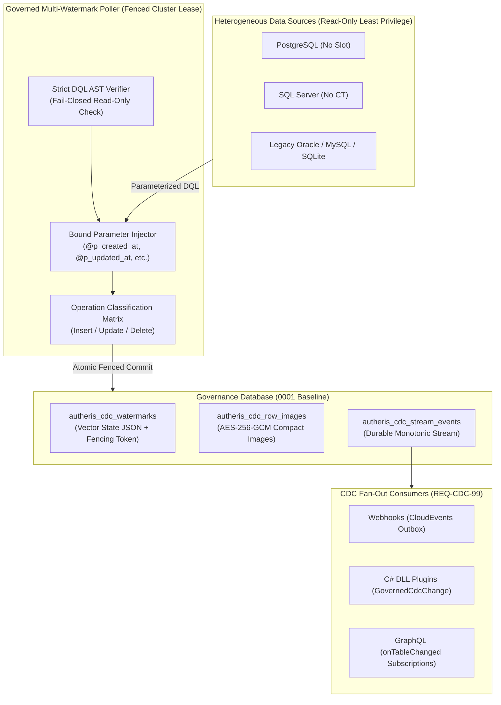

# PRD: REQ-CDC-101 - Governed Multi-Watermark Query Poller for Heterogeneous Sources

**Document ID:** `REQ-CDC-101`  
**Date:** 2026-10-19  
**Status:** PRD READY - next: Phase 2 (Solution Architect)  
**Author:** Enterprise Product Manager & Strategic Gatekeeper (Phase 1)  
**Parent Plan:** [00-master-plan-overview.md](00-master-plan-overview.md)  
**Related Documents:** [REQ-CDC-99](2026-10-15-req-issue-99-cdc-fanout-and-hardening.md), [PLAN-CDC-99](2026-10-15-plan-issue-99-cdc-fanout-and-hardening.md), [F-CDC-02 MSSQL Change Tracking](../features/f-cdc-02-mssql-change-tracking.md), [F-EXT-01 Plugins, Events & Webhooks](../features/f-ext-01-generic-plugin-events-and-webhooks.md), [F-GOV-21 Declared Table Keys](../features/f-gov-21-declared-table-keys-and-read-ordering.md), [F-DIALECT-02 AST SQL Compiler](../features/f-dialect-02-ast-sql-compiler.md)  

**Binding Project Constraints:**
- No upgrade or repair migrations: governance schema adjustments must be made in the `0001` baseline DDL for SQLite, PostgreSQL, and SQL Server in place, alongside updated schema-shape snapshots in `src/Autheris.Infrastructure/Persistence/Migrations/Shape/`.
- Autheris is pre-production; breaking changes are permitted.
- Least privilege on data sources: strictly `SELECT` permissions (read-only DQL) on the target source tables/views; no DDL, no elevated replication privileges, and no write permissions.
- Zero-Trust & Fail-Closed: dynamic SQL execution is strictly forbidden; administrative queries must be vetted via AST parsing and executed strictly using parameterized queries.

---

## 1. Executive Summary & Problem Statement

### 1.1 Problem Statement
Many enterprise databases lack built-in native change data capture (CDC) mechanisms (e.g., SQLite, PostgreSQL without replication slot grants or superuser access, Oracle/MySQL without binlog access, or legacy systems using soft deletes). Even where native CDC exists, security policies frequently deny gateway service accounts the elevated permissions required for logical replication streams or transactional change tracking tables.

Organizations resort to polling tables using timestamp or sequence columns. However, naive single-watermark polling (`WHERE updated_at > @watermark`) exhibits critical failure modes:
1. **Insert vs. Update Disconnect:** In systems where `created_at` is set on insert and `updated_at` is only populated upon update (or where clocks skew across distributed application servers), a single watermark query inevitably skips newly inserted rows or processes updates out of order.
2. **Soft Deletes:** Deletions are frequently marked via soft-delete flags (e.g., `is_deleted = 1`, `status = 'DELETED'`, or `deleted_at = @now`). A single timestamp poller filtering solely on `updated_at` or `id` misses soft deletions if `updated_at` is not bumped upon deletion, or conflates deletes with updates.
3. **Multi-Column Independent Advancement:** Newly inserted rows advance `created_at` and `id`, while modified rows advance `updated_at`, and soft-deleted rows advance `deleted_at`. Any of these independent vectors may advance between polling intervals.
4. **Data Corruption via Unfenced / Unparameterized Queries:** Ad-hoc scripts written with string interpolation create critical SQL injection risks, duplicate event emission across gateway replicas, and lack durable integration into enterprise downstream fan-out pipelines.

### 1.2 Solution Vision
REQ-CDC-101 introduces the **Governed Multi-Watermark Query Poller**:
- A robust, administrative DQL poller that tracks an independent **Multi-Watermark Vector** across arbitrary configured columns (`created_at`, `updated_at`, `deleted_at`, `id`, `sequence`, etc.).
- Constructs safe, parameterized queries utilizing an **OR-based advancement predicate** with strict query timeouts and batch bounding.
- Classifies emitted row states into discrete operations (`Insert`, `Update`, `Delete`) using declarative row-state predicates and compact row-image tracking.
- Seamlessly appends normalized change events to the high-performance, durable `ICdcStreamStore` pipeline introduced in REQ-CDC-99, delivering encrypted, row-filtered, and field-masked events to Webhooks, C# DLL plugins, and GraphQL subscriptions.

---

## 2. Gatekeeper & Architectural Fit Analysis

### 2.1 Strategic Scope Fit
Autheris is an **Enterprise Zero-Trust Data Access Gateway**. Providing reliable CDC across heterogeneous sources without requiring Kafka, Debezium, or high-privilege replication slots is a direct competitive differentiator against Apollo, Hasura, and traditional API gateways.



### 2.2 Rejected Anti-Patterns & Safe Alternatives

| Anti-Pattern ID | Hazard / Anti-Pattern | Critical Risk | Safe Governed Alternative (Enforced) |
| :--- | :--- | :--- | :--- |
| **AP-CDC-01** | **Exposing raw ad-hoc SQL execution to end-users or REST clients** | SQL injection, privilege escalation, bypass of Casbin ABAC, execution of DDL/DML. | **Strict GitOps/Administrative Authority:** Queries are authored only by privileged administrators, stored in configuration, and verified by AST parsing. |
| **AP-CDC-02** | **Single timestamp watermark for composite lifecycles** | Silent omission of inserts, dropped soft deletes, or duplicate storm loops. | **Multi-Watermark Vector:** Independent monotonic high-water marks for `created_at`, `updated_at`, `deleted_at`, `id`. |
| **AP-CDC-03** | **Dynamic string concatenation for WHERE clauses** | SQL injection (OWASP A03:2021) and database query plan cache thrashing. | **Strict Parameterization:** Typed parameter primitives (`@p_created_at`, `@p_updated_at`, etc.) injected through `DbParameter`. |
| **AP-CDC-04** | **Unfenced multi-replica polling** | Duplicate events produced, race conditions advancing watermarks backwards. | **Fenced Cluster Leases:** Single active poller lease per stream with epoch fencing tokens validated inside the commit transaction. |
| **AP-CDC-05** | **Bypassing the CDC durable stream (`ICdcStreamStore`)** | Lack of encryption at rest, broken consumer offsets, and bypass of per-receiver authorization. | **Direct Pipeline Integration:** Poller produces batches via `ICdcStreamStore.AppendAsync`, inheriting AES-256-GCM encryption and fan-out authorization. |

---

## 3. Industry & Best-Practice Benchmark

| Reference Framework | Industry Pattern | Adoption in REQ-CDC-101 |
| :--- | :--- | :--- |
| **Kafka Connect JDBC Source** | Incremental query mode with `timestamp+incrementing` columns. | Adopted and extended: Autheris supports an arbitrary N-dimensional vector (including soft-delete timestamps) rather than just 1 or 2 fixed columns. |
| **Debezium Polling Connectors** | Query-based CDC with watermark deduplication and tombstone generation. | Adopted: Emits distinct `Delete` operations from soft-delete states, updating row-image tracking to reflect tombstones. |
| **Snowflake Streams on Views** | Change tracking on arbitrary SQL views using offset tracking. | Adopted: The poller accepts arbitrary DQL queries against views, joined tables, or single tables, provided primary key columns are declared. |
| **OWASP API Security 2023** | API3 (Broken Object Property Authorization) & API8 (Security Misconfiguration). | Zero-Trust fail-closed AST verification ensures read-only isolation; per-receiver delivery enforces Casbin row and column policies. |

---

## 4. Multi-Watermark Vector State Tracking Architecture

### 4.1 Watermark Vector Definition
A tracked query defines a **Multi-Watermark Vector** consisting of 1 to $N$ dimension definitions:
```json
{
  "streamName": "legacy_crm_customers",
  "dimensions": [
    { "name": "created_at", "type": "DateTimeOffset", "parameterName": "p_created_at", "column": "created_at", "initialValue": "1970-01-01T00:00:00Z" },
    { "name": "updated_at", "type": "DateTimeOffset", "parameterName": "p_updated_at", "column": "updated_at", "initialValue": "1970-01-01T00:00:00Z" },
    { "name": "deleted_at", "type": "DateTimeOffset", "parameterName": "p_deleted_at", "column": "deleted_at", "initialValue": "1970-01-01T00:00:00Z" },
    { "name": "id",         "type": "Int64",          "parameterName": "p_id",         "column": "id",         "initialValue": "0" }
  ]
}
```

### 4.2 Query Generation & Parameterized OR-Condition
The administrator provides the base DQL query or projection. The query compiler wraps or synthesizes the incremental predicate using strictly bound parameters:
```sql
SELECT id, email, full_name, is_active, created_at, updated_at, deleted_at
FROM legacy_crm.customers
WHERE (
    (created_at > @p_created_at)
 OR (updated_at > @p_updated_at)
 OR (deleted_at > @p_deleted_at)
 OR (id > @p_id)
)
ORDER BY COALESCE(updated_at, created_at, deleted_at) ASC, id ASC
FETCH NEXT @p_batch_size ROWS ONLY;
```
*(Dialect-specific pagination syntax, e.g., `LIMIT` vs `FETCH NEXT`, is handled via Autheris `ISqlDialectProvider`.)*

### 4.3 Monotonic Vector Advancement Algorithm
To prevent duplicate processing and infinite loops while supporting multi-column OR conditions:
1. For each batch fetched from the database:
   - For every dimension $d \in \text{Dimensions}$:
     $$\text{BatchMax}(d) = \max_{r \in \text{Batch}} (r[d])$$
   - The provisional candidate watermark vector is:
     $$\text{NewVector}[d] = \max(\text{CurrentVector}[d], \text{BatchMax}(d))$$
2. **Tie-Breaking / Monotonic Ordering:** If multiple rows have identical timestamp values at the batch boundary, the secondary monotonic dimension (e.g. `id` or primary key sequence) prevents boundary skipping.
3. **Atomic Persistence:** The new vector is serialized to JSON and committed into `autheris_cdc_watermarks` alongside the stream append batch and fencing token in a single governance database transaction.

### 4.4 Governance Storage Model (`0001` Baseline)
The existing `autheris_cdc_watermarks` table is extended in the `0001` baseline schema to support vector state:
```sql
ALTER TABLE autheris_cdc_watermarks ADD COLUMN watermark_state TEXT NULL;
```
- `source`: `'query_poller'` or source identifier.
- `domain_name`, `schema_name`, `table_name`: Stream logical target identifiers.
- `watermark`: Monotonically increasing synthetic epoch/sequence (for backward compatibility with single-value readers).
- `watermark_state`: JSON-serialized vector tracking `{ "created_at": "...", "updated_at": "...", "deleted_at": "...", "id": 1042 }`.
- `fencing_token`: Fencing lease counter verifying producer exclusivity.

---

## 5. Operations Classification Matrix

A query poller reading database rows does not have a database-native `SYS_CHANGE_OPERATION` column. The poller must classify each row into an operation type: `Insert`, `Update`, or `Delete`.

### 5.1 Classification Rules Engine

| Evaluation Step | Predicate / Condition | Classified Operation | Emitted Payload Details |
| :--- | :--- | :---: | :--- |
| **1. Soft-Delete Detection** | `deleted_at IS NOT NULL AND deleted_at > @initial_deleted_at`<br/>OR `is_deleted = 1 / true`<br/>OR `status = 'DELETED'` | **`Delete`** | Emits primary key values in payload; flags `operation = Delete`. Clears/updates entry in `autheris_cdc_row_images`. |
| **2. Insert Detection (Timestamp Identity)** | `(updated_at IS NULL OR updated_at == created_at)`<br/>AND Row image fingerprint not found in `autheris_cdc_row_images` | **`Insert`** | After-image materialized. Before-image is `null`. |
| **3. Update Detection** | `updated_at > created_at`<br/>OR Row image fingerprint exists in `autheris_cdc_row_images` | **`Update`** | After-image materialized. Before-image fetched from `autheris_cdc_row_images` for precise row-filter delta evaluation. |
| **4. Fingerprint Fallback (Ambiguous State)** | Configurable fallback when timestamps are identical or missing. | **`Insert`** (if new key)<br/>**`Update`** (if known key) | Checked against `ICdcStreamStore.GetRowImagesAsync`. If key fingerprint exists and payload changed $\rightarrow$ `Update`; if payload identical $\rightarrow$ omitted (no-op suppression). |

---

## 6. Integration into CDC Durable Streaming Pipeline

The poller executes on a scheduled interval (e.g., 1000ms default) as a singleton `ClusterScheduledService` holding lease `cdc:query:poll:{stream_id}`:
1. **Fetch Batch:** Runs parameterized DQL query with timeout (`CommandTimeout = 30s`).
2. **Classify Rows:** Translates rows into `CdcStreamEvent` instances.
3. **Resolve Before-Images:** Calls `ICdcStreamStore.GetRowImagesAsync` to populate prior images for delta analysis (needed for Casbin row-filter transitions: visible $\to$ invisible).
4. **Encrypt at Rest:** Row data is encrypted using AES-256-GCM with stream-level DEK.
5. **Atomic Commit via `ICdcStreamStore.AppendAsync`:**
   - Appends events to `autheris_cdc_stream_events`.
   - Updates `autheris_cdc_row_images`.
   - Advances stream `head_offset`.
   - Updates `autheris_cdc_watermarks` with `watermark_state` JSON and verifies `fencing_token`.
6. **Egress Delivery:**
   - **Webhooks:** `CdcWebhookDeliveryService` enqueues masked CloudEvents into the durable outbox.
   - **C# DLL Plugins:** `GovernedCdcChange` dispatched to `IPluginEventListener<GovernedCdcChange>`.
   - **GraphQL Subscriptions:** Shared tail reader fans out to `onTableChanged(table: "...")` subscribers with runtime Casbin ABAC.

---

## 7. Detailed User Stories & Acceptance Criteria

### User Story 1: Admin Poller DQL Declaration & Zero-Trust AST Validation
> **As an** Enterprise Data Governance Administrator,  
> **I want to** configure a multi-watermark query poller using declarative SQL in configuration,  
> **So that** changes from non-CDC databases can be streamed without risking SQL injection or granting write permissions.

- **AC-1.1:** The poller configuration accepts a target data source, logical table identifier, declared primary key column(s), dimensions list, and read-only DQL query.
- **AC-1.2:** At startup/activation, the poller passes the SQL statement to the Autheris SQL AST Parser. If the AST contains any statement other than `SelectStatementNode`, or contains side-effecting keywords (`INSERT`, `UPDATE`, `DELETE`, `DROP`, `ALTER`, `EXEC`, `INTO`), activation **fails closed** with `GovernedCdcConfigurationException`.
- **AC-1.3:** The query MUST NOT contain string-interpolated user parameters. All dimension comparison conditions must be parameterized via `@p_<dimension>`.
- **AC-1.4:** Source connection executes strictly with read-only transaction semantics where supported by dialect (e.g. `SET TRANSACTION READ ONLY` on PostgreSQL).

### User Story 2: Multi-Watermark Vector State Tracking
> **As an** Integration Engineer,  
> **I want** the poller to track multiple independent watermarks (`created_at`, `updated_at`, `deleted_at`, `id`),  
> **So that** rows advancing on any individual column are reliably captured without skipping changes.

- **AC-2.1:** The poller evaluates an OR-condition across all defined dimensions.
- **AC-2.2:** After reading a batch, the poller calculates the element-wise maximum for each dimension and persists the updated vector state to `autheris_cdc_watermarks.watermark_state`.
- **AC-2.3:** In the event of gateway crash or restart, the poller resumes from the persisted vector state, reproducing no duplicate events beyond standard at-least-once boundary handling.
- **AC-2.4:** Polling honors `BatchSize` (default 500) and `MaxWaitMilliseconds`.

### User Story 3: Operation Classification & Soft-Delete Handling
> **As a** Downstream Webhook Consumer,  
> **I want** soft-deleted rows to be delivered as `Delete` operations and newly added rows as `Insert`,  
> **So that** my downstream cache or search index accurately mirrors the source state.

- **AC-3.1:** Rows satisfying the configured soft-delete condition (`deleted_at IS NOT NULL` or `is_deleted = true`) are emitted with `operation = "Delete"`.
- **AC-3.2:** Rows with `created_at == updated_at` (or no prior row image) are emitted with `operation = "Insert"`.
- **AC-3.3:** Rows with updated timestamps or differing payloads from the prior row image are emitted with `operation = "Update"`.
- **AC-3.4:** Identical poll results (where none of the watermark columns advanced) produce zero stream events and advance no watermarks (zero noise).

### User Story 4: Seamless Streaming Pipeline Integration
> **As a** Security Officer,  
> **I want** query-polled change events to pass through the same encryption, row-level security, and column masking as native MSSQL CDC,  
> **So that** unauthorized consumers never observe PII or unconsented records.

- **AC-4.1:** All events appended to `ICdcStreamStore` are encrypted at rest with AES-256-GCM.
- **AC-4.2:** Downstream deliveries (Webhooks, Plugins, GraphQL) enforce runtime Casbin ABAC and row-filter visibility (including move-in and move-out transitions) identical to REQ-CDC-99.
- **AC-4.3:** Event IDs follow the opaque standard `evt-<hash>` derived from stream ID and offset.

### User Story 5: Fencing, Reset, and Error Recovery
> **As an** Operations SRE,  
> **I want** poller leases to be fenced and watermarks to be resettable via admin API,  
> **So that** split-brain pollers are rejected and corrupted watermarks can be repaired safely.

- **AC-5.1:** Poller writes must include a valid fencing token. If a token is rejected, the poller immediately aborts with `FencingTokenRejectedException`.
- **AC-5.2:** An administrative endpoint (`POST /api/v1/cdc/streams/{id}/reset-watermark`) allows resetting the vector state with an audited admin justification.

---

## 8. Non-Functional Requirements (NFRs)

- **Security (Zero-Trust):**
  - Fail-closed AST validation.
  - Zero SQL injection: 100% parameter binding through `DbParameter`.
  - Sensitive columns masked according to active Casbin policies at delivery time.
- **Performance (.NET 10 Zero-Allocation):**
  - Streaming reads using `DbDataReader.ReadAsync` with array pooling for batch buffers.
  - Avoid object allocations on poll cycles where no new rows are returned.
  - CPU overhead under 2% during idle polling; memory allocation < 100KB per 500-row batch.
- **Observability:**
  - OpenTelemetry counter `autheris_cdc_query_poll_batches_total` tagged by `stream`, `source`, and `status`.
  - Histogram `autheris_cdc_query_poll_duration_seconds`.
  - Gauge `autheris_cdc_query_poll_watermark_lag_seconds` tracking timestamp delta from current server time.

---

## 9. Scope and Out-of-Scope Boundaries

### In Scope
- Multi-watermark vector definition and parameterized OR-condition query construction.
- Strict read-only DQL AST validation engine for administrator-supplied queries.
- Monotonic vector advancement logic and JSON persistence in `autheris_cdc_watermarks`.
- Operation classification (`Insert`, `Update`, `Delete`) with soft-delete rule evaluator.
- Integration with `ICdcStreamStore` (fenced batch appends, encrypted storage, row images).
- Delivery to Webhooks, C# DLL plugins, and GraphQL subscriptions via existing REQ-CDC-99 pipelines.
- Baseline schema update (`0001` baseline for SQLite, PostgreSQL, SQL Server).

### Out of Scope
- Hard physical deletes on sources without soft-delete columns or tombstone tables (physically deleted rows leave no watermark trace and cannot be detected via query polling without full table diffing).
- Full table differential scanning / hash-tree synchronization (handled in future snapshot tools).
- Sub-second streaming (polling is subject to configured interval, typically 500ms to 60s).
- Non-administrative / end-user ad-hoc query polling.
