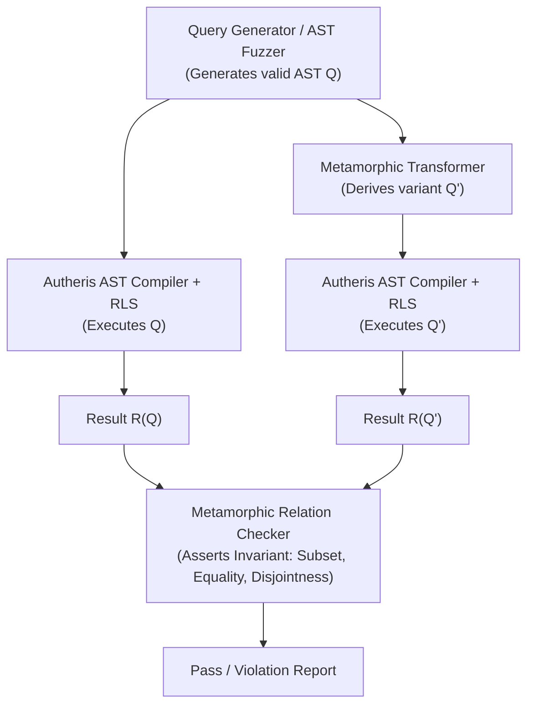
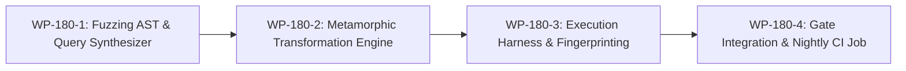

# PRD: REQ-TEST-180 - Metamorphic & Property-Based RLS Differential Testing

**Document ID:** `REQ-TEST-180`  
**Date:** 2026-10-19  
**Status:** PROPOSED (Phase 1 qualified)  
**Author:** Enterprise Product Manager & Security Testing Lead  
**Parent Plan:** [00-master-plan-overview.md](00-master-plan-overview.md)  
**Branch:** `feat/differential-rls-testing`  

---

## 1. Executive Summary & Problem Statement

Autheris enforces zero-trust data governance by rewriting client SQL and GraphQL queries at the Abstract Syntax Tree (AST) layer via `TrinoSqlEngine`. It conjoins tenant-scoped Row-Level Security (RLS) policies, enforces virtual filters, applies dynamic column masking, and selectively pushes predicates down into heterogeneous underlying storage engines (PostgreSQL, SQL Server, DuckDB, SQLite).

Historically, verification of this compiler pipeline relied on two mechanisms:
1. **Unit & Security Regression Tests:** Handcrafted scenarios asserting specific SQL query rewrites.
2. **Differential Gate against Frozen Legacy:** The `DifferentialGateTests` harness in `Autheris.Tests.SqlCompilerGate` executing ~150 static corpus queries and asserting directional equivalence against frozen outputs of the decommissioned legacy rewriter.

### The Limitations of the Current Approach:
- **Test Oracle Problem:** The legacy rewriter is frozen and gone. New features—such as cross-source WebSQL subtrees (#123), dynamic key-set filters (#124), bound parameters (#131), and caller-attribute row filters (#129)—have no legacy counterpart.
- **Corpus Blind Spots:** Hand-authored queries rarely explore complex combinatorial edge cases: deep boolean negation trees, Three-Valued Logic (3VL) NULL interactions in `NOT IN` predicates, join reordering with virtual filters, or correlated subqueries in multi-tenant contexts.
- **Pushdown Divergence Risk:** When predicates and RLS policies are pushed down into native dialects (e.g. T-SQL vs. PostgreSQL vs. DuckDB), semantic discrepancies (such as collation sensitivity or NULL ordering) could cause row leaks or silent omissions.

---

## 2. Solution: Metamorphic RLS Differential Testing

**Metamorphic Testing (MT)** solves the test oracle problem by evaluating mathematical relations between multiple executions of transformed inputs, rather than comparing against a separate reference implementation.

If an input query $Q$ is transformed into $Q'$ using a relation-preserving transformation, the relation between the outputs $R(Q)$ and $R(Q')$ must satisfy a predefined invariant called a **Metamorphic Relation (MR)**.

---

## 3. Core Metamorphic Relations (MRs)

### MR-1: Policy Monotonicity (Narrowing Invariant)
- **Principle:** Given a query $Q$ under policy $P_1$, and a strictly more restrictive policy $P_1 \land P_2$, the result set of the more restrictive execution must be a strict subset or equal to the less restrictive execution:
  $$\mathcal{R}(Q, P_1 \land P_2) \subseteq \mathcal{R}(Q, P_1)$$
- **Security Guarantee:** Any row present in $\mathcal{R}(Q, P_1 \land P_2)$ that is absent from $\mathcal{R}(Q, P_1)$ represents an catastrophic policy bypass or operator inversion vulnerability.

### MR-2: Boolean Commutativity & Associative Invariance
- **Principle:** Logical conjunctions and disjunctions in RLS policies and query filters must produce identical result sets regardless of AST ordering or nesting:
  $$\mathcal{R}(Q, A \land B) \equiv \mathcal{R}(Q, B \land A)$$
  $$\mathcal{R}(Q, (A \land B) \land C) \equiv \mathcal{R}(Q, A \land (B \land C))$$
- **Security Guarantee:** Ensures that AST visitor optimizations and boolean simplifications in `AstSimplificationVisitor` never alter governance semantics.

### MR-3: Strict Tenant Disjointness
- **Principle:** For two disjoint tenants $T_A$ and $T_B$ with orthogonal partition bounds ($P_{T_A} \land P_{T_B} = \text{FALSE}$):
  $$\mathcal{R}(Q, P_{T_A}) \cap \mathcal{R}(Q, P_{T_B}) = \emptyset$$
- **Security Guarantee:** Zero cross-tenant data leakage under arbitrary user queries, CTEs, or aggregate rollups.

### MR-4: Pushdown Semantic Equivalence
- **Principle:** Executing a federated query $Q$ with AST pushdown enabled (where pushed predicates and RLS evaluate in PostgreSQL/SQL Server) must yield exactly the same rows as executing $Q$ with pushdown disabled (where full base tables are staged into DuckDB and filtered entirely within the gateway engine):
  $$\mathcal{R}_{\text{Pushdown}}(Q) \equiv \mathcal{R}_{\text{DuckDB-Staged}}(Q)$$
- **Security Guarantee:** Verifies that dialect compilation preserves exact 3VL semantics, collation rules, and filter boundaries across native storage engines.

### MR-5: Masking Non-Inversion & Projection Leak Resistance
- **Principle:** If column $C$ is subject to masking rule $M$, then for any wrapper expression $E(C)$ (e.g. `UPPER(C)`, `SUBSTRING(C, 1, 3)`, `CASE WHEN C = 'secret' THEN 1 ELSE 0 END`), the query must never reveal unmasked underlying values, and filtering on masked columns must either fail closed or evaluate against masked representations.
- **Security Guarantee:** Eliminates side-channel oracle probing via expressions and conditional execution.

### MR-6: 3VL Anti-Join & NULL Soundness
- **Principle:** Queries containing `NOT IN (SELECT ...)` or `<> ALL (...)` with nullable columns must strictly produce empty result sets or correct ANSI SQL three-valued logic outcomes when candidate sets contain NULLs, rather than bypassing filters.

---

## 4. Work Packages & Implementation Blueprint

### WP-180-1: AST Query & Policy Synthesizer
- In `tests/Autheris.Tests.SqlCompilerGate/Metamorphic/`:
  - Implement `QuerySynthesizer`: Generates valid, typed SQL AST trees over the standard `GateModel` schema (Tables: `accounts`, `tenants`, `transactions`, `audit_records`).
  - Capable of generating arbitrary combinations of:
    - Inner, left, right, full, and cross joins.
    - Deeply nested WHERE conjuncts (`AND`, `OR`, `NOT`, `IS NULL`, `IN`, `BETWEEN`).
    - Aggregations and `HAVING` filters.
    - Common Table Expressions (CTEs) and correlated subqueries.

### WP-180-2: Metamorphic Transformation Engine
- Implement `MetamorphicTransformer`:
  - Generates relation pairs $(Q_1, Q_2)$ applying MR-1 through MR-6.
  - Automatically derives complementary policy sets and conjoined constraints.

### WP-180-3: Differential Execution Harness & Fingerprinting
- Implement `MetamorphicExecutionHarness`:
  - Compiles and executes both query variants against DuckDB, PostgreSQL, and SQL Server fixtures.
  - Uses SHA-256 row-hash multiset fingerprinting (`RowMultisetFingerprint`) to assert set equality, subset inclusion, or set disjointness independent of physical row ordering.

### WP-180-4: Stryker.NET Configuration & CI Pipeline Expansion
- Expand mutation testing coverage in `stryker-config.json` and provide modular mutation configs:
  - `stryker-config.json`: Core compiler & AST mutators (`TrinoSqlEngine`).
  - `stryker-application.json`: Governance, virtual filters, and federation pushdown (`Autheris.Application`).
  - `stryker-cdc.json`: Change tracking & multi-watermark pollers (`Autheris.Extensions`).
- Incorporate metamorphic test passes into `.github/workflows/sql-compiler-gate-nightly.yml`.

---

## 5. Acceptance Criteria

- **AC-1:** `QuerySynthesizer` generates 1,000+ distinct syntactically and semantically valid AST queries over `GateModel` without crashing.
- **AC-2:** MR-1 (Policy Monotonicity) executes 500+ randomized query-policy pairs with 0 subset violations.
- **AC-3:** MR-2 (Commutativity) and MR-3 (Tenant Disjointness) verify 0 cross-tenant leaks.
- **AC-4:** MR-4 (Pushdown Equivalence) verifies 100% result parity between pushed storage execution and pure DuckDB gateway execution.
- **AC-5:** Metamorphic test suite integrates into `Autheris.Tests.SqlCompilerGate` as an automated xUnit theory test runner.
- **AC-6:** Mutation testing configuration covers `TrinoSqlEngine`, `Sql/Federation`, `VirtualFilters`, and `Cdc`.
