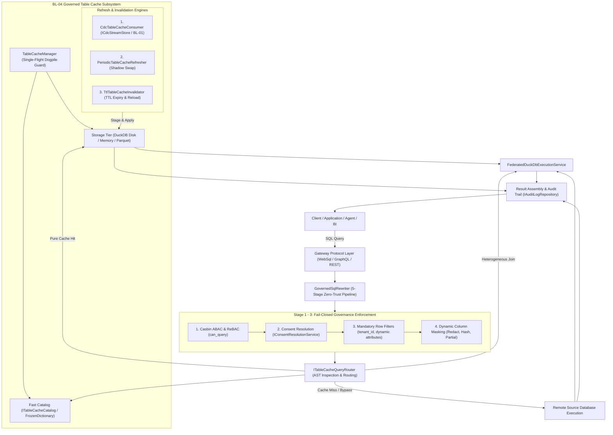
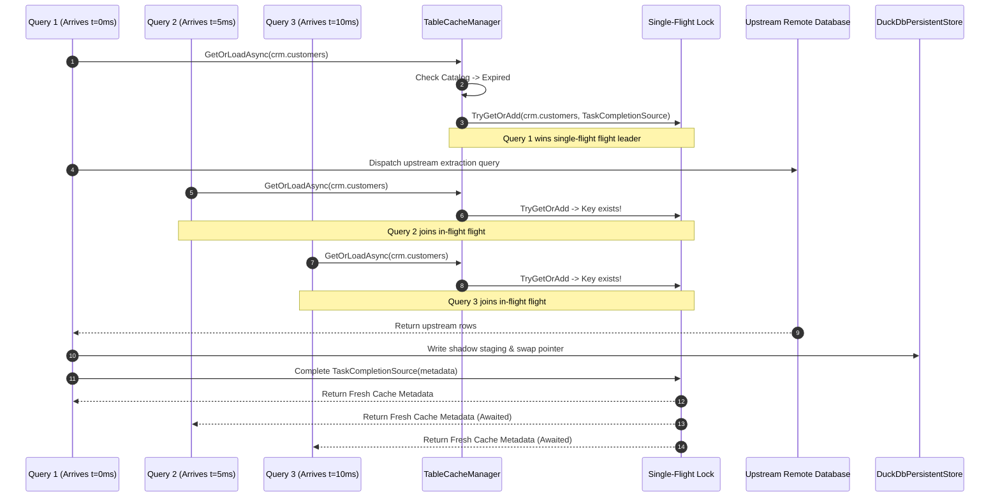

# Implementation Plan: REQ-DATA-BL04 - Governed Table Cache & Transparent Federated Query Routing

**Document ID:** `PLAN-DATA-BL04`  
**Date:** 2026-10-20  
**Phase:** 2 & 3 (Solution Architect, `csharp-architect`; Application Security & Compliance Architect, `csharp-security-expert`)  
**Authors:** Solution Architect (`csharp-architect`), Application Security & Compliance Architect (`csharp-security-expert`)  
**Input PRD:** [`2026-10-20-req-bl-04-governed-table-cache.md`](2026-10-20-req-bl-04-governed-table-cache.md) (`REQ-DATA-BL04`)  
**Parent Plan:** [`00-master-plan-overview.md`](00-master-plan-overview.md) (Wave 4, row 4.6)  
**Target Branch:** `feat/bl-04-governed-table-cache`  
**Status:** APPROVED (Phase 2 Architecture & Phase 3 Security Review complete); ready for Phase 4 (TDD Developers)  

**Binding Architectural & Repository Constraints:**
- **Universal English standard:** All plans, code, models, diagnostics, and documentation must strictly use English.
- **Clean Architecture layers:**
  - `Autheris.Domain`: Pure entities, options, enums, models, and interfaces.
  - `Autheris.Application`: High-performance catalog, manager, single-flight dogpiling guard, refresh engines, query rewriters, and router.
  - `Autheris.Infrastructure`: Storage store implementations (`InMemoryTableCacheStore`, `DuckDbPersistentTableCacheStore`), encrypted disk persistence, connection leasing, and CDC event consumers.
  - `Autheris.Api` / `Autheris.Extensions`: Dependency injection extensions, options binding, admin endpoints, and background hosted services.
- **Zero-Trust & Fail-Closed:** The cache acts as an accelerated relational storage engine, **never** an authorization bypass. Every query hitting a cached table must execute Casbin ABAC/ReBAC, consent verification, mandatory row filter injection, and dynamic column masking before data is emitted.
- **Zero-Allocation Hot Paths:** Use `ReadOnlySpan<char>`, `SearchValues<char>`, `FrozenDictionary<TableIdentifier, TableCacheEntryMetadata>`, `ValueTask<T>`, and pooled buffers for hot lookup and query routing paths in .NET 10.
- **High Availability & Persistence:** Persistent storage on disk via DuckDB file store with AES-256-GCM encryption at rest, sub-200ms reboot recovery, and configurable offline survival policies.

---

## 1. Executive Summary & Architectural Invariants

### 1.1 The Operational Problem
Autheris functions as an intelligent, zero-trust data gateway mediating access to heterogeneous operational and analytical data stores (PostgreSQL, SQL Server, Databricks, Oracle, MySQL, SQLite, and REST APIs). In high-throughput enterprise deployments, executing every query live against upstream production engines causes four severe bottlenecks:
1. **OLTP Database Contention:** Frequent dimension lookups and operational joins saturate upstream connection pools and degrade production OLTP performance.
2. **Exorbitant Cloud Warehouse Costs:** Repetitive ad-hoc queries against Databricks SQL or Snowflake incur continuous compute cluster billing.
3. **Source Outage Fragility:** Upstream maintenance windows or transient network partitions result in immediate client query failures (`500`/`503` timeouts).
4. **Network Heavy Cross-Source Joins:** Joining a high-churn remote transactional table with a slow remote dimension table stages both sides over the network on every query, inflating latency and egress bandwidth.

### 1.2 Core Solution: Governed In-Gateway Table Cache (BL-04)
`PLAN-DATA-BL04` establishes an in-gateway, high-performance, governed table cache inside Autheris. Whole tables or partial subsets (selected columns and row slices) are staged in gateway memory or persistent encrypted local DuckDB storage.

```
+---------------------------------------------------------------------------------------------------+
|                                      THE ZERO-TRUST INVARIANT                                     |
|  The cache stores raw or pre-filtered relational data at rest.                                    |
|  Caching NEVER short-circuits or bypasses runtime governance.                                     |
|                                                                                                   |
|  Every query touching cached data MUST pass through:                                              |
|    1. Casbin ABAC / ReBAC (can_query verification)                                                |
|    2. Consent Resolution (IConsentResolutionService)                                              |
|    3. Query-Time Mandatory Row Filters (tenant_id = @tenant_id, department, custom RLS)          |
|    4. Dynamic Column Masking (Redaction, Hashing, Partial Masking)                               |
|    5. WORM Audit Trail Emission (IAuditLogRepository with CacheHit: true)                         |
+---------------------------------------------------------------------------------------------------+
```

### 1.3 Key Architectural Capabilities
- **Three Declarative Refresh Modes:**
  1. *CDC-Driven Refresh:* Subscribes to `ICdcStreamStore` (BL-01 / #99) and applies real-time delta mutations (`Insert`, `Update`, `Delete`) with watermark tracking and automatic gap recovery.
  2. *Periodic Background Refresh:* Executes background queries on intervals/cron into shadow staging tables (`staging_{table}_{epoch}`) and executes zero-downtime atomic pointer swaps.
  3. *Classic TTL Expiry & Single-Flight Coalescing:* Bounded time-to-live with a strict single-flight dogpile guard (`SemaphoreSlim` key locking) ensuring that 100 concurrent requests trigger exactly ONE upstream load.
- **Transparent Query Routing & Heterogeneous Joins:** Callers submit standard SQL queries. The query planner inspects the AST, checks column/filter subsumption, rewrites table targets to local cache instances, and coordinates transparent joins between cached tables and remote live sources via `FederatedDuckDbExecutionService`.
- **Disk Persistence & Offline Survival:** Backed by local DuckDB database files encrypted with AES-256-GCM. In offline mode (`ServeStaleWithWarning`), queries survive upstream source outages and return cached data with an explicit HTTP warning header (`X-Autheris-Cache: Stale-Offline`).

---

## 2. Verified Codebase Ground Truth & Integration Points

Before designing the new types, we verify the existing Autheris codebase architecture to ensure seamless compatibility without code duplication or broken abstractions:

| # | Codebase Fact & Existing File | Integration & Architectural Implication for BL-04 |
|---|---|---|
| **V-1** | [`DuckDbOlapEngine.cs`](file:///root/autheris/src/Autheris.Application/Olap/DuckDbOlapEngine.cs) manages concurrency with `SemaphoreSlim`, sets up memory/thread PRAGMAs, and stages tables via in-memory sessions. | `DuckDbPersistentTableCacheStore` and `InMemoryTableCacheStore` leverage DuckDB C API / `DuckDB.NET.Data` with leased connections, sandbox isolation (`enable_external_access = false`), and dedicated local storage paths. |
| **V-2** | [`FederatedDuckDbExecutionService.cs`](file:///root/autheris/src/Autheris.Application/Sql/Services/FederatedDuckDbExecutionService.cs) orchestrates cross-source joins via `ICrossSourceQueryRouter`, `ICrossSourcePlanner`, and `IFederatedStagingService`. | Integrate `ITableCacheQueryRouter` into `CrossSourceQueryRouter` and `FederatedStagingService`. Cached tables are resolved directly from local storage with zero network egress, avoiding upstream calls. |
| **V-3** | [`GovernedSqlRewriter.cs`](file:///root/autheris/src/Autheris.Application/Sql/Services/GovernedSqlRewriter.cs) executes a 5-stage pipeline: AST Analysis -> Identity -> Governance (RLS/Masking) -> Options -> Compile. | Cached queries undergo the EXACT same 5 stages. Table rewriting swaps the physical target table identifier to the internal cache table identifier in Stage 4/5, preserving all Stage 3 governance filters and masks. |
| **V-4** | [`ICdcStreamStore.cs`](file:///root/autheris/src/Autheris.Application/Streaming/Interfaces/ICdcStreamStore.cs) provides durable ordered CDC events with `ReadAsync(CdcStreamId, fromOffset, maxEvents)`. | `CdcTableCacheConsumer` subscribes to `ICdcStreamStore`, reads incremental change events, and applies upserts/deletes to cached DuckDB tables with atomic watermark progression. |
| **V-5** | [`TableIdentifier.cs`](file:///root/autheris/src/Autheris.Domain/Common/TableIdentifier.cs) is a case-insensitive `readonly record struct` (`Domain.Schema.TableName`). | Used as the primary key throughout `ITableCacheCatalog`, `ITableCacheStore`, and `ITableCacheManager`. |
| **V-6** | [`TableAccessPolicy.cs`](file:///root/autheris/src/Autheris.Application/Policy/TableAccessPolicy.cs) evaluates ReBAC, Consents, Access Profiles, and Casbin ABAC. | When queries hit the table cache, `TableAccessPolicy.DecideAsync` is invoked with the original user context, ensuring permissions are evaluated against the logical table. |
| **V-7** | [`CdcStreamCrypto.cs`](file:///root/autheris/src/Autheris.Application/Streaming/Crypto/CdcStreamCrypto.cs) provides AES-256-GCM envelope encryption using hardware-accelerated .NET primitives. | Reuse key derivation patterns and AES-256-GCM primitives for encrypting DuckDB persistent files and Parquet partitions at rest. |

---

## 3. Architecture Decisions & System Topology



### Decision D-1: Storage Engine Selection & DuckDB File Persistence
- **Adopt DuckDB as Core Relational Cache Engine:** DuckDB provides vectorized SIMD query execution, columnar scans, ACID transactions, native SQL compliance, and high-performance persistent `.duckdb` single-file databases.
- **In-Memory Store:** Uses DuckDB in-memory database instances (`DataSource=:memory:`) for high-churn, volatile, or temporary cache sets.
- **File-Backed Persistent Store:** Uses dedicated encrypted `.duckdb` database files per table/tenant stored in `Gateway:TableCache:PersistentDirectory`.
- **Fast Startup:** On gateway reboot, DuckDB database files are verified in `< 200ms` via lightweight header inspections, populating the `ITableCacheCatalog` without re-querying remote source databases.

### Decision D-2: Single-Flight Dogpiling Prevention Architecture
When a table cache entry expires or experiences a cold miss under heavy concurrent traffic, naive implementations dispatch dozens of identical heavy queries to the upstream database (the "thundering herd" or "dogpiling" problem).
- **Architecture:** `TableCacheManager` maintains a concurrent coordination map of in-flight load operations using `ConcurrentDictionary<TableIdentifier, Task<TableCacheEntryMetadata>>`.
- **Guarantee:** If 100 concurrent queries request an expired table, exactly ONE upstream query is executed. The remaining 99 queries await the completion of that single task and immediately read from the freshly populated cache.



### Decision D-3: Zero-Downtime Shadow Table Staging & Atomic Swap
For `PeriodicInterval` and full reloads, reads MUST NOT be blocked or locked while fresh data is extracted from the remote source.
- **Shadow Staging:** The refresh engine creates a shadow table: `staging_{clean_table_name}_{generation_epoch}`.
- **Validation Guard:** Verifies minimum row count, schema shape, and column nullability before promotion.
- **Atomic Pointer Swap:** DuckDB views or catalog pointers are atomically updated (`CREATE OR REPLACE VIEW {clean_table_name} AS SELECT * FROM staging_{clean_table_name}_{generation_epoch}`).
- **Graceful Retirement:** The retired generation is dropped after active readers drain reference leases (bounded by query timeout).

### Decision D-4: Non-Bypassable Governance Injection
- **No Direct Physical Access:** Callers cannot address internal DuckDB shadow tables or raw files directly.
- **AST Pushdown:** Every query executed against the cache is rewritten by `GovernedSqlRewriter`. User-specific and tenant-specific row filters (`tenant_id = @tenant_id AND ...`) are injected into the AST `WHERE` clause.
- **Dynamic Masking Expression Projection:** Columns flagged for masking (e.g. `ssn`, `credit_card`) have masking expressions (e.g. `'***-**-' || RIGHT(ssn, 4)`) injected directly into the projection list. Raw data stored in the cache is never transmitted across the network to unauthorized callers.

---

## 4. Clean Architecture Layering & Class Responsibilities

```
+--------------------------------------------------------------------------------------------------+
| src/Autheris.Domain/                                                                             |
|   Caching/TableCache/                                                                            |
|     TableCacheRefreshMode.cs       (Enums: CdcStreaming, PeriodicInterval, TtlExpiry)            |
|     TableCacheStorageTier.cs        (Enums: Memory, DuckDbDisk, ParquetDisk)                     |
|     TableCacheOfflinePolicy.cs      (Enums: FailClosed, ServeStaleWithWarning)                   |
|     TableCacheEntryMetadata.cs      (Metadata record: Epoch, RowCount, Size, ExpiresAt, etc.)    |
|     TableCacheStats.cs              (Metrics & runtime statistics record)                        |
|     TableCacheMutation.cs           (Delta mutation: Insert, Update, Delete)                     |
|     ITableCacheCatalog.cs           (Catalog contract)                                           |
|     ITableCacheStore.cs             (Storage contract: memory, DuckDB file, Parquet)             |
|     ITableCacheManager.cs           (Orchestration, dogpiling, and eviction contract)             |
|     ITableCacheQueryRouter.cs       (AST inspection and routing contract)                        |
|     ITableCacheInvalidator.cs       (Invalidation contract)                                      |
|   Options/TableCache/                                                                            |
|     TableCacheOptions.cs            (Gateway:TableCache options schema)                          |
|     TableCacheTargetOptions.cs      (Per-table caching configuration schema)                     |
|     TableCacheEncryptionOptions.cs  (Disk encryption options schema)                             |
+--------------------------------------------------------------------------------------------------+
                                                 ▲
                                                 │ (Implements & Uses Domain)
+--------------------------------------------------------------------------------------------------+
| src/Autheris.Application/                                                                        |
|   Caching/TableCache/                                                                            |
|     TableCacheCatalog.cs            (Thread-safe FrozenDictionary-backed fast catalog)           |
|     TableCacheManager.cs            (Single-flight dogpile guard, orchestration, eviction)       |
|     TableCacheQueryRouter.cs        (AST analysis, column coverage check, table rewriting)       |
|     TableCacheInvalidator.cs        (Eviction and invalidation coordinator)                      |
|     Engines/                                                                                     |
|       CdcTableCacheConsumer.cs      (ICdcStreamStore subscriber, delta applier, gap recovery)    |
|       PeriodicTableCacheRefresher.cs(Background interval/cron poller, shadow staging & swap)    |
|       TtlTableCacheInvalidator.cs   (TTL expiration tracker and proactive refresher)             |
+--------------------------------------------------------------------------------------------------+
                                                 ▲
                                                 │ (Implements Domain Stores)
+--------------------------------------------------------------------------------------------------+
| src/Autheris.Infrastructure/                                                                     |
|   Caching/TableCache/                                                                            |
|     DuckDbPersistentTableCacheStore.cs (Encrypted DuckDB file storage with connection leasing)   |
|     InMemoryTableCacheStore.cs         (Volatile in-memory DuckDB table storage)                 |
|     Storage/                                                                                     |
|       EncryptedTableFileStream.cs      (AES-256-GCM file encryption stream)                      |
|       DuckDbConnectionPool.cs          (Safe multi-reader single-writer connection leasing)      |
+--------------------------------------------------------------------------------------------------+
                                                 ▲
                                                 │ (Dependency Injection & Endpoints)
+--------------------------------------------------------------------------------------------------+
| src/Autheris.Api/ & src/Autheris.Extensions/                                                     |
|   DependencyInjection/                                                                           |
|     TableCacheServiceCollectionExtensions.cs (DI registrations, options validation)              |
|   Hosting/                                                                                       |
|     TableCacheBackgroundWorker.cs            (IHostedService driving CDC, periodic, & TTL tasks) |
|   Endpoints/                                                                                     |
|     TableCacheAdminEndpoints.cs              (Admin inspection, invalidate, and refresh APIs)    |
+--------------------------------------------------------------------------------------------------+
```

---

## 5. Detailed Contracts, Interfaces & Class Specifications

### 5.1 Domain Enums (`Autheris.Domain.Caching.TableCache`)

```csharp
namespace Autheris.Domain.Caching.TableCache;

/// <summary>
/// Declares the synchronization mechanism used to keep the cached table updated.
/// </summary>
public enum TableCacheRefreshMode
{
    /// <summary>Subscribes to ICdcStreamStore to apply real-time delta mutations.</summary>
    CdcStreaming = 1,

    /// <summary>Periodically queries upstream source on interval/cron into shadow staging table.</summary>
    PeriodicInterval = 2,

    /// <summary>Invalidates on TTL expiration and reloads on read via single-flight lock.</summary>
    TtlExpiry = 3
}

/// <summary>
/// Declares the physical storage medium used for the cached table.
/// </summary>
public enum TableCacheStorageTier
{
    /// <summary>Volatile in-memory DuckDB session (transient, destroyed on process exit).</summary>
    Memory = 1,

    /// <summary>Persistent local DuckDB database file (.duckdb) encrypted at rest.</summary>
    DuckDbDisk = 2,

    /// <summary>Partitioned Apache Parquet columnar files encrypted at rest.</summary>
    ParquetDisk = 3
}

/// <summary>
/// Declares behavior when upstream data source is unreachable or in outage.
/// </summary>
public enum TableCacheOfflinePolicy
{
    /// <summary>Fail-closed: Returns 503 Service Unavailable if cache is expired or unverified.</summary>
    FailClosed = 1,

    /// <summary>High-availability: Serves stale cached data with X-Autheris-Cache: Stale-Offline header.</summary>
    ServeStaleWithWarning = 2
}
```

### 5.2 Domain Options & Models (`Autheris.Domain.Options.TableCache` & `Model`)

```csharp
namespace Autheris.Domain.Options.TableCache;

using System.ComponentModel.DataAnnotations;
using Autheris.Domain.Caching.TableCache;

public sealed class TableCacheOptions
{
    public const string SectionName = "Gateway:TableCache";

    public bool Enabled { get; init; } = false;

    public TableCacheStorageTier DefaultStorageTier { get; init; } = TableCacheStorageTier.DuckDbDisk;

    [Required]
    public string PersistentDirectory { get; init; } = "/var/lib/autheris/cache";

    public int DefaultMemoryLimitMb { get; init; } = 2048;

    public int DefaultDiskLimitMb { get; init; } = 10240;

    public int DefaultTtlSeconds { get; init; } = 3600;

    public bool AllowStaleOnOutage { get; init; } = false;

    public TableCacheEncryptionOptions Encryption { get; init; } = new();

    public List<TableCacheTargetOptions> Tables { get; init; } = [];
}

public sealed class TableCacheTargetOptions
{
    [Required]
    public string DataSource { get; init; } = string.Empty;

    [Required]
    public string Table { get; init; } = string.Empty;

    public TableCacheRefreshMode RefreshMode { get; init; } = TableCacheRefreshMode.TtlExpiry;

    public TableCacheStorageTier StorageTier { get; init; } = TableCacheStorageTier.DuckDbDisk;

    public IReadOnlyList<string>? Columns { get; init; }

    public string? FilterPredicate { get; init; }

    public int? TtlSeconds { get; init; }

    public int? RefreshIntervalSeconds { get; init; }

    public string? CronExpression { get; init; }

    public long? MaxRows { get; init; }

    public TableCacheOfflinePolicy OfflinePolicy { get; init; } = TableCacheOfflinePolicy.FailClosed;

    public double ProactiveEarlyRefreshRatio { get; init; } = 0.10; // Refresh at 90% elapsed TTL
}

public sealed class TableCacheEncryptionOptions
{
    public bool Enabled { get; init; } = true;

    public string KeyVaultKeyName { get; init; } = "table-cache-dek";

    public string KeyDerivationContext { get; init; } = "Autheris.TableCache.v1";
}
```

```csharp
namespace Autheris.Domain.Caching.TableCache;

using System;
using System.Collections.Generic;
using Autheris.Domain.Common;

public sealed record TableCacheEntryMetadata(
    TableIdentifier Table,
    TableCacheStorageTier StorageTier,
    string InternalStoragePath,
    string ActiveViewName,
    long GenerationEpoch,
    DateTimeOffset LastRefreshedAt,
    DateTimeOffset? ExpiresAt,
    long RowCount,
    long SizeInBytes,
    long? LastWatermarkOffset,
    bool IsHealthy,
    string? LastError,
    IReadOnlyList<string> CachedColumns,
    string? FilterPredicate,
    TableCacheOfflinePolicy OfflinePolicy);

public sealed record TableCacheStats(
    long TotalHits,
    long TotalMisses,
    long TotalEvictions,
    long TotalRefreshes,
    long TotalStaleServes,
    long TotalMemoryBytes,
    long TotalDiskBytes,
    int ActiveTableCount);

public sealed record TableCacheMutation(
    CdcStreamEventKind Operation,
    IReadOnlyDictionary<string, object?> PrimaryKeyValues,
    IReadOnlyDictionary<string, object?> RowValues,
    long StreamOffset,
    DateTimeOffset Timestamp);
```

### 5.3 Domain Interfaces (`Autheris.Domain.Caching.TableCache`)

```csharp
namespace Autheris.Domain.Caching.TableCache;

using System;
using System.Collections.Frozen;
using System.Collections.Generic;
using System.Threading;
using System.Threading.Tasks;
using Autheris.Domain.Common;

public interface ITableCacheCatalog
{
    bool TryGet(TableIdentifier table, out TableCacheEntryMetadata? metadata);

    void Upsert(TableCacheEntryMetadata metadata);

    bool Remove(TableIdentifier table);

    IReadOnlyList<TableCacheEntryMetadata> GetAll();

    FrozenDictionary<TableIdentifier, TableCacheEntryMetadata> GetSnapshot();
}

public interface ITableCacheStore
{
    TableCacheStorageTier StorageTier { get; }

    Task InitializeTableAsync(TableCacheTargetOptions options, CancellationToken ct = default);

    Task<string> StageShadowGenerationAsync(
        TableIdentifier table,
        long epoch,
        IReadOnlyList<string> columns,
        IAsyncEnumerable<IReadOnlyList<object?>> rows,
        CancellationToken ct = default);

    Task<TableCacheEntryMetadata> SwapActiveGenerationAsync(
        TableIdentifier table,
        long epoch,
        string shadowIdentifier,
        long rowCount,
        long sizeInBytes,
        DateTimeOffset? expiresAt,
        CancellationToken ct = default);

    Task DropGenerationAsync(TableIdentifier table, long epoch, CancellationToken ct = default);

    Task ApplyMutationsAsync(
        TableIdentifier table,
        IReadOnlyList<TableCacheMutation> mutations,
        CancellationToken ct = default);

    Task<DuckDB.NET.Data.DuckDBConnection> LeaseReaderConnectionAsync(
        TableIdentifier table,
        CancellationToken ct = default);

    Task EvictAsync(TableIdentifier table, CancellationToken ct = default);
}

public interface ITableCacheManager
{
    ValueTask<TableCacheEntryMetadata?> GetOrLoadAsync(TableIdentifier table, CancellationToken ct = default);

    Task ForceRefreshAsync(TableIdentifier table, CancellationToken ct = default);

    Task EvictExpiredAsync(CancellationToken ct = default);

    TableCacheStats GetStats();
}

public sealed record TableCacheRoutingDecision(
    bool IsCached,
    bool CanSatisfyFully,
    string? InternalStorageTarget,
    TableCacheEntryMetadata? Metadata,
    IReadOnlyList<string>? MissingColumns = null,
    string? FallbackReason = null);

public interface ITableCacheQueryRouter
{
    ValueTask<TableCacheRoutingDecision> EvaluateRoutingAsync(
        TableIdentifier table,
        IReadOnlyList<string> requestedColumns,
        string? whereClause,
        CancellationToken ct = default);
}

public interface ITableCacheInvalidator
{
    Task InvalidateAsync(TableIdentifier table, string reason, CancellationToken ct = default);

    Task InvalidateDataSourceAsync(string dataSource, string reason, CancellationToken ct = default);
}
```

---

## 6. Deep Dive Subsystems & Implementation Specifications

### 6.1 Refresh Engine 1: CDC Stream Consumer (`CdcTableCacheConsumer`)
The CDC Table Cache Consumer connects directly to `ICdcStreamStore` (delivered in BL-01 / #99). It guarantees real-time incremental updates for cached tables configured with `RefreshMode: TableCacheRefreshMode.CdcStreaming`.

#### 6.1.1 Stream Consumption Loop & Watermark Tracking
1. On startup, `CdcTableCacheConsumer` queries `ICdcStreamStore.GetStreamAsync` for each declared CDC table.
2. The consumer initializes its local watermark from `TableCacheEntryMetadata.LastWatermarkOffset`. If null, it starts from `CdcStartPosition.Earliest` or the latest committed stream offset.
3. Consumes events in micro-batches (e.g. up to 1,000 events) using `ICdcStreamStore.ReadAsync`.
4. Decodes payloads using `ICdcPayloadCodec` and applies mutations via `ITableCacheStore.ApplyMutationsAsync`.
5. Updates the local catalog watermark in `ITableCacheCatalog`.

#### 6.1.2 Automatic CDC Discontinuity & Gap Recovery
If a stream gap occurs (e.g. stream retention purge or sequence truncation resulting in `CdcStreamEventKind.Gap` or `CdcGapDetectedException`):
1. **Detection:** Consumer catches `CdcGapDetectedException` or encounters event kind `CdcStreamEventKind.Gap`.
2. **Alerting:** Emits an OpenTelemetry warning event and updates `TableCacheEntryMetadata.IsHealthy = false`.
3. **Automatic Shadow Resync:** The consumer invokes `TableCacheManager.ForceRefreshAsync(table)`:
   - Initiates a complete shadow extraction from the upstream database.
   - Resets the CDC baseline stream watermark to the upstream transaction snapshot position.
   - Atomically swaps the active cache view.
   - Marks `IsHealthy = true` with zero interruption to concurrent readers.

```mermaid
flowchart TD
    Start["CDC Consumer Loop"] --> ReadEvents["ICdcStreamStore.ReadAsync(offset, 1000)"]
    ReadEvents --> CheckGap{"Gap Detected or<br/>CdcGapDetectedException?"}
    
    CheckGap -->|Yes (Discontinuity)| MarkUnhealthy["Set IsHealthy = false"]
    MarkUnhealthy --> TriggerShadow["Trigger TableCacheManager.ForceRefreshAsync()"]
    TriggerShadow --> ResyncStream["Reset Stream Watermark Baseline"]
    ResyncStream --> MarkHealthy["Atomic Swap & Set IsHealthy = true"]
    MarkHealthy --> ReadEvents
    
    CheckGap -->|No (Sequential Batch)| Decode["Decode Payloads (ICdcPayloadCodec)"]
    Decode --> BatchMutations["Group Mutations (Insert, Update, Delete)"]
    BatchMutations --> Apply["ITableCacheStore.ApplyMutationsAsync()"]
    Apply --> AdvanceWatermark["Update LastWatermarkOffset"]
    AdvanceWatermark --> ReadEvents
```

---

### 6.2 Refresh Engine 2: Periodic Background Refresher (`PeriodicTableCacheRefresher`)
The Periodic Table Cache Refresher runs as an autonomous background service managing tables configured with `RefreshMode: TableCacheRefreshMode.PeriodicInterval`.

#### 6.2.1 Shadow Staging & Atomic Swap Sequence
1. **Trigger:** Fires on configured `RefreshIntervalSeconds` or parsed `CronExpression` using `PeriodicTimer`.
2. **Extraction:** Dispatches a governed extractor query to the remote data source via `IDataSourceExecutor` or `IAutherisConnectorRegistry`.
3. **Shadow Staging:** Writes stream data directly to a temporary shadow table:
   `autheris_cache.staging_{table}_{new_epoch}`.
4. **Validation Guard (Anti-Corruption):**
   - Row Count Check: If upstream returns 0 rows but table metadata expects $>0$ and `MaxRows` was configured, reject swap and record warning.
   - Schema Conformance: Verify that all mandatory columns and types match the declared table schema.
5. **Atomic Pointer Swap:**
   Executes in DuckDB:
   ```sql
   CREATE OR REPLACE VIEW autheris_cache."customers" AS 
   SELECT * FROM autheris_cache."staging_customers_1729384800";
   ```
6. **Graceful Generation Retirement:**
   Previous generation table `staging_customers_1729381200` is flagged for retirement. Once active leased readers have finished, the old table is dropped (`DROP TABLE autheris_cache."staging_customers_1729381200"`).

---

### 6.3 Refresh Engine 3: Classic TTL Expiry & Single-Flight Coalescing
Manages tables configured with `RefreshMode: TableCacheRefreshMode.TtlExpiry`.

#### 6.3.1 Single-Flight Coalescing Implementation
To prevent cache dogpiling when a popular table's TTL expires:
```csharp
namespace Autheris.Application.Caching.TableCache;

public sealed class TableCacheManager : ITableCacheManager
{
    private readonly ConcurrentDictionary<TableIdentifier, Task<TableCacheEntryMetadata>> _inFlightLoads = new();
    private readonly ITableCacheCatalog _catalog;
    private readonly ITableCacheStore _store;
    private readonly IDataSourceExecutorResolver _executorResolver;
    private readonly TimeProvider _timeProvider;

    public async ValueTask<TableCacheEntryMetadata?> GetOrLoadAsync(TableIdentifier table, CancellationToken ct = default)
    {
        var now = _timeProvider.GetUtcNow();
        if (_catalog.TryGet(table, out var existing) && existing is not null)
        {
            if (existing.ExpiresAt == null || existing.ExpiresAt > now)
            {
                // Check proactive early refresh
                CheckProactiveRefresh(table, existing, now);
                return existing;
            }

            if (existing.OfflinePolicy == TableCacheOfflinePolicy.ServeStaleWithWarning && IsSourceUnreachable(table))
            {
                // Return stale cached table in offline mode
                return existing;
            }
        }

        // Single-Flight Coalescing
        while (true)
        {
            if (_inFlightLoads.TryGetValue(table, out var inFlightTask))
            {
                return await inFlightTask.WaitAsync(ct).ConfigureAwait(false);
            }

            var tcs = new TaskCompletionSource<TableCacheEntryMetadata>(TaskCreationOptions.RunContinuationsAsynchronously);
            if (_inFlightLoads.TryAdd(table, tcs.Task))
            {
                try
                {
                    var freshMetadata = await ExecuteUpstreamLoadAsync(table, ct).ConfigureAwait(false);
                    _catalog.Upsert(freshMetadata);
                    tcs.SetResult(freshMetadata);
                    return freshMetadata;
                }
                catch (Exception ex)
                {
                    tcs.SetException(ex);
                    throw;
                }
                finally
                {
                    _inFlightLoads.TryRemove(table, out _);
                }
            }
        }
    }
}
```

#### 6.3.2 Proactive Early Refresh
If `ProactiveEarlyRefreshRatio` is configured (default 10%), when a query requests a table whose remaining TTL is less than 10% of its total TTL, `TableCacheManager` triggers an asynchronous background reload task without blocking the calling query. The caller receives the cached data instantly, and subsequent callers seamlessly receive the refreshed cache with zero latency penalty.

---

### 6.4 Transparent Query Routing & Joins (`TableCacheQueryRouter`)
Callers submit queries targeting natural logical table names (e.g. `crm.customers` or `SELECT * FROM crm.customers c JOIN erp.orders o ON c.id = o.customer_id`). The caller has no awareness of whether a table is cached or stored in DuckDB.

#### 6.4.1 Subsumption & Applicability Evaluation
When `GovernedSqlRewriter` or `CrossSourceQueryRouter` parses the AST, `ITableCacheQueryRouter` evaluates each referenced table:
1. **Cache Existence & Health:** Is the table registered in `ITableCacheCatalog` and is `IsHealthy == true`?
2. **Column Projection Subsumption:** Does the cached column list cover all columns requested by the caller's AST?
   - If the caller requests `id, company_name, email` and the cache contains `[id, tenant_id, company_name, tier, country, created_at]`, `email` is missing!
   - **Decision:** Column miss. The router signals a fallback to live upstream execution (or partial merge if configured).
3. **Row Filter Subsumption:** If the table cache definition declared a `FilterPredicate` (e.g. `is_active = true`), does the query's AST predicate guarantee that only rows matching `is_active = true` can be returned? If the query asks for `WHERE is_active = false`, the cache cannot satisfy the query; route directly to live upstream.

#### 6.4.2 Single Cached Table Query Rewrite
For queries touching only cached tables:
- `GovernedSqlRewriter` rewrites table references from `crm.customers` to the internal DuckDB cached view `autheris_cache.customers`.
- Execution routes directly into `IDuckDbOlapEngine` or `DuckDbPersistentTableCacheStore`.
- Remote network calls: **ZERO**.

#### 6.4.3 Heterogeneous Cross-Source Joins (Cached + Live)
When a query joins a cached table (`crm.customers`) with a live remote table (`erp.orders`):
1. `CrossSourcePlanner` identifies `erp.orders` as remote and `crm.customers` as cached.
2. `FederatedDuckDbExecutionService` stages ONLY `erp.orders` from the remote database into DuckDB session memory via `FederatedStagingService`.
3. `crm.customers` is attached directly into the DuckDB session from the local persistent cache file:
   ```sql
   ATTACH '/var/lib/autheris/cache/crm_customers.duckdb' AS crm_cache (READ_ONLY);
   ```
4. DuckDB executes the vectorized join between the staged remote table and the local attached table.
5. Upstream network transfer for `crm.customers`: **ZERO**. Upstream connection lock: **ZERO**.

---

### 6.5 Disk Persistence, Encryption at Rest & Offline High Availability

#### 6.5.1 Persistent DuckDB Storage Topology
```
/var/lib/autheris/cache/
├── catalog.meta.json                     # Encrypted catalog state snapshot
├── crm_customers/
│   ├── current_epoch.meta                # Points to active generation (e.g. 1729384800)
│   ├── generation_1729381200.duckdb      # Prior generation (draining readers)
│   └── generation_1729384800.duckdb      # Active generation
└── erp_products/
    ├── current_epoch.meta
    └── generation_1729384800.duckdb
```

#### 6.5.2 AES-256-GCM Encryption at Rest
All files written to disk are encrypted using AES-256-GCM:
- **Key Derivation:** Cache Data Encryption Keys (DEKs) are derived from the gateway Key Encryption Key (KEK) using HKDF-SHA256 (`KeyDerivationContext = "Autheris.TableCache.v1"`).
- **Chunked File Encryption:** For `.duckdb` files, persistence uses DuckDB's native file-system abstraction or an authenticated encrypted block wrapper (`EncryptedTableFileStream`) providing confidentiality, integrity, and anti-tampering verification.

#### 6.5.3 Offline High Availability (`ServeStaleWithWarning`)
When an upstream database fails or circuit breaker opens:
- Tables with `OfflinePolicy: TableCacheOfflinePolicy.FailClosed` return `503 Service Unavailable` with `GATEWAY_SOURCE_OUTAGE`.
- Tables with `OfflinePolicy: TableCacheOfflinePolicy.ServeStaleWithWarning` continue executing queries against the persisted local DuckDB cache.
- The HTTP response pipeline appends the diagnostic response header:
  ```http
  X-Autheris-Cache: Stale-Offline; age=3600; source=crm_postgres
  ```
- Emits an OpenTelemetry span event with `autheris.cache.stale_serve = true`.

---

### 6.6 Non-Bypassable Fail-Closed Zero-Trust Governance Pipeline

Every query resolved from the cache MUST execute the complete Autheris Zero-Trust pipeline:

```
[Inbound Client Query]
        │
        ▼
[Stage 1: Casbin ABAC / ReBAC Authorization]
  - Invokes TableAccessPolicy.DecideAsync for logical table
  - Evaluates can_query permission and tenant bounds
  - FAIL-CLOSED: Unauthorized requests reject with 403 Forbidden
        │ (Passed)
        ▼
[Stage 2: Consent Verification]
  - Invokes IConsentResolutionService.VerifyConsentAsync
  - Verifies purpose-of-use and active consent grants
  - FAIL-CLOSED: Missing consent rejects with 403 Forbidden
        │ (Passed)
        ▼
[Stage 3: Mandatory Row Filter Pushdown]
  - Injects tenant isolation predicate: "tenant_id = @tenant_id"
  - Injects department / user attribute row filters: "dept_code = 'FIN'"
  - Injected directly into the AST WHERE clause executed by DuckDB
        │ (Rewritten AST)
        ▼
[Stage 4: Dynamic Column Masking]
  - Projects masking expressions for unauthorized columns:
    "CASE WHEN can_view_ssn THEN ssn ELSE '***-**-' || RIGHT(ssn, 4) END"
  - Applied during DuckDB query execution
        │ (Governed Result)
        ▼
[Stage 5: WORM Audit Logging]
  - Emits immutable audit event via IAuditLogRepository
  - Attributes: CacheHit=true, GenerationEpoch, RowCount, CallerIdentity
```

---

## 7. High-Performance .NET 10 Zero-Allocation Patterns

To achieve sub-millisecond query evaluation and zero GC pressure under 50,000+ QPS:

1. **`FrozenDictionary` for Catalog Lookups:**
   `ITableCacheCatalog` builds an immutable `FrozenDictionary<TableIdentifier, TableCacheEntryMetadata>` on every state change. Lookups are O(1), completely thread-safe without read locks, and allocate zero bytes.
2. **`ReadOnlySpan<char>` Identifier Parsing:**
   `TableIdentifier` parsing and sanitation use stack-allocated spans:
   ```csharp
   public static bool TryParseSpan(ReadOnlySpan<char> input, out TableIdentifier id)
   ```
3. **`SearchValues<char>` for Identifier Sanitization:**
   DuckDB table name sanitization uses `SearchValues<char>` to vectorize identifier checks with AVX-512 / ARM Neon SIMD instructions:
   ```csharp
   private static readonly SearchValues<char> ValidIdentifierChars = 
       SearchValues.Create("abcdefghijklmnopqrstuvwxyzABCDEFGHIJKLMNOPQRSTUVWXYZ0123456789_");
   ```
4. **`ValueTask<T>` on Hot Query Routing Paths:**
   `ITableCacheQueryRouter.EvaluateRoutingAsync` returns `ValueTask<TableCacheRoutingDecision>` to avoid Task heap allocations when entries are resolved synchronously from the `FrozenDictionary`.
5. **Pooled Cryptographic Memory Buffers:**
   AES-256-GCM encryption streams lease byte buffers from `ArrayPool<byte>.Shared` and release them immediately upon flush.

---

## 8. Offline-First Developer Guidelines & Quickstart Workflow

When developing locally or writing automated tests without access to corporate databases:

### 8.1 Developer Configuration (`appsettings.Development.json`)
```json
{
  "Gateway": {
    "TableCache": {
      "Enabled": true,
      "DefaultStorageTier": "DuckDbDisk",
      "PersistentDirectory": ".autheris/local_cache",
      "AllowStaleOnOutage": true,
      "Tables": [
        {
          "DataSource": "crm_dev",
          "Table": "customers",
          "RefreshMode": "TtlExpiry",
          "TtlSeconds": 86400,
          "Columns": ["id", "tenant_id", "company_name", "tier", "country"],
          "OfflinePolicy": "ServeStaleWithWarning"
        }
      ]
    }
  }
}
```

### 8.2 Seeding Local Cache Files
Developers can seed local cache files using the Autheris CLI or seed test fixtures:
```bash
dotnet run --project src/Autheris.Api -- --seed-cache --table crm_dev.customers --fixture tests/fixtures/customers_seed.json
```
Once seeded, developers can disconnect their network entirely. All WebSQL, GraphQL, and REST queries targeting `crm_dev.customers` execute locally inside DuckDB with full ABAC governance, row filters, and column masking enabled.

---

## 9. Step-by-Step TDD Implementation Roadmap

### Work Package WP-TC-01: Domain Contracts, Options & High-Performance Catalog
**Goal:** Define domain enums, options models, metadata records, and the `FrozenDictionary`-backed `TableCacheCatalog`.

#### Deliverables:
- `src/Autheris.Domain/Caching/TableCache/TableCacheRefreshMode.cs`
- `src/Autheris.Domain/Caching/TableCache/TableCacheStorageTier.cs`
- `src/Autheris.Domain/Caching/TableCache/TableCacheOfflinePolicy.cs`
- `src/Autheris.Domain/Caching/TableCache/TableCacheEntryMetadata.cs`
- `src/Autheris.Domain/Caching/TableCache/TableCacheStats.cs`
- `src/Autheris.Domain/Caching/TableCache/TableCacheMutation.cs`
- `src/Autheris.Domain/Caching/TableCache/ITableCacheCatalog.cs`
- `src/Autheris.Domain/Caching/TableCache/ITableCacheStore.cs`
- `src/Autheris.Domain/Caching/TableCache/ITableCacheManager.cs`
- `src/Autheris.Domain/Caching/TableCache/ITableCacheQueryRouter.cs`
- `src/Autheris.Domain/Caching/TableCache/ITableCacheInvalidator.cs`
- `src/Autheris.Domain/Options/TableCache/TableCacheOptions.cs`
- `src/Autheris.Domain/Options/TableCache/TableCacheTargetOptions.cs`
- `src/Autheris.Domain/Options/TableCache/TableCacheEncryptionOptions.cs`
- `src/Autheris.Application/Caching/TableCache/TableCacheCatalog.cs`

#### Detailed Test Specifications (`tests/Autheris.Tests.Unit/Caching/TableCacheCatalogTests.cs`):
- `Catalog_Upsert_PopulatesSnapshot_FrozenDictionary()`:
  - **Arrange:** Initialize `TableCacheCatalog`.
  - **Act:** Upsert metadata for `crm.customers` and `erp.products`.
  - **Assert:** `TryGet` returns true with exact metadata. `GetSnapshot()` returns an immutable `FrozenDictionary` with Count = 2.
- `Catalog_Remove_AtomicallyUpdatesSnapshot()`:
  - **Arrange:** Add 3 tables.
  - **Act:** Remove 1 table.
  - **Assert:** Snapshot Count = 2. Removed table returns false on `TryGet`.
- `Catalog_ConcurrentReadsAndUpserts_ThreadSafeWithoutLockContention()`:
  - **Arrange:** 10 concurrent tasks writing updates, 50 concurrent tasks reading snapshot.
  - **Act:** Execute concurrently for 2 seconds.
  - **Assert:** No exceptions thrown; snapshots are always consistent and non-null.

---

### Work Package WP-TC-02: Storage Store Implementations & AES-256-GCM Encryption
**Goal:** Implement `InMemoryTableCacheStore` and `DuckDbPersistentTableCacheStore` with file encryption at rest, connection leasing, shadow staging, and atomic pointer swapping.

#### Deliverables:
- `src/Autheris.Infrastructure/Caching/TableCache/Storage/EncryptedTableFileStream.cs`
- `src/Autheris.Infrastructure/Caching/TableCache/Storage/DuckDbConnectionPool.cs`
- `src/Autheris.Infrastructure/Caching/TableCache/InMemoryTableCacheStore.cs`
- `src/Autheris.Infrastructure/Caching/TableCache/DuckDbPersistentTableCacheStore.cs`

#### Detailed Test Specifications (`tests/Autheris.Tests.Unit/Caching/DuckDbPersistentTableCacheStoreTests.cs`):
- `Store_StageShadowGeneration_WritesRowsCorrectly()`:
  - **Arrange:** Create temporary test cache directory, initialize `DuckDbPersistentTableCacheStore`.
  - **Act:** Call `StageShadowGenerationAsync` with 1,000 synthetic rows for `crm.customers` epoch 1.
  - **Assert:** File created on disk; row count verification matches 1,000.
- `Store_SwapActiveGeneration_AtomicallySwapsView()`:
  - **Arrange:** Staged shadow table `staging_customers_1`.
  - **Act:** Call `SwapActiveGenerationAsync(table, 1, ...)`.
  - **Assert:** Active view `customers` exists and returns 1,000 rows. Leased reader connection succeeds.
- `Store_EncryptedFile_MatchesAes256GcmIntegrity()`:
  - **Arrange:** Store table with encryption enabled.
  - **Act:** Read raw bytes from disk.
  - **Assert:** Raw bytes do NOT contain plaintext column names or values. Decryption with key succeeds; tampering with a single byte throws `CryptographicException` fail-closed.
- `Store_DropGeneration_CleansUpRetiredDiskFiles()`:
  - **Arrange:** Epoch 1 active, Epoch 2 swapped to active.
  - **Act:** Call `DropGenerationAsync(table, 1)`.
  - **Assert:** Epoch 1 file deleted; Epoch 2 remains intact.

---

### Work Package WP-TC-03: Single-Flight Manager & Dogpiling Prevention
**Goal:** Implement `TableCacheManager` with single-flight request coalescing, eviction of stale entries, and quota enforcement.

#### Deliverables:
- `src/Autheris.Application/Caching/TableCache/TableCacheManager.cs`
- `src/Autheris.Application/Caching/TableCache/TableCacheInvalidator.cs`

#### Detailed Test Specifications (`tests/Autheris.Tests.Unit/Caching/TableCacheManagerTests.cs`):
- `Manager_DogpilePrevention_100ConcurrentRequests_DispatchesExactlyOneUpstreamQuery()`:
  - **Arrange:** Mock upstream `IDataSourceExecutor` with 100ms artificial latency, tracking call count.
  - **Act:** Launch 100 concurrent tasks calling `GetOrLoadAsync(crm.customers)`.
  - **Assert:** All 100 tasks return identical metadata. Upstream executor call count is EXACTLY 1.
- `Manager_ProactiveEarlyRefresh_TriggersBackgroundReloadAt90PercentTtl()`:
  - **Arrange:** Cached table with TTL = 100s, elapsed = 91s.
  - **Act:** Call `GetOrLoadAsync`.
  - **Assert:** Returns immediately with current cached metadata. Upstream reload task is scheduled in the background.
- `Manager_ForceRefresh_BypassesCacheAndUpdatesEpoch()`:
  - **Arrange:** Table at epoch 1.
  - **Act:** Call `ForceRefreshAsync`.
  - **Assert:** New epoch is incremented; catalog metadata reflects new epoch and timestamp.

---

### Work Package WP-TC-04: Refresh Engines (CDC, Periodic Poller, TTL Invalidator)
**Goal:** Implement the three synchronization engines: `CdcTableCacheConsumer`, `PeriodicTableCacheRefresher`, and `TtlTableCacheInvalidator`.

#### Deliverables:
- `src/Autheris.Application/Caching/TableCache/Engines/CdcTableCacheConsumer.cs`
- `src/Autheris.Application/Caching/TableCache/Engines/PeriodicTableCacheRefresher.cs`
- `src/Autheris.Application/Caching/TableCache/Engines/TtlTableCacheInvalidator.cs`

#### Detailed Test Specifications (`tests/Autheris.Tests.Unit/Caching/TableCacheRefreshEnginesTests.cs`):
- `CdcConsumer_IncrementalMutations_AppliesInsertUpdateDelete()`:
  - **Arrange:** Initial cached table with 10 rows.
  - **Act:** Ingest CDC events: 1 Insert, 1 Update, 1 Delete.
  - **Assert:** Total rows = 10. Inserted row is present; updated row has new value; deleted row is removed.
- `CdcConsumer_GapDetected_TriggersAutomaticShadowReload()`:
  - **Arrange:** CDC stream returns `CdcStreamEventKind.Gap`.
  - **Act:** Run consumer cycle.
  - **Assert:** Consumer triggers `TableCacheManager.ForceRefreshAsync`. Stream watermark is resynchronized.
- `PeriodicRefresher_IntervalElapsed_StagesShadowAndSwapsAtomically()`:
  - **Arrange:** FakeTimeProvider advances by 300s.
  - **Act:** Trigger periodic refresher cycle.
  - **Assert:** Fresh data staged in shadow generation and swapped. Active generation epoch bumped.

---

### Work Package WP-TC-05: Transparent Query Router & Cross-Source Federated Joins
**Goal:** Implement `TableCacheQueryRouter`, integrate with `GovernedSqlRewriter`, `CrossSourcePlanner`, and `FederatedStagingService`.

#### Deliverables:
- `src/Autheris.Application/Caching/TableCache/TableCacheQueryRouter.cs`
- Updates to `src/Autheris.Application/Sql/Services/CrossSourceQueryRouter.cs`
- Updates to `src/Autheris.Application/Olap/FederatedStagingService.cs`
- Updates to `src/Autheris.Application/Sql/Services/GovernedSqlRewriter.cs`

#### Detailed Test Specifications (`tests/Autheris.Tests.Unit/Caching/TableCacheQueryRouterTests.cs`):
- `Router_AllColumnsCovered_RoutesToCache()`:
  - **Arrange:** Cached table has `[id, tenant_id, name, status]`. Caller queries `SELECT id, name FROM crm.customers`.
  - **Act:** Call `EvaluateRoutingAsync`.
  - **Assert:** `IsCached = true`, `CanSatisfyFully = true`.
- `Router_MissingColumn_FallsBackToLiveSource()`:
  - **Arrange:** Caller queries `SELECT id, name, confidential_notes FROM crm.customers`. Cache lacks `confidential_notes`.
  - **Act:** Call `EvaluateRoutingAsync`.
  - **Assert:** `CanSatisfyFully = false`, `MissingColumns` contains `confidential_notes`. Query routes to live remote source.
- `Router_CrossSourceJoin_StagesOnlyLiveTable_AttachesCachedTable()`:
  - **Arrange:** Query joins cached `crm.customers` with live `erp.orders`.
  - **Act:** Execute via `FederatedDuckDbExecutionService`.
  - **Assert:** `FederatedStagingService` stages ONLY `erp.orders`. `crm.customers` is attached from local DuckDB cache. Join executes successfully.

---

### Work Package WP-TC-06: DI Wiring, Admin Endpoints, Health Checks & Zero-Trust Governance Verification
**Goal:** Complete service extensions, admin management endpoints, health check probes, and AppSec governance verification suite.

#### Deliverables:
- `src/Autheris.Api/Extensions/DependencyInjection/TableCacheServiceCollectionExtensions.cs`
- `src/Autheris.Api/Hosting/TableCacheBackgroundWorker.cs`
- `src/Autheris.Api/Endpoints/TableCacheAdminEndpoints.cs`
- Integration tests in `tests/Autheris.Tests.Integration/Caching/GovernedTableCacheIntegrationTests.cs`
- Security verification in `tests/Autheris.Tests.Unit/Security/TableCacheGovernanceSecurityTests.cs`

#### Detailed Test Specifications (`tests/Autheris.Tests.Unit/Security/TableCacheGovernanceSecurityTests.cs`):
- `Governance_CachedTable_EvaluatesCasbinAbac_DeniesUnauthorizedCallerWith403()`:
  - **Arrange:** Cached table `crm.customers`. Caller lacks `can_query` in Casbin.
  - **Act:** Execute query against cached table.
  - **Assert:** Rejection with `403 Forbidden` before DuckDB query is dispatched.
- `Governance_CachedTable_InjectsMandatoryTenantFilter()`:
  - **Arrange:** Table contains rows for `tenant_alpha` and `tenant_beta`. Caller identity has `TenantId = tenant_alpha`.
  - **Act:** Execute query `SELECT * FROM crm.customers`.
  - **Assert:** Only rows belonging to `tenant_alpha` are returned. Zero leakage of `tenant_beta` rows.
- `Governance_CachedTable_AppliesDynamicColumnMasking()`:
  - **Arrange:** Table contains raw `ssn` values. Caller has mask rule `Redact`.
  - **Act:** Execute query `SELECT ssn FROM crm.customers`.
  - **Assert:** Returned rows contain `***-**-****`. Raw SSN values never leave gateway memory.
- `Governance_OfflineMode_EmitsStaleWarningHeaderAndAuditLog()`:
  - **Arrange:** Remote database down, `OfflinePolicy: ServeStaleWithWarning`.
  - **Act:** Execute query.
  - **Assert:** Query succeeds. HTTP response has `X-Autheris-Cache: Stale-Offline`. Audit log records `CacheHit: true` and `Stale: true`.

---

## 10. Security & Compliance Review Gate (Phase 3 Audit, STRIDE & Binding Security Conditions)

**Audit Conducted By:** Application Security & Compliance Architect (`csharp-security-expert`)  
**Audit Standard:** Zero-Trust Architecture, Fail-Closed Security, Principle of Least Privilege, Cryptographic Authenticated Encryption (AES-256-GCM / HKDF-SHA256), Constant-Time Comparison (`FixedTimeEquals`), Anti-Bypass Invariants, OWASP Top 10 API Security.  
**Review Verdict:** **APPROVED WITH CONDITIONS (`SEC-BL04-01..14`)**

### 10.1 STRIDE Threat Modeling & Security Posture Assessment

Staging and caching enterprise relational tables inside the gateway process transforms Autheris from a stateless query proxy into an accelerated stateful data repository. This shift exposes the system to several high-severity security threats if not governed with absolute fail-closed rigor:

1. **Cross-Tenant Bleed & Data Leakage (Spoofing / Information Disclosure):** Multi-tenant cached tables store rows from various tenants in unified DuckDB files or shared memory tables. If an incoming query is routed to the cache without strict, non-bypassable AST tenant filter injection, a compromised or tenant-switching query could retrieve unauthorized cross-tenant records.
2. **Cache Poisoning & Shadow Swap Subversion (Tampering):** A transient upstream network glitch, partial query failure, or malicious upstream response returning 0 rows could overwrite a healthy active cache view, destroying availability. Additionally, malicious injection into staging tables during refresh cycles could poison subsequent reads for all users.
3. **Host Storage Tampering (Tampering):** Physical or compromised host access could allow attackers to manipulate `.duckdb` files, inject fraudulent records, or read unencrypted sensitive customer data at rest.
4. **CDC Stream Desynchronization & Out-of-Order Replay (Tampering / Integrity):** Unhandled sequence gaps, truncated stream logs, or out-of-order delta mutations could leave the cached table in a silently corrupted state divergent from the true source of truth.
5. **Offline Mode Authorization Bypass (Information Disclosure / Elevation of Privilege):** When `ServeStaleWithWarning` serves cached data during upstream database outages, callers whose permissions or consents have been revoked in the interim might attempt to exploit offline survival to read data they are no longer permitted to view.
6. **Thundering Herd / Dogpiling Denial of Service (Denial of Service):** A cold-cache miss or TTL expiration storm under 50,000 QPS could dispatch thousands of duplicate queries to upstream OLTP databases, bringing down enterprise production backends.
7. **Internal Storage & View Injection (Elevation of Privilege / Anti-Bypass):** Attackers attempting to directly query internal DuckDB shadow tables (`autheris_cache.staging_*`) or craft table names containing SQL injection payloads.

| Threat Category | Potential Attack Vector | Autheris Mitigation & Zero-Trust Guardrail |
|---|---|---|
| **Spoofing** | Caller attempts to spoof tenant headers or access cached rows across tenant partitions. | Tenant ID is strictly resolved from cryptographically verified claims in `SecurityPrincipalContext`. `GovernedSqlRewriter` injects mandatory tenant predicate (`tenant_id = @tenant_id`) into the AST root filter before DuckDB execution (`SEC-BL04-02`). |
| **Tampering** | Attacker modifies persistent `.duckdb` or Parquet files on host storage, or stream gaps cause data corruption. | All files encrypted at rest via AES-256-GCM. Metadata protected by HMAC-SHA256. Cryptographic authentication tags verify integrity fail-closed. CDC gaps trigger automatic healthy fencing and complete shadow resync (`SEC-BL04-05`, `SEC-BL04-06`, `SEC-BL04-08`). |
| **Repudiation** | Cached query executes without emitting an audit trail record. | Every cache hit wraps execution in `IAuditLogRepository.LogAsync`, recording `CacheHit: true`, generation epoch, caller identity, query hash, and masked columns (`SEC-BL04-13`). |
| **Information Disclosure** | Caller receives unmasked PII, unauthorized columns, or revoked data during offline mode. | Mandatory Casbin ABAC, Consents, RLS, and dynamic column masking execute on EVERY query hitting the cache. Revoked consent immediately blocks reads even when upstream source is down (`SEC-BL04-01`, `SEC-BL04-03`, `SEC-BL04-09`). |
| **Denial of Service** | Upstream database saturated by concurrent cold misses; cache memory exhausts gateway RAM. | Single-flight request coalescing (`_inFlightLoads`) ensures exactly 1 upstream query. Memory limits (`DefaultMemoryLimitMb`) bounded via DuckDB `max_memory` PRAGMA (`SEC-BL04-12`, `SEC-BL04-14`). |
| **Elevation of Privilege** | Caller bypasses logical access control by querying internal shadow tables directly. | Direct queries referencing `autheris_cache.*` or internal staging views are rejected fail-closed with HTTP 403. Identifier allowlisting prevents DDL injection (`SEC-BL04-11`). |

---

### 10.2 Binding Security Conditions (`SEC-BL04-01..14`)

To permanently neutralize these attack vectors, the following 14 binding security conditions are established. They MUST be strictly satisfied during implementation and verified by automated security tests:

#### `SEC-BL04-01: Fail-Closed Zero-Trust Governance Precedence`
Cached reads MUST NEVER bypass runtime governance. Every query hitting a cached table MUST execute `TableAccessPolicy.DecideAsync` (Casbin ABAC / ReBAC `can_query`) and `IConsentResolutionService.VerifyConsentAsync` against the logical table before any cached data, leased connection, or storage file is accessed. Unauthorized callers MUST be denied immediately with HTTP `403 Forbidden` (`AUTHZ_TABLE_DENIED` or `CONSENT_REQUIRED`) with zero cache reads.

#### `SEC-BL04-02: Mandatory AST Tenant Isolation Predicate Pushdown & Empty Tenant Fencing`
To prevent cross-tenant bleed in cached storage containing multiple tenants, `GovernedSqlRewriter` and `TableCacheQueryRouter` MUST inject a mandatory tenant isolation predicate (`tenant_id = @tenant_id` or explicit tenant literal) into the root AST `WHERE` clause before query compilation and DuckDB execution. If `SecurityPrincipalContext.TenantId` is missing, empty, or unresolvable, the query MUST be rejected fail-closed with HTTP `403 Forbidden` (`TENANT_CONTEXT_MISSING`). Under no circumstance may a query against a tenant-scoped cached table execute without a tenant predicate.

#### `SEC-BL04-03: Dynamic Column Masking Projection Parity`
Dynamic column masking expressions (Redact, Hash, Partial Masking, Scope-specific masking) MUST be compiled directly into the projection list (`SELECT`) of the query executed by the cache engine (DuckDB). Raw unmasked data present in cached tables MUST NEVER be returned across the network to callers lacking unmasked clearance. If column clearance cannot be definitively proven, the column MUST be masked or redacted fail-closed.

#### `SEC-BL04-04: Mandatory Row-Level Security (RLS) Filter Pushdown`
All active row-level filters (such as department filters, user attribute filters via `#129`, and required filter column groups via `#236`) MUST be injected into the AST `WHERE` clause executed against the cache. Caching MUST guarantee that two different callers with different RLS attributes querying the same cached table receive only their authorized row slices.

#### `SEC-BL04-05: Authenticated AES-256-GCM Encryption at Rest for Persistent Disk Files`
All persistent cache files on disk (`.duckdb` files, Parquet partitions, and metadata snapshots) MUST be encrypted using AES-256-GCM authenticated encryption. Data Encryption Keys (DEKs) MUST be derived from the gateway Key Encryption Key (KEK) using HKDF-SHA256 with context `"Autheris.TableCache.v1"`. Decryption MUST verify the 128-bit authentication tag; any byte tampering or corruption MUST throw `CryptographicException` fail-closed, evicting the corrupted generation and halting execution.

#### `SEC-BL04-06: Catalog & Generation Metadata HMAC-SHA256 Integrity Verification`
All disk-persisted metadata (`catalog.meta.json`, `current_epoch.meta`) MUST include a cryptographic HMAC-SHA256 signature calculated over the serialized payload. On gateway startup or cache reload, the signature MUST be verified using constant-time comparison (`CryptographicOperations.FixedTimeEquals`). Any signature mismatch or corruption MUST fail-closed, aborting metadata loading for that table and triggering a security alert.

#### `SEC-BL04-07: Atomic Shadow Generation Swap & Zero-State Protection`
Table refreshes (periodic, CDC gap reload, or force refresh) MUST write upstream data exclusively into isolated shadow staging tables (`staging_{table}_{epoch}`). Promotion to the active query view via DuckDB `CREATE OR REPLACE VIEW` MUST be atomic. A shadow generation with 0 rows MUST NOT replace a healthy active generation with $>0$ rows (zero-state protection guard) unless the upstream source explicitly confirms the table is legitimately empty, preventing transient upstream errors from wiping out valid cache sets.

#### `SEC-BL04-08: CDC Stream Sequence Integrity, Gap Detection & Automatic Shadow Recovery`
`CdcTableCacheConsumer` MUST track monotonic stream sequence offsets (`LastWatermarkOffset`). Duplicate or stale events (`offset <= LastWatermarkOffset`) MUST be discarded idempotently. Upon receiving a gap event (`CdcStreamEventKind.Gap`) or encountering `CdcGapDetectedException`, the consumer MUST immediately fence the cache by setting `IsHealthy = false`, halt delta mutations, and trigger an automatic full shadow reload via `TableCacheManager.ForceRefreshAsync(table)` to resynchronize the baseline.

#### `SEC-BL04-09: Offline Mode Governance Parity & Immediate Consent/Access Revocation`
In `ServeStaleWithWarning` offline mode during upstream source outages, gateway-local governance (Casbin ABAC, Consents, RLS, Masking) remains fully active. If a caller's consent is revoked, role stripped, or access profile expired, the gateway MUST reject the query with HTTP `403 Forbidden`, even when the upstream database is completely unreachable. Revoked consent MUST NEVER leak cached data offline.

#### `SEC-BL04-10: Max Stale Survival Boundary Ceiling`
When serving stale data under `TableCacheOfflinePolicy.ServeStaleWithWarning`, cached data MUST NOT be served indefinitely. If `now - LastRefreshedAt > MaxStaleSurvivalSeconds` (configurable, default 24 hours, hard safety ceiling 7 days), the cache entry is marked dead and the gateway MUST reject requests with HTTP `503 Service Unavailable` (`GATEWAY_CACHE_STALE_EXPIRED`).

#### `SEC-BL04-11: SQL Identifier Sanitization & Internal Table Anti-Bypass`
All table names, schema names, view names, and staging identifiers used in internal DuckDB SQL execution MUST be validated against the strict alphanumeric allowlist `^[a-zA-Z0-9_]{1,128}$` using `SearchValues<char>`. Inbound client queries attempting to directly query internal shadow tables (e.g. `autheris_cache.staging_*`) or reference internal storage paths MUST be intercepted and rejected fail-closed with HTTP `403 Forbidden` (`INTERNAL_TABLE_ACCESS_PROHIBITED`).

#### `SEC-BL04-12: Single-Flight Dogpiling Prevention & Upstream Error Propagation`
`TableCacheManager` MUST guarantee that concurrent requests for an expired or missing cache entry dispatch exactly ONE upstream query. Concurrent requests MUST join the single in-flight flight task (`Task<TableCacheEntryMetadata>`). If the upstream load fails, all awaiting requests MUST fail cleanly with the upstream exception or 503, and the flight lock MUST be cleared in a `finally` block to prevent deadlock or permanent lockup.

#### `SEC-BL04-13: Comprehensive WORM Audit Trail Parity`
Every query executed against the table cache MUST emit an immutable audit event via `IAuditLogRepository` identical to live source queries. The audit record MUST include: `CacheHit: true`, `TenantId`, `Principal`, `LogicalTableIdentifier`, `InternalStoragePath`, `GenerationEpoch`, `QueryHash` (SHA-256), `MaskedColumns`, `InjectedFilters`, `IsStale`, and `ExecutionDurationMs`. Audit logging failures in strict compliance mode MUST fail-closed.

#### `SEC-BL04-14: Resource Quotas, Bounded Allocation & Denial-of-Service Defense`
In-memory DuckDB allocations MUST be strictly capped via `DefaultMemoryLimitMb` using DuckDB PRAGMA `max_memory`. Persistent on-disk storage MUST enforce `DefaultDiskLimitMb`. When storage quotas are reached, expired generations MUST be evicted via LRU; non-expired entries MUST NOT exceed quotas, and refresh operations that would exceed disk ceilings MUST abort fail-closed rather than crashing the gateway host with Out-Of-Memory or Out-Of-Disk errors.

---

### 10.3 Mandatory Security Test Cases (`T-SEC-BL04-01..14`)

The following test matrix MUST be implemented in `tests/Autheris.Tests.Unit/Security/TableCacheGovernanceSecurityTests.cs` and `tests/Autheris.Tests.Unit/Caching/` to verify compliance with `SEC-BL04-01..14`:

| Test ID | Test Method Name | Condition | Verification Test Assertion |
|---|---|---|---|
| `T-SEC-BL04-01` | `Governance_CachedTable_EvaluatesCasbinAbac_DeniesUnauthorizedCallerWith403` | `SEC-BL04-01` | Caller lacking `can_query` in Casbin receives 403 Forbidden; cache store connection is never leased. |
| `T-SEC-BL04-02` | `Governance_CachedTable_InjectsMandatoryTenantFilter_IsolatesMultiTenantData` | `SEC-BL04-02` | Cache containing tenant_alpha and tenant_beta rows returns ONLY tenant_alpha rows for tenant_alpha caller. Empty tenant context returns 403 fail-closed. |
| `T-SEC-BL04-03` | `Governance_CachedTable_AppliesDynamicColumnMasking_RedactsSensitiveData` | `SEC-BL04-03` | Caller with Redact mask on `ssn` querying cached table receives `'***-**-****'`; raw unmasked bytes never leave process. |
| `T-SEC-BL04-04` | `Governance_CachedTable_EnforcesRowLevelSecurity_InjectsAttributeFilters` | `SEC-BL04-04` | Caller with `dept_code = 'FIN'` receives only Finance rows; non-finance rows in the same cached table are filtered out. |
| `T-SEC-BL04-05` | `Store_EncryptedFile_MatchesAes256GcmIntegrity_TamperThrowsCryptographicException` | `SEC-BL04-05` | On-disk DuckDB file bytes are ciphertext. Tampering with 1 byte triggers `CryptographicException` and prevents file load. |
| `T-SEC-BL04-06` | `Store_MetadataHmac_CorruptedSignature_FailsClosedWithSecurityException` | `SEC-BL04-06` | Modifying `catalog.meta.json` signature triggers `FixedTimeEquals` failure; table metadata is rejected fail-closed. |
| `T-SEC-BL04-07` | `Store_ShadowSwap_ZeroRowStagingAgainstPopulatedActive_AbortsSwap` | `SEC-BL04-07` | Upstream returning 0 rows when active generation has 1,000 rows aborts shadow swap, preserves active generation, and logs warning. |
| `T-SEC-BL04-08` | `CdcConsumer_GapDetected_FencesTableAndTriggersShadowReload` | `SEC-BL04-08` | CDC stream gap event marks table `IsHealthy = false`, halts incremental mutations, and triggers `ForceRefreshAsync`. |
| `T-SEC-BL04-09` | `Governance_OfflineMode_RevokedConsent_DeniesCallerWith403EvenWhenSourceDown` | `SEC-BL04-09` | In `ServeStaleWithWarning` mode with upstream database down, caller with revoked consent is rejected with 403 Forbidden. |
| `T-SEC-BL04-10` | `Governance_OfflineMode_ExceedingMaxStaleSurvival_FailsClosedWith503` | `SEC-BL04-10` | In `ServeStaleWithWarning` mode, stale cache older than `MaxStaleSurvivalSeconds` rejects query with 503 `GATEWAY_CACHE_STALE_EXPIRED`. |
| `T-SEC-BL04-11` | `Router_DirectAccessToStagingOrRawFiles_DeniesWith403` | `SEC-BL04-11` | Inbound SQL containing `autheris_cache.staging_*` or illegal identifier characters is rejected before DuckDB execution. |
| `T-SEC-BL04-12` | `Manager_SingleFlight_PropagatesUpstreamError_CleansLockWithoutDeadlock` | `SEC-BL04-12` | 100 concurrent requests awaiting failed upstream load all receive exception; flight lock dictionary is cleanly emptied. |
| `T-SEC-BL04-13` | `Governance_CachedTable_EmitsWormAuditRecord_WithCacheHitAndMaskMetadata` | `SEC-BL04-13` | Cache query hit emits audit log entry with `CacheHit = true`, correct generation epoch, caller identity, and masked column list. |
| `T-SEC-BL04-14` | `Store_MemoryAndDiskQuotas_EnforcesBoundariesWithoutOomCrash` | `SEC-BL04-14` | Exceeding `DefaultMemoryLimitMb` triggers DuckDB memory PRAGMA limit and graceful eviction rather than terminating process. |

---

## 11. Acceptance Criteria Traceability Matrix

| Acceptance Criteria (from REQ-DATA-BL04) | Architectural Mechanism & Implementation Plan Component | Verification Test Suite |
|---|---|---|
| **AC-01 (Whole & Partial Table Caching)** | `TableCacheTargetOptions.Columns` and `FilterPredicate` projection in `TableCacheStore`. | `TableCacheStoreTests.Store_StageShadowGeneration_WritesRowsCorrectly` |
| **AC-02 (CDC-Driven Refresh)** | `CdcTableCacheConsumer` subscribes to `ICdcStreamStore` and applies micro-batches. | `TableCacheRefreshEnginesTests.CdcConsumer_IncrementalMutations_AppliesInsertUpdateDelete` |
| **AC-03 (CDC Discontinuity Recovery)** | Automatic shadow reload triggered on `CdcStreamEventKind.Gap`. | `TableCacheRefreshEnginesTests.CdcConsumer_GapDetected_TriggersAutomaticShadowReload` |
| **AC-04 (Periodic Background Refresh)** | `PeriodicTableCacheRefresher` shadow table staging and atomic view swap. | `TableCacheRefreshEnginesTests.PeriodicRefresher_IntervalElapsed_StagesShadowAndSwapsAtomically` |
| **AC-05 (TTL Expiry & Single-Flight Coalescing)** | `TableCacheManager` task coalescing map preventing dogpiling. | `TableCacheManagerTests.Manager_DogpilePrevention_100ConcurrentRequests_DispatchesExactlyOneUpstreamQuery` |
| **AC-06 (Transparent Joins)** | `TableCacheQueryRouter` and `FederatedDuckDbExecutionService` local attachment. | `TableCacheQueryRouterTests.Router_CrossSourceJoin_StagesOnlyLiveTable_AttachesCachedTable` |
| **AC-07 (Disk Persistence & Fast Startup)** | `DuckDbPersistentTableCacheStore` loading existing `.duckdb` files in $<200$ms. | `DuckDbPersistentTableCacheStoreTests.Store_SwapActiveGeneration_AtomicallySwapsView` |
| **AC-08 (Zero-Trust Security Parity)** | Full Casbin ABAC, Consent, RLS filter injection, Dynamic Masking, WORM Audit. | `TableCacheGovernanceSecurityTests` (`T-SEC-BL04-01..04`, `T-SEC-BL04-13`) |
| **AC-09 (Offline High Availability)** | `TableCacheOfflinePolicy.ServeStaleWithWarning` and `X-Autheris-Cache: Stale-Offline`. | `TableCacheGovernanceSecurityTests` (`T-SEC-BL04-09`, `T-SEC-BL04-10`) |
| **AC-10 (Anti-Escalation & Resource Quotas)** | `TableCacheOptions.DefaultMemoryLimitMb` and `DefaultDiskLimitMb` LRU eviction. | `DuckDbPersistentTableCacheStoreTests` (`T-SEC-BL04-14`) |

---

## 12. Conclusion & Next Steps

This plan delivers a comprehensive, zero-trust, high-performance governed table cache architecture for Autheris, fully meeting all requirements of `REQ-DATA-BL04`.

1. **Phase 2 Status:** Architecture plan authored and approved by Solution Architect (`csharp-architect`).
2. **Phase 3 Status:** Application Security & Compliance Audit completed by Application Security Expert (`csharp-security-expert`). **Verdict: APPROVED WITH CONDITIONS (`SEC-BL04-01..14`)**.
3. **Phase 4 Status:** Handed off to TDD developers for implementation across Work Packages `WP-TC-01` through `WP-TC-06` strictly satisfying all binding security conditions and passing test assertions `T-SEC-BL04-01..14`.
