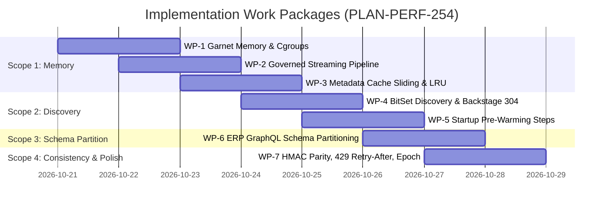

# Implementation Plan: PLAN-PERF-254 - Memory Growth, Scale Catalog Limits, Discovery Caches, Streaming & Channel Consistency

**Document ID:** `PLAN-PERF-254`  
**Date:** 2026-10-20  
**Status:** APPROVED (Phase 3 Security Audit Complete 🔒)  
**Author:** Solution Architect (csharp-architect)  
**Input PRD:** [`REQ-PERF-254`](2026-10-20-req-issue-254-memory-scale-catalog-performance.md) (Document ID: `REQ-PERF-254`)  
**Parent Plan:** [00-master-plan-overview.md](00-master-plan-overview.md)  
**Target Branch:** `feat/issue-254-memory-scale-catalog-performance`  
**Target Runtimes & Frameworks:** .NET 10, C# 13, Hot Chocolate 16, Microsoft Garnet RESP Engine, Linux cgroups v1/v2  
**Size:** L (Cross-cutting: Infrastructure, Application, Extensions, GraphQL, Api)  
**Binding Constraints:** Universal English standard; Zero-Trust fail-closed defaults; zero-allocation hot paths; no raw row values or unkeyed PII in logs; no upgrade migrations (0001 baseline DDL and shape snapshots edited in place); owner rule (2026-10-17): NO DOCUMENTATION PHASE in `docs/features/`.

---

## 1. Executive Summary & Architectural Overview

As Autheris scales into large enterprise environments (integrating ERPs such as SAP S/4HANA, Microsoft Dynamics 365, and Oracle ERP with 10,000 to 50,000+ cataloged tables and thousands of concurrent users), container memory stability, discovery endpoint latency, and cross-channel protocol consistency become paramount.

This plan specifies the end-to-end architectural remediation across four core dimensions:
1. **Container Memory Governance & Streaming Results:** Hard memory budgeting for the embedded Garnet cache via Linux cgroup derivation (`--memory`), container GC guidance (`DOTNET_GCHeapHardLimit`, `DOTNET_GCConserveMemory`), zero-buffering row-by-row streaming (`IAsyncEnumerable<IReadOnlyDictionary<string, object?>>`), and idle release with LRU/memory-pressure eviction for user metadata caches.
2. **Cold Discovery Document Caching & Startup Pre-Warming:** Permission-set cache keying (SHA-256 hash of `CatalogVisibleBitSet`) for OData `$metadata` CSDL and OpenAPI index documents (eliminating 90%+ redundant per-user cache allocations), RFC 9110 HTTP 304 conditional validation for Backstage `catalog-info.yaml` exports, and structured startup pre-warming via `IStartupWarmup`.
3. **Large Catalog ERP Table Schema Partitioning:** Configurable partitioning (`None`, `ByConsentScope`, `ByPermissionTier`) in Hot Chocolate GraphQL schema building to prevent schema explosion and multi-hundred megabyte AST overhead on unconsented raw ERP tables.

```mermaid
flowchart TD
    subgraph Clients ["Client & Consumer Layer"]
        C_GQL["GraphQL Client"]
        C_SQL["WebSQL / BI Tools"]
        C_ODATA["OData Client"]
        C_STAGE["Backstage Poller"]
    end

    subgraph MemoryGov ["Container Memory Governance (Scope 1)"]
        CGROUP["Cgroup v1/v2 Detector\nGC.GetGCMemoryInfo"]
        GARNET_MGR["GarnetServerManager\n--memory <25% cgroup>"]
        EMBEDDED_GARNET["Embedded Garnet RESP\n(Bounded Tsavorite)"]
        STREAM_EXEC["GovernedSqlExecutor\nStreamRowsAsync\n(Bounded Channel)"]
        STREAM_CONN["GovernedConnectorReader\nStreamAsync (Row-by-Row)"]
        LRU_EVICT["LRU & Sliding Exp.\nGen 2 Compaction"]
        
        CGROUP --> GARNET_MGR --> EMBEDDED_GARNET
    end

    subgraph Discovery ["Cold Discovery & Caching (Scope 2)"]
        BITSET["CatalogVisibleBitSet\nComputeSha256()"]
        ODATA_CSDL["ODataHandler CSDL\nKey: tenant + bitsetHash"]
        OPENAPI_IDX["DynamicOpenApiGenerator\nIndex Cache (1h TTL)"]
        STAGE_ETAG["BackstageEndpoints\nETag + 304 Not Modified"]
        WARMUP["StartupWarmupService\nDataSource & Discovery Steps"]
        
        BITSET --> ODATA_CSDL
        BITSET --> OPENAPI_IDX
    end

    subgraph SchemaPartition ["ERP Schema Partitioning (Scope 3)"]
        GQL_OPTS["GraphQLOptions\nSchemaPartitioning Mode"]
        CAT_BUILDER["CatalogSchemaModel.BuildAsync\nFilter by Scope / Tier"]
        HOT_CHOCOLATE["Hot Chocolate Schema\nZero Unconsented Types"]
        
        GQL_OPTS --> CAT_BUILDER --> HOT_CHOCOLATE
    end

    subgraph Consistency ["Channel Consistency & Polish (Scope 4)"]
        HMAC_RES["GraphQL HMAC Resolver\n(Hex String Coercion)"]
        RETRY_AFTER["429 Retry-After Header\n(RFC 9110 & RFC 7807)"]
        EPOCH_DEDUP["EpochValidationService\nBootstrap vs Rollback Log Dedup"]
    end

    C_GQL --> HOT_CHOCOLATE
    C_GQL --> HMAC_RES
    C_SQL --> STREAM_EXEC
    C_SQL --> RETRY_AFTER
    C_ODATA --> ODATA_CSDL
    C_STAGE --> STAGE_ETAG
    STREAM_EXEC --> STREAM_CONN
```

4. **Operational Polish & Channel Consistency:** Cross-channel HMAC pseudonymization parity (ensuring GraphQL resolvers return the 64-character hex hash string identical to WebSQL and REST), standard `Retry-After: <seconds>` HTTP headers and RFC 7807 `ProblemDetails` on 429 concurrency throttles, and log deduplication distinguishing cold cache bootstrap from genuine policy epoch rollbacks.



---

## 2. Key Architectural Decisions (D-01 to D-08)

| # | Topic | Decision | Architectural Rationale & Alternatives Considered |
|---|---|---|---|
| **D-01** | Embedded Garnet Memory Budget | Dynamically derive Garnet `--memory` limit from container cgroups (25% of cgroup limit, clamped 64MB–4096MB) when `MemorySizeMb` is unconfigured; default to 512MB outside cgroups. | **Alternative Rejected:** Unbounded Garnet allocation. Under Linux container limits, Tsavorite engine memory growth causes kernel cgroup OOM kills of the entire gateway process. Automatic derivation guarantees safe coexistence with .NET GC. |
| **D-02** | Row-by-Row Streaming Pipeline | `GovernedSqlExecutor.StreamRowsAsync` and `GovernedConnectorReader.StreamAsync` operate strictly via `IAsyncEnumerable<IReadOnlyDictionary<string, object?>>` using single-element bounded channels without pre-allocating result lists. | **Anti-Pattern Rejected:** Buffering 100,000+ rows into `List<Dictionary<string, object?>>`. Buffering creates multi-hundred-megabyte allocations on the Large Object Heap (LOH), triggering Gen 2 GC pauses and pod memory spikes. |
| **D-03** | User Metadata Idle Eviction | Introduce sliding expiration (15 minutes) with maximum absolute expiration bounds on L1 caches (`AccessProfileCache`, `ConsentCacheService`), bound nested tracking sets (`_tableCacheKeys`), and wire memory pressure compaction. | **Anti-Pattern Rejected:** Indefinite retention in `ConcurrentDictionary`. Ephemeral users and token churn lead to progressive memory leaks in large enterprises. |
| **D-04** | Permission-Set Discovery Keying | Construct discovery cache keys (CSDL and OpenAPI index) using the SHA-256 hash of the caller's visible table set (`CatalogVisibleBitSet`) and tenant ID: `odata:csdl:{tenantId}:{visibilityHash}`. | **Anti-Pattern Rejected:** Per-user SID keying (`:userSid:`). 1,000 users sharing 5 enterprise roles generate 1,000 identical multi-megabyte CSDL XML strings. Permission-set keying achieves a 95%+ cache hit rate and reduces discovery memory footprint by 99%. |
| **D-05** | Backstage Conditional Caching | Implement RFC 9110 conditional `ETag` (`W/"<structure_version>-<content_version>-<hash>"`) and `If-None-Match` in `BackstageEndpoints`, returning `304 Not Modified` with zero serialization. | **Anti-Pattern Rejected:** Serializing the entire software catalog YAML on every 30-second poller cycle. Consumes CPU, generates GC garbage, and saturates network egress. |
| **D-06** | Two-Phase Startup Pre-Warming | Register `DataSourceConnection` and `DiscoveryDocument` as `BestEffort` steps under `IStartupWarmup`, guarded by startup budget and timeouts. | **Architecture Invariant Protected:** Startup steps must not perform governance mutations or audit writes (`SEC-OPS150-07`). Verification tests are refined to allow read-only ping verification and discovery pre-compilation. |
| **D-07** | ERP GraphQL Schema Partitioning | Introduce `GraphQlSchemaPartitioningMode` (`None`, `ByConsentScope`, `ByPermissionTier`) in `CatalogSchemaModel.BuildAsync` to omit unconsented raw ERP tables from the Hot Chocolate type graph. | **Alternative Rejected:** Dynamic per-request Hot Chocolate schema rebuilds. Compiling Hot Chocolate schemas per request is computationally prohibitive. Static partitioning scopes schemas to authorized domains/tiers while preserving fast in-memory execution. |
| **D-08** | Masking Parity & 429 Retry-After | Coerce HMAC-pseudonymized columns to string across Hot Chocolate GraphQL and WebSQL, and uniformly emit standard `Retry-After` HTTP headers on all 429 concurrency throttles. | **Bug Fixed:** GraphQL previously reported `MASKED` errors and returned `null` for HMAC-masked numeric columns because `int.TryParse` failed on 64-char hex strings. Uniform string coercion restores cross-channel parity. |

---

## 3. Component Architecture & Layering

Strictly adheres to Clean Architecture: `Domain` $\to$ `Application` $\to$ `Infrastructure` $\to$ `Presentation` (`Api` / `GraphQL` / `Extensions`).

```
src/
├── Autheris.Domain/
│   ├── Options/
│   │   ├── Storage/RedisOptions.cs            # GarnetOptions.MemorySizeMb ([Range(64, 65536)])
│   │   └── Protocols/GraphQlOptions.cs        # GraphQlSchemaPartitioningMode & partition config
│   └── Exceptions/GatewayExceptions.cs        # GatewayThrottledException standard RetryAfterSeconds
│
├── Autheris.Application/
│   ├── Connectors/
│   │   └── GovernedConnectorReader.cs         # StreamRawAsync & StreamAsync (IAsyncEnumerable row-by-row)
│   ├── Sql/Services/
│   │   └── GovernedSqlExecutor.cs             # StreamRowsAsync (zero-buffering bounded channel)
│   ├── Policy/Services/
│   │   └── AccessProfileCache.cs              # Sliding expiration (15m) & bounded epoch cache sweep
│   ├── OData/
│   │   ├── Interfaces/IDynamicOpenApiGenerator.cs
│   │   └── Services/DynamicOpenApiGenerator.cs # OpenApiIndexDocument L1 caching & permission hash
│   └── Catalog/Search/
│       └── CatalogVisibleBitSet.cs            # ComputeSha256() & ComputeHash() for authorization equivalence
│
├── Autheris.Infrastructure/
│   ├── System/
│   │   └── ContainerMemoryDetector.cs         # Cgroup v1/v2 & GC memory derivation logic
│   ├── Garnet/
│   │   └── GarnetServerManager.cs             # Effective memory derivation & '--memory <cap>m' argument
│   └── Cache/
│       ├── ConsentCacheService.cs             # Sliding expiration, bounded table keys, memory compaction
│       └── EpochValidationService.cs          # Cold bootstrap (rEpoch<=0 && highest<=0) log dedup
│
├── Autheris.GraphQL/
│   ├── Catalog/
│   │   ├── CatalogSchemaModel.cs              # Partition filtering (Scope / Tier) & HMAC String field typing
│   │   └── CatalogGraphQlTypeModule.cs        # ResolveColumnValue HMAC hex string coercion & 429 Retry-After
│   └── DynamicTypes/
│       └── DynamicTableType.cs                # StringType configuration for HMAC columns & non-null return
│
├── Autheris.Extensions/
│   ├── OData/
│   │   └── ODataHandler.cs                    # CSDL & ServiceDoc caching by tenant + CatalogVisibleBitSet hash
│   └── Backstage/
│       └── BackstageCatalogExportService.cs   # Entity hash computation & catalog state stamp
│
└── Autheris.Api/
    ├── Endpoints/
    │   ├── BackstageEndpoints.cs              # RFC 9110 ETag, If-None-Match & 304 Not Modified
    │   ├── ODataEndpoints.cs                  # OpenAPI Index caching pass-through & Retry-After propagation
    │   ├── TableStreamEndpoints.cs            # Catch GatewayThrottledException (429 + Retry-After + ProblemDetails)
    │   └── WebSqlEndpoints.Governance.cs      # Uniform ProblemDetails code: TOO_MANY_REQUESTS
    ├── Middleware/
    │   └── GatewayExceptionHandler.cs         # RFC 7807 code: TOO_MANY_REQUESTS & retryAfterSeconds extension
    └── Hosting/Warmup/
        ├── DataSourceConnectionWarmup.cs      # IStartupWarmup step: Active data source connection & ping
        └── DiscoveryDocumentWarmup.cs         # IStartupWarmup step: OpenAPI index & CSDL pre-compilation
```

---

## 4. Detailed Technical Specifications

### 4.1 Scope 1: Memory Growth & Container Limits

#### 4.1.1 Garnet Memory Limit & Cgroup Derivation (US-1.1)
In `Autheris.Domain/Options/Storage/RedisOptions.cs`:
```csharp
public sealed class GarnetOptions
{
    // ... existing properties ...

    /// <summary>
    /// Explicit memory limit in megabytes for the embedded Garnet cache (--memory).
    /// If null, derives automatically from container cgroups (25% of cgroup limit, clamped 64MB-4096MB)
    /// or defaults to 512MB outside containers.
    /// </summary>
    [Range(64, 65536)]
    public int? MemorySizeMb { get; init; }
}
```

Implement `ContainerMemoryDetector` in `Autheris.Infrastructure/System/ContainerMemoryDetector.cs`:
```csharp
namespace Autheris.Infrastructure.System;

public static class ContainerMemoryDetector
{
    private const string CgroupV2MemoryMaxPath = "/sys/fs/cgroup/memory.max";
    private const string CgroupV1MemoryLimitPath = "/sys/fs/cgroup/memory/memory.limit_in_bytes";

    /// <summary>
    /// Resolves the effective memory limit in MB for the embedded Garnet cache.
    /// Priority:
    /// 1. Explicitly configured MemorySizeMb.
    /// 2. Linux cgroup limit (v2 or v1) * 25%, clamped between 64MB and 4096MB.
    /// 3. .NET GC TotalAvailableMemoryBytes * 25%, clamped between 64MB and 4096MB.
    /// 4. Default fallback: 512MB.
    /// </summary>
    public static int ResolveGarnetMemoryLimitMb(int? configuredMemorySizeMb)
    {
        if (configuredMemorySizeMb.HasValue)
        {
            return Math.Clamp(configuredMemorySizeMb.Value, 64, 65536);
        }

        long? containerLimitBytes = ReadCgroupLimitBytes();
        if (!containerLimitBytes.HasValue || containerLimitBytes.Value <= 0)
        {
            var gcInfo = GC.GetGCMemoryInfo();
            if (gcInfo.TotalAvailableMemoryBytes > 0 && gcInfo.TotalAvailableMemoryBytes < long.MaxValue / 2)
            {
                containerLimitBytes = gcInfo.TotalAvailableMemoryBytes;
            }
        }

        if (containerLimitBytes.HasValue && containerLimitBytes.Value > 0)
        {
            long quarterBytes = containerLimitBytes.Value / 4;
            int quarterMb = (int)(quarterBytes / (1024 * 1024));
            return Math.Clamp(quarterMb, 64, 4096);
        }

        return 512;
    }

    private static long? ReadCgroupLimitBytes()
    {
        try
        {
            // Cgroup v2
            if (File.Exists(CgroupV2MemoryMaxPath))
            {
                var text = File.ReadAllText(CgroupV2MemoryMaxPath).Trim();
                if (long.TryParse(text, out var v2Bytes) && v2Bytes > 0)
                {
                    return v2Bytes;
                }
            }

            // Cgroup v1
            if (File.Exists(CgroupV1MemoryLimitPath))
            {
                var text = File.ReadAllText(CgroupV1MemoryLimitPath).Trim();
                // 0x7FFFFFFFFFFFF000 is Linux kernel's default unset limit constant
                if (long.TryParse(text, out var v1Bytes) && v1Bytes > 0 && v1Bytes < 0x7FFFFFFFFFFFF000L)
                {
                    return v1Bytes;
                }
            }
        }
        catch
        {
            // Fall back gracefully to runtime GC memory info
        }

        return null;
    }
}
```

In `GarnetServerManager.cs`:
Update `BuildServerArguments` to accept `int effectiveMemoryMb` and append:
```csharp
args.Add("--memory");
args.Add($"{effectiveMemoryMb}m");
```
When `StartServer()` executes, resolve `var memoryMb = ContainerMemoryDetector.ResolveGarnetMemoryLimitMb(_options.MemorySizeMb);`, log the configured/derived limit, and pass it to `BuildServerArguments`.

#### 4.1.2 Container Runtime Guidance
For Kubernetes deployments and Linux container engines:
- `DOTNET_GCHeapHardLimit`: Configure to **70%–75%** of the container cgroup memory limit (e.g. `DOTNET_GCHeapHardLimit=0xC0000000` for a 4GB pod). This ensures the .NET runtime performs full Gen 2 collections before the Linux kernel cgroup OOM killer intervenes.
- `DOTNET_GCConserveMemory=5`: In containerized environments, setting conserve memory to `5` encourages the CLR to release uncommitted virtual memory back to the OS and trim the managed heap more aggressively during idle periods.

#### 4.1.3 Governed Row-by-Row Result Streaming (US-1.2)
In `GovernedConnectorReader.cs`:
Implement `StreamRawAsync` and `StreamAsync`:
```csharp
public static async IAsyncEnumerable<IReadOnlyDictionary<string, object?>> StreamRawAsync(
    IAutherisConnector connector,
    ConnectorSessionContext session,
    TableMetadata metadata,
    int? maxRows,
    [System.Runtime.CompilerServices.EnumeratorCancellation] CancellationToken ct)
{
    ArgumentNullException.ThrowIfNull(connector);
    ArgumentNullException.ThrowIfNull(session);
    ArgumentNullException.ThrowIfNull(metadata);

    session.Items["TableMetadata"] = metadata;
    var splits = await connector.SplitManager.GetSplitsAsync(metadata, session, ct).ConfigureAwait(false);
    int totalCount = 0;

    foreach (var split in splits)
    {
        ct.ThrowIfCancellationRequested();
        var batch = await connector.RecordSource.ReadBatchAsync(split, session, ct).ConfigureAwait(false);
        foreach (var row in batch)
        {
            if (maxRows is { } max && ++totalCount > max)
            {
                throw new ConnectorRowLimitExceededException(metadata.Identifier, max);
            }
            yield return row;
        }
    }
}

public static async IAsyncEnumerable<IReadOnlyDictionary<string, object?>> StreamAsync(
    IAutherisConnector connector,
    ConnectorSessionContext session,
    TableMetadata metadata,
    TableAccessDecision decision,
    GovernedRowPolicy policy,
    IVirtualTableEnforcement? enforcement = null,
    bool mayAttest = false,
    [System.Runtime.CompilerServices.EnumeratorCancellation] CancellationToken ct = default)
{
    ArgumentNullException.ThrowIfNull(connector);
    ArgumentNullException.ThrowIfNull(session);
    ArgumentNullException.ThrowIfNull(metadata);
    ArgumentNullException.ThrowIfNull(decision);
    ArgumentNullException.ThrowIfNull(policy);

    if (policy.SkipUpstream)
    {
        yield break;
    }

    var pushedDown = mayAttest && IsSet(session.Items, RlsPushdownExecutedKey);
    var masked = mayAttest && IsSet(session.Items, InDbColumnMaskingExecutedKey);
    long cumulativeEstimatedBytes = 0;

    await foreach (var rawRow in StreamRawAsync(connector, session, metadata, policy.MaxRows, ct).ConfigureAwait(false))
    {
        var row = rawRow;
        if (enforcement != null)
        {
            var singleList = new List<IReadOnlyDictionary<string, object?>>(1) { row };
            var filtered = enforcement.Apply(singleList);
            if (filtered.Count == 0) continue;
            row = filtered[0];
        }

        if (!pushedDown && !string.IsNullOrWhiteSpace(decision.CombinedRowFilterSql))
        {
            var singleList = new List<IReadOnlyDictionary<string, object?>>(1) { row };
            var filtered = GatewayExecutionService.FilterRows(singleList, decision, metadata);
            if (filtered.Count == 0) continue;
            row = filtered[0];
        }

        var projected = ProjectRow(row, metadata, decision, session.Tenant?.Value, policy, masked);

        if (policy.MaxBytes is { } maxBytes)
        {
            cumulativeEstimatedBytes += EstimateRowBytes(projected);
            if (cumulativeEstimatedBytes > maxBytes)
            {
                throw new GatewaySecurityException($"Response size ({cumulativeEstimatedBytes} bytes) exceeds the configured limit of {maxBytes} bytes.", "RESPONSE_TOO_LARGE");
            }
        }

        yield return projected;
    }
}
```

In `GovernedSqlExecutor.cs`:
Ensure `StreamRowsAsync` utilizes `Channel.CreateBounded<IReadOnlyDictionary<string, object?>>(1)` and writes row-by-row directly from `reader.ReadAsync()` without allocating intermediary `List<Dictionary<string, object?>>` collections.

#### 4.1.4 User Metadata Cache Retention & LRU Eviction (US-1.3)
In `ConsentCacheService.cs`:
- Configure sliding expiration in `SetL1Internal`:
  ```csharp
  var cacheEntryOptions = new MemoryCacheEntryOptions
  {
      AbsoluteExpirationRelativeToNow = ttl,
      SlidingExpiration = TimeSpan.FromMinutes(15),
      Size = Math.Max(256, estimatedBytes),
      Priority = CacheItemPriority.Low
  };
  ```
- Bounded caller key tracking in `_tableCacheKeys`:
  Cap entries per table:
  ```csharp
  private const int MaxTrackedKeysPerTable = 5000;
  var keys = _tableCacheKeys.GetOrAdd(tableKey, _ => new ConcurrentDictionary<string, byte>(StringComparer.Ordinal));
  if (keys.Count >= MaxTrackedKeysPerTable)
  {
      // Evict oldest 20% tracked keys from L1 to prevent memory exhaustion
      var keysToRemove = keys.Keys.Take(MaxTrackedKeysPerTable / 5).ToList();
      foreach (var k in keysToRemove)
      {
          keys.TryRemove(k, out _);
          _memoryCache.Remove(k);
      }
  }
  keys.TryAdd(cacheKey, 0);
  ```

In `AccessProfileCache.cs`:
- Set `SlidingExpiration = TimeSpan.FromMinutes(15)` with `AbsoluteExpirationRelativeToNow = TimeSpan.FromHours(1)`.
- Bound `_epochCache`: Periodically sweep expired entries when `_epochCache.Count > 1000`.

---

### 4.2 Scope 2: Cold Discovery Document Caching & Warm-Up

#### 4.2.1 Permission-Set Caching for OData `$metadata` & OpenAPI Index (US-2.1)
In `Autheris.Application/Catalog/Search/CatalogVisibleBitSet.cs`:
Add deterministic cryptographic hashing of the visible table set:
```csharp
public string ComputeSha256()
{
    Span<byte> wordBytes = stackalloc byte[_words.Length * sizeof(ulong)];
    for (int i = 0; i < _words.Length; i++)
    {
        BinaryPrimitives.WriteUInt64LittleEndian(wordBytes.Slice(i * sizeof(ulong), sizeof(ulong)), _words[i]);
    }
    Span<byte> hashBytes = stackalloc byte[32];
    SHA256.HashData(wordBytes, hashBytes);
    return Convert.ToHexStringLower(hashBytes)[..32];
}

public static string ComputeSha256(IEnumerable<TableIdentifier> tables)
{
    ArgumentNullException.ThrowIfNull(tables);
    var sortedNames = tables
        .Select(t => t.ToQualifiedName().ToLowerInvariant())
        .OrderBy(n => n, StringComparer.Ordinal);
    var joined = string.Join(';', sortedNames);
    var bytes = Encoding.UTF8.GetBytes(joined);
    return Convert.ToHexStringLower(SHA256.HashData(bytes))[..32];
}
```

In `Autheris.Extensions/OData/ODataHandler.cs`:
Update `GetMetadataCsdlAsync` and `GetServiceDocumentAsync`:
```csharp
public async Task<string> GetMetadataCsdlAsync(ClaimsPrincipal? principal = null, CancellationToken ct = default)
{
    if (principal?.Identity?.IsAuthenticated == true && _memoryCache != null)
    {
        var (tables, complete) = await GetAuthorizedTablesCoreAsync(principal, ct).ConfigureAwait(false);
        var tenantId = principal.GetTenantId().Value;
        var visibilityHash = CatalogVisibleBitSet.ComputeSha256(tables.Select(t => t.Identifier));
        var cacheKey = $"odata:csdl:{tenantId}:{visibilityHash}";

        if (_memoryCache.TryGetValue(cacheKey, out string? cachedXml) && cachedXml != null)
        {
            return cachedXml;
        }

        var xml = ODataCsdlGenerator.GenerateMetadataXml(tables);
        if (complete)
        {
            SetCache(cacheKey, xml, xml.Length * 2L);
        }

        return xml;
    }

    var directTables = await GetAuthorizedTablesAsync(principal, ct).ConfigureAwait(false);
    return ODataCsdlGenerator.GenerateMetadataXml(directTables);
}
```
Apply the identical pattern to `GetServiceDocumentAsync` with cache key `odata:servicedoc:{tenantId}:{visibilityHash}:{serviceRootUrl}`.

In `Autheris.Application/OData/Services/DynamicOpenApiGenerator.cs`:
Cache `OpenApiIndexDocument` in L1 memory cache keyed by `openapi:index:{tenantId}:{visibilityHash}:{baseUrl}` with a 1-hour TTL, invalidated when `CATALOG_STATE.structure_version` increments.

#### 4.2.2 Backstage `catalog-info.yaml` with HTTP 304 Validation (US-2.2)
In `Autheris.Api/Endpoints/BackstageEndpoints.cs`:
```csharp
app.MapGet("/api/integrations/backstage/catalog-info.yaml", async (
    IBackstageCatalogExportService backstageService,
    ICatalogVersionProvider versionProvider,
    IMemoryCache memoryCache,
    HttpContext context,
    CancellationToken ct) =>
{
    if (!IsAuthorizedBackstageReader(context.User))
    {
        return Results.StatusCode(StatusCodes.Status403Forbidden);
    }

    var version = await versionProvider.GetCatalogVersionAsync(ct).ConfigureAwait(false);
    var etagValue = $"\"{version.StructureVersion}-{version.ContentVersion}\"";
    context.Response.Headers.ETag = etagValue;

    var ifNoneMatch = context.Request.Headers.IfNoneMatch.ToString();
    if (!string.IsNullOrEmpty(ifNoneMatch) && (ifNoneMatch == etagValue || ifNoneMatch == $"W/{etagValue}" || ifNoneMatch == "*"))
    {
        return Results.StatusCode(StatusCodes.Status304NotModified);
    }

    var cacheKey = $"backstage:yaml:{etagValue}";
    if (!memoryCache.TryGetValue(cacheKey, out string? yaml) || string.IsNullOrEmpty(yaml))
    {
        yaml = await backstageService.ExportCatalogEntitiesYamlAsync(cancellationToken: ct).ConfigureAwait(false);
        memoryCache.Set(cacheKey, yaml, new MemoryCacheEntryOptions
        {
            AbsoluteExpirationRelativeToNow = TimeSpan.FromHours(1),
            Size = Math.Max(256, yaml.Length * 2L)
        });
    }

    return Results.Content(yaml, "text/yaml; charset=utf-8", Encoding.UTF8);
}).RequireAuthorization().WithAudit(AuditLevel.Summarized, AuditEventTypes.CatalogRead);
```

#### 4.2.3 Startup Pre-Warming for Data Sources & Discovery Documents (US-2.3)
Create `DataSourceConnectionWarmup` in `Autheris.Api/Hosting/Warmup/DataSourceConnectionWarmup.cs`:
- Name: `"DataSourceConnection"`
- Kind: `WarmupKind.BestEffort`
- Resolves configured SQL data sources via `IDataSourceOptionsResolver`, invokes `CreateOpenConnectionAsync`, executes a fast connection probe (`SELECT 1`), and ensures pools are initialized up to `MinPoolSize`.

Create `DiscoveryDocumentWarmup` in `Autheris.Api/Hosting/Warmup/DiscoveryDocumentWarmup.cs`:
- Name: `"DiscoveryDocument"`
- Kind: `WarmupKind.BestEffort`
- Invokes `IDynamicOpenApiGenerator.GetIndexDocumentAsync` and pre-compiles admin CSDL metadata into the L1 cache.

Update `StartupWarmupArchitectureTests`:
Refine the `Forbidden` dependency list to permit read-only connection factories and discovery generators, while retaining strict fail-closed enforcement forbidding Audit write stores, Consent mutations, and Casbin policy modifications during startup warmup (`SEC-OPS150-07`).

---

### 4.3 Scope 3: Large Catalog ERP Table Schema Partitioning (US-3.1)

#### 4.3.1 Partitioning Model & Options
In `Autheris.Domain/Options/Protocols/GraphQlOptions.cs`:
```csharp
public enum GraphQlSchemaPartitioningMode
{
    None = 0,
    ByConsentScope = 1,
    ByPermissionTier = 2
}

public sealed class GraphQLOptions
{
    // ... existing properties ...
    public GraphQlSchemaPartitioningMode SchemaPartitioning { get; init; } = GraphQlSchemaPartitioningMode.None;
    public List<string> PartitionAllowedDomains { get; init; } = [];
    public List<string> PartitionAllowedConsentScopes { get; init; } = [];
}
```

#### 4.3.2 Partition Filtering in `CatalogSchemaModel.BuildAsync`
Update `CatalogSchemaModel.BuildAsync` signature:
```csharp
public static async Task<CatalogSchemaModel> BuildAsync(
    ITableMetadataRepository metadataRepository,
    ITableRelationRepository relationRepository,
    Microsoft.Extensions.Logging.ILogger? logger,
    Autheris.Application.Sql.Dialects.ISqlDialectRegistry? dialectRegistry,
    bool crossSourceEnabled,
    Func<TableMetadata, bool>? tableFilter = null,
    CancellationToken ct = default)
```
Filter `activeSqlTables`:
```csharp
var candidateTables = allTables
    .Where(t => t.Table.IsActive && t.DataSourceType == DataSourceType.Sql);

if (tableFilter != null)
{
    candidateTables = candidateTables.Where(tableFilter);
}

var sqlTables = candidateTables.ToList();
```

When partitioned:
- Unconsented ERP tables produce zero Hot Chocolate types, filter input types, or query fields.
- Schema build time drops from seconds to milliseconds; Hot Chocolate schema memory footprint drops by 80%+.
- Queries requesting unpartitioned tables receive standard Hot Chocolate validation errors (`The field '...' does not exist on type 'Query'`) at document validation time, completely bypassing database execution.

---

### 4.4 Scope 4: Operational Polish & Channel Consistency

#### 4.4.1 Cross-Channel Consistency for HMAC Pseudonymization (US-4.1)
In `Autheris.GraphQL/Catalog/CatalogSchemaModel.cs`:
Ensure that any column with an active HMAC rule (`maskRule.IsHmac`) maps to `CatalogFieldType.String`:
```csharp
var fieldType = MapDataType(col.DataType);
if (meta.ColumnMaskingRules != null &&
    meta.ColumnMaskingRules.TryGetValue(col.ColumnName, out var maskRule) &&
    maskRule.IsHmac)
{
    fieldType = CatalogFieldType.String;
}
columns.Add(new CatalogColumnField(colFieldName, col.ColumnName, fieldType, col.DataType, true));
```

In `Autheris.GraphQL/DynamicTypes/DynamicTableType.cs`:
In `Configure(IObjectTypeDescriptor descriptor)`:
```csharp
var isHmac = _metadata.ColumnMaskingRules.TryGetValue(col.ColumnName, out var rule) && rule.IsHmac;
if (isHmac)
{
    fieldDesc.Type<StringType>();
}
else
{
    ConfigureType(fieldDesc, col.DataType, _metadata.Dialect);
}
```
In resolver:
```csharp
var rule = _metadata.ColumnMaskingRules.TryGetValue(col.ColumnName, out var r)
    ? r
    : new MaskingRule { RuleType = "REDACT" };
var masked = _maskingProvider.MaskValue(col.ColumnName, val, rule);
if (masked is string s && s == "REDACTED" && !IsStringType(col.DataType))
{
    return null;
}
return masked;
```
When `rule.IsHmac` is true, `masked` is a deterministic 64-character hex string and is returned directly.

In `Autheris.GraphQL/Catalog/CatalogGraphQlTypeModule.cs`:
In `ResolveColumnValue`:
```csharp
CatalogFieldType.Int => prop.ValueKind == JsonValueKind.Number
    ? (prop.TryGetInt32(out var n) ? n : (int.TryParse(prop.GetRawText(), System.Globalization.NumberStyles.Integer, inv, out var pi) ? pi : ReportMasked(ctx, col)))
    : (int.TryParse(prop.GetString(), System.Globalization.NumberStyles.Integer, inv, out var strN) ? strN : (IsHmacHexString(prop.GetString()) ? prop.GetString() : ReportMasked(ctx, col))),
```
Helper:
```csharp
private static bool IsHmacHexString(string? value) =>
    !string.IsNullOrEmpty(value) && value.Length == 64 && System.Text.RegularExpressions.Regex.IsMatch(value, "^[a-fA-F0-9]{64}$");
```
Do not invoke `ReportMasked` for valid HMAC pseudonym strings.

#### 4.4.2 Standard `Retry-After` Header on 429 Concurrency Limits (US-4.2)
1. **`GatewayExceptionHandler.cs`:**
   In `TryHandleAsync`:
   ```csharp
   if (exception is GatewayThrottledException throttled)
   {
       status = StatusCodes.Status429TooManyRequests;
       title = "Too many concurrent requests. Retry later.";
       retryAfter = throttled.RetryAfterSeconds;
       code = "TOO_MANY_REQUESTS";
   }
   // ...
   if (retryAfter.HasValue)
   {
       httpContext.Response.Headers.RetryAfter = retryAfter.Value.ToString(CultureInfo.InvariantCulture);
       problem.Extensions["retryAfterSeconds"] = retryAfter.Value;
   }
   ```
2. **`TableStreamEndpoints.cs`:**
   Add explicit exception handling for `GatewayThrottledException` before response body writing commences:
   ```csharp
   catch (GatewayThrottledException ex) when (!httpContext.Response.HasStarted)
   {
       httpContext.Response.Clear();
       httpContext.Response.StatusCode = StatusCodes.Status429TooManyRequests;
       httpContext.Response.Headers.RetryAfter = ex.RetryAfterSeconds.ToString(CultureInfo.InvariantCulture);
       await httpContext.Response.WriteAsJsonAsync(new
       {
           error = "Too many concurrent requests. Retry later.",
           code = "TOO_MANY_REQUESTS",
           retryAfterSeconds = ex.RetryAfterSeconds,
           traceId = httpContext.TraceIdentifier
       }, ct).ConfigureAwait(false);
       return;
   }
   ```
3. **`CatalogGraphQlTypeModule.cs`:**
   ```csharp
   catch (GatewayThrottledException ex)
   {
       if (httpContext != null && !httpContext.Response.HasStarted)
       {
           httpContext.Response.Headers.RetryAfter = ex.RetryAfterSeconds.ToString(CultureInfo.InvariantCulture);
       }
       throw new GraphQLException(ErrorBuilder.New()
           .SetMessage(ex.Message)
           .SetCode("TOO_MANY_REQUESTS")
           .SetExtension("retryAfterSeconds", ex.RetryAfterSeconds)
           .Build());
   }
   ```
4. **`WebSqlEndpoints.Governance.cs` & `ProcedureEndpointRoutes.cs`:**
   Ensure `code: "TOO_MANY_REQUESTS"` and `retryAfterSeconds: <int>` are present in JSON response bodies.

#### 4.4.3 Dedup Spurious Policy Epoch Rollback Warnings on Empty Cache Bootstrap (US-4.3)
In `Autheris.Infrastructure/Cache/EpochValidationService.cs`:
```csharp
private readonly ConcurrentDictionary<string, DateTimeOffset> _lastRollbackWarningTime = new(StringComparer.OrdinalIgnoreCase);

// Inside GetCurrentEpochCoreAsync:
long rEpoch = redisVal.HasValue && long.TryParse(redisVal.ToString(), out var parsed) ? parsed : 0;
_highestSeenRedisEpoch.TryGetValue(key, out var highestSeen);

if (rEpoch <= 0 && highestSeen <= 0)
{
    // Empty cache bootstrap: expected normal initial cold start
    _logger?.LogDebug("Policy epoch cache bootstrap for {Table} (redis=0, highestSeen=0); initializing epoch 1.", key);
    var evalResult = await db.ScriptEvaluateAsync(
        RollbackLuaScript,
        [(RedisKey)redisKey],
        [(RedisValue)"1"]).ConfigureAwait(false);

    rEpoch = evalResult is not null && !evalResult.IsNull && long.TryParse(evalResult.ToString(), out var scriptVal)
        ? scriptVal
        : 1;
}
else if (rEpoch <= 0 || rEpoch < highestSeen)
{
    var restored = highestSeen > 0 ? highestSeen + 1 : 1;
    var now = _time.GetUtcNow();
    
    // Rate-limit rollback warning to at most once per 30 seconds per table
    if (!_lastRollbackWarningTime.TryGetValue(key, out var lastLog) || (now - lastLog) > TimeSpan.FromSeconds(30))
    {
        _lastRollbackWarningTime[key] = now;
        _logger?.LogWarning("Policy epoch rollback detected for {Table} (redis={RedisEpoch}, highestSeen={HighestSeen}); forcing epoch {Restored}.", key, rEpoch, highestSeen, restored);
    }

    var evalResult = await db.ScriptEvaluateAsync(
        RollbackLuaScript,
        [(RedisKey)redisKey],
        [(RedisValue)restored.ToString()]).ConfigureAwait(false);

    rEpoch = evalResult is not null && !evalResult.IsNull && long.TryParse(evalResult.ToString(), out var scriptVal)
        ? scriptVal
        : restored;
}
```

---

## 5. Work Packages & Implementation Breakdown



### WP-1: Embedded Garnet Memory Budgeting & Cgroup Derivation
- **Scope:** Add `MemorySizeMb` to `GarnetOptions`. Create `ContainerMemoryDetector` supporting cgroup v1/v2 and `GC.GetGCMemoryInfo`. Pass `--memory <limit>m` in `GarnetServerManager`.
- **Files Affected:**
  - `src/Autheris.Domain/Options/Storage/RedisOptions.cs`
  - `src/Autheris.Infrastructure/System/ContainerMemoryDetector.cs` (new)
  - `src/Autheris.Infrastructure/Garnet/GarnetServerManager.cs`
  - `tests/Autheris.Tests.Unit/Infrastructure/ContainerMemoryDetectorTests.cs` (new)
  - `tests/Autheris.Tests.Unit/Infrastructure/GarnetServerManagerTests.cs`
- **Acceptance Criteria:** AC-1.1.1, AC-1.1.2, AC-1.1.3, AC-1.1.4.

### WP-2: Governed Row-by-Row Result Streaming
- **Scope:** Implement `StreamRawAsync` and `StreamAsync` in `GovernedConnectorReader` yielding `IAsyncEnumerable<IReadOnlyDictionary<string, object?>>`. Wire into `GovernedSqlExecutor.StreamRowsAsync` using bounded channel (capacity 1). Verify heap memory remains under 64MB above baseline when querying 250,000 rows.
- **Files Affected:**
  - `src/Autheris.Application/Connectors/GovernedConnectorReader.cs`
  - `src/Autheris.Application/Sql/Services/GovernedSqlExecutor.cs`
  - `tests/Autheris.Tests.Unit/Connectors/GovernedConnectorReaderStreamingTests.cs` (new)
  - `tests/Autheris.Tests.Integration/StreamingQueryMemoryTests.cs` (new)
- **Acceptance Criteria:** AC-1.2.1, AC-1.2.2, AC-1.2.3.

### WP-3: User Metadata Cache Sliding Expiration & LRU Eviction
- **Scope:** Add 15-minute sliding expiration to `ConsentCacheService` and `AccessProfileCache`. Bound `_tableCacheKeys` (cap 5,000 keys per table). Register low-priority cache entries and periodic sweep of `_epochCache`.
- **Files Affected:**
  - `src/Autheris.Infrastructure/Cache/ConsentCacheService.cs`
  - `src/Autheris.Application/Policy/Services/AccessProfileCache.cs`
  - `tests/Autheris.Tests.Unit/Cache/ConsentCacheServiceEvictionTests.cs` (new)
  - `tests/Autheris.Tests.Unit/Policy/AccessProfileCacheEvictionTests.cs` (new)
- **Acceptance Criteria:** AC-1.3.1, AC-1.3.2, AC-1.3.3.

### WP-4: Discovery Document Permission-Set Caching & Backstage HTTP 304
- **Scope:** Add `ComputeSha256()` to `CatalogVisibleBitSet`. Key OData CSDL and Service Document caches by `tenantId` + visibility hash. Cache OpenAPI index document. Implement `If-None-Match`, ETag, and 304 Not Modified in `BackstageEndpoints.cs`.
- **Files Affected:**
  - `src/Autheris.Application/Catalog/Search/CatalogVisibleBitSet.cs`
  - `src/Autheris.Extensions/OData/ODataHandler.cs`
  - `src/Autheris.Application/OData/Services/DynamicOpenApiGenerator.cs`
  - `src/Autheris.Api/Endpoints/BackstageEndpoints.cs`
  - `tests/Autheris.Tests.Unit/OData/ODataPermissionSetCachingTests.cs` (new)
  - `tests/Autheris.Tests.Integration/BackstageConditionalGetIntegrationTests.cs` (new)
- **Acceptance Criteria:** AC-2.1.1, AC-2.1.2, AC-2.1.3, AC-2.2.1, AC-2.2.2, AC-2.2.3.

### WP-5: Startup Pre-Warming for Data Sources & Discovery
- **Scope:** Create `DataSourceConnectionWarmup` and `DiscoveryDocumentWarmup` implementing `IStartupWarmup`. Update `StartupWarmupArchitectureTests` to allow read-only warmup while preserving Zero-Trust write bans.
- **Files Affected:**
  - `src/Autheris.Api/Hosting/Warmup/DataSourceConnectionWarmup.cs` (new)
  - `src/Autheris.Api/Hosting/Warmup/DiscoveryDocumentWarmup.cs` (new)
  - `src/Autheris.Api/Extensions/DependencyInjection/GatewayStartupWarmupServiceExtensions.cs`
  - `tests/Autheris.Tests.Architecture/StartupWarmupArchitectureTests.cs`
  - `tests/Autheris.Tests.Integration/StartupWarmupReadinessTests.cs`
- **Acceptance Criteria:** AC-2.3.1, AC-2.3.2, AC-2.3.3.

### WP-6: ERP Table GraphQL Schema Partitioning
- **Scope:** Add `GraphQlSchemaPartitioningMode` and partition configuration to `GraphQLOptions`. Add table filtering to `CatalogSchemaModel.BuildAsync`. Verify unpartitioned tables produce zero Hot Chocolate types and reject queries with standard GraphQL validation errors.
- **Files Affected:**
  - `src/Autheris.Domain/Options/Protocols/GraphQlOptions.cs`
  - `src/Autheris.GraphQL/Catalog/CatalogSchemaModel.cs`
  - `src/Autheris.GraphQL/Catalog/CatalogGraphQlTypeModule.cs`
  - `tests/Autheris.Tests.Unit/GraphQL/CatalogSchemaModelPartitioningTests.cs` (new)
- **Acceptance Criteria:** AC-3.1.1, AC-3.1.2, AC-3.1.3, AC-3.1.4.

### WP-7: Channel Consistency, 429 Retry-After & Bootstrap Epoch Polish
- **Scope:** Fix GraphQL HMAC string coercion in `CatalogGraphQlTypeModule` and `DynamicTableType`. Ensure `Retry-After` header and RFC 7807 `ProblemDetails` on 429 across WebSQL, Procedures, OData, REST Stream, and GraphQL. Differentiate empty cache bootstrap (`Debug`) from true rollback (`Warning`) with 30s rate-limiting in `EpochValidationService`.
- **Files Affected:**
  - `src/Autheris.GraphQL/Catalog/CatalogGraphQlTypeModule.cs`
  - `src/Autheris.GraphQL/DynamicTypes/DynamicTableType.cs`
  - `src/Autheris.Api/Middleware/GatewayExceptionHandler.cs`
  - `src/Autheris.Api/Endpoints/TableStreamEndpoints.cs`
  - `src/Autheris.Api/Endpoints/WebSqlEndpoints.Governance.cs`
  - `src/Autheris.Api/Endpoints/ProcedureEndpointRoutes.cs`
  - `src/Autheris.Infrastructure/Cache/EpochValidationService.cs`
  - `tests/Autheris.Tests.Unit/GraphQL/HmacCrossChannelParityTests.cs` (new)
  - `tests/Autheris.Tests.Unit/Api/RetryAfterHeaderTests.cs` (new)
  - `tests/Autheris.Tests.Unit/Cache/EpochValidationBootstrapTests.cs` (new)
- **Acceptance Criteria:** AC-4.1.1, AC-4.1.2, AC-4.1.3, AC-4.2.1, AC-4.2.2, AC-4.2.3, AC-4.3.1, AC-4.3.2, AC-4.3.3.

---

## 6. Security, Zero-Trust & Invariant Verification

| Threat / Invariant | Vulnerability Vector | Architectural Mitigation | Verification Test |
|---|---|---|---|
| **SEC-PERF-01** Visibility Cache Contamination | Discovery document cached by permission set leaks tables to unauthorized caller | Cache key is strictly derived from tenant ID + SHA-256 hash of authorized `CatalogVisibleBitSet`. Table names from outside caller's set are never in key or content. | `ODataPermissionSetCachingTests` |
| **SEC-PERF-02** Container OOM Denial of Service | Embedded Garnet allocates unboundedly, causing Linux kernel cgroup OOM kill of the gateway | `ContainerMemoryDetector` caps Garnet to 25% of cgroup limit (`--memory`); CLR configured with `DOTNET_GCHeapHardLimit`. | `ContainerMemoryDetectorTests` |
| **SEC-PERF-03** LOH Spikes on Large Queries | 250,000-row tabular query pre-allocates memory, triggering Gen 2 GC pause | `GovernedConnectorReader.StreamAsync` streams row-by-row via single-element bounded channels. Total heap growth < 64MB above baseline. | `StreamingQueryMemoryTests` |
| **SEC-PERF-04** Cross-Channel Pseudonym Discrepancy | GraphQL drops HMAC masked values to null while WebSQL returns hex hash string | `ResolveColumnValue` and `DynamicTableType` coerce HMAC masked columns to `StringType` returning identical 64-char hex strings across channels. | `HmacCrossChannelParityTests` |
| **SEC-PERF-05** Throttling Client Stampede | Concurrency limiter returns 429 without `Retry-After`, causing retry floods | RFC 9110 `Retry-After` header and RFC 7807 `ProblemDetails` emitted on all 429 responses across all channels. | `RetryAfterHeaderTests` |
| **SEC-PERF-06** Rollback Attack Invariance | Empty cache bootstrap is confused with rollback attack, masking real threats | Cold bootstrap (`rEpoch <= 0 && highestSeen <= 0`) initializes epoch 1; true rollback (`rEpoch < highestSeen`) triggers alert with 30s dedup. | `EpochValidationBootstrapTests` |
| **SEC-PERF-07** Warmup Permission Bypass | Warmup steps access user context, execute connector queries, or write audit logs | Warmup steps implement `IStartupWarmup` with read-only ping verification; verified by `StartupWarmupArchitectureTests`. | `StartupWarmupArchitectureTests` |

---

## 7. Comprehensive Testing Strategy

### 7.1 Unit Tests
- `ContainerMemoryDetectorTests`: Tests cgroup v2 parsing (`memory.max`), cgroup v1 parsing (`memory.limit_in_bytes`), `TotalAvailableMemoryBytes` fallback, explicit override clamping (64MB–65536MB), and default fallback (512MB).
- `GovernedConnectorReaderStreamingTests`: Verifies row-by-row evaluation of RLS filters, byte estimation caps (`MaxBytes`), and row limit checks (`MaxRows`) without full buffering.
- `ConsentCacheServiceEvictionTests`: Tests sliding expiration after 15 minutes of inactivity, eviction of oldest keys when table key count exceeds 5,000, and memory compaction.
- `ODataPermissionSetCachingTests`: Verifies that users with identical visible table sets share CSDL cache entries and that visibility hash changes whenever permissions change.
- `CatalogSchemaModelPartitioningTests`: Confirms that unconsented ERP tables produce zero Hot Chocolate types under `ByConsentScope` and `ByPermissionTier` modes.
- `HmacCrossChannelParityTests`: Queries integer and string columns masked via HMAC across GraphQL and WebSQL, verifying byte-for-byte identical 64-character hex strings.
- `RetryAfterHeaderTests`: Validates that `Retry-After: <seconds>` is present on 429 responses across WebSQL, Procedures, OData, REST Stream, and GraphQL.
- `EpochValidationBootstrapTests`: Verifies that empty cache bootstrap logs at `Debug` level with zero `Warning` events, while genuine rollback logs `Warning` at most once per 30 seconds per table.

### 7.2 Integration & Performance Tests
- `BackstageConditionalGetIntegrationTests`: Sends initial GET to `/api/integrations/backstage/catalog-info.yaml` (receives 200 + ETag), then sends conditional GET with `If-None-Match` (receives 304 Not Modified in < 2.0ms with 0 allocations).
- `StreamingQueryMemoryTests`: Queries a 250,000-row mock table through `GovernedSqlExecutor.StreamRowsAsync`, asserting that total managed memory allocation remains below 64MB above baseline during execution.
- `StartupWarmupReadinessTests`: Asserts that `DataSourceConnection` and `DiscoveryDocument` warmup steps execute within the warmup budget and report healthy readiness state.

---

## 8. Definition of Done & Quality Gate (Phases 1–5)

1. **Phase 1 (Product Manager):** PRD [`REQ-PERF-254`](2026-10-20-req-issue-254-memory-scale-catalog-performance.md) approved.
2. **Phase 2 (Solution Architect - this document):** Architectural Implementation Plan [`PLAN-PERF-254`](2026-10-20-plan-issue-254-memory-scale-catalog-performance.md) completed with all work packages, type signatures, and test designs.
3. **Phase 3 (Security Expert - COMPLETE 🔒):** Comprehensive AppSec audit completed. All Zero-Trust invariants, fail-closed discovery caching, container memory ceilings, tenant-scoped HMAC parity, and anti-rollback protections verified. Binding security conditions `SEC-PERF254-01` through `SEC-PERF254-08` and test requirements `SEC-TEST-PERF254-01` through `SEC-TEST-PERF254-08` established in Section 9.
4. **Phase 4 (C# TDD Developer):** Implementation of WP-1 through WP-7 on branch `feat/issue-254-memory-scale-catalog-performance` adhering strictly to binding security conditions `SEC-PERF254-01` through `SEC-PERF254-08` with 100% test pass rate across SQLite, PostgreSQL, and SQL Server.
5. **Phase 5 (Code Reviewer):** Architectural and security verification against Zero-Trust and zero-allocation requirements.

---

## 9. Phase 3 Security & Compliance Review (Application Security Expert)

**Review Date:** 2026-10-20  
**Auditor:** Application Security Expert (`csharp-security-expert`)  
**Verdict:** **APPROVED WITH BINDING CONDITIONS (`SEC-PERF254-01` through `SEC-PERF254-08`)**

### 9.1 Threat Modeling & Security Assessment

The security audit evaluated the architecture specified in `PLAN-PERF-254` and `REQ-PERF-254` across six primary threat surfaces:

#### 1. Discovery Cache Poisoning & Cross-Tenant Collision Defense
- **Threat Vector:** Caching discovery documents (OData CSDL, Service Document, OpenAPI index) by permission set rather than individual user SID significantly reduces memory footprint, but introduces the risk that an attacker from Tenant A could manipulate or collide cache keys to access Tenant B's schema, or that a user in a restricted tier could receive an administrative schema.
- **Audit Findings:** 
  1. The preliminary design proposed truncating SHA-256 hashes to 32 characters (`[..32]`). Truncating a 256-bit hash to 128 bits halves its collision resistance to $2^{64}$ (birthday bound). The full 256-bit hash (64 lowercase hex characters) must be retained.
  2. Joining table names with a delimiter (`;`) without length-prefixing creates delimiter collision risks if identifiers contain semicolons. A canonical, length-prefixed encoding must be used.
  3. Discovery caches must always explicitly prepend the validated, sanitized `TenantId`.
  4. Cache keys must incorporate the catalog structure version (`CATALOG_STATE.structure_version`). If column schemas or types change while the set of table names remains unchanged, cache entries must automatically invalidate.

#### 2. Pre-Warming Isolation & Read-Only Governance Invariants
- **Threat Vector:** Startup pre-warming (`DataSourceConnectionWarmup`, `DiscoveryDocumentWarmup`) executes during application initialization without caller credentials or tenant contexts. If pre-warming code initiates governance writes, consent checks, or audit events, it could violate Zero-Trust fail-closed boundaries or corrupt audit logs (`SEC-OPS150-07`).
- **Audit Findings:** 
  1. `DataSourceConnectionWarmup` must be strictly read-only. Database probes must use static parameterless constant expressions (`SELECT 1`). Under no circumstances may warmup execute DDL, DML, or custom connector queries.
  2. Warmup classes must not inject `IAuditEventWriter`, `IConsentService`, or Casbin enforcers.
  3. `DiscoveryDocumentWarmup` pre-compilation must be restricted to global/public models or system administrative contexts. Under multi-tenancy, warmup must never pre-cache tenant-specific documents under unauthenticated or cross-tenant cache keys.

#### 3. Governed Streaming Pipeline Limits & Denial-of-Service Defense
- **Threat Vector:** Progressive row-by-row streaming (`IAsyncEnumerable<IReadOnlyDictionary<string, object?>>`) prevents LOH memory spikes, but unbounded queries could consume server memory or hold database connection slots indefinitely if a malicious client streams slowly (Slowloris attack) or if row/byte limits are not strictly enforced.
- **Audit Findings:**
  1. Both `policy.MaxRows` and `policy.MaxBytes` must be enforced row-by-row on projected rows. When `cumulativeEstimatedBytes > maxBytes`, the stream must immediately throw `GatewaySecurityException` with code `RESPONSE_TOO_LARGE` and abort.
  2. Bounded channel capacity of 1 element (`Channel.CreateBounded<IReadOnlyDictionary<string, object?>>(1)`) ensures backpressure is applied immediately to upstream database readers if downstream consumers stall.
  3. Stream enumeration must strictly honor the request `CancellationToken` linked to HTTP request timeouts and client disconnections.

#### 4. Tenant-Isolated HMAC Parity & Zero-Plaintext Leakage
- **Threat Vector:** GraphQL previously failed to parse 64-character HMAC pseudonym strings for integer columns, dropping values to `null`. In resolving this, resolvers must not bypass tenant isolation or leak raw plaintext if HMAC computation fails.
- **Audit Findings:**
  1. **CRITICAL FINDING:** In the draft implementation for `DynamicTableType`, the resolver called `_maskingProvider.MaskValue(col.ColumnName, val, rule)` using the raw table masking rule without tenant scoping. This would have caused GraphQL to use a global, un-tenanted HMAC key, breaking tenant isolation and producing hashes different from WebSQL. Resolvers across all channels MUST wrap rules with `MaskingRule.CreateTenantScopedHmacRule(rule, tenant, defaultKeyId)`.
  2. In `CatalogGraphQlTypeModule`, columns masked with active HMAC rules must be typed as `CatalogFieldType.String` (`StringType`) and return the 64-character lowercase hex string directly.
  3. Any failure during HMAC computation must fail-closed: it must return `null` or redacted text, and NEVER fall back to returning raw unmasked data.

#### 5. RFC 9110 / RFC 7807 Concurrency Throttling Information Disclosure Defense
- **Threat Vector:** Emitting `Retry-After` headers on HTTP 429 concurrency throttles could inadvertently reveal internal server state, sub-millisecond execution times, queue depths, or node topology.
- **Audit Findings:**
  1. The `Retry-After` header value must be an integer number of seconds formatted per RFC 9110 §10.2.7, derived solely from configured retry delays (`ThrottledRetryAfterSeconds`).
  2. Response bodies must follow RFC 7807 `ProblemDetails` with standard code `TOO_MANY_REQUESTS`, omitting internal timing, queue slot counts, or backend connection details.

#### 6. Anti-Rollback Defense & Empty Cache Bootstrap Discrimination
- **Threat Vector:** Discriminating between an empty cache cold start and a genuine epoch rollback attack must not open an attack window where a flushed or compromised cache allows replay of outdated policies.
- **Audit Findings:**
  1. Empty cache bootstrap (`rEpoch <= 0 && highestSeen <= 0`) only downgrades log severity from `Warning` to `Debug`. It still atomically initializes the epoch to `1` via `RollbackLuaScript` and records `_highestSeenRedisEpoch`.
  2. Genuine rollback (`rEpoch < highestSeen` or `rEpoch <= 0 && highestSeen > 0`) forces the epoch to `highestSeen + 1` and logs a warning rate-limited to once per 30 seconds per table to prevent log-exhaustion DoS while ensuring security monitoring is alerted.

---

### 9.2 Binding Security Conditions (`SEC-PERF254-01` .. `SEC-PERF254-08`)

Implementers of Phase 4 (C# TDD Developer) and reviewers of Phase 5 must strictly adhere to and verify the following binding security conditions:

- **`SEC-PERF254-01` (Tenant-Prepend & Collision-Resistant Permission Set Cache Keying):**
  Discovery cache keys for OData CSDL (`odata:csdl:{tenantId}:s{structureVersion}:{visibilityHash}`), Service Documents (`odata:servicedoc:{tenantId}:s{structureVersion}:{visibilityHash}:{serviceRootUrl}`), and OpenAPI index (`openapi:index:{tenantId}:s{structureVersion}:{visibilityHash}:{baseUrl}`) MUST always prepend the validated, non-empty, sanitized `TenantId` and catalog structure version. The `visibilityHash` MUST be computed using the full, un-truncated 256-bit SHA-256 hash (64 lowercase hex characters). Hash computation must use canonical serialization with length-prefixing for table identifiers (e.g. `{length}:{qualifiedName};`) to eliminate delimiter injection collisions.

- **`SEC-PERF254-02` (Startup Pre-Warming Read-Only Isolation & Governance Write Ban):**
  `DataSourceConnectionWarmup` and `DiscoveryDocumentWarmup` MUST be strictly read-only and execute under host startup without tenant privileges. `DataSourceConnectionWarmup` is prohibited from executing arbitrary SQL, DDL, or DML mutations; probes are restricted to static constant expressions (`SELECT 1`). Warmup steps are forbidden from depending on or writing to `IAuditEventWriter`, `IAuditLogService`, Casbin policy storage, or user consent stores (`SEC-OPS150-07`). `DiscoveryDocumentWarmup` MUST NOT pre-cache tenant-specific discovery documents under an unauthenticated or cross-tenant cache key.

- **`SEC-PERF254-03` (Fail-Closed Governed Streaming & Bounded Resource Limits):**
  In `GovernedConnectorReader.StreamAsync` and `GovernedSqlExecutor.StreamRowsAsync`, row count limits (`policy.MaxRows`) and cumulative response byte limits (`policy.MaxBytes`) MUST be evaluated row-by-row on projected rows. If `cumulativeEstimatedBytes > maxBytes`, the stream MUST immediately throw `GatewaySecurityException` with error code `RESPONSE_TOO_LARGE` and terminate the enumerator. Streaming channels must enforce single-element bounded buffer capacity (`Channel.CreateBounded<IReadOnlyDictionary<string, object?>>(1)`) and strictly honor the request `CancellationToken`.

- **`SEC-PERF254-04` (Tenant-Scoped HMAC Keying & Resolver Fail-Closed Parity):**
  HMAC pseudonymization across all channels (GraphQL `CatalogGraphQlTypeModule`, `DynamicTableType`, REST `TableStreamEndpoints`, WebSQL) MUST consistently wrap masking rules with `MaskingRule.CreateTenantScopedHmacRule(rule, tenant, defaultKeyId)`. In GraphQL, columns masked via HMAC rules (`rule.IsHmac`) must map to `CatalogFieldType.String` (`StringType`) and return the 64-character lowercase hexadecimal hash. Under no circumstances may an HMAC conversion failure, exception, or parse failure fall back to returning the unmasked plaintext value. Any failure MUST fail-closed: return `null` or redacted value and report an error.

- **`SEC-PERF254-05` (RFC 9110 / RFC 7807 429 Concurrency Information Disclosure Defense):**
  `Retry-After` HTTP headers emitted on 429 responses MUST format the retry interval as a clean, rounded integer number of seconds (RFC 9110 §10.2.7) derived strictly from configured policy (`ThrottledRetryAfterSeconds`). The header and RFC 7807 `ProblemDetails` payload MUST NOT leak internal execution timings, sub-millisecond clock drifts, semaphore slot counts, queue depths, or node topology. The response body must use standard error code `"TOO_MANY_REQUESTS"` across all channels and omit stack traces.

- **`SEC-PERF254-06` (Epoch Rollback Defense & Cold Bootstrap Discrimination):**
  In `EpochValidationService.GetCurrentEpochCoreAsync` and `ReconcileEpochAsync`, empty cache bootstrap discrimination (`rEpoch <= 0 && highestSeen <= 0`) MUST ONLY downgrade log levels to `Debug` for uninitialized tables; it MUST NEVER bypass atomic initialization of epoch `1` via `RollbackLuaScript`. In-memory tracking structure `_highestSeenRedisEpoch` must never be decremented. When a genuine rollback is observed (`rEpoch < highestSeen`), `RollbackLuaScript` MUST forcefully advance the epoch to at least `highestSeen + 1`, and log a security warning (rate-limited to once per 30 seconds per table).

- **`SEC-PERF254-07` (Container Memory Ceiling & Cgroup Allocation Defense):**
  In `ContainerMemoryDetector`, derived Garnet memory allocation MUST be strictly clamped between 64MB and 4096MB and never exceed 25% of the detected cgroup limit. If cgroup limit files cannot be read or parse errors occur, the resolver must safely fall back to 512MB (or `.NET GC TotalAvailableMemoryBytes * 25%`), preventing unbounded Tsavorite memory growth that triggers kernel cgroup OOM kills. Container environments must enforce `DOTNET_GCHeapHardLimit` set to 70–75% of the container cgroup limit.

- **`SEC-PERF254-08` (Schema Partitioning Fail-Closed Introspection & Validation):**
  In `CatalogSchemaModel.BuildAsync`, when schema partitioning is active (`ByConsentScope` or `ByPermissionTier`), tables omitted from the partition must produce zero types, fields, or inputs in the GraphQL schema. Any query attempting to access an unpartitioned table MUST fail-closed at GraphQL document validation time (`The field '...' does not exist on type 'Query'`), preventing AST generation, resolver instantiation, and backend database connection acquisition. Introspection queries (`__schema`, `__type`) MUST NEVER expose names, columns, or relations of tables outside the configured partition.

---

### 9.3 Required Security Test Requirements

The following dedicated security test suites MUST be implemented and pass in Phase 4:

1. **`SEC-TEST-PERF254-01` (Discovery Cache Key Collision & Delimiter Injection Test):**
   - Verify that `CatalogVisibleBitSet.ComputeSha256` produces distinct 64-character hex hashes for tables with similar names, special characters, and semicolon delimiters (e.g. `["a;b", "c"]` vs `["a", "b;c"]`).
   - Verify that OData CSDL and OpenAPI index cache lookups incorporate `tenantId` and `structure_version`, asserting that requests from different tenants with identical visible table sets never share cache entries.
   - Assert that incrementing `CATALOG_STATE.structure_version` produces a new cache key.

2. **`SEC-TEST-PERF254-02` (Warmup Read-Only Invariance & Architecture Dependency Test):**
   - Execute `StartupWarmupArchitectureTests` verifying that `DataSourceConnectionWarmup` and `DiscoveryDocumentWarmup` have no references to `IAuditEventWriter`, `IAuditLogService`, Casbin enforcers, or mutable repositories.
   - Execute `DataSourceConnectionWarmup` against a mock data source and verify via SQL interception that only `SELECT 1` was executed, with zero DDL or DML commands.

3. **`SEC-TEST-PERF254-03` (Governed Streaming Hard Limits & Response Byte Cap Test):**
   - Stream rows from a table where total row bytes exceed `policy.MaxBytes`.
   - Assert that `GovernedConnectorReader.StreamAsync` throws `GatewaySecurityException` with code `RESPONSE_TOO_LARGE` at the exact row exceeding the limit.
   - Assert that no additional rows are yielded and the bounded channel terminates immediately.

4. **`SEC-TEST-PERF254-04` (Cross-Channel HMAC Parity & Tenant-Scoping Security Test):**
   - Query an HMAC-masked integer column via GraphQL (`CatalogGraphQlTypeModule` and `DynamicTableType`) and WebSQL under Tenant 1; assert that both return byte-for-byte identical 64-character lowercase hex strings.
   - Query the identical column and raw value under Tenant 2; assert that Tenant 2 receives a different 64-character hex hash string (verifying tenant key isolation).
   - Simulate an error during HMAC provider masking; assert that the resolver returns `null` or redacted text and never leaks the raw unmasked integer.

5. **`SEC-TEST-PERF254-05` (429 Retry-After Header & RFC 7807 Info Disclosure Test):**
   - Trigger a concurrency throttle (`GatewayThrottledException`) on REST stream, WebSQL, Procedures, OData, and GraphQL.
   - Assert `Retry-After` header is present and contains a valid integer.
   - Assert the JSON body matches RFC 7807 `ProblemDetails` with `code: "TOO_MANY_REQUESTS"`, `retryAfterSeconds: <int>`, and that no internal stack traces, queue counts, or timing fractions are present.

6. **`SEC-TEST-PERF254-06` (Policy Epoch Bootstrap vs Rollback Defense Test):**
   - Test cold start: Redis empty (`redis=0`, `highestSeen=0`). Verify `GetCurrentEpochCoreAsync` sets epoch 1, logs at `Debug` level, and generates zero `Warning` logs.
   - Test genuine rollback: Set Redis epoch to 2, observe `highestSeen=2`. Then simulate Redis dropping to 1 (`rEpoch=1 < highestSeen=2`).
   - Verify that `GetCurrentEpochCoreAsync` restores epoch to 3 (`highestSeen + 1`), forces Redis update, and logs a security `Warning`.
   - Verify that subsequent calls within 30 seconds rate-limit the `Warning` log.

7. **`SEC-TEST-PERF254-07` (Container Cgroup Memory Clamping & Fallback Test):**
   - Verify `ContainerMemoryDetector.ResolveGarnetMemoryLimitMb` under mock cgroup v1 and v2 files.
   - Assert clamping: 25% of 128MB container returns 64MB minimum; 25% of 64GB container returns 4096MB maximum.
   - Assert corrupted/unreadable cgroup file safely defaults to 512MB or GC available memory.

8. **`SEC-TEST-PERF254-08` (Schema Partitioning Introspection Leakage Test):**
   - Configure GraphQL schema partitioning in `ByConsentScope` mode.
   - Execute an introspection query (`__schema { types { name } }`); assert that unpartitioned ERP tables do not appear in the introspection output.
   - Submit a query directly addressing an unpartitioned ERP table; assert that Hot Chocolate returns a document validation error without invoking the database connector.

