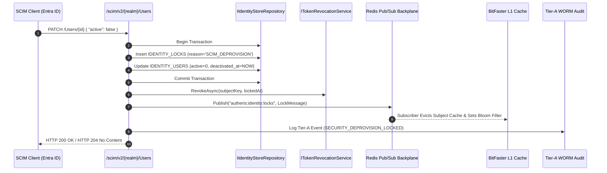
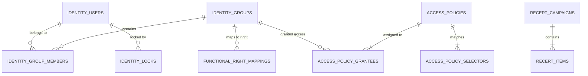
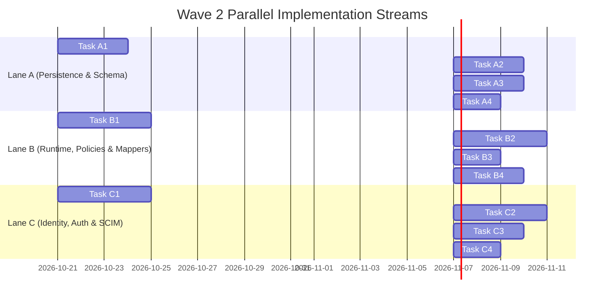

# Implementation Plan: PLAN-SCALE-5000-WAVE2 - Scale to 5,000 Users: Identity Foundation & Structural Access Governance (Wave 2)

**Document ID:** `PLAN-SCALE-5000-WAVE2`  
**Date:** 2026-10-20  
**Status:** APPROVED BY APPSEC (Phase 3 Security Sign-Off Complete) ✅  
**Author:** Solution Architect (Lead Solution Architect, .NET 10 / C# 13) / Application Security Expert (AppSec Sign-Off)  
**Input PRD:** [`REQ-SCALE-5000-WAVE2`](2026-10-20-req-scale-5000-users-wave2.md) (Document ID: `REQ-SCALE-5000-WAVE2`)  
**Parent Plan:** [`PLAN-SCALE-5000`](2026-10-16-plan-scale-5000-users.md) (rev. 4)  
**Related Analyses:** [`ANALYSIS-SCALE-5000-GOV`](2026-10-16-analysis-scale-5000-users-governance.md), [`ANALYSIS-SCALE-5000-PERF`](2026-10-16-analysis-scale-5000-users-performance.md)  
**Target Branch:** `feat/scale-5000-users`  
**Target Runtimes & Frameworks:** .NET 10, C# 13, ASP.NET Core Minimal APIs / Middleware, SQLite 3, PostgreSQL 16, SQL Server 2022, Microsoft.Graph 5.x, Polly 8.x, BitFaster.Caching  
**Size Estimate:** XL (6 core work packages executed across 3 parallel developer lanes)

---

## 0. Binding Architectural Constraints

| # | Constraint | Architectural Enforcement |
|:---|:---|:---|
| **C-01** | **Universal English Standard** | All source code, interfaces, comments, docstrings, unit/integration tests, DDL, and plans must strictly adhere to the repository English standard (`AGENTS.md` §1). |
| **C-02** | **In-Place Baseline `0001` Schema Evolution** | Strictly **no upgrade or repair migrations** (owner decision 2026-10-15). All 10 new tables and indices must be added directly into `SqliteBaselineSchema.cs`, `PostgreSqlBaselineSchema.cs`, and `SqlServerBaselineSchema.cs`. Shape snapshots (`governance-shape.*.json`) must be regenerated and verified via `GovernanceSchemaShapeSnapshotTests`. |
| **C-03** | **AST Engine Invariance** | Zero changes to `src/TrinoSqlEngine/Ast/Visitors/AstSecurityVisitor.cs`. The core AST security rewriting engine remains 100% untouched. All data governance policies project solely through `RowPolicyFactory` and `ColumnMaskPolicyFactory`. |
| **C-04** | **Strict Fail-Closed Semantics** | In the event of external directory outages (Graph, LDAPS), database connectivity failures, lock store partitions, Redis pub/sub desynchronizations, or circuit trips, the system must default to **DENY** or **HTTP 503 Service Unavailable**. No cached decision may ever be served past its `ExpiresAt`. |
| **C-05** | **Decoupled 3-Layer Identity Governance** | Clear separation of concerns: **Layer 1** (Identity / Authentication: who the user is) $\to$ **Layer 2** (Gateway Functional Rights: what gateway actions they can execute) $\to$ **Layer 3** (Data Access Governance: which datasets, rows, and columns they can read). Group claims are stripped from tokens and resolved out-of-band. |
| **C-06** | **Permanent Ban on Progress in Documentation** | Progress tracking, status tags, and sprint checklists are strictly banned from `docs/` and `docs/features/` (Owner Rule 2026-10-17). All execution tracking lives exclusively in `docs/plans/00-master-plan-overview.md`. |
| **C-07** | **Zero Allocation on Hot Paths** | Principal resolution, scheme routing, and in-memory policy lookups must leverage `ReadOnlySpan<T>`, pre-compiled non-backtracking regular expressions, and bounded BitFaster caching. |

---

## 1. Executive Summary & 3-Layer Identity Governance Topology

Scaling Autheris to **5,000 enterprise workforce users and external customer identities** requires breaking the monolithic reliance on JWT token claims (`groups`, `roles`, `tid`). Wave 2 establishes a decoupled, enterprise-grade identity and access governance foundation across six cohesive work packages:
- **WP-SC-13: Identity Realm Registry** — Multi-issuer dynamic routing, per-realm validation, tenant binding, and customer sandboxing.
- **WP-SC-05: Role-Resolver & Providers** — Modular group/role resolution abstracting directory lookups from token transport (SCIM store, Entra App Roles, Graph, Static).
- **WP-SC-07: SCIM 2.0 Receiver & Deprovisioning Lock** — RFC 7643/7644 receiver for inbound push, constant-time authentication, schema persistence, and sub-second cluster-wide deprovisioning locks.
- **WP-SC-14: Functional-Rights Mapping** — Decoupled mapping from directory groups to typed gateway rights with mandatory four-eyes segregation of duties for privileged operations.
- **WP-SC-06: Scoped Access Policies** — Group/role-based policy aggregates governing dataset access via table name patterns and catalog metadata tags, decoupled from individual table consents.
- **WP-SC-08: Recertification Campaigns** — Risk-based periodic re-attestation (90-day privileged / 365-day business roles) with automated revocation upon deadline expiry.

### 1.1 Architecture Topology: The 3-Layer Model

```
┌─────────────────────────────────────────────────────────────────────────────────────────────────────────┐
│                                 AUTHERIS ZERO-TRUST GATEWAY PIPELINE                                    │
│                                                                                                         │
│  LAYER 1: IDENTITY & AUTHENTICATION (Who You Are)                                                       │
│  ┌───────────────────────┐   ┌───────────────────────────┐   ┌──────────────────────────────────────┐   │
│  │ Workforce Entra ID    │   │ Customer CIAM / B2C       │   │ Inbound SCIM 2.0 Push                │   │
│  │ Bearer JWT (Identity) │   │ Bearer JWT (Customer)     │   │ (Entra / Windows LAN Push Agent)     │   │
│  └───────────┬───────────┘   └─────────────┬─────────────┘   └──────────────────┬───────────────────┘   │
│              │                             │                                    │                       │
│              ▼                             ▼                                    ▼                       │
│  ┌───────────────────────────────────────────────────────┐   ┌──────────────────────────────────────┐   │
│  │ RealmSchemeSelector (Dynamic Multi-Issuer Routing)   │   │ ScimAuthenticationHandler            │   │
│  │ - Unverified 'iss' Inspection                         │   │ - Constant-Time SHA-256 Compare      │   │
│  │ - Isolated JwtBearer Scheme & JWKS Per Realm          │   │ - Rejects User Tokens                │   │
│  │ - Strip client 'autheris:realm' & Stamp Server Realm  │   │ - Push to IDENTITY_USERS & GROUPS    │   │
│  │ - TenantBinding Evaluation (Fixed or ClaimMapped)     │   │ - Sub-Second Deprovisioning Lock     │   │
│  └───────────────────────────┬───────────────────────────┘   └──────────────────┬───────────────────┘   │
│                              │                                                  │                       │
│                              ▼                                                  │                       │
│  ┌──────────────────────────────────────────────────────────────────────────┐   │                       │
│  │ SubjectLockoutMiddleware (Fail-Closed Gate)                              │   │                       │
│  │ - BitFaster In-Memory Cache (0s staleness via Redis pub/sub)             │   │                       │
│  │ - Rejects locked subjects immediately with HTTP 401                      │   │                       │
│  │ - Outage of Lock Store yields HTTP 503 Service Unavailable               │   │                       │
│  └───────────────────────────┬──────────────────────────────────────────────┘   │                       │
│                              │                                                  │                       │
│                              ▼                                                  ▼                       │
│  LAYER 2: GATEWAY FUNCTIONAL RIGHTS (What Actions You Can Do In Gateway)                               │
│  ┌──────────────────────────────────────────────────────────────────────────────────────────────────┐   │
│  │ RoleResolver Pipeline (Modular Chain per Realm)                                                  │   │
│  │ - ScimStoreRoleProvider (Default Authoritative Source for Workforce)                             │   │
│  │ - EntraAppRoleProvider (Token JWT 'roles' extraction)                                            │   │
│  │ - GraphRoleProvider ($batch <= 20, Polly Circuit Breaker, 429 Retry-After)                       │   │
│  │ - StaticMappingRoleProvider (Local / Test / PAT realms)                                          │   │
│  │ - Two-Tier Cache: BitFaster L1 (15m/5m TTL) + HMAC-Framed Redis L2                               │   │
│  │ - Namespace Isolation: '<realmId>|<groupId>' (Legacy SIDs preserved for workforce compatibility)│   │
│  └───────────────────────────┬──────────────────────────────────────────────────────────────────────┘   │
│                              │                                                                          │
│                              ▼                                                                          │
│  ┌──────────────────────────────────────────────────────────────────────────────────────────────────┐   │
│  │ FunctionalRightMapper (Decoupled Granular Rights Engine)                                         │   │
│  │ - FUNCTIONAL_RIGHT_MAPPINGS Relational Store                                                     │   │
│  │ - Four-Eyes Segregation of Duties: approved_by != created_by (Privileged Rights)                 │   │
│  │ - Customer Realm Ceiling: Barred from Admin, Approve, and Unmask Rights                          │   │
│  │ - Declarative Endpoint Enforcement: [RequireFunctionalRight]                                     │   │
│  └───────────────────────────┬──────────────────────────────────────────────────────────────────────┘   │
│                              │                                                                          │
│                              ▼                                                                          │
│  LAYER 3: DATA ACCESS GOVERNANCE (What Datasets You Can Read)                                           │
│  ┌──────────────────────────────────────────────────────────────────────────────────────────────────┐   │
│  │ ScopedAccessPolicyEngine                                                                         │   │
│  │ - ACCESS_POLICIES & SELECTORS (TablePattern NonBacktracking Regex & CatalogTag metadata)         │   │
│  │ - Standing Grants Restricted EXCLUSIVELY to Groups and Roles (User Grantees STRICTLY PROHIBITED) │   │
│  │ - Policy-Set Epoch Invalidation (access_policy_epoch:{tenantId})                                  │   │
│  │ - Coarse Gate on Delegated Sources (Databricks UC / Azure SQL OBO)                               │   │
│  │ - Fine Gate & Pushdown on Autheris-Enforced Sources (Row Policies & Column Masking)              │   │
│  └───────────────────────────┬──────────────────────────────────────────────────────────────────────┘   │
│                              │                                                                          │
│                              ▼                                                                          │
│  ┌──────────────────────────────────────────────────────────────────────────────────────────────────┐   │
│  │ RecertificationEngine (Continuous Attestation Governor)                                          │   │
│  │ - 90-Day Cadence: Privileged Functional Rights, Unmasked Profiles, Break-Glass, Sensitive Policies│   │
│  │ - 365-Day Cadence: Standard Business Roles & Policies                                            │   │
│  │ - Event-Driven Triggers: SCIM Deprovisioning Locks & Mover Group Changes                          │   │
│  │ - 14-Day Review Deadline: Auto-Revocation Fail-Closed upon Expiry (SECURITY_RECERT_AUTO_REVOKED)   │   │
│  └──────────────────────────────────────────────────────────────────────────────────────────────────┘   │
└─────────────────────────────────────────────────────────────────────────────────────────────────────────┘
```

---

## 2. Key Architectural Decisions (ADR Matrix)

| Decision ID | Area | Architecture Choice | Rationale & Trade-Offs |
|:---|:---|:---|:---|
| **D-W2-01** | Multi-Issuer Routing | **`RealmSchemeSelector` routing by unverified `iss`** to per-realm `JwtBearerHandler` instances. | Eliminates single-issuer constraints. Validates each token strictly against that realm's JWKS and configuration. Unknown issuers immediately yield HTTP 401. Prevents cross-issuer confusion (`SEC-SC-21`). |
| **D-W2-02** | Token Identity Decoupling | **Identity-Only Bearer Tokens (`oid`, `upn`, `sub`)**; token-borne `groups` claims are discarded during claims transformation when `GroupSource = Resolver`. | Eliminates Microsoft Entra ID 200-group overage limit (`_claim_names.groups`). Establishes a single authoritative source of group truth per realm. |
| **D-W2-03** | Group Ingestion Topology | **Inbound Outbound-Push SCIM 2.0 (`/Users` and `/Groups`)** in both Hybrid and Pure Entra modes; no LDAPS pull into corporate LANs. | Autheris can run in Kubernetes/Cloud without LAN ingress or bind accounts. Groups pushed by Entra or on-premises Windows LAN push agent. |
| **D-W2-04** | Deprovisioning Velocity | **Atomic multi-step lock** (`IDENTITY_LOCKS`, token revocation, Redis cluster pub/sub, cache purge, break-glass revocation). | Guarantees sub-second (0s staleness) deprovisioning cluster-wide. Bounded memory cache verified in `SubjectLockoutMiddleware`. Outages fail closed with HTTP 503 (`SEC-SC-14`). |
| **D-W2-05** | Privilege Decoupling | **Granular `FunctionalRight` taxonomy** with mandatory relational persistence in `FUNCTIONAL_RIGHT_MAPPINGS`. | Separates coarse administrative roles from granular capabilities (`Governance.Approve`, `Data.UnmaskSensitive`, `Mcp.Admin`). |
| **D-W2-06** | Segregation of Duties | **Enforced Four-Eyes Principle:** `approved_by != created_by` with neither field null for all Privileged Rights. | Self-approved or unapproved mappings fail closed (ignored during evaluation). Mappings generate Tier-A WORM audit records (`SEC-SC-22`). |
| **D-W2-07** | Customer CIAM Sandboxing | **Strict capability ceilings on customer realms:** prohibited from administrative, approval, or unmasking rights; prohibited from workforce tenant binding. | Protects corporate workforce assets from external customer crossover or privilege escalation (`SEC-SC-21`, `SEC-SC-22`). |
| **D-W2-08** | Policy Scalability | **Scoped Access Policies** targeting table name patterns and catalog tags, assigned **exclusively to Groups and Roles**. | Eliminates combinatorial explosion of per-user, table-by-table consents. Individual user grantees in Access Policies are strictly rejected with HTTP 400 (`SEC-SC-13`). |
| **D-W2-09** | Delegated Sources Gate | **Coarse Gate Only on Delegated Sources** (Databricks UC, Azure SQL OBO); no synthetic Autheris row filters or masks injected. | Prevents double-filtering conflicts (C2). Allows native data platform `current_user()` dynamic security policies to govern rows and masks. |
| **D-W2-10** | Recertification Governance | **Risk-based cadence (90d privileged / 365d business)** with strict 14-day deadline and **automated revocation**. | Unanswered recertification items auto-revoke fail-closed. Autheris recertifies *its own artifacts* (mappings, policies, profiles), while group membership is recertified at IdP (C7, `SEC-SC-15`). |
| **D-W2-11** | Two-Tier Cache Resilience | **BitFaster L1 LRU + HMAC-framed Redis L2** with circuit breakers on external directory calls (Microsoft Graph, LDAP). | Circuit trip returns empty sets (fail closed, never bypass). Resolves role lookups in < 0.05 ms without cross-replica stampedes (`SEC-SC-12`, `SEC-SC-24`). |
| **D-W2-12** | Database Baseline Parity | **In-place baseline `0001` evolution** across SQLite, PostgreSQL, SQL Server + shape snapshots. | Complies with owner decision 2026-10-15. Schema validator fails closed on missing elements (`SEC-SC-02`). |

---

## 3. Component Architecture & Clean Layering

Conforming strictly to Clean Architecture (`Domain` $\to$ `Application` $\to$ `Infrastructure` $\to$ `Api`), with unidirectional dependencies and zero external library leaks in `Domain`:

```
src/
├── Autheris.Domain/                                # Pure Domain (Zero External Dependencies)
│   ├── Identity/
│   │   ├── IdentityRealm.cs                       # IdentityRealm aggregate, RealmKind, GroupSource, Provisioning
│   │   ├── TenantBindingSpecification.cs          # Fixed vs ClaimMapped tenant resolution
│   │   ├── ResolvedIdentity.cs                    # Stable subject identity value object
│   │   ├── RoleResolution.cs                      # Resolved groups, app roles, caller attributes
│   │   └── ScimModels.cs                          # ScimUser, ScimGroup, ScimGroupMember, ScimLock, PatchOp
│   ├── Governance/
│   │   ├── FunctionalRight.cs                     # Typed FunctionalRight enum/struct & FunctionalRightMapping
│   │   ├── AccessPolicy.cs                        # AccessPolicy aggregate, Grantees (Group/Role only), Selectors
│   │   └── RecertificationModels.cs               # RecertificationCampaign, RecertificationItem, RecertDecision
│   └── Options/Security/
│       └── IdentityRealmsOptions.cs               # Realm configuration section options
│
├── Autheris.Application/                           # Application Use Cases, Engines, Contracts & Validators
│   ├── Identity/
│   │   ├── IIdentityRealmRegistry.cs              # Realm resolution & startup registry contract
│   │   ├── IdentityRealmRegistry.cs              # Thread-safe registry & legacy synthesizer
│   │   ├── IRoleResolver.cs                      # Role resolution orchestrator contract
│   │   ├── RoleResolver.cs                       # Pipeline orchestrator with two-tier cache & namespacing
│   │   ├── IRoleProvider.cs                      # Provider abstraction
│   │   ├── ProviderRoleResult.cs                 # Provider result value object
│   │   ├── Providers/
│   │   │   ├── ScimStoreRoleProvider.cs          # Reads from internal SCIM relational store (Workforce Default)
│   │   │   ├── EntraAppRoleProvider.cs           # Reads JWT 'roles' claim
│   │   │   ├── GraphRoleProvider.cs              # Microsoft Graph integration ($batch <= 20, Polly resilience)
│   │   │   ├── StaticMappingRoleProvider.cs      # Static configuration & ROLES tables
│   │   │   └── LdapsRoleProvider.cs              # Optional LAN LDAPS provider (RFC 4515 sanitized)
│   │   ├── Caching/
│   │   │   ├── IRoleResolverCache.cs             # L1/L2 cache contract
│   │   │   └── RoleResolverCache.cs              # BitFaster L1 + HMAC Redis L2 implementation
│   │   ├── Services/
│   │   │   ├── IIdentityDeprovisioningService.cs # Sub-second lockout orchestrator
│   │   │   ├── IdentityDeprovisioningService.cs  # Atomic lockout, token revoke, pub/sub publish, Tier-A audit
│   │   │   ├── IScimService.cs                   # SCIM CRUD & RFC 7644 filter evaluation
│   │   │   ├── ScimService.cs                    # SCIM business service with mass-change guard
│   │   │   └── ScimGroupMembershipValidator.cs   # 10% mass membership removal quarantine guard
│   │   └── Validators/
│   │       ├── IdentityRealmOptionsValidator.cs  # Startup customer sandboxing & realm invariants validator
│   │       └── ScimRequestValidator.cs           # SCIM schema & immutable ID binding validator
│   ├── Governance/
│   │   ├── Rights/
│   │   │   ├── IFunctionalRightMapper.cs         # Mapping contract
│   │   │   ├── FunctionalRightMapper.cs          # Four-eyes evaluation & customer ceiling enforcement
│   │   │   ├── Requirements/
│   │   │   │   ├── RequireFunctionalRightRequirement.cs # ASP.NET Core authorization requirement
│   │   │   │   └── RequireFunctionalRightHandler.cs     # Authorization handler evaluating mapped rights
│   │   │   └── Validators/
│   │   │       └── FunctionalRightMappingValidator.cs   # Four-eyes approver != creator validation
│   │   ├── Policies/
│   │   │   ├── IScopedAccessPolicyEngine.cs      # Policy evaluation contract
│   │   │   ├── ScopedAccessPolicyEngine.cs       # Pattern & Tag matching, priority & permit/deny evaluation
│   │   │   ├── PolicyEvaluationContext.cs        # Evaluation context (caller, table, tags, mode)
│   │   │   ├── ScopedPolicyEvaluationResult.cs   # Evaluation outcome (Decision, MatchedPolicy, Reason)
│   │   │   ├── PatternMatcher.cs                 # Non-backtracking compiled regex matcher
│   │   │   ├── IPolicyEpochService.cs            # Policy-set epoch invalidation contract
│   │   │   └── PolicyEpochService.cs             # Global Redis & memory epoch counter
│   │   └── Recertification/
│   │       ├── IRecertificationService.cs        # Campaign management & decision recording
│   │       ├── RecertificationService.cs         # 90d/365d scheduler, event-driven intake, auto-revocation
│   │       └── RecertificationGovernorHostedService.cs # Daily background runner for deadlines & auto-revocation
│
├── Autheris.Infrastructure/                        # Persistence, External Clients & Infrastructure Adapters
│   ├── Persistence/
│   │   ├── Migrations/
│   │   │   ├── SqliteBaselineSchema.cs           # 10 tables + indices in SQLite baseline 0001
│   │   │   ├── PostgreSqlBaselineSchema.cs       # 10 tables + indices in PostgreSQL baseline 0001
│   │   │   ├── SqlServerBaselineSchema.cs        # 10 tables + indices in SQL Server baseline 0001
│   │   │   └── Shape/
│   │   │       ├── governance-shape.sqlite.json  # Updated snapshot including Wave 2 tables
│   │   │       ├── governance-shape.postgresql.json # Updated snapshot
│   │   │       └── governance-shape.sqlserver.json  # Updated snapshot
│   │   ├── Repositories/
│   │   │   ├── IIdentityStoreRepository.cs       # Repository contract for IDENTITY_* tables
│   │   │   ├── IFunctionalRightRepository.cs     # Repository contract for FUNCTIONAL_RIGHT_MAPPINGS
│   │   │   ├── IAccessPolicyRepository.cs        # Repository contract for ACCESS_POLICY_* tables
│   │   │   ├── IRecertificationRepository.cs     # Repository contract for RECERT_* tables
│   │   │   ├── SqliteGovernanceRepository.Identity.cs
│   │   │   ├── PostgreSqlGovernanceRepository.Identity.cs
│   │   │   ├── SqlServerGovernanceRepository.Identity.cs
│   │   │   ├── SqliteGovernanceRepository.RightsAndPolicies.cs
│   │   │   ├── PostgreSqlGovernanceRepository.RightsAndPolicies.cs
│   │   │   ├── SqlServerGovernanceRepository.RightsAndPolicies.cs
│   │   │   ├── SqliteGovernanceRepository.Recertification.cs
│   │   │   ├── PostgreSqlGovernanceRepository.Recertification.cs
│   │   │   └── SqlServerGovernanceRepository.Recertification.cs
│   ├── Identity/
│   │   ├── Graph/
│   │   │   ├── GraphClientAdapter.cs             # Microsoft.Graph adapter ($batch <= 20)
│   │   │   ├── GraphOptions.cs                   # Client credentials options per realm
│   │   │   └── GraphResiliencePolicy.cs          # Polly circuit breaker & 429 retry
│   │   ├── Ldap/
│   │   │   └── LdapDirectoryAdapter.cs           # System.DirectoryServices.Protocols LDAPS client
│   │   └── Locks/
│   │       ├── RedisLockPubSubChannel.cs         # Redis pub/sub backplane publisher
│   │       └── RedisLockSubscriber.cs            # Background subscriber updating L1 lockout cache
│
├── Autheris.Api/                                   # Presentation, Middleware, Endpoints & Authentication Schemes
│   ├── Security/
│   │   ├── RealmSchemeSelector.cs                # Routes Bearer tokens by unverified 'iss'
│   │   ├── ScimAuthenticationHandler.cs          # Dedicated constant-time SHA-256 scheme handler
│   │   ├── SubjectLockoutMiddleware.cs           # Sub-second lockout check (0s staleness / fail-closed 503)
│   │   ├── RequireFunctionalRightAttribute.cs    # Declarative endpoint authorization attribute
│   │   └── EnterpriseClaimsTransformation.cs     # Enriched with Role-Resolver invocation & provenance
│   ├── Endpoints/
│   │   ├── ScimUsersEndpoints.cs                 # /scim/v2/{realmId}/Users
│   │   ├── ScimGroupsEndpoints.cs                # /scim/v2/{realmId}/Groups
│   │   ├── ScimDiscoveryEndpoints.cs             # ServiceProviderConfig, Schemas, ResourceTypes
│   │   ├── SubjectLifecycleEndpoints.cs          # /api/v1/governance/subjects/{realm}/{userKey}/revoke-all, transfer
│   │   ├── FunctionalRightEndpoints.cs           # /api/v1/governance/rights/mappings (create, approve, list)
│   │   ├── AccessPolicyEndpoints.cs              # /api/v1/governance/policies/access (CRUD, dry-run)
│   │   └── RecertificationEndpoints.cs           # /api/v1/governance/recertification (campaigns, items, certify)
│   └── Extensions/
│       └── GatewayServiceCollectionExtensions.cs # Multi-realm JWT registration, SCIM scheme, DI wiring
```

---

## 4. Work Package Technical Specifications

### 4.1 WP-SC-13: Identity Realm Registry

#### 4.1.1 Problem & Objectives
Single-tenant authentication options (`EntraIdAuthOptions`, `AdfsOptions`) cannot support multi-issuer topologies where corporate workforce identities, external customer CIAM accounts (`*.ciamlogin.com` / `*.b2clogin.com`), and legacy internal directories coexist. Furthermore, evaluating tenant context from unverified `tid` claims introduces cross-issuer tenant impersonation hazards.

#### 4.1.2 Domain Models & Contracts
```csharp
namespace Autheris.Domain.Identity;

public enum IdentityRealmKind
{
    EntraWorkforce = 1,
    EntraExternalId = 2,
    AzureAdB2C = 3,
    GenericOidc = 4,
    Adfs = 5,
    Kerberos = 6,
    ForwardAuth = 7,
    Basic = 8,
    Pat = 9
}

public enum RealmGroupSource
{
    Resolver = 1, // Authoritative Role-Resolver pipeline; token groups dropped
    Token = 2,    // Inbound JWT 'groups' claim (legacy/explicit only)
    None = 3      // No groups recognized
}

public enum RealmProvisioningMode
{
    Scim = 1,     // Inbound push via SCIM 2.0
    Jit = 2,      // Just-in-time creation upon initial authenticated request
    None = 3      // Pre-seeded or external only
}

public sealed record TenantBindingSpecification(
    TenantBindingKind Kind,
    TenantId? FixedTenantId = null,
    string? ClaimName = null,
    IReadOnlyDictionary<string, TenantId>? Mapping = null)
{
    public static TenantBindingSpecification Fixed(TenantId tenantId) =>
        new(TenantBindingKind.Fixed, FixedTenantId: tenantId);

    public static TenantBindingSpecification ClaimMapped(string claimName, IReadOnlyDictionary<string, TenantId> mapping) =>
        new(TenantBindingKind.ClaimMapped, ClaimName: claimName, Mapping: mapping);

    public TenantId ResolveTenant(ClaimsPrincipal principal)
    {
        if (Kind == TenantBindingKind.Fixed && FixedTenantId.HasValue)
        {
            return FixedTenantId.Value;
        }

        if (Kind == TenantBindingKind.ClaimMapped && !string.IsNullOrWhiteSpace(ClaimName) && Mapping != null)
        {
            var val = principal.FindFirst(ClaimName)?.Value;
            if (val != null && Mapping.TryGetValue(val, out var matchedTenant))
            {
                return matchedTenant;
            }
            throw new SecurityException($"Claim '{ClaimName}' value '{val}' not authorized in realm tenant mapping.");
        }

        return TenantId.LegacySingleTenant;
    }
}

public enum TenantBindingKind { Fixed = 1, ClaimMapped = 2 }

public sealed record IdentityRealm(
    string Id,
    IdentityRealmKind Kind,
    IReadOnlyList<string> Issuers,
    string? MetadataAddress,
    IReadOnlyList<string> Audiences,
    IReadOnlyList<string>? AllowedClientIds,
    string UserKeyClaim,
    string UpnClaim,
    TenantBindingSpecification TenantBinding,
    RealmGroupSource GroupSource,
    IReadOnlyList<string> ResolverChain,
    RealmProvisioningMode Provisioning,
    IReadOnlySet<GatewayRole> AllowedGatewayRoles,
    bool Delegable = false,
    bool IsImplicitLegacy = false
);
```

#### 4.1.3 Dynamic Routing & Scheme Selector (`RealmSchemeSelector`)
Incoming HTTP requests carrying `Authorization: Bearer <token>` are intercepted in `GatewayAuthSchemes.DefaultScheme`.
```csharp
public static class RealmSchemeSelector
{
    public static string SelectScheme(string rawToken, IIdentityRealmRegistry registry)
    {
        ArgumentException.ThrowIfNullOrWhiteSpace(rawToken);
        var trimmed = rawToken.Trim();

        try
        {
            var jwt = new JsonWebTokenHandler().ReadJsonWebToken(trimmed);
            var issuer = jwt.Issuer;
            if (string.IsNullOrWhiteSpace(issuer))
            {
                return GatewayAuthSchemes.RejectScheme; // Fails closed
            }

            var realm = registry.ResolveByIssuer(issuer);
            if (realm == null)
            {
                return GatewayAuthSchemes.RejectScheme; // Unknown issuer -> HTTP 401
            }

            return GatewayAuthSchemes.RealmJwt(realm.Id);
        }
        catch (ArgumentException)
        {
            return GatewayAuthSchemes.RejectScheme; // Malformed token -> HTTP 401
        }
    }
}
```

#### 4.1.4 Cryptographic Realm Stamping & Claim Stripping
- During JWT validation in the realm's `JwtBearerEvents.OnTokenValidated`:
  1. Inspect incoming claims for any client-supplied `autheris:realm`.
  2. **Strip all incoming `autheris:realm` claims** to eliminate client injection.
  3. Append the server-authoritative claim: `autheris:realm = {realm.Id}` with issuer `"Autheris.Gateway"`.
- Update `Sid.GetTenantId(ClaimsPrincipal)`:
  - If `autheris:realm` is present, resolve realm via `IIdentityRealmRegistry.GetRealm(realmId)`.
  - Invoke `realm.TenantBinding.ResolveTenant(principal)`.
  - Fallback to legacy `tid` parsing strictly if `autheris:realm` is missing or belongs to a synthesized legacy implicit realm.
- **Customer Sandboxing Rule (`SEC-SC-21`):** Startup configuration validation asserts that no realm with `Kind = EntraExternalId` or `AzureAdB2C` is configured with `TenantBinding` targeting the primary workforce corporate tenant. Violation immediately halts gateway startup.

#### 4.1.5 Backward-Compatibility Synthesizer
At host startup, `IdentityRealmRegistry.Initialize()` inspects legacy configuration blocks:
- `Authentication:EntraId` $\to$ Synthesizes implicit realm `workforce-entra-legacy` with `Kind = EntraWorkforce`, `GroupSource = Token`, `Provisioning = None`.
- `Authentication:Adfs` $\to$ Synthesizes implicit realm `corp-adfs-legacy`.
- `Authentication:BasicAuth` $\to$ Synthesizes implicit realm `legacy-basic`.
- `Authentication:ForwardAuth` $\to$ Synthesizes implicit realm `legacy-forwardauth`.
- `Authentication:Kerberos` $\to$ Synthesizes implicit realm `legacy-kerberos`.
Legacy configs continue operating without modification with 100% principal parity.

---

### 4.2 WP-SC-05: Modular Role-Resolver & Providers

#### 4.2.1 Problem & Objectives
To solve the 200-group overage limit and decouple directory transport from client tokens, tokens carry **identity claims only**. Autheris resolves group memberships, enterprise app roles, and caller attributes through an extensible, modular provider pipeline.

#### 4.2.2 Contracts & Data Structures
```csharp
namespace Autheris.Application.Identity;

public sealed record ResolvedIdentity(
    string UserKey,
    string? Upn,
    string? DisplayName,
    string? Email,
    TenantId TenantId,
    string RealmId,
    IReadOnlyList<Claim> RawClaims
);

public sealed record RoleResolution(
    IReadOnlySet<string> Groups,
    IReadOnlySet<string> AppRoles,
    IReadOnlyDictionary<string, string> Attributes,
    DateTimeOffset ResolvedAt,
    DateTimeOffset ExpiresAt,
    string Provenance
)
{
    public static RoleResolution Empty(DateTimeOffset expiresAt) =>
        new(new HashSet<string>(), new HashSet<string>(), new Dictionary<string, string>(), 
            DateTimeOffset.UtcNow, expiresAt, "empty");
}

public sealed record ProviderRoleResult(
    IReadOnlySet<string> Groups,
    IReadOnlySet<string> AppRoles,
    IReadOnlyDictionary<string, string> Attributes
)
{
    public static readonly ProviderRoleResult Empty = new(
        new HashSet<string>(), new HashSet<string>(), new Dictionary<string, string>());
}

public interface IRoleProvider
{
    string ProviderId { get; }
    Task<ProviderRoleResult> GetRolesAsync(
        ResolvedIdentity identity, 
        IdentityRealm realm, 
        CancellationToken cancellationToken);
}

public interface IRoleResolver
{
    Task<RoleResolution> ResolveAsync(
        ResolvedIdentity identity, 
        IdentityRealm realm, 
        CancellationToken cancellationToken);
}
```

#### 4.2.3 Concrete Provider Implementations
1. **`ScimStoreRoleProvider` (ProviderId: `"scim-store"`):**
   - Authoritative default group provider for the workforce realm in both Hybrid and Pure Entra modes (rev. 4).
   - Reads group memberships from relational table `IDENTITY_GROUP_MEMBERS` via `IIdentityStoreRepository.GetGroupMembershipsForUserAsync(tenant, realm, userKey)`.
2. **`EntraAppRoleProvider` (ProviderId: `"entra-app-roles"`):**
   - Extracts signed application roles from the JWT `roles` claims in `ResolvedIdentity.RawClaims`.
   - Small cardinality, immune to overage.
3. **`GraphRoleProvider` (ProviderId: `"microsoft-graph"`):**
   - Integrates with Microsoft Graph SDK (`Microsoft.Graph`) via `GraphClientAdapter`.
   - Queries `transitiveMemberOf`, `appRoleAssignments`, and directory extension attributes.
   - Operates under strict Polly resilience policies: 3.0-second timeout, circuit breaker tripping after 5 consecutive failures with 30-second break, jittered exponential backoff.
   - Batched operations: Maximum 20 requests per `$batch`.
   - HTTP 429 Throttling: Explicitly parses and delays for the duration specified in the `Retry-After` header (`SEC-SC-24`).
   - Circuit Open or Timeout: Returns `ProviderRoleResult.Empty` (fail closed, never grant fallback access).
4. **`StaticMappingRoleProvider` (ProviderId: `"static-mapping"`):**
   - Resolves roles from configuration or persisted `ROLES`/`ROLE_MEMBERS` tables (`WP-SC-12`), utilized for Basic, PAT, and automated testing realms.
5. **`LdapsRoleProvider` (ProviderId: `"ldaps-ad"`, Optional / LAN Only):**
   - Utilizes `System.DirectoryServices.Protocols` over LDAPS (port 636 or StartTLS) with mandatory certificate validation (`SEC-SC-12`).
   - All filter parameters are strictly sanitized according to RFC 4515. Only loaded when Autheris operates inside the corporate LAN.

#### 4.2.4 Pipeline Orchestration, Namespacing & Caching
- **Single Authoritative Source Rule:** When `realm.GroupSource == RealmGroupSource.Resolver`, all incoming token-borne `groups` and `roles` claims are removed.
- **Realm Namespace Isolation:** Group identifiers resolved from providers are namespaced as `<realmId>|<groupId>` (e.g., `workforce-entra|4b7a1f52-8c9e-4b61-9c32-b8f394c8e711`).
  - *Backward Compatibility:* For the default workforce realm (`workforce-entra`), un-namespaced legacy SIDs are preserved in the principal alongside the namespaced identifier to ensure compatibility with existing table consents.
- **Two-Tier Caching (`RoleResolverCache`):**
  - **L1 In-Memory:** `BitFaster.Caching.ConcurrentLru` / `ConcurrentTlru` keyed by `(realmId, userKey)`. Default TTL: 15 minutes (workforce), 5 minutes (customer).
  - **L2 Distributed:** Garnet / Redis cluster entry framed with HMAC signature to prevent cross-replica stampedes.
  - Invalidation: Real-time eviction upon receiving SCIM group modification events or deprovisioning lock broadcasts.
- **Claims Transformation:** `EnterpriseClaimsTransformation` coordinates with `IRoleResolver`, appending resolved groups and roles as claims marked with `autheris:provenance = resolved`.

---

### 4.3 WP-SC-07: SCIM 2.0 Receiver & Deprovisioning Lock

#### 4.3.1 Problem & Objectives
Outbound LDAPS pull into on-premises LANs violates cloud/Kubernetes network posture. Group memberships must be pushed to Autheris via SCIM 2.0 (`/Users` and `/Groups`). Furthermore, deprovisioning an identity in Entra ID must execute an immediate cluster-wide lockout, terminating active sessions and token validity in sub-second time.

#### 4.3.2 Endpoints Specification
Exposed under route prefix `/scim/v2/{realmId}/`:
- `GET /scim/v2/{realmId}/Users?filter={attribute}+{op}+{value}&startIndex={n}&count={n}`
- `POST /scim/v2/{realmId}/Users` (Provision user)
- `GET /scim/v2/{realmId}/Users/{id}`
- `PUT /scim/v2/{realmId}/Users/{id}` (Full update)
- `PATCH /scim/v2/{realmId}/Users/{id}` (Partial update, active status toggle)
- `DELETE /scim/v2/{realmId}/Users/{id}` (Deprovision user)
- `GET /scim/v2/{realmId}/Groups?filter={filter}`
- `POST /scim/v2/{realmId}/Groups` (Create group)
- `GET /scim/v2/{realmId}/Groups/{id}`
- `PUT /scim/v2/{realmId}/Groups/{id}`
- `PATCH /scim/v2/{realmId}/Groups/{id}` (Add/remove members)
- `DELETE /scim/v2/{realmId}/Groups/{id}`
- `GET /scim/v2/{realmId}/ServiceProviderConfig`
- `GET /scim/v2/{realmId}/Schemas`
- `GET /scim/v2/{realmId}/ResourceTypes`

#### 4.3.3 Dedicated Constant-Time Authentication (`ScimAuthenticationHandler`)
- Secured via dedicated authentication scheme `"Scim"`. Standard user bearer tokens are strictly rejected (`SEC-SC-14`).
- Pre-shared Bearer Secret: Secret value is hashed with SHA-256 and compared using `CryptographicOperations.FixedTimeEquals` against configured primary and secondary secret hashes (enabling zero-downtime secret rotation).
- OAuth Client Credentials Option: Token from designated IdP containing app role `scim.provision`.
- IP Allowlist: Optional CIDR range filtering supporting Microsoft Entra `AzureActiveDirectory` service tag.

#### 4.3.4 Sub-Second Deprovisioning Lock Flow
When SCIM receives `PATCH /Users/{id}` with `active = false` or `DELETE /Users/{id}`:


#### 4.3.5 Lock Enforcement Middleware (`SubjectLockoutMiddleware`)
- Executes in the ASP.NET Core pipeline immediately after authentication.
- Evaluates subject lock state against an in-memory BitFaster cache populated and updated via Redis pub/sub.
- If subject is locked $\to$ Terminates request with **HTTP 401 Unauthorized** (`error = "subject_locked"`).
- **Fail-Closed Guard:** If the identity lock repository or backplane experiences an outage, authentication **fails closed with HTTP 503 Service Unavailable** (`SEC-SC-14`).

#### 4.3.6 Mass-Change Quarantine Guard
- In `ScimService.PatchGroupAsync`: If an inbound SCIM batch modifies or removes members of a group mapped to Privileged Rights (`WP-SC-14`), the system calculates the delta percentage.
- If the batch removes **> 10% of the group's active memberships**, the change is held in quarantined status, rejected with HTTP 409 Conflict (`error = "mass_membership_change_quarantined"`), and logs a Tier-A security audit event (`SECURITY_MASS_MEMBERSHIP_REVOCATION_BLOCKED`).

#### 4.3.7 Subject Lifecycle Endpoints
- `POST /api/v1/governance/subjects/{realmId}/{userKey}/revoke-all`: Atomically revokes all active consents, profiles, sessions, and tokens.
- `POST /api/v1/governance/subjects/{realmId}/{userKey}/transfer`: Reassigns catalog table ownership (`TABLE_OWNERS`) from the departing subject to a designated successor. Does not transfer permissions or consents.

---

### 4.4 WP-SC-14: Functional-Rights Mapping

#### 4.4.1 Problem & Objectives
Directly mapping external directory groups to broad gateway roles (`GatewayAdmin`, `DataEngineer`) creates excessive privilege exposure. Autheris decouples directory groups into granular, strongly typed functional capabilities with mandatory four-eyes segregation of duties.

#### 4.4.2 Taxonomy of Functional Rights
```csharp
namespace Autheris.Domain.Governance;

public readonly record struct FunctionalRight(string Value)
{
    // Standard Roles
    public static readonly FunctionalRight ClusterAdmin = new("ClusterAdmin");
    public static readonly FunctionalRight TenantAdmin = new("TenantAdmin");
    public static readonly FunctionalRight GovernanceAdmin = new("GovernanceAdmin");
    public static readonly FunctionalRight DataOwner = new("DataOwner");
    public static readonly FunctionalRight DataSteward = new("DataSteward");
    public static readonly FunctionalRight SchemaPublisher = new("SchemaPublisher");
    public static readonly FunctionalRight Consumer = new("Consumer");

    // Granular Privileged Rights (Require Four-Eyes Approval)
    public static readonly FunctionalRight GovernanceApprove = new("Governance.Approve");
    public static readonly FunctionalRight GovernanceAdminRight = new("Governance.Admin");
    public static readonly FunctionalRight DataUnmaskSensitive = new("Data.UnmaskSensitive");
    public static readonly FunctionalRight SecurityBreakGlass = new("Security.BreakGlass");
    public static readonly FunctionalRight DataExportClearText = new("Data.ExportClearText");

    // Operational Rights
    public static readonly FunctionalRight DataExport = new("Data.Export");
    public static readonly FunctionalRight DataAsyncJobs = new("Data.AsyncJobs");
    public static readonly FunctionalRight McpUse = new("Mcp.Use");
    public static readonly FunctionalRight McpAdmin = new("Mcp.Admin");
    public static readonly FunctionalRight CatalogCurate = new("Catalog.Curate");

    public bool IsPrivileged => 
        this == GovernanceApprove || 
        this == GovernanceAdminRight || 
        this == DataUnmaskSensitive || 
        this == SecurityBreakGlass || 
        this == DataExportClearText ||
        this == ClusterAdmin;
}
```

#### 4.4.3 Four-Eyes Segregation of Duties (`IFunctionalRightMapper`)
- Domain Model `FunctionalRightMapping`:
  - `tenant_id`, `realm_id`, `group_or_role`, `functional_right`, `approved_by`, `approved_at`, `recert_class`, `created_by`, `created_at`.
- Invariant: When `FunctionalRight.IsPrivileged` is true, the mapping requires:
  $$\text{approved\_by} \neq \text{created\_by} \quad \land \quad \text{approved\_by} \neq \text{null}$$
- An unapproved mapping or self-approved mapping remains in `Pending` state and is **ignored during authorization evaluation** (fails closed).
- Customer Realm Ceiling: Any attempt to persist a mapping linking a customer realm (`EntraExternalId`, `AzureAdB2C`) to an administrative, approval, or unmasking right is rejected with HTTP 400 Bad Request (`SEC-SC-22`).
- Endpoint Enforcement: `[RequireFunctionalRight(FunctionalRight.GovernanceApprove)]` integrated into ASP.NET Core authorization pipeline.

---

### 4.5 WP-SC-06: Scoped Access Policies

#### 4.5.1 Problem & Objectives
Managing individual, table-by-table consents for 5,000 users across 10,000 tables creates an unscalable combinatorial explosion. Access governance at scale requires **Scoped Access Policies** targeting collections of tables via name patterns and catalog metadata tags, assigned strictly to groups and roles.

#### 4.5.2 Domain Aggregate & Invariants
```csharp
namespace Autheris.Domain.Governance;

public enum GranteeType { Group = 1, Role = 2 } // NOTE: User is strictly excluded!
public enum SelectorType { TablePattern = 1, CatalogTag = 2 }
public enum PolicyDecision { Permit = 1, Deny = 2 }

public sealed class AccessPolicy
{
    public string TenantId { get; private init; }
    public string PolicyId { get; private init; }
    public string Name { get; private set; }
    public string? Description { get; private set; }
    public bool IsActive { get; private set; }
    public int Priority { get; private set; }
    public PolicyDecision Decision { get; private set; }
    public string CreatedBy { get; private init; }
    public string? ApprovedBy { get; private set; }
    public DateTimeOffset CreatedAt { get; private init; }
    public DateTimeOffset? ApprovedAt { get; private set; }
    
    public List<AccessPolicyGrantee> Grantees { get; private init; } = [];
    public List<AccessPolicySelector> Selectors { get; private init; } = [];

    public void AddGrantee(string realmId, GranteeType granteeType, string granteeId)
    {
        // Enforce standing group/role rule (R-SC06-02)
        if (granteeType != GranteeType.Group && granteeType != GranteeType.Role)
        {
            throw new ArgumentException("Access Policies strictly forbid individual User grantees. Use time-bound grants for users.");
        }
        Grantees.Add(new AccessPolicyGrantee(TenantId, PolicyId, realmId, granteeType, granteeId));
    }
}
```

#### 4.5.3 Selectors & Evaluation Engine
- `TablePattern`: Case-insensitive glob matching (e.g., `sales_*.eu_*`) converted to compiled regex using `RegexOptions.NonBacktracking` with a strict 10 ms execution timeout.
- `CatalogTag`: Evaluated against catalog metadata tags synchronized in `TABLE_TAGS`.
- **Policy Epoch Invalidation:** Redis counter `access_policy_epoch:{tenantId}` bumped upon any policy or selector mutation. In-memory caches include epoch in key; mismatch forces immediate cache eviction.
- **Coarse Gate on Delegated Sources:** On Databricks Unity Catalog or Azure SQL OBO sources, `WP-SC-06` functions solely as a coarse visibility and allow/deny gate. It injects **no** synthetic row filters or column masks, deferring row-level filtering to native source dynamic security policies (`current_user()`).

---

### 4.6 WP-SC-08: Recertification Campaigns

#### 4.6.1 Problem & Objectives
Enterprise compliance requires continuous periodic re-attestation of permissions. Recertification is risk-based: **90 days for privileged assignments** and **365 days for standard business roles**, with automated revocation upon deadline expiry.

#### 4.6.2 Cadence & Classification
- **Privileged Class (90-Day Cadence):**
  - Mappings to privileged functional rights (`WP-SC-14`).
  - Individual `Unmasked` access profile assignments.
  - Active break-glass exceptions.
  - Access policies matching sensitive/PII data.
  - Service principal grants.
- **Standard Business Class (365-Day Cadence):**
  - Standard business role mappings.
  - General access policy assignments.

#### 4.6.3 Scope Boundary & Event-Driven Triggers
- **Scope Boundary (C7):** Autheris recertifies *its own artifacts* (`FUNCTIONAL_RIGHT_MAPPINGS`, `ACCESS_POLICIES`, access profiles). Directory group membership is recertified at IdP (Microsoft Entra Access Reviews).
- **Event-Driven Triggers:** Inbound SCIM deprovisioning locks (`WP-SC-07`) or mover events (removal of a user from a privileged directory group) immediately spawn event-driven recertification review items.
- **Automated Revocation on Deadline:**
  - Campaigns enforce a strict 14-day review deadline.
  - Any item remaining `Pending` upon deadline expiry is **automatically transitioned to `Revoked`** by `RecertificationGovernorHostedService`.
  - The revocation immediately deactivates the mapping or policy assignment, increments the policy epoch, and logs a Tier-A cryptographic audit event (`SECURITY_RECERT_AUTO_REVOKED`). No automatic extensions permitted (`SEC-SC-15`).
- **Self-Review Prohibition:** Grantees and creators are strictly barred from approving their own recertification items (`ReviewerId != AssignedTo`).

---

## 5. Database Schema & Migration Specification (Lane A)

In strict accordance with constraint **C-02**, schema evolution occurs **in-place on baseline `0001`** across SQLite, PostgreSQL, and SQL Server. Strictly no upgrade or repair migrations.

### 5.1 DDL Statements Across Baselines



#### 5.1.1 SQLite Baseline (`SqliteBaselineSchema.cs`)
```sql
-- WP-SC-07: Identity Tables & Deprovisioning Locks
CREATE TABLE IF NOT EXISTS IDENTITY_USERS (
    tenant_id TEXT NOT NULL,
    realm_id TEXT NOT NULL,
    user_key TEXT NOT NULL,
    external_id TEXT NOT NULL,
    user_name TEXT NOT NULL,
    email TEXT,
    display_name TEXT,
    active INTEGER NOT NULL DEFAULT 1,
    deactivated_at TEXT,
    created_at TEXT NOT NULL,
    updated_at TEXT NOT NULL,
    PRIMARY KEY (tenant_id, realm_id, user_key)
);
CREATE UNIQUE INDEX IF NOT EXISTS UX_IDENTITY_USERS_EXT ON IDENTITY_USERS (tenant_id, realm_id, external_id);

CREATE TABLE IF NOT EXISTS IDENTITY_GROUPS (
    tenant_id TEXT NOT NULL,
    realm_id TEXT NOT NULL,
    group_id TEXT NOT NULL,
    external_id TEXT NOT NULL,
    display_name TEXT NOT NULL,
    created_at TEXT NOT NULL,
    updated_at TEXT NOT NULL,
    PRIMARY KEY (tenant_id, realm_id, group_id)
);
CREATE UNIQUE INDEX IF NOT EXISTS UX_IDENTITY_GROUPS_EXT ON IDENTITY_GROUPS (tenant_id, realm_id, external_id);

CREATE TABLE IF NOT EXISTS IDENTITY_GROUP_MEMBERS (
    tenant_id TEXT NOT NULL,
    realm_id TEXT NOT NULL,
    group_id TEXT NOT NULL,
    user_key TEXT NOT NULL,
    created_at TEXT NOT NULL,
    PRIMARY KEY (tenant_id, realm_id, group_id, user_key)
);
CREATE INDEX IF NOT EXISTS IX_IDENTITY_GROUP_MEMBERS_USER ON IDENTITY_GROUP_MEMBERS (tenant_id, realm_id, user_key);

CREATE TABLE IF NOT EXISTS IDENTITY_LOCKS (
    tenant_id TEXT NOT NULL,
    realm_id TEXT NOT NULL,
    user_key TEXT NOT NULL,
    reason TEXT NOT NULL,
    source TEXT NOT NULL,
    locked_at TEXT NOT NULL,
    PRIMARY KEY (tenant_id, realm_id, user_key)
);

-- WP-SC-14: Functional-Rights Mappings
CREATE TABLE IF NOT EXISTS FUNCTIONAL_RIGHT_MAPPINGS (
    tenant_id TEXT NOT NULL,
    realm_id TEXT NOT NULL,
    group_or_role TEXT NOT NULL,
    functional_right TEXT NOT NULL,
    approved_by TEXT NOT NULL,
    approved_at TEXT NOT NULL,
    recert_class TEXT NOT NULL DEFAULT 'Standard',
    created_by TEXT NOT NULL,
    created_at TEXT NOT NULL,
    PRIMARY KEY (tenant_id, realm_id, group_or_role, functional_right)
);

-- WP-SC-06: Scoped Access Policies
CREATE TABLE IF NOT EXISTS ACCESS_POLICIES (
    tenant_id TEXT NOT NULL,
    policy_id TEXT NOT NULL,
    name TEXT NOT NULL,
    description TEXT,
    is_active INTEGER NOT NULL DEFAULT 1,
    priority INTEGER NOT NULL DEFAULT 100,
    decision TEXT NOT NULL DEFAULT 'Permit',
    created_by TEXT NOT NULL,
    approved_by TEXT,
    created_at TEXT NOT NULL,
    approved_at TEXT,
    PRIMARY KEY (tenant_id, policy_id)
);

CREATE TABLE IF NOT EXISTS ACCESS_POLICY_GRANTEES (
    tenant_id TEXT NOT NULL,
    policy_id TEXT NOT NULL,
    realm_id TEXT NOT NULL,
    grantee_type TEXT NOT NULL,
    grantee_id TEXT NOT NULL,
    PRIMARY KEY (tenant_id, policy_id, realm_id, grantee_type, grantee_id)
);

CREATE TABLE IF NOT EXISTS ACCESS_POLICY_SELECTORS (
    tenant_id TEXT NOT NULL,
    policy_id TEXT NOT NULL,
    selector_type TEXT NOT NULL,
    selector_value TEXT NOT NULL,
    PRIMARY KEY (tenant_id, policy_id, selector_type, selector_value)
);

-- WP-SC-08: Recertification Campaigns & Items
CREATE TABLE IF NOT EXISTS RECERT_CAMPAIGNS (
    tenant_id TEXT NOT NULL,
    campaign_id TEXT NOT NULL,
    name TEXT NOT NULL,
    recert_class TEXT NOT NULL,
    status TEXT NOT NULL,
    deadline TEXT NOT NULL,
    created_at TEXT NOT NULL,
    PRIMARY KEY (tenant_id, campaign_id)
);

CREATE TABLE IF NOT EXISTS RECERT_ITEMS (
    tenant_id TEXT NOT NULL,
    campaign_id TEXT NOT NULL,
    item_id TEXT NOT NULL,
    asset_type TEXT NOT NULL,
    asset_key TEXT NOT NULL,
    assigned_to TEXT NOT NULL,
    reviewer_id TEXT NOT NULL,
    decision TEXT NOT NULL DEFAULT 'Pending',
    decision_at TEXT,
    decision_by TEXT,
    comments TEXT,
    PRIMARY KEY (tenant_id, campaign_id, item_id)
);
```

#### 5.1.2 PostgreSQL Baseline (`PostgreSqlBaselineSchema.cs`)
```sql
CREATE TABLE IF NOT EXISTS IDENTITY_USERS (
    tenant_id VARCHAR(64) NOT NULL,
    realm_id VARCHAR(64) NOT NULL,
    user_key VARCHAR(128) NOT NULL,
    external_id VARCHAR(128) NOT NULL,
    user_name VARCHAR(256) NOT NULL,
    email VARCHAR(256),
    display_name VARCHAR(256),
    active BOOLEAN NOT NULL DEFAULT TRUE,
    deactivated_at TIMESTAMP WITH TIME ZONE,
    created_at TIMESTAMP WITH TIME ZONE NOT NULL,
    updated_at TIMESTAMP WITH TIME ZONE NOT NULL,
    PRIMARY KEY (tenant_id, realm_id, user_key)
);
CREATE UNIQUE INDEX IF NOT EXISTS UX_IDENTITY_USERS_EXT ON IDENTITY_USERS (tenant_id, realm_id, external_id);

CREATE TABLE IF NOT EXISTS IDENTITY_GROUPS (
    tenant_id VARCHAR(64) NOT NULL,
    realm_id VARCHAR(64) NOT NULL,
    group_id VARCHAR(128) NOT NULL,
    external_id VARCHAR(128) NOT NULL,
    display_name VARCHAR(256) NOT NULL,
    created_at TIMESTAMP WITH TIME ZONE NOT NULL,
    updated_at TIMESTAMP WITH TIME ZONE NOT NULL,
    PRIMARY KEY (tenant_id, realm_id, group_id)
);
CREATE UNIQUE INDEX IF NOT EXISTS UX_IDENTITY_GROUPS_EXT ON IDENTITY_GROUPS (tenant_id, realm_id, external_id);

CREATE TABLE IF NOT EXISTS IDENTITY_GROUP_MEMBERS (
    tenant_id VARCHAR(64) NOT NULL,
    realm_id VARCHAR(64) NOT NULL,
    group_id VARCHAR(128) NOT NULL,
    user_key VARCHAR(128) NOT NULL,
    created_at TIMESTAMP WITH TIME ZONE NOT NULL,
    PRIMARY KEY (tenant_id, realm_id, group_id, user_key)
);
CREATE INDEX IF NOT EXISTS IX_IDENTITY_GROUP_MEMBERS_USER ON IDENTITY_GROUP_MEMBERS (tenant_id, realm_id, user_key);

CREATE TABLE IF NOT EXISTS IDENTITY_LOCKS (
    tenant_id VARCHAR(64) NOT NULL,
    realm_id VARCHAR(64) NOT NULL,
    user_key VARCHAR(128) NOT NULL,
    reason VARCHAR(256) NOT NULL,
    source VARCHAR(64) NOT NULL,
    locked_at TIMESTAMP WITH TIME ZONE NOT NULL,
    PRIMARY KEY (tenant_id, realm_id, user_key)
);

CREATE TABLE IF NOT EXISTS FUNCTIONAL_RIGHT_MAPPINGS (
    tenant_id VARCHAR(64) NOT NULL,
    realm_id VARCHAR(64) NOT NULL,
    group_or_role VARCHAR(128) NOT NULL,
    functional_right VARCHAR(64) NOT NULL,
    approved_by VARCHAR(128) NOT NULL,
    approved_at TIMESTAMP WITH TIME ZONE NOT NULL,
    recert_class VARCHAR(32) NOT NULL DEFAULT 'Standard',
    created_by VARCHAR(128) NOT NULL,
    created_at TIMESTAMP WITH TIME ZONE NOT NULL,
    PRIMARY KEY (tenant_id, realm_id, group_or_role, functional_right)
);

CREATE TABLE IF NOT EXISTS ACCESS_POLICIES (
    tenant_id VARCHAR(64) NOT NULL,
    policy_id VARCHAR(64) NOT NULL,
    name VARCHAR(128) NOT NULL,
    description VARCHAR(512),
    is_active BOOLEAN NOT NULL DEFAULT TRUE,
    priority INT NOT NULL DEFAULT 100,
    decision VARCHAR(16) NOT NULL DEFAULT 'Permit',
    created_by VARCHAR(128) NOT NULL,
    approved_by VARCHAR(128),
    created_at TIMESTAMP WITH TIME ZONE NOT NULL,
    approved_at TIMESTAMP WITH TIME ZONE,
    PRIMARY KEY (tenant_id, policy_id)
);

CREATE TABLE IF NOT EXISTS ACCESS_POLICY_GRANTEES (
    tenant_id VARCHAR(64) NOT NULL,
    policy_id VARCHAR(64) NOT NULL,
    realm_id VARCHAR(64) NOT NULL,
    grantee_type VARCHAR(32) NOT NULL,
    grantee_id VARCHAR(128) NOT NULL,
    PRIMARY KEY (tenant_id, policy_id, realm_id, grantee_type, grantee_id)
);

CREATE TABLE IF NOT EXISTS ACCESS_POLICY_SELECTORS (
    tenant_id VARCHAR(64) NOT NULL,
    policy_id VARCHAR(64) NOT NULL,
    selector_type VARCHAR(32) NOT NULL,
    selector_value VARCHAR(256) NOT NULL,
    PRIMARY KEY (tenant_id, policy_id, selector_type, selector_value)
);

CREATE TABLE IF NOT EXISTS RECERT_CAMPAIGNS (
    tenant_id VARCHAR(64) NOT NULL,
    campaign_id VARCHAR(64) NOT NULL,
    name VARCHAR(128) NOT NULL,
    recert_class VARCHAR(32) NOT NULL,
    status VARCHAR(32) NOT NULL,
    deadline TIMESTAMP WITH TIME ZONE NOT NULL,
    created_at TIMESTAMP WITH TIME ZONE NOT NULL,
    PRIMARY KEY (tenant_id, campaign_id)
);

CREATE TABLE IF NOT EXISTS RECERT_ITEMS (
    tenant_id VARCHAR(64) NOT NULL,
    campaign_id VARCHAR(64) NOT NULL,
    item_id VARCHAR(64) NOT NULL,
    asset_type VARCHAR(64) NOT NULL,
    asset_key VARCHAR(256) NOT NULL,
    assigned_to VARCHAR(128) NOT NULL,
    reviewer_id VARCHAR(128) NOT NULL,
    decision VARCHAR(32) NOT NULL DEFAULT 'Pending',
    decision_at TIMESTAMP WITH TIME ZONE,
    decision_by VARCHAR(128),
    comments VARCHAR(512),
    PRIMARY KEY (tenant_id, campaign_id, item_id)
);
```

#### 5.1.3 SQL Server Baseline (`SqlServerBaselineSchema.cs`)
```sql
IF OBJECT_ID(N'dbo.IDENTITY_USERS', N'U') IS NULL
CREATE TABLE dbo.IDENTITY_USERS (
    tenant_id NVARCHAR(64) NOT NULL,
    realm_id NVARCHAR(64) NOT NULL,
    user_key NVARCHAR(128) NOT NULL,
    external_id NVARCHAR(128) NOT NULL,
    user_name NVARCHAR(256) NOT NULL,
    email NVARCHAR(256) NULL,
    display_name NVARCHAR(256) NULL,
    active BIT NOT NULL DEFAULT 1,
    deactivated_at NVARCHAR(64) NULL,
    created_at NVARCHAR(64) NOT NULL,
    updated_at NVARCHAR(64) NOT NULL,
    CONSTRAINT PK_IDENTITY_USERS PRIMARY KEY (tenant_id, realm_id, user_key)
);
IF NOT EXISTS (SELECT 1 FROM sys.indexes WHERE name = N'UX_IDENTITY_USERS_EXT' AND object_id = OBJECT_ID(N'dbo.IDENTITY_USERS'))
    CREATE UNIQUE INDEX UX_IDENTITY_USERS_EXT ON dbo.IDENTITY_USERS (tenant_id, realm_id, external_id);

IF OBJECT_ID(N'dbo.IDENTITY_GROUPS', N'U') IS NULL
CREATE TABLE dbo.IDENTITY_GROUPS (
    tenant_id NVARCHAR(64) NOT NULL,
    realm_id NVARCHAR(64) NOT NULL,
    group_id NVARCHAR(128) NOT NULL,
    external_id NVARCHAR(128) NOT NULL,
    display_name NVARCHAR(256) NOT NULL,
    created_at NVARCHAR(64) NOT NULL,
    updated_at NVARCHAR(64) NOT NULL,
    CONSTRAINT PK_IDENTITY_GROUPS PRIMARY KEY (tenant_id, realm_id, group_id)
);
IF NOT EXISTS (SELECT 1 FROM sys.indexes WHERE name = N'UX_IDENTITY_GROUPS_EXT' AND object_id = OBJECT_ID(N'dbo.IDENTITY_GROUPS'))
    CREATE UNIQUE INDEX UX_IDENTITY_GROUPS_EXT ON dbo.IDENTITY_GROUPS (tenant_id, realm_id, external_id);

IF OBJECT_ID(N'dbo.IDENTITY_GROUP_MEMBERS', N'U') IS NULL
CREATE TABLE dbo.IDENTITY_GROUP_MEMBERS (
    tenant_id NVARCHAR(64) NOT NULL,
    realm_id NVARCHAR(64) NOT NULL,
    group_id NVARCHAR(128) NOT NULL,
    user_key NVARCHAR(128) NOT NULL,
    created_at NVARCHAR(64) NOT NULL,
    CONSTRAINT PK_IDENTITY_GROUP_MEMBERS PRIMARY KEY (tenant_id, realm_id, group_id, user_key)
);
IF NOT EXISTS (SELECT 1 FROM sys.indexes WHERE name = N'IX_IDENTITY_GROUP_MEMBERS_USER' AND object_id = OBJECT_ID(N'dbo.IDENTITY_GROUP_MEMBERS'))
    CREATE INDEX IX_IDENTITY_GROUP_MEMBERS_USER ON dbo.IDENTITY_GROUP_MEMBERS (tenant_id, realm_id, user_key);

IF OBJECT_ID(N'dbo.IDENTITY_LOCKS', N'U') IS NULL
CREATE TABLE dbo.IDENTITY_LOCKS (
    tenant_id NVARCHAR(64) NOT NULL,
    realm_id NVARCHAR(64) NOT NULL,
    user_key NVARCHAR(128) NOT NULL,
    reason NVARCHAR(256) NOT NULL,
    source NVARCHAR(64) NOT NULL,
    locked_at NVARCHAR(64) NOT NULL,
    CONSTRAINT PK_IDENTITY_LOCKS PRIMARY KEY (tenant_id, realm_id, user_key)
);

IF OBJECT_ID(N'dbo.FUNCTIONAL_RIGHT_MAPPINGS', N'U') IS NULL
CREATE TABLE dbo.FUNCTIONAL_RIGHT_MAPPINGS (
    tenant_id NVARCHAR(64) NOT NULL,
    realm_id NVARCHAR(64) NOT NULL,
    group_or_role NVARCHAR(128) NOT NULL,
    functional_right NVARCHAR(64) NOT NULL,
    approved_by NVARCHAR(128) NOT NULL,
    approved_at NVARCHAR(64) NOT NULL,
    recert_class NVARCHAR(32) NOT NULL DEFAULT 'Standard',
    created_by NVARCHAR(128) NOT NULL,
    created_at NVARCHAR(64) NOT NULL,
    CONSTRAINT PK_FUNCTIONAL_RIGHT_MAPPINGS PRIMARY KEY (tenant_id, realm_id, group_or_role, functional_right)
);

IF OBJECT_ID(N'dbo.ACCESS_POLICIES', N'U') IS NULL
CREATE TABLE dbo.ACCESS_POLICIES (
    tenant_id NVARCHAR(64) NOT NULL,
    policy_id NVARCHAR(64) NOT NULL,
    name NVARCHAR(128) NOT NULL,
    description NVARCHAR(512) NULL,
    is_active BIT NOT NULL DEFAULT 1,
    priority INT NOT NULL DEFAULT 100,
    decision NVARCHAR(16) NOT NULL DEFAULT 'Permit',
    created_by NVARCHAR(128) NOT NULL,
    approved_by NVARCHAR(128) NULL,
    created_at NVARCHAR(64) NOT NULL,
    approved_at NVARCHAR(64) NULL,
    CONSTRAINT PK_ACCESS_POLICIES PRIMARY KEY (tenant_id, policy_id)
);

IF OBJECT_ID(N'dbo.ACCESS_POLICY_GRANTEES', N'U') IS NULL
CREATE TABLE dbo.ACCESS_POLICY_GRANTEES (
    tenant_id NVARCHAR(64) NOT NULL,
    policy_id NVARCHAR(64) NOT NULL,
    realm_id NVARCHAR(64) NOT NULL,
    grantee_type NVARCHAR(32) NOT NULL,
    grantee_id NVARCHAR(128) NOT NULL,
    CONSTRAINT PK_ACCESS_POLICY_GRANTEES PRIMARY KEY (tenant_id, policy_id, realm_id, grantee_type, grantee_id)
);

IF OBJECT_ID(N'dbo.ACCESS_POLICY_SELECTORS', N'U') IS NULL
CREATE TABLE dbo.ACCESS_POLICY_SELECTORS (
    tenant_id NVARCHAR(64) NOT NULL,
    policy_id NVARCHAR(64) NOT NULL,
    selector_type NVARCHAR(32) NOT NULL,
    selector_value NVARCHAR(256) NOT NULL,
    CONSTRAINT PK_ACCESS_POLICY_SELECTORS PRIMARY KEY (tenant_id, policy_id, selector_type, selector_value)
);

IF OBJECT_ID(N'dbo.RECERT_CAMPAIGNS', N'U') IS NULL
CREATE TABLE dbo.RECERT_CAMPAIGNS (
    tenant_id NVARCHAR(64) NOT NULL,
    campaign_id NVARCHAR(64) NOT NULL,
    name NVARCHAR(128) NOT NULL,
    recert_class NVARCHAR(32) NOT NULL,
    status NVARCHAR(32) NOT NULL,
    deadline NVARCHAR(64) NOT NULL,
    created_at NVARCHAR(64) NOT NULL,
    CONSTRAINT PK_RECERT_CAMPAIGNS PRIMARY KEY (tenant_id, campaign_id)
);

IF OBJECT_ID(N'dbo.RECERT_ITEMS', N'U') IS NULL
CREATE TABLE dbo.RECERT_ITEMS (
    tenant_id NVARCHAR(64) NOT NULL,
    campaign_id NVARCHAR(64) NOT NULL,
    item_id NVARCHAR(64) NOT NULL,
    asset_type NVARCHAR(64) NOT NULL,
    asset_key NVARCHAR(256) NOT NULL,
    assigned_to NVARCHAR(128) NOT NULL,
    reviewer_id NVARCHAR(128) NOT NULL,
    decision NVARCHAR(32) NOT NULL DEFAULT 'Pending',
    decision_at NVARCHAR(64) NULL,
    decision_by NVARCHAR(128) NULL,
    comments NVARCHAR(512) NULL,
    CONSTRAINT PK_RECERT_ITEMS PRIMARY KEY (tenant_id, campaign_id, item_id)
);
```

### 5.2 Shape Snapshot Regeneration
Following schema baseline edits, execute:
```bash
AUTHERIS_SHAPE_SNAPSHOT_DIR=src/Autheris.Infrastructure/Persistence/Migrations/Shape dotnet test tests/Autheris.Tests.Unit/Autheris.Tests.Unit.csproj --filter FullyQualifiedName~GovernanceSchemaShapeSnapshotTests
```
This writes the freshly normalized shape snapshots for `sqlite`, `postgresql`, and `sqlserver` directly into the shape folder, ensuring strict shape assertion parity across all engines (`SEC-SC-02`).

---

## 6. Security, Threat Modeling & Fail-Closed Guardrails

### 6.1 Phase 3 Security Conditions Matrix

| Condition ID | Work Package | Threat Vector | Mandatory Security Enforcement |
|:---|:---|:---|:---|
| **`SEC-SC-02`** | All (Lane A) | Schema Drift / Downgrade Attack | Schema updates applied strictly in-place to baseline `0001`. Snapshots verified by `GovernanceSchemaShapeSnapshotTests`. Validator fails closed on missing tables/columns. |
| **`SEC-SC-12`** | WP-SC-05 | Directory Exfiltration & Fault Ingestion | Provider calls to Graph and LDAPS fail closed (empty result). No cached data served past `ExpiresAt`. LDAPS filters RFC 4515 sanitized. Zero PII/token logging. Least-privilege Graph permissions (`User.Read.All`, `GroupMember.Read.All`). |
| **`SEC-SC-13`** | WP-SC-06 | Individual Permission Creep & Over-Scoping | Access Policies strictly forbid individual `User` grantees (HTTP 400). Selectors matching sensitive data require four-eyes approval. Mutations bump `access_policy_epoch:{tenantId}`. |
| **`SEC-SC-14`** | WP-SC-07 | Deprovisioning Race Condition & Timing Attack | SCIM authentication scheme uses constant-time comparison (`CryptographicOperations.FixedTimeEquals`). Deprovisioning locks propagate cluster-wide in sub-second time. Outage of lock store yields **HTTP 503 fail-closed**. |
| **`SEC-SC-15`** | WP-SC-08 | Privilege Stagnation & Self-Certification | Unanswered recertification items auto-revoke fail-closed upon deadline expiry (14 days). Self-review strictly forbidden (`ReviewerId != AssignedTo`). |
| **`SEC-SC-21`** | WP-SC-13 | Cross-Issuer Confusion & Tenant Crossover | `RealmSchemeSelector` routes strictly by unverified `iss` to isolated scheme. Token valid for Realm A presented to Realm B rejected. `autheris:realm` claim stamped server-side; client claim stripped. Customer realms barred from workforce tenant. |
| **`SEC-SC-22`** | WP-SC-14 | Uncontrolled Privilege Escalation | Four-eyes approval required for all Privileged Rights (`approved_by != created_by`). Customer realms strictly barred from administrative/unmasking rights. Every gateway endpoint protected by explicit policy. |
| **`SEC-SC-24`** | WP-SC-05, SC-13 | Graph Directory Denial of Service / 429 Throttle | Batched Graph queries ($batch <= 20). Strict adherence to `Retry-After`. Circuit breaker isolation ensures customer CIAM rate limits never degrade workforce gateway traffic. |

### 6.2 Cryptographic WORM Audit Events (Tier-A SHA-256 Chain)
Wave 2 emits immutable Tier-A audit events anchored into the tamper-evident hash chain:
1. `SECURITY_DEPROVISION_LOCKED` — Immediate subject lockout triggered via SCIM or admin lifecycle API.
2. `SECURITY_FUNCTIONAL_MAPPING_CREATED` — New directory-to-right mapping proposed.
3. `SECURITY_FUNCTIONAL_MAPPING_APPROVED` — Four-eyes approval executed.
4. `SECURITY_POLICY_MUTATED` — Scoped access policy created, modified, or deleted.
5. `SECURITY_RECERT_CAMPAIGN_LAUNCHED` — 90d/365d or event-driven campaign initiated.
6. `SECURITY_RECERT_AUTO_REVOKED` — Automated deadline expiration revocation executed.
7. `SECURITY_MASS_MEMBERSHIP_REVOCATION_BLOCKED` — Quarantine triggered by > 10% privileged membership removal.

---

## 7. Multi-Lane Implementation Roadmap & Task Breakdown

Execution proceeds across **3 parallel developer streams** with strict file ownership to eliminate merge collisions:



### 7.1 Lane A: Persistence & Schema (Owner: `csharp-tdd-developer-lane-a`)
- **Task A1: Baseline Migrations & Shape Snapshots**
  - Files:
    - `src/Autheris.Infrastructure/Persistence/Migrations/SqliteBaselineSchema.cs`
    - `src/Autheris.Infrastructure/Persistence/Migrations/PostgreSqlBaselineSchema.cs`
    - `src/Autheris.Infrastructure/Persistence/Migrations/SqlServerBaselineSchema.cs`
    - `src/Autheris.Infrastructure/Persistence/Migrations/Shape/governance-shape.sqlite.json`
    - `src/Autheris.Infrastructure/Persistence/Migrations/Shape/governance-shape.postgresql.json`
    - `src/Autheris.Infrastructure/Persistence/Migrations/Shape/governance-shape.sqlserver.json`
  - Deliverables: Apply 10 tables + indices in-place; regenerate shape snapshots; verify `GovernanceSchemaShapeSnapshotTests`.
- **Task A2: Identity & Lock Store Repositories**
  - Files:
    - `src/Autheris.Infrastructure/Persistence/IIdentityStoreRepository.cs`
    - `src/Autheris.Infrastructure/Persistence/SqliteGovernanceRepository.Identity.cs`
    - `src/Autheris.Infrastructure/Persistence/PostgreSqlGovernanceRepository.Identity.cs`
    - `src/Autheris.Infrastructure/Persistence/SqlServerGovernanceRepository.Identity.cs`
  - Deliverables: CRUD operations for `IDENTITY_USERS`, `IDENTITY_GROUPS`, `IDENTITY_GROUP_MEMBERS`, and `IDENTITY_LOCKS`.
- **Task A3: Rights & Access Policy Repositories**
  - Files:
    - `src/Autheris.Infrastructure/Persistence/IFunctionalRightRepository.cs`
    - `src/Autheris.Infrastructure/Persistence/IAccessPolicyRepository.cs`
    - `src/Autheris.Infrastructure/Persistence/SqliteGovernanceRepository.RightsAndPolicies.cs`
    - `src/Autheris.Infrastructure/Persistence/PostgreSqlGovernanceRepository.RightsAndPolicies.cs`
    - `src/Autheris.Infrastructure/Persistence/SqlServerGovernanceRepository.RightsAndPolicies.cs`
  - Deliverables: Persistence for `FUNCTIONAL_RIGHT_MAPPINGS`, `ACCESS_POLICIES`, `ACCESS_POLICY_GRANTEES`, `ACCESS_POLICY_SELECTORS`.
- **Task A4: Recertification Repositories**
  - Files:
    - `src/Autheris.Infrastructure/Persistence/IRecertificationRepository.cs`
    - `src/Autheris.Infrastructure/Persistence/SqliteGovernanceRepository.Recertification.cs`
    - `src/Autheris.Infrastructure/Persistence/PostgreSqlGovernanceRepository.Recertification.cs`
    - `src/Autheris.Infrastructure/Persistence/SqlServerGovernanceRepository.Recertification.cs`
  - Deliverables: Persistence for `RECERT_CAMPAIGNS` and `RECERT_ITEMS`.

### 7.2 Lane B: Runtime, Policies & Mappers (Owner: `csharp-tdd-developer-lane-b`)
- **Task B1: Functional-Rights Mapper & Four-Eyes Evaluation**
  - Files:
    - `src/Autheris.Domain/Governance/FunctionalRight.cs`
    - `src/Autheris.Application/Governance/Rights/IFunctionalRightMapper.cs`
    - `src/Autheris.Application/Governance/Rights/FunctionalRightMapper.cs`
    - `src/Autheris.Application/Governance/Rights/Requirements/RequireFunctionalRightRequirement.cs`
    - `src/Autheris.Application/Governance/Rights/Requirements/RequireFunctionalRightHandler.cs`
    - `src/Autheris.Api/Security/RequireFunctionalRightAttribute.cs`
    - `src/Autheris.Api/Endpoints/FunctionalRightEndpoints.cs`
  - Deliverables: Four-eyes validation (`approved_by != created_by`), customer realm ceiling, endpoint attribute.
- **Task B2: Scoped Access Policy Engine**
  - Files:
    - `src/Autheris.Domain/Governance/AccessPolicy.cs`
    - `src/Autheris.Application/Governance/Policies/IScopedAccessPolicyEngine.cs`
    - `src/Autheris.Application/Governance/Policies/ScopedAccessPolicyEngine.cs`
    - `src/Autheris.Application/Governance/Policies/PatternMatcher.cs`
    - `src/Autheris.Application/Governance/Policies/IPolicyEpochService.cs`
    - `src/Autheris.Application/Governance/Policies/PolicyEpochService.cs`
    - `src/Autheris.Api/Endpoints/AccessPolicyEndpoints.cs`
  - Deliverables: Glob pattern non-backtracking regex matching, tag matching, group/role matching, epoch bump.
- **Task B3: Coarse Gate on Delegated Sources**
  - Files:
    - `src/Autheris.Application/Policy/TableAccessPolicy.cs`
    - `src/Autheris.Application/Policy/TableAccessPolicy.Consent.cs`
  - Deliverables: Coarse visibility and allow/deny evaluation without row filter or column mask injection on `Delegated` sources.
- **Task B4: Recertification Governor Hosted Service**
  - Files:
    - `src/Autheris.Domain/Governance/RecertificationModels.cs`
    - `src/Autheris.Application/Governance/Recertification/IRecertificationService.cs`
    - `src/Autheris.Application/Governance/Recertification/RecertificationService.cs`
    - `src/Autheris.Application/Governance/Recertification/RecertificationGovernorHostedService.cs`
    - `src/Autheris.Api/Endpoints/RecertificationEndpoints.cs`
  - Deliverables: 90d/365d scheduler, event-driven intake, 14-day deadline auto-revocation runner.

### 7.3 Lane C: Identity, Auth & SCIM (Owner: `csharp-tdd-developer-lane-c`)
- **Task C1: Identity Realm Registry & Scheme Selector**
  - Files:
    - `src/Autheris.Domain/Identity/IdentityRealm.cs`
    - `src/Autheris.Domain/Identity/TenantBindingSpecification.cs`
    - `src/Autheris.Domain/Options/Security/IdentityRealmsOptions.cs`
    - `src/Autheris.Application/Identity/IIdentityRealmRegistry.cs`
    - `src/Autheris.Application/Identity/IdentityRealmRegistry.cs`
    - `src/Autheris.Api/Security/RealmSchemeSelector.cs`
    - `src/Autheris.Api/Security/ClaimsNormalizer.cs`
    - `src/Autheris.Domain/Common/Sid.cs`
    - `src/Autheris.Api/Extensions/GatewayServiceCollectionExtensions.cs`
  - Deliverables: Multi-issuer JWT scheme routing, legacy realm synthesizer, cryptographic realm stamping, tenant binding.
- **Task C2: Role-Resolver & Modular Providers**
  - Files:
    - `src/Autheris.Domain/Identity/ResolvedIdentity.cs`
    - `src/Autheris.Domain/Identity/RoleResolution.cs`
    - `src/Autheris.Application/Identity/IRoleResolver.cs`
    - `src/Autheris.Application/Identity/RoleResolver.cs`
    - `src/Autheris.Application/Identity/IRoleProvider.cs`
    - `src/Autheris.Application/Identity/Providers/ScimStoreRoleProvider.cs`
    - `src/Autheris.Application/Identity/Providers/EntraAppRoleProvider.cs`
    - `src/Autheris.Application/Identity/Providers/GraphRoleProvider.cs`
    - `src/Autheris.Application/Identity/Providers/StaticMappingRoleProvider.cs`
    - `src/Autheris.Application/Identity/Providers/LdapsRoleProvider.cs`
    - `src/Autheris.Application/Identity/Caching/RoleResolverCache.cs`
    - `src/Autheris.Infrastructure/Identity/Graph/GraphClientAdapter.cs`
    - `src/Autheris.Api/Security/EnterpriseClaimsTransformation.cs`
  - Deliverables: 5 modular role providers, two-tier caching, Polly resilience, claims transformation namespacing.
- **Task C3: SCIM 2.0 Receiver & Constant-Time Auth**
  - Files:
    - `src/Autheris.Domain/Identity/ScimModels.cs`
    - `src/Autheris.Application/Identity/Services/IScimService.cs`
    - `src/Autheris.Application/Identity/Services/ScimService.cs`
    - `src/Autheris.Application/Identity/Services/ScimGroupMembershipValidator.cs`
    - `src/Autheris.Api/Security/ScimAuthenticationHandler.cs`
    - `src/Autheris.Api/Endpoints/ScimUsersEndpoints.cs`
    - `src/Autheris.Api/Endpoints/ScimGroupsEndpoints.cs`
    - `src/Autheris.Api/Endpoints/ScimDiscoveryEndpoints.cs`
    - `src/Autheris.Api/Endpoints/SubjectLifecycleEndpoints.cs`
  - Deliverables: RFC 7643/7644 endpoints, constant-time SHA-256 scheme, mass-change guard, JIT provisioning, lifecycle APIs.
- **Task C4: Deprovisioning Lockout Middleware & Redis Sync**
  - Files:
    - `src/Autheris.Application/Identity/Services/IIdentityDeprovisioningService.cs`
    - `src/Autheris.Application/Identity/Services/IdentityDeprovisioningService.cs`
    - `src/Autheris.Infrastructure/Identity/Locks/RedisLockPubSubChannel.cs`
    - `src/Autheris.Infrastructure/Identity/Locks/RedisLockSubscriber.cs`
    - `src/Autheris.Api/Security/SubjectLockoutMiddleware.cs`
  - Deliverables: Sub-second lockout orchestrator, Redis pub/sub backplane, lockout middleware with 503 fail-closed guard.

---

## 8. Comprehensive Test Strategy & Acceptance Matrix

Testing follows strict TDD (Red-Green-Refactor). Every PR must deliver matching unit and contract tests:

### 8.1 Unit Test Specifications (`tests/Autheris.Tests.Unit/`)
- `Identity/IdentityRealmRegistryTests.cs`:
  - Verify routing by unverified `iss` selects exactly one realm scheme.
  - Unknown issuer yields HTTP 401.
  - Cross-issuer confusion: Token from Realm A presented to Realm B is rejected (`SEC-SC-21`).
  - Synthesizer produces identical security contexts from legacy configs (golden tests).
  - Customer realm attempting to bind to workforce tenant throws startup validation exception.
- `Identity/RoleResolverTests.cs`:
  - Token-borne groups are dropped when `GroupSource = Resolver`.
  - Providers merge groups as union; attributes merge first-wins.
  - Provider failure or circuit breaker trip yields empty set (fail closed, never bypass).
  - Graph HTTP 429 response delays for `Retry-After`.
  - Group identifiers namespaced as `<realmId>|<groupId>`, with legacy SID preserved for workforce realm.
- `Identity/ScimAuthenticationHandlerTests.cs`:
  - Standard user bearer tokens rejected with HTTP 401.
  - Pre-shared secret evaluated via `FixedTimeEquals` with constant-time latency.
  - Dual secret rotation allows both primary and secondary secrets.
- `Identity/DeprovisioningLockTests.cs`:
  - `active = false` triggers atomic lock insert, token revocation, Redis publish, and Tier-A audit event.
  - Next request for subject rejected immediately with HTTP 401 (`error = "subject_locked"`).
  - Lock store outage triggers HTTP 503 Service Unavailable fail-closed.
- `Governance/FunctionalRightMapperTests.cs`:
  - Mapping to Privileged Right with `approved_by == created_by` or `null` fails closed.
  - Customer realm group mapping to Admin right rejected with HTTP 400.
  - Architecture test: 100% of gateway endpoints have explicit policy or functional right.
- `Governance/ScopedAccessPolicyEngineTests.cs`:
  - Reject policy creation with `grantee_type = 'User'` with HTTP 400.
  - Table pattern non-backtracking regex matching (`sales_*.eu_*`).
  - Catalog tag matching against `TABLE_TAGS`.
  - Mutating policy bumps `access_policy_epoch:{tenantId}`.
- `Governance/RecertificationCampaignTests.cs`:
  - Privileged assets generate 90-day campaign; standard assets generate 365-day campaign.
  - Unanswered items reaching deadline auto-revoke fail-closed (`SECURITY_RECERT_AUTO_REVOKED`).
  - Reviewer cannot self-approve (`ReviewerId == AssignedTo` rejected).

### 8.2 Integration & Contract Tests (`tests/Autheris.Tests.Integration/`)
- `IdentityStoreContractTests.cs`: Contract tests verifying identical repository semantics across SQLite, PostgreSQL, and SQL Server for all 10 Wave 2 tables.
- `AccessPolicyContractTests.cs`: Multi-engine persistence, selector joins, priority ordering, and grantee matching.
- `RecertificationContractTests.cs`: Campaign lifecycle transitions, item status updates, and auto-revocation database transactions.
- `ScimEndpointsIntegrationTests.cs`: RFC 7643/7644 compliance suite using Microsoft Entra ID test payload fixtures.
- `RedisLockPropagationTests.cs`: Validating multi-replica lock eviction over Redis pub/sub with sub-50ms latency.

### 8.3 Scale & Chaos Tests (`[Trait("Category", "Scale")]`)
- **5,000 Provisioned Users SCIM Load:** Simulating bulk push of 5,000 users and 500 groups into PostgreSQL and SQL Server; P99 PATCH execution < 15.0 ms.
- **Graph 429 Throttle Injection:** WireMock HTTP 429 fault injection asserting circuit breaker opens and graceful recovery occurs without gateway crash.
- **Lock Store Outage Chaos:** Simulating relational database disconnection; verifying all incoming requests immediately fail closed with HTTP 503.

---

---

## 9. Security & Compliance Review - Phase 3 Sign-Off (AppSec Expert)

**Review Date:** 2026-10-20  
**Auditor:** Application Security Expert (`csharp-security-expert`)  
**Status:** **APPROVED WITH BINDING CONDITIONS (`SEC-SC-02`, `SEC-SC-12`, `SEC-SC-13`, `SEC-SC-14`, `SEC-SC-15`, `SEC-SC-21`, `SEC-SC-22`, `SEC-SC-24`)**  
**Classification:** Zero-Trust Enterprise Security Specification (L3 Gateway Invariant)

### 9.1 Threat Modeling & Zero-Trust Security Assessment

The security audit evaluated the architecture specified in `PLAN-SCALE-5000-WAVE2` and `REQ-SCALE-5000-WAVE2` across eight primary threat surfaces:

#### 1. Identity Realm Isolation & Multi-Issuer Confusion Defense (`SEC-SC-21`)
- **Threat Vector:** In a multi-tenant / multi-issuer environment, an attacker presenting a valid token signed by an external customer CIAM or partner IdP could attempt to authenticate against corporate workforce APIs or access corporate data sets (cross-issuer confusion). Furthermore, a malicious client could craft an `autheris:realm` or `tenant_id` claim in an inbound JWT to hijack tenant context.
- **AppSec Audit Findings & Mitigations:**
  1. `RealmSchemeSelector` inspects ONLY the unverified `iss` claim using `JsonWebTokenHandler.ReadJsonWebToken(token)`. It selects exactly one registered realm scheme (`GatewayAuthSchemes.RealmJwt(realm.Id)`). If the issuer is unregistered, malformed, or missing, routing terminates immediately with `GatewayAuthSchemes.RejectScheme` (fails closed, HTTP 401).
  2. Each realm registers an independent `JwtBearerHandler` with dedicated `TokenValidationParameters`. Signing keys, JWKS endpoints, `ValidIssuers`, and `ValidAudiences` are realm-isolated. A token valid in Realm A presented to Realm B is rejected at cryptographic signature validation.
  3. Client-supplied realm claims (`autheris:realm`, `realm_id`, `tenant_id`) MUST be stripped during `OnTokenValidated`. The gateway stamps the authoritative `autheris:realm = {realm.Id}` with server issuer (`"Autheris.Gateway"`).
  4. Startup validation (`IdentityRealmOptionsValidator`) strictly forbids customer realms (`EntraExternalId`, `AzureAdB2C`) from configuring `TenantBinding` to the workforce tenant (`TenantId.LegacySingleTenant` or workforce corporate tenant GUID). Gateway startup must abort immediately if violated.

#### 2. Role-Resolver Fail-Closed Semantics & Directory Exfiltration Defense (`SEC-SC-12`, `SEC-SC-24`)
- **Threat Vector:** Transient directory outages (Microsoft Graph rate limiting, LAN LDAPS connection drop) could cause resolvers to fail, potentially bypassing authorization or falling back to insecure defaults. Insecure LDAP filter string concatenation could enable LDAP injection. Cached group decisions could become stale or poison other tenants.
- **AppSec Audit Findings & Mitigations:**
  1. `IRoleProvider.GetRolesAsync` implementations MUST catch all exceptions, timeouts (clamped to 3.0s), and Polly circuit trips, returning `ProviderRoleResult.Empty`. Under no circumstances may a provider failure grant default permissions or fall back to an allow state (Strict Fail-Closed).
  2. Cache entries in BitFaster L1 (`ConcurrentLru` / `ConcurrentTlru`) must have bounded capacity (maximum 10,000 entries) and strict TTL (15m workforce / 5m customer). Cached items must never be served past `ExpiresAt`.
  3. Distributed L2 cache entries (Redis/Garnet) must be HMAC-SHA256 framed using an internal gateway key. Deserialization must verify the HMAC before consumption; any tampered or unverified payload must be discarded as a cache miss.
  4. `LdapsRoleProvider` requires encrypted transport (`ldaps://` or StartTLS) with mandatory certificate validation. Plaintext `ldap://` is banned. All LDAP search inputs must be sanitized per RFC 4515: escaping `\`, `*`, `(`, `)`, `\0`, and control characters.
  5. Zero-Leakage: Client secrets, bearer tokens, passwords, and PII (user emails, display names, SAML assertions) must never be logged or exposed in exceptions. Logs must contain only non-PII keys: `TenantId`, `RealmId`, and opaque `UserKey`.

#### 3. Inbound SCIM 2.0 Auth Hardening & Sub-Second Deprovisioning Race Condition Defense (`SEC-SC-14`)
- **Threat Vector:** Compromised SCIM endpoints could allow unauthorized creation of identities or administrative groups. Timing attacks against SCIM bearer tokens could leak pre-shared secrets. Deprovisioning delays could allow a terminated employee to continue executing queries with already-issued tokens.
- **AppSec Audit Findings & Mitigations:**
  1. Dedicated Authentication Scheme: SCIM endpoints under `/scim/v2/*` must mandate `[Authorize(AuthenticationSchemes = "Scim")]`. Gateway user bearer tokens are strictly rejected with HTTP 401.
  2. Constant-Time Authentication: Pre-shared bearer token comparison in `ScimAuthenticationHandler` must hash the incoming secret with SHA-256 and evaluate against configured primary and secondary secret hashes using `CryptographicOperations.FixedTimeEquals`.
  3. Atomic Sub-Second Lock: `PATCH /Users/{id}` (`active = false`) and `DELETE /Users/{id}` execute within a single relational transaction inserting `IDENTITY_LOCKS` and updating `IDENTITY_USERS(active = 0)`. Post-commit, it calls `ITokenRevocationService`, broadcasts to Redis pub/sub (`autheris:identity:locks`), updates local BitFaster in-memory lock caches across all replicas, and emits Tier-A WORM audit `SECURITY_DEPROVISION_LOCKED`.
  4. `SubjectLockoutMiddleware` Fail-Closed Rule: Executes immediately after authentication. If subject is locked $\to$ HTTP 401 (`subject_locked`). **If the lock repository or backplane is unavailable, the middleware MUST fail closed with HTTP 503 Service Unavailable** (`identity_lock_store_unavailable`), preventing unverified access.

#### 4. Mass-Change Quarantine & Malicious Directory Sync Defense (`SEC-SC-14`)
- **Threat Vector:** A rogue IdP administrator or compromised SCIM push agent could submit a batch group update removing all enterprise administrators or compliance officers from privileged groups, causing denial of governance or opening access to unauthorized replacements.
- **AppSec Audit Findings & Mitigations:**
  1. In `ScimService.PatchGroupAsync`, if an inbound patch removes members of a group mapped to any Privileged Right (`FunctionalRight.IsPrivileged`), the system calculates the delta percentage.
  2. If the operation removes **> 10% of active members** in a single batch, the update is quarantined, blocked with **HTTP 409 Conflict** (`error = "mass_membership_change_quarantined"`), and logs Tier-A audit event `SECURITY_MASS_MEMBERSHIP_REVOCATION_BLOCKED`.
  3. Release of quarantined updates requires explicit four-eyes administrative override.

#### 5. Four-Eyes Segregation of Duties & Customer Capability Sandboxing (`SEC-SC-22`)
- **Threat Vector:** Single-actor privilege escalation where an administrator assigns themselves or their group critical governance capabilities (`Governance.Approve`, `Data.UnmaskSensitive`). External customer groups could attempt to gain administrative control over the gateway.
- **AppSec Audit Findings & Mitigations:**
  1. In `FunctionalRightMapping`, any mapping targeting a privileged right (`FunctionalRight.IsPrivileged`) mandates:
     $$\text{approved\_by} \neq \text{created\_by} \quad \land \quad \text{approved\_by} \neq \text{null}$$
  2. Unapproved mappings remain in `Pending` status and are **completely ignored during authorization evaluation** (fails closed).
  3. Customer Realm Ceiling: Any attempt to map a customer realm group/role to administrative, governance, unmasking, or approval rights is rejected with HTTP 400 Bad Request (`customer_realm_privilege_escalation_prohibited`).
  4. Endpoint Coverage: 100% of gateway endpoints must be guarded by an explicit `[RequireFunctionalRight]`, explicit policy, or explicit `[AllowAnonymous]`. An automated architecture test enforces this gate.

#### 6. Scoped Access Policy Invariants & ReDoS Pattern Defense (`SEC-SC-13`)
- **Threat Vector:** Combinatorial permission creep through per-user individual consents. Regular expression denial of service (ReDoS) via catastrophic backtracking in user-supplied table pattern globs.
- **AppSec Audit Findings & Mitigations:**
  1. Prohibition of User Grantees: `AccessPolicyGrantee` supports ONLY `GranteeType.Group` and `GranteeType.Role`. Specifying `GranteeType.User` is strictly rejected with HTTP 400 Bad Request.
  2. ReDoS Defense: Table patterns are converted to regex using `RegexOptions.NonBacktracking` with a strict 10 ms execution timeout (`MatchTimeout = TimeSpan.FromMilliseconds(10)`).
  3. Cache Coherence: Any mutation to policies, grantees, or selectors increments Redis counter `access_policy_epoch:{tenantId}`. In-memory evaluation caches include the epoch in cache keys; epoch mismatch triggers immediate eviction.
  4. Coarse Gate on Delegated Sources: On Databricks Unity Catalog or Azure SQL OBO sources, `ScopedAccessPolicyEngine` operates solely as a coarse allow/deny gate; it does not inject row filters or masks, deferring fine-grained filtering to native dynamic policies (`current_user()`).

#### 7. Continuous Recertification, Auto-Revocation & Anti-Self-Review Governance (`SEC-SC-15`)
- **Threat Vector:** Privilege creep where standing permissions persist indefinitely without periodic review. Self-approval by reviewers certifying their own access.
- **AppSec Audit Findings & Mitigations:**
  1. Risk-Based Cadence: 90 days for Privileged functional rights, unmasked profiles, break-glass exceptions, and sensitive access policies. 365 days for standard business roles/policies.
  2. Event-Driven Triggers: Inbound SCIM deprovisioning locks or mover events immediately spawn event-driven recertification items.
  3. Strict 14-Day Deadline & Auto-Revocation: Campaigns enforce a strict 14-day completion deadline. `RecertificationGovernorHostedService` executes daily; any pending item whose deadline has expired (`UtcDate > Deadline`) is **automatically revoked** (`decision = 'Revoked'`, `decision_by = 'SYSTEM_AUTO_REVOKE'`). Revocation deactivates the underlying mapping/policy, increments the policy epoch, and logs Tier-A audit event `SECURITY_RECERT_AUTO_REVOKED`. No automatic extensions or deferrals are permitted.
  4. Self-Review Prohibition: `ReviewerId != AssignedTo` AND `ReviewerId != CreatedBy`. Any attempt by the assignee or creator to certify their own access is rejected with HTTP 403 Forbidden (`self_certification_prohibited`).

#### 8. Baseline Schema Evolution & Shape Drift Prevention (`SEC-SC-02`)
- **Threat Vector:** Uncontrolled database migrations leading to schema divergence across SQLite, PostgreSQL, and SQL Server, risking partial security enforcement or downgrade attacks.
- **AppSec Audit Findings & Mitigations:**
  1. In-place evolution on baseline `0001` across all three engines. Upgrade migrations are permanently banned.
  2. Normalized shape snapshots (`governance-shape.{sqlite,postgresql,sqlserver}.json`) verified via `GovernanceSchemaShapeSnapshotTests`.
  3. `GovernanceSchemaValidator` fails closed at startup if any required table, column, or index is missing.

---

### 9.2 Binding Security Conditions (`SEC-SC-02`, `SEC-SC-12` .. `SEC-SC-24`)

Implementers in Phase 4 (Sonnet C# TDD Developers across Lanes A, B, and C) and code reviewers in Phase 5 must strictly implement and verify these binding conditions:

```
┌──────────────────────────────────────────────────────────────────────────────────────────────────┐
│                             PHASE 3 BINDING SECURITY CONDITIONS                                  │
├─────────────────┬──────────┬─────────────────────────────────────────────────────────────────────┤
│ Condition ID    │ Lane     │ Mandatory AppSec Requirement                                        │
├─────────────────┼──────────┼─────────────────────────────────────────────────────────────────────┤
│ SEC-SC-02       │ Lane A   │ Schema Baseline Parity & Fail-Closed Shape Validation:              │
│                 │          │ - All 10 Wave 2 tables & indices added in-place to baseline 0001.   │
│                 │          │ - Shape snapshots updated and validated via snapshot unit tests.     │
│                 │          │ - GovernanceSchemaValidator aborts host startup on missing objects. │
├─────────────────┼──────────┼─────────────────────────────────────────────────────────────────────┤
│ SEC-SC-12       │ Lane C   │ Role-Resolver Fail-Closed & Defense-in-Depth:                      │
│                 │          │ - IRoleProvider exceptions/timeouts/circuit trips return Empty.     │
│                 │          │ - BitFaster L1 bounded (<= 10k entries, TTL 15m/5m, zero past exp). │
│                 │          │ - Redis L2 entries framed with HMAC-SHA256 signature.               │
│                 │          │ - LDAPS mandates TLS/cert validation & RFC 4515 filter escaping.    │
│                 │          │ - Zero PII, tokens, or credentials in logs, traces, or exceptions.  │
├─────────────────┼──────────┼─────────────────────────────────────────────────────────────────────┤
│ SEC-SC-13       │ Lane B   │ Scoped Access Policy Invariants:                                    │
│                 │          │ - Grantees restricted to Group and Role ONLY (User returns 400).    │
│                 │          │ - TablePattern matching uses RegexOptions.NonBacktracking (10ms).   │
│                 │          │ - Policy/selector mutations atomically bump access_policy_epoch.    │
│                 │          │ - Coarse gate only on Delegated sources (no synthetic AST masks).   │
├─────────────────┼──────────┼─────────────────────────────────────────────────────────────────────┤
│ SEC-SC-14       │ Lanes    │ SCIM Auth Isolation & Sub-Second Deprovisioning Lock:               │
│                 │ A & C    │ - Dedicated 'Scim' auth scheme; standard user tokens return 401.    │
│                 │          │ - Secret compared via CryptographicOperations.FixedTimeEquals SHA256│
│                 │          │ - Active=false / DELETE atomically writes IDENTITY_LOCKS + pub/sub. │
│                 │          │ - SubjectLockoutMiddleware fails closed with 503 on store outage.   │
│                 │          │ - Group membership removal > 10% held in quarantine (HTTP 409).     │
├─────────────────┼──────────┼─────────────────────────────────────────────────────────────────────┤
│ SEC-SC-15       │ Lane B   │ Recertification Campaigns & Auto-Revocation:                        │
│                 │          │ - Cadence: 90d Privileged / 365d Business. Strict 14-day deadline. │
│                 │          │ - Pending items past deadline auto-revoke fail-closed (daily job).  │
│                 │          │ - Self-review strictly prohibited: Reviewer != Assignee/Creator.    │
│                 │          │ - Auto-revocation deactivates mapping & logs Tier-A audit event.     │
├─────────────────┼──────────┼─────────────────────────────────────────────────────────────────────┤
│ SEC-SC-21       │ Lane C   │ Multi-Issuer JWT Routing & Sandboxing:                              │
│                 │          │ - RealmSchemeSelector routes by unverified iss to isolated scheme.  │
│                 │          │ - Token valid for Realm A presented to Realm B rejected at JWKS.    │
│                 │          │ - Client autheris:realm claim stripped; server stamps realm claim.  │
│                 │          │ - Customer realms cannot bind to workforce tenant (startup abort).  │
├─────────────────┼──────────┼─────────────────────────────────────────────────────────────────────┤
│ SEC-SC-22       │ Lane B   │ Functional Rights Four-Eyes & Endpoint Protection:                  │
│                 │          │ - Privileged rights require approved_by != created_by (both non-null│
│                 │          │ - Unapproved/self-approved mappings ignored during evaluation.      │
│                 │          │ - Customer realms barred from admin/approval/unmask rights (400).   │
│                 │          │ - Architecture test: 100% of endpoints have explicit auth policy.   │
├─────────────────┼──────────┼─────────────────────────────────────────────────────────────────────┤
│ SEC-SC-24       │ Lane C   │ Microsoft Graph Resilience & Multi-Directory Isolation:            │
│                 │          │ - Batched requests clamped to $batch <= 20.                         │
│                 │          │ - HTTP 429 Retry-After strictly honored via Polly backoff.          │
│                 │          │ - Outage/circuit trip returns Empty (fail closed).                  │
│                 │          │ - Isolated Graph client & breaker per realm (no cross-talk).        │
└─────────────────┴──────────┴─────────────────────────────────────────────────────────────────────┘
```

---

### 9.3 Mandatory Security Test Cases for C# TDD Developers

The following 23 security test cases are mandatory and must be implemented as automated unit, contract, or architecture tests:

#### Lane A (Persistence & Schema)
1. **`BaselineSchemaShapeParityTest` (`SEC-SC-02`):** Run `GovernanceSchemaShapeSnapshotTests` asserting all 10 Wave 2 tables, column types, and indices match across SQLite, PostgreSQL, and SQL Server.
2. **`MissingSchemaElementFailClosedTest` (`SEC-SC-02`):** Drop a required Wave 2 table (e.g. `IDENTITY_LOCKS` or `FUNCTIONAL_RIGHT_MAPPINGS`) and assert that `GovernanceSchemaValidator` throws a fatal startup exception and refuses gateway initialization.
3. **`MultiEngineIdentityStoreContractTest` (`SEC-SC-02`, `SEC-SC-14`):** Verify `IIdentityStoreRepository` CRUD, unique index constraints (`UX_IDENTITY_USERS_EXT`), and transaction isolation behave identically across SQLite, PostgreSQL, and SQL Server.

#### Lane B (Runtime, Policies & Recertification)
4. **`PrivilegedRightFourEyesApprovalTest` (`SEC-SC-22`):** Propose a mapping to `Governance.Approve` where `approved_by == created_by` or `null`. Assert status is `Pending` and `IFunctionalRightMapper.GetRightsForCallerAsync` returns an empty set (fails closed).
5. **`PrivilegedRightValidFourEyesTest` (`SEC-SC-22`):** Propose mapping to `Governance.Approve` and approve with a distinct subject (`approver != creator`). Assert right is granted and Tier-A audit event `SECURITY_FUNCTIONAL_MAPPING_APPROVED` is logged.
6. **`CustomerRealmCapabilityCeilingTest` (`SEC-SC-22`):** Attempt to create or approve a mapping linking an `AzureAdB2C` or `EntraExternalId` realm group to `Data.UnmaskSensitive`, `Governance.Admin`, or `ClusterAdmin`. Assert HTTP 400 Bad Request is returned.
7. **`GatewayEndpointAuthorizationArchitectureTest` (`SEC-SC-22`):** Reflection-based test scanning 100% of Minimal API endpoints and controllers. Assert every endpoint declares either `[RequireFunctionalRight]`, `[Authorize(Policy = "...")]`, or `[AllowAnonymous]`. Unprotected endpoints fail the test.
8. **`AccessPolicyUserGranteeRejectionTest` (`SEC-SC-13`):** Post an access policy containing `grantee_type = 'User'`. Assert request is rejected with HTTP 400 Bad Request.
9. **`TablePatternNonBacktrackingRegexTest` (`SEC-SC-13`):** Supply a nested catastrophic backtracking regex pattern (e.g. `(a+)+$`). Assert `PatternMatcher` compiles with `RegexOptions.NonBacktracking` and times out or rejects within 10 ms without thread starvation.
10. **`AccessPolicyEpochInvalidationTest` (`SEC-SC-13`):** Mutate an access policy or selector. Assert Redis key `access_policy_epoch:{tenantId}` is atomically incremented and previous cache entries become invalid.
11. **`RecertificationAutoRevocationTest` (`SEC-SC-15`):** Seed a pending recertification item with `deadline = DateTimeOffset.UtcNow.AddMinutes(-5)`. Execute `RecertificationGovernorHostedService.ExecuteCycleAsync`. Assert item status becomes `Revoked`, decision by is `SYSTEM_AUTO_REVOKE`, the mapping is deactivated, and Tier-A audit event `SECURITY_RECERT_AUTO_REVOKED` is written.
12. **`RecertificationAntiSelfReviewTest` (`SEC-SC-15`):** Attempt to certify a recertification item where the authenticated caller matches `AssignedTo` or `CreatedBy`. Assert HTTP 403 Forbidden is returned.

#### Lane C (Identity, SCIM & Auth)
13. **`DynamicRealmRoutingUnknownIssuerTest` (`SEC-SC-21`):** Present a JWT carrying unknown issuer `https://evil-issuer.com`. Assert `RealmSchemeSelector.SelectScheme` returns `GatewayAuthSchemes.RejectScheme` resulting in HTTP 401 Unauthorized.
14. **`CrossIssuerConfusionPreventionTest` (`SEC-SC-21`):** Present a token signed by Customer B2C key to an endpoint routing to the Workforce Entra scheme. Assert token fails signature/audience validation and is rejected.
15. **`ClientRealmClaimStrippingTest` (`SEC-SC-21`):** Inbound JWT contains client claim `autheris:realm = "workforce-entra"`. Assert claims transformation strips this claim and stamps the authoritative realm resolved from the token issuer.
16. **`CustomerRealmWorkforceTenantBindingStartupTest` (`SEC-SC-21`):** Configure an `EntraExternalId` realm with `TenantBinding.Fixed(TenantId.LegacySingleTenant)`. Assert `IdentityRealmOptionsValidator` throws a fatal `ValidationException` during host build.
17. **`ScimDedicatedAuthSchemeTest` (`SEC-SC-14`):** Present a valid workforce user Bearer JWT to `/scim/v2/workforce/Users`. Assert request is rejected with HTTP 401 Unauthorized.
18. **`ScimFixedTimeEqualsConstantTimeTest` (`SEC-SC-14`):** Verify `ScimAuthenticationHandler` evaluates pre-shared bearer token hashes via `CryptographicOperations.FixedTimeEquals` across matching, partially matching, and completely mismatched inputs.
19. **`ScimDualSecretRotationTest` (`SEC-SC-14`):** Configure primary and secondary SCIM secrets. Assert requests authenticated with either secret succeed, enabling zero-downtime secret rotation.
20. **`SubSecondDeprovisioningLockMultiNodeTest` (`SEC-SC-14`):** Send SCIM `PATCH /Users/{id}` (`active = false`). Assert `IDENTITY_LOCKS` written, Redis pub/sub message emitted, and a second simulated gateway node's in-memory `SubjectLockoutMiddleware` rejects subsequent requests for this subject within 50 ms.
21. **`LockStoreOutageFailClosedTest` (`SEC-SC-14`):** Disconnect database / backplane connection in `SubjectLockoutMiddleware`. Assert incoming authenticated requests receive HTTP 503 Service Unavailable fail-closed.
22. **`ScimMassChangeQuarantineTest` (`SEC-SC-14`):** Submit SCIM `PATCH /Groups/{id}` removing 15% of members from a group mapped to `FunctionalRight.GovernanceApprove`. Assert request is blocked with HTTP 409 Conflict and Tier-A audit event `SECURITY_MASS_MEMBERSHIP_REVOCATION_BLOCKED` is logged.
23. **`GraphResilienceCircuitBreakerFailClosedTest` (`SEC-SC-24`):** Simulate Microsoft Graph HTTP 429 throttling and server 500 errors. Assert Polly retry honors `Retry-After`, circuit opens after 5 failures, and provider returns `ProviderRoleResult.Empty` (fail closed, no access granted).

---

### 9.4 Architectural Sign-Off Matrix & Phase 4 Developer Dispatch

| Work Package | Developer Lane | Primary Security Invariants | Phase 3 Sign-Off |
|:---|:---|:---|:---:|
| **WP-SC-13** (Realm Registry) | Lane C | `SEC-SC-21` (Issuer routing, claim stripping, customer sandboxing) | **APPROVED ✅** |
| **WP-SC-05** (Role-Resolver) | Lane C | `SEC-SC-12`, `SEC-SC-24` (Fail-closed empty results, L1/L2 bounds, Graph resilience) | **APPROVED ✅** |
| **WP-SC-07** (SCIM & Locks) | Lanes A & C | `SEC-SC-14` (FixedTimeEquals, sub-second lock, 503 fail-closed, mass-change hold) | **APPROVED ✅** |
| **WP-SC-14** (Functional Rights) | Lanes A & B | `SEC-SC-22` (Four-eyes approval, customer ceiling, 100% endpoint coverage) | **APPROVED ✅** |
| **WP-SC-06** (Scoped Policies) | Lanes A & B | `SEC-SC-13` (No user grantees, non-backtracking regex, epoch bump, coarse gate) | **APPROVED ✅** |
| **WP-SC-08** (Recertification) | Lanes A & B | `SEC-SC-15` (90d/365d cadence, 14-day auto-revoke fail-closed, no self-review) | **APPROVED ✅** |

---

## 10. Verification & Acceptance Criteria Traceability

| PRD Acceptance Criteria | Architectural Implementation & Test Verification | Status |
|:---|:---|:---:|
| **`AC-SC13-01..06`** | Handled in `IdentityRealmRegistry`, `RealmSchemeSelector`, and `IdentityRealmRegistryTests`. | Planned (Lane C) |
| **`AC-SC05-01..05`** | Handled in `RoleResolver`, modular providers, Polly resilience, and `RoleResolverTests`. | Planned (Lane C) |
| **`AC-SC07-01..05`** | Handled in `ScimService`, `ScimAuthenticationHandler`, `SubjectLockoutMiddleware`, and `DeprovisioningLockTests`. | Planned (Lanes A & C) |
| **`AC-SC14-01..04`** | Handled in `FunctionalRightMapper`, `RequireFunctionalRightAttribute`, and `FunctionalRightMapperTests`. | Planned (Lanes A & B) |
| **`AC-SC06-01..05`** | Handled in `ScopedAccessPolicyEngine`, `PatternMatcher`, `PolicyEpochService`, and `ScopedAccessPolicyEngineTests`. | Planned (Lanes A & B) |
| **`AC-SC08-01..04`** | Handled in `RecertificationService`, `RecertificationGovernorHostedService`, and `RecertificationCampaignTests`. | Planned (Lanes A & B) |

---

## 11. Phase 4 Implementation Readiness & Lane Dispatch

This architectural implementation plan (`PLAN-SCALE-5000-WAVE2`) has successfully passed **Phase 3 Security & Compliance Review** by the Application Security Expert. All threat models, fail-closed guardrails, and binding conditions (`SEC-SC-02`, `SEC-SC-12` through `SEC-SC-24`) have been formally formulated.

Implementation is authorized to proceed to **Phase 4 (C# TDD Developer Execution)** across three parallel lanes:
- **Lane A (Persistence & Schema):** Baseline 0001 DDL, shape snapshot verification, and repository persistence.
- **Lane B (Runtime, Policies & Recertification):** FunctionalRightMapper, ScopedAccessPolicyEngine, and RecertificationGovernorHostedService.
- **Lane C (Identity, SCIM & Auth):** IdentityRealmRegistry, RoleResolver, ScimAuthenticationHandler, and SubjectLockoutMiddleware.

