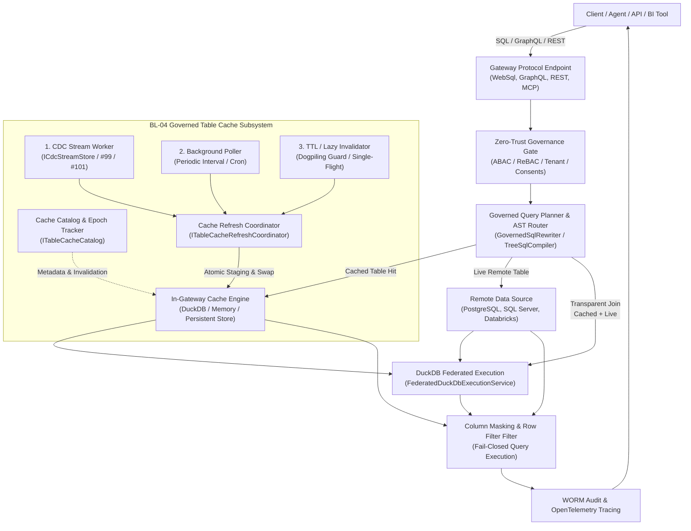
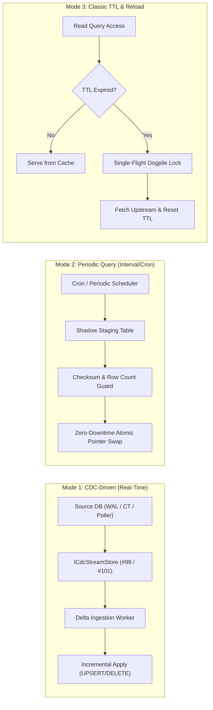

# PRD: REQ-DATA-BL04 - Governed Table Cache & Transparent Federated Query Routing

**Document ID:** `REQ-DATA-BL04`  
**Date:** 2026-10-20  
**Status:** PRD APPROVED (Phase 1 complete); ready for Phase 2 Implementation Plan (`PLAN-DATA-BL04`)  
**Author:** Enterprise Product Manager  
**Source:** Owner request BL-04 ("Table cache"), [backlog intake](2026-10-16-backlog-intake.md) §2.1  
**Branch:** `feat/bl-04-governed-table-cache`  
**Parent Plan:** [`00-master-plan-overview.md`](00-master-plan-overview.md) (Wave 4, row 4.6)  
**Related Items:**  
- BL-01 Governed CDC Fan-Out & Hardening (`REQ-CDC-99` / `PLAN-CDC-99` / `ICdcStreamStore`)  
- Issue #101 Governed Multi-Watermark Query Poller (`REQ-CDC-101` / `PLAN-CDC-101`)  
- BL-05 Granular Configuration per Data Source (`REQ-OPS-BL05` / `PLAN-OPS-BL05` / `IDataSourceOptionsResolver`)  
- Issue #107 Row Filter Key-Set Cache (`REQ-GOV-107` / `PLAN-GOV-107`)  
- Cross-Source Federation (`REQ-FED-01` / `IDuckDbOlapEngine` / `FederatedDuckDbExecutionService`)  
- Issue #122 / #123 / #124 Cross-Source WebSQL Optimization & Filter Pushdown  
- Issue #236 Unified Required Filter Column Groups across Read Paths  

---

## 1. Executive Summary & Problem Statement

### 1.1 Motivation & Business Value
In distributed enterprise architectures, Autheris sits between client applications (APIs, BI tools, AI agents, GraphQL consumers) and heterogeneous enterprise data stores (PostgreSQL, SQL Server, Databricks, Oracle, MySQL, SQLite, HTTP sources).

Under the current architecture, every query hitting Autheris requires live network calls and query execution on remote source engines. While federation and cross-source joins are supported via `FederatedDuckDbExecutionService` and `IDuckDbOlapEngine`, remote sources suffer from significant operational bottlenecks:
1. **Network Latency & Upstream Contention:** High-frequency operational queries, repeated dimension lookups, and complex cross-source joins cause connection pool starvation and high latency on production transactional databases (OLTP).
2. **High Cloud Warehouse Compute Costs:** Frequent point queries or small aggregations against analytical cloud warehouses (e.g. Databricks SQL, Snowflake) incur massive compute cluster uptime costs.
3. **Fragility During Source Downtime:** When an upstream source database undergoes a maintenance window, transient network partition, or failover, client queries immediately fail with connection timeouts or downstream 500/503 errors.
4. **Inefficient Cross-Source Joins:** Joining a high-churn remote transactional table with a slow remote dimension table requires staging both sides over the network on every request, degrading throughput and multiplying network egress.

### 1.2 Core Objective: Governed In-Gateway Table Cache
**BL-04** establishes an in-gateway, high-performance, governed table cache inside Autheris. Whole tables or partial subsets (selected columns and row slices) can be staged within the gateway memory and optional persistent local storage.

Crucially, **caching in Autheris NEVER bypasses governance**:
- Cached data is stored in partitioned, tenant-isolated raw or pre-filtered representations.
- When any consumer queries a cached table—either directly or via transparent joins with live sources—the entire Autheris Zero-Trust governance pipeline (**Casbin ABAC/ReBAC, Consents, Mandatory Row Filters, Dynamic Column Masking, Tenant Isolation, and WORM Audit**) executes fail-closed on every single request.
- The cache acts as an accelerated query storage engine, **not** an authorization bypass.

---

## 2. High-Level Architectural Context & System Flow



---

## 3. Detailed Functional Requirements

### 3.1 Caching Granularity & Subsets (FR-CACHE-01)
- **FR-CACHE-01.1 (Whole Table Caching):** Operators can configure full table replicas to be maintained in the cache.
- **FR-CACHE-01.2 (Column Projection Subsets):** Operators can specify an explicit whitelist of columns to cache (e.g. `[id, tenant_id, name, status, updated_at]`), omitting heavy payload blobs or columns irrelevant to analytical/operational joins.
- **FR-CACHE-01.3 (Row Filter & Slice Subsets):** Operators can specify a deterministic predicate (e.g. `status = 'ACTIVE' AND is_deleted = false`) to cache only the hot working set of a table.
- **FR-CACHE-01.4 (Strict Tenant Partitioning):** For multi-tenant databases, cache entries MUST be partitioned by `tenant_id`. In-memory and on-disk tables maintain tenant indices or separate schema namespaces to guarantee physical and logical tenant separation.

### 3.2 Three Refresh Modes (FR-REFRESH-02)
Every cached table definition MUST configure exactly one of the three supported refresh modes:



#### 3.2.1 Mode 1: Change Tracking / CDC-Driven Refresh (FR-REFRESH-02.1)
- Builds on top of `ICdcStreamStore` (delivered in BL-01 / #99) and the Multi-Watermark Poller (#101).
- Subscribes to the continuous stream of changes (`Insert`, `Update`, `Delete`) for the tracked table.
- **Incremental Apply:** Directly applies delta mutations into the cached table representation using the table's declared primary key.
- **Watermark & Gap Recovery:** Tracks processed stream sequence numbers. If a watermark discontinuity or gap event (`CdcGapDetectedException`) occurs, the refresh coordinator triggers a full shadow reload from the source and resynchronizes the CDC baseline.

#### 3.2.2 Mode 2: Periodic Background Query Refresh (FR-REFRESH-02.2)
- Periodically executes a background governed extractor query against the source database based on a configured cron expression or interval (e.g., `IntervalSeconds: 300` or `Cron: "0 */1 * * *"`).
- **Shadow Staging & Atomic Swap:**
  1. Staging worker writes to a private shadow table (`staging_{table}_{epoch}`).
  2. Runs validation checks (minimum row count, schema shape verification).
  3. Atomically swaps the active cache pointer/view to the newly staged table.
  4. Drops previous staging generation after active readers release reference locks.
- **Non-Blocking:** Incoming caller queries read continuously from the previous generation with zero lock contention or stalls while the background refresh runs.

#### 3.2.3 Mode 3: Classic TTL Expiry & Reload (FR-REFRESH-02.3)
- Cached table records or table instances have a configurable Time-To-Live (e.g. `Ttl: "30m"`, range 1 second to 7 days).
- **Single-Flight Dogpiling Prevention:** When a TTL expires and concurrent queries request the table, only ONE upstream query is dispatched to the remote source. All concurrent caller queries await the completion of the single flight worker rather than overwhelming the upstream database with duplicate queries.
- **Proactive Early Refresh (Configurable):** Optional background refresh when remaining TTL falls below 10% to completely eliminate cold-read latency penalties for hot paths.

### 3.3 Transparent Joins & Query Routing (FR-ROUTING-03)
- **FR-ROUTING-03.1 (Caller Transparency):** Callers submit standard SQL, GraphQL, REST, or MCP requests without knowledge of cache placement. They reference standard table names (e.g. `crm.customers`).
- **FR-ROUTING-03.2 (AST Query Inspection & Rewriter Integration):**
  - Integrated into `GovernedSqlRewriter`, `TreeSqlCompiler`, and `CrossSourcePlanner`.
  - The planner matches referenced tables against the `ITableCacheCatalog`.
  - If a table is cached and valid (healthy, not expired, covering requested columns and predicates), the planner substitutes the remote table reference with the local cache table identifier.
- **FR-ROUTING-03.3 (Heterogeneous Transparent Joins):**
  - If a query joins a cached table (`cached_crm.customers`) with a live remote table (`live_erp.orders`), the query planner utilizes `FederatedDuckDbExecutionService`:
    - The live table is staged via standard federated streaming.
    - The cached table is queried directly from local cache storage with zero network latency.
    - DuckDB executes the join locally.
- **FR-ROUTING-03.4 (Fallback to Source on Cache Miss/Invalidation):**
  - If the cache for a table is unavailable or in an invalid state and the table's policy does not enforce offline survival, the planner dynamically falls back to live source execution without failing the user's query.

### 3.4 Optional Disk Persistence & High Availability (FR-PERSIST-04)
- **FR-PERSIST-04.1 (Persistence Storage Engines):**
  - Supported storage engines:
    1. **DuckDB File-backed:** Single-file or per-tenant database files (`.duckdb`) providing native vectorized OLAP scan performance.
    2. **Parquet Store:** Columnar Snappy/ZSTD-compressed Parquet files organized in tenant/table directory partitions.
    3. **In-Memory Only:** Volatile RAM storage for high-churn or ephemeral workloads.
- **FR-PERSIST-04.2 (High Availability & Source Outage Survival):**
  - When an upstream data source is offline (connection failure, timeout, circuit breaker open), the gateway can enter **Survivable / Offline Mode** for cached tables:
    - `OfflinePolicy: FailClosed` (default for strict real-time tables).
    - `OfflinePolicy: ServeStaleWithWarning` (serves cached data from persistent disk, adds HTTP header `X-Autheris-Cache: Stale-Offline`, and emits diagnostic telemetry).
- **FR-PERSIST-04.3 (Fast Gateway Reboot & Recovery):**
  - On gateway container restart or rolling deployment, cached tables backed by disk persistence load their catalog metadata in `< 200ms` without triggering massive thundering herds of initial sync queries against the source systems.
- **FR-PERSIST-04.4 (Encryption at Rest):**
  - All on-disk persistent cache files (DuckDB databases, Parquet files) MUST be encrypted at rest using AES-256-GCM. Encryption keys are derived from the gateway Key Encryption Key (KEK) via `ICdcStreamCrypto` or `IKeyVaultProvider`.

### 3.5 Fail-Closed Governance & Zero-Trust Guarantees (FR-GOV-05)
> [!CRITICAL]
> **The Golden Rule of Autheris Caching:** The table cache stores raw or pre-filtered data at rest. Caching NEVER short-circuits or bypasses query-time governance.

- **FR-GOV-05.1 (Per-Request ABAC/ReBAC & Consent Verification):**
  - Every query hitting a cached table MUST execute Casbin ABAC evaluation and verify caller consents (`IConsentResolutionService`). If a caller lacks permission on the logical table, execution is aborted with `403 Forbidden` before cache data is touched.
- **FR-GOV-05.2 (Query-Time Mandatory Row Filters):**
  - Caller-specific row filters (such as tenant filters, department filters, dynamic user attribute filters `#129`, and `#236` required filter column groups) are injected into the AST at execution time and applied directly to the query executed against the cache.
  - User A and User B querying the same cached table will each only receive their authorized row slices.
- **FR-GOV-05.3 (Query-Time Dynamic Column Masking):**
  - Column masking rules (e.g. Redact, Hash, Partial Masking, Scope-specific masking `#143`) are applied at query time. Raw unmasked values stored in the cache are NEVER leaked to callers lacking unmasked clearance.
- **FR-GOV-05.4 (WORM Audit Trail Parity):**
  - Queries served from cache emit complete WORM audit records (`IAuditLogRepository`) identical to queries served from live sources. Audit logs record `CacheHit: true`, cache generation epoch, applied masks, row counts, and caller identity.

---

## 4. Open-Source Assessment & License Compliance

In strict compliance with Autheris repository governance and BSL 1.1 license requirements:
- **Zero Copy Policy:** No GPL, AGPL, or proprietary BSL code may be copied or included.
- **Permissive Open-Source Licensing:** Any adopted library must be strictly licensed under MIT, Apache 2.0, or BSD-2/3-Clause.

### 4.1 Evaluation of Candidates

| Component / Library | License | Fit Assessment | Recommendation |
|---|---|---|---|
| **DuckDB / DuckDB.NET** | MIT | Already adopted in Autheris (`src/Autheris.Application/Olap/DuckDbOlapEngine.cs`). High-performance vectorized execution, ACID local storage file format, native SQL compliance, seamless Parquet integration. Zero copy needed; uses official NuGet bindings. | **ADOPT (Primary Execution & Persistence Engine)** |
| **Parquet.Net** | Apache 2.0 | Pure C# high-performance Apache Parquet reader and writer. Excellent for columnar storage partitions on disk, zero native runtime dependencies, cross-platform ARM64/x64 support. | **ADOPT (Optional Columnar Disk Format)** |
| **Faster / RocksDB** | MIT / BSD | Key-value store engines. Poor fit for arbitrary SQL analytics, relational joins, and predicate pushdown. Requires heavy serialization and lack of relational query engine. | **REJECT (Unsuitable for relational query caching)** |
| **FusionCache / HybridCache** | MIT | Key-value application memory/distributed caching library with single-flight stamping and L1/L2 coordination. Good candidate for cache metadata and key-set coordination, but does not provide SQL query execution over cached tables. | **ADOPT (Metadata / Coordination only)** |
| **Apache Arrow (.NET)** | Apache 2.0 | High-performance in-memory columnar format. DuckDB natively handles Arrow buffers via C API. | **ADOPT (Inter-engine memory exchange)** |
| **Presto / Trino Engine Embed** | Apache 2.0 | Heavyweight Java runtime; violates .NET 10 unified in-process model. | **REJECT** |

### 4.2 Architectural Decision: Native Autheris Orchestration on DuckDB & Parquet
1. **Core Relational Engine:** Autheris will expand its existing native integration with **DuckDB** (`DuckDB.NET.Data`, MIT) to serve as the local execution and storage engine for cached tables. DuckDB provides sub-millisecond vectorized scans, multi-million-row aggregation throughput, and battle-tested disk persistence.
2. **Metadata & Single-Flight Coordination:** Autheris will build a lightweight, native, zero-allocation cache coordinator (`GovernedTableCacheCoordinator`) utilizing `System.Threading.Channels`, `FrozenDictionary`, and native `SemaphoreSlim` single-flight gates.
3. **Delta Ingestion:** Reuses existing `ICdcStreamStore` (BL-01 / #99) and `CdcStreamKeyring` for real-time CDC replay.

---

## 5. Security & Zero-Trust Threat Model (STRIDE)

| Threat Category | Potential Attack Vector | Autheris Mitigation & Zero-Trust Guardrail |
|---|---|---|
| **Spoofing** | Adversary attempts to forge cache refresh messages or bypass tenant tags. | All cache update operations are internal to the gateway process; CDC stream reads require authenticated system credentials and verify cryptographic stream hashes. Tenant isolation is enforced in cache keys and table namespaces. |
| **Tampering** | Malicious alteration of persistent cache files (DuckDB / Parquet) on host storage. | Persistent storage directories are restricted to gateway system permissions (`0700`). Optional AES-256-GCM file-level cryptographic HMAC verification detects external tampering fail-closed. |
| **Repudiation** | Query executed against cache without audit logging. | The query execution pipeline wraps cache hits in the exact same `IAuditLogRepository` transaction as live queries. Audit logs record `CacheHit: true` and the cache generation hash. |
| **Information Disclosure** | Caller receives unmasked cached data or bypasses row-level security. | **Strict Fail-Closed Architecture:** Caching sits beneath the AST query rewriter. The AST always rewrites the query with mandatory row filters and projects columns through masking expressions before DuckDB executes the query. |
| **Denial of Service** | Cache refresh queries exhaust memory or upstream connection pool (dogpiling). | Single-flight request coalescing prevents dogpiling. Disk persistence uses bounded memory limits (`MaxMemoryBytes`, `MaxDiskSpaceBytes`). Global safety ceilings prevent memory exhaustion. |
| **Elevation of Privilege** | Caller exploits cache routing to access tables across data sources without 4-eyes approval. | Transparent joins through the cache strictly enforce `Gateway:CrossSource:Enabled` and `AllowCrossDataSource` permissions verified at the federation gate. |

---

## 6. Data Model & Configuration Schemas

### 6.1 Configuration Schema (`appsettings.json`)
```json
{
  "Gateway": {
    "TableCache": {
      "Enabled": true,
      "StorageEngine": "DuckDb",
      "PersistentDirectory": "/var/lib/autheris/cache",
      "DefaultMemoryLimitMb": 2048,
      "DefaultDiskLimitMb": 10240,
      "AllowStaleOnOutage": false,
      "Encryption": {
        "Enabled": true,
        "KeyVaultKeyName": "table-cache-dek"
      },
      "Tables": [
        {
          "DataSource": "crm_postgres",
          "Table": "customers",
          "RefreshMode": "CdcStream",
          "Columns": ["id", "tenant_id", "company_name", "tier", "country", "created_at"],
          "FilterPredicate": "is_active = true",
          "MaxRows": 500000,
          "Persistence": "DiskPersistent"
        },
        {
          "DataSource": "erp_sqlserver",
          "Table": "products",
          "RefreshMode": "PeriodicQuery",
          "RefreshIntervalSeconds": 3600,
          "Columns": ["sku", "title", "category", "unit_price", "is_discontinued"],
          "FilterPredicate": "is_discontinued = false",
          "MaxRows": 100000,
          "Persistence": "MemoryOnly"
        },
        {
          "DataSource": "analytics_databricks",
          "Table": "exchange_rates",
          "RefreshMode": "TtlExpiry",
          "TtlSeconds": 1800,
          "Columns": ["currency_code", "rate_to_usd", "effective_date"],
          "Persistence": "DiskPersistent",
          "OfflinePolicy": "ServeStaleWithWarning"
        }
      ]
    }
  }
}
```

### 6.2 Cache Metadata Model (C# Contracts)
```csharp
namespace Autheris.Domain.Caching.TableCache;

public enum CacheRefreshMode
{
    CdcStream = 1,
    PeriodicQuery = 2,
    TtlExpiry = 3
}

public enum CachePersistenceMode
{
    MemoryOnly = 1,
    DiskPersistent = 2
}

public enum CacheOfflinePolicy
{
    FailClosed = 1,
    ServeStaleWithWarning = 2
}

public sealed record CachedTableConfig(
    string DataSource,
    string Table,
    CacheRefreshMode RefreshMode,
    IReadOnlyList<string>? Columns,
    string? FilterPredicate,
    int? TtlSeconds,
    int? RefreshIntervalSeconds,
    string? CronExpression,
    long? MaxRows,
    CachePersistenceMode Persistence,
    CacheOfflinePolicy OfflinePolicy);

public sealed record CachedTableMetadata(
    string TableIdentifier,
    string InternalStorageName,
    long GenerationEpoch,
    DateTimeOffset LastRefreshedAt,
    DateTimeOffset? ExpiresAt,
    long RowCount,
    long SizeInBytes,
    bool IsHealthy,
    string? LastError);
```

---

## 7. Acceptance Criteria (AC)

- **AC-01 (Whole & Partial Table Caching):** The gateway successfully caches either entire tables or specific column projections and row filter subsets as declared in configuration.
- **AC-02 (CDC-Driven Refresh):** For tables configured with `RefreshMode: CdcStream`, insert, update, and delete events from `ICdcStreamStore` are applied incrementally to the cached table within `< 100ms` of ingestion.
- **AC-03 (CDC Discontinuity Recovery):** If a CDC gap or sequence mismatch is detected, the cache coordinator initiates an automatic shadow refresh from the source and restores consistency without manual intervention.
- **AC-04 (Periodic Background Refresh):** For tables configured with `RefreshMode: PeriodicQuery`, background refresh queries run at the configured interval, stage into a shadow table, and execute a zero-downtime atomic swap with no reader lock contention.
- **AC-05 (TTL Expiry & Single-Flight Dogpiling Prevention):** For tables configured with `RefreshMode: TtlExpiry`, expired caches trigger a reload where 100 concurrent incoming queries result in exactly ONE upstream query to the source database while the remaining 99 await the shared result.
- **AC-06 (Transparent Joins):** Queries combining a cached table and a remote live data source join transparently via DuckDB, requiring zero syntactic modifications by the caller.
- **AC-07 (Disk Persistence & Fast Startup):** On gateway restart with disk persistence enabled, cached tables load their catalogs and become queryable in `< 200ms` without issuing initial full-load queries against the remote source.
- **AC-08 (Zero-Trust Security Parity):** Every query targeting a cached table strictly enforces:
  - Casbin ABAC/ReBAC authorization (unauthorized queries reject with 403).
  - Mandatory row filtering (user-scoped and tenant-scoped data isolation).
  - Dynamic column masking (redaction and hashing applied identically to source queries).
  - Complete WORM audit logging with `CacheHit: true`.
- **AC-09 (Offline High Availability):** When a source database is down, tables with `OfflinePolicy: ServeStaleWithWarning` continue serving cached queries with warning indicators rather than returning errors.
- **AC-10 (Anti-Escalation & Resource Quotas):** Memory and disk usage for the cache strictly adhere to configured memory limits (`MaxMemoryBytes`, `MaxDiskSpaceBytes`). Exceeding quotas triggers orderly LRU eviction of expired items or fail-closed rejection.

---

## 8. Rollout Plan & Implementation Phases

1. **Phase 1 (Product Management):** PRD Approved (`REQ-DATA-BL04`).
2. **Phase 2 (Architecture & Plan):** Implementation Plan (`PLAN-DATA-BL04`) defining work packages:
   - `WP-TC-01`: Configuration models, validation & BL-05 integration.
   - `WP-TC-02`: In-memory & DuckDB storage manager (`IDuckDbTableCacheEngine`).
   - `WP-TC-03`: Refresh workers (CDC stream receiver, Periodic poller, TTL single-flight).
   - `WP-TC-04`: Query Planner & AST rewriter transparent routing integration.
   - `WP-TC-05`: Offline resilience mode & AES-256-GCM persistence at rest.
3. **Phase 3 (AppSec / Security Review):** Security gate verification of fail-closed invariants and tenant isolation.
4. **Phases 4–6 (Implementation & Verification):** TDD implementation, comprehensive integration tests, regression checks, and performance benchmarks.
