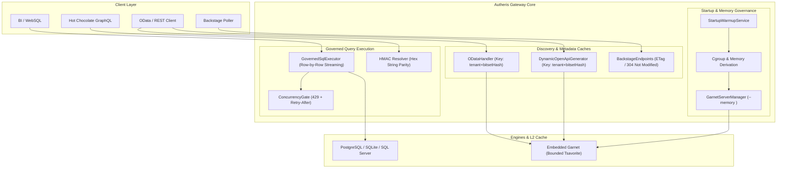

# REQ-PERF-254: Memory Growth, Scale Catalog Limits, Discovery Caches, Streaming & Channel Consistency

**Document ID:** `REQ-PERF-254`  
**Date:** 2026-10-20  
**Status:** PROPOSED  
**Author:** Enterprise Product Manager & Strategic Gatekeeper  
**Source:** GitHub Issue #254 (v1.2.4/v1.2.5); related: #138 (`REQ-CAT-138` / PR #252), #146 (`REQ-CAT-146`), BL-03 (`PLAN-SCALE-5000`), BL-04 (`PLAN-DATA-BL04`), BL-05 (`PLAN-OPS-BL05`), #157 (`REQ-BUG-157`)  
**Branch:** `feat/issue-254-memory-scale-catalog-performance`  
**Parent Plan:** [00-master-plan-overview.md](00-master-plan-overview.md)  
**Binding Project Constraints:** English only; Zero-Trust and fail-closed defaults; zero-allocation hot paths; no raw row values or unkeyed PII in logs; no upgrade migrations (0001 baseline DDL and shape snapshots edited in place); owner rule (2026-10-17): NO DOCUMENTATION PHASE in `docs/features/`.

---

## 1. Executive Summary & Problem Statement

### 1.1 Executive Summary
As Autheris expands into large-scale enterprise deployments—especially integrating core ERP environments (SAP S/4HANA, Microsoft Dynamics 365, Oracle ERP) with 10,000 to 50,000+ cataloged tables and thousands of concurrent users—two acute bottlenecks emerge:
1. **Unbounded Memory Growth & Container Resource Contention:** The embedded Garnet L2 cache lacks explicit container memory limits, leading to potential cgroup Out-Of-Memory (OOM) kills. Meanwhile, high-volume tabular query results buffer entirely in memory before serialization, and per-user metadata caches retain idle entries indefinitely.
2. **Cold Discovery Latency & Redundant Schema Overhead:** Discovery endpoints (OData `$metadata`, Service Documents, and OpenAPI slices) currently key their caches by user SID (`{tenantId}:{userSid}`), duplicating megabytes of identical XML/JSON across hundreds of users who share identical permission sets. Backstage integration endpoints perform full serializations on every poll without HTTP conditional caching (`ETag` / `304 Not Modified`). Furthermore, generating Hot Chocolate GraphQL schemas across thousands of unconsented raw ERP tables bloats gateway schema memory and slows first calls.

Additionally, operational polish is required to ensure cross-channel consistency between GraphQL and WebSQL for HMAC pseudonymization, guarantee standard `Retry-After` HTTP headers on all 429 concurrency throttles, and eliminate spurious "epoch rollback" log spam during empty cache bootstrap.

### 1.2 Target Audience
- **Enterprise Platform Engineers & SREs:** Running Autheris in memory-constrained Kubernetes pods and Linux containers under strict cgroup limits.
- **Enterprise Data Consumers & AI Agents:** Querying large ERP datasets through MCP, GraphQL, REST, and WebSQL without suffering cold-start latencies.
- **Data Governance & Security Officers:** Enforcing consistent HMAC pseudonymization across all read channels while maintaining strict Zero-Trust boundaries.

### 1.3 Strategic Fit & Moat Matrix
Competitors in the API and data access space (Apollo Router, Hasura DDN, Kong) handle catalog scale by either offloading governance to databases or requiring external commercial control planes. Autheris provides an **all-in-one in-process Zero-Trust Gateway** on .NET 10. By introducing deterministic memory budgeting, streaming result pipelines, shared permission-set discovery caches, and ERP table schema partitioning, Autheris achieves lower Total Cost of Ownership (TCO) and superior P99 latency while remaining completely resilient within strict container limits.

---

## 2. Market & Best-Practice Benchmark

| Vector | Apollo Router / Federation v2 | Hasura DDN | Kong / Traditional Gateway | Autheris Target (`REQ-PERF-254`) |
| :--- | :--- | :--- | :--- | :--- |
| **Container Memory Management** | Static Rust memory footprint, but subgraph cascades accumulate unbounded memory. | Managed cloud DDN; on-prem requires substantial per-connector memory pools. | Relies on Lua/Go memory limits; IPC serialization overhead with gRPC plugins. | **Native .NET 10 + Garnet cgroup derivation**: Explicit `MemorySizeMb` cap, automatic cgroup v1/v2 derivation, and .NET GC heap hard limits. |
| **Large Result Buffering** | Buffers JSON responses before AST assembly; large responses risk OOM. | Node/Haskell engine streams JSON but lacks column-level HMAC rewrite on the fly. | Passes raw stream without deep column-level Zero-Trust masking or RLS pushdown. | **True Row-by-Row Governed Streaming**: Streams `IAsyncEnumerable<IReadOnlyDictionary<string, object?>>` directly to NDJSON/Arrow/WebSQL/Parquet without LOH memory spikes. |
| **Catalog Metadata Discovery Caching** | Schema registry compiles centralized supergraphs; lacks ABAC-filtered metadata endpoints. | Per-role metadata generation; cold compile latency on large ERP models. | Static OpenAPI specs; no dynamic ABAC-filtered CSDL/OpenAPI generation. | **Permission-Bitset Discovery Caching**: OData `$metadata` & OpenAPI index cached by hash of visible table bitset (`CatalogVisibleBitSet`), achieving 90%+ cache hit deduplication across users. |
| **Catalog Discovery Refresh Protocol** | Polling or WebSocket subscription without lightweight HTTP 304 conditional validation. | Webhook-triggered recompilation. | Periodic poll without versioning headers. | **Backstage RFC 9110 ETag / Last-Modified**: Lightweight conditional `If-None-Match` returns 304 Not Modified instantly without YAML serialization. |
| **Large Catalog ERP Schema Footprint** | Unpartitioned federated schema exposed to all authenticated clients. | Full model exposed; RBAC checks applied at execution time. | Route-level filtering only. | **Partitioned Schema Models**: Partition/filter Hot Chocolate GraphQL schemas and discovery endpoints by caller permission tier / consent scope. |
| **Masking Channel Parity** | External plugins handle masking; inconsistent formats across protocols. | Native column masking in DDN. | Inconsistent plugin transformations across REST and gRPC. | **Cross-Channel Parity**: Uniform HMAC hex hash string output across GraphQL and WebSQL; no null regressions. |

---

## 3. Verified Current State & Technical Analysis

### 3.1 Memory Growth & Embedded Garnet Configuration
- **Current State:** [`GarnetOptions`](file:///root/autheris/src/Autheris.Domain/Options/Storage/RedisOptions.cs#L14) only exposes `Host`, `Port`, `DisableConsole`, `CheckpointDir`, and TLS options. It lacks a `MemorySizeMb` property. In [`GarnetServerManager.cs`](file:///root/autheris/src/Autheris.Infrastructure/Garnet/GarnetServerManager.cs#L113), the embedded server arguments only pass `--port`, `--bind`, `--auth`, `--password`, and `--lua`. Garnet runs without Tsavorite memory limits, allocating up to available physical system memory and risking container termination under Linux cgroup caps.
- **Root Cause:** Absence of memory budgeting flags (`--memory`) in the Garnet startup CLI builder and lack of container cgroup memory autodetection.

### 3.2 Large Query Result Buffering
- **Current State:** In [`GovernedSqlExecutor.cs`](file:///root/autheris/src/Autheris.Application/Sql/Services/GovernedSqlExecutor.cs#L129-L137), `ExecuteAsync` iterates `reader.ReadAsync()` and appends every row into an in-memory `List<Dictionary<string, object?>> rows`. In [`GovernedConnectorReader.cs`](file:///root/autheris/src/Autheris.Application/Connectors/GovernedConnectorReader.cs#L138), `ReadRawAsync` also builds an in-memory `List<IReadOnlyDictionary<string, object?>>`.
- **Root Cause:** Batch execution buffers the entire result set in memory before returning to the caller. When a user or BI tool queries 100,000+ rows, this triggers multi-hundred-megabyte allocations on the Large Object Heap (LOH), leading to Gen 2 GC pauses and container memory spikes.

### 3.3 User Metadata Cache Retention & LRU Eviction
- **Current State:** [`ConsentCacheService.cs`](file:///root/autheris/src/Autheris.Infrastructure/Cache/ConsentCacheService.cs#L27) stores `_tableCacheKeys` as `ConcurrentDictionary<string, ConcurrentDictionary<string, byte>>`. Per-user cache keys accumulate indefinitely without TTL or LRU pruning when users become inactive. Similarly, [`AccessProfileCache.cs`](file:///root/autheris/src/Autheris.Application/Policy/Services/AccessProfileCache.cs#L40) uses an unbounded `ConcurrentDictionary` for `_epochCache`.
- **Root Cause:** Absence of sliding expiration and LRU/idle cleanup mechanics for per-user metadata lookup tables.

### 3.4 Cold Discovery Document Caching (`$metadata` & `$openapi/index`)
- **Current State:** In [`ODataHandler.cs`](file:///root/autheris/src/Autheris.Extensions/OData/ODataHandler.cs#L51), the CSDL cache key is constructed as:
  ```csharp
  var cacheKey = $"odata:csdl:{principal.GetTenantId().Value}:{principal.GetUserSid()?.Value}";
  ```
  The service document cache key uses the same pattern (`:userSid:`). In [`DynamicOpenApiGenerator.cs`](file:///root/autheris/src/Autheris.Application/OData/Services/DynamicOpenApiGenerator.cs#L70), `GetIndexDocumentAsync` scans all tables from the repository on every invocation without caching.
- **Root Cause:** Caches are keyed by individual user identity (`userSid`) rather than the caller's authorization equivalence class. If 5,000 users share the same role (and thus identical visible tables), the gateway generates and caches 5,000 redundant copies of the CSDL XML document.

### 3.5 Backstage `catalog-info.yaml` Polling Overhead
- **Current State:** In [`BackstageEndpoints.cs`](file:///root/autheris/src/Autheris.Api/Endpoints/BackstageEndpoints.cs#L84-L96), `GET /api/integrations/backstage/catalog-info.yaml` calls `ExportCatalogEntitiesYamlAsync` on every request and returns raw UTF-8 YAML without `ETag` or `Last-Modified` headers.
- **Root Cause:** Backstage entities are re-serialized on every poll even when the underlying catalog snapshot (`CATALOG_STATE`) has not changed.

### 3.6 Cold Startup Pre-Warming
- **Current State:** [`StartupWarmupService.cs`](file:///root/autheris/src/Autheris.Api/Hosting/Warmup/StartupWarmupService.cs#L12) currently only executes `McpSerializationWarmup`. Database connection pools and discovery documents are not pre-warmed, forcing the first incoming requests to incur database handshake latency and schema compilation overhead.
- **Root Cause:** Missing `IStartupWarmup` steps for data source connection verification and discovery document compilation.

### 3.7 Large ERP Catalog GraphQL Schema Bloat
- **Current State:** [`CatalogSchemaModel.BuildAsync`](file:///root/autheris/src/Autheris.GraphQL/Catalog/CatalogSchemaModel.cs#L150) queries `GetAllTablesAsync` and generates Hot Chocolate types, filter input types, order types, and relation fields for *all* active tables. In enterprise environments with 10,000+ ERP tables, this results in hundreds of thousands of generated GraphQL types, consuming gigabytes of memory and generating enormous introspection schemas.
- **Root Cause:** Lack of configurable schema partitioning or consent-scope filtering at GraphQL schema generation time.

### 3.8 Channel Masking Discrepancy (GraphQL vs WebSQL)
- **Current State:** In [`CatalogGraphQlTypeModule.cs`](file:///root/autheris/src/Autheris.GraphQL/Catalog/CatalogGraphQlTypeModule.cs#L468-L492), `ResolveColumnValue` attempts to parse JSON values into the column's original technical type (e.g. `int.TryParse` for `Int`). When a column is pseudonymized via HMAC, `GovernedTreeQueryService` inserts a 64-character hex hash string. `int.TryParse` fails, causing `ReportMasked` to be called, which reports an error and returns `null`. Conversely, WebSQL and REST return the HMAC hash string.
- **Root Cause:** Type conversion logic in GraphQL resolver assumes unmasked raw values and fails when encountering HMAC hex strings, dropping the pseudonym to `null`.

### 3.9 Standard `Retry-After` Header on 429 Responses
- **Current State:** When `MaxConcurrentReadsPerUserAndTable` concurrency limits are exceeded, [`GatewayExecutionService.cs`](file:///root/autheris/src/Autheris.Application/Services/GatewayExecutionService.cs#L557) throws `GatewayThrottledException(ThrottledRetryAfterSeconds)`. While [`GatewayExceptionHandler.cs`](file:///root/autheris/src/Autheris.Api/Middleware/GatewayExceptionHandler.cs#L82) maps this to HTTP 429 and sets `Retry-After`, certain direct handlers and GraphQL resolvers do not consistently propagate `Retry-After`.
- **Root Cause:** Inconsistent exception mapping and response header decoration across endpoint handlers.

### 3.10 Policy Epoch Rollback Warnings on Empty Cache Bootstrap
- **Current State:** In [`EpochValidationService.cs`](file:///root/autheris/src/Autheris.Infrastructure/Cache/EpochValidationService.cs#L165-L169):
  ```csharp
  if (rEpoch <= 0 || rEpoch < highestSeen)
  {
      var restored = highestSeen > 0 ? highestSeen + 1 : 1;
      _logger?.LogWarning("Policy epoch rollback detected for {Table} (redis={RedisEpoch}, highestSeen={HighestSeen}); forcing epoch {Restored}.", key, rEpoch, highestSeen, restored);
      ...
  }
  ```
  On empty cache bootstrap, `redis=0` and `highestSeen=0`. The condition `rEpoch <= 0` evaluates to true, logging a spurious warning for every single table accessed during startup.
- **Root Cause:** Failure to distinguish between an uninitialized cache state (`redis == 0 && highestSeen == 0`) and a genuine rollback attack (`rEpoch < highestSeen`).

---

## 4. User Stories & Acceptance Criteria

### 4.1 Scope 1: Memory Growth & Container Limits

#### User Story US-1.1: Configurable Garnet Memory Limits & Cgroup Derivation
*As an Enterprise Platform Engineer, I want to set explicit memory caps on the embedded Garnet cache (or have it automatically derive from container cgroups), so that the gateway never exceeds its Kubernetes pod memory limits and prevents OOM kills.*

- **AC-1.1.1 (Configurable Limit):** Add `MemorySizeMb` (`int?`, default `null`, range `64` to `65536`) to `GarnetOptions`. When specified, [`GarnetServerManager`](file:///root/autheris/src/Autheris.Infrastructure/Garnet/GarnetServerManager.cs) appends `--memory <MemorySizeMb>m` to the server arguments.
- **AC-1.1.2 (Automatic Cgroup Derivation):** If `MemorySizeMb` is not explicitly configured and Autheris detects it is running in a Linux container with cgroup limits (`/sys/fs/cgroup/memory.max` in cgroup v2 or `/sys/fs/cgroup/memory/memory.limit_in_bytes` in cgroup v1), the gateway defaults Garnet memory to **25% of the cgroup memory limit** (clamped to minimum 64MB, maximum 4096MB).
- **AC-1.1.3 (Fallback):** If not running in a cgroup or limits are unset, Garnet defaults to 512MB.
- **AC-1.1.4 (Container Documentation & Guidance):** Document the recommended container environment configuration for .NET 10 GC in the plan:
  - `DOTNET_GCHeapHardLimit`: Set to 70–75% of container memory limit.
  - `DOTNET_GCConserveMemory`: Set to `5` for container environments to encourage timely memory trimming.

#### User Story US-1.2: Governed Row-by-Row Result Streaming
*As a Data Consumer querying large datasets, I want the gateway to stream rows progressively instead of buffering the entire multi-hundred megabyte result set in memory, so that memory usage remains flat and low latency is preserved.*

- **AC-1.2.1 (Streaming Execution in GovernedSqlExecutor):** `GovernedSqlExecutor.StreamRowsAsync` and `ExecuteAsync` must support progressive streaming without pre-allocating the entire result set in memory when streaming formats (NDJSON, Arrow IPC, WebSQL chunked transfer) are requested.
- **AC-1.2.2 (Bounded Connector Buffer):** `GovernedConnectorReader` must provide a streaming read mechanism (`IAsyncEnumerable<IReadOnlyDictionary<string, object?>>`) that avoids holding all rows in a single `List<>` when the consumer can process row-by-row.
- **AC-1.2.3 (Zero LOH Spikes):** Executing a query returning 250,000 rows must maintain gateway managed heap allocations below 64MB above baseline during execution, avoiding LOH allocation spikes.

#### User Story US-1.3: Idle Release & LRU Eviction for User Metadata Caches
*As an Operator managing thousands of ephemeral users, I want per-user metadata caches and internal tracking structures to evict idle entries automatically, so that gateway memory does not leak over time.*

- **AC-1.3.1 (Sliding Expiration in L1):** All per-user cached decisions and profiles in `AccessProfileCache` and `ConsentCacheService` must enforce sliding expiration (default: 15 minutes of inactivity) and maximum lifetime bounds.
- **AC-1.3.2 (Bounded Table Key Tracking):** Replace unbounded nested `ConcurrentDictionary<string, byte>` in `ConsentCacheService._tableCacheKeys` with a bounded LRU tracking structure or purge idle caller keys periodically during epoch invalidations.
- **AC-1.3.3 (Memory Pressure Trimming):** Register a memory cache compaction callback that aggressively trims expired and low-priority user metadata entries when .NET Gen 2 memory pressure signals occur.

---

### 4.2 Scope 2: Cold Discovery Document Caching & Warm-Up

#### User Story US-2.1: Permission-Set Caching for OData `$metadata` & OpenAPI Index
*As an API Developer, I want OData `$metadata` and OpenAPI discovery documents to be cached by permission set rather than user SID, so that users with identical table access share cache entries and experience instant response times.*

- **AC-2.1.1 (BitSet / Hash Permission Key):** `ODataHandler.GetMetadataCsdlAsync` and `GetServiceDocumentAsync` must construct cache keys using the SHA-256 hash of the caller's visible table set (`CatalogVisibleBitSet` or sorted table ID hash) and tenant ID:
  ```csharp
  var cacheKey = $"odata:csdl:{tenantId}:{visibilityHash}";
  ```
  No individual `userSid` or user claim may be part of the cache key.
- **AC-2.1.2 (OpenAPI Index Caching):** `DynamicOpenApiGenerator.GetIndexDocumentAsync` must cache the generated `OpenApiIndexDocument` in L1 memory cache, keyed by the caller's permission set hash, with a configurable TTL (default: 1 hour) and invalidation on catalog changes (`CATALOG_STATE` version bump).
- **AC-2.1.3 (Deduplication Ratio):** In an environment with 1,000 users belonging to 5 role groups, OData CSDL and OpenAPI index cache entries must number at most 5 per tenant rather than 1,000.

#### User Story US-2.2: Backstage `catalog-info.yaml` with HTTP 304 Validation
*As an Enterprise Catalog Integrator, I want `catalog-info.yaml` to support HTTP `ETag` and `Last-Modified` validation, so that periodic Backstage polling does not trigger full YAML regenerations.*

- **AC-2.2.1 (ETag Computation):** The endpoint `GET /api/integrations/backstage/catalog-info.yaml` computes an `ETag` header formatted as `W/"<structure_version>-<content_version>-<hash>"` based on `CATALOG_STATE` and catalog entity count.
- **AC-2.2.2 (Conditional GET):** If the incoming request contains `If-None-Match` matching the current `ETag`, the endpoint immediately returns `304 Not Modified` with an empty body and no YAML generation.
- **AC-2.2.3 (Cached Output):** When generation is necessary, the YAML output is cached in memory until `CATALOG_STATE` changes.

#### User Story US-2.3: Startup Pre-Warming for Data Sources & Discovery Documents
*As an SRE, I want the gateway to pre-warm data source connection pools and compile discovery documents during startup, so that the first client queries do not suffer cold-start spikes.*

- **AC-2.3.1 (DataSourceWarmup Step):** Add a new `IStartupWarmup` step named `DataSourceConnection` to `StartupWarmupService`. It verifies connectivity and initializes connection pools for all active configured data sources (up to the configured `MinPoolSize`).
- **AC-2.3.2 (DiscoveryDocumentWarmup Step):** Add an `IStartupWarmup` step named `DiscoveryDocument` that pre-compiles the public/default OpenAPI catalog index and admin CSDL metadata during startup.
- **AC-2.3.3 (Configuration & Diagnostics):** Both steps must be configurable via `Gateway:Startup:Warmup:Steps:<StepName>:Enabled` and record step durations in `autheris.startup.warmup.step.duration`.

---

### 4.3 Scope 3: Large Catalog ERP Table Schema Partitioning

#### User Story US-3.1: Permission-Tier & Scope Partitioning for GraphQL Schema
*As a Solution Architect, I want the option to partition or filter the GraphQL schema and discovery documents by permission tier or consent scope, so that 10,000+ raw ERP tables do not bloat the schema for clients that cannot access them.*

- **AC-3.1.1 (Partitioning Configuration):** Add `Gateway:GraphQL:SchemaPartitioning` configuration with modes: `None` (default, current behavior), `ByConsentScope`, or `ByPermissionTier`.
- **AC-3.1.2 (Scope Filtering in Schema Build):** In `CatalogSchemaModel.BuildAsync`, allow filtering the input tables by allowed domains, consent scopes, or visibility tiers (`Full`, `Summary`, `Hidden`).
- **AC-3.1.3 (Zero Unconsented Type Bloat):** When partitioned, clients only see types and query fields for tables within their authorized partition; unconsented tables produce zero Hot Chocolate types or filter inputs.
- **AC-3.1.4 (Fail-Closed Safety):** If a query requests a table outside the partition, Hot Chocolate returns standard GraphQL validation errors without executing backend queries.

---

### 4.4 Scope 4: Operational Polish & Channel Consistency

#### User Story US-4.1: Cross-Channel Consistency for HMAC Pseudonymization
*As an API Consumer, I want HMAC-masked columns in GraphQL to return the deterministic hash string (just like WebSQL and REST), rather than returning null.*

- **AC-4.1.1 (GraphQL String Coercion):** In `CatalogGraphQlTypeModule.cs:ResolveColumnValue`, if a column is evaluated as `ColumnAccessLevel.Mask` with an HMAC rule (`rule.IsHmac`), the resolver must return the HMAC pseudonym string directly.
- **AC-4.1.2 (No Erroneous Mask Error):** The resolver must not invoke `ReportMasked` (which logs an error and returns null) for HMAC columns, since HMAC pseudonymization intentionally produces a queryable hash value.
- **AC-4.1.3 (Parity Test):** Querying an integer column masked via HMAC through GraphQL and WebSQL on the same table under identical tenant/user context must yield the exact same 64-character hex hash string.

#### User Story US-4.2: Standard `Retry-After` Header on 429 Concurrency Limits
*As a Client Application Developer, I want all 429 Too Many Requests responses caused by `MaxConcurrentReadsPerUserAndTable` to include a standard `Retry-After` header, so that my HTTP client can implement proper jittered backoff.*

- **AC-4.2.1 (HTTP Header Presence):** Whenever `GatewayThrottledException` is thrown, the HTTP response must include the standard `Retry-After: <seconds>` header (RFC 9110 §10.2.7), where `<seconds>` equals `ex.RetryAfterSeconds`.
- **AC-4.2.2 (Cross-Protocol Verification):** Verify that WebSQL (`WebSqlEndpoints`), Procedures (`ProcedureEndpointRoutes`), OData (`ODataEndpoints`), REST Stream (`TableStreamEndpoints`), and global exception handling (`GatewayExceptionHandler`) set the `Retry-After` header consistently.
- **AC-4.2.3 (ProblemDetails Payload):** The JSON response body must follow RFC 7807 `ProblemDetails` with `code: "TOO_MANY_REQUESTS"` and `retryAfterSeconds: <int>`.

#### User Story US-4.3: Dedup Spurious Policy Epoch Rollback Warnings on Bootstrap
*As an Operator inspecting startup logs, I want empty cache initialization to not trigger false-positive "Policy epoch rollback detected" warnings, so that our alerting systems are not flooded with spurious alarms.*

- **AC-4.3.1 (Bootstrap Discrimination):** In `EpochValidationService.GetCurrentEpochCoreAsync`, when `rEpoch <= 0` and `highestSeen <= 0`, classify this as an **empty cache bootstrap** (`Info` or `Debug` log), NOT an epoch rollback.
- **AC-4.3.2 (True Rollback Alerting):** Reserve `LogWarning("Policy epoch rollback detected...")` strictly for genuine rollback events where `highestSeen > 0` and `rEpoch < highestSeen`.
- **AC-4.3.3 (Rate-Limiting / Dedup):** If genuine rollback conditions occur repeatedly within a short window, rate-limit or deduplicate the warning log to at most once per 30 seconds per table.

---

## 5. Non-Functional Requirements (NFRs)

### 5.1 Security & Zero-Trust (Fail-Closed)
- **Zero Information Leakage:** Caching discovery documents by permission-set hash must never expose table names or column definitions from outside the caller's authorized set.
- **Cryptographic Consistency:** HMAC pseudonymization must use tenant-scoped keyed SHA-256 HKDF derivation (`SecretKeyRequirements`) uniformly across GraphQL, WebSQL, and REST.
- **Fail-Closed on Concurrency Gate Failure:** If concurrency state cannot be verified, access fails closed with a controlled 429 or 503 response.

### 5.2 Performance & Zero-Allocation Hot Paths
- **OData `$metadata` P99 Latency:** < 5.0ms on cache hit (down from > 150ms on cold dynamic compilation).
- **Backstage `catalog-info.yaml` Polling Overhead:** HTTP 304 response latency < 2.0ms with zero memory allocations.
- **Memory Footprint Stability:** Maximum gateway managed heap growth under 100,000-row streaming queries < 64MB above baseline.

### 5.3 Reliability & Resilience
- **Container Memory Ceiling:** Embedded Garnet and L1 cache combined must strictly observe container cgroup boundaries, eliminating cgroup OOM kills.
- **Jittered Backoff Adherence:** `Retry-After` headers prevent stampedes when `MaxConcurrentReadsPerUserAndTable` limits trip.

---

## 6. Architecture & Implementation Design Guidance



### 6.1 Proposed Options Model Changes
In `Autheris.Domain/Options/Storage/RedisOptions.cs`:
```csharp
public sealed class GarnetOptions
{
    // ... existing properties ...

    /// <summary>
    /// Explicit memory limit in megabytes for the embedded Garnet cache (--memory).
    /// If null, derives automatically from container cgroups (25% of cgroup limit, clamped 64MB-4096MB) or defaults to 512MB.
    /// </summary>
    [Range(64, 65536)]
    public int? MemorySizeMb { get; init; }
}
```

In `Autheris.Domain/Options/GraphQL/GraphQlOptions.cs`:
```csharp
public enum GraphQlSchemaPartitioningMode
{
    None = 0,
    ByConsentScope = 1,
    ByPermissionTier = 2
}
```

### 6.2 Permission-Set Discovery Cache Key Computation
In `ODataHandler.cs`:
```csharp
// Compute authorization equivalence key:
var visibleTables = await GetAuthorizedTablesCoreAsync(principal, ct);
var permissionHash = CatalogVisibleBitSet.ComputeSha256(visibleTables.Select(t => t.TableId));
var cacheKey = $"odata:csdl:{tenantId}:{permissionHash}";
```

---

## 7. Rollout, Configuration & Telemetry

### 7.1 OpenTelemetry Metrics
- `autheris.discovery.cache.hit` (Counter): Measures hit/miss ratio for OData `$metadata` and OpenAPI index caches.
- `autheris.backstage.conditional_hits` (Counter): Counts HTTP 304 responses returned to Backstage.
- `autheris.concurrency.throttles` (Counter): Counts 429 throttles tripped with `Retry-After` headers.
- `autheris.startup.warmup.step.duration` (Histogram): Records duration for `DataSourceConnection` and `DiscoveryDocument` warmup steps.

### 7.2 Configuration Defaults (`appsettings.json`)
```json
{
  "Gateway": {
    "Caching": {
      "Garnet": {
        "EnableEmbeddedServer": true,
        "MemorySizeMb": null
      }
    },
    "Startup": {
      "Warmup": {
        "Steps": {
          "DataSourceConnection": { "Enabled": true },
          "DiscoveryDocument": { "Enabled": true }
        }
      }
    },
    "GraphQL": {
      "SchemaPartitioning": "None"
    }
  }
}
```

---

## 8. Definition of Done & Quality Gate (Phases 1–5)

1. **Phase 1 (Product Manager - this PRD):** Approved with full scope coverage for Issue #254. Registered in [`00-master-plan-overview.md`](00-master-plan-overview.md).
2. **Phase 2 (Solution Architect):** Author execution plan (`2026-10-20-plan-issue-254-memory-scale-catalog-performance.md`) detailing class signatures, DI wiring, and test contracts.
3. **Phase 3 (Security Expert):** Threat audit confirming fail-closed visibility invariance, cgroup boundary safety, and HMAC pseudonymization security.
4. **Phase 4 (C# TDD Developer):** Implement changes with unit and integration tests across SQLite, PostgreSQL, and SQL Server.
5. **Phase 5 (Code Reviewer):** Architectural and security verification against Zero-Trust and zero-allocation requirements.
