# REQ-DOC-256: dbt Sources Manifest Ingestion Documentation & End-to-End Test Suite

**Document ID:** `REQ-DOC-256`  
**Date:** 2026-10-20  
**Status:** PRD APPROVED / READY FOR ARCHITECTURAL PLAN (Phase 1 Complete)  
**Author:** Principal Enterprise Product Manager & Technical Strategist  
**Issue Reference:** GitHub Issue #256  
**Parent Plan:** [00-master-plan-overview.md](00-master-plan-overview.md)  
**Target Delivery Window:** v1.2.6  
**Classification:** Documentation Integrity, Data Governance & Automated Testing (P1)  

---

## 1. Executive Summary & Strategic Fit

Modern analytics engineering architectures using **dbt (data build tool)** rely heavily on `sources` to declare and govern external, raw, or upstream datasets prior to transformation into downstream models (`models/`) and static lookup tables (`seeds/`).

While the parser in `Autheris.Extensions` (`DbtArtifactStreamingParser.cs:302-371`) was updated in feature increment B-04 to ingest top-level `sources` nodes from `manifest.json`, two significant enterprise gaps remain:
1. **Documentation Asymmetry:** The enterprise reference document [`docs/extensions/dbt-integration-guide.md`](file:///root/autheris/docs/extensions/dbt-integration-guide.md) omits `sources` from Section 1 (Overview) and Section 5 (Streaming Ingestion & Performance). Specifically, Section 5 currently states that the parser *exclusively* inspects `model.*` and `seed.*` nodes, misleading data engineering teams into assuming raw upstream sources are uncatalogued.
2. **Missing End-to-End Test Suite:** While model and seed ingestion are verified, there is no end-to-end test in `tests/Autheris.Tests.Unit/` asserting that a manifest containing **exclusively sources** (zero models or seeds) correctly flows through the ingestion pipeline (`DbtMetadataIngestionService`), creates source-materialized dataset definitions, and generates data governance/masking proposals in `IDbtProposalRepository`.

This PRD formalizes the requirements to update the documentation guide and establish rigorous automated test coverage.

---

## 2. Verified Current State & Gap Analysis

| Component | Current State | Defect / Enterprise Gap | Target Requirement |
|---|---|---|---|
| **dbt Integration Guide (Overview)** | `docs/extensions/dbt-integration-guide.md:12` references only "Modelle, Seeds, Spaltentypen, DSGVO-Tags und Abhängigkeiten". | Users and data architects are unaware that top-level `sources` are first-class catalog citizens. | Update Section 1 to explicitly declare that top-level `sources` are ingested as materialization `"source"`. |
| **dbt Integration Guide (Parser Spec)** | `docs/extensions/dbt-integration-guide.md:123` states: *"Verarbeitet ausschließlich `model.*`- und `seed.*`-Knoten; Makros, Tests und Operationen werden im Lesepfad übersprungen."* | Inaccurate technical documentation. The parser actively extracts `sources` nodes. | Revise Section 5 to document `sources` ingestion, including mapped schema attributes (name, database, schema, description, columns, tags, meta, constraints). |
| **Unit Test Suite** | `tests/Autheris.Tests.Unit/Dbt/` contains semantic manifest tests; `tests/Autheris.Tests.Unit/DbtPolicyAutoSyncTests.cs` tests `models` only. | No test validates that a manifest containing only `sources` parses, maps, and generates proposals end-to-end. | Implement end-to-end unit test in `tests/Autheris.Tests.Unit/` verifying sources-only manifest ingestion and proposal generation. |

---

## 3. Detailed Field Mapping Specification for dbt Sources

When processing the top-level `"sources"` dictionary in `manifest.json`, the streaming parser maps each node to `DbtModelDefinition`:

```mermaid
flowchart LR
    SRC["manifest.json<br/>sources: { 'source.proj.db.schema.table': { ... } }"] --> PARSER["DbtArtifactStreamingParser"]
    PARSER --> DTO["DbtModelDefinition"]
    
    subgraph DTO_FIELDS ["Mapped Attributes"]
        M1["UniqueId: source.<project>.<db>.<schema>.<table>"]
        M2["Name: node.name"]
        M3["Database: node.database"]
        M4["Schema: node.schema"]
        M5["Materialization: 'source'"]
        M6["Description: node.description"]
        M7["Tags: node.tags[]"]
        M8["Meta: node.meta{}"]
        M9["Columns: node.columns{ name, data_type, description, tags, meta }"]
        M10["ContractEnforced: false"]
    end
    
    DTO --> DTO_FIELDS
    DTO --> INGEST["DbtMetadataIngestionService"]
    INGEST --> PROPOSALS["IDbtProposalRepository<br/>(PII & Policy Proposals)"]
```

### Attribute Mapping Table:
- **`uniqueId`**: Source node identifier (e.g. `source.ecommerce.raw_db.public.orders_raw`).
- **`name`**: Table identifier string (`name`).
- **`database`**: Target database name (`database`).
- **`schema`**: Target schema namespace (`schema`).
- **`materialization`**: Fixed value `"source"`.
- **`description`**: Dataset markdown documentation / summary (`description`).
- **`tags`**: List of string tags (e.g. `["raw", "finance", "external"]`).
- **`meta`**: Key-value property bag (e.g. `owner`, `retention`, `pii`).
- **`columns`**: Map of column definitions, including:
  - `name`: Column name.
  - `data_type`: Inferred or declared storage type.
  - `description`: Column documentation.
  - `tags`: Column-level tags (e.g. `["pii", "gdpr"]`).
  - `meta`: Column-level metadata dictionary (e.g. `{"pii": "true"}`).

---

## 4. Functional & Documentation Requirements

### 4.1 REQ-DOC-256-1: Documentation Updates in `docs/extensions/dbt-integration-guide.md`
- **Section 1 (Overview & Architecture):**
  Update item 1 to declare that `manifest.json` ingestion processes models, seeds, and top-level **sources**, enabling automated catalog registration and policy proposals for raw data lake and warehouse sources.
- **Section 5 (Streaming Ingestion & Performance):**
  - Update the node filtering bullet point to state that in addition to `model.*` and `seed.*` elements from `nodes`, all entities under the top-level `sources` object are streamed and parsed into `DbtModelDefinition` instances with `materialization = "source"`.
  - Add an explicit subsection documenting the mapping of source attributes: name, database, schema, description, columns (data type, description, tags, meta), source-level tags, meta property bag, and relation/key constraints where applicable.

### 4.2 REQ-DOC-256-2: End-to-End Automated Test in `tests/Autheris.Tests.Unit/`
- Implement a test class (or add test methods to `tests/Autheris.Tests.Unit/Dbt/DbtSourcesManifestIngestionTests.cs` or `DbtPolicyAutoSyncTests.cs`):
  1. Construct a valid dbt `manifest.json` containing **only** top-level `sources` (with no `nodes` containing `model.*` or `seed.*`).
  2. The source definition must declare:
     - `database`, `schema`, `name`, `description`.
     - Tags at source level and column level (e.g. `pii`, `gdpr`).
     - Meta dictionary containing governance triggers (e.g. `meta: { "owner": "DataPlatform", "pii": "true" }`).
     - Multiple columns with data types and descriptions.
  3. Execute `DbtMetadataIngestionService.IngestManifestStreamAsync(stream, dryRun: false)`.
  4. Assert:
     - `syncResult.Success` is `true`.
     - `syncResult.ParsedModelsCount` reflects the source table count.
     - `syncResult.GeneratedProposalsCount` captures PII/governance proposals generated from source tags and meta.
     - Inspect `IDbtProposalRepository` to assert that proposals were registered with correct table identifier, column names, and rule suggestions.

---

## 5. Acceptance Criteria

| ID | Category | Scenario | Expected Outcome |
|---|---|---|---|
| **AC-256-01** | Documentation | Inspection of `docs/extensions/dbt-integration-guide.md` Section 1 and Section 5. | Accurately documents top-level `sources` ingestion, materialization `"source"`, and mapped attributes. |
| **AC-256-02** | Unit Testing | A sources-only `manifest.json` stream is ingested by `DbtMetadataIngestionService`. | Service completes successfully; parses models with materialization `"source"`; verifies column types and descriptions. |
| **AC-256-03** | Governance | Source table has columns tagged with `"pii"` and `"meta.pii = true"`. | `PendingReview` proposals are created in `IDbtProposalRepository` matching source table identifiers. |

---

## 6. Implementation Dependencies & Timeline

- **Phase 1 (Product Management):** PRD Approved (`REQ-DOC-256`).
- **Phase 2 (Solution Architect):** Architectural plan authoring (`2026-10-20-plan-issue-256-dbt-sources-manifest-ingestion.md`).
- **Phase 3 (AppSec Review):** Verification that source metadata cannot inject untrusted SQL or bypass zero-trust gates.
- **Phase 4 (C# TDD Developer):** Update documentation guide, author unit test suite in `tests/Autheris.Tests.Unit/`.
- **Phase 5 (Code Review):** Review and merge.
