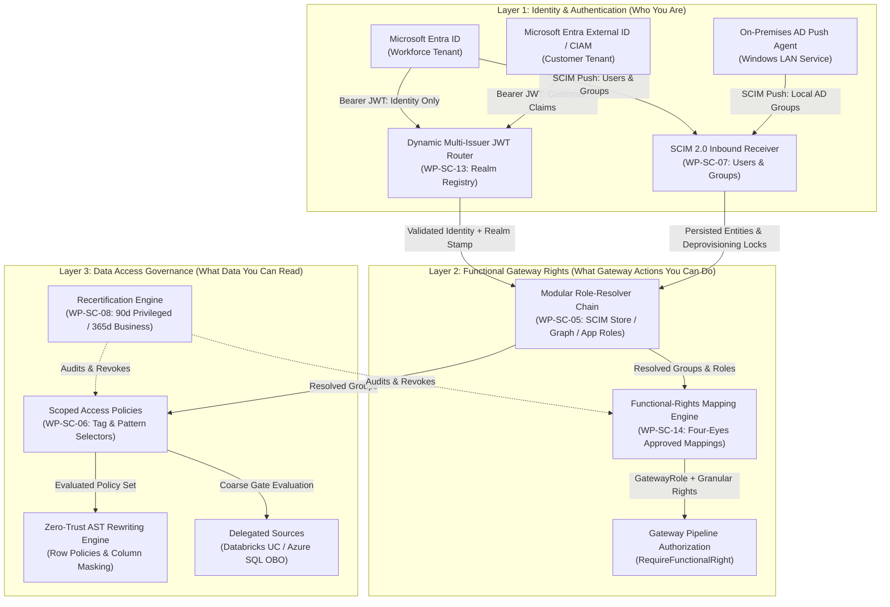
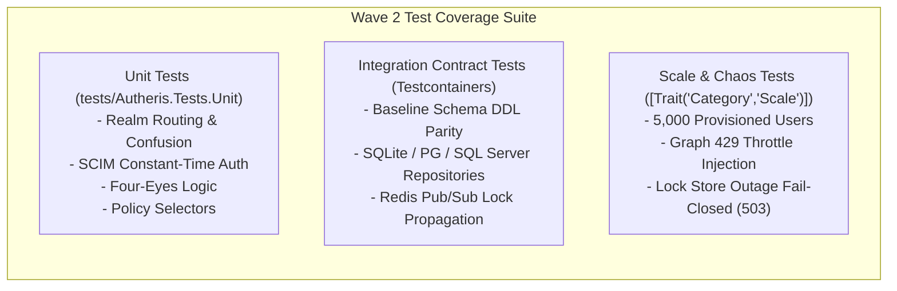
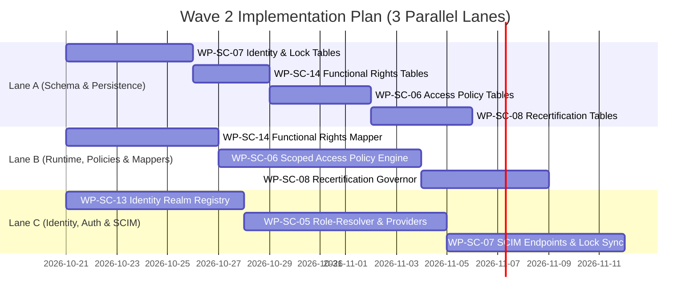

# PRD: Scale to 5,000 Users — Wave 2: Identity Foundation & Structural Access Governance

**Document ID:** `REQ-SCALE-5000-WAVE2`  
**Date:** 2026-10-20  
**Status:** APPROVED (Phase 1 Complete; Handoff to Phase 2 Architecture Plan)  
**Author:** Enterprise Product Manager (Phase 1)  
**Parent Plan:** [00-master-plan-overview.md](00-master-plan-overview.md)  
**Base Document:** [`PLAN-SCALE-5000`](2026-10-16-plan-scale-5000-users.md) (rev. 4), [`ANALYSIS-SCALE-5000-GOV`](2026-10-16-analysis-scale-5000-users-governance.md), [`ANALYSIS-SCALE-5000-PERF`](2026-10-16-analysis-scale-5000-users-performance.md)  
**Target Branch:** `feat/scale-5000-users`  
**Binding Constraints:**
1. Universal English documentation standard across all specifications and plans.
2. In-place schema evolution on baseline `0001` across SQLite, PostgreSQL, and SQL Server (`SqliteBaselineSchema.cs`, `PostgreSqlBaselineSchema.cs`, `SqlServerBaselineSchema.cs`) with regenerated shape snapshots; strictly no upgrade or repair migrations (owner decision 2026-10-15).
3. Zero tolerance for regression on core engine AST security visitors (`AstSecurityVisitor.cs` remains completely untouched).
4. Fail-closed semantics across all failure modes (directory, Redis, database, Graph, SCIM store, lock pub/sub outages default to DENY or HTTP 503).
5. No documentation phase in `docs/features/` or `README.md` (owner rule 2026-10-17). Progress tracked exclusively in `docs/plans/00-master-plan-overview.md`.

---

## 1. Executive Summary & Strategic Fit

### 1.1 The 5,000-User Scaling Inflection Point
Autheris was conceived as a Zero-Trust GraphQL and Data Access Gateway, delivering AST-rewritten row-level security (RLS), field-level masking, and cryptographic WORM auditing. In smaller deployments (under 500 users), identity was predominantly single-tenant, relying on pre-packaged JWT token claims (`groups`, `roles`, `tid`), and authorization relied on point-to-point, table-by-table consents.

Scaling Autheris to **5,000 enterprise workforce users and concurrent external customer users** introduces critical structural boundaries:
1. **Token Bloat & Group Overage:** Enterprise users in Microsoft Entra ID often belong to hundreds of security and distribution groups. When group count exceeds 200, Entra ID stops emitting group claims in JWT tokens (the `_claim_names.groups` overage hazard). Depending on tokens for authorization either fails outright or induces unpredictable downstream resolution latency.
2. **Multi-Issuer & Customer Federation:** Enterprise organizations operate heterogeneous identity surfaces. A single gateway must simultaneously authenticate corporate workforce users (Entra ID with conditional access), external B2B/B2C customers (Entra External ID / CIAM / Azure AD B2C), and legacy internal systems (Kerberos, AD FS, Basic/ForwardAuth), while preventing cross-issuer impersonation and tenant crossover.
3. **Identity-to-Permission Decoupling (3-Layer Architecture):** Identity claims (Layer 1: who the user is) must be cleanly decoupled from functional gateway capabilities (Layer 2: what actions they can perform in the gateway) and data-layer policies (Layer 3: which datasets they can access).
4. **Lifecycle Synchronization & Instant Deprovisioning:** Relying solely on token expiration (often 60–90 minutes) when an employee is terminated introduces severe insider-threat exposure. SCIM 2.0 push synchronization combined with an immediate event-driven deprovisioning lock must revoke sessions, clear distributed token caches, and terminate active database connections in sub-second time.
5. **Policy Combinatorial Explosion:** Managing individual, table-by-table consents for 5,000 users against 10,000 tables produces tens of millions of database rows, degrading decision caches and query planners. Structural governance demands **Scoped Access Policies** (pattern- and tag-based selectors) assigned strictly to groups and roles, supplemented by risk-based **Recertification Campaigns** (90-day privileged, 365-day business).

### 1.2 Wave 2 Scope Definition
This PRD (`REQ-SCALE-5000-WAVE2`) formalizes the functional, security, and operational requirements for the six foundational Wave 2 packages defined in `PLAN-SCALE-5000`:
- **WP-SC-13: Identity Realm Registry** — Multi-issuer JWT routing, per-realm claim mapping, tenant binding, and customer realm security sandboxing.
- **WP-SC-05: Role-Resolver & Providers** — Modular identity role resolution (`IRoleResolver`, `IRoleProvider`) abstracting directory lookups from token transport, featuring SCIM-store, Entra App Roles, Microsoft Graph, and static providers with fail-closed caching.
- **WP-SC-07: SCIM 2.0 Receiver & Deprovisioning Lock** — RFC 7643/7644 receiver for inbound user/group push, isolated constant-time authentication, schema persistence, and sub-second cluster-wide deprovisioning locks.
- **WP-SC-14: Functional-Rights Mapping** — Decoupled mapping from directory groups to typed gateway functional rights (`FunctionalRight`), enforcing four-eyes segregation of duties for privileged operations.
- **WP-SC-06: Scoped Access Policies** — Group/role-based policy aggregates governing dataset access via table name patterns and catalog metadata tags, decoupled from individual table consents.
- **WP-SC-08: Recertification Campaigns** — Risk-based periodic re-attestation (90-day privileged / 365-day business roles), event-driven mover/leaver triggers, and automated revocation on deadline expiry.

---

## 2. Market & Industry Benchmarks

| Domain / Dimension | Apollo Router / Hasura DDN | Immuta / Privacera | Enterprise Target for Autheris (Wave 2) |
| :--- | :--- | :--- | :--- |
| **Identity Federation** | Basic JWT validation against a single JWKS endpoint; multi-tenant requires separate router instances. | Centralized IAM sync, but decoupled from API gateway runtime; relies on out-of-band agent sync. | **Native In-Gateway Realm Registry**: Dynamic multi-issuer routing by unverified `iss` with isolated JWKS validation, tenant binding, and customer CIAM segregation in a single instance. |
| **Directory Group Ingestion** | Reads JWT `groups` claim directly; breaks on Entra 200-group overage or requires proprietary JS coprocessors. | Periodic polling of LDAP/Active Directory; high infrastructure overhead and firewall traversal. | **Outbound Push SCIM 2.0 Receiver**: Eliminates LAN ingress and LDAPS polling; receives outbound pushes from Entra ID or LAN push agents; tokens carry identity claims only. |
| **Deprovisioning Latency** | Passive token lifetime expiration (up to 60+ minutes exposure window). | Agent-based periodic synchronization (15–60 min latency). | **Sub-Second Deprovisioning Lock**: Inbound SCIM `active=false` or `DELETE` immediately executes local revocation, publishes Redis cluster eviction, and terminates active query contexts. Outage fails closed (HTTP 503). |
| **Privilege Governance** | Static role-to-subgraph mappings defined in router configuration. | Heavyweight workflow suites requiring external orchestration (ServiceNow/Jira). | **Integrated Four-Eyes Rights Mapping & Native Recertification**: In-gateway four-eyes approval workflow for privileged rights, 90/365-day campaigns, and automated deadline auto-revocation. |
| **Authorization Model** | Custom JS/Rust coprocessors; double-hop IPC overhead. | In-database plugin / proxy architecture; high database CPU overhead. | **Unified In-Process Engine**: Zero-allocation C# 13 evaluation combining Casbin ABAC, Scoped Access Policies, and deep AST query pushdown. |

---

## 3. Core Architecture & 3-Layer Identity Governance Model



---

## 4. Package Requirements & Specifications

### 4.1 WP-SC-13: Identity Realm Registry

#### 4.1.1 Problem Statement & Objectives
Autheris currently evaluates authentication through hard-coded single-tenant configurations (`EntraIdAuthOptions`, `AdfsOptions`, `BasicAuthOptions`). Presenting a token from another issuer or tenant results in signature failure or incorrect tenant context mapping via raw `tid`. Furthermore, customer identities (Entra External ID / Azure AD B2C) must coexist with corporate workforce identities without allowing customer tokens to claim corporate tenant rights or administrative gateway roles.

#### 4.1.2 Functional Requirements
- **R-SC13-01: Multi-Realm Domain Abstraction:** The system shall define an `IdentityRealm` domain aggregate and configuration registry (`IIdentityRealmRegistry`) configurable via `Authentication:Realms:<RealmId>`.
- **R-SC13-02: Core Realm Properties:** Each `IdentityRealm` must encapsulate:
  - `Id` (string, unique slug, e.g., `workforce-entra`, `customer-ciam`, `corp-adfs`, `legacy-basic`).
  - `Kind` (enum: `EntraWorkforce`, `EntraExternalId`, `AzureAdB2C`, `GenericOidc`, `Adfs`, `Kerberos`, `ForwardAuth`, `Basic`, `Pat`).
  - `Issuers` (collection of valid RFC 7519 `iss` URLs; supports tenant authority URLs).
  - `MetadataAddress` (OIDC discovery endpoint, e.g., `https://login.microsoftonline.com/{tenant}/v2.0/.well-known/openid-configuration` or `https://{tenant}.ciamlogin.com/{tenant}/v2.0/.well-known/openid-configuration`).
  - `Audiences` (collection of accepted `aud` claims).
  - `AllowedClientIds` (optional client ID whitelist).
  - `UserKeyClaim` (claim type identifying the stable subject, e.g., `oid`, `sub`).
  - `UpnClaim` (claim type for user principal name, e.g., `upn`, `preferred_username`, `email`).
  - `TenantBinding` (specification determining Autheris tenant binding: `Fixed(tenantId)` or `ClaimMapped(claimName, dictionaryMapping)`). The raw unverified `tid` claim shall **never** be used for tenant binding outside of legacy implicit realms.
  - `GroupSource` (enum: `Token`, `Resolver`, `None`).
  - `ResolverChain` (ordered list of registered role provider identifiers).
  - `Provisioning` (enum: `Scim`, `Jit`, `None`).
  - `AllowedGatewayRoles` (whitelist of permissible `GatewayRole` assignments; customer realms default to non-admin roles only).
  - `Delegable` (boolean; indicates whether assertion tokens from this realm are eligible for OAuth 2.0 On-Behalf-Of downstream delegation).
- **R-SC13-03: Backward-Compatibility Engine:** At application startup, existing legacy configuration blocks (`Authentication:EntraId`, `Authentication:Adfs`, `Authentication:BasicAuth`, `Authentication:ForwardAuth`, `Authentication:Kerberos`) shall automatically synthesize equivalent implicit `IdentityRealm` entries in the registry. Existing configuration files shall continue to operate without modification.
- **R-SC13-04: Dynamic JWT Scheme Routing:** Incoming HTTP requests carrying a `Bearer` authorization token shall inspect the unverified JWT header/payload `iss` claim using `RealmSchemeSelector`.
  - The token is routed to the distinct `JwtBearerHandler` configured exclusively for that realm.
  - Unknown or unregistered issuers are rejected immediately with HTTP 401 Unauthorized.
  - Key validation, issuer validation, audience validation, and lifetime validation are executed solely against the selected realm's configuration and JWKS cache (`SEC-SC-21`).
- **R-SC13-05: Cryptographic Realm Stamping:** Upon successful token validation, the authentication middleware shall stamp the authenticated principal with an authoritative internal claim: `autheris:realm = {realmId}`. Any client-provided `autheris:realm` claim arriving in the inbound token payload shall be stripped prior to principal construction.
- **R-SC13-06: Isolated Tenant Resolution:** `Sid.GetTenantId(ClaimsPrincipal)` shall be updated to resolve tenant context from the stamped `IdentityRealm.TenantBinding`. If `autheris:realm` is missing or unrecognized, it falls back to legacy `tid` parsing only for legacy implicit realms. Customer realms are barred by startup validation from binding to the primary corporate workforce tenant.

---

### 4.2 WP-SC-05: Role-Resolver & Providers

#### 4.2.1 Problem Statement & Objectives
In alignment with Owner Decision Q1 and Q3, authentication tokens shall carry **identity claims only** (`oid`, `upn`, `name`, `email`), discarding group claims to eliminate group-overage limits. Autheris must resolve user groups, enterprise app roles, and functional attributes through a decoupled, modular **Role-Resolver** pipeline before authorization evaluation occurs.

#### 4.2.2 Functional Requirements
- **R-SC05-01: Modular Resolver Abstraction:** The system shall define `IRoleResolver` and `IRoleProvider` interfaces in `Autheris.Application.Identity`:
  ```csharp
  public interface IRoleResolver
  {
      Task<RoleResolution> ResolveAsync(
          ResolvedIdentity identity, 
          IdentityRealm realm, 
          CancellationToken cancellationToken);
  }

  public interface IRoleProvider
  {
      string ProviderId { get; }
      Task<ProviderRoleResult> GetRolesAsync(
          ResolvedIdentity identity, 
          IdentityRealm realm, 
          CancellationToken cancellationToken);
  }
  ```
- **R-SC05-02: RoleResolution Contract:** The output `RoleResolution` must provide:
  - `Groups`: Set of resolved directory group identifiers.
  - `AppRoles`: Set of resolved application roles.
  - `Attributes`: Dictionary of caller attributes (`ICallerAttributeProvider` compatible).
  - `ResolvedAt`: UTC timestamp of resolution.
  - `ExpiresAt`: UTC timestamp of cache validity.
- **R-SC05-03: Provider Ecosystem:** The system shall implement five specialized role providers:
  1. `ScimStoreRoleProvider`: Retrieves group memberships from the internal SCIM 2.0 relational store (`WP-SC-07`). This serves as the **default authoritative group source** for the workforce realm in both Hybrid and Pure Entra modes (rev. 4).
  2. `EntraAppRoleProvider`: Extracts application roles from the validated JWT `roles` claim. App roles are cryptographically signed, small in cardinality, and unaffected by the 200-group overage limit.
  3. `GraphRoleProvider`: Integrates with Microsoft Graph SDK (`Microsoft.Graph`) to query `transitiveMemberOf`, `appRoleAssignments`, and extension attributes. Supports both corporate workforce tenants and customer CIAM directories (`SEC-SC-24`).
  4. `StaticMappingRoleProvider`: Resolves roles from configuration or persisted `ROLES`/`ROLE_MEMBERS` tables (`WP-SC-12`), primarily for Basic, PAT, and automated testing realms.
  5. `LdapsRoleProvider`: (Optional / Non-default) Queries on-premises Active Directory DS via `System.DirectoryServices.Protocols` over LDAPS (port 636 / StartTLS) with mandatory certificate validation. Only configured when Autheris runs directly inside the corporate LAN.
- **R-SC05-04: Single Authoritative Source Rule:** When an `IdentityRealm` specifies `GroupSource = Resolver`, any inbound token-borne `groups` or `roles` claims shall be ignored and dropped during claims transformation. Exactly one authoritative source defines groups per realm.
- **R-SC05-05: Realm Namespace Isolation:** All resolved group identifiers shall be namespaced in the format `<realmId>|<groupId>` (e.g., `workforce-entra|f47ac10b-58cc-4372-a567-0e02b2c3d479`). The default workforce realm retains un-namespaced legacy SIDs strictly for backward compatibility with existing consent tables.
- **R-SC05-06: Two-Tier Bounded Caching:**
  - **L1 In-Memory Cache:** Bounded LRU cache using BitFaster.Caching, keyed by `(realmId, userKey)`. Default TTL: 15 minutes for workforce realms, 5 minutes for customer realms (configurable, max 60 minutes).
  - **L2 Distributed Cache:** Redis entry framed with HMAC to mitigate cross-replica stampedes against Graph or LDAP.
  - Invalidation: Cache entries are evicted immediately upon receiving SCIM group update events or deprovisioning lock notifications (`WP-SC-07`).
- **R-SC05-07: Fail-Closed Resilience & Circuit Breaking:**
  - Graph and LDAPS provider calls shall be guarded by Polly circuit breakers with jittered exponential backoff and strict timeout policies (max 3.0 seconds).
  - Microsoft Graph HTTP 429 throttling responses must strictly honor the `Retry-After` header.
  - If a provider fails or its circuit breaker is open, the provider shall return **empty sets** for that provider. Under no circumstances shall an error grant fallback access. Cached data past its `ExpiresAt` must never be returned.
- **R-SC05-08: Claims Transformation Pipeline:** An ASP.NET Core `IClaimsTransformation` implementation (`EnterpriseClaimsTransformation`) shall invoke `IRoleResolver` upon first request traversal (cached) and append resolved groups and roles as claims with an internal provenance indicator (`autheris:provenance = resolved`).

---

### 4.3 WP-SC-07: SCIM 2.0 Receiver & Deprovisioning Lock

#### 4.3.1 Problem Statement & Objectives
In compliance with Owner Decisions Q2, Q5, and rev. 4 (§1.7), Autheris shall not initiate outbound LDAP pulls into on-premises LANs. Instead, on-premises and cloud group memberships shall be **pushed to Autheris via SCIM 2.0** (`/Users` and `/Groups`). Furthermore, deprovisioning an identity in Entra ID must execute an immediate, cluster-wide lock across all Autheris gateway replicas, terminating active user sessions and cached tokens.

#### 4.3.2 Functional Requirements
- **R-SC07-01: SCIM 2.0 Endpoint Coverage:** Autheris shall expose RFC 7643 and RFC 7644 compliant endpoints partitioned by realm:
  - `/scim/v2/{realmId}/Users` (`GET`, `POST`, `PUT`, `PATCH`, `DELETE`)
  - `/scim/v2/{realmId}/Groups` (`GET`, `POST`, `PUT`, `PATCH`, `DELETE` — enabled for workforce realms in both Hybrid and Pure Entra modes)
  - `/scim/v2/{realmId}/ServiceProviderConfig`
  - `/scim/v2/{realmId}/Schemas`
  - `/scim/v2/{realmId}/ResourceTypes`
- **R-SC07-02: Isolated SCIM Authentication Scheme:**
  - Access to SCIM endpoints shall be secured via a dedicated authentication scheme (`Scim`). Standard user bearer tokens are strictly rejected with HTTP 401 Unauthorized.
  - Authentication options:
    1. Pre-shared Bearer Secret: Hashed with SHA-256 and compared using constant-time comparison (`CryptographicOperations.FixedTimeEquals`) to prevent timing attacks. Supports dual-secret configuration to enable zero-downtime secret rotation.
    2. OAuth 2.0 Client Credentials: Signed token from a designated authority containing the application role `scim.provision`.
  - Rate limiting and optional source IP whitelisting (supporting the Microsoft Entra ID `AzureActiveDirectory` service tag).
- **R-SC07-03: Relational Identity Schema (Lane A):** Baseline schema `0001` across SQLite, PostgreSQL, and SQL Server shall define four core tables:
  ```sql
  -- IDENTITY_USERS: Provisioned subjects
  CREATE TABLE IDENTITY_USERS (
      tenant_id VARCHAR(64) NOT NULL,
      realm_id VARCHAR(64) NOT NULL,
      user_key VARCHAR(128) NOT NULL,
      external_id VARCHAR(128) NOT NULL,
      user_name VARCHAR(256) NOT NULL,
      email VARCHAR(256),
      display_name VARCHAR(256),
      active BOOLEAN NOT NULL DEFAULT 1,
      deactivated_at TIMESTAMP,
      created_at TIMESTAMP NOT NULL,
      updated_at TIMESTAMP NOT NULL,
      PRIMARY KEY (tenant_id, realm_id, user_key)
  );
  CREATE UNIQUE INDEX IX_IDENTITY_USERS_EXT ON IDENTITY_USERS(tenant_id, realm_id, external_id);

  -- IDENTITY_GROUPS: Provisioned groups
  CREATE TABLE IDENTITY_GROUPS (
      tenant_id VARCHAR(64) NOT NULL,
      realm_id VARCHAR(64) NOT NULL,
      group_id VARCHAR(128) NOT NULL,
      external_id VARCHAR(128) NOT NULL,
      display_name VARCHAR(256) NOT NULL,
      created_at TIMESTAMP NOT NULL,
      updated_at TIMESTAMP NOT NULL,
      PRIMARY KEY (tenant_id, realm_id, group_id)
  );
  CREATE UNIQUE INDEX IX_IDENTITY_GROUPS_EXT ON IDENTITY_GROUPS(tenant_id, realm_id, external_id);

  -- IDENTITY_GROUP_MEMBERS: Group memberships
  CREATE TABLE IDENTITY_GROUP_MEMBERS (
      tenant_id VARCHAR(64) NOT NULL,
      realm_id VARCHAR(64) NOT NULL,
      group_id VARCHAR(128) NOT NULL,
      user_key VARCHAR(128) NOT NULL,
      created_at TIMESTAMP NOT NULL,
      PRIMARY KEY (tenant_id, realm_id, group_id, user_key)
  );
  CREATE INDEX IX_IDENTITY_GROUP_MEMBERS_USER ON IDENTITY_GROUP_MEMBERS(tenant_id, realm_id, user_key);

  -- IDENTITY_LOCKS: Explicit deprovisioning and security locks
  CREATE TABLE IDENTITY_LOCKS (
      tenant_id VARCHAR(64) NOT NULL,
      realm_id VARCHAR(64) NOT NULL,
      user_key VARCHAR(128) NOT NULL,
      reason VARCHAR(256) NOT NULL,
      source VARCHAR(64) NOT NULL,
      locked_at TIMESTAMP NOT NULL,
      PRIMARY KEY (tenant_id, realm_id, user_key)
  );
  ```
- **R-SC07-04: Event-Driven Deprovisioning Lock (Q5):** When a SCIM request sets `active = false` or executes `DELETE /Users/{id}`, Autheris shall atomically perform the following actions within a single database transaction:
  1. Insert an entry into `IDENTITY_LOCKS` (`reason = 'SCIM_DEPROVISION'`).
  2. Mark `IDENTITY_USERS.active = false` and record `deactivated_at`.
  3. Call `ITokenRevocationService.RevokeAsync(subject)` to invalidate all tokens issued prior to this timestamp.
  4. Broadcast a lock message over the Redis cluster pub/sub backplane (`channel: autheris:identity:locks`).
  5. Cascading revocation of active break-glass exceptions and time-bound user grants.
  6. Emit a Tier-A cryptographic audit event (`SECURITY_DEPROVISION_LOCKED`).
- **R-SC07-05: Multi-Replica Lock Enforcement & Fail-Closed Guard:**
  - Authentication middleware on every gateway replica must verify subject lock status via an in-memory BitFaster bloom filter / bounded cache (synchronized in real time via pub/sub, 0-second staleness).
  - Any request arriving for a locked subject must be rejected immediately with HTTP 401 Unauthorized (`error = "subject_locked"`).
  - If the identity lock repository or backplane experiences an outage, authentication must **fail closed with HTTP 503 Service Unavailable** (`SEC-SC-14`).
  - Reactivation requires an explicit SCIM `active = true` PATCH/PUT request and generates a Tier-A audit event.
- **R-SC07-06: Group Invalidation & Mass-Change Protection:**
  - When SCIM `/Groups` PATCH/PUT modifies group members, Autheris shall publish cache invalidations for all added/removed user keys to clear their `RoleResolution` cache.
  - Mappings in `FUNCTIONAL_RIGHT_MAPPINGS` (`WP-SC-14`) and `ACCESS_POLICIES` (`WP-SC-06`) must bind to the group's immutable `externalId` (or Active Directory `objectGUID`), never to the mutable `displayName`.
  - **Mass-Change Guard:** If a single SCIM sync cycle removes or alters more than 10% of the memberships of a group mapped to privileged rights, Autheris shall hold the update in a quarantined state, alert security administrators, and log a Tier-A audit warning (`SEC-SC-14`).
- **R-SC07-07: Just-In-Time (JIT) Provisioning:**
  - For realms configured with `Provisioning = Jit` (e.g., customer CIAM directories without SCIM push), successful initial login shall automatically persist a record in `IDENTITY_USERS`.
  - JIT provisioning creates identity records only; it never creates standing consents, policies, or permissions.
  - Inactive JIT user records (no logins for 90 days) shall be marked deactivated by the background maintenance service.
- **R-SC07-08: Subject Lifecycle Governance Endpoints:**
  - `POST /api/v1/governance/subjects/{realmId}/{userKey}/revoke-all`: Immediately revokes all active consents, profiles, sessions, and tokens for the target subject.
  - `POST /api/v1/governance/subjects/{realmId}/{userKey}/transfer`: Transfers table ownerships from the specified user to a designated successor. Does not transfer permissions or consents.
- **R-SC07-09: Group Ownership in Catalog:** `TABLE_OWNERS` shall support group grantees (`data_owner_type = 'Group'`), enabling domain -> schema -> table inheritance and preventing orphaned tables upon individual departures.

---

### 4.4 WP-SC-14: Functional-Rights Mapping

#### 4.4.1 Problem Statement & Objectives
In existing releases, administrative and operational capabilities are tied directly to coarse roles (`GatewayRole`: `GatewayAdmin`, `DataEngineer`, `Analyst`). Directly mapping external directory groups to broad gateway roles introduces excessive privilege grants. Autheris must establish a decoupled **Functional-Rights Mapping** layer with granular capability rights and mandatory four-eyes segregation of duties.

#### 4.4.2 Functional Requirements
- **R-SC14-01: Granular Functional-Right Taxonomy:** The system shall define a strongly typed set of functional rights (`FunctionalRight` enum / string constants) extending existing roles:
  - *Standard Roles:* `GatewayRole.GatewayAdmin`, `GatewayRole.DataEngineer`, `GatewayRole.Analyst`, `GatewayRole.Consumer`.
  - *Granular Privileged Rights:* `Governance.Approve`, `Governance.Admin`, `Data.UnmaskSensitive`, `Security.BreakGlass`, `Data.ExportClearText`.
  - *Operational Rights:* `Data.Export`, `Data.AsyncJobs`, `Mcp.Use`, `Mcp.Admin`, `Catalog.Curate`.
- **R-SC14-02: Relational Mapping Schema (Lane A):** Baseline schema `0001` across all engines shall establish:
  ```sql
  CREATE TABLE FUNCTIONAL_RIGHT_MAPPINGS (
      tenant_id VARCHAR(64) NOT NULL,
      realm_id VARCHAR(64) NOT NULL,
      group_or_role VARCHAR(128) NOT NULL,
      functional_right VARCHAR(64) NOT NULL,
      approved_by VARCHAR(128) NOT NULL,
      approved_at TIMESTAMP NOT NULL,
      recert_class VARCHAR(32) NOT NULL DEFAULT 'Standard',
      created_by VARCHAR(128) NOT NULL,
      created_at TIMESTAMP NOT NULL,
      PRIMARY KEY (tenant_id, realm_id, group_or_role, functional_right)
  );
  ```
- **R-SC14-03: Four-Eyes Segregation of Duties:**
  - Any mapping linking a group or role to a **Privileged Right** (`Governance.Admin`, `Governance.Approve`, `Data.UnmaskSensitive`, `Security.BreakGlass`) requires four-eyes approval: `approved_by != created_by`, with neither field null (`SEC-SC-22`).
  - An unapproved mapping or a self-approved mapping shall remain inactive and fail closed during permission evaluation.
  - Creation and approval operations must generate Tier-A WORM audit records.
- **R-SC14-04: Customer Realm Restrictions:**
  - The functional rights mapper shall enforce each realm's `AllowedGatewayRoles` constraint.
  - Customer realms (`EntraExternalId`, `AzureAdB2C`) are strictly prohibited from mapping to any administrative, approval, or unmasking rights. Any attempt to persist such mappings shall be rejected with HTTP 400 Bad Request (`SEC-SC-22`).
- **R-SC14-05: Declarative Endpoint Policy Enforcement:**
  - API endpoint authorization shall transition to `[RequireFunctionalRight(FunctionalRight.XYZ)]`.
  - Existing endpoints protected by `Authorize(Roles = "GatewayAdmin")` shall be re-expressed via functional rights with zero behavioral change for legacy administrators (verified via automated golden tests).
  - An architecture test shall verify that 100% of gateway endpoints possess an explicit functional right or policy requirement.

---

### 4.5 WP-SC-06: Scoped Access Policies

#### 4.5.1 Problem Statement & Objectives
Table-by-table consents do not scale to 5,000 users and 10,000 tables. Managing access at scale requires **Scoped Access Policies**: high-level policy aggregates that grant read access to collections of datasets matching naming patterns (e.g., `sales_*.eu_*`) and catalog metadata tags (e.g., `tag:public`, `tag:finance_non_sensitive`). Furthermore, standing individual grants must be eliminated in favor of role/group grants.

#### 4.5.2 Functional Requirements
- **R-SC06-01: Access Policy Aggregate:** Baseline schema `0001` across all three engines shall introduce:
  ```sql
  -- ACCESS_POLICIES: High-level policy definitions
  CREATE TABLE ACCESS_POLICIES (
      tenant_id VARCHAR(64) NOT NULL,
      policy_id VARCHAR(64) NOT NULL,
      name VARCHAR(128) NOT NULL,
      description VARCHAR(512),
      is_active BOOLEAN NOT NULL DEFAULT 1,
      priority INT NOT NULL DEFAULT 100,
      decision VARCHAR(16) NOT NULL DEFAULT 'Permit', -- Permit | Deny
      created_by VARCHAR(128) NOT NULL,
      approved_by VARCHAR(128),
      created_at TIMESTAMP NOT NULL,
      approved_at TIMESTAMP,
      PRIMARY KEY (tenant_id, policy_id)
  );

  -- ACCESS_POLICY_GRANTEES: Group and Role assignments only
  CREATE TABLE ACCESS_POLICY_GRANTEES (
      tenant_id VARCHAR(64) NOT NULL,
      policy_id VARCHAR(64) NOT NULL,
      realm_id VARCHAR(64) NOT NULL,
      grantee_type VARCHAR(32) NOT NULL, -- Group | Role
      grantee_id VARCHAR(128) NOT NULL,
      PRIMARY KEY (tenant_id, policy_id, realm_id, grantee_type, grantee_id)
  );

  -- ACCESS_POLICY_SELECTORS: Pattern and Tag matching
  CREATE TABLE ACCESS_POLICY_SELECTORS (
      tenant_id VARCHAR(64) NOT NULL,
      policy_id VARCHAR(64) NOT NULL,
      selector_type VARCHAR(32) NOT NULL, -- TablePattern | CatalogTag
      selector_value VARCHAR(256) NOT NULL,
      PRIMARY KEY (tenant_id, policy_id, selector_type, selector_value)
  );
  ```
- **R-SC06-02: Standing Grants Restricted to Groups and Roles:**
  - `ACCESS_POLICY_GRANTEES` shall accept only `grantee_type = 'Group'` or `grantee_type = 'Role'`.
  - Standing individual user grants are **strictly prohibited** in Access Policies. Any request specifying `grantee_type = 'User'` shall be rejected with HTTP 400 Bad Request.
  - Per-user individual exceptions must utilize the time-bound grant policy defined in `WP-SC-16` (`SEC-SC-20`).
- **R-SC06-03: Expressive Selectors:**
  - `TablePattern`: Case-insensitive glob matching (e.g., `bi_*.fact_*`) evaluated via compiled regex (`RegexOptions.NonBacktracking`) with strict execution timeouts.
  - `CatalogTag`: Evaluated against catalog metadata tags synchronized with `TABLES.tags_json`.
- **R-SC06-04: Policy-Set Epoch Invalidation:**
  - A global Redis and in-memory epoch (`access_policy_epoch:{tenantId}`) shall increment on every create, update, or delete of an access policy, selector, or grantee assignment.
  - Cached authorization decisions must incorporate the current policy-set epoch. Any epoch mismatch immediately invalidates cached decisions.
- **R-SC06-05: Coarse Gate for Delegated Sources:**
  - When accessing delegated data sources (Databricks Unity Catalog or Azure SQL with OBO, `WP-SC-15`), `WP-SC-06` evaluates strictly as a **coarse visibility and allow/deny gate** (table visibility, purpose, and contract enforcement).
  - The policy engine shall **not** inject synthetic consent row filters or column masks onto delegated sources, allowing the native data platform's dynamic security policies (`current_user()`) to govern rows and masks without double-filtering conflicts (C2).

---

### 4.6 WP-SC-08: Recertification Campaigns

#### 4.6.1 Problem Statement & Objectives
Under enterprise compliance standards (SOX, ISO 27001, GDPR Art. 9/15), standing permissions must be periodically re-attested. In alignment with Owner Decision Q5, recertification must be risk-based: **90 days for privileged assignments** and **365 days for standard business roles**, accompanied by event-driven triggers when users change roles or leave the company.

#### 4.6.2 Functional Requirements
- **R-SC08-01: Risk-Based Recertification Cadence:**
  - **Privileged Class (90-Day Cadence):** Mappings to administrative functional rights (`WP-SC-14`), individual `Unmasked` access profile assignments, active break-glass grants, policies matching sensitive/PII data, and service principal grants.
  - **Standard Business Class (365-Day Cadence):** Standard business role mappings and general access policy assignments.
- **R-SC08-02: Scope Boundary (C7):** Autheris recertifies **its own artifacts**:
  - `FUNCTIONAL_RIGHT_MAPPINGS` (directory groups mapped to gateway functional rights).
  - `ACCESS_POLICIES` and their grantee assignments.
  - Access profile assignments (`Strict`, `Unmasked`).
  - Active data-source delegation configurations.
  - *Directory group membership* is recertified at the authoritative source (Microsoft Entra Access Reviews / Active Directory IAM). Autheris provides audit entitlement export reports (`WP-SC-10`) to substantiate identity audits.
- **R-SC08-03: Event-Driven Campaign Triggers:**
  - An inbound SCIM deprovisioning lock (`WP-SC-07`) or mover event (removal of a user from a privileged group) shall immediately spawn an event-driven recertification review item for affected assets.
- **R-SC08-04: Recertification Data Model (Lane A):** Baseline schema `0001` shall include:
  ```sql
  CREATE TABLE RECERT_CAMPAIGNS (
      tenant_id VARCHAR(64) NOT NULL,
      campaign_id VARCHAR(64) NOT NULL,
      name VARCHAR(128) NOT NULL,
      recert_class VARCHAR(32) NOT NULL, -- Privileged | Standard
      status VARCHAR(32) NOT NULL,       -- Active | Concluded | Expired
      deadline TIMESTAMP NOT NULL,
      created_at TIMESTAMP NOT NULL,
      PRIMARY KEY (tenant_id, campaign_id)
  );

  CREATE TABLE RECERT_ITEMS (
      tenant_id VARCHAR(64) NOT NULL,
      campaign_id VARCHAR(64) NOT NULL,
      item_id VARCHAR(64) NOT NULL,
      asset_type VARCHAR(64) NOT NULL,   -- FunctionalRightMapping | AccessPolicy | AccessProfile
      asset_key VARCHAR(256) NOT NULL,
      assigned_to VARCHAR(128) NOT NULL,
      reviewer_id VARCHAR(128) NOT NULL,
      decision VARCHAR(32) NOT NULL DEFAULT 'Pending', -- Pending | Certified | Revoked
      decision_at TIMESTAMP,
      decision_by VARCHAR(128),
      comments VARCHAR(512),
      PRIMARY KEY (tenant_id, campaign_id, item_id)
  );
  ```
- **R-SC08-05: Automated Expiration & Revocation:**
  - Campaigns have a strict review deadline (default: 14 calendar days from launch).
  - Any recertification item remaining in `Pending` status upon deadline expiration shall be **automatically revoked** by the background governor service. No automatic extensions are permitted (`SEC-SC-15`).
  - The revocation immediately deactivates the mapping or policy assignment, increments the policy epoch, and logs a Tier-A cryptographic audit event (`SECURITY_RECERT_AUTO_REVOKED`).
- **R-SC08-06: Customer Realm Governance:** Customer realms require an annual 365-day attestation by the **customer tenant administrator** for standard access, and 90-day review for any elevated roles. When a customer commercial agreement terminates, disabling the realm executes an immediate cascade lock on all associated identities.

---

## 5. Security & Governance Review (Phase 3 Constraints)

The following security conditions are derived from `PLAN-SCALE-5000` Section 8 and must be satisfied by all Wave 2 implementations:

| Condition ID | Target Packages | Mandatory Security Requirement |
| :--- | :--- | :--- |
| `SEC-SC-02` | SC-05, SC-06, SC-07, SC-08, SC-13, SC-14 | All schema changes must be applied strictly in-place to baseline `0001` across SQLite, PostgreSQL, and SQL Server. Shape snapshots (`governance-shape.*.json`) must be regenerated and verified. The schema validator must fail closed on missing columns, tables, or indices. |
| `SEC-SC-12` | SC-05 | Provider calls (Graph, LDAPS) must fail closed (return empty sets). Cached decisions must never be served past `ExpiresAt`. LDAP queries must sanitize filters according to RFC 4515. Microsoft Graph permissions must remain read-only least-privilege (`User.Read.All`, `GroupMember.Read.All`). Logs must remain free of PII and token material. |
| `SEC-SC-13` | SC-06 | Access Policies support group and role grantees only. Dry-run evaluations must be recorded upon creation. Policies matching sensitive data require four-eyes approval. Changing selectors or tags must bump the policy epoch. |
| `SEC-SC-14` | SC-07 | SCIM endpoint authentication must use a dedicated scheme with constant-time comparison (`FixedTimeEquals`). Standard user tokens are rejected. Deprovisioning locks must take effect on the very next request across all replicas (0-second staleness). An outage of the lock repository must yield HTTP 503 fail-closed. |
| `SEC-SC-15` | SC-08 | Recertification items unanswered upon deadline expiry must be revoked automatically without renewal. Reviews may only be approved by authorized data owners or delegates, never by the grantee. |
| `SEC-SC-21` | SC-13 | Cross-issuer confusion prevention: routing by unverified `iss` selects exactly one realm scheme. Tokens valid for Realm A presented to Realm B must be rejected. The `autheris:realm` claim is stamped by the server and stripped from client tokens. Customer realms can never bind to the workforce tenant. |
| `SEC-SC-22` | SC-14 | Functional right mappings to privileged rights require four-eyes approval (`approved_by != created_by`). Customer realms are barred from administrative and unmasking rights. Every gateway endpoint must be guarded by an explicit right or policy. |
| `SEC-SC-24` | SC-05, SC-13 | Microsoft Graph requests must be batched ($batch <= 20), honor `Retry-After`, and operate under circuit breakers. Rate limits or outages on one customer tenant's Graph directory must never degrade workforce or other customer realms. |

---

## 6. Comprehensive Acceptance Criteria & Test Matrix



### 6.1 Package Acceptance Criteria

#### WP-SC-13: Identity Realm Registry
- **AC-SC13-01 (Dynamic Routing):** Submitting a valid JWT from the workforce realm routes to the workforce scheme; submitting a valid token from the customer CIAM realm routes to the customer scheme; an unknown issuer yields HTTP 401 Unauthorized.
- **AC-SC13-02 (Cross-Issuer Rejection):** A token issued by Realm A presented with Realm B's audience is rejected. A token bearing Realm A's issuer signed by Realm B's private key is rejected.
- **AC-SC13-03 (Realm Claim Stamping):** Authenticated principals receive `autheris:realm = {realmId}` stamped by the gateway. Any inbound `autheris:realm` claim sent by the client is erased.
- **AC-SC13-04 (Tenant Binding Integrity):** Tenant context is resolved strictly via `IdentityRealm.TenantBinding`. Attempts to override tenant ID via `X-Tenant-ID` header, ForwardAuth headers, or JWT `tid` claim are ignored.
- **AC-SC13-05 (Customer Sandboxing):** Startup configuration validation throws an exception if a customer realm attempts to bind to the primary workforce tenant.
- **AC-SC13-06 (Legacy Compatibility):** Golden principal tests confirm that legacy configurations (`Authentication:EntraId`, `BasicAuth`) produce identical security contexts before and after migration.

#### WP-SC-05: Role-Resolver & Providers
- **AC-SC05-01 (Token Group Stripping):** For realms with `GroupSource = Resolver`, all `groups` and `roles` claims in the incoming JWT are discarded; only resolved groups appear in the final principal.
- **AC-SC05-02 (SCIM Store Provider):** Group memberships created in `IDENTITY_GROUP_MEMBERS` are correctly resolved for the user and injected into the principal.
- **AC-SC05-03 (Entra App Roles):** App roles in the JWT `roles` claim are extracted and prefixed as gateway roles.
- **AC-SC05-04 (Graph Throttling & Circuit Breaker):** When Microsoft Graph returns HTTP 429, the provider waits for `Retry-After`. When the Graph provider faults or trips its circuit breaker, resolution completes with empty roles (fail closed).
- **AC-SC05-05 (Two-Tier Cache & Invalidation):** Successful resolutions are served from L1 memory cache. Invalidation messages on Redis pub/sub instantly purge the cached entry across all replicas.

#### WP-SC-07: SCIM 2.0 Receiver & Deprovisioning Lock
- **AC-SC07-01 (Authentication Isolation):** SCIM endpoints reject standard user bearer tokens with HTTP 401. Requests with invalid pre-shared secrets or invalid timing hashes are rejected with constant-time latency.
- **AC-SC07-02 (Deprovisioning Lock Speed):** Sending `active = false` via SCIM `/Users/{id}` immediately inserts a row in `IDENTITY_LOCKS`, revokes tokens via `ITokenRevocationService`, and publishes a Redis lock notification. The very next HTTP request for that user on any replica is rejected with HTTP 401.
- **AC-SC07-03 (Lock Store Outage):** If the identity lock database is unreachable, authentication middleware immediately responds with HTTP 503 Service Unavailable (fail closed).
- **AC-SC07-04 (Groups Inbound Push):** Group creation and membership assignment via SCIM `/Groups` correctly populate `IDENTITY_GROUPS` and `IDENTITY_GROUP_MEMBERS`.
- **AC-SC07-05 (Mass Change Hold):** A SCIM batch removing >10% of memberships in a group mapped to privileged rights triggers quarantine and a Tier-A security audit event.

#### WP-SC-14: Functional-Rights Mapping
- **AC-SC14-01 (Mapping Schema & Resolution):** Directory groups mapped in `FUNCTIONAL_RIGHT_MAPPINGS` correctly grant the specified `FunctionalRight` to callers possessing that group.
- **AC-SC14-02 (Four-Eyes Enforcement):** Mappings to privileged rights with `approved_by == created_by` or `approved_by == null` are ignored during authorization evaluation.
- **AC-SC14-03 (Customer Realm Rejection):** Attempting to map a customer realm group to an administrative or unmasking right is rejected at persistence time.
- **AC-SC14-04 (Endpoint Protection):** Endpoints decorated with `[RequireFunctionalRight]` reject callers lacking the required capability with HTTP 403 Forbidden.

#### WP-SC-06: Scoped Access Policies
- **AC-SC06-01 (No User Grantees):** Attempting to create an access policy with `grantee_type = 'User'` returns HTTP 400 Bad Request.
- **AC-SC06-02 (Pattern Matching):** An access policy with selector `sales_*.eu_*` permits access to `sales_archive.eu_customers` and denies access to `hr.employees`.
- **AC-SC06-03 (Tag Matching):** An access policy with selector `tag:public` grants access to all tables tagged with `public` in catalog metadata.
- **AC-SC06-04 (Policy Epoch Invalidation):** Updating an access policy increments `access_policy_epoch`, instantly purging cached table access decisions.
- **AC-SC06-05 (Delegated Source Coarse Gate):** For delegated Databricks sources, access policies determine table visibility and allow/deny without injecting Autheris row filters or masks.

#### WP-SC-08: Recertification Campaigns
- **AC-SC08-01 (Cadence Scheduling):** Privileged mappings generate campaign items every 90 days; standard business roles generate items every 365 days.
- **AC-SC08-02 (Event-Driven Ingestion):** Deprovisioning a user via SCIM automatically spawns an asset recertification item for all resources previously owned by that user.
- **AC-SC08-03 (Auto-Revocation on Deadline):** Pending recertification items reaching deadline expiration are automatically transitioned to `Revoked`, immediately removing the underlying mapping and logging a Tier-A audit event.
- **AC-SC08-04 (Self-Review Prohibition):** Reviewers cannot certify their own access or mappings where they are the assigned grantee.

---

## 7. Non-Functional Requirements (NFRs)

### 7.1 Performance & Latency Budgets
- **Authentication & Realm Routing Overhead:** Evaluating `RealmSchemeSelector` and validating token headers must introduce < 0.2 ms of latency overhead.
- **Role-Resolver L1 Cache Hits:** Resolving cached roles from BitFaster memory cache must complete in < 0.05 ms with zero allocations on the hot path.
- **SCIM Push Execution:** Processing a standard SCIM `/Users` or `/Groups` PATCH request must complete in < 15.0 ms P99 on PostgreSQL and SQL Server.
- **Cluster Lock Propagation:** Deprovisioning lock publication across Redis pub/sub must ensure that all replicas enforce the lockout in < 50.0 ms.

### 7.2 High Availability & Fail-Closed Resilience
- **Database Partition Resilience:** If the primary relational governance store is offline, authentication fails closed with HTTP 503.
- **Cache Eviction Guarantee:** Evictions must never cause stale permissions to be served. Cache miss paths must evaluate fail-closed against the database.
- **Directory Outage Handling:** Complete unavailability of external IdP directories (Graph, LDAP) must never block gateway startup or prevent local service accounts from authenticating.

### 7.3 Cryptographic Integrity & WORM Audit
- **Tier-A Audit Logging:** Every identity provisioning, deprovisioning lock, functional right mapping change, four-eyes approval, and recertification revocation must emit an immutable audit event anchored into the SHA-256 hash chain.
- **Secret Zero-Exposure:** Pre-shared SCIM secrets and client secrets must never appear in log statements, OpenTelemetry trace spans, error details, or diagnostic dumps.

---

## 8. Implementation Roadmap & Lane Ownership

Implementation progresses according to the established multi-lane model:



- **Lane A (Persistence & Schema):** Owns baseline migrations `0001` (`SqliteBaselineSchema.cs`, `PostgreSqlBaselineSchema.cs`, `SqlServerBaselineSchema.cs`), shape snapshot updates, and repository persistence.
- **Lane B (Runtime & Policy Execution):** Owns `IFunctionalRightMapper`, `RequireFunctionalRightAttribute`, Scoped Access Policy evaluation, and the recertification background worker.
- **Lane C (Identity & Authentication):** Owns `IdentityRealmRegistry`, `RealmSchemeSelector`, `IRoleResolver`, provider implementations, SCIM HTTP endpoints, and Redis lock pub/sub synchronization.

---

## 9. Conclusion & Phase 2 Handoff

The Product Requirements Document for **BL-03 Wave 2: Scale to 5,000 Users (`REQ-SCALE-5000-WAVE2`)** establishes a comprehensive, zero-trust foundation for enterprise identity, decoupled directory group synchronization, high-performance structural access governance, and continuous risk-based recertification.

Upon acceptance of this document:
1. This PRD is anchored in `docs/plans/00-master-plan-overview.md` with status `IN PROGRESS (Phase 1 Complete -> Phase 2 Architecture Plan)`.
2. The Solution Architect shall commence Phase 2 to produce the detailed technical architecture specification and contract interfaces.
3. The Security Expert shall conduct the Phase 3 gatekeeper review prior to Phase 4 Sonnet TDD developer execution.
