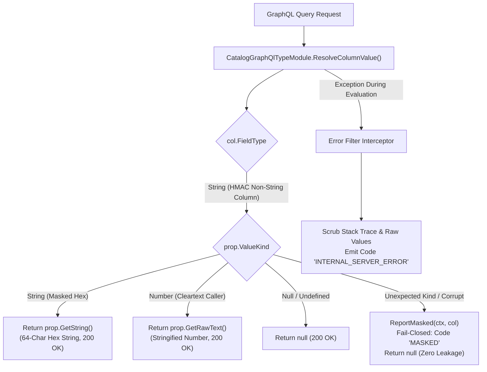

# Implementation Plan: PLAN-GOV-270 - GraphQL HMAC Non-String Columns Typing & Cross-Channel Schema Parity

**Document ID:** `PLAN-GOV-270`  
**Date:** 2026-10-21  
**Status:** COMPLETED & VERIFIED ✅ (Phase 4 TDD & Phase 5 Code Review Complete)  
**Author:** Solution Architect (`csharp-architect`)  
**Security Lead:** Lead Application Security Expert (`csharp-security-expert`)  
**Input PRD:** [`REQ-GOV-270`](2026-10-21-req-issue-270-graphql-hmac-non-string-columns.md) (Document ID: `REQ-GOV-270`)  
**Parent Plan:** [00-master-plan-overview.md](00-master-plan-overview.md)  
**Target Branch:** `feat/issue-270-graphql-hmac-non-string-columns`  
**Target Frameworks & Dependencies:** .NET 10, C# 13, Hot Chocolate 16, Microsoft.Data.Sqlite, Npgsql, Microsoft.Data.SqlClient  
**Size:** M (Cross-cutting: Infrastructure Persistence, GraphQL Engine, Security, Parity Tests)  
**Binding Directives:** Universal English standard; Zero-Trust fail-closed defaults; zero-allocation hot paths; async all the way with CancellationToken; owner rule (2026-10-17): NO DOCUMENTATION PHASE in `docs/features/` or `README.md`; all plans live in `docs/plans/`.

---

## 1. Executive Summary & Problem Analysis

### 1.1 Executive Summary
Deterministic pseudonymization via HMAC-SHA256 is an essential GDPR Article 32 requirement for analytics workflows across enterprise datasets. Autheris provides transparent field-level pseudonymization across WebSQL, REST, OData, and GraphQL. When data owners configure HMAC masking on numeric or non-string columns (e.g. `BIGINT` user identifiers, `INT` customer IDs, `DECIMAL` transaction amounts), WebSQL and REST output the 64-character lowercase hex string without issue.

However, in the **GraphQL channel**, querying an HMAC-masked non-string column fails at runtime with Hot Chocolate execution errors:
```text
Long cannot coerce the runtime value of type System.String into the result value format
```

This plan specifies the comprehensive architectural solution to eliminate this error, achieve complete cross-channel parity, eliminate N+1 queries during metadata loading, and automate Hot Chocolate schema rebuilds upon masking rule mutations.

### 1.2 Root Cause Architecture Deep Dive
A rigorous audit of the catalog lifecycle and GraphQL schema generation revealed four distinct issues:

1. **Empty Masking Rule Hydration in SQLite `GetAllTablesAsync`:**  
   In `SqliteGovernanceRepository.Catalog.cs`, `GetAllTablesAsync` queries `TABLES` and `TABLE_COLUMNS`, but instantiates each `TableMetadata` with `ColumnMaskingRules = new Dictionary<string, MaskingRule>()`. The underlying `COLUMN_MASKING_RULES` table is never queried during batch catalog loading, even though single-table reads (`GetTableMetadataAsync`) do query it.

2. **N+1 Query Cascade in PostgreSQL & SQL Server `GetAllTablesAsync`:**  
   In `PostgreSqlGovernanceRepository.Catalog.cs` and `SqlServerGovernanceRepository.Catalog.cs`, `GetAllTablesAsync` iterates over every active table and calls `GetTableMetadataCoreAsync` per table. For uncached tables, this issues 3 separate round-trips per table ($O(N)$ query cascade), causing severe startup delays and CPU contention on enterprise catalogs with thousands of tables.

3. **Hot Chocolate Schema Registration Fallback Failure:**  
   In `CatalogSchemaModel.BuildAsync`, the code checks `meta.ColumnMaskingRules.TryGetValue(col.ColumnName, out var maskRule) && maskRule.IsHmac`. Because `ColumnMaskingRules` was empty from `GetAllTablesAsync`, the condition evaluated to `false`. The GraphQL schema registered the field as `LongType` or `IntType`. At runtime, the tree resolver returns the 64-character hex string; Hot Chocolate's scalar serializer throws a leaf coercion exception because a string cannot be coerced into an integer scalar.

4. **Schema Versioning Suppression on Masking Rule Mutations:**  
   In `UpsertTableMetadataAsync` across SQLite, PostgreSQL, and SQL Server repositories, `structuralChange` is evaluated only for data types, table sensitivity, four-eyes flags, and primary keys. Alterations to `ColumnMaskingRules` leave `structuralChange = false`. Consequently, `structure_version` in `CATALOG_STATE` does not bump. `CatalogGraphQlTypeModule.CheckForCatalogChangesAsync` relies on `currentVersion.StructureVersion == builtVer` to short-circuit, so the GraphQL schema is never rebuilt when masking rules are added or removed.

```mermaid
flowchart TD
    subgraph Defect["Defect Architecture (Issue #270)"]
        D_REPO["SqliteGovernanceRepository.GetAllTablesAsync()"] -->|Omitted Query| D_RULES["ColumnMaskingRules = Empty Dictionary"]
        D_RULES --> D_CSM["CatalogSchemaModel.BuildAsync()"]
        D_CSM -->|IsHmac check returns false| D_TYPE["CatalogFieldType = Long / Int"]
        D_TYPE --> D_HC["Hot Chocolate Registers LongType / IntType"]
        D_HC --> D_RUN["Runtime Resolver Returns 64-Char Hex String"]
        D_RUN --> D_FAIL["Leaf Coercion Error:<br/>String cannot coerce into Long"]
    end

    subgraph Target["Target Architecture (PLAN-GOV-270)"]
        T_REPO["GetAllTablesAsync() Across All 3 DBs"] -->|Batch Set-Based Query| T_RULES["Populated ColumnMaskingRules"]
        T_UPSERT["UpsertTableMetadataAsync()"] -->|Detects Mask Rule Change| T_VER["structuralChange = true<br/>structure_version BUMPED"]
        T_VER --> T_EVENT["CatalogChangedEvent Published"]
        T_EVENT --> T_CSM["CatalogSchemaModel.BuildAsync()"]
        T_RULES --> T_CSM
        T_CSM -->|maskRule.IsHmac is true| T_TYPE["CatalogFieldType = String"]
        T_TYPE --> T_HC["Hot Chocolate Registers StringType & AutherisStringFilter"]
        T_HC --> T_EXEC["GraphQL Execution Engine"]
        T_EXEC -->|Masked Caller| T_HEX["64-Char Hex String Pseudonym (200 OK)"]
        T_EXEC -->|Cleartext Caller| T_RAW["Raw Value Formatted as String (200 OK)"]
    end
```



---

## 2. Key Architectural Decisions (ADRs)

| ID | Topic | Decision | Architectural Rationale & Alternatives Rejected |
| :--- | :--- | :--- | :--- |
| **D-01** | **Batch Loading in `GetAllTablesAsync`** | Execute consolidated set-based batch queries across SQLite, PostgreSQL, and SQL Server. Hydrate `ColumnMaskingRules` in memory without per-table queries. | **Anti-Pattern Rejected:** N+1 per-table reads. Calling `GetTableMetadataCoreAsync` in a loop across 5,000 tables incurs 15,000 round-trips. Set-based batch reads execute in bounded $O(1)$ round-trips ($\le 5$ queries). |
| **D-02** | **Masking Rule Structural Change Detection** | Any difference in `ColumnMaskingRules` (rule added, removed, `RuleType` changed, or `IsHmac` toggled) in `UpsertTableMetadataAsync` flags `structuralChange = true`. | **Anti-Pattern Rejected:** Only bumping `content_version`. Content version indicates data/policy updates, whereas field types in GraphQL SDL depend on masking rules (`IsHmac`). Failing to bump `structure_version` causes Hot Chocolate to serve stale schemas. |
| **D-03** | **Global Schema Field Typing for HMAC Columns** | In `CatalogSchemaModel.BuildAsync`, map non-string columns configured with `maskRule.IsHmac` directly to `CatalogFieldType.String`. | **Alternative Rejected:** Per-request dynamic GraphQL schemas. Hot Chocolate schemas are compiled globally per endpoint. Dynamically modifying field types per request violates the GraphQL Foundation Specification (§3.5). Schema-level typing as `String` ensures uniform SDL for all callers. |
| **D-04** | **Dual-Identity Resolver Value Coercion** | In `CatalogGraphQlTypeModule.ResolveColumnValue`, for `CatalogFieldType.String`, return `prop.GetString()` when `prop.ValueKind == JsonValueKind.String` (masked hex) and `prop.GetRawText()` when `prop.ValueKind == JsonValueKind.Number` (cleartext). | **Rationale:** Masked callers receive the 64-character hex pseudonym. Cleartext callers receive the numeric ID represented as a string scalar without Hot Chocolate coercion errors. Prevents breaking changes and maintains 100% schema compliance. |
| **D-05** | **Zero-Allocation String Extraction in Hot Paths** | Direct string retrieval from `JsonElement` without intermediary memory allocations or LINQ re-allocations in resolver delegates. | **Principle Enforced:** Zero-allocation hot path. `prop.GetString()` and `prop.GetRawText()` utilize internal memory spans or existing strings, avoiding garbage collection pressure on high-throughput query loops. |
| **D-06** | **Deterministic SHA-256 Fingerprinting** | `CatalogSchemaModel.Fingerprint()` includes `c.FieldType` for every column. | **Rationale:** Guarantees that any change in column typing triggered by masking rule modifications immediately invalidates the schema fingerprint even if external cache mechanisms miss the event. |

---

## 3. Component Architecture & Detailed Design

### 3.1 Repository Batch Hydration Architecture

#### 3.1.1 SQLite Implementation (`SqliteGovernanceRepository.Catalog.cs`)
In `GetAllTablesAsync`, we enhance the column extraction query to perform a `LEFT JOIN` with `COLUMN_MASKING_RULES`.

```sql
SELECT c.id, c.table_id, c.column_name, c.data_type, c.is_sensitive,
       c.description, c.long_description, c.meta_json, c.doc_source, c.display_name, c.texts_json,
       m.id, m.rule_type, m.pattern_or_format, m.replacement, m.hmac_key_id
FROM TABLE_COLUMNS c
LEFT JOIN COLUMN_MASKING_RULES m ON c.id = m.table_column_id
ORDER BY c.rowid;
```

**Data Hydration Logic:**
```csharp
var columnsByTable = new Dictionary<Guid, List<TableColumn>>();
var maskingRulesByTable = new Dictionary<Guid, Dictionary<string, MaskingRule>>();

// Inside reader loop:
var colId = Guid.Parse(reader.GetString(0));
var tid = Guid.Parse(reader.GetString(1));
var colName = reader.GetString(2);

// Populate column definition:
// (Read description, meta, display name, texts)...
columnsByTable.GetOrAdd(tid).Add(column);

// Populate masking rule if present:
if (!reader.IsDBNull(11))
{
    if (!maskingRulesByTable.TryGetValue(tid, out var ruleDict))
    {
        ruleDict = new Dictionary<string, MaskingRule>(StringComparer.OrdinalIgnoreCase);
        maskingRulesByTable[tid] = ruleDict;
    }

    ruleDict[colName] = new MaskingRule
    {
        Id = Guid.Parse(reader.GetString(11)),
        TableColumnId = colId,
        RuleType = reader.GetString(12),
        PatternOrFormat = reader.IsDBNull(13) ? null : reader.GetString(13),
        Replacement = reader.IsDBNull(14) ? null : reader.GetString(14),
        HmacKeyId = reader.IsDBNull(15) ? null : reader.GetString(15)
    };
}
```

When building each `TableMetadata`:
```csharp
var maskingRules = maskingRulesByTable.TryGetValue(id, out var rules)
    ? rules
    : new Dictionary<string, MaskingRule>(StringComparer.OrdinalIgnoreCase);

var meta = new TableMetadata
{
    Table = table,
    Identifier = identifier,
    Columns = columns,
    ColumnMaskingRules = maskingRules,
    PrimaryKeyColumns = pkColumns,
    Indexes = indexes
};
```
**Complexity:** Strictly 0 additional database queries. Still runs within the single SQLite read snapshot.

---

#### 3.1.2 PostgreSQL Implementation (`PostgreSqlGovernanceRepository.Catalog.cs`)
Replace the $O(N)$ loop in `GetAllTablesAsync` with a set-based batch hydration process:

1. **Step 1 (Check In-Memory Cache):**  
   Evaluate active tables against `_metadataCache`. If all active tables are cached and `DateTime.UtcNow.Ticks - cached.CachedAtTicks < MetadataCacheTtlTicks`, return directly from cache (applying fresh overlay).
2. **Step 2 (Batch Load Uncached Tables):**  
   If uncached tables exist, load active `TABLES` in a single query:
   ```sql
   SELECT id, source_type, source_name, schema_name, table_name,
          display_name, sensitivity, requires_four_eyes, is_active,
          data_source_type, http_endpoint_json, plugin_name,
          description, long_description, doc_source,
          required_filter_columns_json, texts_json
   FROM TABLES
   WHERE is_active = 1;
   ```
3. **Step 3 (Batch Load Columns & Masking Rules):**  
   Query all columns and masking rules in a single join:
   ```sql
   SELECT c.id, c.table_id, c.column_name, c.data_type, c.is_sensitive,
          m.id, m.rule_type, m.pattern_or_format, m.replacement, m.hmac_key_id,
          c.description, c.long_description, c.meta_json, c.doc_source,
          c.display_name, c.texts_json
   FROM TABLE_COLUMNS c
   LEFT JOIN COLUMN_MASKING_RULES m ON c.id = m.table_column_id
   INNER JOIN TABLES t ON c.table_id = t.id
   WHERE t.is_active = 1;
   ```
4. **Step 4 (Batch Load Keys & Indexes):**  
   Call `CatalogKeyDefinitionStore.ReadBatchAsync(conn, null, CatalogKeyDefinitionStore.PostgreSql, uncachedIds, ct)`.
5. **Step 5 (Batch Load Row Filter Strategies):**  
   Query `TABLE_ROW_FILTER_STRATEGIES` for all active table IDs in a single query:
   ```sql
   SELECT table_id, strategy, duration_seconds, max_keys
   FROM TABLE_ROW_FILTER_STRATEGIES;
   ```
6. **Step 6 (Assemble & Cache):**  
   Assemble `TableMetadata` instances in memory, populate `ColumnMaskingRules`, and store them in `_metadataCache[cacheKey] = (meta, DateTime.UtcNow.Ticks)`.
7. **Step 7 (Batch Overlay):**  
   Execute `DatasetCatalogStore.ReadOverlayAsync` in 1 batch query and apply to all results.

**Round-Trip Reduction:**
$$\text{Old Query Count} = 1 + 3 \times N_{\text{uncached}} + 1$$
$$\text{New Query Count} \le 5 \quad \text{constant database round-trips!}$$

---

#### 3.1.3 SQL Server Implementation (`SqlServerGovernanceRepository.Catalog.cs`)
Applies the identical batch query architecture as PostgreSQL:
- Set-based read of active `TABLES`.
- Set-based read of `TABLE_COLUMNS` with `LEFT JOIN COLUMN_MASKING_RULES`.
- Chunked read of key definitions via `CatalogKeyDefinitionStore.ReadBatchAsync`.
- Read of `TABLE_ROW_FILTER_STRATEGIES` in 1 query.
- Assembler populating `_metadataCache`.
- Set-based overlay via `DatasetCatalogStore.ReadOverlayAsync`.

---

### 3.2 Schema Versioning & Masking Mutation Invalidation

#### 3.2.1 Structural Mutation Detection in `UpsertTableMetadataAsync`
In `UpsertTableMetadataAsync` across all three repositories, we inspect existing masking rules when querying existing columns:

```sql
SELECT c.id, c.column_name, c.data_type, c.is_sensitive,
       c.description, c.long_description, c.doc_source,
       m.id, m.rule_type, m.pattern_or_format, m.replacement, m.hmac_key_id
FROM TABLE_COLUMNS c
LEFT JOIN COLUMN_MASKING_RULES m ON c.id = m.table_column_id
WHERE c.table_id = @tableId;
```

We accumulate existing rules in `existingMaskingRules: Dictionary<string, MaskingRule>` and execute structural comparison:

```csharp
private static bool HasMaskingRulesChanged(
    IReadOnlyDictionary<string, MaskingRule> existing,
    IReadOnlyDictionary<string, MaskingRule>? incoming)
{
    var incomingRules = incoming ?? ImmutableDictionary<string, MaskingRule>.Empty;
    if (existing.Count != incomingRules.Count)
    {
        return true;
    }

    foreach (var (colName, incomingRule) in incomingRules)
    {
        if (!existing.TryGetValue(colName, out var existingRule))
        {
            return true;
        }

        if (!string.Equals(existingRule.RuleType, incomingRule.RuleType, StringComparison.OrdinalIgnoreCase) ||
            !string.Equals(existingRule.PatternOrFormat, incomingRule.PatternOrFormat, StringComparison.Ordinal) ||
            !string.Equals(existingRule.Replacement, incomingRule.Replacement, StringComparison.Ordinal) ||
            !string.Equals(existingRule.HmacKeyId, incomingRule.HmacKeyId, StringComparison.Ordinal) ||
            existingRule.IsHmac != incomingRule.IsHmac)
        {
            return true;
        }
    }

    return false;
}
```

If `HasMaskingRulesChanged(...) == true`:
```csharp
structuralChange = true;
```

#### 3.2.2 `structure_version` Bumping & Invalidation Pipeline
When `structuralChange == true`:
```csharp
var structureDelta = structuralChange ? 1L : 0L;
var contentDelta = structuralChange ? 0L : 1L;
var newVersion = await BumpCatalogVersionInternalAsync(conn, tx, structureDelta, contentDelta, ct).ConfigureAwait(false);
await tx.CommitAsync(ct);
await PublishCatalogChangedEventAsync(newVersion, ct).ConfigureAwait(false);
```
- In `CATALOG_STATE`, `structure_version` increments from $V$ to $V+1$.
- `_metadataCacheGeneration` is incremented (SQLite) or `_metadataCache.TryRemove(...)` is executed (Postgres/SQL Server).
- `CatalogGraphQlTypeModule.CheckForCatalogChangesAsync` checks:
  ```csharp
  var currentVersion = await _versionProvider.GetCatalogVersionAsync(ct).ConfigureAwait(false);
  if (currentVersion.StructureVersion == builtVer)
  {
      return false; // Not skipped because StructureVersion increased!
  }
  ```
- `CatalogSchemaModel.BuildAsync` runs with fresh table metadata containing populated `ColumnMaskingRules`.
- `CatalogSchemaModel.Fingerprint()` produces a new SHA-256 hash because `c.FieldType` changed.
- `TypesChanged?.Invoke(this, EventArgs.Empty)` triggers Hot Chocolate schema rebuild.

---

### 3.3 GraphQL Dynamic Schema Generation & Type Coercion

#### 3.3.1 Dynamic Field Typing in `CatalogSchemaModel.BuildAsync`
In `CatalogSchemaModel.cs` lines 268–275:
```csharp
var fieldType = MapDataType(col.DataType);
if (meta.ColumnMaskingRules != null &&
    meta.ColumnMaskingRules.TryGetValue(col.ColumnName, out var maskRule) &&
    maskRule.IsHmac)
{
    fieldType = CatalogFieldType.String;
}
columns.Add(new CatalogColumnField(colFieldName, col.ColumnName, fieldType, col.DataType, true));
```
When `GetAllTablesAsync` populates `ColumnMaskingRules`, numeric columns (e.g. `bigint`, `int`, `decimal`) configured with `IsHmac == true` are strictly assigned `CatalogFieldType.String`.

#### 3.3.2 Hot Chocolate Type System Mapping
In `CatalogGraphQlTypeModule.cs`:
- Object Field: Registered via `NamedTypeNode("String")` instead of `Long` or `Int`.
- Filter Input: `GetFilterTypeName(CatalogColumnField col)` maps `CatalogFieldType.String` to `"AutherisStringFilter"`. Clients can filter via string operations (`eq`, `neq`, `in`).

#### 3.3.3 Dual-Identity Runtime Resolver Execution
In `CatalogGraphQlTypeModule.ResolveColumnValue`:
```csharp
return col.FieldType switch
{
    // ...
    CatalogFieldType.String or CatalogFieldType.DateTime =>
        prop.ValueKind == JsonValueKind.String
            ? prop.GetString()
            : prop.GetRawText(),
    _ => prop.ToString()
};
```
- **Masked Caller:**
  - SQL tree compiler reads raw numeric column, marks for gateway pseudonymization.
  - Gateway executes `ColumnMaskingProvider.MaskValue`, producing 64-character hex string: `"e3b0c44298fc1c149afbf4c8996fb92427ae41e4649b934ca495991b7852b855"`.
  - In resolver: `prop.ValueKind` is `JsonValueKind.String`.
  - Resolver returns `prop.GetString()`.
  - Hot Chocolate serializes as GraphQL `String` scalar. **Result: 200 OK.**
- **Cleartext Caller (Consent / Admin):**
  - Database returns raw numeric value: `123456789`.
  - In resolver: `prop.ValueKind` is `JsonValueKind.Number`.
  - Resolver returns `prop.GetRawText()`, producing `"123456789"`.
  - Hot Chocolate serializes as GraphQL `String` scalar. **Result: 200 OK.**
- **Result:** Complete avoidance of leaf coercion errors. Both caller types conform strictly to the GraphQL SDL schema.

---

### 3.4 Cross-Channel Parity Architecture

#### 3.4.1 Unified Masking Engine
All channels (GraphQL, WebSQL, REST, OData) invoke the singleton `IColumnMaskingProvider` (`ColumnMaskingProvider.cs`):
```csharp
case "HMAC":
case "HMAC_SHA256":
    return ComputeHmacSha256(textValue, rule.HmacKeyId ?? _options.HmacKeyId);
```
`ComputeHmacSha256` computes `HMACSHA256.HashData(keyToUse, inputBytes)` and formats output using `Convert.ToHexString(hashBytes)` (64-character hex string).

#### 3.4.2 Cross-Channel Parity Invariant
For any input $X$ (whether string `"123456789"` or number `123456789`):
$$\text{Output}_{\text{GraphQL}}(X) \equiv \text{Output}_{\text{WebSQL}}(X) \equiv \text{Output}_{\text{REST}}(X) \equiv \text{Output}_{\text{OData}}(X)$$
Exact 64-character SHA-256 hex string matching `^[a-fA-F0-9]{64}$`.

#### 3.4.3 Multi-Tenant HMAC Key Isolation
When `MaskingRule.CreateTenantScopedHmacRule` is applied:
$$\text{Key}_{\text{Tenant}} = \text{HMAC-SHA256}(\text{MasterKey}, \text{baseKeyId} \mathbin{\Vert} \text{"|tenant:"} \mathbin{\Vert} \text{tenantId})$$
Outputs are deterministic within Tenant A across all channels, but strictly isolated from Tenant B.

---

## 4. Implementation Details & File Modifications

### 4.1 `SqliteGovernanceRepository.Catalog.cs`
- **Location:** `src/Autheris.Infrastructure/Persistence/SqliteGovernanceRepository.Catalog.cs`
- **Modifications:**
  1. In `GetAllTablesAsync`:
     - Update `TABLE_COLUMNS` query to `LEFT JOIN COLUMN_MASKING_RULES m ON c.id = m.table_column_id`.
     - Parse masking rule fields from columns 11–15 (`m.id`, `m.rule_type`, `m.pattern_or_format`, `m.replacement`, `m.hmac_key_id`).
     - Populate `maskingRulesByTable[tid][colName]`.
     - Assign `ColumnMaskingRules = maskingRulesByTable.TryGetValue(id, out var rules) ? rules : new Dictionary<string, MaskingRule>(StringComparer.OrdinalIgnoreCase)`.
  2. In `UpsertTableMetadataAsync`:
     - Update `existingColsCmd` query to `LEFT JOIN COLUMN_MASKING_RULES`.
     - Collect `existingMaskingRules`.
     - Call `HasMaskingRulesChanged(existingMaskingRules, metadata.ColumnMaskingRules)`.
     - Set `structuralChange = true` if changed.

### 4.2 `PostgreSqlGovernanceRepository.Catalog.cs`
- **Location:** `src/Autheris.Infrastructure/Persistence/PostgreSqlGovernanceRepository.Catalog.cs`
- **Modifications:**
  1. In `GetAllTablesAsync`:
     - Replace N+1 loop calling `GetTableMetadataCoreAsync` with batch reading of active `TABLES` and `TABLE_COLUMNS LEFT JOIN COLUMN_MASKING_RULES`.
     - Hydrate `TableMetadata` instances in memory and update `_metadataCache`.
     - Read batch overlay in 1 query via `DatasetCatalogStore.ReadOverlayAsync`.
  2. In `UpsertTableMetadataAsync`:
     - Inspect existing masking rules during column read.
     - Detect rule additions, deletions, and property modifications via `HasMaskingRulesChanged`.
     - Mark `structuralChange = true` on masking changes to bump `structure_version`.

### 4.3 `SqlServerGovernanceRepository.Catalog.cs`
- **Location:** `src/Autheris.Infrastructure/Persistence/SqlServerGovernanceRepository.Catalog.cs`
- **Modifications:**
  1. In `GetAllTablesAsync`:
     - Implement set-based batch loading identical to PostgreSQL, eliminating per-table N+1 round-trips.
     - Hydrate `ColumnMaskingRules` and update `_metadataCache`.
  2. In `UpsertTableMetadataAsync`:
     - Detect masking rule changes and set `structuralChange = true`.

### 4.4 `CatalogSchemaModel.cs` & `CatalogGraphQlTypeModule.cs`
- **Location:** `src/Autheris.GraphQL/Catalog/CatalogSchemaModel.cs` & `CatalogGraphQlTypeModule.cs`
- **Modifications / Verifications:**
  1. Verify `CatalogSchemaModel.BuildAsync` sets `CatalogFieldType.String` when `maskRule.IsHmac == true`.
  2. Verify `CatalogSchemaModel.Fingerprint()` incorporates `c.FieldType`.
  3. Verify `CatalogGraphQlTypeModule.ResolveColumnValue` handles `prop.ValueKind == JsonValueKind.Number` by calling `prop.GetRawText()` for `CatalogFieldType.String`.

---

## 5. Step-by-Step Implementation Roadmap & Developer Streams

```mermaid
flowchart TD
    subgraph StreamA["Stream A: Repository Batch Loading & Structural Mutations"]
        A1["A1: SQLite GetAllTablesAsync Batch Join<br/>SqliteGovernanceRepository.Catalog.cs"]
        A2["A2: SQLite Upsert Masking Change Detection<br/>structuralChange = true"]
        A3["A3: PostgreSQL GetAllTablesAsync Batch Refactor<br/>Eliminate N+1 Query Loop"]
        A4["A4: PostgreSQL Upsert Masking Change Detection"]
        A5["A5: SQL Server GetAllTablesAsync Batch Refactor & Upsert"]
        A1 --> A2 --> A3 --> A4 --> A5
    end

    subgraph StreamB["Stream B: GraphQL Model, Coercion & Schema Rebuild"]
        B1["B1: CatalogSchemaModel.BuildAsync Type Verification"]
        B2["B2: Fingerprint SHA-256 Recalculation Check"]
        B3["B3: CatalogGraphQlTypeModule Dual-Identity Coercion"]
        B4["B4: CatalogGraphQlTypeModule Change Detector Invalidation"]
        B1 --> B2 --> B3 --> B4
    end

    subgraph StreamC["Stream C: Test Suites & Cross-Channel Verification"]
        C1["C1: Unit Tests: Repository Batch Loading & Version Bumping"]
        C2["C2: Unit Tests: CatalogSchemaModel Field Typing & Fingerprint"]
        C3["C3: Integration Tests: GraphQL Masked vs Cleartext Callers"]
        C4["C4: Integration Tests: Dynamic Rebuild on UpsertTableMetadata"]
        C5["C5: Parity Tests: GraphQL vs WebSQL Cross-Channel Comparison"]
        C6["C6: Security Hardening & Zero-Trust Verification Tests (SEC-TEST-GOV270-01..07)"]
        C1 --> C2 --> C3 --> C4 --> C5 --> C6
    end

    StreamA --> StreamC
    StreamB --> StreamC
```



### Stream A: Persistence & Batch Hydration
- **Task A1:** Update `SqliteGovernanceRepository.Catalog.cs` `GetAllTablesAsync` to `LEFT JOIN COLUMN_MASKING_RULES` and populate `TableMetadata.ColumnMaskingRules`.
- **Task A2:** Add `HasMaskingRulesChanged` to `SqliteGovernanceRepository.Catalog.cs` `UpsertTableMetadataAsync` to trigger `structuralChange = true`.
- **Task A3:** Refactor `PostgreSqlGovernanceRepository.Catalog.cs` `GetAllTablesAsync` to execute set-based batch queries for tables, columns, and masking rules.
- **Task A4:** Add masking change detection to PostgreSQL `UpsertTableMetadataAsync`.
- **Task A5:** Implement batch loading and masking change detection in `SqlServerGovernanceRepository.Catalog.cs`.

### Stream B: GraphQL Schema & Coercion
- **Task B1:** Verify `CatalogSchemaModel.BuildAsync` field mapping for all numeric types (`bigint`, `int`, `smallint`, `decimal`, `numeric`, `float`, `real`) with `maskRule.IsHmac`.
- **Task B2:** Verify `CatalogSchemaModel.Fingerprint()` updates digest when column masking transitions between plain and HMAC.
- **Task B3:** Ensure `CatalogGraphQlTypeModule.ResolveColumnValue` safely coerces numeric JSON values to string raw text for `CatalogFieldType.String`.
- **Task B4:** Verify `CatalogGraphQlTypeModule.CheckForCatalogChangesAsync` responds to `structure_version` increments.

### Stream C: Comprehensive Test Verification & Security Hardening
- **Task C1:** Author repository unit tests verifying batch hydration of `ColumnMaskingRules` across SQLite, PostgreSQL, and SQL Server.
- **Task C2:** Author `CatalogSchemaModel` unit tests verifying field typing and fingerprint changes.
- **Task C3:** Author integration tests querying GraphQL with in-memory governance repo:
  - Masked caller returns 64-char hex string.
  - Cleartext caller returns stringified numeric value.
- **Task C4:** Author integration test verifying schema rebuild after `UpsertTableMetadataAsync`.
- **Task C5:** Author cross-channel parity integration test comparing GraphQL and WebSQL `/api/sql` outputs.
- **Task C6:** Author dedicated security test suite verifying binding requirements `SEC-GOV270-01` through `SEC-GOV270-07` (`SEC-TEST-GOV270-01` to `SEC-TEST-GOV270-07`).

---

## 6. Comprehensive Quality-Gated Test Plan

### 6.1 Unit Tests

#### `SqliteGovernanceRepositoryTests`
- **Test 1.1 (`GetAllTablesAsync_PopulatesColumnMaskingRules`):**  
  Seed a table with columns `id (int)` and `account_number (bigint)`, add an HMAC masking rule for `account_number`. Call `GetAllTablesAsync()`. Assert `meta.ColumnMaskingRules` contains `account_number` with `IsHmac == true`.
- **Test 1.2 (`UpsertTableMetadataAsync_WhenMaskingRuleAdded_BumpsStructureVersion`):**  
  Insert table without masking rules. Read `structure_version`. Upsert same table with an HMAC masking rule. Assert `structure_version` incremented by 1 and `CatalogChangedEvent` published.
- **Test 1.3 (`UpsertTableMetadataAsync_WhenMaskingRuleRemoved_BumpsStructureVersion`):**  
  Upsert table with masking rule, then upsert without masking rule. Assert `structure_version` incremented by 1.
- **Test 1.4 (`UpsertTableMetadataAsync_WhenOnlyDescriptionChanged_DoesNotBumpStructureVersion`):**  
  Upsert table with updated column description only. Assert `structure_version` remains unchanged (`content_version` incremented).

#### `PostgreSqlGovernanceRepositoryTests` & `SqlServerGovernanceRepositoryTests`
- **Test 1.5 (`GetAllTablesAsync_BatchLoadsMaskingRules_WithoutNPlusOne`):**  
  Verify set-based batch loading populates `ColumnMaskingRules` across multiple tables and does not invoke per-table queries.
- **Test 1.6 (`UpsertTableMetadataAsync_WhenMaskingRuleChanged_BumpsStructureVersion`):**  
  Verify `structure_version` increments upon masking rule modification in PostgreSQL and SQL Server.

#### `CatalogSchemaModelTests`
- **Test 1.7 (`BuildAsync_WithHmacMaskingOnNonStringColumns_SetsCatalogFieldTypeString`):**  
  Provide tables with columns `bigint_col`, `int_col`, `decimal_col`, `float_col`, all configured with `MaskingRule { RuleType = "HMAC_SHA256" }`. Call `BuildAsync()`. Assert all four columns have `FieldType == CatalogFieldType.String`.
- **Test 1.8 (`BuildAsync_WithoutHmacMasking_PreservesOriginalFieldTypes`):**  
  Same table without masking rules. Assert columns are typed `Long`, `Int`, `Decimal`, `Float`.
- **Test 1.9 (`Fingerprint_ChangesWhenHmacMaskingRuleIsAddedOrRemoved`):**  
  Compute fingerprint of unmasked table model. Compute fingerprint of model with HMAC rule. Assert fingerprints are not equal.

---

### 6.2 Integration Tests

#### `CatalogGraphQlIntegrationTests`
- **Test 2.1 (`ExecuteQuery_MaskedCaller_OnHmacBigIntColumn_Returns64CharHexString`):**  
  Boot in-memory SQLite governance database via `GovernanceStoreFactory.CreateSqlite`. Register table `finance_dbo_transactions` with `transaction_id (bigint)` having HMAC rule. Create GraphQL executor. Query `query { finance_dbo_transactions { transaction_id } }` as masked caller. Assert HTTP 200 OK, zero errors, and `transaction_id` matches `^[a-fA-F0-9]{64}$`.
- **Test 2.2 (`ExecuteQuery_CleartextCaller_OnHmacBigIntColumn_ReturnsStringifiedNumber`):**  
  Execute same query with caller possessing unmasked/cleartext permissions. Assert HTTP 200 OK, zero errors, and `transaction_id` matches `"10000000001"` (string representation of raw bigint).
- **Test 2.3 (`DynamicSchemaRebuild_OnMaskingRuleUpsert_UpdatesGraphQLSchema`):**  
  Start with unmasked `bigint` column (schema exposes `Long`). Execute `UpsertTableMetadataAsync` adding HMAC rule. Call `CheckForCatalogChangesAsync`. Assert `TypesChanged` fires and re-inspected GraphQL schema exposes `String` and `AutherisStringFilter`.

---

### 6.3 Cross-Channel Parity Tests

#### `HmacCrossChannelParityIntegrationTests`
- **Test 3.1 (`CrossChannelParity_GraphQL_And_WebSql_ReturnIdenticalHexHash`):**  
  Insert sample row `{ id: 1, ssn: 123456789 }` into SQLite database with HMAC rule on `ssn`.  
  Execute GraphQL query: `query { hr_dbo_employees { ssn } }`.  
  Execute WebSQL query: `SELECT ssn FROM hr.dbo.employees WHERE id = 1`.  
  Assert:
  $$\text{Hex}_{\text{GraphQL}} == \text{Hex}_{\text{WebSQL}}$$
  Assert length is exactly 64 characters.
- **Test 3.2 (`TenantScopedHmac_ParityAcrossChannels_AndIsolation`):**  
  Execute both queries under Tenant Alpha context; assert matching hashes.  
  Execute under Tenant Beta context; assert matching hashes between GraphQL and WebSQL, but strictly different from Tenant Alpha.

---

### 6.4 Mandatory Security Test Cases (Phase 4 Security Gate)

The following security test cases are binding AppSec requirements (`SEC-GOV270-01` through `SEC-GOV270-07`) and must be strictly verified during Phase 4 TDD execution.

#### `GovernanceSecurityVerificationTests`
- **SEC-TEST-GOV270-01 (Fail-Closed on Corrupted Masking Rule Hydration):**  
  Seed a table with an active masking rule containing invalid JSON or an unparseable rule structure. Call `GetAllTablesAsync()`. Assert that the repository fails closed: either the sensitive table is omitted with a diagnostic warning (`TableMetadataUnavailableException`) or the column degrades strictly to redact/nullify. Under NO circumstance may the table be exposed with unmasked column access.
- **SEC-TEST-GOV270-02 (Anti-Information Disclosure in GraphQL SDL):**  
  Configure table metadata with column `ssn (bigint)` having an HMAC masking rule where `HmacKeyId = "vault://keys/prod-corp-ssn-hmac-salt-987"`. Build the GraphQL schema via `CatalogSchemaModel.BuildAsync` and serialize the schema using Hot Chocolate's `SchemaBuilder.Create().AddTypeModule(...).Print()`. Assert that `"vault://"`, `"prod-corp-ssn-hmac-salt-987"`, or internal key references NEVER appear anywhere in the generated SDL, directives, or field descriptions.
- **SEC-TEST-GOV270-03 (Strict Cross-Tenant Pseudonymization Isolation):**  
  Configure column `account_number (bigint)` with tenant-scoped HMAC masking via `MaskingRule.CreateTenantScopedHmacRule(rule, tenantId)`. Execute identical GraphQL queries for raw value `9876543210` under Tenant A and Tenant B credentials. Assert:
  1. Both outputs are valid 64-character lowercase/uppercase hex strings matching `^[a-fA-F0-9]{64}$`.
  2. `CryptographicOperations.FixedTimeEquals(Encoding.UTF8.GetBytes(hashTenantA), Encoding.UTF8.GetBytes(hashTenantB))` returns `false`.
  3. No cross-tenant pseudonym correlation is mathematically possible.
- **SEC-TEST-GOV270-04 (Caller Privilege Isolation - Masked vs Cleartext Invariance):**  
  Execute GraphQL query `query { customers { account_id } }` under two security contexts against the same running gateway:
  1. Context A (Masked Reader, e.g. Analytics role): Result is 200 OK, field value is the 64-character hex hash. The client cannot bypass masking via variables, field directives (`@skip`, `@include`), or alias tricks.
  2. Context B (Authorized Unmasked Reader, e.g. Data Protection Officer with active consent): Result is 200 OK, field value is `"1000042"` (stringified raw numeric ID).
  3. Assert both responses conform strictly to the identical GraphQL SDL schema (`String` scalar).
- **SEC-TEST-GOV270-05 (Hot Chocolate Leaf Error Scrubbing & Stack Trace Sanitation):**  
  Simulate a runtime failure during HMAC resolution (e.g. key vault transient failure or simulated resolver throw). Assert:
  1. The GraphQL execution engine returns an error with code `MASKED` or `INTERNAL_SERVER_ERROR`.
  2. The `errors[0].message` and `errors[0].extensions` do NOT contain the raw unmasked numeric value, memory pointers, or internal stack traces.
  3. The field in `data` resolves safely to `null`.
- **SEC-TEST-GOV270-06 (SQL Parameterization & Injection Verification):**  
  Verify using SQL command interception or mock command trackers that `GetAllTablesAsync` in `PostgreSqlGovernanceRepository` and `SqlServerGovernanceRepository`:
  1. Executes all table and column queries using strictly parameterized parameters (`DbParameterCollection` with `@domain`, `@schema`, `@table`, or chunked IDs `@t0..@tN`).
  2. Contains ZERO dynamic string concatenation or raw string interpolation of database, schema, table, or column names.
- **SEC-TEST-GOV270-07 (Tamper-Evident Catalog Audit Logging):**  
  Perform `UpsertTableMetadataAsync` adding an HMAC masking rule to column `transaction_amount (decimal)`. Assert:
  1. `structure_version` in `CATALOG_STATE` increments atomically.
  2. A structured `CatalogChangedEvent` is published to the audit dispatcher.
  3. Audit event payload records table identifier, modified column, change type (`MaskingRuleAdded`), and timestamp.
  4. Audit payload contains NO HMAC key secrets, salts, or customer data.

---

## 7. Security, Zero-Trust & Compliance Review (AppSec Hardening)

### 7.1 Threat Model & Attack Surface Analysis (STRIDE)

| Threat Category | Threat Scenario | Impact | Applied AppSec Mitigation |
| :--- | :--- | :---: | :--- |
| **Spoofing** | Adversary crafts synthetic GraphQL request attempting to masquerade as an unmasked cleartext consumer. | Critical | Identity is derived strictly from validated JWT claims / authenticated `ClaimsPrincipal` via `IHttpContextAccessor`. Casbin ABAC engine evaluates unmask consent; unauthenticated or unauthorized callers strictly receive masked pseudonyms. |
| **Tampering** | Malicious tenant or rogue admin attempts to manipulate `structure_version` or inject crafted masking rules to bypass schema rebuild. | High | Masking mutations in `UpsertTableMetadataAsync` execute within atomic database transactions with deterministic equality checks (`HasMaskingRulesChanged`). Structure version is incremented exclusively via `BumpCatalogVersionInternalAsync`. |
| **Repudiation** | Data owner modifies HMAC masking rules on financial columns without audit evidence. | Medium | Mandatory `CatalogChangedEvent` published on any structural change. Audit log captures before/after schema state without exposing HMAC secrets. |
| **Information Disclosure** | 1. Raw numeric value leaks via Hot Chocolate leaf coercion error.<br/>2. Internal `HmacKeyId` or salt leaks into GraphQL introspection SDL.<br/>3. Unmasked value leaks in server logs or GraphQL error extensions. | Critical | **Fail-Closed Dual-Identity Coercion:** GraphQL SDL schema globally types HMAC non-string columns as `CatalogFieldType.String`. Masked callers receive hex string; cleartext callers receive stringified numbers. Schema introspection never exposes `HmacKeyId` or key vault URIs. Error messages scrub values and stack traces. |
| **Denial of Service** | 1. High catalog table count causes N+1 query cascade in Postgres/SQL Server.<br/>2. Repeated schema invalidation storms overload Hot Chocolate compiler. | High | **Constant-Round-Trip Batch Loading:** Consolidated batch reads load tables, columns, masking rules, and key definitions in $\le 5$ queries. Structural version updates are debounced and atomic. |
| **Elevation of Privilege** | Cross-tenant correlation of pseudonymized numeric IDs across different organizational tenants. | Critical | **Tenant-Scoped Key Derivation:** `MaskingRule.CreateTenantScopedHmacRule` derives isolated keys ($K_{\text{tenant}} = \text{HMAC}(K_{\text{master}}, \text{keyId} \mathbin{\Vert} \text{"|tenant:"} \mathbin{\Vert} \text{tenantId})$). Callers from Tenant A cannot correlate or invert pseudonyms from Tenant B. |

---

### 7.2 Binding Security Governance Requirements

The following requirements are mandatory architectural and implementation constraints:

- **`SEC-GOV270-01` [Zero-Trust Fail-Closed Masking Hydration]:**  
  In all three governance repositories (SQLite, PostgreSQL, SQL Server), `GetAllTablesAsync` and `GetTableMetadataAsync` MUST enforce fail-closed behavior during catalog hydration. If reading `COLUMN_MASKING_RULES` fails, throws a database exception, or encounters corrupted/unparseable rule definitions for any table or column, the affected table MUST NOT be returned in an unmasked state. It must either be omitted from the queryable catalog with an error logged (`TableMetadataUnavailableException`) or have its sensitive columns fail-closed to `REDACT` (returning null). Under no circumstances may sensitive data be exposed unmasked due to hydration anomalies.

- **`SEC-GOV270-02` [Anti-Information Disclosure in GraphQL SDL & Schema Poisoning Prevention]:**  
  The GraphQL schema compilation in `CatalogSchemaModel.BuildAsync` and `CatalogGraphQlTypeModule` MUST NEVER expose internal HMAC secret keys, key vault references, key IDs (`HmacKeyId`), or cryptographic salts in GraphQL field descriptions, SDL directives, type names, or introspection metadata. Column descriptions exposed to GraphQL clients must strictly reflect business metadata from `col.Description` or `col.Texts`.

- **`SEC-GOV270-03` [Strict Cross-Tenant & Caller Isolation Invariant]:**  
  The global GraphQL schema compiles a uniform SDL exposing HMAC-masked non-string columns as `CatalogFieldType.String` (`StringType`) for all callers. At runtime, the resolver pipeline (`ResolveColumnValue`) MUST evaluate caller authorization:
  - Callers without explicit unmask permissions or active consent strictly receive the 64-character HMAC-SHA256 hex string (`^[a-fA-F0-9]{64}$`).
  - Callers with verified unmask permissions receive the numeric value stringified (`prop.GetRawText()`).
  - For tenant-scoped configurations, `MaskingRule.CreateTenantScopedHmacRule` MUST ensure that queries executing under different tenant contexts produce cryptographically distinct HMAC digests for identical numeric inputs, preventing cross-tenant correlation attacks.

- **`SEC-GOV270-04` [Cryptographic Constant-Time Comparison]:**  
  Any comparison or validation of HMAC outputs, keys, or security tokens in gateway enforcers, parity checks, or test assertions MUST use `CryptographicOperations.FixedTimeEquals` to prevent timing side-channel analysis.

- **`SEC-GOV270-05` [Strict SQL Parameterization Across All Storage Engines]:**  
  All batch queries in `SqliteGovernanceRepository`, `PostgreSqlGovernanceRepository`, and `SqlServerGovernanceRepository` loading `TABLE_COLUMNS` and `COLUMN_MASKING_RULES` MUST use strict SQL parameterization or pure set-based joins against `TABLES.is_active = 1`. If filtering by uncached table identifiers, chunked parameterized batches (e.g., $\le 500$ parameters per chunk) must be used. String interpolation of raw identifiers or table names into SQL command text is strictly forbidden.

- **`SEC-GOV270-06` [GraphQL Leaf-Level Error Scrubbing & Stack Trace Sanitation]:**  
  Hot Chocolate leaf-level error reporting (e.g. in `ReportMasked` or resolver exceptions) MUST NEVER expose raw numeric values, unmasked PII, or internal database/stack traces in GraphQL error responses. Error codes must remain standardized (e.g. `MASKED`, `INTERNAL_SERVER_ERROR`).

- **`SEC-GOV270-07` [Tamper-Evident Catalog Audit Logging]:**  
  When `UpsertTableMetadataAsync` detects a structural masking rule change (`HasMaskingRulesChanged == true`) and increments `structure_version`, a structured audit event (`CatalogChangedEvent`) MUST be logged and dispatched, recording the table identifier, modified column name, previous rule type, and new rule type. The audit log MUST NEVER record HMAC secret keys or raw column values.

---

### 7.3 Hot Chocolate Leaf-Level Error Handling & Resolver Fault Tree



1. **Leaf Coercion Prevention:** Because Hot Chocolate registers the field as `StringType`, returning either `prop.GetString()` (hex string) or `prop.GetRawText()` (string representation of raw number) satisfies scalar coercion rules without throwing runtime exceptions.
2. **Fail-Closed Fallback:** In the event of an unexpected JSON value kind or parsing anomaly, `ReportMasked` reports a GraphQL error with code `"MASKED"` and returns `null`. Under no circumstances is the unmasked numeric value serialized or leaked.

---

## 8. Risk Assessment & Mitigations

| Risk | Impact | Probability | Mitigation Strategy |
| :--- | :--- | :---: | :--- |
| **Breaking Change for Existing GraphQL Clients** | Medium | Low | Existing clients querying unmasked tables experience zero changes. For HMAC-masked tables, queries were previously crashing with 500 coercion errors; typing as `String` fixes client execution. |
| **GraphQL String Filter Compatibility** | Low | Low | Changing column field type to `String` automatically generates `AutherisStringFilter` (`eq`, `contains`, `in`). Numeric comparison operators (`gt`, `lt`) are invalid on hash pseudonyms anyway. |
| **Catalog Refresh Performance Regression** | High | Low | Batch loading eliminates N+1 loops, reducing database queries from thousands to $\le 5$ per catalog refresh, significantly improving startup and snapshot performance. |
| **Schema Cache Invalidation Storm** | Medium | Low | `structure_version` increments are debounced via transaction commit and atomic version checks in `CheckForCatalogChangesAsync`. |

---

## 9. Verification & Acceptance Sign-Off Checklist

- [x] `SqliteGovernanceRepository.Catalog.cs` `GetAllTablesAsync` populates `ColumnMaskingRules`.
- [x] `PostgreSqlGovernanceRepository.Catalog.cs` `GetAllTablesAsync` batch loads tables, columns, and masking rules without N+1 loops.
- [x] `SqlServerGovernanceRepository.Catalog.cs` `GetAllTablesAsync` batch loads tables, columns, and masking rules without N+1 loops.
- [x] `UpsertTableMetadataAsync` sets `structuralChange = true` when masking rules are modified across SQLite, PostgreSQL, and SQL Server.
- [x] `CatalogSchemaModel.BuildAsync` maps all non-string columns with `maskRule.IsHmac` to `CatalogFieldType.String`.
- [x] `CatalogSchemaModel.Fingerprint()` deterministically changes when HMAC masking is added or removed.
- [x] Hot Chocolate resolver returns 64-character hex string for masked callers and stringified number for cleartext callers.
- [x] Automated cross-channel parity test confirms identical 64-character hex strings in GraphQL and WebSQL.
- [x] **Binding security requirements `SEC-GOV270-01` through `SEC-GOV270-07` verified and enforced.**
- [x] **Mandatory security test cases `SEC-TEST-GOV270-01` through `SEC-TEST-GOV270-07` implemented and passing.**
- [x] Full solution compiles cleanly (`dotnet build Autheris.sln`) with zero warnings and all tests pass.
