# REQ-GOV-270: GraphQL HMAC Pseudonymization Typing & Cross-Channel Schema Parity for Non-String Columns

**Document ID:** `REQ-GOV-270`  
**Date:** 2026-10-21  
**Status:** APPROVED  
**Author:** Principal Enterprise Product Manager & Strategic Gatekeeper  
**Source:** GitHub Issue #270; related: #254 (`REQ-PERF-254` / PR #258), #138 (`REQ-CAT-138` / PR #252), #157 (`REQ-BUG-157`), BL-03 (`PLAN-SCALE-5000-WAVE2`)  
**Branch:** `feat/issue-270-graphql-hmac-non-string-columns`  
**Parent Plan:** [00-master-plan-overview.md](00-master-plan-overview.md)  
**Binding Directives:** English standard; Zero-Trust and fail-closed defaults; zero-allocation hot paths; owner rule (2026-10-17): NO DOCUMENTATION PHASE in `docs/features/` or `README.md`; all plans live in `docs/plans/`.

---

## 1. Executive Summary & Problem Statement

### 1.1 Executive Summary
Autheris provides enterprise data governance with transparent field-level masking, including HMAC-SHA256 deterministic pseudonymization. When data owners configure HMAC masking on non-string columns (e.g. `BIGINT`, `INT`, `DECIMAL` identifiers such as social security numbers, bank account numbers, customer IDs, or transaction amounts), WebSQL, REST, and OData channels correctly output the 64-character lowercase hex pseudonym string.

However, in the **GraphQL channel**, queries requesting these masked non-string columns either fail outright or return `null` with an execution coercion error:
```text
Long cannot coerce the runtime value of type System.String into the result value format
```

This breaks cross-channel consistency, causes GraphQL client crashes, and blocks enterprise analytics consumers from using GraphQL to join or correlate pseudonymized datasets across business domains.

### 1.2 Root Cause Analysis (Verified in Codebase)
The defect stems from three interacting governance catalog and schema generation flaws:

1. **Empty Masking Rule Initialization in SQLite Catalog Batch Load:**  
   In [`SqliteGovernanceRepository.Catalog.cs`](file:///root/autheris/src/Autheris.Infrastructure/Persistence/SqliteGovernanceRepository.Catalog.cs#L419), `GetAllTablesAsync` assembles each `TableMetadata` object with a hardcoded empty dictionary:
   ```csharp
   ColumnMaskingRules = new Dictionary<string, MaskingRule>(),
   ```
   While `GetTableMetadataAsync` (single table read) executes a join with `COLUMN_MASKING_RULES`, `GetAllTablesAsync` queries `TABLES` and `TABLE_COLUMNS` but completely omits querying `COLUMN_MASKING_RULES`.

2. **N+1 Query Pattern in PostgreSQL and SQL Server Repositories:**  
   In [`PostgreSqlGovernanceRepository.Catalog.cs`](file:///root/autheris/src/Autheris.Infrastructure/Persistence/PostgreSqlGovernanceRepository.Catalog.cs#L227-L242) and [`SqlServerGovernanceRepository.Catalog.cs`](file:///root/autheris/src/Autheris.Infrastructure/Persistence/SqlServerGovernanceRepository.Catalog.cs#L228-L243), `GetAllTablesAsync` iterates through every active table and invokes `GetTableMetadataCoreAsync` per table. While this loads masking rules, it introduces an $O(N)$ query cascade during gateway startup and catalog snapshot refreshes, severely degrading performance for catalogs with thousands of tables.

3. **HotChocolate Schema Type Definition Mismatch:**  
   HotChocolate builds its dynamic GraphQL schema via [`CatalogSchemaModel.BuildAsync`](file:///root/autheris/src/Autheris.GraphQL/Catalog/CatalogSchemaModel.cs#L168), which obtains all table metadata from `metadataRepository.GetAllTablesAsync`. Because `ColumnMaskingRules` is empty, the check:
   ```csharp
   if (meta.ColumnMaskingRules != null &&
       meta.ColumnMaskingRules.TryGetValue(col.ColumnName, out var maskRule) &&
       maskRule.IsHmac)
   {
       fieldType = CatalogFieldType.String;
   }
   ```
   evaluates to `false`. The GraphQL schema registers the field as `LongType`, `IntType`, or `DecimalType`. At runtime, [`CatalogGraphQlTypeModule.cs`](file:///root/autheris/src/Autheris.GraphQL/Catalog/CatalogGraphQlTypeModule.cs#L513) detects the 64-character hex hash via `IsHmacHexString` and returns the `string` hash. HotChocolate's execution engine enforces GraphQL Foundation scalar serialization rules and throws a leaf coercion exception because a `string` cannot be serialized as an integer or decimal scalar.

4. **Schema Versioning & Fingerprint Suppression on Masking Rule Mutation:**  
   In [`SqliteGovernanceRepository.Catalog.cs`](file:///root/autheris/src/Autheris.Infrastructure/Persistence/SqliteGovernanceRepository.Catalog.cs#L631-L635) and its PostgreSQL/SQL Server counterparts, `UpsertTableMetadataAsync` determines `structuralChange` solely by checking column data types, table sensitivity, four-eyes flags, and key replacements. Adding, modifying, or removing a `MaskingRule` in `metadata.ColumnMaskingRules` does **not** trigger `structuralChange = true`. As a result, `structure_version` in `CATALOG_STATE` is not bumped (only `content_version` increments). Because [`CatalogGraphQlTypeModule.cs`](file:///root/autheris/src/Autheris.GraphQL/Catalog/CatalogGraphQlTypeModule.cs#L127) short-circuits when `currentVersion.StructureVersion == builtVer`, the GraphQL schema is never rebuilt when masking rules are updated.

```mermaid
flowchart TD
    subgraph Bug["Current Failure Path (Issue #270)"]
        GAT1["GetAllTablesAsync()"] -->|Omites COLUMN_MASKING_RULES| EMPTY["ColumnMaskingRules = Empty Dictionary"]
        EMPTY --> CSMB1["CatalogSchemaModel.BuildAsync()"]
        CSMB1 -->|IsHmac check fails| INT_TYPE["Schema Field Registered as Long / Int / Decimal"]
        INT_TYPE --> HC_RUN["HotChocolate GraphQL Execution"]
        HC_RUN -->|Runtime value is 64-char Hex String| COERCE_FAIL["Coercion Error: System.String cannot coerce into Long<br/>Field returns NULL or Query Fails"]
    end

    subgraph Solution["Governed Target Path (REQ-GOV-270)"]
        GAT2["GetAllTablesAsync()"] -->|Single Batch Query| BATCH["Batch Load COLUMN_MASKING_RULES for all tables"]
        BATCH --> FULL_META["TableMetadata with ColumnMaskingRules"]
        FULL_META --> CSMB2["CatalogSchemaModel.BuildAsync()"]
        CSMB2 -->|IsHmac is TRUE| STR_TYPE["Schema Field Registered as String! / String"]
        STR_TYPE --> HC_OK["HotChocolate GraphQL Execution"]
        HC_OK -->|Runtime value is 64-char Hex String| SUCCESS["Clean 64-character HMAC Hex Output<br/>Full Parity with WebSQL & REST"]
    end
```



### 1.3 Target Audience
- **Enterprise Data Consumers & BI Engineers:** Accessing analytics datasets and microservices via GraphQL without data loss or type coercion errors.
- **Data Governance & Compliance Officers (DPO / CISO):** Ensuring GDPR Art. 32 and HIPAA pseudonymization rules apply consistently across all protocols without leaking unmasked values or breaking client contracts.
- **Platform Engineers & Gateway Operators:** Requiring $O(1)$ constant-round-trip catalog discovery performance without N+1 query overhead across SQLite, PostgreSQL, and SQL Server.

---

## 2. Market, Standards & Strategic Gatekeeping Benchmark

| Dimension | GraphQL Foundation Spec (Oct 2021) | OWASP API Security Top 10 (2023) | Apollo Router / Federation v2 | Hasura DDN | Autheris Target (`REQ-GOV-270`) |
| :--- | :--- | :--- | :--- | :--- | :--- |
| **Scalar Type Coercion** | §3.5 & §6.4.1 mandate strict serialization. Non-scalar string returns for integer fields trigger leaf coercion failures. | API3:2023 Broken Object Property Level Authorization. Inconsistent schema masking leaks data or breaks integrations. | External subgraphs must manage type coercion; gateway does not rewrite scalar types per masking rule. | Native dynamic models; requires separate schemas per role. | **Adaptive Schema Field Typing:** Dynamic GraphQL schema compiles HMAC-masked non-string fields directly to `CatalogFieldType.String`. |
| **Catalog Metadata Ingestion** | N/A (protocol specification). | API4:2023 Unrestricted Resource Consumption. N+1 queries during startup cause denial of service. | Subgraph introspection cascades. | Metadata stored in JSON/YAML control plane. | **Constant-Round-Trip Batch Ingestion:** All active tables, columns, and masking rules loaded in a single consolidated batch query per backend. |
| **Masking Mutation Invalidation** | N/A. | API9:2023 Improper Inventory Management. Stale schema definitions must not bypass access control. | Manual schema publishing pipeline. | Immediate webhook / metadata reload. | **Automated `StructureVersion` Bump:** Masking rule additions/deletions trigger `structuralChange = true`, forcing immediate GraphQL schema recompilation. |
| **Cross-Protocol Parity** | Protocol specific. | Defense-in-depth: Identical pseudonym outputs across all client access vectors. | Differs across GraphQL and REST federation endpoints. | Uniform JSON format across GraphQL/REST. | **Full Parity:** Exact 64-character lowercase SHA-256 hex string output across WebSQL, REST, OData, and GraphQL. |

---

## 3. User Stories & Acceptance Criteria

### US-1: Governed GraphQL Queries on Pseudonymized Numeric Columns
> **As an** Enterprise Data Consumer querying GraphQL,  
> **I want** non-string columns (e.g. `BIGINT` user identifiers, `DECIMAL` balances) configured with an HMAC masking rule to be exposed as `String` in the GraphQL schema,  
> **So that** I receive the valid 64-character pseudonym hex string without HotChocolate scalar coercion errors or null values.

- **AC-1.1:** For any column whose data type is non-string (including `bigint`, `int`, `smallint`, `decimal`, `numeric`, `float`, `real`) that has an active `MaskingRule` with `IsHmac == true`, `CatalogSchemaModel.BuildAsync` MUST map `col.FieldType` to `CatalogFieldType.String`.
- **AC-1.2:** The HotChocolate GraphQL schema MUST register such fields as scalar `String` (or `String!` if non-nullable), and generate corresponding `AutherisStringFilter` input types in `_filter` arguments.
- **AC-1.3:** Execution of a GraphQL query requesting an HMAC-pseudonymized non-string column MUST return the exact 64-character lowercase hex string (`^[a-fA-F0-9]{64}$`). No nulls, no exceptions.
- **AC-1.4:** When a caller has explicit cleartext permission (bypassing masking), the field value returned in the response MUST be formatted safely according to the GraphQL scalar contract (or cleartext string representation if requested).

### US-2: Constant-Round-Trip Batch Metadata Loading Across All Storage Engines
> **As a** Platform Engineer,  
> **I want** `ITableMetadataRepository.GetAllTablesAsync` to batch load all `COLUMN_MASKING_RULES` across active tables without N+1 queries,  
> **So that** gateway startup and catalog refreshes scale predictably regardless of whether SQLite, PostgreSQL, or SQL Server is used.

- **AC-2.1 (SQLite):** In [`SqliteGovernanceRepository.Catalog.cs`](file:///root/autheris/src/Autheris.Infrastructure/Persistence/SqliteGovernanceRepository.Catalog.cs), `GetAllTablesAsync` MUST query `COLUMN_MASKING_RULES` in a single batch query (or join with `TABLE_COLUMNS` and `TABLES`) and populate `TableMetadata.ColumnMaskingRules` for every active table.
- **AC-2.2 (PostgreSQL):** In [`PostgreSqlGovernanceRepository.Catalog.cs`](file:///root/autheris/src/Autheris.Infrastructure/Persistence/PostgreSqlGovernanceRepository.Catalog.cs), `GetAllTablesAsync` MUST replace the loop of `GetTableMetadataCoreAsync` with a set-based batch load of tables, columns, and masking rules, eliminating the N+1 query cascade.
- **AC-2.3 (SQL Server):** In [`SqlServerGovernanceRepository.Catalog.cs`](file:///root/autheris/src/Autheris.Infrastructure/Persistence/SqlServerGovernanceRepository.Catalog.cs), `GetAllTablesAsync` MUST execute the equivalent set-based batch load, populating `ColumnMaskingRules` with zero per-table query cascades.

### US-3: Automated Schema Invalidation & Rebuild on Masking Rule Modifications
> **As a** Data Owner,  
> **I want** adding, updating, or deleting a column masking rule to be recognized as a structural schema change,  
> **So that** the gateway increments `structure_version` in `CATALOG_STATE` and HotChocolate automatically rebuilds the GraphQL schema.

- **AC-3.1:** In `UpsertTableMetadataAsync` across SQLite, PostgreSQL, and SQL Server repositories, any difference between existing masking rules and incoming masking rules (rule added, rule removed, or rule type changed) MUST set `structuralChange = true`.
- **AC-3.2:** When `structuralChange = true`, `BumpCatalogVersionInternalAsync` MUST increment `structure_version` by 1 and publish a `CatalogChangedEvent`.
- **AC-3.3:** `CatalogGraphQlTypeModule.CheckForChangesAsync` MUST detect the incremented `StructureVersion`, recalculate `Fingerprint()`, invoke `TypesChanged`, and rebuild the HotChocolate schema with updated field types.

### US-4: Cross-Channel Parity & Dual-Identity Validation
> **As a** Security Compliance Auditor,  
> **I want** HMAC-pseudonymized outputs from GraphQL to match outputs from WebSQL, REST, and OData byte-for-byte,  
> **So that** deterministic pseudonymization invariants hold across all enterprise consumption patterns.

- **AC-4.1:** An automated cross-channel parity integration test MUST execute the exact same query against GraphQL, WebSQL (`/api/sql`), and REST endpoints for a numeric column with an HMAC rule and assert identical 64-character SHA-256 hex strings.
- **AC-4.2:** In tenant-scoped HMAC mode (`MaskingRule.CreateTenantScopedHmacRule`), the returned hex strings MUST remain identical across all channels for Tenant A, but differ from Tenant B.
- **AC-4.3:** If an unauthenticated or unauthorized caller accesses the column, fail-closed Zero-Trust evaluation MUST apply before any serialization takes place.

---

## 4. Technical Architecture & Database Specification

### 4.1 Batch Query Architecture in Repositories

#### SQLite Batch Loading in `GetAllTablesAsync`:
```sql
SELECT c.table_id, c.column_name, m.id, m.rule_type, m.pattern_or_format, m.replacement, m.hmac_key_id
FROM TABLE_COLUMNS c
INNER JOIN COLUMN_MASKING_RULES m ON c.id = m.table_column_id
INNER JOIN TABLES t ON c.table_id = t.id
WHERE t.is_active = 1;
```
This query executes in a single round-trip within the read snapshot, grouping rules into a `Dictionary<Guid, Dictionary<string, MaskingRule>>` by table ID and column name. Each `TableMetadata` constructed in `tableRows` is assigned its populated dictionary instead of `new Dictionary<string, MaskingRule>()`.

#### PostgreSQL & SQL Server Batch Loading:
Rather than running `GetTableMetadataCoreAsync` in a `foreach` loop over `tables`:
1. Query active `TABLES` in 1 query.
2. Query `TABLE_COLUMNS` with `LEFT JOIN COLUMN_MASKING_RULES` for all active tables in 1 query.
3. Batch read primary keys and indexes via `CatalogKeyDefinitionStore.ReadBatchAsync`.
4. Batch read overlay tiers and tags via `DatasetCatalogStore.ReadOverlayAsync`.
5. Assemble all `TableMetadata` instances in memory in $O(N)$ CPU time with 0 additional database round-trips.

### 4.2 Structural Change Detection in `UpsertTableMetadataAsync`
To ensure masking mutations bump `structure_version`:
```csharp
// Inspect existing masking rules for the table
var existingRules = await GetExistingMaskingRulesAsync(conn, tx, tableId, ct).ConfigureAwait(false);
bool maskingRulesChanged = HasMaskingRulesChanged(existingRules, metadata.ColumnMaskingRules);
if (maskingRulesChanged)
{
    structuralChange = true;
}
```
`HasMaskingRulesChanged` compares counts, column keys, `RuleType`, `HmacKeyId`, and parameters. Any change that could alter GraphQL schema types (`IsHmac` flipping between true and false) or client projection contracts triggers `structuralChange = true`.

### 4.3 Schema Fingerprint Invariance
[`CatalogSchemaModel.Fingerprint()`](file:///root/autheris/src/Autheris.GraphQL/Catalog/CatalogSchemaModel.cs#L78-L112) incorporates `c.FieldType`:
```csharp
sb.Append(c.FieldName).Append(':').Append(c.ColumnName).Append(':').Append(c.FieldType).Append(',');
```
When `col.FieldType` transitions between `Long` and `String`, the SHA-256 digest computed by `Fingerprint()` immediately changes, guaranteeing deterministic rebuilds even if structure version checking were bypassed.

---

## 5. Non-Functional Requirements (NFRs)

### 5.1 Performance & Memory Footprint
- **Query Complexity:** Gateway metadata discovery (`GetAllTablesAsync`) MUST execute in strictly bounded $O(1)$ database query round-trips (maximum 4 set-based batch queries: tables, columns + masking, key definitions, overlay).
- **Zero-Allocation Hot Path:** Resolver value mapping in [`CatalogGraphQlTypeModule.cs`](file:///root/autheris/src/Autheris.GraphQL/Catalog/CatalogGraphQlTypeModule.cs#L529) for `CatalogFieldType.String` directly reuses existing string instances without allocating temporary conversion buffers.

### 5.2 Security & Zero-Trust
- **Fail-Closed Default:** If a column is sensitive and its masking rule cannot be evaluated or the secret key is missing, the field MUST fail closed (error reported, no raw numeric values exposed in GraphQL response).
- **Zero Leakage:** At no point may a cleartext integer (e.g. raw SSN `123456789`) be returned in GraphQL output when an HMAC rule is active for a masked caller.
- **Log Hygiene:** Query logs and HotChocolate diagnostic events MUST NEVER log the cleartext value or unmasked numeric payloads.

### 5.3 Reliability & Backward Compatibility
- **Backward Compatibility:** Existing GraphQL clients expecting numeric types on unmasked tables experience zero breaking changes. Only columns explicitly configured with HMAC pseudonymization reflect `String` in the GraphQL schema.
- **Cross-Channel Parity:** All four read vectors (GraphQL, WebSQL, REST, OData) return identical hex pseudonym strings for the same data and tenant context.

---

## 6. Prioritization Framework: RICE-C Score

$$\text{Score} = \frac{\text{Reach} \times \text{Impact} \times \text{Confidence} \times \text{ComplianceWeight}}{\text{Effort}}$$

| Factor | Value | Rationale |
| :--- | :---: | :--- |
| **Reach** | **8 / 10** | Affects all enterprise deployments where primary keys, numeric IDs, or financial fields are pseudonymized for analytics. |
| **Impact** | **2.5 / 3.0** | Eliminates fatal GraphQL runtime errors, unlocking core analytics workflows and multi-tenant pseudonymized joins. |
| **Confidence** | **95%** | Root causes verified down to line numbers in SQLite, Postgres, SQL Server, and HotChocolate modules. |
| **Compliance Weight** | **2.0** | Regulatory mandate: GDPR Art. 32 (Pseudonymization integrity) & OWASP API3:2023. |
| **Effort** | **0.5 weeks** | Targeted batch query implementation, structural change detection, and parity test suites. |
| **Total RICE-C Score** | **76.0** | **Rank 1 Active Priority (Critical Bug & Parity Blocker).** |

---

## 7. Plan of Execution & Deliverables

1. **Persistence Layer Batch Loading:**
   - Update `SqliteGovernanceRepository.Catalog.cs` `GetAllTablesAsync` to batch load `COLUMN_MASKING_RULES` and populate `TableMetadata.ColumnMaskingRules`.
   - Update `PostgreSqlGovernanceRepository.Catalog.cs` and `SqlServerGovernanceRepository.Catalog.cs` `GetAllTablesAsync` to batch load tables, columns, and masking rules in set-based queries, removing the N+1 loop.
2. **Structural Change & Catalog Versioning:**
   - Enhance `UpsertTableMetadataAsync` across all three repositories to detect masking rule alterations and set `structuralChange = true`.
3. **GraphQL Model & Resolver Parity:**
   - Verify `CatalogSchemaModel.BuildAsync` sets `CatalogFieldType.String` when `maskRule.IsHmac` is present on non-string columns.
   - Verify `CatalogGraphQlTypeModule` generates `String` fields and `AutherisStringFilter` inputs.
4. **Automated Test Coverage:**
   - Unit tests verifying `GetAllTablesAsync` populates `ColumnMaskingRules` with HMAC rules across all backends.
   - HotChocolate schema generation tests verifying numeric columns with HMAC masking become `StringType`.
   - Cross-channel parity tests asserting identical 64-character hex strings in GraphQL and WebSQL queries.
   - Rebuild tests asserting that updating a masking rule increments `structure_version` and rebuilds the schema.
