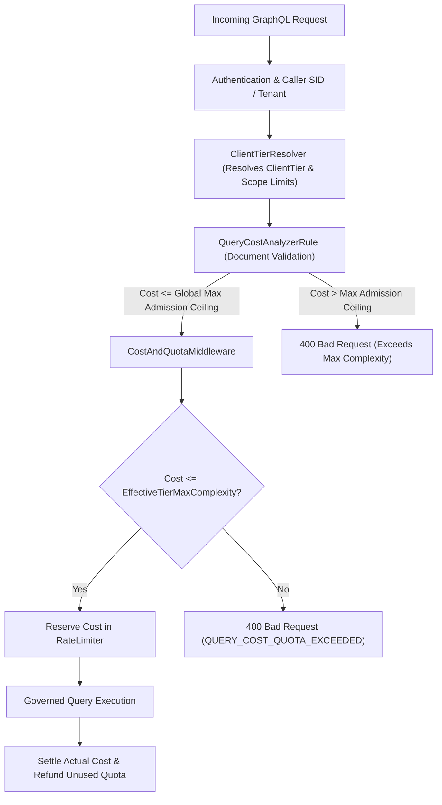

# Architecture Implementation Plan & Security Review: Admission Estimate & Per-Tier Complexity Ceiling (Issue #419 / WP-B)

**Document ID:** `PLAN-COST-419`  
**PRD Reference:** [`2026-11-01-req-issue-419-complexity-tier-ceiling.md`](2026-11-01-req-issue-419-complexity-tier-ceiling.md) (`REQ-COST-419`)  
**Lifecycle Phases:** Phase 2 (C# Solution Architect) & Phase 3 (C# Security Expert)  
**Date:** 2026-11-01  
**Branch:** `feat/issue-419-complexity-tier-ceiling`  

---

## 1. Architectural Architecture & Design (Phase 2)

### Component Changes:

1. **`Autheris.Domain.Options.QueryCostOptions`:**
   - Add `[Range(0.01, 1.0)] public double ScalarColumnWeight { get; set; } = 0.2;`
   - Validated at startup in all environments via `GatewayStartupValidator`.

2. **`Autheris.Domain.Options.Resilience.ClientTierLimitOverride`:**
   - Ensure `MaxAllowedComplexity` (or `MaxCostPerQuery`) carries explicit validation bounds: `[Range(100, 10000)]`.
   - Add `MaxAllowedAdmissionCeiling` resolution in `ClientTierResolver` / `GatewayOptions` representing the supremum of all tier/scope limits (bounded by 10,000).

3. **`Autheris.GraphQL.Interceptors.QueryCostAnalyzerRule`:**
   - Introduce `ScalarColumnWeight` support in `CalculateSelectionSetCost`.
   - Plain scalar fields (non-relation, non-object, `field.SelectionSet == null`) without masking are scaled by `ScalarColumnWeight`:
     $$\text{scalarCost} = \max(1, \lfloor \text{effectiveRows} \times \text{scalarColumnWeight} \rfloor)$$
   - Nested relations, sub-selections, and masked columns continue to compound at full weight.

4. **`Autheris.GraphQL.Interceptors.CostAndQuotaMiddleware`:**
   - In `EffectiveGatewayMaxCost`, instead of strictly clamping to `gatewayOptions.GraphQL.MaxAllowedComplexity`, resolve the effective maximum allowable cost using the caller's tier policy (`clientContext.Policy.MaxCostPerQuery`).
   - If the operator configured a higher tier limit (e.g. `Enterprise = 2000`), the query is permitted up to 2000, bounded by `HardMaxComplexityCeiling` (10,000).

5. **`Autheris.Api.Startup.GatewayStartupValidator`:**
   - Enforce that all tier and scope complexity overrides in `ClientTiers.TierLimits` and `ClientTiers.ScopeLimits` are within `[100, 10000]`.
   - Throw `ValidationException` failing startup immediately if any tier ceiling exceeds `10000` or is below `100`.

---

## 2. Security & Compliance Review (Phase 3 - `csharp-security-expert`)

### Threat Modeling & Rulings:

1. **Denial-of-Service via Elevated Tier Ceilings (STRIDE: Denial of Service):**
   - *Risk:* A rogue or compromised enterprise token could execute deeply nested, runaway queries that exhaust server CPU and database connections.
   - *Mitigation:* `MaxResponseRows` (default 1000) and `MaxAllowedExecutionDepth` (default 15/25) remain independent, non-negotiable hard bounds. The complexity ceiling only governs row/field breadth, while recursion depth and response volume remain strictly bounded.
   - *Binding Condition `SEC-COST-01`:* `MaxComplexitySafetyCeiling` is strictly capped at `10000`. Any configuration exceeding `10000` must fail startup loudly.

2. **Cost Number Enumeration & Side-Channel Leaking (`SEC-PG-12`):**
   - *Risk:* Returning exact calculated cost numbers and max limit in Production responses leaks internal schema weights, table sizing heuristics, and tier policy thresholds.
   - *Mitigation:* In Production environments, error responses for `QUERY_COST_QUOTA_EXCEEDED` or validation complexity rejections must sanitize detailed point numbers (`calculatedCost`, `maxAllowedCost`) when `ExposeCostExtensions == false` (the default for `Free` tier, and governed by environment).
   - *Binding Condition `SEC-COST-02`:* Shield tests verifying byte-identical generic error messages for unauthenticated or untrusted callers must remain green.

3. **Tampering with Tier Overrides (STRIDE: Elevation of Privilege):**
   - *Risk:* Callers attempting to pass tier or complexity overrides via query headers or variables.
   - *Mitigation:* Tier resolution is strictly derived from verified JWT claims via `ClientTierResolver` (`RoleTierMappings`, `ScopeTierMappings`, API key binding). No client-provided header or variable can override tier limits.
   - *Binding Condition `SEC-COST-03`:* All tier complexity overrides are loaded exclusively from operator configuration at startup.

---

## 3. Step-by-Step TDD Execution Plan (Phase 4)

- **Step 1 (Red):** Add unit tests in `QueryCostOptionsValidatorTests` and `QueryCostAnalyzerRuleTests`:
  - Test `ScalarColumnWeight` validation bounds `[0.01, 1.0]`.
  - Test root list with 10 scalar fields under `ScalarColumnWeight = 0.2` has reduced admission price allowing `first: 100`.
  - Test nested relation retains full weight.
- **Step 2 (Green):** Implement `ScalarColumnWeight` in `QueryCostOptions` and `QueryCostAnalyzerRule.CalculateSelectionSetCost`.
- **Step 3 (Red):** Add unit and integration tests in `ClientTierResolverTests` and `CostAndQuotaMiddlewareTests`:
  - Test Enterprise tier with `MaxCostPerQuery = 2000` admits query with cost 1500 (which previously failed on global 500).
  - Test Free tier with `MaxCostPerQuery = 50` rejects query with cost 80.
  - Test startup validator rejects tier limit `15000` (exceeds safety ceiling 10000).
- **Step 4 (Green):** Wire tier-resolved complexity ceiling into `CostAndQuotaMiddleware` and startup validation.
- **Step 5 (Refactor & Verify):** Run full test suite (`Autheris.Tests.Unit`, `Autheris.Tests.Architecture`), verify 0 errors, 0 warnings.
