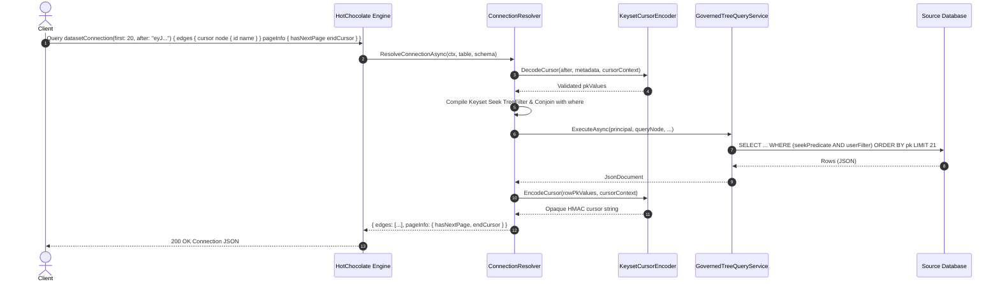

# Implementation Plan: GraphQL Root Lists Signed Keyset Cursor (Relay Connections) (#420)

**Document ID:** `PLAN-GQL-420`  
**Parent Document:** [`2026-11-01-req-issue-420-graphql-keyset-cursor.md`](2026-11-01-req-issue-420-graphql-keyset-cursor.md) (`REQ-GQL-420`)  
**Related Issues:** [#420](https://github.com/themulle/autheris/issues/420), [#417](https://github.com/themulle/autheris/issues/417), [#390](https://github.com/themulle/autheris/issues/390), [#403](https://github.com/themulle/autheris/issues/403), [#404](https://github.com/themulle/autheris/issues/404), [#412](https://github.com/themulle/autheris/issues/412), [#427](https://github.com/themulle/autheris/issues/427)  
**Authors:** Solution Architect (`csharp-architect`) & Security Expert (`csharp-security-expert`)  
**Status:** PROPOSED (Phases 2 & 3 aligned)

---

## 1. Architectural Architecture & Component Wiring

### 1.1 Non-Breaking Additive Design
To maintain zero breakage for existing GraphQL clients and tooling:
1. `Query.<tableQueryName>` remains intact with `first`, `offset`, `where`, `orderBy`.
2. `Query.<tableQueryName>Connection` is added as a peer query field for every queryable table in the schema.
3. Standard Relay Connection types are registered dynamically in `CatalogGraphQlTypeModule.Connection.cs`:
   - `PageInfo`: `hasNextPage: Boolean!`, `hasPreviousPage: Boolean!`, `startCursor: String`, `endCursor: String`.
   - `{TableTypeName}Edge`: `cursor: String!`, `node: {TableTypeName}!`.
   - `{TableTypeName}Connection`: `edges: [{TableTypeName}Edge!]!`, `pageInfo: PageInfo!`, `totalCount: Int`.

### 1.2 Cryptographic Cursor Integration (`KeysetCursorContextFactory`)
We reuse `IKeysetCursorEncoder` which signs an opaque JSON token containing primary key values:
- Add a dedicated context factory method `KeysetCursorContextFactory.ForGraphQl(...)`:
  - `TenantId`: caller tenant ID.
  - `DataSource`: catalog domain of table.
  - `TableName`: catalog table name.
  - `Schema`: catalog schema.
  - `Columns`: canonical primary key column names.
  - `Direction`: resolved index direction signature (honoring #390, #403, #427).
  - `Caller`: caller SID (`ClaimTypes.NameIdentifier` or sub).
  - `RequestHash`: SHA-256 over canonical representation of `where` filter AST and selected node fields.

### 1.3 Keyset Seek Translation into AST `TreeFilter`
Instead of using SQL `OFFSET`, the `after` cursor is decoded into primary key values and transformed into a `TreeFilter` seek predicate:
- Single primary key column:
  - If ASC: `TreeComparison(pk, TreeFilterOperator.Gt, cursorValue)`
  - If DESC: `TreeComparison(pk, TreeFilterOperator.Lt, cursorValue)`
- Composite primary key columns $(pk_0, pk_1, \dots, pk_k)$:
  - Nested OR-chain of AND-terms:
    $$\bigvee_{i=0}^k \left( \bigwedge_{j=0}^{i-1} (pk_j = val_j) \land (pk_i \gtrless val_i) \right)$$
  - Conjoined with user `where`: `where != null ? new TreeAndFilter([where, seekFilter]) : seekFilter`.
- Handled seamlessly by `TreeSqlCompiler` and `TreeFilterRenderer` across all dialect targets (PostgreSQL, SQL Server, Trino, DuckDB).

### 1.4 Connection Query Resolution Workflow

---

## 2. Security & Compliance Review (`csharp-security-expert`)

### 2.1 Threat Modeling & Mitigations
| Threat Vector | Severity | Mitigation |
| :--- | :---: | :--- |
| **Cross-Tenant Replay** | High | `KeysetCursorContext` binds caller `TenantId`. Validation fails closed if replayed across tenants. |
| **Cross-Dataset / Cross-Table Replay** | High | Context binds `DataSource`, `Schema`, `TableName`. Tampering fails closed. |
| **Filter-Bypass Tampering** | High | Context binds `RequestHash` (SHA-256 over canonical `where` filter). A cursor obtained under `{ department: 'HR' }` cannot be replayed under `{ department: 'Finance' }`. |
| **Masked Primary Key Leakage (#412)** | Critical | If any primary key column is masked or denied under active policy, keyset connection queries must fail closed (`KEYSET_PAGINATION_UNAVAILABLE`) to prevent side-channel inference through cursor tokens. |
| **Production Error Enumeration (`SEC-PG-12`)** | Medium | Invalid, corrupt, or tampered cursors return the standard shielded `INVALID_QUERY` error without leaking exception traces or HMAC signature details. |
| **Deep Paging Denial of Service** | Medium | No `OFFSET` scan on database. Keyset seek uses physical primary key index with $O(\log N)$ point-lookup seek. |

### 2.2 Security Acceptance Matrix
- [ ] `SEC-GQL-420-01`: Cursors signed for tenant A are rejected with `INVALID_QUERY` when presented by tenant B.
- [ ] `SEC-GQL-420-02`: Modifying any byte of cursor token causes HMAC validation failure and returns error without disclosing internals.
- [ ] `SEC-GQL-420-03`: Altering query `where` filter between pages invalidates `RequestHash` and aborts request.
- [ ] `SEC-GQL-420-04`: Tables with masked PK columns disallow keyset connection queries.

---

## 3. Step-by-Step Implementation Work Packages

### WP1: Keyset Context Extension for GraphQL
- **File:** `src/Autheris.Application/Data/Services/KeysetCursorContextFactory.cs`
- Add `ForGraphQl`:
  - Canonical hash builder for `TreeFilter` and selected node field list.
  - Consistent casing and whitespace normalization.

### WP2: GraphQL Relay Connection Types Registration
- **File:** `src/Autheris.GraphQL/Catalog/CatalogGraphQlTypeModule.Connection.cs`
- Register `PageInfo` type (`hasNextPage`, `hasPreviousPage`, `startCursor`, `endCursor`).
- Register dynamic `{table.TypeName}Edge` and `{table.TypeName}Connection` types for all catalog tables.
- Add `{table.QueryFieldName}Connection` query field on `Query`.

### WP3: Connection Resolver & Tree Keyset Seek Compiler
- **File:** `src/Autheris.GraphQL/Catalog/CatalogGraphQlConnectionResolver.cs`
- Parse `first` (defaults to 100, clamped to `maxResponseRows`) and `after`.
- Decode `after` cursor; build `TreeFilter` seek predicate.
- Conjoin with selection's `where` argument.
- Execute tree query via `IGovernedTreeQueryService`.
- Extract PK values for each row, compute cursor, build `PageInfo` with `hasNextPage`.

### WP4: Unit & Security Tests
- **File:** `tests/Autheris.Tests.Unit/GraphQL/CatalogGraphQlConnectionTests.cs`
- Test 1: Relay schema generation (PageInfo, Edge, Connection types).
- Test 2: Keyset first page pagination without `after` cursor.
- Test 3: Keyset second page pagination with `after` cursor, verifying seek predicate and row progression.
- Test 4: Cross-tenant replay rejection (`SEC-GQL-420-01`).
- Test 5: Tampered cursor rejection (`SEC-GQL-420-02`).
- Test 6: Filter change replay rejection (`SEC-GQL-420-03`).
- Test 7: Masked PK refusal (`SEC-GQL-420-04`).
- Test 8: Descending key seek direction correctness.
