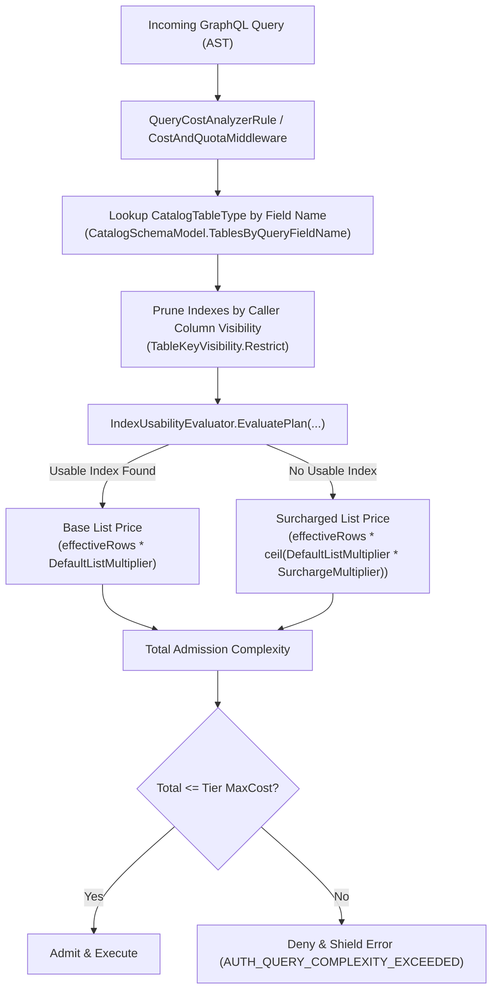

# Architectural Implementation Plan & Security Audit: Index-Aware Pricing for Root-List Plans

**Document ID:** `PLAN-COST-421`  
**Author:** Lead Solution Architect (`csharp-architect`)  
**Security Auditor:** Security Principal (`csharp-security-expert`)  
**Status:** `PROPOSED`  
**Date:** 2026-11-01  
**Target Branch:** `feat/issue-421-index-aware-pricing`  
**GitHub Issues:** #421 (WP-D of #417, building on #390, #403, #404, #412)  
**PRD Reference:** [`REQ-COST-421`](file:///root/autheris/docs/plans/2026-11-01-req-issue-421-index-aware-pricing.md)

---

## 1. Architectural Design & Component Wiring

### 1.1 Overview
The objective is to compute the admission price of GraphQL root lists by incorporating index usability information from catalog metadata (`TableMetadata`), while maintaining zero-allocation efficiency in .NET 10, fail-closed anti-enumeration security, and complete alignment between HotChocolate pre-flight AST validation and runtime middleware enforcement.



### 1.2 Component Design
1. **Domain Options (`Autheris.Domain/Options/QueryCostOptions.cs`):**
   - Add property:
     ```csharp
     /// <summary>
     /// Issue #421: Multiplier applied to root list pricing when neither filter nor ordering can utilize a database index.
     /// Default 2.0 (doubles the list base cost).
     /// </summary>
     [Range(1.0, 50.0)]
     public double UnindexedRootListSurchargeMultiplier { get; set; } = 2.0;
     ```
   - Bound validation in `GatewayStartupValidator.cs`: enforce `[1.0, 50.0]`.

2. **Index Usability Evaluator (`Autheris.GraphQL/Interceptors/IndexUsabilityEvaluator.cs`):**
   - Pure, zero-allocation helper class:
     ```csharp
     public static class IndexUsabilityEvaluator
     {
         public static bool HasUsableIndex(
             TableMetadata metadata,
             IReadOnlyList<(string FieldName, string Direction)>? orderBy,
             IReadOnlyList<string>? filterColumns);
     }
     ```
   - Logic:
     - Discovers candidate indexes: `PrimaryKeyColumns` (with `PrimaryKeyDirections`), `Indexes`, `PhysicalIndexes`.
     - Matching `orderBy`:
       - If `orderBy` is empty or null, default ordering is used (which uses PK or primary unique index), returning `true` if metadata has a PK or unique index.
       - If `orderBy` has entries, check if candidate indexes have leading columns matching the requested order columns in exact sequence and direction.
     - Matching `filterColumns`:
       - Check if any candidate index has its leading column present in the filter columns.
     - If an index satisfies ordering or filtering without requiring an unindexed sort, return `true`; else return `false`.

3. **AST Extraction & Integration (`QueryCostAnalyzerRule.cs` & `CostAndQuotaMiddleware.cs`):**
   - Extract filter column names and order columns from AST field arguments `where` and `orderBy`.
   - When costing a root field of type list targeting a known catalog table:
     - Check `HasUsableIndex`.
     - If false, scale `_defaultListMultiplier` by `Math.Ceiling(_defaultListMultiplier * surchargeMultiplier)`.
   - Saturating arithmetic ensures no integer overflow occurs.

---

## 2. Security Expert Audit & Rulings (`csharp-security-expert`)

### 2.1 Threat Analysis & Controls
- **SEC-COST-421-01 (Anti-Enumeration & Oracle Mitigation):**
  - *Threat:* An attacker crafts queries with various `orderBy` and `where` fields to measure execution rejection or response latency, mapping which internal database columns have indexes.
  - *Mitigation:* Error responses in Production must be shielded via `GraphQlEnumerationShieldMiddleware`. The error code remains `AUTH_QUERY_COMPLEXITY_EXCEEDED` and contains zero text regarding index existence.
- **SEC-COST-421-02 (Column Visibility & Masking Invariant):**
  - *Threat:* An index exists on a masked or sensitive column (e.g., `credit_card_hash` or `ssn`). If an unprivileged caller's query is recognized as "indexed" on that column, it leaks information about the existence of the column or index.
  - *Mitigation:* Before testing index usability, candidate indexes MUST pass through `TableKeyVisibility.Restrict(table, visibleColumns)`. If any column in the index is not visible or masked with restriction, the entire index is excluded.
- **SEC-COST-421-03 (DoS Prevention & Arithmetic Saturation):**
  - *Threat:* Large `surchargeMultiplier` combined with large row limits could overflow 32-bit signed integers, wrapping around to negative values and bypassing cost controls.
  - *Mitigation:* All cost accumulation uses `SafeAdd` and `Math.Min(int.MaxValue, ...)`. Multiplier is clamped to `[1.0, 50.0]`.

---

## 3. Step-by-Step Implementation Roadmap

1. **Step 1: Domain Options & Startup Validation**
   - Update `QueryCostOptions.cs` with `UnindexedRootListSurchargeMultiplier`.
   - Update `GatewayStartupValidator.cs` with range checks and unit tests.
2. **Step 2: IndexUsabilityEvaluator Service**
   - Implement `IndexUsabilityEvaluator` in `Autheris.GraphQL/Interceptors/`.
   - Implement unit tests covering PK, directions, compound indexes, physical non-unique indexes, and column visibility pruning.
3. **Step 3: QueryCostAnalyzerRule Integration**
   - Pass catalog schema / table metadata into `QueryCostAnalyzerRule`.
   - Incorporate `UnindexedRootListSurchargeMultiplier` during root list costing.
4. **Step 4: End-to-End & Integration Verification**
   - Verify cost calculation with indexed vs unindexed root list queries.
   - Run full unit, architecture, and integration test suites.
