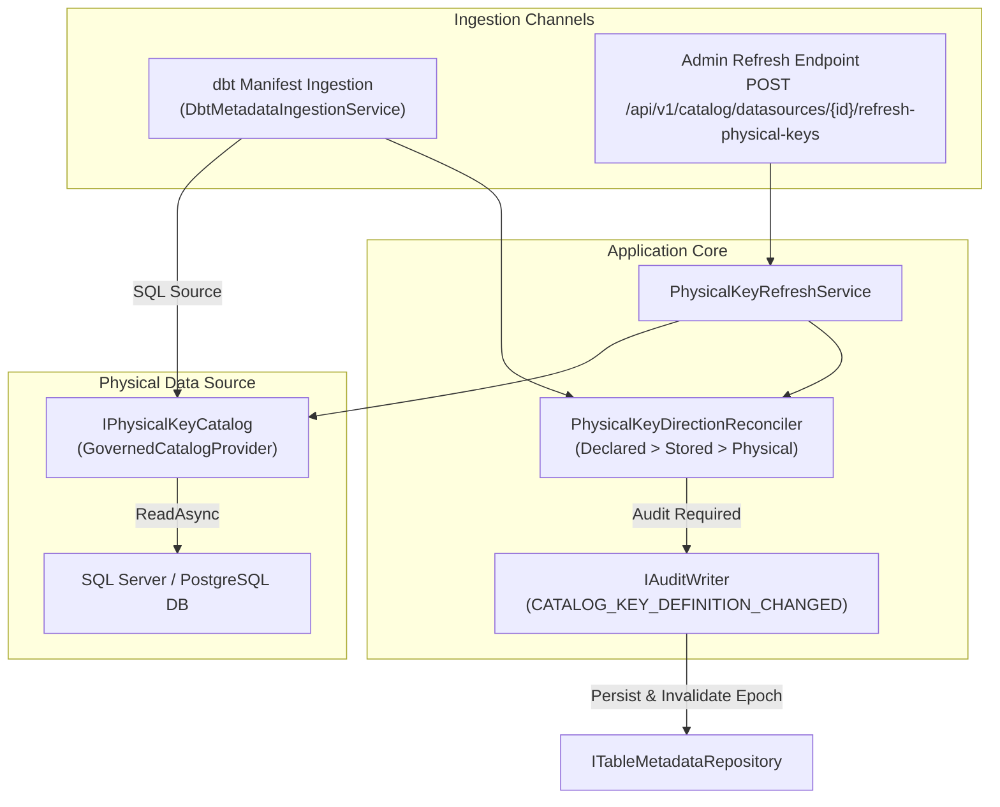

# Architecture Plan: Source Physical Key and Index Direction Ingestion (#427)

**Document ID:** `PLAN-CAT-427`  
**Phase:** 2 (Solution Architecture & Technical Design)  
**Author:** Solution Architect (`csharp-architect`)  
**Date:** 2026-11-01  
**Status:** PROPOSED (Ready for Phase 3 Security Review)  
**Related PRD:** [`2026-11-01-req-issue-427-sync-key-directions.md`](2026-11-01-req-issue-427-sync-key-directions.md) (`REQ-CAT-427`)  
**Issues:** [Issue #427](https://github.com/themulle/autheris/issues/427), [Issue #403](https://github.com/themulle/autheris/issues/403), [Issue #404](https://github.com/themulle/autheris/issues/404)

---

## 1. Executive Summary & Architecture Overview

In Autheris v1.6.0, table key directions (`ASC` / `DESC`) and non-unique physical indexes are utilized by read planners (`GovernedTableReadPlanner`, `DefaultReadOrdering`, `TreeSqlCompiler`) to optimize ordering and eliminate expensive in-memory / database sorts. However, physical index inspection (`IPhysicalKeyCatalog`, `PhysicalKeyDirectionReconciler`) is currently executed solely during an external enterprise data catalog sync (`DataCatalogSyncService`).

When datasets are registered or updated via:
1. **dbt Metadata Ingestion (`DbtMetadataIngestionService`)**, or
2. **Catalog REST APIs / CI Pipelines without an external data catalog**,

the catalog stores keys with default `ASC` directions. For clustered or unique indexes featuring descending columns (e.g. `(device_id ASC, ts DESC)`), queries without an explicit order compile to `ORDER BY device_id ASC, ts ASC`, causing full table scans and timeouts on SQL Server and PostgreSQL sources.

This architecture plan designs two complementary tracks:
- **Track A (dbt Ingestion Integration):** Integrates `IPhysicalKeyCatalog` and `PhysicalKeyDirectionReconciler` into `DbtMetadataIngestionService` for SQL sources, writing audited physical directions strictly when keys match the declared column list.
- **Track B (Admin Refresh Service & Endpoint):** Introduces `IPhysicalKeyRefreshService` in `Autheris.Application` and exposes `POST /api/v1/catalog/datasources/{id}/refresh-physical-keys` (governed by `GatewayPolicies.GovernanceAdmin`), supporting `dryRun` inspection, table filtering, and cache invalidation.



---

## 2. Work Breakdown Structure (WBS)

### Work Package 1: Application Refresh Service (`WP-1`)
- Interface `IPhysicalKeyRefreshService` and implementation `PhysicalKeyRefreshService` in `Autheris.Application.DataCatalog.Services`.
- Iterates over declared SQL tables for a datasource, calls `IPhysicalKeyCatalog.ReadAsync`, executes `PhysicalKeyDirectionReconciler.Reconcile`, audits changes, updates definitions, applies non-unique index sync, and invalidates table epochs.
- Comprehensive unit tests mocking `IPhysicalKeyCatalog` and `ITableMetadataRepository`.

### Work Package 2: dbt Ingestion Reconciliation (`WP-2`)
- Update `DbtMetadataIngestionService` constructor to inject optional `IPhysicalKeyCatalog?` and `IAuditWriter?`.
- In `IngestManifestAsync`, when `model.DeclaredKeys` is present on a SQL table, read physical snapshot and reconcile directions before upserting metadata.
- Audit before persisting; fail closed to `reconciled.WithoutPhysical` if audit fails.
- Add unit tests verifying physical directions are attached to dbt-imported SQL tables.

### Work Package 3: Admin HTTP Endpoint (`WP-3`)
- Register `POST /api/v1/catalog/datasources/{id}/refresh-physical-keys` and `/api/governance/datasources/{id}/refresh-physical-keys` in `CatalogApiEndpoints.cs`.
- Guard with `GatewayPolicies.GovernanceAdmin`.
- Support query/body options: `dryRun` (`bool`), `tableFilter` (`string?`).
- Integration/unit tests verifying endpoint authorization, dry-run behavior, and drift reporting.

---

## 3. Component Design & Interfaces

### 3.1 Domain Models & DTOs
File: `src/Autheris.Domain/Model/PhysicalKeyRefreshModels.cs`

```csharp
namespace Autheris.Domain.Model;

public sealed record PhysicalKeyRefreshRequest(
    bool DryRun = false,
    string? TableFilter = null);

public sealed record PhysicalKeyRefreshResult(
    string DatasourceId,
    bool DryRun,
    int TablesScanned,
    int KeysUpdated,
    int IndexesUpdated,
    IReadOnlyList<TableKeyRefreshItem> Details);

public sealed record TableKeyRefreshItem(
    string Table,
    string Status, // "Updated", "Unchanged", "DriftDetected", "Unsupported", "Unavailable"
    IReadOnlyList<string> Findings,
    string[]? PrimaryKeyDirections);
```

### 3.2 Service Interface
File: `src/Autheris.Application/DataCatalog/Interfaces/IPhysicalKeyRefreshService.cs`

```csharp
namespace Autheris.Application.DataCatalog.Interfaces;

using System.Threading;
using System.Threading.Tasks;
using Autheris.Domain.Model;
using Autheris.Domain.Security;

public interface IPhysicalKeyRefreshService
{
    Task<PhysicalKeyRefreshResult> RefreshDatasourceKeysAsync(
        string datasourceId,
        PhysicalKeyRefreshRequest request,
        Sid actor,
        CancellationToken ct = default);
}
```

### 3.3 PhysicalKeyRefreshService Implementation
File: `src/Autheris.Application/DataCatalog/Services/PhysicalKeyRefreshService.cs`

Core orchestration logic:
1. Validate datasource exists and retrieve tables:
   ```csharp
   var allTables = await metadataRepo.GetAllTablesAsync(ct).ConfigureAwait(false);
   var tables = allTables.Where(t => t.Table.SourceName.Equals(datasourceId, StringComparison.OrdinalIgnoreCase)).ToList();
   ```
2. Apply `TableFilter` if provided (by `TableName` or full identifier).
3. For each table where `t.Table.DataSourceType == DataSourceType.Sql`:
   - Query `var physical = await physicalCatalog.ReadAsync(table, ct).ConfigureAwait(false);`
   - If `physical.State == Unsupported` or `Unavailable`, report status and findings.
   - If `Known`:
     - Construct `incoming = table with { ReplaceKeyDefinition = true };`
     - Run `var reconciled = PhysicalKeyDirectionReconciler.Reconcile(incoming, table, physical);`
     - If `reconciled.PhysicalApplied`:
       - If `!request.DryRun`:
         - Audit `CATALOG_KEY_DEFINITION_CHANGED` via `IAuditWriter`.
         - Update key definition:
           ```csharp
           await metadataRepo.ReplaceTableKeyDefinitionAsync(
               table.Identifier,
               reconciled.Metadata.PrimaryKeyColumns,
               reconciled.Metadata.Indexes,
               reconciled.Metadata.PrimaryKeyDirections,
               ct).ConfigureAwait(false);
           await epochService.InvalidateTableEpochAsync(table.Identifier, ct).ConfigureAwait(false);
           ```
     - For non-unique indexes: if `IPhysicalIndexRepository` is present, sync non-unique indexes.

### 3.4 Track A: `DbtMetadataIngestionService` Integration
In `DbtMetadataIngestionService.cs`:
- Add `IPhysicalKeyCatalog? _physicalKeys` and `IAuditWriter? _auditWriter` to constructors.
- In `IngestManifestAsync`:
  ```csharp
  if (model.DeclaredKeys is { } declared)
  {
      updatedMetadata = DbtDeclaredKeysImport.Apply(updatedMetadata, declared, _logger);
      if (_physicalKeys is not null && updatedMetadata.Table.DataSourceType == DataSourceType.Sql)
      {
          var physical = await _physicalKeys.ReadAsync(updatedMetadata, ct).ConfigureAwait(false);
          var reconciled = PhysicalKeyDirectionReconciler.Reconcile(updatedMetadata, existingMeta, physical);
          foreach (var finding in reconciled.Findings)
          {
              warnings.Add($"Table '{updatedMetadata.Identifier}': {finding}");
          }

          if (reconciled.PhysicalApplied)
          {
              if (await TryAuditPhysicalDirectionsAsync(updatedMetadata.Identifier, existingMeta, reconciled, ct).ConfigureAwait(false))
              {
                  updatedMetadata = reconciled.Metadata;
              }
              else
              {
                  updatedMetadata = reconciled.WithoutPhysical;
              }
          }
      }
  }
  ```

---

## 4. Security & Zero-Trust Architecture Rules

1. **"No Key is Ever Inferred" (Strict Zero-Trust):**
   Physical key directions are applied **strictly and exclusively** when the physical key columns match the declared column list in the identical order. If columns differ, `PhysicalKeyDirectionReconciler` emits `Mismatch` and applies nothing.
2. **Declared Intent Takes Absolute Precedence:**
   If a dbt model or developer contract explicitly specifies directions (`ts DESC`), declared direction wins. Physical direction is not applied, and `KEY_DIRECTION_DRIFT` is reported.
3. **Audit Trail Integrity Before Storage:**
   Every physical direction persistence must be preceded by an immutable `CATALOG_KEY_DEFINITION_CHANGED` audit record specifying `directionSource = "physical"`. If the audit writer fails, persistence is aborted and the non-physical metadata is retained.
4. **Administrative Authorization:**
   The refresh endpoint requires `GatewayPolicies.GovernanceAdmin`. Anonymous or unprivileged callers are rejected with `401 Unauthorized` or `403 Forbidden`.
5. **Fail-Closed on Network/Permission Failures:**
   If the database connection times out, credentials lack `VIEW DEFINITION`, or the table is not found, the operation reports `Unavailable` and leaves stored definitions unchanged.

---

## 5. Test Specifications & Verification Plan

### Unit Test Matrix (`Autheris.Tests.Unit`)
- `DbtIngestion_WhenSqlTableHasClusteredDescKey_ReconcilesPhysicalDirections`
- `DbtIngestion_WhenExplicitDirectionDeclared_DeclaredPrecedenceWins`
- `DbtIngestion_WhenPhysicalKeyColumnsMismatch_ReconcilesNoDirections`
- `DbtIngestion_WhenPhysicalReadFails_RetainsDeclaredWithoutError`
- `PhysicalKeyRefreshService_DryRun_ReportsDriftWithoutMutatingStore`
- `PhysicalKeyRefreshService_WhenPhysicalApplied_AuditsAndBumpsEpoch`
- `PhysicalKeyRefreshService_TableFilter_OnlyRefreshesMatchingTables`
- `CatalogApiEndpoints_RefreshPhysicalKeys_RequiresGovernanceAdmin`

---

## Phase 3: Security Expert Review Gate (`csharp-security-expert`)

**Review Date:** 2026-11-01  
**Verdict:** APPROVED WITH BINDING CONDITIONS.

### Rulings
1. **Zero-Trust Rule "No Key is Ever Inferred":** Confirmed. Reconciling directions on an explicitly declared column list does not invent semantic keys. Strict column equality and ordering matching (`I403-SC-04`) prevents unauthorized key promotion.
2. **Declared Intent Priority:** Confirmed. Manifest/contract directions take absolute precedence. Physical index inspection must never override explicit declarations (`I403-SC-06`).
3. **Pre-Storage Audit Invariant:** Confirmed. Audit records (`CATALOG_KEY_DEFINITION_CHANGED`) must be recorded prior to updating catalog key definitions. If audit recording fails, persistence must fail closed to the non-physical state (`WithoutPhysical`).
4. **Administrative Access Control:** Confirmed. The refresh endpoint is restricted to `GovernanceAdmin`. The datasource ID and table filter must be strictly sanitized against injection patterns.
5. **No Credential or Raw Schema Leakage:** Confirmed. Failures during physical reading must report normalized codes (`Unavailable`, `Unsupported`, `KEY_DIRECTION_DRIFT`) without exposing internal database errors.

### Binding Conditions
- **CAT427-SC-01:** `DbtMetadataIngestionService` and `PhysicalKeyRefreshService` must only invoke physical key reads when `table.DataSourceType == DataSourceType.Sql`.
- **CAT427-SC-02:** If physical key reading fails (`PhysicalKeySnapshotState.Unavailable` or exception), the table's declared key definition must remain untouched and ingestion/refresh must proceed without failure.
- **CAT427-SC-03:** In `PhysicalKeyRefreshService`, if `!dryRun`, `IAuditWriter.RecordRequiredAsync` must be called strictly prior to `ReplaceTableKeyDefinitionAsync`.
- **CAT427-SC-04:** The HTTP route `POST /api/v1/catalog/datasources/{id}/refresh-physical-keys` must be guarded by `.RequireAuthorization(GatewayPolicies.GovernanceAdmin)` and audited via `.WithAudit(AuditLevel.Full, AuditEventTypes.CatalogKeyDefinitionChanged)`.
- **CAT427-SC-05:** Datasource ID and optional `tableFilter` parameters must be validated with null byte, whitespace, and path delimiter guards.
- **CAT427-SC-06:** All new security test cases must be tagged with `[Trait("Category", "Security")]`.

### Mandatory Security Tests
- `CAT427_T01_DbtIngestion_WhenSqlTableHasClusteredDescKey_ReconcilesPhysicalDirections`
- `CAT427_T02_DbtIngestion_WhenExplicitDirectionDeclared_DeclaredPrecedenceWins`
- `CAT427_T03_DbtIngestion_WhenPhysicalKeyColumnsMismatch_ReconcilesNoDirections`
- `CAT427_T04_DbtIngestion_WhenPhysicalReadFails_RetainsDeclaredWithoutError`
- `CAT427_T05_DbtIngestion_WhenAuditFails_RollsBackToWithoutPhysical`
- `CAT427_T06_PhysicalKeyRefreshService_DryRun_DoesNotMutateStoreOrAudit`
- `CAT427_T07_PhysicalKeyRefreshService_UnauthorizedCaller_IsRejected`
- `CAT427_T08_RefreshEndpoint_WhenNoSid_ReturnsForbidden`
- `CAT427_T09_RefreshEndpoint_WhenInvalidDatasourceId_ReturnsBadRequest`
- `CAT427_T10_RefreshEndpoint_WhenInvalidTableFilter_ReturnsBadRequest`
- `CAT427_T11_RefreshEndpoint_WhenDatasourceNotFound_ReturnsNotFound`
- `CAT427_T12_RefreshEndpoint_WhenValid_ReturnsOkWithRefreshResult`
- `CAT427_T13_MapCatalogEndpoints_RegistersRefreshRouteWithoutException`

---

## Phase 4: Implementation & Test-Driven Verification (`csharp-tdd-developer`)

### Implementation Summary
- **Domain Models (`PhysicalKeyRefreshModels.cs`):**
  - Added `PhysicalKeyRefreshRequest(bool DryRun = false, string? TableFilter = null)`.
  - Added `PhysicalKeyRefreshResult` and `TableKeyRefreshItem` reporting scanned tables, updated keys/indexes, drift findings, and wire directions.
- **Service Layer (`IPhysicalKeyRefreshService.cs`, `PhysicalKeyRefreshService.cs`):**
  - Implemented `PhysicalKeyRefreshService` orchestrating table retrieval, SQL filtering, `IPhysicalKeyCatalog.ReadAsync`, `PhysicalKeyDirectionReconciler.Reconcile`, pre-storage audit logging, `ITableMetadataRepository.ReplaceTableKeyDefinitionAsync`, and `IEpochValidationService.InvalidateEpochAsync`.
  - Reconciles non-unique physical indexes when `IPhysicalIndexRepository` is present.
- **Track A dbt Reconciliation (`DbtMetadataIngestionService.cs`):**
  - Hooked physical key reading and reconciliation into `IngestManifestAsync` during declared key ingestion.
  - Enforced fail-closed pre-storage audit: if `TryAuditPhysicalDirectionsAsync` fails, rolls back to `WithoutPhysical`.
- **API & Governance Endpoints (`CatalogApiEndpoints.cs`, `GatewayCatalogServiceExtensions.cs`):**
  - Exposed `POST /api/v1/catalog/datasources/{id}/refresh-physical-keys` and alias `/api/governance/datasources/{id}/refresh-physical-keys`.
  - Enforced `GatewayPolicies.GovernanceAdmin` authorization, actor SID validation, datasource ID sanitation (`DatasourceTestingService.IsValidDatasourceId`), and table filter sanitization.
  - Audited with `AuditEventTypes.CatalogKeyDefinitionChanged` at `AuditLevel.Full`.
  - Updated DI descriptor snapshots in `composition-dev-sqlite.txt` and `composition-production-like.txt`.

### Test Results
- Unit test suite: 24/24 tests passed green (`PhysicalKeyRefreshServiceTests`, `DbtPhysicalKeyIngestionTests`, `PhysicalKeyRefreshEndpointTests`, `CompositionDescriptorSnapshotTests`).
- Integration test suite: 4/4 tests passed green (`PhysicalKeyRefreshEndpointAuthIntegrationTests` verifying 401 Unauthorized for anonymous and 403 Forbidden for non-admin callers).
- Full solution build: 0 errors, 0 warnings.

---

## Phase 5: Code Review & Quality Gate (`csharp-code-reviewer`)

**Review Date:** 2026-11-01  
**Verdict:** APPROVED.

### Findings & Checklist
- [x] **Zero-Trust & Fail-Closed Invariants:** Explicit column list matching preserves "no key is ever inferred"; pre-storage audit ensures rollback to `WithoutPhysical` if audit logging fails.
- [x] **C# 13 & Idiomatic .NET 10:** Clean record structures, primary constructors, collection expressions `[...]`, pattern matching, and proper `ConfigureAwait(false)` in library services.
- [x] **Resource & Security Hygiene:** Stack traces preserved; all input parameters strictly validated (null bytes, path delimiters, length limits); no database credentials or connection strings leaked in error messages.
- [x] **DI & Composition Stability:** `[ActivatorUtilitiesConstructor]` on `DbtMetadataIngestionService` guarantees unambiguous DI activation; DI composition snapshots verified and stable.
- [x] **Coverage & Security Tests:** All mandatory security tests CAT427-SC-01..06 implemented with `[Trait("Category", "Security")]` and passing green.


