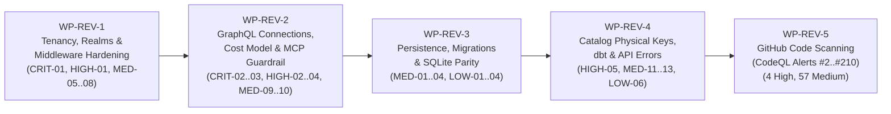

# Architectural Implementation Plan: Post-v1.5.0 Code Review & GitHub Code Scanning Remediation

**Document ID:** `PLAN-SEC-REV-V15`  
**Date:** November 4, 2026  
**Status:** PROPOSED 📝  
**Requirements:** [`docs/plans/2026-11-04-req-v15-review-and-codeql-remediation.md`](2026-11-04-req-v15-review-and-codeql-remediation.md) (`REQ-SEC-REV-V15`)  
**Category Document:** [`docs/plans/security.md`](security.md) (`PLAN-SECURITY-REVIEW`)  
**Origin Plan:** [`docs/plans/00-master-plan-overview.md`](00-master-plan-overview.md) (Track 17)

---

## 1. Architecture & Work Package Overview

This implementation plan remediates all **33 findings** (`3 Critical`, `5 High`, `13 Medium`, `8 Low`, `4 Nit`) from the `v1.5.0..HEAD` full-diff code review alongside all **61 open GitHub Code Scanning (CodeQL) alerts** (`4 High`, `57 Medium`).

Work is structured into five independent, parallelizable Work Packages (`WP-REV-1` to `WP-REV-5`) ordered by risk and dependency:



| Work Package | Scope | Findings / Alerts Covered | Target Assemblies |
| :--- | :--- | :--- | :--- |
| **`WP-REV-1`** | Tenancy, Identity Realms, Middleware Ordering & dbt Owner Verification | `CRIT-01`, `HIGH-01`, `MED-05`, `MED-06`, `MED-07`, `MED-08`, `LOW-05`, `NIT-01`, `NIT-02` | `Autheris.Domain`, `Autheris.Application`, `Autheris.Api`, `Autheris.Extensions` |
| **`WP-REV-2`** | GraphQL Relay Keyset Connections, Index-Aware Cost Model & MCP Guardrail | `CRIT-02`, `CRIT-03`, `HIGH-02`, `HIGH-03`, `HIGH-04`, `MED-09`, `MED-10`, `LOW-07`, `LOW-08` | `Autheris.GraphQL`, `Autheris.Application`, `Autheris.Api`, `TrinoSqlEngine` |
| **`WP-REV-3`** | Persistence Deduplication Hardening & SQLite Dialect Parity | `MED-01`, `MED-02`, `MED-03`, `MED-04`, `LOW-01`, `LOW-02`, `LOW-03`, `LOW-04`, `NIT-04` | `Autheris.Infrastructure`, `tools/sqlgate` |
| **`WP-REV-4`** | Catalog Physical Key Sync, dbt Ingestion & API Error Contracts | `HIGH-05`, `MED-11`, `MED-12`, `MED-13`, `LOW-06`, `NIT-03` | `Autheris.Api`, `Autheris.Application`, `Autheris.Extensions` |
| **`WP-REV-5`** | GitHub Code Scanning (CodeQL) Remediation (61 Open Alerts) | High Alerts `#210`, `#99`, `#182`, `#183`; Medium Alerts `#2` and 56 `cs/log-forging` alerts | `Autheris.Domain`, `Autheris.Application`, `Autheris.Infrastructure`, `Autheris.Api`, `Autheris.Extensions`, `benchmarks/` |

---

## 2. Detailed Work Packages

### 2.1 `WP-REV-1`: Tenancy, Identity Realms, Middleware Ordering & dbt Owner Verification

#### Step 1.1 — Deterministic Scheme-Aware Realm Resolution & Per-User Tenant Claim Preservation (`CRIT-01`)
* **Files:**
  - `src/Autheris.Application/Identity/IdentityRealmRegistry.cs`
  - `src/Autheris.Api/Security/EnterpriseClaimsTransformation.cs`
  - `src/Autheris.Api/Security/TenantStamping.cs`
  - `src/Autheris.Application/Tenancy/TenantResolver.cs`
* **Changes:**
  1. In `IdentityRealmRegistry`:
     - Store `_defaultRealmId = options.Value.DefaultRealm` during `Initialize()`.
     - Add `IdentityRealm? ResolveRealmForScheme(string? issuer, string? authenticationType)`:
       - If `!string.IsNullOrEmpty(issuer)`: look up in `_realmsByIssuer` (normalized). If not found on a bearer/JWT identity, return `null` (do **not** fall back to another scheme's realm).
       - If `issuer` is absent, map `authenticationType` (`"Basic"`, `"BasicSession"`, `"ForwardAuth"`, `"Negotiate"`, `"Kerberos"`) to the corresponding `RealmKind` (`RealmKind.BasicAuth`, `RealmKind.ForwardAuth`, `RealmKind.Kerberos`) and return the unique realm of that kind (or the one matching `_defaultRealmId`).
     - In `GetDefaultRealm()`, resolve `_defaultRealmId` first; never call `_realmsById.Values.FirstOrDefault()` over an unordered `ConcurrentDictionary`.
  2. In `EnterpriseClaimsTransformation.TransformAsync`:
     - Call `_realmRegistry.ResolveRealmForScheme(issuer, identity.AuthenticationType)`.
     - When `identity.AuthenticationType` is `"Basic"`, `"BasicSession"`, or `"ForwardAuth"` and the authentication handler already emitted a validated `tenant_id` claim while the resolved realm's binding is `Unbound` (or matches the handler's tenant), preserve the handler-emitted `tenant_id` claim instead of stripping it in `TenantStamping.Apply` (`realmBound` only strips claims when `realm.TenantBinding.Mode != TenantBindingMode.Unbound`).

#### Step 1.2 — Clone-First `ClaimsNormalizer` & Idempotent `TenantStamping` (`MED-06`)
* **Files:**
  - `src/Autheris.Api/Security/EnterpriseClaimsTransformation.cs`
  - `src/Autheris.Api/Security/TenantStamping.cs`
  - `tests/Autheris.Tests.Unit/Tenancy/Wp4ReviewFindingsTests.cs`
* **Changes:**
  1. At the start of `EnterpriseClaimsTransformation.TransformAsync`, normalize/clone the incoming `ClaimsPrincipal` via `var normalizedPrincipal = ClaimsNormalizer.Normalize(principal);` and perform all realm, role, and tenant stamping on `normalizedPrincipal`'s `ClaimsIdentity` (never mutating the caller's input `principal` in place).
  2. In `TenantStamping.Apply`, in addition to `ConditionalWeakTable<ClaimsIdentity, string> Stamped`, check whether the identity already carries both `TenantStamping.StatusClaimType` (`autheris:tenant_status`) and `TenantStamping.SourceClaimType` (`autheris:tenant_source` == `"default"`) stamped by a prior transformation before reading `TenantClaimReader.Read(principal)`.
  3. Update `DT_SC_05_Second_Claims_Transformation_Keeps_The_Original_Tenant_Source` in `Wp4ReviewFindingsTests.cs` to pass the *returned* `ClaimsPrincipal` of the first `TransformAsync` into the second `TransformAsync`.

#### Step 1.3 — Middleware Pipeline Ordering & Global `ClusterAdmin` / `[AllowAnonymous]` Tenant Safety (`HIGH-01`)
* **Files:**
  - `src/Autheris.Api/Extensions/GatewayApplicationBuilderExtensions.cs`
  - `src/Autheris.Api/Middleware/SubjectLockoutMiddleware.cs`
  - `src/Autheris.Api/Middleware/SecurityContextResolutionMiddleware.cs`
  - `src/Autheris.Api/Middleware/FinOpsBudgetMiddleware.cs`
  - `src/Autheris.Api/Endpoints/TenantRegistryAdminEndpoints.cs`
  - `src/Autheris.Api/Endpoints/TokenRevocationEndpoints.cs`
* **Changes:**
  1. In `GatewayApplicationBuilderExtensions.cs`, move `SubjectLockoutMiddleware` to run **after** `SecurityContextResolutionMiddleware` (or resolve `var tenantId = context.GetSecurityContext()?.ResolvedTenant ?? TryGetClaimTenantOrPlatform(context.User);` and skip `IAllowAnonymous` endpoints).
  2. In `SecurityContextResolutionMiddleware.cs` (line 248), guard auth-plugin role enrichment with `if (securityContext.IsAuthenticated && securityContext.ResolvedTenant is { } resolvedTenant && _roleProviders.Count > 0)` and pass `resolvedTenant`.
  3. In `SecurityContextResolutionMiddleware.DenyCollidingTenantAsync`, allow a `ClusterAdmin` calling `POST /api/admin/tenant-registry/{tenantId}/resolve-collision` through the collision gate so the collision can be resolved via the API.
  4. In `FinOpsBudgetMiddleware.cs` (line 61), check `if (secContext is { IsAuthenticated: true, ResolvedTenant: { } resolvedTenant })` and use `resolvedTenant.Value` instead of throwing on `secContext.TenantId.Value`.
  5. In `TenantRegistryAdminEndpoints.ResolveCollisionAsync` and `TokenRevocationEndpoints.RevokeAsync`, resolve the audit entry's `TenantId` via `context.GetSecurityContext()?.ResolvedTenant ?? TenantId.Platform` instead of `context.User.GetTenantId()`.

#### Step 1.4 — Post-Resolution Self-Assignment Guard (`MED-05`), SCIM Realm Filter (`MED-07`), Realm Options Validation (`MED-08`) & Grant Limits Startup (`LOW-05`, `NIT-01..02`)
* **Files:**
  - `src/Autheris.Extensions/Dbt/DbtMetadataIngestionService.DataOwners.cs`
  - `src/Autheris.Infrastructure/Persistence/DataOwnerAssignmentSqlCore.cs`
  - `src/Autheris.Application/Governance/DataOwnerIdentityVerification.cs`
  - `src/Autheris.Application/Identity/Validators/IdentityRealmOptionsValidator.cs`
  - `src/Autheris.Application/Governance/Grants/IndividualGrantServiceCollectionExtensions.cs`
  - `src/Autheris.Domain/Common/TenantId.cs`
  - `src/Autheris.Api/Security/SecurityContextFactory.cs`
* **Changes:**
  1. **Post-resolution self-assignment check (`MED-05`):** Pass `CallerIdentifiers(caller)` into `ResolveAndDetectConflictsAsync` / `DataOwnerAssignmentSqlCore.Resolve`. Whenever an owner spec resolves to an existing `OwnerRow` (`row.Sid`, `row.Account`, `row.Email`) or produces a `DataOwnerChange.OwnerSid` that matches any identifier in `callerIdentifiers`, reject the model with `dbt_owner_self_assignment_denied` (`I393B-SC-05`).
  2. **SCIM realm filter (`MED-07`):** In `ScimDataOwnerIdentityVerifier.VerifyAsync`, filter `realms` to `r => r.Provisioning == RealmProvisioningMode.Scim`. If no SCIM-provisioned realm exists, return `OwnerIdentityStatus.NotConfigured`.
  3. **Realm options validator (`MED-08`):** In `IdentityRealmOptionsValidator.Validate`:
     - Validate `TenantId.TryParse(config.FixedTenantId, out _)` whenever `!string.IsNullOrWhiteSpace(config.FixedTenantId)` and validate every value in `config.TenantClaimMapping.Values` across **all** realm tiers (`Workforce`, `Partner`, `Customer`).
     - When `workforceCorporateTenantId` is not explicitly provided, derive workforce tenant IDs from all `RealmTier.Workforce` entries in `options.Realms` and enforce `SEC-SC-21` against all `RealmTier.Customer` entries.
  4. **Grant limits startup (`LOW-05`) & cleanups (`NIT-01`, `NIT-02`):** Add `.ValidateOnStart()` to `AddOptions<IndividualGrantOptions>()` in `IndividualGrantServiceCollectionExtensions.cs`; call private `new TenantId(value, false)` in `TenantId.TryParse`; remove the unused `clientIp` local in `SecurityContextFactory.CreateFromHttpContext`.

---

### 2.2 `WP-REV-2`: GraphQL Relay Keyset Connections, Index-Aware Cost Model & MCP Guardrail

#### Step 2.1 — Relay `*Connection` Cost Multiplication & Unindexed Surcharge (`CRIT-02`)
* **Files:**
  - `src/Autheris.GraphQL/Interceptors/QueryCostAnalyzerRule.cs`
* **Changes:**
  1. Add `IsConnectionField(FieldNode field, IOutputFieldDefinition? fieldDef)`: returns `true` when `fieldDef?.Type.NamedType().Name.EndsWith("Connection", StringComparison.Ordinal) == true` (or when `fieldDef is null` and `field.Name.Value.EndsWith("Connection", StringComparison.Ordinal)` with `first`/`after` arguments).
  2. In `CalculateSelectionSetCost`:
     - Treat `isConnection = IsConnectionField(field, fieldDef)` alongside `isList` as a paginated list root (`bool isPagedList = isList || isConnection`), using `DefaultConnectionFirst = 100` when `first` is omitted on a connection field.
     - Enter the `UnindexedRootListSurchargeMultiplier` check (`#L593`) for `isRootField && isPagedList`.
     - Multiply `effectiveRows * totalChild` when `isPagedList` is `true`, while treating the synthetic `edges` (`ListType` on `*Connection`) and `node` (`ObjectType` on `*Edge`) fields as `1x` pass-through containers so child selections inside `edges { node { ... } }` are scaled once by `effectiveRows` (`first`).

#### Step 2.2 — MCP GraphQL Guardrail Traversal of `edges -> node` on `*Connection` Fields (`CRIT-03`)
* **Files:**
  - `src/Autheris.GraphQL/Mcp/CatalogGraphQlMap.cs`
* **Changes:**
  1. In `CatalogGraphQlMap.CollectRoot`, when a root field resolves via the `<rootField>Connection` suffix:
     - Instead of calling `CollectTable(field.SelectionSet, table, walk, depth + 1)` directly on the connection selection set, call a helper `CollectConnectionNodeSelections(field.SelectionSet, table, walk, fragments, visitedFragments, depth + 1)` that traverses `edges` → `node` (unwrapping inline fragments and fragment spreads on `*Connection` and `*Edge`) and invokes `CollectTable` on each `node` selection set.

#### Step 2.3 — Keyset Ordering Consistency & HMAC Cursor Order Binding on `*Connection` (`HIGH-02` Owner Decision 2026-11-04, `MED-10`)
* **Files:**
  - `src/Autheris.GraphQL/Catalog/ConnectionGraphQlTypes.cs`
  - `src/Autheris.GraphQL/Catalog/GraphQlTreeBuilder.cs`
  - `src/Autheris.Application/Data/Services/KeysetCursorContextFactory.cs`
* **Changes:**
  1. Use `BulkStreamKey.TryResolve(table.Metadata)` (`MED-10`) in `ConnectionGraphQlTypes` to resolve the canonical keyset columns and default directions (checking `idx.IsUnique && idx.Columns.Count > 0`).
  2. **Owner Decision (2026-11-04) on `HIGH-02` (`orderBy` on `*Connection`):**
     - Keep the `orderBy` argument on `*Connection` fields (`REQ-GQL-420-01`), but restrict `orderBy` strictly to the resolved keyset columns (matching the keyset column sequence or a leading prefix thereof, with any omitted trailing keyset columns retaining their default physical index directions).
     - If a caller supplies any non-keyset column or out-of-order keyset columns in `orderBy` on a `*Connection` field, reject the query *after* table authorization (`SEC-RG-08`) with governed code `INVALID_QUERY` and a fixed error message.
     - Propagate the effective per-column `OrderDirection` list (`effectiveDirections`) identically into:
       - `GraphQlTreeBuilder.BuildConnectionTree` (SQL `ORDER BY`),
       - `ConnectionGraphQlTypes.BuildTreeSeekFilter` (lexicographic seek comparisons `>` for `Asc`, `<` for `Desc`), and
       - `KeysetCursorContextFactory.ForGraphQl` (binding the canonical per-column directions into `KeysetCursorContext.Direction` and `ComputeRequestHash` so cursors cannot be replayed across different `orderBy` directions).
  3. In `ConnectionGraphQlTypes.ReadElementValue` (`MED-10`), decode numeric values via `elem.TryGetInt64(out var l) ? l : elem.TryGetDecimal(out var d) ? d : elem.GetDouble()`.
  4. In `KeysetCursorContextFactory.WriteTreeFilter` (`MED-10`), include `c.BindNullOperand` (`writer.WriteBoolean("nullOp", c.BindNullOperand)`).
  5. Update `GraphQlTreeBuilder.BuildConnectionTree` and `ConnectionGraphQlTypes.CollectSelectedNodeColumns` to collect across all `edges` / `node` selections and inline/named fragments (`MED-10`).

#### Step 2.4 — `IndexUsabilityEvaluator` Hardening (`HIGH-03`)
* **Files:**
  - `src/Autheris.GraphQL/Interceptors/IndexUsabilityEvaluator.cs`
  - `src/Autheris.GraphQL/Interceptors/QueryCostAnalyzerRule.cs`
  - `src/Autheris.GraphQL/Interceptors/CostAndQuotaMiddleware.cs`
* **Changes:**
  1. **Require both `where` and `orderBy` to be satisfiable (`#L54-L70`):** When both `hasExplicitOrder` and `hasFilter` are true, require `orderBy` to match a candidate index prefix **and** `filterColumns` to be satisfied by an index prefix (do not return `true` early on `orderBy` alone when an unindexed `where` filter is present).
  2. **GraphQL variable resolution (`$where`, `$orderBy`):**
     - When `variableValues` is `null` (static validation) and `where` or `orderBy` is a `VariableNode` (or contains a `VariableNode`), treat the unresolved variable conservatively as unindexed (`return false`).
     - When `variableValues` is provided at runtime (`CostAndQuotaMiddleware`), support HotChocolate `IValueNode` (`ObjectValueNode`, `ListValueNode`, `StringValueNode`, `EnumValueNode`) inside `ExtractOrderBy` and `ExtractFilterColumns`, and pass `variableValues` into recursive `AddOrderEntry` and `CollectFilterColumnsFromNode` calls so nested variables (e.g. `orderBy: [{ col: $dir }]`) are resolved.
  3. **Disjunction (`or`), negation (`not`), and non-SARGable operators (`contains`, `endsWith`, `neq`, `nin`):**
     - In `CollectFilterColumnsFromNode` / `CollectFilterColumnsFromDictionary`:
       - Inside an `or` list, require **every** branch of the disjunction to have a usable index prefix; if any branch has no usable index, the disjunction is unindexed.
       - Inside `not`, do not credit inner columns as SARGable index prefix matches.
       - Only credit a column comparison as SARGable when the operator object contains at least one index-seekable operator (`eq`, `in`, `gt`, `gte`, `lt`, `lte`, `startsWith`) and no unindexed scan operator (`contains`, `endsWith`, `neq`, `nin`).
  4. **Enforce `visibleColumns` pruning (`SEC-COST-421-02`):** In `QueryCostAnalyzerRule.cs#L605`, pass the table's exposed column names (`table.Columns.Select(c => c.ColumnName).ToList()`) as `visibleColumns` into `IndexUsabilityEvaluator.EvaluateField`.

#### Step 2.5 — DI `ICatalogRelationRegistry` Unification (`HIGH-04`) & Connection Resolver Parity (`MED-09`, `LOW-07`, `LOW-08`)
* **Files:**
  - `src/Autheris.Api/Extensions/GatewayServiceCollectionExtensions.GraphQL.cs`
  - `src/Autheris.GraphQL/Catalog/ConnectionGraphQlTypes.cs`
  - `src/Autheris.GraphQL/Interceptors/CostAndQuotaMiddleware.cs`
  - `src/TrinoSqlEngine/Ast/Visitors/AstSecurityVisitor.MaskGuards.AggregateAndDerived.cs`
* **Changes:**
  1. In `GatewayServiceCollectionExtensions.GraphQL.cs#L125`, register `services.AddSingleton<ICatalogRelationRegistry>(CatalogRelationRegistry.Current);` and pass the injected `ICatalogRelationRegistry` in `CostAndQuotaMiddleware` so validation and runtime cost evaluation read the exact same populated relation registry (`HIGH-04`).
  2. In `ConnectionGraphQlTypes.ResolveConnectionAsync` (`MED-09`):
     - Enforce `SEC-RG-08`: defer throwing `KEYSET_PAGINATION_UNAVAILABLE`, `GatewayPageRangeException` (using `ReadBoundedIntArgument` for `first`), and cursor decode errors until *after* table authorization / `ExecuteAsync` (clamping `first` to `0` pre-auth on invalid pagination, matching `CatalogGraphQlTypeModule.ResolveRootQueryAsync`).
     - Check `treeService.GetMaskedColumns(...)` (`SEC-412`) and call `RegisterMaskedColumns` *before* executing SQL (and support `["edges", "node", ...]` path mapping for `extensions.maskedFields`).
     - Set `ctx.ContextData["AutherisRowsReturned"] = edges.Count` so `CostAndQuotaMiddleware` settles against actual returned rows rather than walking `edges`/`node`/`pageInfo` dictionaries (`2N + 2`).
     - Add missing catch handlers (`KeysetStreamingUnavailableException`, `CrossSourceRelationException`, `GatewaySecurityException`, `DataAccessErrorClassifier.Classify`, and `retryAfterSeconds` extension on `GatewayThrottledException`).
  3. Pass `_options.Value.Analytics.Aggregation` in `CostAndQuotaMiddleware.RejectIfOverGatewayComplexity` (`LOW-07`), and replace `_options.TableColumns(tbl)` with `CachedColumns(tbl)` at lines 119 and 366 of `AstSecurityVisitor.MaskGuards.AggregateAndDerived.cs` (`LOW-08`).

---

### 2.3 `WP-REV-3`: Persistence Deduplication Hardening & SQLite Dialect Parity

#### Step 3.1 — `AuditSqlCore` Anchor Sequence Validation (`MED-01`) & `CatalogPhysicalIndexStore` Overflow Fail-Closed (`MED-02`)
* **Files:**
  - `src/Autheris.Infrastructure/Persistence/AuditSqlCore.cs`
  - `src/Autheris.Infrastructure/Persistence/CatalogPhysicalIndexStore.cs`
* **Changes:**
  1. In `AuditSqlCore.TryLoadVerifiedAnchor` (`#L126-L135`), reject `anchor.Sequence < 0 || string.IsNullOrEmpty(anchor.EntryHash) || string.IsNullOrEmpty(anchor.Signature)` by setting `invalid = true`. In `AuditSqlCore.VerifyAuditRowsAsync` (`#L608`), change `anchor.Sequence > 0` to `anchor.Sequence >= 0`.
  2. In `CatalogPhysicalIndexStore.ReadBatchAsync` (`#L74-L81`), track a per-table `Overflow` flag when `rows.Count >= MaxRowsPerTable` (or `indexOrdinal > MaxPhysicalIndexesPerTable`), and in `Assemble` fail closed (returning `[]` and logging a structured warning) whenever `Overflow` is true, matching `CatalogKeyDefinitionStore`.

#### Step 3.2 — SQLite Consent & Catalog Repository Parity (`MED-03`, `MED-04`)
* **Files:**
  - `src/Autheris.Infrastructure/Persistence/SqliteGovernanceRepository.Consent.cs`
  - `src/Autheris.Infrastructure/Persistence/SqliteGovernanceRepository.Catalog.cs`
* **Changes:**
  1. In `SqliteGovernanceRepository.Consent.cs`:
     - Call `await HydrateConsentsBatchAsync(conn, results, ct).ConfigureAwait(false)` in `GetActiveConsentsByConsentRequestIdAsync` (`#L223`, with `includeNotYetValid: false`) and in `GetExpiringConsentsAsync` (`#L767`).
     - In `DeleteConsentRequestAsync` (`#L434-L441`), delete child `APPROVAL_STEPS` rows (`DELETE FROM APPROVAL_STEPS WHERE consent_request_id = @id`) before `DELETE FROM CONSENT_REQUESTS WHERE id = @id` inside a transaction, matching `ConsentSqlCore.DeleteConsentRequestRowsAsync`.
  2. In `SqliteGovernanceRepository.Catalog.cs`:
     - In `GetAllTablesAsync` (`#L339-L368`), load `RowFilterEvaluationStore.ReadBatchAsync(conn, tableIds, ct)` and populate `RowFilterEvaluation` on each returned `TableMetadata`.
     - In `UpsertTableMetadataAsync` (`#L565-L574`), return `(await GetTableMetadataAsync(metadata.Identifier, ct).ConfigureAwait(false))!` after committing the transaction, matching PostgreSQL and SQL Server.

#### Step 3.3 — Physical Keys Cap, Column `DocSource`, Migration Linter & Catalog Version (`LOW-01..04`, `NIT-04`)
* **Files:**
  - `src/Autheris.Infrastructure/Persistence/Catalog/GovernedCatalogProvider.PhysicalKeys.cs`
  - `src/Autheris.Infrastructure/Persistence/CatalogSqlCore.cs`
  - `src/Autheris.Infrastructure/Persistence/SqliteGovernanceRepository.Catalog.cs`
  - `src/Autheris.Infrastructure/Persistence/Migrations/StepSqlLint.cs`
  - `src/Autheris.Infrastructure/Persistence/PostgreSqlGovernanceRepository.PhysicalIndexes.cs`
  - `src/Autheris.Infrastructure/Persistence/SqlServerGovernanceRepository.PhysicalIndexes.cs`
  - `src/Autheris.Infrastructure/Persistence/SqliteGovernanceRepository.PhysicalIndexes.cs`
  - `tools/sqlgate/g7-scope.sh`
* **Changes:**
  1. In `GovernedCatalogProvider.PhysicalKeys.cs` (`LOW-01`):
     - Account for `+ 1` (Primary Key) in `MaxPhysicalKeyRows = (TableKeyDefinitionValidator.MaxIndexesPerTable + 1 + TableKeyDefinitionValidator.MaxPhysicalIndexesPerTable) * TableKeyDefinitionValidator.MaxColumnsPerKey` and allow `1` PK + `32` unique indexes in `TryBuild`.
     - When `keyRows.Count == 0` but `indexRows.Count > 0`, return `new PhysicalKeySnapshot(true, [], nonUnique)` instead of `PhysicalKeySnapshot.Unavailable`.
  2. In `CatalogSqlCore.cs#L757` and `SqliteGovernanceRepository.Catalog.cs#L453` (`LOW-02`), update `targetColDocSource` when `(canOverwriteColDesc || canOverwriteColLongDesc)` is true.
  3. In `StepSqlLint.cs#L67-L84` (`LOW-03`), strip SQL comments before matching `DynamicDropConstraint`.
  4. In `*.PhysicalIndexes.cs` (`LOW-04`), bump the catalog structure version (`BumpCatalogVersionInternalAsync(conn, tx, 1, 0, ct)`) and publish `CatalogChangedEvent` after `ReplacePhysicalIndexesAsync` commits.
  5. In `tools/sqlgate/g7-scope.sh` (`NIT-04`), replace `head -n 5 "$root/$1" | grep -qi '<auto-generated'` with `grep -qi '<auto-generated' <(head -n 5 "$root/$1")`.

---

### 2.4 `WP-REV-4`: Catalog Physical Key Sync, dbt Ingestion & API Error Contracts

#### Step 4.1 — `GatewayExceptionHandler` Fixed Title & Governed ErrorCode Preservation (`HIGH-05`, `LOW-06`)
* **Files:**
  - `src/Autheris.Api/Middleware/GatewayExceptionHandler.cs`
  - `src/Autheris.Api/Endpoints/DatasetDataEndpoints.cs`
  - `src/Autheris.Api/Endpoints/RebacEndpoints.cs`
  - `src/Autheris.Extensions/Dbt/DbtMetadataIngestionService.cs`
* **Changes:**
  1. In `GatewayExceptionHandler.cs` (`HIGH-05`), change `GatewayInvalidQueryException` mapping at line 131 to return a fixed title (`"The query is invalid."`) and resolve `e.ErrorCode` via `ApiErrorCodes.Resolve(StatusCodes.Status400BadRequest, e.ErrorCode)` so `AggregationPrivacyRestrictedException` (`AGGREGATION_PRIVACY_RESTRICTED`) and other governed codes are preserved and raw `e.Message` strings never reach `ProblemDetails.Title`.
  2. In `DatasetDataEndpoints.WriteValue` (`LOW-06`), guard `float` and `double` serialization with `float.IsFinite(f)` / `double.IsFinite(d)` (writing `null` when non-finite).
  3. In `RebacEndpoints.GetTuplesAsync` (`LOW-06`), validate `requestedTenant` via `InvalidTupleTenant(requestedTenant)`.
  4. In `DbtMetadataIngestionService.cs` (`LOW-06`), log raw exceptions via `_logger` and return fixed governed error descriptions in `DbtSyncResult.ErrorMessage` / `Warnings`.

#### Step 4.2 — `PhysicalKeyRefreshService` Audit, Epoch Invalidation & Tenant Scope (`MED-11`, `MED-12`, `MED-13`, `NIT-03`)
* **Files:**
  - `src/Autheris.Application/DataCatalog/Services/PhysicalKeyRefreshService.cs`
  - `src/Autheris.Api/Endpoints/CatalogApiEndpoints.cs`
  - `src/Autheris.Extensions/Dbt/DbtMetadataIngestionService.PhysicalKeys.cs`
  - `src/Autheris.Extensions/Dbt/DbtMetadataIngestionService.cs`
* **Changes:**
  1. In `PhysicalKeyRefreshService.RefreshDatasourceKeysAsync` (`MED-11`):
     - Before calling `_physicalIndexRepository.ReplacePhysicalIndexesAsync(table.Identifier, resolution.Indexes, ct)`, write a required audit entry (`AuditEventTypes.CatalogPhysicalIndexesChanged`) via `_auditWriter.RecordRequiredAsync`, aborting persistence if the audit write fails (`I404-SC-01` / `I404-SC-04`).
     - Increment `indexesUpdated++` only *after* `ReplacePhysicalIndexesAsync` succeeds, and call `await _epochService.InvalidateEpochAsync(table.Identifier, ct)` whenever either `reconciled.PhysicalApplied` or non-unique physical indexes were updated.
  2. In `DbtMetadataIngestionService.PhysicalKeys.cs` (`MED-12`):
     - Fail closed (`return false`) when `_auditWriter is null` in `TryAuditPhysicalDirectionsAsync`, and append `"KEY_DIRECTION_AUDIT_FAILED"` to `warnings` when `TryAuditPhysicalDirectionsAsync` fails.
     - In `DbtMetadataIngestionService.cs#L680-L686`, move `ReconcilePhysicalDirectionsIfApplicableAsync` outside `if (model.DeclaredKeys is { } declared)` so physical direction drift (`KEY_DIRECTION_DRIFT`) is checked against existing stored keys even when `model.DeclaredKeys` is null.
  3. In `CatalogApiEndpoints.RefreshDatasourcePhysicalKeysHandler` (`MED-13`), resolve `CallerScopeResolver.Resolve(context, _tenancyOptions.Value)` and pass `restrictToTenant` into `IPhysicalKeyRefreshService.RefreshDatasourceKeysAsync` so tenant-scoped `GovernanceAdmin` callers can only refresh tables owned by their tenant.
  4. In `DbtMetadataIngestionService.IngestGovernanceStreamAsync` (`#L1526-L1534`) and `IngestManifestStreamAsync` (`#L673-L676`) (`MED-13`, `NIT-03`), copy `Indexes = existingMeta.Indexes` and `PhysicalIndexes = existingMeta.PhysicalIndexes` onto `updatedMetadata`, and pass `new JsonDocumentOptions { MaxDepth = 64 }` to `JsonDocument.ParseAsync` at `#L1099`.

---

### 2.5 `WP-REV-5`: GitHub Code Scanning (CodeQL) Remediation (All 61 Open Alerts)

#### Step 5.1 — High CodeQL Alerts (`#210`, `#99`, `#182`, `#183`)
* **Alert `#210` (`cs/cleartext-storage-of-sensitive-information` in `src/Autheris.Application/Audit/AuditWriter.cs:70, 89`):**
  - **Root cause:** CodeQL's sensitive-data heuristic treats the constant names `AuditEventTypes.TrustedDocumentsReplaced` / `TrustedDocumentsRetired` as sensitive tokens and flags `entry.EventType` when passed into `_logger.LogError` / `_logger.LogWarning`.
  - **Fix:** In `AuditWriter.cs`, pass `AuditPolicyTable.Classify(entry.EventType).ToString()` (or a sanitized event category / hash) or omit `entry.EventType` from the `ILogger` message template (since the `AuditWriteFailedCounter` metric already records the failure tier and callers log contextual failure codes).
* **Alert `#99` (`cs/cleartext-storage-of-sensitive-information` in `src/Autheris.Api/Security/BasicAuthenticationHandler.cs:262` and `src/Autheris.Api/Security/PasswordHasher.cs`):**
  - **Root cause:** CodeQL tracks taint from `storedHashToVerify` / `HashPasswordArgon2id` / `HashPasswordPbkdf2` into the `Action<string>? logError` callback on `PasswordHasher.VerifyPassword(..., msg => Logger.LogError("{Message}", msg))`.
  - **Fix:** Replace `Action<string>? logError` with a strongly typed enum callback `Action<PasswordVerificationDiagnostic>? onDiagnostic` (where `enum PasswordVerificationDiagnostic { Argon2idRejectedInProduction, WeakPbkdf2IterationCount }`), and map the enum to fixed constant log templates in `BasicAuthenticationHandler` without passing any string constructed inside `PasswordHasher`.
* **Alerts `#182` & `#183` (`cs/user-controlled-bypass` in `src/Autheris.Application/Sql/Services/FederatedDuckDbExecutionService.cs:212, 263`):**
  - **Root cause:** Inline `if (rawSql.Contains(GovernedSqlExecutionService.ClientParameterPlaceholderPrefix, ...))` and `if (request.Sql.Contains(...))` checks in `ValidateAsync` and `ExecuteFederatedInternalAsync` match CodeQL's `cs/user-controlled-bypass` query pattern.
  - **Fix:** Move the reserved placeholder prefix rejection inside `GovernedSqlExecutionService.NormalizeClientParameters` (throwing `WebSqlPolicyException("The SQL statement uses a reserved identifier prefix.")` directly inside `NormalizeClientParameters`) and remove the two duplicate inline `.Contains(...)` branches in `FederatedDuckDbExecutionService.cs`.

#### Step 5.2 — Medium CodeQL Alert `#2` (`js/identity-replacement`)
* **File:** `benchmarks/load/configs/apollo-server/index.js:59`
* **Fix:** Replace `params.push(where.title._like.replace(/%/g, '%'));` with `params.push(where.title._like);`.

#### Step 5.3 — 56 Medium CodeQL `cs/log-forging` Alerts Across 16 C# Files
* **Root cause:** Although `LogRedactionProcessor` strips control characters on the OpenTelemetry exporter pipeline, CodeQL's static `cs/log-forging` query requires explicit CR/LF sanitization (`\r` and `\n` removal) on user-tainted arguments at the `ILogger` call site before they are passed to `Log*`.
* **Shared Helper:** Add `LogSanitizer.Sanitize(string? value)` in `src/Autheris.Domain/Diagnostics/LogSanitizer.cs`:
  ```csharp
  public static string Sanitize(string? value)
      => string.IsNullOrEmpty(value)
          ? string.Empty
          : value.Replace("\r", string.Empty, StringComparison.Ordinal)
                 .Replace("\n", string.Empty, StringComparison.Ordinal);
  ```
* **Complete Inventory of All 56 `cs/log-forging` Alerts to Remediate:**

| Alert #(s) | File Path | Line(s) | Remediated Arguments |
| :--- | :--- | :---: | :--- |
| `#161` | `src/Autheris.Api/Middleware/AccessAuditMiddleware.cs` | `239` | `LogSanitizer.Sanitize(path)` |
| `#64, #65, #66, #67` | `src/Autheris.Api/Middleware/GatewayExceptionHandler.cs` | `34, 49, 88, 92` | `LogSanitizer.Sanitize(httpContext.Request.Path)` |
| `#100, #101` | `src/Autheris.Application/Catalog/Services/DatasourceTestingService.cs` | `240, 445` | `LogSanitizer.Sanitize(datasourceId)` |
| `#4, #5, #102` | `src/Autheris.Application/FinOps/Services/FocusCostAccountingService.cs` | `174, 185, 191` | `LogSanitizer.Sanitize(entry.SubAccountId)`, `LogSanitizer.Sanitize(entry.ChargeCategory)` |
| `#118` | `src/Autheris.Application/Governance/Services/ClassificationEngine.cs` | `87` | `LogSanitizer.Sanitize(proposal.ColumnName)`, `LogSanitizer.Sanitize(proposal.TableKey)` |
| `#119, #120, #159` | `src/Autheris.Application/Governance/Services/ClassificationWorkflowStateMachine.cs` | `99, 151, 267` | `LogSanitizer.Sanitize(proposalId)`, `LogSanitizer.Sanitize(actorSid)` |
| `#103, #104, #113, #114` | `src/Autheris.Application/Governance/Services/DifferentialPrivacyEngine.cs` | `71, 89, 149, 166` | `LogSanitizer.Sanitize(subjectId)`, `LogSanitizer.Sanitize(datasetId)` |
| `#56, #57` | `src/Autheris.Application/Governance/Services/SchemaSunsettingService.cs` | `34` | `LogSanitizer.Sanitize(tableKey)`, `LogSanitizer.Sanitize(columnName)` |
| `#105` | `src/Autheris.Application/Jobs/Services/AsyncQueryJobManager.cs` | `135` | `LogSanitizer.Sanitize(job.JobId)`, `LogSanitizer.Sanitize(job.OwnerSid)` |
| `#20, #26, #95, #96, #97, #98` | `src/Autheris.Application/Mesh/Services/EnvoyExtAuthzService.cs` | `96, 206, 227, 233` | `LogSanitizer.Sanitize(request.Method)`, `LogSanitizer.Sanitize(request.Path)`, `LogSanitizer.Sanitize(subject)` |
| `#27, #28` | `src/Autheris.Application/Security/Rebac/Services/InMemoryRebacStore.cs` | `46, 70` | `LogSanitizer.Sanitize(tuple.Object)`, `LogSanitizer.Sanitize(tuple.Relation)`, `LogSanitizer.Sanitize(tuple.User)` |
| `#30..#34, #106..#108, #115..#117` | `src/Autheris.Application/Security/Rebac/Services/ZanzibarRebacEvaluator.cs` | `116, 130, 161, 224, 315, 323` | `LogSanitizer.Sanitize(subject)`, `LogSanitizer.Sanitize(relation)`, `LogSanitizer.Sanitize(objectId)`, `LogSanitizer.Sanitize(tenantId)` |
| `#68` | `src/Autheris.Extensions/Itsm/ItsmWebhookHandler.cs` | `494` | `LogSanitizer.Sanitize(ticketId)`, `LogSanitizer.Sanitize(status)` |
| `#44, #45` | `src/Autheris.Extensions/Lakehouse/Services/IcebergRestCatalogFederationService.cs` | `166` | `LogSanitizer.Sanitize(namespaceName)`, `LogSanitizer.Sanitize(tableName)` |
| `#197` | `src/Autheris.Infrastructure/Identity/Locks/RedisLockPubSubChannel.cs` | `64` | `LogSanitizer.Sanitize(ev.SubjectSid)`, `LogSanitizer.Sanitize(ev.TenantId)` |
| `#121, #122` | `src/Autheris.Infrastructure/Messaging/RedisEventBus.cs` | `76, 99` | `LogSanitizer.Sanitize(channelName)` |
| `#46, #47` | `src/Autheris.Infrastructure/Rebac/RedisRebacStore.cs` | `64, 97` | `LogSanitizer.Sanitize(tuple.Object)`, `LogSanitizer.Sanitize(tuple.Relation)`, `LogSanitizer.Sanitize(tuple.User)` |
| `#83, #84, #85` | `src/Autheris.Infrastructure/Security/DefaultEnvironmentSecretProvider.cs` | `199, 208, 217` | `LogSanitizer.Sanitize(secretName)` |
| `#109..#112, #160` | `src/Autheris.Infrastructure/State/RedisClusterStateProvider.cs` | `63, 94, 126, 171, 200` | `LogSanitizer.Sanitize(nodeId)`, `LogSanitizer.Sanitize(key)`, `LogSanitizer.Sanitize(lockKey)` |

---

## 3. Binding Security & Compliance Conditions (`SEC-REV-V15-*`)

1. **`SEC-REV-V15-01` (No Cross-Realm Fallback):** An identity authenticated by one scheme (`Basic`, `ForwardAuth`, `Negotiate`, or a JWT with an unregistered `iss`) must never resolve to a realm of a different `RealmKind` or inherit another realm's `FixedTenantId` / `AllowedGatewayRoles`.
2. **`SEC-REV-V15-02` (Per-User Tenant Claim Integrity):** Validated `tenant_id` claims emitted by `BasicAuthPrincipalFactory` or `ForwardAuthAuthenticationHandler` (`TrustUpstreamTenant = true`) must survive `EnterpriseClaimsTransformation` when the scheme's realm is `Unbound` (or matches the tenant).
3. **`SEC-REV-V15-03` (Clone-Before-Stamp Immutability):** `EnterpriseClaimsTransformation.TransformAsync` must never mutate the input `ClaimsPrincipal` and must preserve `autheris:tenant_source = "default"` across repeated `TransformAsync` calls on the returned principal.
4. **`SEC-REV-V15-04` (Claim-less `ClusterAdmin` & `[AllowAnonymous]` Pipeline Safety):** A canonical `ClusterAdmin` without a token tenant claim (with or without `X-Tenant-ID`) and any authenticated caller invoking an `[AllowAnonymous]` endpoint must not be rejected by `SubjectLockoutMiddleware`, `SecurityContextResolutionMiddleware`, or `FinOpsBudgetMiddleware`.
5. **`SEC-REV-V15-05` (Post-Resolution Self-Assignment Guard):** dbt owner import must reject self-assignment (`dbt_owner_self_assignment_denied`) both on raw manifest fields and after `DataOwnerAssignmentSqlCore.Resolve` resolves `LookupOnly` strings or existing `DATA_OWNERS` rows.
6. **`SEC-REV-V15-06` (Relay `*Connection` Cost Parity):** `<tableField>Connection(first: N)` must scale child selections under `edges -> node` by `N` (`effectiveRows`) and apply `UnindexedRootListSurchargeMultiplier` on unindexed root connection queries.
7. **`SEC-REV-V15-07` (MCP Guardrail Connection Traversal):** `CatalogGraphQlMap.ResolveDocumentTablesAsync` must return all child and grandchild relation tables selected inside `<tableField>Connection { edges { node { ... } } }`.
8. **`SEC-REV-V15-08` (Connection Keyset Order & HMAC Binding):** `*Connection` queries must use identical keyset columns and sort directions across SQL `ORDER BY`, seek predicate generation, and HMAC cursor `RequestHash`.
9. **`SEC-REV-V15-09` (Index Usability Fail-Closed Pricing):** `IndexUsabilityEvaluator` must price queries as unindexed whenever `where` is unindexed (even if `orderBy` is indexed), when `where`/`orderBy` use unresolved variables during static validation or unindexed runtime `IValueNode` variables, when an `or` branch is unindexed, or when non-SARGable operators (`contains`, `endsWith`, `neq`, `nin`, `not`) are used; and must prune candidate indexes via `TableKeyVisibility.Restrict`.
10. **`SEC-REV-V15-10` (Unified `ICatalogRelationRegistry`):** Document validation and runtime `CostAndQuotaMiddleware` must resolve identical relation cardinalities from the shared `ICatalogRelationRegistry` instance.
11. **`SEC-REV-V15-11` (Connection `SEC-RG-08` & `SEC-412` Parity):** `ConnectionGraphQlTypes.ResolveConnectionAsync` must not leak `KEYSET_PAGINATION_UNAVAILABLE` or pagination/cursor errors before table authorization and must enforce `SEC-412` before executing SQL.
12. **`SEC-REV-V15-12` (`AuditSqlCore` & `CatalogPhysicalIndexStore` Fail-Closed):** `AuditSqlCore` must verify anchors at `Sequence >= 0` and reject `Sequence < 0`; `CatalogPhysicalIndexStore` must fail closed on row-cap overflow.
13. **`SEC-REV-V15-13` (SQLite Repository Parity):** `SqliteGovernanceRepository` must hydrate `ColumnRules` and `RowFilters` in `GetActiveConsentsByConsentRequestIdAsync` and `GetExpiringConsentsAsync`, delete child `APPROVAL_STEPS` in `DeleteConsentRequestAsync`, and populate `RowFilterEvaluation` in `GetAllTablesAsync`.
14. **`SEC-REV-V15-14` (`ProblemDetails` Fixed Title & Governed Code):** `GatewayExceptionHandler` must never write `GatewayInvalidQueryException.Message` into `ProblemDetails.Title` and must preserve `e.ErrorCode` via `ApiErrorCodes.Resolve`.
15. **`SEC-REV-V15-15` (Physical Key Refresh Audit & Tenant Scope):** `PhysicalKeyRefreshService` and `DbtMetadataIngestionService.PhysicalKeys` must fail closed if required audit logging fails, invalidate the table epoch on non-unique index updates, and restrict `POST /api/v1/catalog/datasources/{id}/refresh-physical-keys` to the caller's tenant scope when not a global admin.
16. **`SEC-REV-V15-16` (Zero Open CodeQL Alerts):** All 61 open CodeQL alerts (`cs/cleartext-storage-of-sensitive-information`, `cs/user-controlled-bypass`, `cs/log-forging`, `js/identity-replacement`) must be resolved without suppressing rules or weakening runtime telemetry redaction.

---

## 4. Verification & TDD Test Matrix

- [ ] **`WP-REV-1` Tests (`tests/Autheris.Tests.Unit/Tenancy/`, `tests/Autheris.Extensions.Tests/`):**
  - Multi-scheme realm isolation test: `BasicAuth` / `ForwardAuth` caller in a deployment with `workforce-entra` does not resolve to `workforce-entra` and preserves per-user `TenantId` (`SEC-REV-V15-01`, `SEC-REV-V15-02`).
  - Repeated `EnterpriseClaimsTransformation.TransformAsync` on the returned `ClaimsPrincipal` preserves `autheris:tenant_source = "default"` (`SEC-REV-V15-03`).
  - Claim-less `ClusterAdmin` with `X-Tenant-ID`, global `ClusterAdmin` on `resolve-collision` / `tokens/revoke`, and authenticated caller on `[AllowAnonymous]` endpoint pass `SubjectLockoutMiddleware`, `SecurityContextResolutionMiddleware`, and `FinOpsBudgetMiddleware` (`SEC-REV-V15-04`).
  - `LookupOnly` self-assignment via secondary identifier (`email` resolving to caller's `sid` in `DATA_OWNERS`) is rejected with `dbt_owner_self_assignment_denied` (`SEC-REV-V15-05`).
  - `ScimDataOwnerIdentityVerifier` returns `NotConfigured` when all realms have `Provisioning != RealmProvisioningMode.Scim`.
- [ ] **`WP-REV-2` Tests (`tests/Autheris.Tests.Unit/GraphQL/`, `tests/Autheris.Tests.Unit/Mcp/`):**
  - `*Connection(first: 100)` scales child selections by `100` and applies `UnindexedRootListSurchargeMultiplier` when `where` is unindexed (`SEC-REV-V15-06`).
  - `CatalogGraphQlMap.ResolveDocumentTablesAsync` discovers nested relations under `ordersConnection { edges { node { customer { ... } } } }` (`SEC-REV-V15-07`).
  - `*Connection` with `orderBy: [{ id: DESC }]` seeks with `<` on page 2 and binds direction into the cursor HMAC (`SEC-REV-V15-08`).
  - `IndexUsabilityEvaluator` unit tests for `orderBy` + unindexed `where`, `$where`/`$orderBy` variables (`IValueNode`), `or`/`not`/`contains`/`neq`, and `visibleColumns` pruning (`SEC-REV-V15-09`).
  - Validation and runtime cost equality test for 1:1 / N:1 catalog relations (`SEC-REV-V15-10`).
  - Unauthorized `*Connection` query returns `ACCESS_DENIED` before `KEYSET_PAGINATION_UNAVAILABLE` or pagination range errors (`SEC-REV-V15-11`).
- [ ] **`WP-REV-3` Tests (`tests/Autheris.Tests.Unit/Persistence/`):**
  - `AuditSqlCore` rejects negative anchor sequence and verifies anchor at sequence `0` (`SEC-REV-V15-12`).
  - `CatalogPhysicalIndexStore` fails closed when a table exceeds `MaxRowsPerTable` (`SEC-REV-V15-12`).
  - SQLite consent hydration, `DeleteConsentRequestAsync` cascade, and `GetAllTablesAsync` `RowFilterEvaluation` parity tests (`SEC-REV-V15-13`).
- [ ] **`WP-REV-4` Tests (`tests/Autheris.Tests.Unit/MiddleWare/`, `tests/Autheris.Tests.Unit/Catalog/`, `tests/Autheris.Extensions.Tests/`):**
  - `GatewayExceptionHandler` maps `AggregationPrivacyRestrictedException` to `AGGREGATION_PRIVACY_RESTRICTED` with fixed title and scrubs dynamic `GatewayInvalidQueryException.Message` (`SEC-REV-V15-14`).
  - `PhysicalKeyRefreshService` records `CatalogPhysicalIndexesChanged`, invalidates epoch on non-unique index changes, and enforces tenant scope (`SEC-REV-V15-15`).
- [ ] **`WP-REV-5` Tests (`tests/Autheris.Tests.Unit/Diagnostics/`, `tests/Autheris.Tests.Architecture/`):**
  - `LogSanitizer.Sanitize` strips `\r` and `\n` and handles `null`/`empty` without allocation.
  - Full solution build (`dotnet build Autheris.sln`) and architecture suite (`Autheris.Tests.Architecture`) pass with 0 warnings and 0 errors.
