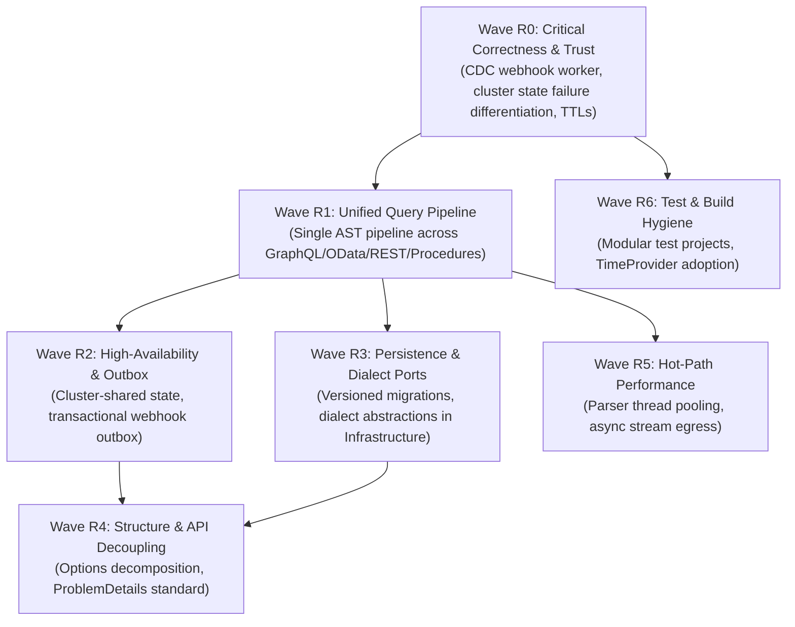

# Solution Architecture Review & Strategic Remediation Roadmap

**Document ID:** `PLAN-ARCH-REVIEW`  
**Location:** `doc/plan/architecture.md` (or `docs/plans/architecture.md`)  
**Status:** REVIEW DELIVERED · REMEDIATION ACTIVE 📋  
**Parent Plan:** [`00-master-plan-overview.md`](00-master-plan-overview.md)  
**Role:** Solution Architect & Engineering Lead  
**Scope:** Full-solution architectural inspection across all production assemblies (`Autheris.Api`, `Autheris.Application`, `Autheris.Domain`, `Autheris.Infrastructure`, `Autheris.Extensions`, `Autheris.GraphQL`, `TrinoSqlEngine`), test suites, and deployment configurations.

---

## 1. Executive Summary & Review Verdict

A comprehensive architectural inspection of the Autheris platform was performed. The solution graph is acyclic and strictly follows the Onion Architecture rule (Domain → Application → Infrastructure / Extensions / GraphQL → Api), with NetArchTest architecture guardrails in CI, centralized egress SSRF defense, and assembly hash pinning for plugins.

However, the internal implementation within layers exhibits architectural fragmentation and debt across ten distinct themes:

| Slice | Focus Area | High | Medium | Low | Total Findings |
|---|---|:---:|:---:|:---:|:---:|
| **01 Layering** | Domain models, DI composition, dependency direction | 3 | 9 | 6 | 18 |
| **02 API** | Minimal API endpoints, middleware pipelines, error formats | 4 | 10 | 5 | 19 |
| **03 App Core** | Governance, access planning, policy enforcers, caching | 5 | 10 | 4 | 19 |
| **04 Features** | Feature modules, CloudEvents, webhooks, extensions | 4 | 10 | 6 | 20 |
| **05 Infra & GraphQL** | DB repositories, WORM persistence, HotChocolate schema | 6 | 10 | 5 | 21 |
| **06 Engine & Tests** | ANTLR parser, typed AST compiler, test suite structure | 4 | 13 | 7 | 24 |
| **Total** | | **26** | **62** | **33** | **121** |

---

## 2. The 10 Core Architectural Themes

### Theme T1: Converge on One Governed Query Pipeline
* **Findings:** ARC-C-01, ARC-S-01, ARC-S-02, ARC-C-12, ARC-A-01, ARC-A-05, ARC-G-01, ARC-G-07, ARC-T-06.
* **Problem:** Four parallel execution paths (GraphQL table reads, OData string-composed SQL, REST datasets, and WebSQL/Trino) had divergent masking and RLS pushdown logic.
* **Resolution / Target:** Unified AST compilation path (`ISqlEngine.Compile`) established under `PLAN-AST-DIALECT-GEN-16` / `F-DIALECT-02`. Table reads and procedure calls now execute via typed AST compiler pushdown with zero string concatenation.

### Theme T2: Unified Audit Contract with Explicit Failure Semantics
* **Findings:** ARC-A-02, ARC-C-03, ARC-C-04, ARC-C-14, ARC-C-09, ARC-C-17.
* **Problem:** Inconsistent failure handling across audit calls; convenience constructors defaulted to `NullAuditLogRepository`.
* **Resolution / Target:** Tier-A security audit events fail closed (aborting execution upon audit failure); Tier-B operational telemetry writes to a bounded, non-blocking channel. Remove `Null*` fallbacks from all production constructor overloads.

### Theme T3: Thin the Application Layer via Explicit Ports
* **Findings:** ARC-L-02, ARC-C-02, ARC-F-19, ARC-I-02, ARC-S-07, ARC-L-04, ARC-C-10, ARC-C-16, ARC-C-18.
* **Problem:** `Autheris.Application` carried heavy database drivers, ADO.NET connectors, DuckDB execution, Arrow Flight, and Oracle specifics.
* **Resolution / Target:** Introduce `IDialect` / `ISqlDialectProvider` owned by the compiler. Move ADO.NET execution and analytics drivers into `Autheris.Infrastructure.Analytics`. Enforce package boundary tests forbidding infrastructure SDKs in Application.

### Theme T4: Governance Persistence & Versioned Schema Migrations
* **Findings:** ARC-L-03, ARC-I-01, ARC-I-04, ARC-I-05, ARC-I-12, ARC-I-13.
* **Problem:** Idempotent DDL executed inside repository constructors across SQLite, SQL Server, and PostgreSQL without schema version tracking.
* **Resolution / Target:** Implement a versioned database migration runner (`autheris_schema_migrations` table) executing once during startup under a distributed lock. Pool connections in WAL mode for SQLite.

### Theme T5: Explicit Cluster & High-Availability Semantics
* **Findings:** ARC-C-05, ARC-I-03, ARC-I-07, ARC-I-08, ARC-G-03, ARC-F-06, ARC-F-07, ARC-F-10, ARC-C-07, ARC-C-13, ARC-L-16.
* **Problem:** Per-node in-memory storage of access plans, one-time tokens, and secrets caused split-brain vulnerabilities in multi-replica deployments.
* **Resolution / Target:** Explicit state classification: node-local cache vs. cluster-shared vs. durable WORM storage. Cluster state provider must differentiate "key absent" from "Redis cluster unavailable" to fail closed safely.

### Theme T6: Eventing, Webhooks & Plugin Contracts
* **Findings:** ARC-F-01, ARC-F-02, ARC-F-03, ARC-F-04, ARC-F-11, ARC-F-15, ARC-F-16, ARC-F-17, ARC-F-20.
* **Problem:** Synchronous `Task.WhenAll` inside event bus blocked caller HTTP pipelines; CDC webhook dispatcher lacked hosted delivery loop.
* **Resolution / Target:** Publish events to a bounded `Channel<T>` consumed by background hosted services. Implement transactional outbox for webhooks, retrying only 5xx/429/network errors with fresh HMAC signatures.

### Theme T7: Configuration & God-Class Decomposition
* **Findings:** ARC-L-01, ARC-L-07, ARC-L-11, ARC-A-04, ARC-C-06, ARC-F-14, ARC-S-11, ARC-G-08, ARC-C-11.
* **Problem:** `GatewayOptions` grew to over 2,000 lines injected across 275 sites; `CasbinEnforcementService` exceeded 1,800 lines.
* **Resolution / Target:** Decompose into scoped options (`IOptions<ODataOptions>`, `IOptions<McpOptions>`) with `IValidateOptions<T>` and `ValidateOnStart()`. Refactor large service classes by single responsibility.

### Theme T8: API Surface Standardization
* **Findings:** ARC-A-03, ARC-A-07, ARC-A-08, ARC-A-09, ARC-A-10, ARC-A-13, ARC-A-14, ARC-A-15, ARC-A-16, ARC-A-17, ARC-A-18, ARC-A-19, ARC-A-06.
* **Problem:** Mixed error payload shapes, 43 imperative `HasRole()` calls rather than declarative policies, inline HTML/JS assets.
* **Resolution / Target:** Enforce RFC 7807 `ProblemDetails` across all endpoints with stable error codes. Replace imperative role assertions with declarative authorization policies.

### Theme T9: Hot-Path Performance Optimization
* **Findings:** ARC-S-03, ARC-S-04, ARC-S-09, ARC-S-13, ARC-S-15, ARC-A-11, ARC-A-12, ARC-I-06, ARC-G-02, ARC-G-06, ARC-C-14, ARC-I-10.
* **Problem:** Thread creation per parse in `FastSqlEngine`, unstreamed memory buffering for large connector datasets.
* **Resolution / Target:** Bounded large-stack worker thread pool for ANTLR parsing. Stream results via `IAsyncEnumerable<T>` and zero-allocation span-based encoding.

### Theme T10: Engineering Hygiene, Test Structure & Tooling
* **Findings:** ARC-T-01..08, ARC-L-08, ARC-L-09, ARC-L-10, ARC-L-13, ARC-L-14, ARC-L-15, ARC-L-17, ARC-S-06, ARC-S-10, ARC-S-12, ARC-S-14, ARC-S-16, ARC-I-09, ARC-I-11, ARC-G-04, ARC-G-05, ARC-F-12, ARC-F-13, ARC-F-18, ARC-C-19.
* **Problem:** Monolithic 100k-LOC unit test project; `#if DEBUG` test seams in security visitors; globally suppressed analyzer rules.
* **Resolution / Target:** Modularize test projects per production assembly. Use .NET 10 `TimeProvider` instead of real clock delays. Remove `#if DEBUG` branching in production security visitors.

---

## 3. Prioritized Remediation Waves (R0–R6)

| Wave | Remediation Focus | Key Deliverables | Status |
|---|---|---|:---:|
| **R0** | Correctness & Trust | Wire `CdcWebhookDeliveryService` (or remove uncalled handlers); `IClusterStateProvider` absent vs unavailable differentiation; plan/token TTL eviction. | **PENDING 📋** |
| **R1** | Unified Pipeline | Standardize GraphQL/OData/REST table reads on `ISqlEngine.Compile` AST pushdown. | **IN PROGRESS 🚀** |
| **R2** | HA & State | Distributed state provider integration, Redis epoch reconciliation, webhook outbox. | **PLANNED 📋** |
| **R3** | Persistence & Dialects | `autheris_schema_migrations` runner; decouple ADO.NET from `Autheris.Application`. | **PLANNED 📋** |
| **R4** | API & Options | Split `GatewayOptions`; standard `ProblemDetails` error catalog; declarative auth policies. | **PLANNED 📋** |
| **R5** | Performance | ANTLR thread pool; `IAsyncEnumerable<T>` streaming on large egress queries. | **PLANNED 📋** |
| **R6** | Engineering Hygiene | Split `Autheris.Tests.Unit`; purge obsolete `#if DEBUG` seams; adopt `FakeTimeProvider`. | **PLANNED 📋** |

---

## 4. Architecture Test Guardrails (Enforced in CI)

1. **Domain Isolation:** `Autheris.Domain` references zero external packages (BCL only).
2. **Application Decoupling:** `Autheris.Application` must not reference concrete ADO.NET packages (`Microsoft.Data.*`, `Npgsql`, `DuckDB.NET`), `Apache.Arrow`, or construct raw `HttpClient`.
3. **DI Cleanliness:** No usage of `IServiceProvider.GetService()` or service-locator anti-patterns outside composition roots.
4. **GraphQL Encapsulation:** `HotChocolate.*` is restricted to `Autheris.GraphQL` and composition roots.
5. **No Production Test Doubles:** No production class references `Null*` repositories or test mocks.
6. **No Constructor I/O:** Types registered as singletons must not open connections or run queries in constructors.
