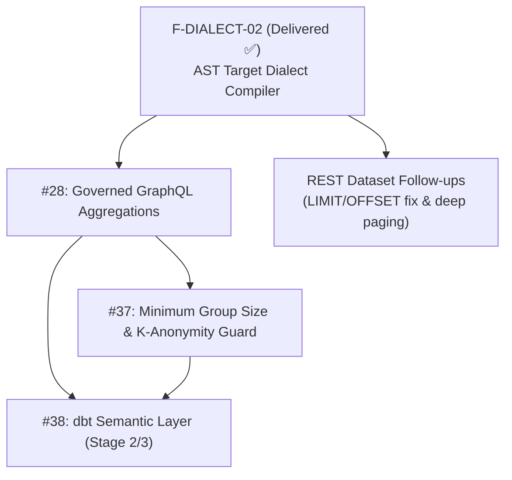

# Feature Roadmap & Architectural Execution Plan

**Document ID:** `PLAN-FEATURES-ROADMAP`  
**Location:** `doc/plan/features.md` (or `docs/plans/features.md`)  
**Status:** ACTIVE & IN EXECUTION 🚀  
**Parent Plan:** [`00-master-plan-overview.md`](00-master-plan-overview.md)  
**Scope:** Active and planned functional feature streams building on the delivered AST SQL compiler (`F-DIALECT-02`), federated virtual filters (`F-GOV-14`), and OpenAPI ingestion (`F-AI-16`).

---

## 1. Executive Summary

Waves 1–3 (#26, #27, #29, #30, #31, #32, #33, #34, #35, #40, #41, #42, #43, #44) and the non-AST parts of Wave 4 (#36, #39, #38 Stage 1) are delivered and documented in [`docs/features/`](../features/README.md) (`f-sec-05`, `f-gov-15`, `f-gov-16`, `f-gov-17`, `f-dialect-02`).

The active roadmap focuses on AST-dependent analytics, aggregation pushdown, privacy budgeting, and headless BI integrations:

---

## 2. Active Feature Tracks

### 2.1 Issue #28: Governed Aggregation in GraphQL (`count`, `sum`, `avg`, `min`, `max`)

* **Problem Statement:** Clients requiring aggregated metrics currently retrieve all raw rows and compute aggregations client-side, causing severe network bandwidth and CPU exhaustion.
* **Architecture Design:**
  - Add native aggregation fields to GraphQL schema: `aggregate(groupBy: [...]) { count sum { column } avg { column } min { column } max { column } }`.
  - Rewrite into AST pushdown (`GROUP BY`, `SUM(...)`) within the unified AST compiler (`TrinoSqlEngine`).
  - **Zero-Trust Security Enforcement:**
    - Base row filters (RLS / consent) apply strictly before aggregation.
    - Aggregation over masked columns is rejected fail-closed (`AGGREGATION_ON_MASKED_COLUMN`).
* **Component Touchpoints:** `Autheris.Application.Ast.Compilers.SingleQueryAstCompiler`, `HotChocolateSchemaBuilder`, `TrinoSqlEngine`.
* **Acceptance Criteria:**
  - Grouped aggregations enforce row-level security before calculating aggregates.
  - Reject queries attempting to aggregate over columns with active masking rules.

---

### 2.2 Issue #37: Minimum Group Size & K-Anonymity Guard

* **Problem Statement:** Small aggregate groups (e.g., salary or health status in a department with only 1 or 2 individuals) allow re-identification and de-anonymization.
* **Architecture Design:**
  - Configure `MinimumGroupSize` per dataset or measure (e.g. `threshold = 5`).
  - Aggregation engine injects `HAVING COUNT(*) >= :threshold` or aggregates small buckets into an `Other` bucket.
  - Differential privacy guard against differencing attacks (e.g. Total minus known large group).
* **Component Touchpoints:** `AstAggregationRewriter`, `PrivacyBudgetService`.
* **Acceptance Criteria:**
  - Groups with fewer rows than the threshold are suppressed or merged.
  - API response metadata indicates `suppressedGroupsCount`.

---

### 2.3 Issue #38: dbt Semantic Layer Integration & Headless BI (Stage 2/3)

* **Problem Statement:** Organizations defining standardized business metrics in dbt Semantic Layer require a single governed gateway to expose metrics to applications, AI agents, and BI dashboards.
* **Architecture Design:**
  - **Stage 1 (Completed):** MetricFlow-compiled SQL passes through governed SQL compiler with row filters and column masking.
  - **Stage 2 (In Execution):** `query_metrics` GraphQL and MCP endpoint compiling semantic queries into AST pushdown with mandatory row filters, masked column protection, and group size guards (#37).
  - **Stage 3 (Planned):** Full headless BI connectivity via Trino protocol and Apache Arrow Flight SQL endpoints.
* **Component Touchpoints:** `Autheris.Extensions.Dbt`, `TrinoSqlEngine`, `McpProtocolHandler`.
* **Acceptance Criteria:**
  - Semantic metrics queryable via GraphQL and MCP with full tenant isolation and audit logging.

---

### 2.4 REST Dataset Channel Follow-Ups

1. **REST Dataset `LIMIT`/`OFFSET` Parser Bug:**
   - **Problem:** `GET /api/v1/data/{source}/{schema}/{table}` generates `LIMIT .. OFFSET ..` that the cross-source parser rejects, returning 500 instead of 403 on web-API tables.
   - **Status:** Being finalized on `fix/rest-dataset-limit-offset`; fails closed until merged.
2. **REST Dataset Deep Paging Pushdown:**
   - **Architecture:** Emit dialect-specific `OFFSET` (e.g. `OFFSET x ROWS FETCH NEXT y ROWS ONLY`) via the AST compiler rather than performing in-memory row skips.
   - **Milestone:** Lift the pagination-window cap once per-dialect OFFSET pushdown is validated across all supported backends.
