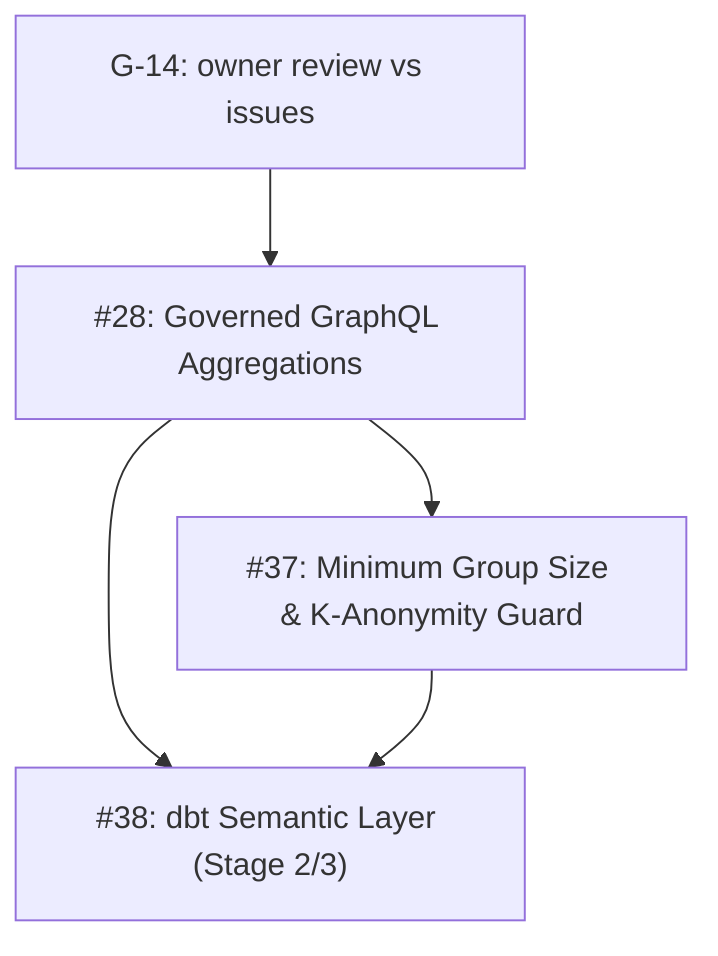

# Feature Roadmap & Architectural Execution Plan

**Document ID:** `PLAN-FEATURES-ROADMAP`  
**Location:** `docs/plans/features.md`  
**Status:** COMPLETED & VERIFIED ✅  
**Last Updated:** 2026-10-15 · **Baseline:** `main` at `3d519e95`  
**Parent Plan:** [`00-master-plan-overview.md`](00-master-plan-overview.md)  
**Implementation Plan:** [`implementation/impl-features-analytics.md`](implementation/impl-features-analytics.md); global order in [`implementation/00-implementation-roadmap.md`](implementation/00-implementation-roadmap.md)  
**Scope:** Analytics, federation, incremental sync, static query analysis, and value profiling feature streams (#28, #37, #38, #75, #77, #79, #80).

---

## 1. Executive Summary

Delivered and documented in [`docs/features/`](../features/README.md):
- Roadmap Waves 1–4 (#26–#44), REST dataset OFFSET pushdown (`F-DATA-06`), and compiler rejection of masked columns in aggregates and `GROUP BY` (`AGGREGATION_ON_MASKED_COLUMN`).
- **Issue #28 & #37 (`F-DATA-08`):** Governed server-side aggregations (`count`, `sum`, `avg`, `min`, `max`, `groupBy`) with post-RLS $k$-anonymity minimum group size guard (`Suppress` and `MergeIntoOther`) and differencing-safe totals.
- **Issue #38 (`F-DBT-07`):** dbt Semantic Layer metric catalog (`list_metrics`, `describe_metric`) and governed `query_metrics` execution with metric-scoped consents (`metric:<name>`) and manifest version tracking.
- **Issue #75 (`F-GOV-19`):** Governed cross-source GraphQL relations via batched `WHERE key IN (...)` key lookup (N:1 and 1:N), clear-key enforcement, bounded cross-source filter pushdown, and cross-source sort guard.
- **Issue #77 (`F-DATA-09`):** Lightweight HMAC-signed change tokens (`ETag` / `If-None-Match` -> `304 Not Modified`) and stateless caller-bound `changesSince` cursors with RLS-exit detection and `DeletedKeyPolicy`.
- **Issue #79 (`F-GOV-20`):** Zero-read static query analysis, access requirements with hidden-dataset anti-oracle, bundled multi-table consent requests with `ConsumerReference`, owner group view, and `FieldSunsettingRule` deprecation reporting.
- **Issue #80 (`F-AI-17`):** Privacy-coarsened column value profiles in `describe_dataset`, `ReleaseProfileToCatalogViewers` gate, and deterministic synthetic sample rows (`sample_rows(synthetic: true)`).

---

## 2. Open Feature Tracks

### 2.1 Issue #28: Governed Aggregation in GraphQL (`count`, `sum`, `avg`, `min`, `max`)

* **Problem Statement:** Clients requiring aggregated metrics retrieve all raw rows and compute aggregations client-side, causing network and CPU exhaustion.
* **Architecture Design:**
  - Add aggregate fields to the catalog-generated GraphQL schema (`aggregate(groupBy: [...]) { count sum { column } avg { column } min { column } max { column } }`).
  - Plan through the shared table-read planner (`IGovernedTableReadPlanner`) and compile through `ISqlEngine.Compile` / `IGovernedSqlExecutionService`; do not extend `TreeSqlCompiler` (G-6).
  - Row filters (RLS / consent) apply before aggregation. Aggregation over masked columns is already rejected by the compiler (`AGGREGATION_ON_MASKED_COLUMN`).
* **Acceptance Criteria:** grouped aggregations enforce row-level security before aggregating; masked-column aggregates fail closed. **Do not release without #37.**
* **Implementation:** `WP-FEAT-03`.

### 2.2 Issue #37: Minimum Group Size & K-Anonymity Guard

* **Problem Statement:** Small aggregate groups allow re-identification.
* **Architecture Design:**
  - Configure a minimum group size per dataset or measure (e.g. `threshold = 5`); suppress or merge small groups (`HAVING COUNT(*) >= :threshold` or an `Other` bucket).
  - Optional differencing defence via `DifferentialPrivacyEngine` noise, only on compliance demand (G-12).
* **Acceptance Criteria:** groups below the threshold are suppressed or merged; response metadata reports `suppressedGroupsCount`. No k-guard on free-form SQL in v1 (G-12).
* **Implementation:** `WP-FEAT-04`, optional `WP-FEAT-05`.

### 2.3 Issue #38: dbt Semantic Layer Stage 2/3

* **Stage 2:** register the existing `list_metrics` / `describe_metric` MCP tools, make the semantic catalog tenant-aware and persistent, then add `query_metrics` for GraphQL and MCP with row filters, masks and the #37 group-size guard (`WP-FEAT-06a/b`).
* **Stage 3:** headless BI connectivity via the Trino protocol, semantic models as catalog views and a gRPC Arrow Flight SQL server (`WP-FEAT-07a/b/c`). Name the target BI clients first (G-12).
* **Component Touchpoints:** `Autheris.Extensions.Dbt`, `McpSemanticTools`, `ISqlEngine.Compile`, `IGovernedSqlExecutionService`.
* **Acceptance Criteria:** semantic metrics queryable via GraphQL and MCP with full tenant isolation and audit logging.
