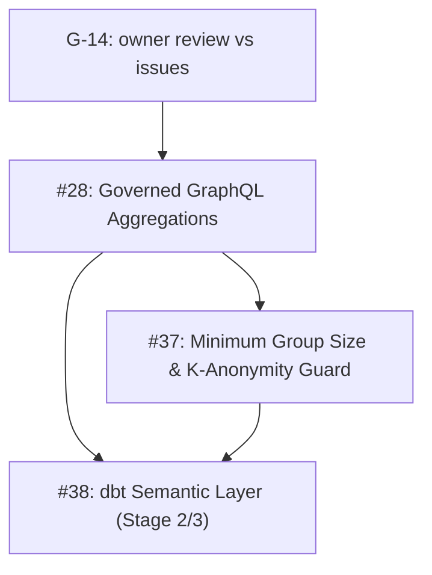

# Feature Roadmap & Architectural Execution Plan

**Document ID:** `PLAN-FEATURES-ROADMAP`  
**Location:** `docs/plans/features.md`  
**Status:** COMPLETED & VERIFIED ✅  
**Last Updated:** 2026-10-15 · **Baseline:** `main` at `3d519e95`  
**Parent Plan:** [`00-master-plan-overview.md`](00-master-plan-overview.md)  
**Implementation Plan:** [`implementation/impl-features-analytics.md`](implementation/impl-features-analytics.md); global order in [`implementation/00-implementation-roadmap.md`](implementation/00-implementation-roadmap.md)  
**Scope:** Analytics, federation, incremental sync, static query analysis, and value profiling feature streams (#28, #37, #38, #75, #77, #79, #80).

---

## 1. Executive Summary

Delivered and documented in [`docs/features/`](../features/README.md):
- Roadmap Waves 1–4 (#26–#44), REST dataset OFFSET pushdown (`F-DATA-06`), and compiler rejection of masked columns in aggregates and `GROUP BY` (`AGGREGATION_ON_MASKED_COLUMN`).
- **Issue #28 & #37 (`F-DATA-08`):** Governed server-side aggregations (`count`, `sum`, `avg`, `min`, `max`, `groupBy`) with post-RLS $k$-anonymity minimum group size guard (`Suppress` and `MergeIntoOther`) and differencing-safe totals.
- **Issue #38 (`F-DBT-07`):** dbt Semantic Layer metric catalog (`list_metrics`, `describe_metric`) and governed `query_metrics` execution with metric-scoped consents (`metric:<name>`) and manifest version tracking.
- **Issue #75 (`F-GOV-19`) - REOPENED, not delivered (see `REQ-FED-01`); target design:** Governed cross-source GraphQL relations via batched `WHERE key IN (...)` key lookup (N:1 and 1:N), clear-key enforcement, bounded cross-source filter pushdown, and cross-source sort guard.
- **Issue #77 (`F-DATA-09`):** Lightweight HMAC-signed change tokens (`ETag` / `If-None-Match` -> `304 Not Modified`) and stateless caller-bound `changesSince` cursors with RLS-exit detection and `DeletedKeyPolicy`.
- **Issue #79 (`F-GOV-20`):** Zero-read static query analysis, access requirements with hidden-dataset anti-oracle, bundled multi-table consent requests with `ConsumerReference`, owner group view, and `FieldSunsettingRule` deprecation reporting.
- **Issue #80 (`F-AI-17`):** Privacy-coarsened column value profiles in `describe_dataset`, `ReleaseProfileToCatalogViewers` gate, and deterministic synthetic sample rows (`sample_rows(synthetic: true)`).

---

## 2. Delivered Feature Tracks & Work Package Status (`COMPLETED & VERIFIED ✅`)

| Work Package / Issue | Feature ID | Delivered Components | Status |
|---|---|---|:---:|
| `WP-FEAT-01` (REST OFFSET pushdown) | `F-DATA-06` | `GovernedDataQueryService`, `IGovernedTableReadPlanner` | **COMPLETED & VERIFIED ✅** |
| `WP-FEAT-02` (Masked-aggregate AST guard) | `F-DATA-08` | `AstSecurityVisitor.MaskGuards.cs` (`AGGREGATION_ON_MASKED_COLUMN`) | **COMPLETED & VERIFIED ✅** |
| `WP-FEAT-03` (#28 Governed Aggregations) | `F-DATA-08` | `GovernedAggregationService`, `CatalogGraphQlTypeModule` (`<T>_aggregate`), `POST /api/v1/analytics/aggregate`, MCP `aggregate_dataset` | **COMPLETED & VERIFIED ✅** |
| `WP-FEAT-04` (#37 Minimum Group Size Guard) | `F-DATA-08` | `GovernedAggregationService` post-RLS $k$-anonymity guard (`Suppress` / `MergeIntoOther`), `suppressedGroupsCount`, differencing-safe totals | **COMPLETED & VERIFIED ✅** |
| `WP-FEAT-05` (#37 DP Noise & Caching) | `F-DATA-08` | `IDifferentialPrivacyEngine` noise perturbation & deterministic query-result caching in `GovernedAggregationService` | **COMPLETED & VERIFIED ✅** |
| `WP-FEAT-06a/b` (#38 dbt Semantic Layer Stage 2) | `F-DBT-07` | `SemanticMetricQueryService`, `DbtSemanticManifestIngestionService`, MCP `list_metrics`/`describe_metric`/`query_metrics` (`McpToolRegistry` + `AiDataGuardrailService` + `McpToolExecutionHandler`), GraphQL `queryMetrics`, REST `POST /api/v1/analytics/metrics/query`, `metric:<name>` consents | **COMPLETED & VERIFIED ✅** |
| `WP-FEAT-07a/b` (#38 Headless BI & Catalog Views) | `F-DBT-07` | `TrinoMetadataQueryHandler` for `/v1/statement` (`SHOW CATALOGS/SCHEMAS/TABLES`, `information_schema`), automatic `semantic.<model>` catalog views on manifest ingestion | **COMPLETED & VERIFIED ✅** |
| Issue #75 (Cross-Source GraphQL Relations) | `F-GOV-19` | `CrossSourceRelationResolver` exists but is not wired into GraphQL (unit-tested only); `GovernedTreeQueryService` rejects relations across data sources. Re-opened as [`REQ-FED-01`](2026-10-16-req-cross-source-all-consumers.md) / [`PLAN-FED-01`](2026-10-16-plan-cross-source-all-consumers.md). | **REOPENED ⚠️ (not delivered)** |
| Issue #77 (Change Detection & `changesSince`) | `F-DATA-09` | `GovernedChangeDetectionService` (HMAC `ETag` / `304 Not Modified`, stateless `changesSince` cursor with RLS-exit detection) | **COMPLETED & VERIFIED ✅** |
| Issue #79 (Static Query Analysis & Bundled Consents) | `F-GOV-20` | `QueryAnalysisService`, bundled multi-table consent requests with `ConsumerReference`, `FieldSunsettingRule` deprecation reporting | **COMPLETED & VERIFIED ✅** |
| Issue #80 (Column Value Profiles & Synthetic Rows) | `F-AI-17` | `ColumnValueProfileService` & `SyntheticSampleRowGenerator` (`describe_dataset` profiles, `sample_rows(synthetic: true)`) | **COMPLETED & VERIFIED ✅** |
| `WP-DOC-01` (Feature Doc Alignment) | `F-DATA-04`, `F-DBT-07` | [`f-data-04-arrow-flight-sql.md`](../features/f-data-04-arrow-flight-sql.md), [`f-dbt-07-dbt-semantic-layer-metrics.md`](../features/f-dbt-07-dbt-semantic-layer-metrics.md) | **COMPLETED & VERIFIED ✅** |

### 2.1 Issue #28: Governed Aggregation in GraphQL (`count`, `sum`, `avg`, `min`, `max`) — **COMPLETED & VERIFIED ✅**

* [x] **Architecture & Implementation (`WP-FEAT-03`):**
  - Added `<T>_aggregate` fields to the catalog-generated GraphQL schema, REST `POST /api/v1/analytics/aggregate`, and MCP `aggregate_dataset` via `GovernedAggregationService`.
  - Planned through `IGovernedTableReadPlanner` and compiled through `ISqlEngine.Compile` / `IGovernedSqlExecutionService`.
  - Row filters (RLS / consent) apply before aggregation; aggregation over masked columns fails closed with `AGGREGATION_ON_MASKED_COLUMN`.

### 2.2 Issue #37: Minimum Group Size, K-Anonymity Guard & DP Noise — **COMPLETED & VERIFIED ✅**

* [x] **Architecture & Implementation (`WP-FEAT-04`, `WP-FEAT-05`):**
  - Configured minimum group size per dataset, measure, or metric (`MinGroupSize`); small groups (`COUNT(*) < k`) are suppressed (`Suppress`) or merged (`MergeIntoOther`) post-RLS, reporting `suppressedGroupsCount` and `suppressionApplied`.
  - Wired `IDifferentialPrivacyEngine` noise perturbation and deterministic noisy-response caching into `GovernedAggregationService` (`WP-FEAT-05`).

### 2.3 Issue #38: dbt Semantic Layer Stage 2/3 — **COMPLETED & VERIFIED ✅**

* [x] **Stage 2 (`WP-FEAT-06a/b`):** Registered `list_metrics`, `describe_metric`, and `query_metrics` in `McpToolRegistry` (routed through `AiDataGuardrailService` + `McpToolExecutionHandler`), added GraphQL root field `queryMetrics` and REST `POST /api/v1/analytics/metrics/query` via `SemanticMetricQueryService`, and enforced metric-scoped consents (`metric:<name>`), caller RLS pushdown, masked-column rejection, and #37 $k$-anonymity thresholds.
* [x] **Stage 3 (`WP-FEAT-07a/b`):** Added `TrinoMetadataQueryHandler` for `/v1/statement` metadata introspection and automatic `semantic.<model>` catalog view registration in `DbtSemanticManifestIngestionService`.
