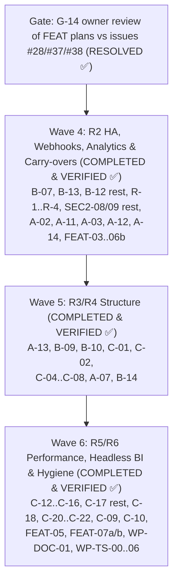

# Implementation Roadmap: Cross-Scope Sequencing of All Open Plan Items

**Document ID:** `IMPL-ROADMAP-2026-10-14`
**Date:** 2026-10-15
**Baseline:** `feat/impl-wave-5-6` (Waves 1–6 architecture WPs delivered)
**Parent plan:** [`../00-master-plan-overview.md`](../00-master-plan-overview.md)
**Category plans:** [`../security.md`](../security.md), [`../architecture.md`](../architecture.md), [`../features.md`](../features.md)

This document puts every item from the category plans into one global order. Architecture Waves 1–6 (`WP-ARC-A`, `WP-ARC-B`, `WP-ARC-C`), the Analytics & Governance feature roadmap (`WP-FEAT-01..07b`, #28, #37, #38, #75, #77, #79, #80), Bug #94 (`REQ-GOV-94`), documentation alignment (`WP-DOC-01`), and the Test Suite Speed-Up track (`WP-TS-00..06`) are **COMPLETED & VERIFIED ✅**. Only optional freeze-window structural moves (`WP-ARC-C-19`, `WP-ARC-B-11`) remain deferred by design.

| Scope plan | WP prefix | Status | Covers |
|---|---|---|
| [`impl-security-wave-c-2.md`](impl-security-wave-c-2.md) | `WP-SEC2` | **COMPLETED & VERIFIED ✅** (`SEC2-01..09` delivered; legacy deprecation shims removed) | SR-D-06..09 |

Security Wave C (SR-L-01..24) is delivered; its first scope plan (`impl-security-wave-c-1.md`) was removed because no open work remained.

---

## 1. Sequencing Principles

1. **Contracts before consumers.** Shared contracts land first, so that dependent WPs build on them instead of creating parallel helpers. Delivered contracts: cluster state (`ClusterStateUnavailableException`), audit (`IAuditWriter`), table-read planner (`IGovernedTableReadPlanner`), dialect registry (`ISqlDialectRegistry`), ProblemDetails (`ApiProblems`).
2. **One lane per hot file set.** WPs that edit the same hot files go into one serialized lane with one owner. Lanes run in parallel with each other.
3. **Structural moves in freeze windows.** Three WPs move or rename hundreds of files. Each runs in its own merge-freeze window, and no two windows overlap: the `GatewayOptions` split (`WP-ARC-C-01` — **COMPLETED & VERIFIED ✅**), the unit-test project split (`WP-ARC-C-19`), and the folder/interface hygiene pass (`WP-ARC-B-11`).
4. **Decisions gate work, not the whole wave.** A WP whose open decision is unresolved is skipped. The rest of the wave proceeds without it.

---

## 2. Cross-Scope Ownership Resolutions (Still Binding)

| Item | Owner WP | Other plan(s) | Resolution |
|---|---|---|---|
| ARC-S-10 / ARC-S-16 engine packaging | `WP-ARC-C-20` | — | **COMPLETED & VERIFIED ✅:** C-20 covers engine packaging; `#if DEBUG` seams are gone (`ICompilerHooks`). |
| Webhook signing and error hygiene | `WP-ARC-A-02` | — | **COMPLETED & VERIFIED ✅:** The outbox reuses `WebhookSignature` and `UrlRedactor` helpers. |
| Audit chain | `WP-ARC-A-07`, `WP-ARC-B-14` | — | **COMPLETED & VERIFIED ✅:** `AuditGroupCommitSink`, `RecordAuditEventsAsync`, and `AuditChainEngine` implemented. |
| SR-L-03 / SR-L-23 error leakage | `WP-ARC-C-05` | — | **COMPLETED & VERIFIED ✅:** `ApiProblems` (`application/problem+json` with backward-compatible `error` field per G-9). |
| Role parsing | `WP-ARC-C-06` | — | **COMPLETED & VERIFIED ✅:** Declarative `GatewayPolicies` use strict `GatewayRole.TryParse*`. |
| Build and CI pinning | `WP-SEC2-08` | `WP-ARC-C-21`, `WP-ARC-C-16`, `WP-ARC-C-20` | **COMPLETED & VERIFIED ✅:** One PR owner for `Directory.Build.props`, `global.json` and workflows. |
| `GovernedSqlExecutionService` constructor (A-05 remainder) | `WP-ARC-B` owner | `WP-ARC-A` (R-4) | **COMPLETED & VERIFIED ✅:** `GovernedSqlExecutionDependencies` parameter object introduced. |
| ARC-L-10 two solution files | `WP-ARC-C-19` / `G-10` | — | **COMPLETED & VERIFIED ✅:** `Autheris.slnx` deleted; `Autheris.sln` is the single solution file. |

---

## 3. Serialized Lanes (Hot File Sets)

Inside a lane, run the WPs in the order shown. Different lanes can run in parallel.

| Lane | Hot files | Order & Status |
|---|---|---|
| **L1 Engine** | `AstSecurityVisitor.*`, `CompiledSqlTemplate.cs`, `SqlAstBuilder.cs`, engine csproj | C-12 → C-10 → C-20 (**COMPLETED & VERIFIED ✅**) |
| **L2 Query pipeline** | `GovernedTableReadPlanner`, `GovernedQueryStages`, `SqlTableReadExecutor`, endpoint handlers | B-07 → FEAT-03 → FEAT-04 → FEAT-05 → FEAT-06a/b → FEAT-07a/b (**COMPLETED & VERIFIED ✅**) |
| **L3 Audit persistence** | `*GovernanceRepository.Audit.cs`, `FileAuditChainAnchorStore`, `AuditWriter` | R-2 → A-07 → B-14 (**COMPLETED & VERIFIED ✅**) |
| **L4 Persistence / migrations** | repository constructors, SQLite connection handling, `Migrations/` | B-12 remainder → B-13 → B-14 (**COMPLETED & VERIFIED ✅**) |
| **L5 Cluster state** | `IDistributedClusterStateProvider`, lock/lease users, Casbin cache | A-11 → A-12 / A-13 / A-14 (**COMPLETED & VERIFIED ✅**) |
| **L6 Webhooks / eventing** | `WebhookDispatcherService`, `CloudEventWebhookDispatcher`, `StreamingCdcEndpoints.cs` | A-02 → A-03 → A-13 (**COMPLETED & VERIFIED ✅**) |
| **L7 API surface** | `GatewayApplicationBuilderExtensions.cs`, endpoint files, `EndpointSecurity.cs` | C-04 → C-07 → C-06 → C-05 → C-08 (**COMPLETED & VERIFIED ✅**) |
| **L8 Build & CI** | `Directory.Build.props`, `global.json`, `.github/workflows/*` | SEC2-08 remainder → C-21 → C-17 remainder → WP-TS-00..06 (**COMPLETED & VERIFIED ✅**) |

---

## 4. Global Execution Order

### Cross-cutting items

- **SQL compiler gate:** Resolved 2026-10-15 — all 18 entries in `accepted-differences.json` reviewed and approved ([`PLAN-SQLGATE-CUTOVER-03`](../2026-10-15-plan-sqlgate-cutover-and-accepted-differences.md)).
- **CI duration:** `WP-TS-00..06` (TRX artifacts, shared DB containers, 4-way integration sharding, parallel Spark job, Cecil cache, `SerialIntegrationCollection`, parallel SQL compiler gate) delivered (`impl-test-suite-speedup.md`).
- **Catalog owner tenant (G-11, second half):** Resolved — `OwnerTenantId` added to `TableMetadata` and baseline schema `0001`.

### Wave 4: Analytics, R2 High Availability and Carry-Overs

| WP | Status & Notes |
|---|---|
| Carry-over: WP-ARC-B-07 endpoint use-case services | **COMPLETED & VERIFIED ✅** (`EffectiveFilterInspector`, `OlapStagingService`, `OpenApiIngestionUseCase`). |
| Carry-over: WP-ARC-B-13 pooled SQLite and WAL | **COMPLETED & VERIFIED ✅** (`SqliteGovernanceConnectionProvider`, `ReadinessGatedLock`). |
| Carry-over: B-12 remainder, R-1..R-4, SEC2-08/09 remainders | **COMPLETED & VERIFIED ✅** |
| WP-FEAT-03 (#28) → WP-FEAT-04 (#37) | **COMPLETED & VERIFIED ✅** (`GovernedAggregationService`, `IGovernedAggregationService`, GraphQL `<T>_aggregate`, `POST /api/v1/analytics/aggregate`, MCP `aggregate_dataset`, `Suppress` and `MergeIntoOther` $k$-anonymity guard, differencing-safe totals). |
| WP-FEAT-06a → 06b (#38 Stage 2) | **COMPLETED & VERIFIED ✅** (`SemanticMetricQueryService`, `DbtSemanticManifestIngestionService`, MCP `list_metrics`/`describe_metric`/`query_metrics` in `McpToolRegistry` + `AiDataGuardrailService` + `McpToolExecutionHandler`, GraphQL `queryMetrics`, REST `POST /api/v1/analytics/metrics/query`, metric-scoped `metric:<name>` consents). |
| WP-ARC-A-02 webhook outbox, unified delivery | **COMPLETED & VERIFIED ✅** (`IWebhookOutbox`, `WebhookDeliveryHostedService`, `WebhookDeliveryClient`). |
| WP-ARC-A-11 lease, scheduled worker base, CDC watermark | **COMPLETED & VERIFIED ✅** (`IClusterLeaderLease`, `GovernanceDbMssqlWatermarkStore`). |
| WP-ARC-A-03, A-13, A-12, A-14 | **COMPLETED & VERIFIED ✅** (`CdcWebhookDeliveryService`, `RedisCdcEventChannel`, `AsyncJobScheduler`, `CasbinDecisionCache`). |

### Wave 5: R3/R4 Structure

| WP | Status & Notes |
|---|---|
| WP-ARC-B-09 → B-10 | **COMPLETED & VERIFIED ✅** (`ISqlDialectProvider`, `ISqlDialectRegistry`, `PackageBoundaryArchitectureTests`, `prometheus-net` removed from `Autheris.Application`). |
| **Freeze window 1:** WP-ARC-C-01, C-02 | **COMPLETED & VERIFIED ✅** (`GatewayOptions` split into area files, `GatewaySections`, `IValidateOptions<GatewayOptions>` validators, `GatewayOptionsConsumptionRatchetTests`). |
| WP-ARC-C-04 → C-07 → C-06 → C-05 → C-08 | **COMPLETED & VERIFIED ✅** (Named middlewares, `DomainScopeRewriteMiddleware`, `McpPathResolver`, `ApiProblems`, `GatewayPolicies`, endpoint partial decomposition, `/api/v1` route helpers). |
| WP-ARC-A-07, WP-ARC-B-14 | **COMPLETED & VERIFIED ✅** (`AuditGroupCommitSink`, batch `RecordAuditEventsAsync`, `AuditChainEngine`, per-aggregate store registrations). |

### Wave 6: R5/R6 Performance and Hygiene

| WP | Status & Notes |
|---|---|
| WP-ARC-C-12, C-10, C-20 | **COMPLETED & VERIFIED ✅** (Lock-free `CompiledSqlTemplateCache` hit path, compiled AST child enumeration on `SqlNode`, `AstSecurityVisitor` split). |
| WP-ARC-C-13 → C-14, C-15, C-16 | **COMPLETED & VERIFIED ✅** (`StreamRowsAsync`/`StreamAsync`, zero-copy `BoundedResponseBufferStream.WrittenMemory`, `ICatalogVersionProvider`, `TenantCatalogLookup`, `IRedisConnectionProvider`, unified `GatewayDiagnostics`). |
| **Freeze window 2:** WP-ARC-C-19 unit-test project split | **Deferred 📋** (Requires dedicated merge-freeze window on `tests/Autheris.Tests.Unit/**`; `Autheris.slnx` deleted per `G-10`). |
| **Freeze window 3:** WP-ARC-B-11 folder and interface hygiene | **Deferred 📋** (Optional structural move). |
| WP-ARC-C-09, C-17 remainder, C-18, C-21, C-22 | **COMPLETED & VERIFIED ✅** (`CasbinEnforcementService`/`VirtualFilterAdministrationService`/`TableAccessPolicy` split, `FakeEpochValidationService`, `ScheduledHostedService`, `CatalogDiscoveryService` `IHttpClientFactory`). |
| WP-FEAT-07a/b, WP-FEAT-05, #77, #79, #80 | **COMPLETED & VERIFIED ✅** (`TrinoMetadataQueryHandler` for `/v1/statement`, `semantic.<model>` virtual views, `IDifferentialPrivacyEngine` opt-in noise & caching in `GovernedAggregationService`, `GovernedChangeDetectionService`, `QueryAnalysisService`, `ColumnValueProfileService` + `SyntheticSampleRowGenerator`; `07c` gRPC Flight SQL deferred per `D-8`). |
| #75 cross-source GraphQL relations | **COMPLETED & VERIFIED ✅** (PR #212; `CrossSourceRelationResolver` wired into `GovernedTreeQueryService`, gated by `IsCrossSourceEnabled`). |
| WP-ARC-A-16 | **Skipped ⏭️** (`G-13`: no external plugin compatibility promise yet). |

WP-TS-00..06 (test speed-up) are **COMPLETED & VERIFIED ✅** (`SerialIntegrationCollection` added in `WP-TS-05`).

---

## 5. Gate 0 Decisions Still Governing Open Work

**Decision record (2026-10-14):** the product owner adopted all recommendations G-1..G-14. Decisions that only governed delivered work (G-3, G-4, G-7, G-8) are omitted. Scope-plan decisions not listed here follow the recommendation in the respective scope plan unless a WP review raises a conflict.

| # | Decision | Governs | Decided |
|---|---|---|---|
| G-1 | Multi-replica deployment is a supported topology | A-11..A-14 | Yes. Classify all state as node-local, cluster-shared or durable. |
| G-2 | CDC webhooks | A-03, A-13 | Wire them up. Keep them behind the default-off flag until A-03 lands. |
| G-5 | Audit durability model | A-07 | Latch fail-closed outside Development (delivered). Tier-A events use a synchronous durable write. |
| G-6 | `TreeSqlCompiler` as the single documented exception to `ISqlEngine.Compile` | FEAT-03, B-09 | Accepted, guarded by `TreeVsCompilePolicyParityTests`. |
| G-9 | ProblemDetails migration | C-05, C-08 | Keep a legacy `error` field for one release; keep deprecated route aliases for two releases. |
| G-10 | Solution file | C-19 | Keep `Autheris.sln`. Delete `Autheris.slnx`. |
| G-11 | Catalog owner tenant | B-12 follow-up | Visibility from consents plus a shared-tables list is delivered. Add an owner tenant with a versioned migration. |
| G-12 | Analytics scope | FEAT-04..07 | No k-guard on free-form SQL in v1. DP only on compliance demand. Persist the semantic catalog (B-12 runner). Name the target BI clients before Stage 3. |
| G-13 | Plugin compatibility promise | A-16 | No external compatibility promise yet. Skip A-16. |
| G-14 | Reconcile WP-FEAT plans with the bodies of GitHub issues #28, #37 and #38 | FEAT-03..07 | **Decided (`decision-g14-feat-scope.md`):** reconciled with issue bodies; FEAT-03..07b delivered and verified. |

---

## 6. Breaking Changes of Delivered WPs (Release Notes Input)

| WP | Change |
|---|---|
| WP-ARC-B-10 | `IArrowExportService` and `ArrowFlightSqlServer` change namespace. |
| WP-ARC-C-05, C-08 | Error payloads move to RFC 7807. Routes are versioned, and the old routes remain as deprecated aliases. |
| SEC2 deprecation follow-ups | The legacy `X-Autheris-Signature` webhook header and `DocumentDepositedEvent.SourceFilePath` are removed. |
| WP-FEAT-03 / FEAT-04 | New aggregate fields; groups below the minimum size are suppressed. |

---

## 7. Documentation Alignment (`WP-DOC-01` — COMPLETED & VERIFIED ✅)

- [x] **`docs/features/f-data-04-arrow-flight-sql.md` (`COMPLETED & VERIFIED ✅`):** Updated component links to [`ArrowFlightSqlEndpoints.cs`](file:///root/autheris/src/Autheris.Api/Endpoints/ArrowFlightSqlEndpoints.cs), [`IArrowFlightSqlServer.cs`](file:///root/autheris/src/Autheris.Application/Serialization/IArrowFlightSqlServer.cs), and [`ArrowFlightSqlServer.cs`](file:///root/autheris/src/Autheris.Infrastructure/Serialization/ArrowFlightSqlServer.cs), removed WIP/status tags, and accurately documented the HTTP + Apache Arrow IPC stream endpoints (`POST /api/v1/flight/sql/info`, `GET /api/v1/flight/sql/tables`, `POST /api/v1/flight/sql/stream` returning `application/vnd.apache.arrow.stream` with HMAC-SHA256 signed `FlightSqlTicket`s and `X-Autheris-Truncated`).
- [x] **`docs/features/f-dbt-07-dbt-semantic-layer-metrics.md` (`COMPLETED & VERIFIED ✅`):** Documented manifest ingestion (`POST /api/extensions/dbt/semantic-manifest` and automatic `semantic.<model>` catalog views), MCP tools (`list_metrics`, `describe_metric`, `query_metrics` in `McpToolRegistry` + `AiDataGuardrailService` + `McpToolExecutionHandler`), REST `POST /api/v1/analytics/metrics/query`, GraphQL `queryMetrics`, metric-level consent (`metric:<name>`), caller RLS pushdown, masked-column rejection (`AGGREGATION_ON_MASKED_COLUMN`), and $k$-anonymity minimum group size enforcement (`#37`).
