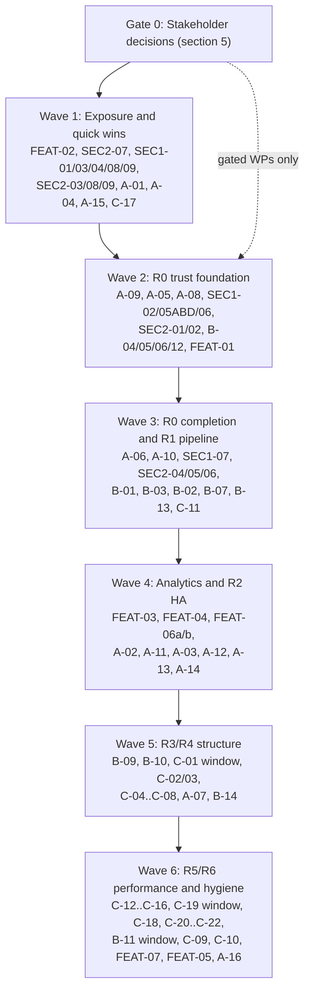

# Implementation Roadmap: Cross-Scope Sequencing of All Open Plan Items

**Document ID:** `IMPL-ROADMAP-2026-10-14`
**Date:** 2026-10-14
**Baseline:** `main` at `317e65b8`
**Parent plan:** [`../00-master-plan-overview.md`](../00-master-plan-overview.md)
**Category plans:** [`../security.md`](../security.md), [`../architecture.md`](../architecture.md), [`../features.md`](../features.md)

This document puts every open item from the three category plans into one global order. The detailed design for each work package (WP) is in the six scope plans listed below. Six solution architects wrote those plans in parallel. Each architect first checked its items against the code on `main`.

| Scope plan | WP prefix | WPs | Covers |
|---|---|:---:|---|
| [`impl-security-wave-c-1.md`](impl-security-wave-c-1.md) | `WP-SEC1` | 9 | SR-L-01..04, SR-L-06..12 |
| [`impl-security-wave-c-2.md`](impl-security-wave-c-2.md) | `WP-SEC2` | 9 | SR-L-13..24, SR-D-06..09 |
| [`impl-arch-r0-r2-trust-ha-eventing.md`](impl-arch-r0-r2-trust-ha-eventing.md) | `WP-ARC-A` | 16 | R0, R2; themes T2 (audit), T5 (HA), T6 (eventing) |
| [`impl-arch-r1-r3-pipeline-persistence.md`](impl-arch-r1-r3-pipeline-persistence.md) | `WP-ARC-B` | 14 | R1, R3; themes T1 (pipeline), T3 (ports), T4 (migrations) |
| [`impl-arch-r4-r6-api-perf-hygiene.md`](impl-arch-r4-r6-api-perf-hygiene.md) | `WP-ARC-C` | 22 | R4–R6; themes T7–T10 |
| [`impl-features-analytics.md`](impl-features-analytics.md) | `WP-FEAT` | 7 | #28, #37, #38 Stage 2/3, REST deep paging |

---

## 1. Sequencing Principles

1. **Security exposure first.** Any item that may leak data on `main` today comes before everything else. This includes items that are only *suspected* leaks.
2. **Contracts before consumers.** Shared contracts land first, so that dependent WPs build on them instead of creating parallel helpers. The shared contracts are: the cluster-state contract (`WP-ARC-A-09`), the audit contract (`WP-ARC-A-06`), the shared table-read planner (`WP-ARC-B-01`), and ProblemDetails (`WP-ARC-C-05`).
3. **One lane per hot file set.** WPs that edit the same hot files go into one serialized lane with one owner. Lanes run in parallel with each other.
4. **Structural moves in freeze windows.** Three WPs move or rename hundreds of files. Each runs in its own merge-freeze window, and no two windows overlap. The three WPs are: the `GatewayOptions` split (`WP-ARC-C-01`), the unit-test project split (`WP-ARC-C-19`), and the folder/interface hygiene pass (`WP-ARC-B-11`).
5. **Decisions gate work, not the whole wave.** A WP whose open decision is unresolved is skipped. The rest of the wave proceeds without it.

---

## 2. Cross-Scope Ownership Resolutions

Several findings were claimed by more than one scope plan. The owner below is binding. The other plan only references the owner's WP.

| Item | Owner WP | Other plan(s) | Resolution |
|---|---|---|---|
| ARC-S-06 `#if DEBUG` security seams | `WP-ARC-A-08` | `WP-ARC-C-20` | A-08 removes the seams in R0 using injected `ICompilerHooks`. C-20 keeps only ARC-S-10 and ARC-S-16 (engine packaging) and reuses the A-08 hooks. |
| SR-L-06 access plan state | `WP-ARC-A-10` (shared store) + `WP-SEC1-05` Parts A/B/D | `WP-SEC1-05` Part C | Part C is implemented as part of A-10. Parts A, B and D ship earlier and independently. |
| SR-L-10 / SR-L-18 revocation fail-closed | `WP-SEC1-06`, `WP-SEC2-04` | `WP-ARC-A-09` | Both build on the `ClusterStateUnavailableException` defined in A-09. Merge order: A-09, then SEC1-06, then SEC2-04. |
| SR-L-13 / SR-L-14 webhook signing and error hygiene | `WP-SEC2-01` | `WP-ARC-A-02` | SEC2-01 ships the `WebhookSignature` and `UrlRedactor` helpers first. A-02 (outbox) reuses them unchanged. |
| SR-L-07/08/09 audit chain | `WP-SEC1-07` | `WP-ARC-A-07`, `WP-ARC-B-14` | SEC1-07 lands first. A-07 and the audit phase of B-14 rebase on it. SR-L-08's latch surfaces as `AuditUnavailableException` from A-06. |
| SR-L-03 / SR-L-23 error leakage | `WP-SEC1-03`, `WP-SEC2-06` (interim `SafeErrorResults`) | `WP-ARC-C-05` | The security fixes ship now with a thin wrapper. C-05 later replaces the wrapper with the ProblemDetails catalog and retires the baseline allow-list. |
| SR-L-04 role parsing | `WP-SEC1-04` | `WP-ARC-C-06` | SEC1-04 lands first. C-06 (declarative policies) uses the strict parser and nothing else. |
| SR-L-24 whole-row masking, masked aggregates | `WP-FEAT-02`, `WP-SEC2-07` | `WP-ARC-B-08` | All three edit `AstSecurityVisitor.MaskGuards.cs`. Order: FEAT-02, then SEC2-07, then B-08. |
| SR-D-07 / SR-D-09 build and CI pinning | `WP-SEC2-08` | `WP-ARC-C-21`, `WP-ARC-C-16`, `WP-ARC-C-20` | One PR owner for `Directory.Build.props`, `global.json` and the workflows. |
| REST deep paging | `WP-FEAT-01` | `WP-ARC-B-01` | FEAT-01 (small, OFFSET pushdown in `GovernedDataQueryService`) lands first. B-01 then extracts the planner including the OFFSET emission. |
| ARC-L-10 two solution files | `WP-ARC-C-19` | — | CI and CLAUDE.md use `Autheris.sln`. `Autheris.slnx` is incomplete: it lacks `SqlCompilerGate`. |

---

## 3. Serialized Lanes (Hot File Sets)

Inside a lane, run the WPs in the order shown. Different lanes can run in parallel.

| Lane | Hot files | Order |
|---|---|---|
| **L1 Engine / mask guards** | `AstSecurityVisitor.MaskGuards.cs`, `SecurityCoverageVerifier.cs`, `GovernedSqlCompiler.cs`, `CompiledSqlTemplate.cs`, `TenantPredicateFactory.cs` | FEAT-02 → SEC2-07 → A-08 → B-08 → C-11 → C-12 → C-10 → C-20 |
| **L2 Query pipeline** | `GovernedDataQueryService`, `GatewayExecutionService`, `SqlDataSourceExecutor`, data DI files | FEAT-01 → B-01 → B-03 → B-02a/b/c (B-07 alongside B-02) → FEAT-03 → FEAT-04 |
| **L3 Audit persistence** | `*GovernanceRepository.Audit.cs`, `FileAuditChainAnchorStore` | SEC1-07 → A-06 → A-07 → B-14 (audit phase) |
| **L4 Persistence / migrations** | repository constructors, SQLite connection handling | B-12 → B-13 → B-14 |
| **L5 Cluster state** | `IDistributedClusterStateProvider`, `AccessPlanningService`, revocation services | A-09 → SEC1-06 → SEC2-04 → A-10 (+SEC1-05C) → A-11 → A-12 / A-13 / A-14 |
| **L6 Webhooks / eventing** | `WebhookDispatcherService`, `CloudEventWebhookDispatcher`, `StreamingCdcEndpoints.cs`, `InMemoryGatewayEventBus` | A-01 → A-04 → SEC2-01 → SEC2-02 → SEC2-05 (SR-L-20 part) → A-02 → A-03 → A-13 |
| **L7 API surface** | `GatewayApplicationBuilderExtensions.cs`, endpoint files, `EndpointSecurity.cs` | SEC1-01 → SEC1-03 → SEC1-02 → C-04 → C-07 → C-06 → C-05 → C-08 |
| **L8 Build & CI** | `Directory.Build.props`, `global.json`, `.github/workflows/*` | SEC2-08 → C-21 (analyzer part) → C-17 |

`GatewayOptions.cs` is touched by many WPs. Until `WP-ARC-C-01` lands, new options go into new standalone option classes bound to their own section with `IValidateOptions<T>`. They never become new members of `GatewayOptions`.

---

## 4. Global Execution Order

### Wave 1: Exposure and Quick Wins

Most of these WPs have no open decisions and low file overlap. They can start immediately on parallel branches.

| WP | Why now | Lane |
|---|---|---|
| **WP-FEAT-02** masked columns in `SUM(...)` / `GROUP BY` | Possible live masking bypass on WebSQL/Trino. It starts with a characterization test. If the test confirms the gap, treat it as a Medium security fix. | L1 |
| **WP-SEC2-07** SR-L-24 whole-row guard | Same file set as FEAT-02. A bare `SELECT t FROM t` may bypass the guard. | L1 |
| WP-SEC1-04 strict role parsing (SR-L-04) | Prerequisite for C-06. Small. | — |
| WP-SEC1-01, WP-SEC1-03 audit noise, exception text | Small fixes. SEC1-03 adds the guard test with a baseline allow-list. | L7 |
| WP-SEC1-08 virtual-filter tenant binding (SR-L-11) | Independent. Decision D-SEC1 on existing stored filters required before release. | — |
| WP-SEC1-09 catalog-driven subgraph masking (SR-L-12) | Independent. | — |
| WP-SEC2-03 OpenAPI download cap, SR-L-17 regression test | Small. | — |
| WP-SEC2-08 TestAuth default and SDK pinning | Owner of lane L8. | L8 |
| WP-SEC2-09 Helm metrics and benchmark stack | Deployment only. | — |
| WP-ARC-A-01 CDC webhook endpoints behind a default-off flag (501) | Closes the "subscriptions that never deliver" correctness hole until A-03. | L6 |
| WP-ARC-A-04 bounded async event bus | Removes `Task.WhenAll` from the request path. | L6 |
| WP-ARC-A-15 plugin and extension-point hygiene | Independent. Removals depend on the plugin compatibility decision. | — |
| WP-ARC-C-17 shared `Tests.Common`, traits, banned APIs | Makes all later test work cheaper. | L8 |

### Wave 2: R0 Trust Foundation

| WP | Notes |
|---|---|
| **WP-ARC-A-09** cluster state: absent vs unavailable, topology guard | Contract for L5. Gated by the multi-replica topology decision. |
| WP-ARC-A-05 remove `Null*` fallbacks | Touches many tests. Merge alone, outside other test-heavy PRs. |
| WP-ARC-A-08 remove `#if DEBUG` seams | L1, after SEC2-07. |
| WP-SEC1-02 host filtering and CSRF | **Breaking:** production startup requires `AllowedHosts`. Gated by its decision. |
| WP-SEC1-05 Parts A/B/D, WP-SEC1-06 | SEC1-06 after A-09. **Breaking default:** 503 when Redis is down. |
| WP-SEC2-01 → WP-SEC2-02 | Webhook signing helpers, then event redaction (L6). |
| WP-ARC-B-04, B-05, B-06 | Mask/row-filter semantics, consent service out of GraphQL, MCP resource provider. These touch separate file sets. |
| WP-ARC-B-12 versioned migrations | Starts L4. **Breaking:** startup fails if migrations fail (decision D6). |
| WP-FEAT-01 REST OFFSET pushdown | Starts L2. Also corrects `f-data-06`. |

### Wave 3: R0 Completion and R1 Pipeline

| WP | Notes |
|---|---|
| WP-ARC-A-06 `IAuditWriter` / `AuditPolicy` | After SEC1-07. Migrates the 14 hand-written audit sites. |
| WP-ARC-A-10 shared access plans, tokens and secrets with TTL | Includes SEC1-05 Part C. **R0 is complete when A-01, A-04, A-05, A-08, A-09 and A-10 are merged.** |
| WP-SEC1-07 audit chain latch, anchors, legacy SQLite | Riskiest Wave C package. One developer, one branch (L3). |
| WP-SEC2-04, WP-SEC2-05, WP-SEC2-06 | SEC2-06 is gated by the catalog-owner decision (D4). |
| WP-ARC-B-01 → B-03 → B-02a/b/c, B-07 | Unified table-read pipeline. B-02 deletes `SqlDataSourceExecutor`. **Breaking:** Experimental Databricks tables now return `SQL_DIALECT_NOT_SUPPORTED`. |
| WP-ARC-B-13 pooled SQLite and WAL | After B-12. |
| WP-ARC-C-11 parser worker pool | L1, after B-08. |

### Wave 4: Analytics and R2 High Availability

| WP | Notes |
|---|---|
| WP-FEAT-03 (#28) → WP-FEAT-04 (#37) | Built on the B-01 planner. **Do not release #28 without #37.** |
| WP-FEAT-06a → 06b (#38 Stage 2) | 06a registers the existing but unwired `list_metrics` and `describe_metric` MCP tools and adds a tenant-aware semantic catalog. |
| WP-ARC-A-02 webhook outbox, unified delivery | Reuses the SEC2-01 helpers. |
| WP-ARC-A-11 lease, scheduled worker base, CDC watermark | Parallel with A-02. |
| WP-ARC-A-03, A-13, A-12, A-14 | A-03 switches the CDC webhook flag on, only after A-02 and A-11. A-14 must be coordinated with C-09 (Casbin split). |

### Wave 5: R3/R4 Structure

| WP | Notes |
|---|---|
| WP-ARC-B-09 → B-10 | Dialect provider registry, then a new `Autheris.Infrastructure.Analytics` project with package-boundary tests. |
| **Freeze window 1:** WP-ARC-C-01, then C-02 and the C-03 batches | `GatewayOptions` split. Run it when few branches are open. |
| WP-ARC-C-04 → C-07 → C-06 → C-05 → C-08 | API track (L7). C-05 retires the interim `SafeErrorResults`. |
| WP-ARC-A-07, WP-ARC-B-14 | Audit group commit and the per-aggregate governance store split. Both come after SEC1-07, B-12 and B-13. |

### Wave 6: R5/R6 Performance and Hygiene

| WP | Notes |
|---|---|
| WP-ARC-C-12, C-10, C-20 | Close out lane L1. C-20 is reduced to engine packaging (see section 2). |
| WP-ARC-C-13 → C-14, C-15, C-16 | Streaming core and egress. C-13's location depends on B-10. |
| **Freeze window 2:** WP-ARC-C-19 unit-test project split | After B-10 and B-01..B-03. Declare a merge freeze on `tests/Autheris.Tests.Unit/**`. |
| **Freeze window 3:** WP-ARC-B-11 folder and interface hygiene | Last structural move. |
| WP-ARC-C-09, C-18, C-21, C-22 | C-09 (Casbin part) after A-14 and C-07. |
| WP-FEAT-07a/b/c, WP-FEAT-05 | Stage 3 headless BI and optional differential privacy. Both are gated by decisions. |
| WP-ARC-A-16 | Only if external plugin authors exist. |

---

## 5. Gate 0: Consolidated Stakeholder Decisions

Each scope plan lists its own decisions with recommendations. The decisions below cross scopes or block whole lanes, so resolve them first.

**Decision record (2026-10-14):** the product owner adopted all recommendations G-1..G-14 as listed below. Scope-plan decisions not listed here follow the recommendation in the respective scope plan unless a WP review raises a conflict.

| # | Decision | Blocks | Decided (recommendation adopted) |
|---|---|---|---|
| G-1 | Is multi-replica deployment a supported topology? | L5 (A-09..A-14), SEC1-05C, SEC1-06 | Yes. Classify all state as node-local, cluster-shared or durable. |
| G-2 | CDC webhooks: wire them up or remove them? | A-01, A-03, A-13 | Wire them up. Keep them behind a default-off flag until A-03 lands. |
| G-3 | Token revocation default when the store is unavailable | SEC1-06, SEC2-04 | Fail closed in production (503). Make it configurable. A watcher aborts after 3 consecutive failures. |
| G-4 | Production `AllowedHosts` policy | SEC1-02 | Required outside Development. Startup fails if it is missing. |
| G-5 | Audit chain violation policy and durability model | SEC1-07, A-06, A-07 | Latch fail-closed outside Development. Tier-A events use a synchronous durable write. |
| G-6 | `TreeSqlCompiler` as the single documented exception to `ISqlEngine.Compile` | B-03, FEAT-03 | Accept the exception, guarded by a tree-vs-`Compile` parity test. |
| G-7 | `SqlDataSourceExecutor` hard cutover without a feature flag | B-02 | Hard cutover. |
| G-8 | Fail startup when governance migrations fail | B-12 | Yes. |
| G-9 | ProblemDetails migration: keep a legacy `error` field for one release; keep deprecated route aliases for two releases | C-05, C-08 | Yes to both. |
| G-10 | Solution file | C-19 | Keep `Autheris.sln`. Delete `Autheris.slnx`. |
| G-11 | Catalog owner tenant (`TableMetadata` has none) | SEC2-06 | Derive visibility from consents plus a shared-tables list now. Add an owner tenant with B-12 migrations. |
| G-12 | Analytics scope: k-guard on free-form SQL, differential privacy, semantic catalog persistence, Stage 3 BI clients | FEAT-04, FEAT-05, FEAT-06, FEAT-07 | No k-guard on free-form SQL in v1. DP only on compliance demand. Persist the semantic catalog after B-12. Name the target BI clients before Stage 3. |
| G-13 | Plugin compatibility promise | A-15 removals, A-16 | No external compatibility promise yet. Skip A-16. |
| G-14 | Reconcile WP-FEAT plans with the bodies of GitHub issues #28, #37 and #38 | FEAT-03..07 | Owner review before Wave 4. |

---

## 6. Breaking Changes Summary (Release Notes Input)

| WP | Change |
|---|---|
| WP-SEC1-02 | Production startup requires `AllowedHosts`. Development accepts only loopback host names. |
| WP-SEC1-06 | Authenticated requests return 503 while the revocation store is unavailable (default on). |
| WP-SEC1-07 | Legacy unsequenced SQLite audit rows need an explicit migration flag. A detected chain violation denies data access. |
| WP-SEC1-08 | SQL-defined virtual filters on tenanted tables must reference the reserved tenant parameter. |
| WP-SEC2-01 | New webhook signature format. The legacy header is kept for one release. |
| WP-FEAT-02 | Queries that aggregate or group by masked columns are rejected, if the characterization test confirms the current behaviour. |
| WP-ARC-B-02 | Experimental Databricks tables return `SQL_DIALECT_NOT_SUPPORTED`. Oracle tables appear in GraphQL. |
| WP-ARC-B-10 | `IArrowExportService` and `ArrowFlightSqlServer` change namespace. |
| WP-ARC-B-12 | Startup fails if governance DB migrations fail. |
| WP-ARC-C-05, C-08 | Error payloads move to RFC 7807. Routes are versioned, and the old routes remain as deprecated aliases. |

---

## 7. Documentation Corrections Found During Planning

These are reference-documentation defects, so they are fixed in `docs/`. They can be done in any wave (WP-DOC-01, effort S).

- `docs/plans/features.md` names types that do not exist: `SingleQueryAstCompiler`, `AstAggregationRewriter`, `HotChocolateSchemaBuilder`, `PrivacyBudgetService`. The real entry points are `ISqlEngine.Compile`, `IGovernedSqlExecutionService` and `DifferentialPrivacyEngine`.
- `docs/plans/architecture.md` names `IClusterStateProvider`. The real type is `IDistributedClusterStateProvider`. Guardrails 1, 2 and 6 in its section 4 are not yet enforced by tests (added by B-10 and B-12).
- `docs/features/f-data-06`: describes `$top`/`$skip` and `{domain}/{table}`, but the code uses `limit`/`offset` and `{domain}/{schema}/{table}`.
- `docs/features/f-data-04`: claims a gRPC Flight SQL service. Only an HTTP endpoint exists.
- `docs/features/f-gov-17`: documents `list_metrics` and `describe_metric` as available, but they are not registered in the MCP server (fixed by FEAT-06a).

---

## 8. Already Resolved Items (Verified on `main`)

These need no further implementation work. Close or annotate them in the category plans.

- **SR-L-17:** `SubgraphSecurityValidator.cs:123-132` returns false on an out-of-range timestamp. Only a regression test is added, in SEC2-03.
- **ARC-S-01, ARC-S-02, ARC-S-14, ARC-T-06:** resolved by the AST X1 cutover. `RlsListener`, `GenerateGovernedSql` and `TrustedSqlExpression` have been deleted and are now banned in the architecture tests.
- **REST LIMIT/OFFSET 500 error:** fixed by avoidance (merged in `c0e0d37f`). Deep paging remains open in FEAT-01.
- **Partially resolved items** are listed in each scope plan's verification table. Examples: SR-L-06, SR-L-07, SR-L-24, SR-D-06, SR-D-09, ARC-F-02, ARC-C-02, ARC-I-04, ARC-I-08, ARC-S-04, ARC-S-13.
