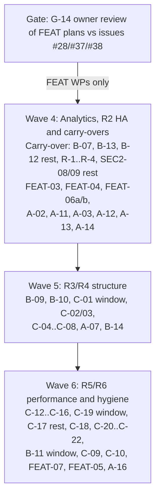

# Implementation Roadmap: Cross-Scope Sequencing of All Open Plan Items

**Document ID:** `IMPL-ROADMAP-2026-10-14`
**Date:** 2026-10-14
**Baseline:** `main` at `a4137626` (Waves 1–3 merged via PRs #78, #81, #82)
**Parent plan:** [`../00-master-plan-overview.md`](../00-master-plan-overview.md)
**Category plans:** [`../security.md`](../security.md), [`../architecture.md`](../architecture.md), [`../features.md`](../features.md)

This document puts every open item from the category plans into one global order. The detailed design for each work package (WP) is in the scope plans below. Each scope plan keeps only open work, verified against `main` `a4137626`. The original designs of delivered WPs are in git history (`git show a4137626:docs/plans/implementation/<file>`).

| Scope plan | WP prefix | Open WPs | Covers |
|---|---|---|---|
| [`impl-security-wave-c-2.md`](impl-security-wave-c-2.md) | `WP-SEC2` | SEC2-08 and SEC2-09 remainders, deprecation follow-ups | SR-D-06..09 remainders |
| [`impl-arch-r0-r2-trust-ha-eventing.md`](impl-arch-r0-r2-trust-ha-eventing.md) | `WP-ARC-A` | R-1..R-4, A-02, A-03, A-07, A-11..A-14, A-16 (skipped, G-13) | R2; themes T2 (audit), T5 (HA), T6 (eventing) |
| [`impl-arch-r1-r3-pipeline-persistence.md`](impl-arch-r1-r3-pipeline-persistence.md) | `WP-ARC-B` | B-07, B-09, B-10, B-11, B-12 remainder, B-13, B-14 | R1 remainder, R3; themes T1, T3, T4 |
| [`impl-arch-r4-r6-api-perf-hygiene.md`](impl-arch-r4-r6-api-perf-hygiene.md) | `WP-ARC-C` | C-01..C-10, C-12..C-16, C-17 remainder, C-18..C-22 | R4–R6; themes T7–T10 |
| [`impl-features-analytics.md`](impl-features-analytics.md) | `WP-FEAT` | FEAT-03, 04, 05, 06a/b, 07a/b/c | #28, #37, #38 Stage 2/3 |
| [`impl-test-suite-speedup.md`](impl-test-suite-speedup.md) | `WP-TS` | CI check of WP-TS-01, WP-TS-02..05 | CI test wall-clock time |

Security Wave C (SR-L-01..24) is delivered; its first scope plan (`impl-security-wave-c-1.md`) was removed because no open work remained.

---

## 1. Sequencing Principles

1. **Contracts before consumers.** Shared contracts land first, so that dependent WPs build on them instead of creating parallel helpers. Delivered contracts: cluster state (`ClusterStateUnavailableException`), audit (`IAuditWriter`), table-read planner (`IGovernedTableReadPlanner`). Open contract: ProblemDetails (`WP-ARC-C-05`).
2. **One lane per hot file set.** WPs that edit the same hot files go into one serialized lane with one owner. Lanes run in parallel with each other.
3. **Structural moves in freeze windows.** Three WPs move or rename hundreds of files. Each runs in its own merge-freeze window, and no two windows overlap: the `GatewayOptions` split (`WP-ARC-C-01`), the unit-test project split (`WP-ARC-C-19`), and the folder/interface hygiene pass (`WP-ARC-B-11`).
4. **Decisions gate work, not the whole wave.** A WP whose open decision is unresolved is skipped. The rest of the wave proceeds without it.

---

## 2. Cross-Scope Ownership Resolutions (Still Binding)

| Item | Owner WP | Other plan(s) | Resolution |
|---|---|---|---|
| ARC-S-10 / ARC-S-16 engine packaging | `WP-ARC-C-20` | — | C-20 covers engine packaging only; the `#if DEBUG` seams are gone (`ICompilerHooks`). |
| Webhook signing and error hygiene | `WP-ARC-A-02` | — | The outbox reuses the delivered `WebhookSignature` and `UrlRedactor` helpers unchanged. |
| Audit chain | `WP-ARC-A-07`, `WP-ARC-B-14` | — | Both rebase on the delivered chain latch (`AuditChainViolationGate`) and `IAuditWriter`. |
| SR-L-03 / SR-L-23 error leakage | `WP-ARC-C-05` | — | C-05 replaces the interim `SafeErrorResults` with the ProblemDetails catalog and retires the guard test's baseline allow-list (~25 `ex.Message` sites). |
| Role parsing | `WP-ARC-C-06` | — | Declarative policies use the strict `GatewayRole.TryParse*` parser and nothing else. |
| Build and CI pinning | `WP-SEC2-08` | `WP-ARC-C-21`, `WP-ARC-C-16`, `WP-ARC-C-20` | One PR owner for `Directory.Build.props`, `global.json` and the workflows. |
| `GovernedSqlExecutionService` constructor (A-05 remainder) | `WP-ARC-B` owner | `WP-ARC-A` (R-4) | R-4 (replace the optional `IServiceProvider` in `GovernedSqlExecutionService`) is done by the R1/R3 owner. |
| ARC-L-10 two solution files | `WP-ARC-C-19` | — | CI and CLAUDE.md use `Autheris.sln`. `Autheris.slnx` is still present and incomplete; delete it (G-10). |

---

## 3. Serialized Lanes (Hot File Sets)

Inside a lane, run the WPs in the order shown. Different lanes can run in parallel.

| Lane | Hot files | Order |
|---|---|---|
| **L1 Engine** | `AstSecurityVisitor.*`, `CompiledSqlTemplate.cs`, `SqlAstBuilder.cs`, engine csproj | C-12 → C-10 → C-20 |
| **L2 Query pipeline** | `GovernedTableReadPlanner`, `GovernedQueryStages`, `SqlTableReadExecutor`, endpoint handlers | B-07 → FEAT-03 → FEAT-04 → FEAT-06b |
| **L3 Audit persistence** | `*GovernanceRepository.Audit.cs`, `FileAuditChainAnchorStore`, `AuditWriter` | R-2 → A-07 → B-14 (audit phase) |
| **L4 Persistence / migrations** | repository constructors, SQLite connection handling, `Migrations/` | B-12 remainder → B-13 → B-14 |
| **L5 Cluster state** | `IDistributedClusterStateProvider`, lock/lease users, Casbin cache | A-11 → A-12 / A-13 / A-14 |
| **L6 Webhooks / eventing** | `WebhookDispatcherService`, `CloudEventWebhookDispatcher`, `StreamingCdcEndpoints.cs` | A-02 → A-03 → A-13 |
| **L7 API surface** | `GatewayApplicationBuilderExtensions.cs`, endpoint files, `EndpointSecurity.cs` | C-04 → C-07 → C-06 → C-05 → C-08 |
| **L8 Build & CI** | `Directory.Build.props`, `global.json`, `.github/workflows/*` | SEC2-08 remainder → C-21 (analyzer part) → C-17 remainder → WP-TS-02 / TS-03 |

`GatewayOptions.cs` is touched by many WPs. Until `WP-ARC-C-01` lands, new options go into new standalone option classes bound to their own section with `IValidateOptions<T>`. They never become new members of `GatewayOptions`.

---

## 4. Global Execution Order

### Cross-cutting open items

- **SQL compiler gate:** 18 entries in `tests/Autheris.Tests.SqlCompilerGate/Corpus/accepted-differences.json` have `"approval": "pending"` (masked-aggregation tightening under `TenantConsentMask` and related differences). They need a security review before the cutover profile passes.
- **CI duration:** the CI effect of WP-TS-01 is not confirmed (GitHub `Build & Test` 23:14 for `f396e742` vs 20:18 before). Investigate before WP-TS-02 ([`impl-test-suite-speedup.md`](impl-test-suite-speedup.md)).
- **Catalog owner tenant (G-11, second half):** `TableMetadata` still has no owner tenant; add it with a versioned migration (B-12 runner).

### Wave 4: Analytics, R2 High Availability and Carry-Overs

| WP | Notes |
|---|---|
| Carry-over: WP-ARC-B-07 endpoint use-case services | Planned for Wave 3, not delivered. L2, before FEAT-03. |
| Carry-over: WP-ARC-B-13 pooled SQLite and WAL | Planned for Wave 3, not delivered. L4, after the B-12 remainder. |
| Carry-over: B-12 remainder, R-1..R-4, SEC2-08/09 remainders | Small, independent. |
| WP-FEAT-03 (#28) → WP-FEAT-04 (#37) | Built on `IGovernedTableReadPlanner`. **Blocked by G-14. Do not release #28 without #37.** |
| WP-FEAT-06a → 06b (#38 Stage 2) | 06a registers the existing but unwired `list_metrics` and `describe_metric` MCP tools and adds a tenant-aware semantic catalog. Blocked by G-14. |
| WP-ARC-A-02 webhook outbox, unified delivery | Reuses the `WebhookSignature` helpers. |
| WP-ARC-A-11 lease, scheduled worker base, CDC watermark | Parallel with A-02. |
| WP-ARC-A-03, A-13, A-12, A-14 | A-03 switches the CDC webhook flag on, only after A-02 and A-11. A-14 must be coordinated with C-09 (Casbin split). |

### Wave 5: R3/R4 Structure

| WP | Notes |
|---|---|
| WP-ARC-B-09 → B-10 | Dialect provider registry, then a new `Autheris.Infrastructure.Analytics` project with package-boundary tests. |
| **Freeze window 1:** WP-ARC-C-01, then C-02 and the C-03 batches | `GatewayOptions` split. Run it when few branches are open. |
| WP-ARC-C-04 → C-07 → C-06 → C-05 → C-08 | API track (L7). C-05 retires the interim `SafeErrorResults`. |
| WP-ARC-A-07, WP-ARC-B-14 | Audit group commit and the per-aggregate governance store split. Both after B-13. |

### Wave 6: R5/R6 Performance and Hygiene

| WP | Notes |
|---|---|
| WP-ARC-C-12, C-10, C-20 | Close out lane L1. |
| WP-ARC-C-13 → C-14, C-15, C-16 | Streaming core and egress. C-13 targets `SqlTableReadExecutor`; its location depends on B-10. |
| **Freeze window 2:** WP-ARC-C-19 unit-test project split | After B-10. Declare a merge freeze on `tests/Autheris.Tests.Unit/**`. |
| **Freeze window 3:** WP-ARC-B-11 folder and interface hygiene | Last structural move. |
| WP-ARC-C-09, C-17 remainder, C-18, C-21, C-22 | C-09 (Casbin part) after A-14 and C-07. |
| WP-FEAT-07a/b/c, WP-FEAT-05 | Stage 3 headless BI and optional differential privacy. Both gated by decisions (G-12). |
| WP-ARC-A-16 | Only if external plugin authors exist (G-13: skipped for now). |

WP-TS-02..05 (test speed-up) can run in any wave; they touch only tests and workflows (L8).

---

## 5. Gate 0 Decisions Still Governing Open Work

**Decision record (2026-10-14):** the product owner adopted all recommendations G-1..G-14. Decisions that only governed delivered work (G-3, G-4, G-7, G-8) are omitted. Scope-plan decisions not listed here follow the recommendation in the respective scope plan unless a WP review raises a conflict.

| # | Decision | Governs | Decided |
|---|---|---|---|
| G-1 | Multi-replica deployment is a supported topology | A-11..A-14 | Yes. Classify all state as node-local, cluster-shared or durable. |
| G-2 | CDC webhooks | A-03, A-13 | Wire them up. Keep them behind the default-off flag until A-03 lands. |
| G-5 | Audit durability model | A-07 | Latch fail-closed outside Development (delivered). Tier-A events use a synchronous durable write. |
| G-6 | `TreeSqlCompiler` as the single documented exception to `ISqlEngine.Compile` | FEAT-03, B-09 | Accepted, guarded by `TreeVsCompilePolicyParityTests`. |
| G-9 | ProblemDetails migration | C-05, C-08 | Keep a legacy `error` field for one release; keep deprecated route aliases for two releases. |
| G-10 | Solution file | C-19 | Keep `Autheris.sln`. Delete `Autheris.slnx`. |
| G-11 | Catalog owner tenant | B-12 follow-up | Visibility from consents plus a shared-tables list is delivered. Add an owner tenant with a versioned migration. |
| G-12 | Analytics scope | FEAT-04..07 | No k-guard on free-form SQL in v1. DP only on compliance demand. Persist the semantic catalog (B-12 runner). Name the target BI clients before Stage 3. |
| G-13 | Plugin compatibility promise | A-16 | No external compatibility promise yet. Skip A-16. |
| G-14 | Reconcile WP-FEAT plans with the bodies of GitHub issues #28, #37 and #38 | FEAT-03..07 | **Open action:** owner review before Wave 4. Blocks the FEAT WPs. |

---

## 6. Breaking Changes of Open WPs (Release Notes Input)

| WP | Change |
|---|---|
| WP-ARC-B-10 | `IArrowExportService` and `ArrowFlightSqlServer` change namespace. |
| WP-ARC-C-05, C-08 | Error payloads move to RFC 7807. Routes are versioned, and the old routes remain as deprecated aliases. |
| SEC2 deprecation follow-ups | The legacy `X-Autheris-Signature` webhook header and `DocumentDepositedEvent.SourceFilePath` are removed. |
| WP-FEAT-03 / FEAT-04 | New aggregate fields; groups below the minimum size are suppressed. |

---

## 7. Open Documentation Corrections (WP-DOC-01, effort S)

These are reference-documentation defects in `docs/features/`, fixed together with the WP that changes the behaviour or at any time:

- `docs/features/f-data-04`: claims a gRPC Flight SQL service. Only an HTTP endpoint exists (or FEAT-07c adds the gRPC server).
- `docs/features/f-gov-17`: documents `list_metrics` and `describe_metric` as available, but they are not registered in the MCP server (fixed by FEAT-06a).
