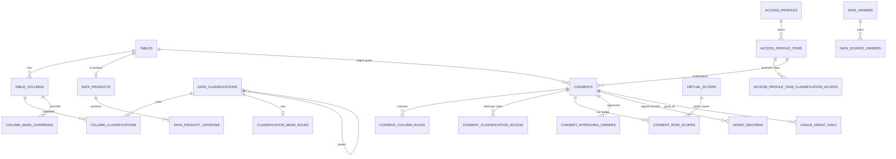

# WP-SIMPL-52 Governance data model consolidation and classification-based masking
Status: Draft (Phase 3 security review pending)
Parent: [plan](../2026-11-05-plan-project-simplification.md) | Owner decision: OD-45 (2026-11-07, "there is not only PII but also other masking rules") | Related: WP-SIMPL-20 (forward-only steps, `GovernanceTable`), WP-SIMPL-41 (discovery), WP-SIMPL-42 (usage), WP-SIMPL-45 (write grants), WP-SIMPL-46 (decision point), WP-SIMPL-47 (consent API, grant records), WP-SIMPL-48 (row scopes, patterns, per-cell), WP-SIMPL-49 (data products), WP-SIMPL-51 (WebSQL `masked`) | Freeze: feature work (OD-45), schema decisions of part B are binding for the owning WPs.

How to read this plan: part A (sections 5.1-5.9) is the classification-based masking feature implemented by this WP. Part B (section 5.10) fixes open data-model points; the owning WP implements each table in its own step, using the DDL of section 6 as the single source. Section 12 lists the required wording edits to other WPs.

## 1. Goal and outcome
Replace the single PII flag (`table_columns.is_sensitive`) and the per-column `column_masking_rules` by a general model: tenant-scoped data classifications (PII, PII-special, Financial, Confidential, Credentials, Public, custom), one or more classifications per column, typed mask functions per classification with a per-column override, grants that state Clear/Mask/Deny per classification, and separately requested, time-limited clear access per classification approved by the classification's approver. Consolidate the governance schema so every planned table has column-level DDL, one canonical grant id, and no dead columns or tables.
Measurable: (a) `git grep -n -i -E "is_sensitive|IsSensitive|COLUMN_MASKING_RULES" -- src ':!**/Migrations/**'` returns 0 after PR 6; (b) after the step 1 backfill every decision on the migration fixture is byte-identical to the pre-migration decision (`ClassificationMigrationParityTests`); (c) no Clear value is returned for a column that has a classification without an explicit Clear for that classification on a covering grant (randomized test of section 9); (d) every planned governance table of WP-45..49 has a DDL row in section 6.

## 2. Preconditions and dependencies
- After: WP-SIMPL-11/20 (PostgreSQL and SQL Server only, unified repository and `IGovernanceSqlDialect`, OD-1), WP-SIMPL-46 PR 1-2 (decision point owns column levels), WP-SIMPL-21 parity harness (new mask kinds are parity cells).
- Before: WP-SIMPL-47 step 1 (grant records carry classification access), WP-SIMPL-48 PR 2/4/5 (row scopes, per-cell, patterns use classifications instead of "PII"), WP-SIMPL-41 PR with column states, WP-SIMPL-49 A1 (product columns inherit classifications), WP-SIMPL-51 PR 2 (mask lineage unchanged, boolean only; D-52k).
- PR 6 (drop step) after WP-SIMPL-46 (role grantees revoked), WP-SIMPL-47 step 9 (ITSM column backfilled), WP-SIMPL-48 PR 2 (subquery filters converted) and the access-profile item backfill of WP-SIMPL-47.
- Schema baseline: `governance-shape.{postgresql,sqlserver}.v0001.json` plus steps 0002-0006 (last: `0006_remove_breakglass_assignments`). All new steps are forward-only `NNNN_<name>.sql` + `.shape.json` per engine, next free number at merge time (frozen v1.5.0 base policy, SEC-SIMPL-16).

## 3. Scope
In: classification vocabulary, column assignment, mask rules, mask function catalogue (renderer and in-memory evaluator), effective-mask resolution, grant/profile classification access, per-classification clear-access requests, audit/discovery fields, ingestion mapping (dbt/OpenMetadata `pii` meta -> classification), migration from `is_sensitive`/`column_masking_rules`, drop of superseded columns/tables, SQLite wording in WP-45/47.
Out: reversible tokenization (vault-backed detokenize), filter/join on pseudonymised columns, automatic classification by content scanning (the name heuristic `CatalogPiiDetector` stays a display hint only), table-level `tables.sensitivity` (kept, unchanged).

## 4. Current state (verified on `origin/main`, 2026-11-07)
- Catalog is global: `TABLES` and `TABLE_COLUMNS` have no `tenant_id` (v0001 shape). `TABLE_COLUMNS.is_sensitive INTEGER NOT NULL`; `COLUMN_MASKING_RULES(id, table_column_id, rule_type, pattern_or_format, replacement, hmac_key_id)` written by `CatalogSqlCore.cs:812-835`, read with a `LEFT JOIN` (`CatalogSqlCore.cs:695`, `ConsentSqlCore.cs:58`). Ids are `TEXT` (PG) / `NVARCHAR(128)` (SQL Server).
- `ColumnAccessLevel { Deny = 0, Mask = 1, Clear = 2 }` (`Domain/Interfaces/ColumnAccessLevel.cs`); `CONSENT_COLUMN_RULES(consent_id, table_column_id, column_name, access_level, applicable_scopes)`. `ConsentColumnSnapshot.AccessLevelFor(isSensitive, hasMaskingRule)` => Mask when sensitive or a rule exists. `TableAccessPolicy.Consent.cs:270-291` (`ApplyProfileMasking`, `MaskingPolicyMode {Default, Unmasked, Strict}`) treats `IsSensitive || ColumnMaskingRules.ContainsKey` as sensitive; Default masks an implicit Clear, keeps an explicit Clear (`HasExplicitClear`).
- `MaskingRule.RuleType` strings: REDACT, NULLIFY, HMAC/HMAC_SHA256/HASH, MASK_EMAIL, MASK_PHONE, MASK_IBAN, GEO_JITTER, PARTIAL_MASK, TOKENIZE (`Domain/Model/MaskingRule.cs`); typed engine kinds `MaskKind { Nullify, Redact, PartialMask, Hmac, GeoJitter, Constant }` (`TrinoSqlEngine/Governance/PolicyProviders.cs:26`); `SqlDataMaskingProvider.BuildUnkeyedMaskSpec` maps unknown types to `Redact(DefaultRedactText)`, MASK_EMAIL to constant `***@***`, MASK_IBAN to `****`; `BuildDefaultTypeSafeMask` gives `'***'` for text, NULL otherwise. HMAC key: master key from `IKeyVaultSecretProvider` (`DataMaskingOptions.HmacSecretKeyVaultRef`), per tenant and key id derived by `DeriveHexKey(masterKey, tenantId, keyId)`; `PreventInDbHmacKeyExposure` redacts instead of binding the key.
- Engine guards: masked columns are rejected in predicates and aggregations (`MaskedColumnPredicateException`, `MaskedAggregationException`, `AstSecurityVisitor.MaskGuards*.cs`).
- `GrantClassifier.IsSensitive` (table sensitive if highly sensitive, a PII/GDPR tag, or any `IsSensitive`/`meta.pii` column); 139 `IsSensitive` references in 30 src files (catalog, MCP, OData OpenAPI, federation masking, dbt/OpenMetadata ingestion, profiling).
- Planned but without column-level DDL: `CONSENT_ROW_SCOPES`, `consents` pattern/approving-owner/workflow columns, virtual-filter parameters (WP-48 step 7), `DATA_PRODUCTS`, `DATA_PRODUCT_VERSIONS`, `DATA_SOURCE_OWNERS` (WP-49 step 1). No table for access-profile read items (only `ACCESS_PROFILE_WRITE_RULES`, WP-45). `GRANT_RECORDS.object_id` cannot hold a pattern (WP-47 step 1). Grant id: `DecisionGrantRef.GrantId = CONSENTS.id` (WP-46), `USAGE_GRANT_DAILY.grant_id VARCHAR(128)` (WP-42), `GRANT_RECORDS.id UUID` + `seq`.
- Live users of tables flagged as dead in review: `RECERT_CAMPAIGNS/ITEMS` (`RecertificationEndpoints`), `FUNCTIONAL_RIGHT_MAPPINGS` (`FunctionalRightEndpoints`), `CONSUMER_APP_QUERYNAME_DAILY` (`ConsumerAggregationStore`, kept by WP-42). `ACCESS_POLICIES*`: no writer in src (read only by `RecertificationService` asset type `ACCESS_POLICIES` and `GovernanceSchemaValidator`). `ROLES/ROLE_MEMBERS`: seeded in `*GovernanceRepository.Schema.cs`, joined for role grantees (removed by OD-30).
- `TenantId` accepts only `^[a-zA-Z0-9_-]{1,64}$` (`Domain/Common/TenantId.cs:13`), so `*` can never be a tenant id.

## 5. Design
### 5.1 Vocabulary (`data_classifications`)
Global built-ins under the reserved scope `*`, custom codes per tenant. Built-ins (code, rank, parent, clear grantable, separate approval): `PUBLIC` 0 -, yes, no; `CONFIDENTIAL` 20 -, yes, yes; `FINANCIAL` 30 -, yes, yes; `PII` 40 -, yes, yes; `PII_SPECIAL` 60 parent `PII` (GDPR art. 9), yes, yes, approver `DATA_OWNER_AND_STEWARD`; `CREDENTIALS` 90 -, **no** (never Clear). A tenant may override a built-in's approver, steward and `max_clear_days` by a row with its own `tenant_id` and the same code (tenant row wins); it may add custom codes. Hierarchy: a child must have `restriction_rank >= parent`; it inherits the parent's mask rule when it has none; it never inherits the parent's Clear (Clear for PII does not clear PII_SPECIAL). Codes: `^[A-Z][A-Z0-9_]{1,63}$`; inactive or unknown code = unknown.
### 5.2 Column assignment (`column_classifications`)
Rows `(scope, table_column_id, code)`; scope `*` = catalog fact (ingestion, owner, migration) valid for all tenants, scope = tenant id = tenant-specific addition. Effective set `K_T(c)` = rows with scope in (`*`, T). Sources: `MIGRATION`, `INGESTION` (dbt/OpenMetadata `meta.pii`/`meta.classification`), `OWNER`, `ADMIN`, `LINEAGE` (data products). Any change increments the catalog epoch (WP-48, generalized from "PII classification change").
### 5.3 Mask functions (`MaskFunction`, persisted as code)
`NULLIFY`; `REDACT {constant}` (text only); `TYPE_SAFE_REDACT {constant}` (today's default: text constant, other types NULL); `PARTIAL {keep_first, keep_last, mask_char, fixed_length}` (text; `keep_first + keep_last <= 16`, `MaskingRule.MaxRevealedChars`); `HASH {key_ref}` (HMAC-SHA256, key derived per tenant and key ref from the existing master key; text output); `TOKENIZE {key_ref, domain}` (deterministic HMAC token with domain prefix, not reversible); `TRUNCATE_DATE {unit: YEAR|MONTH|DAY}` (temporal); `BUCKET_NUMBER {width}` or `ROUND_NUMBER {digits}` (numeric); `EMAIL_DOMAIN` (`***@domain`, text); `GEO_JITTER {decimals}` (existing round mode). Engine: `MaskKind` gains `TruncateDate, BucketNumber, RoundNumber, EmailDomain, Tokenize`; `MaskSpecRenderer` renders every kind for PostgreSql, SqlServer, Oracle, Databricks, DuckDb, Ansi with bound parameters (INV-4); `ColumnMaskingProvider` evaluates the same `MaskSpec` in memory (one definition). Type compatibility is validated on rule write; a mismatch at decision time (column type changed) falls back to `TYPE_SAFE_REDACT` and increments `autheris_mask_type_fallback_total`.
Restrictiveness order (most restrictive first, used in 5.5): `NULLIFY` > `REDACT` = `TYPE_SAFE_REDACT` > `HASH` > `TOKENIZE` > `BUCKET_NUMBER` > `ROUND_NUMBER` > `TRUNCATE_DATE` > `EMAIL_DOMAIN` > `GEO_JITTER` > `PARTIAL`; ties by classification rank, then code ordinal.
### 5.4 Rules (`classification_mask_rules`, `column_mask_overrides`)
Lookup for column c, classification k, tenant T: override `(c, k)` -> override `(c, NULL)` -> rule `(T, k)` -> rule `(*, k)` -> inherited parent rule (same order) -> tenant default rule `(T|*, '_DEFAULT')` = `TYPE_SAFE_REDACT '***'`. A classification with no rule is therefore masked, never Clear. Overrides are written by the column's data owner/delegate or a GovernanceAdmin (audited `MASK_OVERRIDE_CHANGED`); key material is never stored: `key_ref` names a key id resolved through `IKeyVaultSecretProvider`, an unresolvable key ref denies the column (`MASK_KEY_UNAVAILABLE`).
### 5.5 Column level per grant and effective mask (`ClassificationAccessResolver`, new, `Application/Policy/Classification/`)
For grant g covering column c in tenant T:
1. Deny if c is denied by a column rule of g (per-column invisibility, unchanged), if any `k in K_T(c)` is unknown/inactive, or if g has `DENY` for any `k in K_T(c)` (classification-level invisibility).
2. Clear if c is in g's column set **and** for every `k in K_T(c)` with separate approval g holds an unexpired `CLEAR` for k **and** c is named Clear in g's column rules (OD-40: columns classified or added after approval stay Masked). `CREDENTIALS` is never Clear (rejected on grant write, Mask at decision time). Unclassified columns and classifications without separate approval (`PUBLIC`) follow the column set.
3. Otherwise Mask. The grant's candidate mask = most restrictive (5.3 order) of the rules of all `k` that are not Clear for g.
Several grants (OD-41): the Clear/not-Clear decision stays per cell (WP-48 `CASE WHEN flag THEN col ELSE mask END`); the mask expression is one per column and decision: the most restrictive candidate of all contributing grants that include the column and are not Clear (D-52e). A Clear for a classification that expires degrades to Mask, not Deny.
### 5.6 Grants, profiles, requests
`consent_classification_access(consent, code, level, valid_until, approved_by)` on every grant; signed into the `GRANT_RECORDS.scope_json` payload (WP-47). Access-profile items carry the same rows (`access_profile_item_classification_access`); materialization copies them and names the Clear columns existing at approval. Clear request: a request item lists `requested_clear: [{classification, columns[]}]`; approver per classification: `DATA_OWNER` (default), `STEWARD` (tenant steward group SID) or `DATA_OWNER_AND_STEWARD` (both, sequential four-eyes; the requester never approves). Validity = `min(grant valid_until, approved_at + max_clear_days)`. External mode (WP-47): the external decision may only narrow classification levels (`External_DecisionMayOnlyNarrow` extended).
### 5.7 Row policies, aggregation, engine guards
Row-policy predicates keep evaluating raw values server-side (unchanged); a policy parameter can never be bound to a masked value. Every non-Clear column stays guarded in predicates, joins, GROUP BY and aggregates regardless of mask function (HASH/TOKENIZE determinism is not exposed for joins, D-52g). `min_group_size` small-group suppression is independent and unchanged.
### 5.8 Transparency and audit
- WebSQL (WP-51): `masked` stays a boolean; no classification or mask function in result metadata (D-52k).
- Discovery (WP-41): for each visible column `classifications: [{code, displayName}]` and `clearRequestable: [codes with separate approval and clear grantable]`; hidden objects/columns never; `Pii` becomes `classifications` contains `PII` or a descendant; `ClearAccessRequiresSeparateApproval` = any classification with separate approval.
- Audit (data access): per masked column `{column, classifications[], maskFunction, keyRef}` (no key material, no constant values); per grant the classification levels applied. Admin audit events: `CLASSIFICATION_CHANGED`, `COLUMN_CLASSIFICATION_CHANGED`, `MASK_RULE_CHANGED`, `MASK_OVERRIDE_CHANGED`.
### 5.9 Admin API (`/api/v1/governance/classifications`, `.WithAudit`)
`GET/PUT /classifications/{code}`, `GET/PUT /classifications/{code}/mask-rule`, `PUT/DELETE /catalog/columns/{columnId}/classifications/{code}?scope=tenant|global`, `PUT/DELETE /catalog/columns/{columnId}/mask-overrides/{code|_all}`. Vocabulary and tenant rules: GovernanceAdmin of the tenant; `*` scope writes: ClusterAdmin only; column assignment/override: data owner/delegate of the table or GovernanceAdmin. Removing a classification from a column requires the same authority as granting Clear for it (it lifts masking) and is audited.
### 5.10 Part B data-model resolutions
1. Missing DDL: section 6 defines `consent_row_scopes`, the WP-48 `consents` columns and `consent_approving_owners`, virtual-filter parameters, `data_products`, `data_product_versions`, `data_source_owners`; the owning WP creates them in its step.
2. Pattern grants (OD-39/40): no `grant_objects` table. `consents.table_id` becomes nullable, `object_pattern` + `data_source` added, CHECK exactly one of `table_id`/`object_pattern`; index `(tenant_id, data_source)` on pattern rows. `GRANT_RECORDS.object_id` is replaced by `object_kind {OBJECT|PATTERN}` + `object_ref VARCHAR(512)`.
3. Profile read items: `access_profile_items` + `_columns`, `_classification_access`, `_row_scopes`; `ACCESS_PROFILE_WRITE_RULES` gets `item_no` and loses `table_ident` (the item names the object). Backfill: one `OBJECT` item per entry of `access_profiles.target_tables`; `masking_mode` Unmasked -> PII `CLEAR`, Default -> PII `MASK`, Strict -> PII `DENY`.
4. Dead items: see table in section 8 (step 4).
5. Canonical grant id = `CONSENTS.id` (TEXT / NVARCHAR(128)) for every grant source (consent request, profile item, owner grant, pattern). `GRANT_RECORDS.id` is a record id and `seq` a chain position, neither is ever a grant id. `USAGE_GRANT_DAILY.grant_id`, `USAGE_GRANT_REF.grant_id`, `GRANT_RECORDS.consent_id`, audit `grants[].grantId` and `DecisionGrantRef.GrantId` hold that value unchanged (VARCHAR(128)/NVARCHAR(128)).
6. SQLite: removed from the WP-45/47 data-model text in this commit (OD-1).
7. `GovernanceTable` allowlist (WP-42 step 8) adds `UsageGrantDaily`, `UsageGrantRef`, `UsageTariff`; this WP adds `DataClassifications`, `ClassificationMaskRules`, `ColumnClassifications`, `ColumnMaskOverrides`, `ConsentClassificationAccess`. Data products are `TABLES` rows in the reserved data source `products` (one `data_products.table_id` per product), so columns, classifications, owners, grants and usage need no second object model.

## 6. DDL (PostgreSQL; SQL Server: `VARCHAR(n)`->`NVARCHAR(n)`, `TEXT`->`NVARCHAR(MAX)`, `BOOLEAN`->`BIT`, `TIMESTAMPTZ`->`DATETIMEOFFSET`, `UUID`->`UNIQUEIDENTIFIER`, FK columns to legacy ids `TEXT`->`NVARCHAR(128)`)
| Table (step) | Columns | Keys / constraints |
|---|---|---|
| `data_classifications` (S1) | `scope VARCHAR(64)`, `code VARCHAR(64)`, `display_name VARCHAR(256)`, `description VARCHAR(1024) NULL`, `parent_code VARCHAR(64) NULL`, `restriction_rank SMALLINT`, `clear_grantable BOOLEAN`, `separate_approval BOOLEAN`, `approver_mode VARCHAR(24)` (DATA_OWNER, STEWARD, DATA_OWNER_AND_STEWARD), `steward_group_sid VARCHAR(256) NULL`, `max_clear_days INT NULL`, `is_active BOOLEAN`, `version INT`, `updated_by VARCHAR(256)`, `updated_at TIMESTAMPTZ` | PK `(scope, code)`; CHECK rank 0..100; CHECK `approver_mode = 'DATA_OWNER' OR steward_group_sid IS NOT NULL`; parent resolved in the same scope or `*` |
| `classification_mask_rules` (S1) | `scope VARCHAR(64)`, `code VARCHAR(64)` (`_DEFAULT` allowed), `mask_function VARCHAR(32)`, `params_json TEXT NULL`, `key_ref VARCHAR(128) NULL`, `version INT`, `updated_by`, `updated_at` | PK `(scope, code)` |
| `column_classifications` (S1) | `scope VARCHAR(64)`, `table_column_id TEXT`, `code VARCHAR(64)`, `source VARCHAR(16)`, `assigned_by VARCHAR(256)`, `assigned_at TIMESTAMPTZ` | PK `(scope, table_column_id, code)`; FK `table_column_id` -> `table_columns(id)` ON DELETE CASCADE; index `(table_column_id)` |
| `column_mask_overrides` (S1) | `id UUID`, `scope VARCHAR(64)`, `table_column_id TEXT`, `code VARCHAR(64) NULL`, `mask_function`, `params_json NULL`, `key_ref NULL`, `updated_by`, `updated_at` | PK `id`; UNIQUE `(scope, table_column_id, code)` (SQL Server: filtered unique index per NULL/NOT NULL code); FK column CASCADE |
| `consent_classification_access` (S2) | `tenant_id VARCHAR(64)`, `consent_id TEXT`, `code VARCHAR(64)`, `access_level SMALLINT` (0 Deny, 1 Mask, 2 Clear), `valid_until TIMESTAMPTZ NULL`, `approved_by_sid VARCHAR(256) NULL`, `approved_at TIMESTAMPTZ NULL` | PK `(tenant_id, consent_id, code)`; FK `consent_id` -> `consents(id)` CASCADE |
| `consents` (WP-48 step, alter) | `table_id` DROP NOT NULL; add `object_pattern VARCHAR(512) NULL`, `data_source VARCHAR(128) NULL`, `column_set_mode VARCHAR(16) NOT NULL DEFAULT 'EXPLICIT'`, `workflow_mode VARCHAR(16) NOT NULL DEFAULT 'INTERNAL'`, `profile_item_no INT NULL` (with WP-47 `profile_assignment_id`) | CHECK `(table_id IS NULL) <> (object_pattern IS NULL)`; CHECK `object_pattern IS NULL OR data_source IS NOT NULL`; index `(tenant_id, data_source) WHERE object_pattern IS NOT NULL` |
| `consent_approving_owners` (WP-48) | `tenant_id`, `consent_id TEXT`, `owner_sid VARCHAR(256)`, `owner_sid_norm VARCHAR(256)` | PK `(tenant_id, consent_id, owner_sid_norm)`; FK CASCADE |
| `consent_row_scopes` (WP-48) | `tenant_id`, `consent_id TEXT`, `entry_no SMALLINT`, `policy_name VARCHAR(128)`, `parameters_json TEXT`, `column_map_json TEXT NULL`, `uncovered VARCHAR(8)` (DENY, SKIP) | PK `(tenant_id, consent_id, entry_no)`; FK CASCADE; no free predicate column (SEC, WP-48 `No_free_sql_predicate_on_grant_models`) |
| `virtual_filters` (WP-48, alter) | add `parameters_json TEXT NULL` (`[{name,type,isList,maxValues}]`), `evaluation_mode VARCHAR(8) NOT NULL DEFAULT 'LIVE'` (LIVE, KEYSET), `key_set_max_age_seconds INT NULL`, `status VARCHAR(16) NOT NULL DEFAULT 'ACTIVE'`, `approved_by_sid VARCHAR(256) NULL`, `approved_at TIMESTAMPTZ NULL` | CHECK `evaluation_mode = 'KEYSET' OR key_set_max_age_seconds IS NULL` |
| `access_profile_items` (WP-47 step 1) | `tenant_id`, `profile_id VARCHAR(128)`, `item_no INT`, `object_kind VARCHAR(8)`, `object_ref VARCHAR(512)`, `data_source VARCHAR(128)`, `operation VARCHAR(8)` (READ, WRITE), `column_set_mode VARCHAR(16)` | PK `(tenant_id, profile_id, item_no)`; FK `access_profiles` CASCADE |
| `access_profile_item_columns` / `_classification_access` / `_row_scopes` (WP-47) | item key + `column_name VARCHAR(256)`, `access_level SMALLINT` / item key + `code`, `access_level` / item key + `entry_no`, `policy_name`, `parameters_json`, `column_map_json NULL`, `uncovered` | PK item key + `column_name` / + `code` / + `entry_no` |
| `grant_records` (WP-47, amended) | replace `object_id` by `object_kind VARCHAR(8)`, `object_ref VARCHAR(512)`; `consent_id VARCHAR(128) NULL` | unchanged PK `(tenant_id, seq)`; UNIQUE `(tenant_id, id)` |
| `data_products` (WP-49) | `id UUID`, `tenant_id`, `table_id TEXT`, `schema_name VARCHAR(128)`, `product_name VARCHAR(128)`, `kind VARCHAR(16)`, `status VARCHAR(16)`, `current_version INT`, `load_mode VARCHAR(16)`, `load_settings_json TEXT`, `limits_json TEXT`, `managed_by VARCHAR(256) NULL`, `description VARCHAR(2048) NULL`, `created_by`, `created_authority VARCHAR(24)`, `created_at`, `updated_at` | PK `id`; UNIQUE `(tenant_id, schema_name, product_name)`; UNIQUE `table_id` FK `tables(id)` |
| `data_product_versions` (WP-49) | `product_id UUID`, `version INT`, `definition_hash CHAR(64)`, `definition TEXT`, `base_objects_json TEXT`, `columns_json TEXT` (lineage, declassification by and reason per code), `author_sid`, `authority`, `created_at` | PK `(product_id, version)`; append-only |
| `data_source_owners` (WP-49) | `id UUID`, `tenant_id`, `data_source VARCHAR(128)`, `data_owner_id TEXT` -> `data_owners(id)`, `owner_role VARCHAR(32)`, `created_by`, `created_at` | UNIQUE `(tenant_id, data_source, data_owner_id)`; delegation via `data_owner_delegations` |

## 7. ER overview

## 8. Forward migration steps (in merge order)
1. `NNNN_data_classifications` (PR 1): create S1 tables; seed `*` built-ins and `*` rules (`PII`, `PII_SPECIAL`, `FINANCIAL`, `CONFIDENTIAL`, `CREDENTIALS`, `_DEFAULT` = `TYPE_SAFE_REDACT '***'`; `PUBLIC` none); backfill `column_classifications(*, c, PII, MIGRATION)` for every column with `is_sensitive = 1` **or** a `column_masking_rules` row (today both mean sensitive); backfill `column_mask_overrides(*, c, NULL, ...)` from `column_masking_rules` by SQL `CASE rule_type`: NULLIFY->NULLIFY; REDACT and unknown->TYPE_SAFE_REDACT(`replacement`); HMAC/HMAC_SHA256/HASH->HASH(`hmac_key_id`); MASK_EMAIL->REDACT `***@***`; MASK_IBAN->REDACT `****`; PARTIAL_MASK->PARTIAL (defaults 1/0/`*`, `pattern_or_format` copied as read by `CatalogSqlCore` today); GEO_JITTER->GEO_JITTER; TOKENIZE->TOKENIZE(`pattern_or_format` as domain). Behaviour unchanged (parity test).
2. `NNNN_consent_classification_access` (PR 3): create the table; backfill `(tenant, consent, PII, CLEAR)` for every consent with a `consent_column_rules` row `access_level = 2` on a PII-classified column, `(..., PII, MASK)` otherwise.
3. `NNNN_drop_is_sensitive` (PR 6a): drop `table_columns.is_sensitive` and `column_masking_rules` after no src reference remains.
4. `NNNN_drop_superseded_governance_columns` (PR 6b): drop `consents.role_id`, `consents.role_name`, `roles`, `role_members` (OD-30; WP-46 revoked role grantees); `consent_row_filters.{dependent_table, dependent_table_alias, foreign_key_column, primary_key_column, subquery_predicate_json, target_temporal_column, dependent_valid_from_column, dependent_valid_to_column, target_table_alias, additional_hops_json, key_set_strategy, key_set_duration_seconds, key_set_max_keys}` (WP-48 converted them); `consent_requests.itsm_ticket_id` (WP-47 backfilled `external_reference`); `access_profiles.{row_filter_predicate, masking_mode, target_tables}` (replaced by items); `access_policies`, `access_policy_grantees`, `access_policy_selectors` (no writer; the `ACCESS_POLICIES` asset type of `RecertificationService` is removed). **Kept:** `recert_campaigns`, `recert_items` (live endpoints), `functional_right_mappings` (live endpoints), `consumer_app_queryname_daily` (WP-42 keeps it). Pre-check in the step: a row in `roles`-based consents not revoked aborts the step with a clear error (no silent data loss). PG `DROP ... IF EXISTS`; SQL Server drops dependent defaults/indexes first.
WP-47/48/49 tables of section 6 are created in their own steps; if they merge after this WP the DDL above is binding.

## 9. Tests (red first; S = `[Trait("Category","Security")]`)
Unit `tests/Autheris.Tests.Unit/Governance/Classification/`:
- `ClassificationAccessResolverTests`: `Unknown_classification_denies_column` (S), `Inactive_classification_denies_column` (S), `Classified_column_without_rule_uses_tenant_default_never_clear` (S), `Clear_requires_named_column_and_clear_for_every_classification` (S), `Clear_for_PII_does_not_clear_PII_SPECIAL_child` (S), `Classification_added_after_approval_masks_column` (S), `Credentials_never_clear_even_with_clear_row` (S), `Expired_classification_clear_degrades_to_mask` (S), `Classification_deny_hides_column`, `Public_follows_column_set`, `Most_restrictive_mask_wins_across_classifications`, `Override_replaces_only_its_classification_candidate`, `Tie_broken_by_rank_then_code`.
- `MaskFunctionTests`: `Each_function_renders_bound_parameters_only` (Theory over dialects, S), `Truncate_date_month`, `Bucket_number_width`, `Email_domain_keeps_domain_only`, `Partial_rejects_more_than_16_revealed` (S), `Type_mismatch_falls_back_to_type_safe_redact` (S), `Unknown_mask_function_denies_column` (S), `Hash_key_derived_per_tenant_differs_across_tenants` (S), `Unresolvable_key_ref_denies_column` (S), `In_memory_and_sql_mask_agree` (property test).
- `ClassificationVocabularyTests`: `Star_scope_not_a_valid_tenant` (S), `Child_rank_below_parent_rejected`, `Tenant_row_overrides_builtin_approver`, `Cycle_in_hierarchy_rejected`.
- `PerCellClassificationTests` (WP-48 harness): `Row_clear_only_under_grant_with_classification_clear` (randomized, S), `Single_mask_expression_is_most_restrictive_of_masking_grants` (S).
- `ClassificationGrantWriteTests`: `Clear_on_credentials_rejected` (S), `Clear_request_routes_to_steward_for_PII_SPECIAL`, `Requester_cannot_approve_own_classification_clear` (S), `External_decision_cannot_widen_classification_level` (S), `Clear_validity_capped_by_max_clear_days`.
- `ClassificationAdminAuthorizationTests`: `Star_scope_write_requires_cluster_admin` (S), `Removing_column_classification_requires_owner_or_admin_and_is_audited` (S), `Cross_tenant_classification_read_returns_404` (S).
- `ClassificationAuditTests`: `Masked_column_audit_lists_classifications_and_function_not_key` (S); `DiscoveryClassificationTests`: `Hidden_column_classification_never_exposed` (S), `Clear_requestable_lists_separate_approval_codes`; `WebSqlMaskedFlagTests`: `Masked_flag_carries_no_classification` (S).
Integration `tests/Autheris.Tests.Integration/Governance/Migrations/` (PG and SQL Server, Testcontainers): `ClassificationMigrationParityTests.Decisions_identical_after_step_1_and_2` (S), `Backfill_maps_every_rule_type`, `Drop_step_aborts_on_active_role_grant` (S), `Shape_matches_after_each_step`. Architecture: `No_IsSensitive_reference_outside_migrations`, `Mask_keys_never_persisted` (no column named `*key*` except `key_ref`/`key_id`).

## 10. PR slicing (<= 400 net added src lines each)
1. PR 1 Schema step 1, domain (`DataClassification`, `MaskFunction`, `ColumnClassification`), repository load/save, `GovernanceTable` entries, backfill (~380).
2. PR 2 Mask catalogue: new `MaskKind`s, renderer per dialect, in-memory evaluator, tenant key derivation reuse, parity cells (~390).
3. PR 3 Resolver + decision integration (`ClassificationAccessResolver`, decision point, `ConsentColumnSnapshot`, `ApplyProfileMasking` removal), step 2 (~400; `size-exception` allowed for generated shape JSON only).
4. PR 4 Consumers off `IsSensitive` (GrantClassifier, catalog/MCP/OData/federation/profiling, dbt/OpenMetadata mapping to classifications), audit fields, discovery fields (~350).
5. PR 5 Admin API and per-classification clear requests (needs WP-47 pipeline) (~380).
6. PR 6a/6b Drop steps 3 and 4 (~120 src + SQL).

## 11. Threat notes for Phase 3
Downgrade by reclassification (removing PII lifts masking): owner/admin authority, audit, catalog epoch in cache key. Ingestion as a downgrade path: `INGESTION` source may add classifications but removing one requires an owner action (ingestion never deletes). `*` scope abuse: only ClusterAdmin; `TenantId` regex rejects `*`. Weak per-column override: authority and audit; still most-restrictive across classifications. Linkability of HASH/TOKENIZE across tenants: tenant-derived keys; across tables within a tenant: by design, documented. Constant/params injection: bound parameters only (INV-4), `params_json` schema-validated per function. Key exposure: `PreventInDbHmacKeyExposure` honored for HASH/TOKENIZE. Cache: classification/rule version in decision cache key. Info leak: WebSQL boolean only; discovery never for hidden columns. Migration: parity test proves no Clear widening.

## 12. Required edits to other work packages (applied when they start; SQLite wording applied now)
WP-41: `Pii` -> `classifications`, `clearRequestable`. WP-42: `GovernanceTable` additions (5.10.7); grant id definition (5.10.5). WP-45: `ACCESS_PROFILE_WRITE_RULES.item_no`; SQLite removed. WP-46: column set "Clear/Masked per PII column" -> "per classification" (5.5). WP-47: `GRANT_RECORDS.object_kind/object_ref`, profile item tables, classification access in `scope_json`, per-classification approver routing; SQLite removed. WP-48: DDL of section 6; "PII-classified" -> "classified with separate approval"; mask expression rule D-52e. WP-49: `ProductColumnClass` replaced by lineage-derived `column_classifications` (`LINEAGE`), declassification per code in `columns_json`; products are `TABLES` rows. WP-51: unchanged (D-52k).

## 13. Decisions (defaults taken; owner may change)
- D-52a Vocabulary: global built-ins (`*`) plus tenant codes; catalog stays global, assignments scoped `*` or tenant.
- D-52b Built-in set and ranks as in 5.1; `CREDENTIALS` never Clear.
- D-52c Hierarchy inherits mask rules, never Clear.
- D-52d Clear needs the named column and Clear for every separate-approval classification (keeps OD-40).
- D-52e One mask expression per column and decision (most restrictive of non-Clear contributing grants); Clear stays per cell (OD-41).
- D-52f Mask restrictiveness order as in 5.3.
- D-52g No predicates/joins/aggregates on any non-Clear column, including HASH/TOKENIZE.
- D-52h Missing rule -> tenant `_DEFAULT` = `TYPE_SAFE_REDACT` (today's default); unknown classification/function or unresolvable key -> Deny.
- D-52i Approver per classification (`DATA_OWNER` default, `PII_SPECIAL` owner + steward), time limit `max_clear_days`.
- D-52j Classification-level Deny is allowed on grants; per-column Deny unchanged.
- D-52k WebSQL `masked` stays boolean; discovery shows classifications of visible columns; audit records classifications and mask function.
- D-52l Pattern grants stay in `consents` (no `grant_objects`); `GRANT_RECORDS.object_kind/object_ref`.
- D-52m Canonical grant id `CONSENTS.id`.
- D-52n Data products are `TABLES` rows.
- D-52o Drop/keep list of step 4.

## 14. Estimate
PR 1 2 pd, PR 2 2.5 pd, PR 3 3 pd, PR 4 2 pd, PR 5 2.5 pd, PR 6 1 pd: about 13 pd (part B spec edits included).

## Appendix A. Example dataset
- Classifications (scope `*`): `PII` rank 40 rule `HASH key_ref=mask-2026`; `FINANCIAL` rank 30 rule `PARTIAL keep_last=4`; `PII_SPECIAL` rank 60 parent `PII`, rule `NULLIFY`, approver `DATA_OWNER_AND_STEWARD` (steward group `S-1-5-21-..-HealthStewards`), `max_clear_days 30`.
- `CRM.CUSTOMERS` (owner Bernd): `EMAIL` {PII}, `IBAN` {FINANCIAL, PII}, `SALARY` {FINANCIAL}, `DIAGNOSIS` {PII_SPECIAL}, `CUSTOMER_ID` {}; override `EMAIL` -> `EMAIL_DOMAIN` for `PII`.
- Grant `c-4711` to group `Vertrieb-DE` (Anna is a member), table `CRM.CUSTOMERS`, column set `EXPLICIT` {CUSTOMER_ID Clear, EMAIL Clear, IBAN Clear, SALARY Clear, DIAGNOSIS Clear}; classification access: PII `CLEAR` (approved by Bernd, valid 90 days), FINANCIAL `MASK`, PII_SPECIAL `DENY`; row scope `region_policy(region = 'DE')`.
- Anna's result (DE rows): `CUSTOMER_ID` clear; `EMAIL` clear (named, PII Clear); `IBAN` masked with `PARTIAL keep_last=4` (FINANCIAL not Clear; PII is Clear so its HASH candidate is not used); `SALARY` masked `PARTIAL` -> type mismatch on numeric -> `TYPE_SAFE_REDACT` (NULL) and metric (owner should set `BUCKET_NUMBER`); `DIAGNOSIS` absent (classification Deny). Audit: `IBAN {FINANCIAL, PARTIAL}`, `SALARY {FINANCIAL, TYPE_SAFE_REDACT}`, grants `[c-4711]`; usage `grant_id = c-4711`.
- A second grant `c-4712` to Anna personally without row scope, PII `MASK` (all else as above), contributes too: `EMAIL` stays Clear only in rows covered by `c-4711` (per cell), elsewhere `EMAIL_DOMAIN` (override of the PII candidate); `IBAN` mask = most restrictive of `PARTIAL` (`c-4711`) and `HASH` (`c-4712`) = `HASH` (D-52e).
- If an owner later adds `PII_SPECIAL` to `EMAIL`, the catalog epoch changes and `EMAIL` disappears for `c-4711` (classification Deny) without any grant change.
